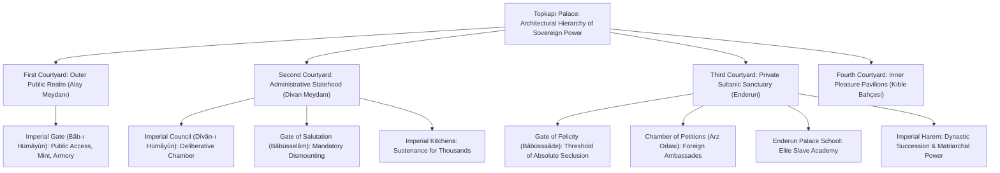
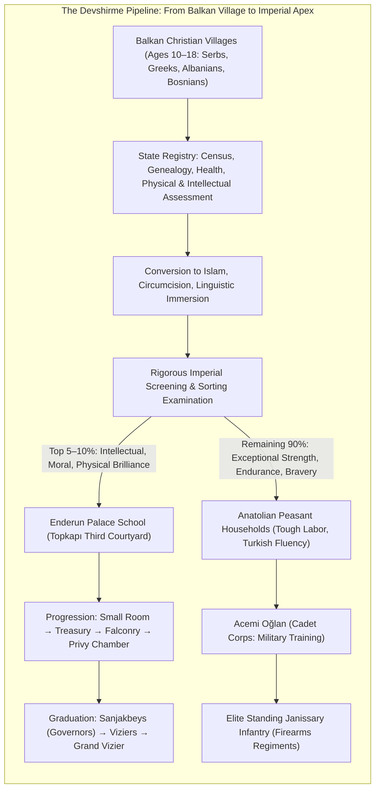
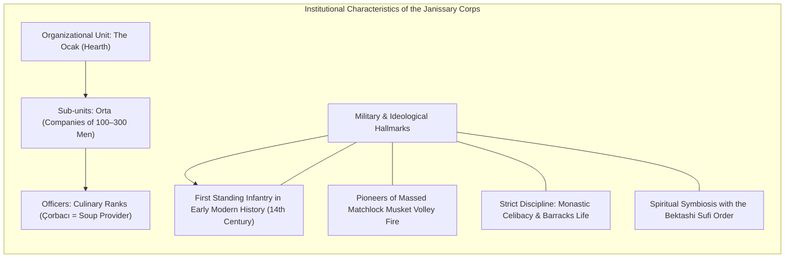
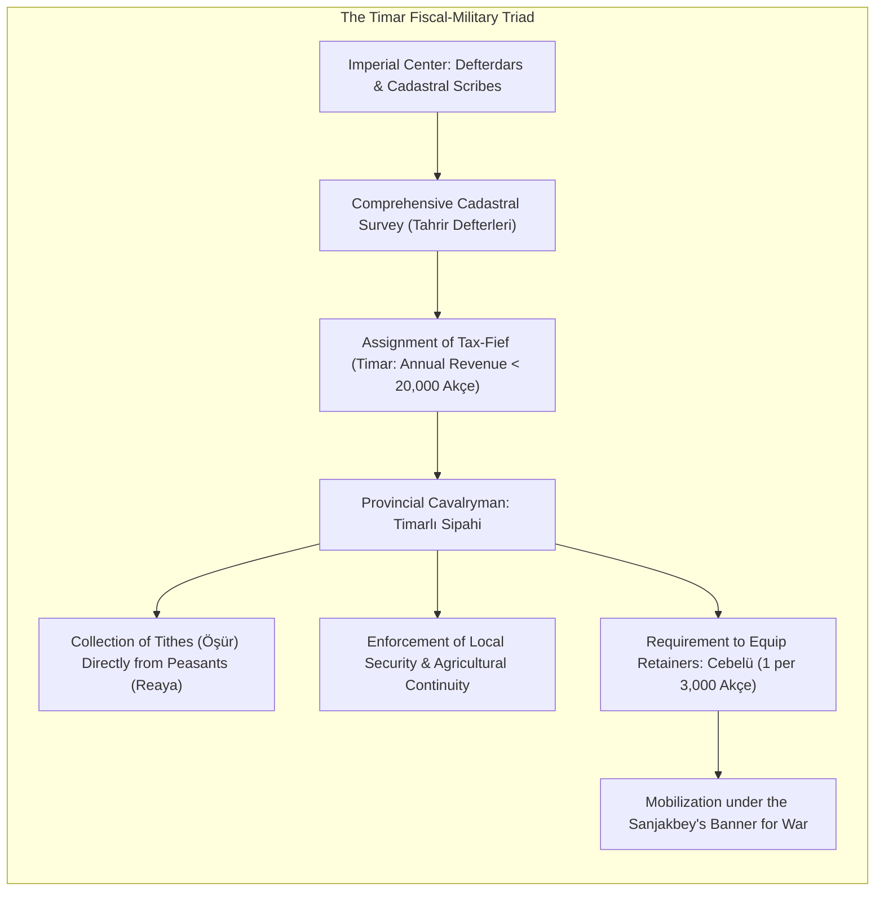
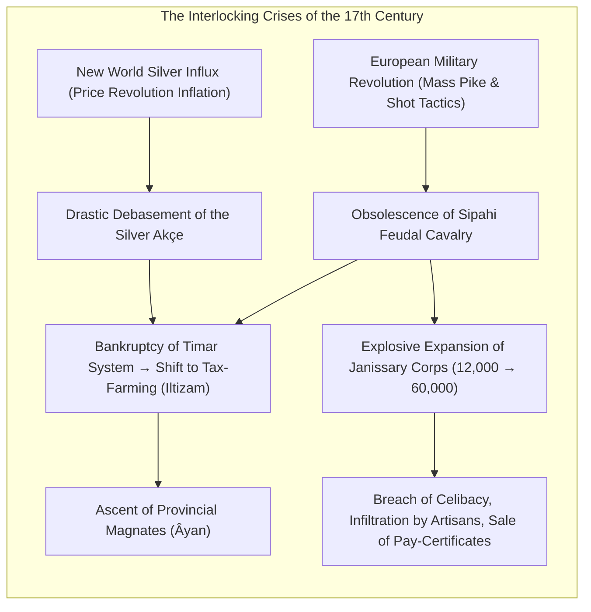

On May 29, 1453, when the massive bronze siege bombards engineered by Urban blasted breaches through the triple Theodosian Walls of Constantinople, the twenty-one-year-old Sultan Mehmed II did not merely conquer the final redoubt of the millennium-old Byzantine Empire; he consecrated the ascent of a new, transcontinental imperial paradigm. At its sixteenth-century zenith under Sultan Süleyman I ("the Magnificent" or *Kanuni*, the Lawgiver), the Pax Ottomanica encompassed an expanse stretching from the walls of Vienna and the Hungarian plains to the cataracts of the Nile, and from the Persian Gulf to the coastal bastions of Algiers.

While early modern Western Europe was torn apart by catastrophic sectarian bloodletting—the French Wars of Religion, the expulsion of Iberian Jews and Moriscos, and the apocalyptic Thirty Years' War—the Ottoman Empire governed a vast, heterodox demographic mosaic of Muslims, Eastern Orthodox Christians, Armenians, and Sephardic Jews with remarkable administrative stability. For over six centuries (1299–1922), the House of Osman preserved dynastic continuity without a single change of ruling dynasty—a feat unmatched in Islamic and European monarchical history.

What institutional machinery made such enduring hegemony possible across three continents? The answer lies not in romanticized oriental despotism, but in a ruthlessly engineered matrix of socio-political, military, and legal structures: the <strong>Devshirme</strong> child-levy that created a meritocratic, non-hereditary administrative class; the <strong>Janissary (Yeniçeri)</strong> standing gunpowder infantry; the agrarian-military <strong>Timar</strong> cavalry system; and the pluralistic <strong>Millet</strong> framework of confessional self-governance.

This treatise delivers an exhaustive, historically grounded, and institutionally comparative analysis of the Ottoman imperial apparatus, tracking its evolution from a dynamic frontier marcher-principality (*gazi beylik*) to a sophisticated bureaucratic world empire, through the transformative crises of the seventeenth century, to the surgical modernizing reforms of the nineteenth century.

---

## 1. Spatial Architecture of Imperial Power: Topkapı Palace and the Imperial Council

To comprehend Ottoman statecraft, one must analyze how sovereign authority was physically manifested, ritualized, and compartmentalized. The nerve center of the empire was <strong>Topkapı Palace (Topkapı Sarayı)</strong>, commissioned by Mehmed II upon the promontory of Seraglio Point overlooking the confluence of the Bosphorus, the Golden Horn, and the Sea of Marmara.



### 1.1 The Ritual Architecture of Seclusion and Silence

Unlike European absolute monarchies that centered majesty around theatrical public visibility (such as Louis XIV at Versailles), Ottoman imperial protocol perfected the <strong>politics of invisibility and ceremonial silence</strong>. As one traversed inward through Topkapı’s concentric courtyards, noise was systematically suppressed, and physical access became exponentially restricted:

- <strong>The First Courtyard (Alay Meydanı)</strong>: Entered via the monumental Imperial Gate (*Bâb-ı Hümâyûn*), this was an open civic courtyard accessible to all subjects, housing the Imperial Mint, the ancient basilica of Hagia Irene (repurposed as the central imperial armory), and barracks for palace sentries.
- <strong>The Second Courtyard (Divan Meydanı)</strong>: Passing the Gate of Salutation (*Bâbüsselâm*), all entrants—including foreign ambassadors and viziers—were required to dismount from horseback. Total, eerie silence reigned over this quadrangle, where thousands of courtiers, scribes, and guards moved without a whisper. Here stood the Council Chamber, the Treasury, and the sprawling imperial kitchens that served up to 4,000 meals daily.
- <strong>The Third Courtyard (Enderun)</strong>: Pierced only via the Gate of Felicity (*Bâbüssaâde*), this guarded portal marked the impenetrable boundary of the Sultan's personal residence. Unauthorized entry was punishable by instant decapitation. Beyond lay the Chamber of Petitions (*Arz Odası*), the Enderun Palace School, the Privy Chamber housing the Sacred Relics of the Prophet Muhammad, and the Imperial Harem.

### 1.2 The Deliberative Engine: The Imperial Council (Dîvân-ı Hümâyûn)

The executive, legislative, and judicial apex of the Ottoman state was the <strong>Imperial Council (Dîvân-ı Hümâyûn)</strong>, convening four mornings a week in the domed council hall (*Kubbealtı*) in the Second Courtyard.

In the nascent empire, early sultans presided over the council directly. However, Mehmed II instituted a revolutionary protocol of sovereign detachment: the Sultan ceased attending the council in person. Instead, he observed proceedings from an elevated, latticed alcove set high within the wall of the council chamber, known as the <strong>"Dangerous Window" (Kasr-ı Adl)</strong>.

Shrouded behind dark curtains and iron grilles, the Sultan was invisible to his ministers. The viziers debated beneath the perpetual, chilling awareness that the sovereign might be observing their every gesture and word at that exact instant. This panoptic spatial design exerted an intense psychological discipline across the imperial cabinet.

### 1.3 The Office of the Grand Vizier (Sadrazam)

In the Sultan's deliberate absence, supreme executive authority was concentrated in the <strong>Grand Vizier (Sadrazam)</strong>—the absolute deputy (*vekil-i mutlak*) of the monarch. The Grand Vizier carried the Sultan's personal imperial seal (*mühr-i hümâyûn*) suspended in a silk pouch around his neck day and night. His signature was equivalent to imperial law.

The Grand Vizier presided over a council of specialized dignitaries:
1. <strong>The Military Judges (Kazaskers of Rumeli and Anadolu)</strong>: The supreme judicial arbiters of European and Asian provinces, overseeing the appointments and court dockets of all provincial Islamic judges (*kadıs*).
2. <strong>The Treasurers (Defterdars)</strong>: Chief custodians of imperial fiscal ledgers, auditing tax revenues, customs, and military expenditures.
3. <strong>The Chancellor (Nişancı)</strong>: The grand jurist entrusted with applying the Sultanic calligraphic monogram (*Tuğra*) to imperial decrees (*firmans*), ensuring absolute harmony between sultanic customary secular legislation (*kanun*) and Islamic jurisprudence (*sharia*).

---

## 2. Institutionalized Meritocracy: The Devshirme System and the Palace Slaves (Kapıkulu)

Pre-modern monarchies across Western Europe and East Asia were plagued by a perennial structural contradiction: the centrifugal threat of a hereditary landed aristocracy. Dynastic nobles, entrenched within their ancestral estates, routinely leveraged territorial wealth to challenge, subvert, or overthrow central royal authority.

The Ottoman Empire bypassed this historical trap through an astonishing institutional innovation: <strong>governing the empire through an elite corps of legal slaves (Kapıkulu / Slaves of the Porte)</strong> recruited through the <strong>Devshirme (Child-Levy)</strong>.



### 2.1 The Mechanics and Juridical Architecture of the Levy

Instituted in the late fourteenth century under Murad I or Bayezid I, the Devshirme was a systematic levy conducted every three to five years across the Christian villages of the Balkans (primarily present-day Albania, Bosnia, Serbia, Bulgaria, and Greece).

Under orthodox Islamic law (*sharia*), the forced recruitment and conversion of protected non-Muslim monotheistic subjects (*dhimmi*) is strictly prohibited. Ottoman imperial jurists reconciled this contradiction through ingenious legal gymnastics: they argued that the Balkan populations had been subdued through conquest (*anwatan*), rendering their children subject to the sovereign's sovereign prerogative under the *Pencik* rule (the state's right to one-fifth of wartime captives).

Imperial commissioners (*devşirme memurları*) conducted the selection with meticulous administrative precision:
- Only boys between approximately 10 and 18 years of age were eligible.
- <strong>Strict Exclusions</strong>: Only sons were exempt, to prevent the economic ruin of the rural household; orphans, married boys, urban tradesmen, and Jews were barred to ensure rural innocence and avoid commercial corruption.
- All biological details—family lineage, eye color, bodily marks—were recorded in duplicate ledgers (*eşkal defterleri*), ensuring no substituting of candidates.

While the loss of a child was an undeniable tragedy for many peasant families, the Devshirme simultaneously represented the only vehicle for vertical socio-economic mobility in the early modern world. Christian parents frequently bribed Ottoman officials to enroll their sons, knowing that a peasant boy from an impoverished Macedonian village could realistically rise to command imperial armies or govern as Grand Vizier.

### 2.2 The Enderun Palace School: Crucible of the Ruling Elite

The top 5 to 10 percent of boys who exhibited extraordinary intellectual acumen, emotional resilience, and physical beauty were routed directly into the <strong>Enderun School</strong> inside Topkapı Palace.

The Enderun was an uncompromising meritocratic academy that made contemporary European royal courts appear barbaric. Its multi-tiered curriculum encompassed:
- <strong>Linguistic and Humanistic Mastery</strong>: Fluent literacy in Ottoman Turkish, classical Arabic, and Persian; immersion in Islamic jurisprudence, Quranic exegesis, history, geography, and astronomy.
- <strong>Fine Arts and Calligraphy</strong>: Illuminations, bookbinding, instrumental music, poetry, and courtly etiquette.
- <strong>Martial Arts</strong>: Elite horsemanship, archery, composite bowcraft, fencing, and tactical siegecraft.

Students advanced through competitive internal chambers (*Odalar*), culminating in the <strong>Privy Chamber (Has Oda)</strong>, where forty chosen youths lived in intimate proximity to the Sultan, attending his wardrobe, weapons, and prayer mats. Upon graduation (*çıkma*), these young men were appointed as high-ranking provincial governors (*sanjakbeys*), imperial admirals (*kapudan pashas*), or grand viziers.

### 2.3 The Logic of the "Slave-Aristocracy": Eliminating Hereditary Succession

Why did the Ottoman sultans entrust the administration of a world empire to men who were legally designated as slaves (*kul*)?

1. <strong>Absolute Devotion to the Crown</strong>: Disconnected from ancestral kinship networks, local blood feuds, and tribal allegiances, the *kapıkulu* owed their status, luxury, and lives entirely to the Sultan. Their survival was inextricably bound to the preservation of the House of Osman.
2. <strong>The Ban on Hereditary Power (Musadere)</strong>: Because the *kapıkulu* were legally slaves of the sovereign, their property, land, and fortunes were subject to instant imperial confiscation upon their death or dismissal (<strong>Musadere</strong>). A grand vizier might accumulate astronomical wealth during his tenure, but his biological sons—born as free-born Muslims—could not inherit his office or his estates. Wealth continually recycled back to the imperial treasury, permanently barring the consolidation of an entrenched, autonomous nobility.

---

## 3. The Vanguard of the Gunpowder Revolution: The Janissary Corps (Yeniçeri)

While the intellectual elite of the Devshirme entered the state bureaucracy, the robust majority was channeled into the military: the legendary <strong>Janissary Corps (Yeniçeri, literally "New Soldier")</strong>.



### 3.1 The Sacred Hearth (Ocak) and Culinary Symbolism

The organizational cohesion of the Janissary corps was forged around a unique domestic and spiritual metaphor: the <strong>hearth (Ocak)</strong> and the <strong>cauldron (Kazan-ı Şerif)</strong>. The corps viewed itself not as a mechanistic army, but as an indissoluble brotherhood fed directly from the Sultan's hand.

- The central symbol of each company (*orta*) was its massive bronze soup cauldron, around which the soldiers gathered daily to consume meat stew (*çorba*) and pilaf.
- Their rank titles derived directly from kitchen logistics: an *orta* commander was the *Çorbacı* ("soup distributor"), the executive officer was the *Aşçıbaşı* ("head chef"), and junior officers carried ladles (*kepçe*) as badges of authority.
- The Janissary uniform was distinguished by the <strong>Börk</strong>—a tall white felt cap featuring a long cloth flap descending down the back of the neck, symbolizing the protective sleeve of their patron saint, Haji Bektash Veli.

Inverting this domestic symbolism, when the Janissaries mutinied against royal policies or currency debasement, they dramatically marched into the palace square and <strong>overturned their cauldrons (Kazan kaldırmak)</strong>. This overt gesture signaled that they rejected the Sultan's bread and stood in active revolt.

### 3.2 The Gunpowder Revolution: Tactics and Dominance

While Western European armies throughout the fifteenth century remained dominated by chivalric mounted knights and mercenary pike squares, the Ottoman Empire executed a comprehensive transformation into the world’s foremost <strong>Gunpowder Empire</strong>.

The Janissaries were the first standing infantry force in history to adopt firearms on a mass institutional scale. Trained rigorously in continuous countermarch volley fire, they transformed battlefields across Europe and Asia:
- <strong>Battle of Chaldiran (1514)</strong>: Sultan Selim I deployed Janissary matchlocks chained behind movable baggage wagons (*tabur cengi*), slaughtering the aristocratic, saber-wielding cavalry of Shah Ismail’s Safavid Persian Empire.
- <strong>Battle of Mohács (1526)</strong>: In less than two hours, massed Janissary musket volleys and Ottoman field artillery wiped out the cream of the Hungarian chivalric nobility, securing Ottoman domination of Central Europe for a century and a half.

---

## 4. The Agrarian-Military Base: The Timar System and the Sipahi Cavalry

If the standing Janissary corps was the professional hammer of the Ottoman military, the bulk of its territorial army was composed of the provincial cavalry: the <strong>Timarlı Sipahis</strong>. This force was sustained by the <strong>Timar System</strong>—an elegant synthesis of fiscal land administration and decentralized military mobilization.



### 4.1 State Land Ownership (Mîrî) vs. European Feudalism

Superficially, a Timar resembles a medieval European fief. However, their legal structures were diametrically opposed:

1. <strong>State Ownership (Mîrî)</strong>: In the Ottoman legal framework, all agricultural land belonged inalienably to the Sultan (*Arz-ı Mîrî*). The Sipahi did not own the soil, nor could he evict the peasant cultivators (*reaya*). He was granted solely the right to collect designated agricultural taxes (*öşür*) in lieu of a cash salary from the state treasury.
2. <strong>The Cadastral Survey (Tahrir Defterleri)</strong>: Every time a province was conquered, imperial surveyors (*muharrir*) conducted exhaustive cadastral surveys, recording every household, vineyard, olive tree, mill, and anticipated crop yield. If a Sipahi attempted to extort taxes exceeding the cadastral register, the local Islamic judge (*kadı*) could strip him of his fief immediately.

Timar holdings were stratified by annual revenue:
- <strong>Timar</strong>: Annual revenue up to 20,000 *akçe*, assigned to standard Sipahi cavalrymen.
- <strong>Zeamet</strong>: Revenue between 20,000 and 100,000 *akçe*, assigned to middle-ranking commanders and sub-governors (*subaşıs*).
- <strong>Has</strong>: Revenue exceeding 100,000 *akçe*, reserved for viziers, provincial governors (*beylerbeys*), and imperial princesses.

### 4.2 The Armored Retainers (Cebelü)

For every 3,000 *akçe* of annual revenue beyond his basic subsistence threshold, the Sipahi was legally mandated to equip, train, mount, and bring an armored horseman—a <strong>Cebelü</strong>—on imperial campaign.

When the Sultan issued an imperial summons (*sefer emri*), tens of thousands of Sipahis and their retainers converged under the standard of their district governor (*Sanjakbey*), who in turn assembled under the governor-general (*Beylerbey*). This decentralized mechanism provided the empire with an army of over 100,000 superb cavalrymen without imposing a single para of direct payroll strain on the central state treasury.

---

## 5. The Pluralist Imperial Compromise: The Millet System

The demographic reality of the Ottoman Empire made forced assimilation or uniform confessionalization impossible. In sixteenth-century European provinces (Rumeli), over 80 percent of the population was Christian; in the capital Istanbul itself, nearly 40 percent of the populace was non-Muslim.

To administer this diverse domain, the Ottomans developed the <strong>Millet System</strong>—a confessional framework granting institutional, legal, and cultural autonomy to non-Muslim religious communities.

```mermaid
graph TD
    subgraph MILLET ["The Millet System of Confessional Autonomy"]
        direction TB
        SULTAN["Ottoman Sovereign (The Sublime Porte)"]
        
        SULTAN -->|Imperial Charter (Berat)| M_ORTH["Greek Orthodox Millet (Ecumenical Patriarch of Constantinople)"]
        SULTAN -->|Imperial Charter (Berat)| M_ARM["Armenian Apostolic Millet (Armenian Patriarch of Istanbul)"]
        SULTAN -->|Imperial Charter (Berat)| M_JEW["Jewish Millet (Grand Rabbi / Hahambaşı)"]
        
        M_ORTH --> JUR_O["Autonomous Ecclesiastical Courts: Marriage, Divorce, Inheritance"]
        M_ORTH --> TAX_O["Collective Collection & Remittance of Poll Tax (Jizya / Cizye)"]
        M_ORTH --> CUL_O["Greek & Slavic Vernacular Education, Hospitals, Monasteries"]
        
        M_ARM --> JUR_A["Armenian Merchant Guilds & Gregorian Canonical Courts"]
        M_JEW --> JUR_J["Halakhic Rabbinical Courts & Ladino Printing Houses"]
    end
```

### 5.1 The Dhimma Covenant and Jizya Taxation

Rooted in the Islamic concept of <strong>Dhimma</strong> (the covenant of protection), "People of the Book" (*Ahl al-Kitab*)—specifically Christians and Jews—were guaranteed absolute inviolability of life, property, and freedom of worship.

In exchange for this protection, non-Muslim male subjects paid an annual poll tax, the <strong>Jizya (Cizye)</strong>, scaled to personal income, and were exempt from conscription into the military. They were forbidden from bearing arms, building houses overlooking Muslim residences, or publicly proselytizing, but their internal communal affairs were left entirely untouched by Ottoman authorities.

### 5.2 The Three Great Millets and Autonomous Jurisdiction

Upon conquering Constantinople, Mehmed II formally recognized <strong>Gennadios Scholarios</strong> as the Ecumenical Patriarch of the Orthodox Church, investing him with temporal and ecclesiastical jurisdiction over all Orthodox Christians across the empire (Greeks, Bulgarians, Serbs, Romanians, and Christian Arabs).

The empire institutionalized three primary millets:
1. <strong>The Rum Millet (Eastern Orthodox)</strong>: Governing all Orthodox subjects regardless of ethnic linguistic heritage under canon law.
2. <strong>The Armenian Millet</strong>: Established in 1461, encompassing not only Armenian Apostolic Christians but also Syrian Jacobites, Copts, and Chaldeans.
3. <strong>The Jewish Millet</strong>: When King Ferdinand and Queen Isabella expelled hundreds of thousands of Sephardic Jews from Spain in 1492, Sultan Bayezid II dispatched the Ottoman navy to transport them safely to Ottoman lands. The Sephardic communities settled in Istanbul, Salonica, and Izmir, transforming Salonica into the premier Jewish metropolis of Europe and establishing flourishing centers of international commerce, medicine, and printing.

Under the Millet framework, a dispute between two Christians regarding divorce or estate succession was settled exclusively in the Patriarchal ecclesiastical court under Byzantine civil law; a dispute between two Jews was resolved in the Beth Din under Halakhic rabbinical law. The Ottoman state intervened only if a conflict involved a Muslim, in which case the matter was referred to the Sharia court (*Mahkeme*). This decentralized legal pluralism defused sectarian resentment and maintained imperial cohesion across centuries.

---

## 6. Systemic Crisis and Transformation: The Long Seventeenth Century

The late sixteenth and seventeenth centuries exposed the Ottoman institutional architecture to seismic structural shocks. Long characterized by older historians as an era of terminal "decline", modern scholarship (Baki Tezcan, Leslie Peirce, Daniel Goffman) recognizes this period as an agonizing but resilient process of <strong>institutional crisis, adaptation, and decentralization</strong>.



### 6.1 The Silver Influx and the Collapse of the Timar

During the late sixteenth century, vast torrents of cheap American silver mined in Potosí and Zacatecas swept through Western Europe and flooded Mediterranean trade routes. The result was rampant inflation—the <strong>Price Revolution</strong>—which halved the purchasing power of the Ottoman silver coin (*akçe*).

- The Timarlı Sipahi cavalry, surviving on fixed agrarian tithes, was economically decimated. Fief-holders could no longer afford the armor and horses required for campaign.
- Simultaneously, on the battlefield of the Long Turkish War (1593–1606) against the Austrian Habsburgs, the Ottomans discovered that traditional Sipahi cavalry charges were suicidal against disciplined lines of Austrian musket infantry entrenched in fortifications. The empire urgently required foot soldiers armed with muskets, not horsemen wielding composite bows.

### 6.2 The Degeneration of the Janissary Corps

To fill the void left by obsolete cavalry, the imperial government enacted disastrous short-term measures:
1. <strong>Exponential Expansion</strong>: The Janissary corps was expanded from 13,000 men in 1570 to nearly 70,000 by 1680.
2. <strong>Abolition of the Devshirme</strong>: The rigorous Balkan levy was abandoned; the gates of the corps were thrown open to free-born Muslims, artisans, shopkeepers, and sons of Janissaries (*Kuloğulları*).

Transforming from a celibate, Spartan military elite into a bloated, hereditary socio-economic guild, the Janissaries abandoned barracks discipline:
- Soldiers married, took up commercial trades (bakers, butchers, boatmen), and monopolized municipal commerce in Istanbul.
- Pay-tickets (*esami*) were bought and sold as speculative financial assets, creating thousands of "ghost soldiers" who drew state wages but had never fired a weapon.
- The corps became a reactionary political Praetorian guard. Whenever a reformist Sultan proposed modernizing military training, the Janissaries overturned their cauldrons, stormed the palace, murdered viziers, and dethroned monarchs. In 1622, when the eighteen-year-old Sultan <strong>Osman II</strong> attempted to disband them in favor of a new Anatolian army, the Janissaries dragged him to the fortress of Yedikule and brutally strangled him—a traumatic watershed in Ottoman regicide.

### 6.3 The Rise of the Âyan and Tax-Farming (Iltizam)

To secure hard cash to pay the swelling ranks of salaried musket troops, the central government dismantled the Timar system and replaced it with <strong>tax-farming (Iltizam)</strong>. Under this scheme, the right to collect taxes in a district was auctioned to the highest bidder, who remitted a lump sum in advance to the imperial treasury and then extracted maximum profits from the peasantry.

By the eighteenth century, tax-farms were converted into life-term leases (<strong>Malikâne</strong>). This fiscal devolution fostered the rise of powerful provincial notables—the <strong>Âyan</strong>. Magnates like Pasvanoğlu Osman in the Balkans or Ali Pasha of Ioannina maintained private armies, levied their own taxes, and dictated terms to Istanbul, transforming the centralized empire into a loose, decentralized confederation.

---

## 7. The Agony of Modernization: From Nizam-ı Cedid to the Tanzimat

The disastrous defeat at the <strong>Second Siege of Vienna (1683)</strong> and the subsequent <strong>Treaty of Karlowitz (1699)</strong> marked the first time the Ottoman Empire was forced to cede extensive sovereign territories (all of Hungary and Transylvania) to Christian European powers. The psychological shock was profound: the empire was no longer technologically or militarily superior to its European rivals.

```mermaid
sequenceDiagram
    autonumber
    participant Sultan as Sultan & Reformist Viziers
    participant Old as Janissary Corps & Reactionary Ulama
    participant New as Nizam-ı Cedid (Western Modern Army)
    participant Hist as Historical Outcome

    Note over Sultan: 1792: Selim III establishes Western-drilled Nizam-ı Cedid
    Old->>Sultan: Outrage over European uniforms & threat to guild privileges
    Old->>Sultan: 1807: Kabakçı Mustafa Revolt (Selim III deposed & murdered)
    
    Note over Sultan: Mahmud II's Methodical 18-Year Trap (1808–1826)
    Sultan->>Old: Public acquiescence while secretly training modern artillery cadres
    Old->>Sultan: June 1826: Janissaries overturn cauldrons in final rebellion
    Sultan->>Old: Unfurls the Sacred Banner; shell barracks with grapeshot
    Note over Hist: The Auspicious Incident: Janissary corps massacred & abolished
    Hist->>Sultan: Clears pathway for 1839 Tanzimat Constitutional Reforms
```

### 7.1 Selim III and the Tragic Fate of the Nizam-ı Cedid

Ascending the throne in 1789 amid the French Revolution, <strong>Selim III</strong> launched the first systematic Westernizing reform program: the <strong>Nizam-ı Cedid (New Order)</strong>.

Selim hired French officers, procured modern flintlock muskets with bayonets, built modern engineering academies, and formed a disciplined, uniformed regiment that proved its mettle by repelling Napoleon Bonaparte’s forces at the Siege of Acre (1799).

However, the Janissaries and conservative religious scholars (*ulama*) viewed the French-style uniforms and marching drills as infidel blasphemy threatening their ancient privileges. In 1807, the Janissaries revolted under Kabakçı Mustafa, dethroned Selim III, and subsequently assassinated him in the palace corridors.

### 7.2 The Auspicious Incident (Vaka-i Hayriye, 1826): The Surgical Elimination

Selim's cousin, <strong>Mahmud II (r. 1808–1839)</strong>, learned from this catastrophe. For eighteen years, Mahmud exercised infinite patience: he placated the Janissaries, cultivated public opinion, secured the unconditional support of the chief Islamic mufti (*Şeyhülislam*), and secretly built an elite, European-trained artillery corps (*topçu*).

In June 1826, when Mahmud ordered the Janissaries to drill in modern tactical formations, the corps predictably revolted, overturned their cauldrons, and assembled in the Hippodrome square.

This time, the Sultan did not cower. Mahmud unfurled the Sacred Standard of the Prophet Muhammad (*Sancak-ı Şerif*), summoning all loyal soldiers and citizens to defend the faith against the rebels. Loyal artillery units sealed off the exits to the Janissary barracks and unleashed relentless point-blank barrages of grapeshot and cannon fire. The barracks were engulfed in flames, and over 6,000 Janissaries were incinerated or shot. Thousands more were executed in the provinces.

Termed the <strong>Auspicious Incident (Vaka-i Hayriye)</strong> in imperial historiography, this bloody purge excised the military parasite that had strangled Ottoman modernization for two centuries. The corps was permanently abolished, and its Bektashi Sufi allies were outlawed.

### 7.3 The Tanzimat Reorganization and the Quest for Ottomanism

With the reactionary barrier shattered, Mahmud II and his brilliant reformist successors (Mustafa Reşid Pasha, Âli Pasha, and Fuad Pasha) launched the <strong>Tanzimat (Reorganization) Era</strong>, inaugurated by the <strong>Edict of Gülhane (1839)</strong> and the <strong>Imperial Reform Edict (1856)</strong>.

The core philosophical thrust of the Tanzimat was <strong>Ottomanism (Osmanlılık)</strong>: replacing the ancient confessional segregation of the Millet system with universal citizenship. Regardless of religion, all subjects of the Sultan were declared equal before the law, entitled to protection of life, honor, and property, and subject to unified taxation and conscription.

Yet, Ottomanism arrived too late. The rising tide of nineteenth-century ethno-linguistic nationalism across the Balkans—fostered by Tsarist Russia and Western European powers—shattered the multi-confessional imperial consensus. The Greeks, Serbs, Romanians, and Bulgarians pursued complete sovereign independence, initiating the violent, piecemeal dissolution of the Ottoman presence in Europe.

---

## 8. Conclusion: The Comparative Imperial Legacy

When modern historiography reassesses the Ottoman Empire, the simplistic caricature of an archaic, despotic "Sick Man of Europe" dissolves into an appreciation of one of the most sophisticated, adaptable statecraft systems ever conceived.

Compared to its imperial contemporaries, the classical Ottoman state executed three masterstrokes of political design:
1. <strong>Meritocratic Governance through Slaves</strong>: By decoupling high administrative office from hereditary noble lineages through the Devshirme and *kapıkulu* institutions, the empire prevented the formation of entrenched feudal baronies that paralyzed contemporary European monarchies.
2. <strong>Synthesis of Law</strong>: It fused divine Islamic jurisprudence (*sharia*) with pragmatic, sovereign-enacted administrative codification (*kanun*), creating a centralized legal apparatus capable of adapting to shifting imperial realities.
3. <strong>Institutionalized Pluralism</strong>: Through the Millet system, it recognized that an enduring multi-ethnic empire cannot survive through forced ideological uniformity, but rather through contractual autonomy and reciprocal obligation.

The legacy of Ottoman institutions remains deeply etched across modern Southeast Europe, the Middle East, and North Africa. In an era where the nation-state model faces systemic strains from ethnic polarization and multicultural challenges, the six-century governance engineering of the Ottoman Empire continues to offer profound insights into the mechanics of diversity, legitimacy, and imperial endurance.