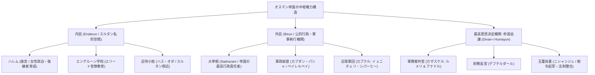
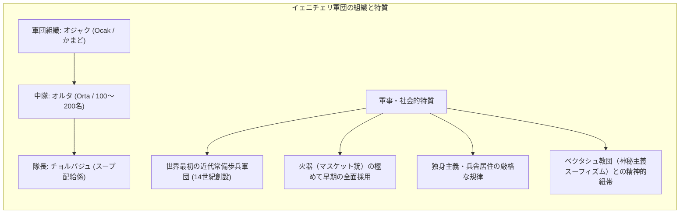
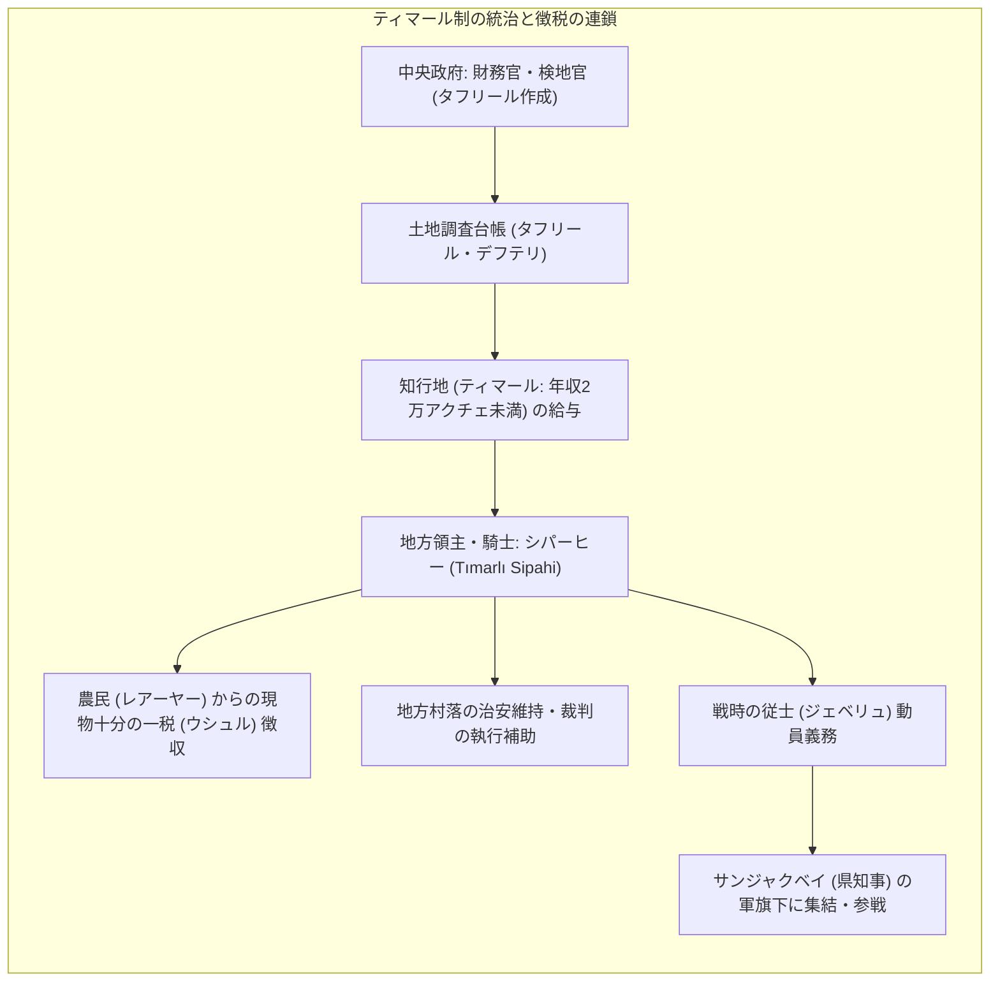
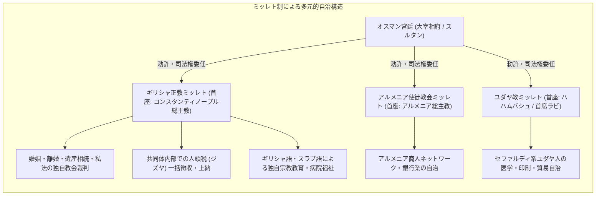
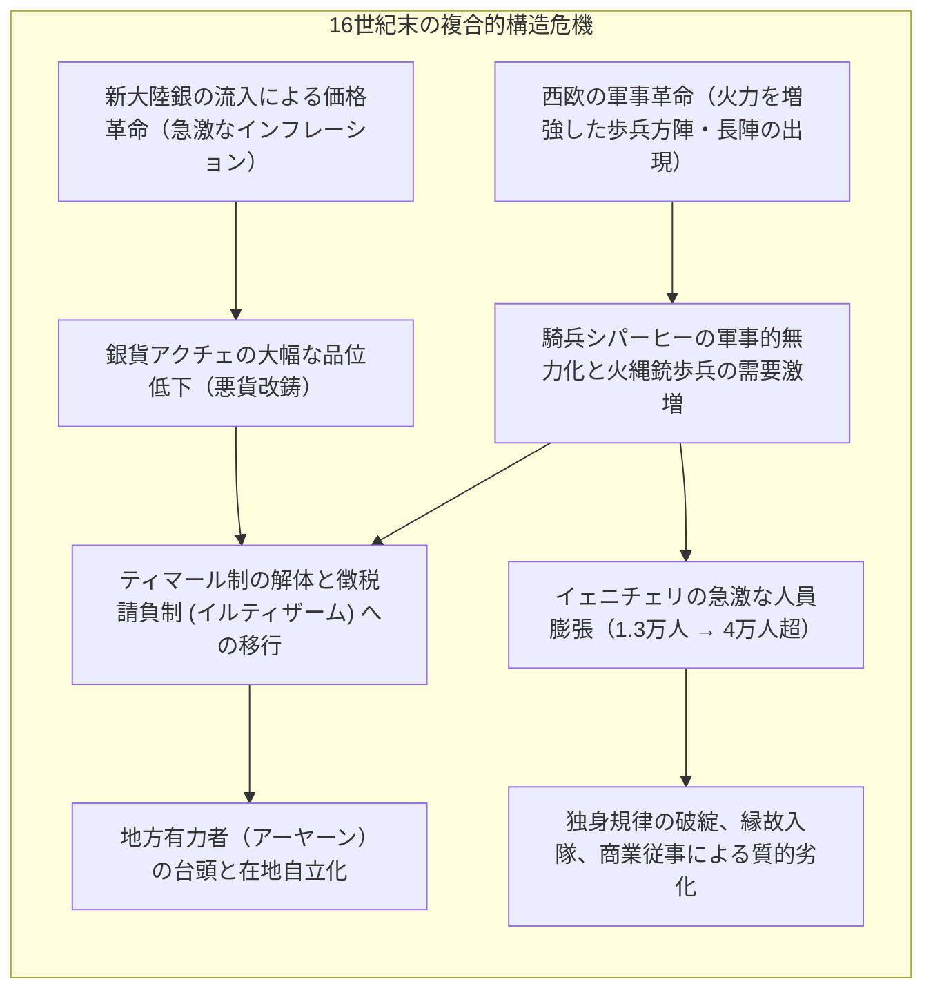
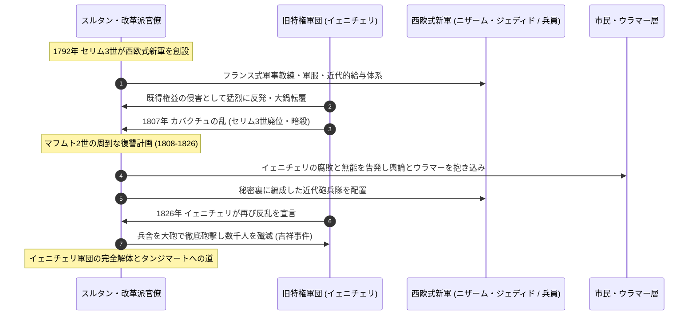

1453年5月29日、ウルバンの巨砲が咆哮し、テオドシウスの三重城壁が崩壊したとき、千年以上続いたビザンツ帝国の首都コンスタンティノープルは陥落し、オスマン帝国の首都イスタンブールへと生まれ変わりました。弱冠21歳の征服王メフメト2世によって完成されたこの劇的な覇権交代は、単なる一王朝の交代ではなく、ユーラシア西部の政治地理を根本から塗り替える新たな「世界帝国」の確立を告げるものでした。

最盛期のスレイマン1世（壮麗帝）の時代、オスマン帝国の版図はドナウ川河畔からナイル川流域、ペルシャ湾からアルジェリア沿岸に至る三大陸に跨り、多様な言語、民族、宗教を抱える数千万の臣民を包含していました。西欧諸国が宗教改革と凄惨な三十年戦争によって引き裂かれていた時代、なぜオスマン帝国はこれほど広大で多様な異質空間を600年以上にわたって統合し、高度に機能的な官僚組織と圧倒的な軍事力を維持し続けることができたのでしょうか。

その秘密は、専制スルタンの個人的カリスマではなく、きわめて合理的かつ冷徹に設計された独自の「制度的複合体」にありました。キリスト教徒の子弟を徴集して帝国最高官僚と最強の常備歩兵へと育成する<strong>デヴシルメ制度（Devşirme）</strong>、常備歩兵軍団<strong>イェニチェリ（Yeniçeri）</strong>、地方の騎兵知行制である<strong>ティマール制（Tımar）</strong>、そして非ムスリム共同体に宗教・司法の広範な自治を認めた多文化統治装置<strong>ミッレト制（Millet）</strong>です。

本稿では、オスマン帝国の統治機構、軍制、司法システム、およびその変容の全軌跡を、歴史学・比較制度論・軍事史の最新の学術的知見に基づいて包括的かつ精緻に解剖します。

---

## 1. 帝国の空間構造と中枢統治機構：トプカプ宮殿と大宰相府

オスマン帝国の統治システムを理解する第一歩は、権力が空間的にどのように配置され、儀礼化されていたかを把握することです。その物理的頂点に位置したのが、ボスポラス海峡と金角湾を見下ろす丘に築かれた<strong>トプカプ宮殿（Topkapı Sarayı）</strong>でした。



### 1.1 トプカプ宮殿の四つの前庭と象徴的秩序

トプカプ宮殿は西欧のヴェルサイユ宮殿のような単一の巨大モニュメントではなく、幾重もの城門によって隔てられた四つの中庭（コートヤード）からなる分散配置型の複合建築でした。外側から内側へと進むにつれて静寂の度合いが増し、アクセス可能な階層が厳格に選別されるという「沈黙の権力劇場」が形成されていました。

- <strong>第一の庭（皇帝の門 / Bab-i Humayun）</strong>: 一般臣民も立ち入り可能な公共広場であり、造幣所や武器庫、衛兵詰所が配置された。
- <strong>第二の庭（挨拶の門 / Bab-us Selam）</strong>: 馬から下りることが義務付けられた公的行政空間。ここに帝国最高会議（ディヴァン）の議事堂、財務庫、給食用の巨大厨房が置かれた。
- <strong>第三の庭（幸福の門 / Bab-us Saade）</strong>: スルタンの私的居住空間への境界。この奥にスルタンの謁見の間（アルズ・オダース）、エリート養成機関である「エンデルーン学校」、そして宝物庫が存在した。
- <strong>第四の庭</strong>: ボスポラス海峡を一望する庭園と離宮（キオスク）が点在する、スルタン個人の瞑想と休息の空間。

### 1.2 帝国会議（ディヴァーニ・ヒュマーユーン）の力学

帝国の最高意思決定機関は、第二の庭の「ドームの部屋（Kubbealtı）」で開催された<strong>帝国会議（Divan-i Humayun）</strong>でした。

初期のスルタンは自ら議長を務めましたが、メフメト2世以降、スルタンは会議に直接列席せず、議事堂の壁面上部に設けられた鉄格子付きの小窓（「危険な窓」カスル・アドゥル）の奥に身を潜めて議論を監視する慣例が確立しました。閣僚たちは、スルタンが今まさに小窓の奥で聞いているか否かを知ることができず、この「不可視の視線」が強烈な規律と緊張を生み出しました。

帝国会議の議事進行と行政執行の全責任を負ったのが、スルタンの絶対的代理人である<strong>大宰相（サドラーザム / Sadrazam）</strong>でした。大宰相はスルタンの印章（玉璽）を常に首から下げて携帯し、スルタンの名において帝国全土に命令を発布する絶大な権力を握っていました。

大宰相を補佐した主要閣僚は以下の通りです：
1. <strong>ルメリおよびアナドルの軍務裁判官（Kazasker）</strong>: 帝国をヨーロッパ側（ルメリ）とアジア側（アナドル）の二大行政管区に分け、それぞれのイスラーム法官（カーディー）の人事権と最高司法権を行使した。
2. <strong>財務長官（Defterdar）</strong>: 帝国の歳入・歳出、徴税台帳（デフテル）を管理する最高財政官。
3. <strong>玉璽尚書（Nişancı）</strong>: スルタンの署名花押（トゥグラ）を勅令（フェルマーン）に捺印し、帝国の世俗法典（カーヌーン）とイスラーム法（シャリーア）の整合性を検証する法制責任者。

---

## 2. 官僚・軍事エリートの再生産装置：デヴシルメ制度の社会学的特異性

近代以前の多くの王朝（中国の貴族制や科挙官僚、西欧の封建諸侯）において、帝権を常に脅かしたのは「地方名望家・世襲貴族の自立化」でした。一族が土地と領民を世襲して勢力を蓄え、やがて中央政府に反旗を翻すという現象は、ユーラシア全域に見られた構造的アキレス腱でした。

オスマン帝国が考案したこの問題への究極の解答こそが、<strong>デヴシルメ制度（Devşirme / 徴童制）</strong>と「スルタンの奴隷（カプクル / Kapıkulu）」システムでした。

```mermaid
flowchart TD
    subgraph DEV ["デヴシルメ制度とエリート分化プロセス"]
        direction TB
        BALK["バルカン農村のキリスト教徒少年（10〜18歳）"] --> REG["官吏による厳密な台帳選抜（家柄・健康・知性）"]
        REG --> CONV["イスラームへの改宗と割礼、トルコ語習得"]
        
        CONV --> TEST["選抜試験（知的能力・身体能力の選別）"]
        
        TEST -->|知性・容姿・品格の上位エリート (約10%)| END["トプカプ宮殿 エンデルーン学校"]
        TEST -->|強靭な肉体と武勇 (約90%)| TURK["アナトリアのトルコ系農家に預託（過酷な労働とトルコ化）"]
        
        END --> PAGE["小部屋・大部屋・ハス・オダ（近侍小姓）"]
        PAGE --> GRAD_END["地方総督 (サンジャクベイ) → 大宰相・パシャへ昇進"]
        
        TURK --> ACEMI["アジェミ・オグラン（見習い兵学校）"]
        ACEMI --> YENI["正規イェニチェリ軍団（常備歩兵銃兵）へ編入"]
    end
```

### 2.1 デヴシルメの選抜基準と法的根拠

デヴシルメとは、帝国内のバルカン半島（アルバニア、ギリシャ、セルビア、ボスニア、ブルガリア等）のキリスト教徒農村から、定期的（おおむね3〜5年ごと）に10歳から18歳前後の健康で聡明な男子を徴集する制度です。

イスラーム法（シャリーア）上、本来ズィンミー（庇護民たる異教徒臣民）から強制的に子弟を徴集し改宗させることは厳格な禁忌でした。しかしオスマン朝のウラマー（法学者）たちは、これを「戦利品の5分の1を国家元首が取得する権利（ペンジク制）」の拡張解釈として、あるいは「帝国の生存とイスラームの拡大に必要なスルタンの世俗法（オルフ / カーヌーン）」として法的に正当化しました。

選抜には厳格な規則が存在しました：
- 一人息子は徴集してはならない（家族の生計破綻を防ぐため）。
- 孤児、職人の子、都市住民、ユダヤ教徒は除外された（純朴な農村気質を保ち、商才や都市の悪習に染まっていない少年が求められた）。
- 徴集台帳には本人の身体的特徴、出身村、親の氏名が記録され、不正な入れ替えが厳しく取り締まられた。

皮肉にも、貧困にあえぐバルカンのキリスト教徒家庭の中には、息子が帝国の最高指導者（大宰相や地方総督）へと出世できる唯一の階層移動ルート（メリトクラシー）として、自ら進んで賄賂を渡してデヴシルメに我が子を推薦する親も少なくありませんでした。

### 2.2 エンデルーン学校と実力主義（メリトクラシー）の極致

徴集された少年のうち、卓越した知能と精神的素質を認められた上位数パーセントの俊英は、トプカプ宮殿内の<strong>エンデルーン学校（Enderun Mektebi）</strong>へと送られました。

エンデルーンでの教育は、近代のオックスフォードやイートン校を遥かに凌ぐ過酷さと洗練を極めました：
- <strong>学芸</strong>: アラビア語・ペルシア語の完璧な習得、コーラン解釈学、イスラーム神学、歴史、地理、天文学、数学。
- <strong>技芸・教養</strong>: 書道（カリグラフィー）、詩作、音楽理論、宮廷作法。
- <strong>武芸</strong>: 弓術、馬術、剣術、槍術。

生徒たちは数年ごとの過酷な昇進試験を通じて下級の部屋（「小部屋」「大部屋」）から上級の部屋（「ハズネ・オダス / 宝物の部屋」「ハス・オダ / 皇帝近侍部屋」）へとステップアップしていきました。最高位のハス・オダに達した者は、スルタンの着替えや預言者の聖遺物管理を担当し、スルタンと日常的に濃密な人間関係を築きました。

卒業（チュクマー）を迎えると、彼らは中央の高級官僚、近衛騎兵隊長、あるいは地方の県知事（サンジャクベイ）、州総督（ベイレルベイ）として赴任し、最終的には大宰相の座へと登りつめました。15世紀半ばから17世紀初頭にかけての歴代大宰相の大部分は、トルコ系名望家ではなく、このデヴシルメ出身者によって占められていたのです。

### 2.3 なぜ「奴隷」が国家を統治したのか：世襲貴族の排除

彼らは法分上、スルタンの個人所有物である「奴隷（クル / Kul）」でした。この身分関係には二つの極めて合理的かつ冷徹な政治的意味がありました：

1. <strong>スルタンへの絶対的忠誠</strong>: 故郷の家族や地縁から完全に切り離された彼らには、権力の源泉が「スルタンの恩顧」以外に存在しない。独自の血族ネットワークによる王朝簒奪の危険性が構造的に排除される。
2. <strong>財産の非世襲性と国家への還流（ムサダレ制度）</strong>: カプクル官僚が死亡または処刑された場合、その莫大な財産は実子へ世襲されず、原則としてすべて国庫に没収（ムサダレ）された。これにより、官僚貴族が何世代にもわたって富を蓄積し、中央政府に対抗しうる独立財閥を形成することが完全に遮断された。

---

## 3. 常備軍団の精華：イェニチェリと「火薬帝国」の軍事革命

デヴシルメで徴集された少年のうち、屈強な体躯と武勇に秀でた大多数の少年たちは、アナトリアのトルコ系農家に預けられ、過酷な農作業を通じてトルコ語とイスラームの風習を叩き込まれた後、「見習い兵（アジェミ・オグラン）」を経て、最強の常備歩兵軍団<strong>イェニチェリ（Yeniçeri / 新軍）</strong>へと編入されました。



### 3.1 「かまど（オジャク）」の精神とベクタシュ教団

イェニチェリ軍団の組織基盤は、伝統的な家族ではなく、軍団そのものを疑似家族とする強固な共同体意識にありました。その象徴が「<strong>かまど（オジャク / Ocak）</strong>」と「<strong>大鍋（カザン・シャリーフ / Kazan-ı Şerif）</strong>」でした。

- イェニチェリの各部隊（オルタ / Orta）の中心には大鍋が置かれ、スルタンから支給される肉入りピラフや羊肉のスープを共に食すことが団結の誓いとされた。
- 部隊長は「チョルバジュ（Çorbacı / スープ配給係）」、下士官は「アシュチュバシュ（料理長）」という調理に由来する独特の軍事階級名で呼ばれた。
- もしイェニチェリたちがスルタンや大宰相への不満を表明し反乱を起こす際、彼らは中央広場において「<strong>大鍋をひっくり返す（Kazan kaldırmak）</strong>」という行動に出た。これは「スルタンの飯はこれ以上食わない」という公然たる反逆の宣誓を意味した。

精神的支柱としては、神秘主義教団である<strong>ベクタシュ教団（Bektaşi）</strong>と不可分に結びついていました。イェニチェリの兵士たちはベクタシュ派の聖者ハッジ・ベクタシュの弟子とみなされ、彼らが着用する特徴的な白いフェルト帽（ベルク / Börk）の背後に垂れ下がる布は、ハッジ・ベクタシュの衣の袖を模した守護の象徴と信じられていました。

### 3.2 近世初期軍事革命における火器の先駆的運用

15世紀から16世紀にかけて、西欧の封建領主たちが依然として重装騎士の個人的武勇に依存していた時代、オスマン帝国はすでに<strong>火砲とマスケット銃（火縄銃）を組織的に大量配備した世界最初の「火薬帝国（Gunpowder Empire）」</strong>でした。

イェニチェリは、極めて早い段階（15世紀初頭）から弓矢を捨ててハンドキャノンや初期マスケット銃を全面採用しました。彼らは整然たる隊列を組み、装填手と射撃手が交互に射撃を継続する「一斉射撃（Volley fire）」戦術を西欧に先駆けて実戦投入しました。

- <strong>1514年 チャルディラーンの戦い</strong>: サファヴィー朝ペルシアの精鋭騎兵軍団クズルバシュを、イェニチェリのマスケット銃陣と連結荷車砲陣（タボル・チェンギ）によって完膚なきまでに撃破。
- <strong>1526年 モハーチの戦い</strong>: ハンガリー王国軍の重装甲騎兵隊をわずか2時間の戦闘で壊滅させ、中欧平原の覇権を確立。

---

## 4. 地方統治と封建軍事力：ティマール制（Tımar）の精緻なメカニズム

常備軍であるカプクル軍団（歩兵イェニチェリと宮廷近衛騎兵）が軍事の中核であったとすれば、帝国陸軍の兵力の過半数を占めたのは、地方に配置された封建騎兵<strong>シパーヒー（Sipahi）</strong>でした。このシパーヒーを維持・動員するための経済基盤が<strong>ティマール制（Tımar）</strong>です。



### 4.1 タフリール（検地台帳）に基づく官僚的知行給与

西欧の中世封建制（フューダリズム）における領地支配と、オスマン帝国のティマール制の間には、決定的な構造差が存在しました：

1. <strong>土地の国有原則（ミーリー地）</strong>: ティマールとして給与された土地はシパーヒーの私有財産ではなく、法的には国家（スルタン）に帰属する国有地（ミーリー）であった。シパーヒーに認められたのは、あくまで「その土地から上がる一定額の租税を徴収する権利（徴税知行権）」に過ぎない。
2. <strong>検地台帳（タフリール・デフテリ / Tahrir Defterleri）の厳密さ</strong>: 新たな領土を獲得するたび、中央から派遣された検地官が村落ごとに世帯数、宗教、耕作面積、家畜数、収穫予想高を極めて詳細に調査・記録した。シパーヒーはこの台帳に規定された以上の不当な課税を固く禁じられており、違反した場合は直ちに知行地を没収された。

知行規模に応じて、年間税収2万アクチェ未満の知行地を<strong>ティマール</strong>、2万〜10万アクチェを<strong>ゼアメト（Zeamet）</strong>、10万アクチェ以上を<strong>ハス（Has）</strong>と呼び、高位官僚や王族に割り当てられました。

### 4.2 シパーヒーの従士動員義務（ジェベリュ）

ティマールを受給したシパーヒー（トゥマルル・シパーヒー）は、知行地の年収から自らの生活費（3,000アクチェ前後）を差し引いた残余の収入に応じて、一定数の武装従士（<strong>ジェベリュ / Cebelü</strong>：甲冑をまとい弓・槍・剣を装備した騎兵）を自費で育成・武装させる義務を負いました（年収3,000アクチェごとに従士1名）。

戦時の動員令が下ると、シパーヒーたちは自らのジェベリュを引き連れて県知事（サンジャクベイ）の軍旗の下に集結し、さらに州総督（ベイレルベイ）の指揮下に入って数万規模の精強な地方騎兵軍団を形成しました。シパーヒーたちは知行地を離れると収入が途絶えるため、略奪や無秩序な長期戦を望まず、規律正しく迅速な作戦行動を重んじました。

---

## 5. 多文化・多宗教共存の統治装置：ミッレト制（Millet System）

オスマン帝国が西欧のキリスト教諸国と根本的に異なっていたのは、「国民全員の宗教的統合」を目指さず、<strong>異宗教徒の存在を前提とした多元的統治パラダイム</strong>を制度化した点にあります。この共生システムを<strong>ミッレト制（Millet）</strong>と呼びます。



### 5.1 イスラーム法（シャリーア）におけるズィンミーの権利と義務

オスマン帝国の非ムスリム統治の根幹には、イスラーム法における「<strong>ズィンマ（契約による庇護）</strong>」の原則がありました。

「啓典の民（キリスト教徒およびユダヤ教徒）」は、イスラーム国家の主権を承認し、成人男子が<strong>人頭税（ジズヤ / Cizye）</strong>を納付することを条件として、以下の権利が不可侵のものとして法的に保障されました：
1. <strong>信教の自由</strong>: 礼拝の実施、聖堂・シナゴーグの維持管理。
2. <strong>生命・財産の保障</strong>: 不当な略奪や強制改宗の禁止。
3. <strong>私法の自治権</strong>: 婚姻、離婚、養子縁組、遺産分割などの身分法に関して、自らの宗教法（教会法やハラーハー）を適用する権利。

### 5.2 三大ミッレトの自治と帝国中央との相互依存

メフメト2世は1453年のコンスタンティノープル征服直後、空位となっていたギリシャ正教会の総主教に反西欧・反カトリック合同派の学者ゲンナディオス2世を任命し、彼に全正教徒臣民の宗教的・世俗的指導権を認める勅許状（ベラート）を授与しました。

これにより、以下の主要ミッレトが公式に成立しました：
1. <strong>ギリシャ正教ミッレト（Rûm Milleti）</strong>: ギリシャ人のみならず、ブルガリア人、セルビア人、ルーマニア人、アルバニア正教徒、アラブ正教徒を含む、帝国領内の全東方正教会信徒を包括。総主教庁は独自の法廷を持ち、信徒間の民事紛争を裁いた。
2. <strong>アルメニア教会ミッレト</strong>: 単性論（非カルケドン派）のアルメニア使徒教会信徒を管轄。のちに帝国境内のコプト正教会やシリア正教会もその下に置かれた。
3. <strong>ユダヤ教ミッレト</strong>: 1492年にスペインを追放されたセファルディ系ユダヤ人をオスマン帝国は熱狂的に歓迎・受け入れた（バヤジット2世の勅令）。彼らはイスタンブール、サロニカ（テッサロニキ）、イズミルに定住し、高度な国際金融、織物産業、印刷技術、医学をもたらして帝国の経済的生命線を担った。

各ミッレトの長（宗教指導者）は、中央政府に対して所属信徒のジズヤ徴収と納税の連帯責任を負う代わりに、共同体内部の教育、福祉、警察、裁判を完全に自主運営しました。この分権的かつ自律的なネットワーク構造により、オスマン帝国は宗教警察のような巨大な抑圧機構を持たずとも、広大な異教徒社会を極めて平穏に統合・管理し得たのです。

---

## 6. 16世紀末の構造転換と「軍事革命」の衝撃

16世紀後半から17世紀にかけて、オスマン帝国は空前の制度的危機に直面しました。従来の歴史学はこの時期を「衰退の始まり（Decline Paradigm）」と単純化していましたが、現代のオスマン史研究（バルカー・テズジャン、ダニエル・ゴフマンら）は、これを<strong>近世のグローバルな構造変動に対する苦難に満ちた「適応と変容のプロセス」</strong>として捉え直しています。



### 6.1 価格革命とティマール制の機能不全

16世紀末、新大陸（ポトシ銀山など）から西欧を経由して大量の銀が地中海世界に流入しました。これによりオスマン帝国内でも猛烈なインフレーション（<strong>価格革命</strong>）が発生し、銀貨アクチェの価値が暴落しました。

- 固定額の現物・貨幣税収に依存していた地方騎士シパーヒーは急速に経済的困窮に陥り、従士（ジェベリュ）を維持できなくなりました。
- 同時に、オーストリア・ハプスブルク家との「長期戦争（1593-1606年）」において、戦場の主役が騎兵の白兵戦から大量のマスケット銃を装備した歩兵の撃ち合いへと完全に移行しました。弓矢と槍を主武装とするシパーヒーは、塹壕と要塞に籠もる敵火器部隊の前に無力化されたのです。

### 6.2 イェニチェリの肥大化と特権階級化

マスケット銃兵の需要激増に応えるため、中央政府は二つの致命的な政策転換を行いました：
1. <strong>イェニチェリ定員の急膨張</strong>: 16世紀初頭に約1万2,000人であったイェニチェリは、17世紀初頭には4万人近くに、17世紀末には7万人近くへと膨れ上がった。
2. <strong>デヴシルメの形骸化と門戸開放</strong>: 人員不足を埋めるため、本来禁じられていた自由身分のムスリム（トルコ系・クルド系・アラブ系）やイェニチェリの子弟（クーログル）の入隊を認めた。17世紀半ばにはデヴシルメの徴集は事実上停止した。

兵員の急増は国庫を逼迫させ、給与（ウルフェ）の遅配や悪貨での支払いが常態化しました。その結果：
- イェニチェリたちは生計を立てるためにイスタンブール市内で肉屋、パン屋、両替商、コーヒー店などの商売を営み始め、既得権益集団（圧力団体）へと変質した。
- 兵舎での独身生活や厳格な軍事訓練は放棄され、軍籍（エサミー）の売買が横行して「名目上の幽霊兵士」が蔓延した。
- スルタンが軍制改革を企てると、彼らは大鍋をひっくり返して蜂起し、大宰相を処刑させ、果てはスルタン自身を廃立・暗殺するに至りました。1622年、近代的な新軍創設を試みた若き<strong>オスマン2世</strong>がイェニチェリによって惨殺された事件は、帝国の軍紀崩壊の象徴的悲劇でした。

### 6.3 徴税請負制（イルティザーム）とアーヤーンの台頭

破綻したティマール制に代わり、国家は即座に現金を回収できる<strong>徴税請負制（イルティザーム / Iltizam）</strong>を全土に拡大しました。

裕福な商人が競売によって地方の徴税権を落札し、前納金と引き換えに農民から法外な税を取り立てるこの制度は、農村の荒廃と農民の都市への逃亡（大逃散 / Büyük Kaçgun）を引き起こしました。さらに18世紀には、徴税請負権の終身化（マリキャネ制）が進み、地方ごとに私兵軍団と莫大な富を蓄積した地方名望家<strong>アーヤーン（Âyan）</strong>が台頭しました。帝国はもはや中央集権国家ではなく、中央政府と無数の在地アーヤーンが妥協と交渉を繰り返す分権的複合国家へと変貌していったのです。

---

## 7. 近代への苦悶：新制軍の挫折からタンジマートへ

1683年の<strong>第2次ウィーン包囲</strong>の破滅的失敗と、その後の大トルコ戦争における連敗は、1699年の<strong>カルロヴィッツ条約</strong>において初めてオスマン帝国がキリスト教諸国に広大な領土（ハンガリー全土、トランシルヴァニア、ポドリア等）を割譲するという未曾有の屈辱をもたらしました。

「不敗のイスラーム帝国」という神話は砕け散り、帝国は西欧の軍事技術と組織論を導入する近代化改革へと舵を切らざるを得なくなりました。



### 7.1 セリム3世の「新秩序（ニザーム・ジェディド）」とその悲劇

18世紀末に即位した<strong>セリム3世</strong>は、フランスから軍事顧問団を招聘し、西欧式の軍服、銃剣付きマスケット銃、近代的な戦術教練を取り入れた常備歩兵軍<strong>ニザーム・ジェディド（Nizam-ı Cedid / 新秩序軍）</strong>を創設しました。

新軍は1799年のアッコ包囲戦においてナポレオン率いるフランス極東軍を撃退するなど優れた実戦能力を発揮しましたが、旧軍イェニチェリと保守派ウラマーの激しい敵意に晒されました。1807年、補助兵カバクチュ・ムスタファに率いられたイェニチェリの大反乱が発生し、ニザーム・ジェディドは解散に追い込まれ、セリム3世は幽閉の末に暗殺されました。

### 7.2 1826年「吉祥事件（Vaka-i Hayriye）」：断固たる外科手術

セリム3世の悲劇を間近で目撃した従弟の<strong>マフムト2世</strong>は、極めて周到で冷徹なマキャヴェリズム的計画を進めました。彼は即位後の十数年間、イェニチェリの無軌道な暴走を泳がせつつ、秘密裏に忠誠心の高い近代的砲兵部隊を育成し、イスラーム法学者（ウラマー）最高指導者の支持を取り付けました。

1826年6月、マフムト2世が新軍の訓練開始を発表すると、予想通りイェニチェリたちはアト・メイダヌ（旧競馬場広場）で大鍋をひっくり返して反乱を起こしました。しかし、今回のスルタンは逃げませんでした。

マフムト2世は預言者ムハンマドの神聖な軍旗（サンジャク・シェリーフ）を掲げて全臣民に反徒鎮圧を呼びかけ、忠誠を誓う砲兵部隊を急派しました。イェニチェリたちの立て籠もる巨大兵舎は至近距離からの連続砲撃によって猛火に包まれ、逃げ場を失った数千人の兵士が炎と銃弾の中に殲滅されました。

この軍事行動は、数百年間にわたり帝国の発展を阻み続けてきた最大の癌細胞を外科的に切除した歴史的転換点として、公式記録に<strong>「吉祥事件（Vaka-i Hayriye）」</strong>と命名されました。イェニチェリ軍団は法的に永久廃止され、彼らと癒着していたベクタシュ教団も非合法化されました。

### 7.3 タンジマート（恩恵改革）とオスマン主義の限界

軍事的制約から解放されたマフムト2世とその志を継いだ開明派官僚たち（ムスタファ・レシト・パシャら）は、1839年に<strong>ギュルハネ勅令（Hatt-ı Şerif of Gülhane）</strong>を公布し、帝国の根本的近代化改革運動<strong>タンジマート（Tanzimat / 再編）</strong>を断行しました。

タンジマートの核心は、これまでのミッレト制に基づく宗教的分断を克服し、宗教・民族を問わず帝国内のすべての臣民に法の前の平等、生命・名誉・財産の不可侵を認める「<strong>オスマン主義（オスマニズム）</strong>」という新たな近代国民意識の創出でした。

しかし、西欧列強の帝国主義的介入と、バルカン諸民族のナショナリズムの爆発を止めることはできませんでした。ギリシャ独立戦争、クリミア戦争、露土戦争を経て、帝国の領土は急速に縮小し、かつて多文化共存を誇ったミッレトの枠組みは、近代的な民族対立の血で塗り替えられていくことになります。

---

## 8. 結論：比較帝国史におけるオスマン帝国の遺産

1299年のアナトリアの小さな遊牧戦士集団（ガーズィー）から出発し、1922年のスルタン制廃止に至るまで623年間継続したオスマン帝国の生命力は、近代の歴史教科書が描いてきた「ヨーロッパの瀕死の重病人」という侮蔑的クリシェを遥かに超えた壮大さを持っています。

同時代の西欧諸国がスペインのユダヤ人追放、ユグノー戦争、三十年戦争に見られるような「単一宗派による強制的均質化」を追求していたのに対し、オスマン帝国は：
1. <strong>出自にとらわれないメリトクラシー（デヴシルメ）</strong>によって支配エリートの世襲貴族化を阻止した。
2. <strong>専制権力と法の支配の融合（シャリーアとカーヌーン）</strong>によって官僚的統制を確立した。
3. <strong>宗教共同体の自律性を制度化（ミッレト制）</strong>することで、前近代における最も先駆的で寛容な多文化共存を実現した。

オスマン帝国の統治機構が示した「多様性の統御」「実力主義の制度化」「自律的分権ネットワーク」のメカニズムは、単なる過去の遺物ではありません。国民国家の枠組みが軋みを見せ、多文化共生とアイデンティティの政治に揺れる21世紀の現代世界において、帝国の残した壮大な制度的遺産は、統治の工学（Engineering of Governance）を再考するための無尽蔵の知的洞察を提供し続けているのです。