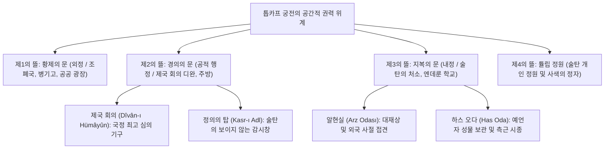

1453년 5월 29일, 21세의 젊은 정복왕 메흐메트 2세가 우르반의 거대한 청동 대포로 천년 비잔티움 제국의 수도 콘스탄티노폴리스 테오도시우스 3중 성벽을 분쇄했을 때, 유라시아 서부의 지정학적 지형은 근본적인 지각변동을 맞이했습니다. 전성기인 쉴레이만 1세(입법제/장려제) 치하에서 오스만 제국의 판도는 도나우강변에서 나일강 상류, 페르시아만에서 알제리 해안에 이르는 유럽, 아시아, 아프리카 3개 대륙에 걸쳐 수천만 명의 다민족, 다종교 신민을 통치하는 명실상부한 세계 제국이었습니다.

동시대 서유럽이 종교개혁과 위그노 전쟁, 그리고 독일 인구의 3분의 1을 몰살시킨 잔혹한 30년 전쟁의 광기에 휩싸여 분열을 거듭하던 시대에, 오스만 제국은 어떻게 623년(1299~1922) 동안 단 한 번의 왕조 교체도 없이 단일 황실(오스만 가문)의 통치 아래 고도로 기능적인 관료제와 압도적인 군사력을 유지할 수 있었을까요?

그 해답은 군주의 개인적 카리스마나 단순한 무력 정복이 아니라, 놀라울 정도로 정밀하고 합리적으로 설계된 독창적인 '제도적 복합체'에 있었습니다:
1. 발칸반도의 기독교도 소년들을 선발 징집하여 술탄 직속의 최고 관료와 전사로 양성한 <strong>데브쉬르메 제도(Devşirme)</strong>;
2. 인류 역사상 최초로 근대적 상비 보병 조직과 화승총 일제 사격 전술을 도입한 <strong>예니체리 군단(Yeniçeri)</strong>;
3. 토지의 국유화를 전제로 중앙 정부의 엄격한 조세 대장에 기반해 운영된 기병 봉토제인 <strong>티마르제(Tımar)</strong>;
4. 비무슬림 피지배 공동체에 광범위한 종교적·사법적 자치권을 부여하여 평화적 공존을 이끌어낸 <strong>밀레트 체제(Millet)</strong>.

본 논문은 오스만 제국의 공간적 권력 구조, 관료 리크루팅 메커니즘, 군사 혁명과 전술, 다문화 통치 기구의 궤적을 비교제국사 및 제도경제학의 최신 학술적 성과를 바탕으로 심층 분석합니다.

---

## 1. 제국의 공간 질서와 중추 통치 기구: 톱카프 궁전과 디완(Divan)

오스만 제국의 권력 행사는 이스탄불 보스포루스 해협과 골든혼이 내려다보이는 반도 끝에 세워진 <strong>톱카프 궁전(Topkapı Sarayı)</strong>의 4중 뜰 공간 배치에 극적으로 투영되어 있었습니다. 궁전 내부로 들어갈수록 정적과 통제의 강도가 기하급수적으로 증가하는 독특한 '침묵의 권력 극장'이 연출되었습니다.



### 1.1 '정의의 탑'과 보이지 않는 감시의 파놉티콘

제2의 뜰 돔 홀(Kubbealtı)에서 열리는 <strong>제국 회의(Dîvân-ı Hümâyûn)</strong>는 제국의 최고 행정·사법·입법 평의회였습니다. 초기 군주들은 회의를 직접 주재했으나, 메흐메트 2세 이후 술탄은 회의장에 모습을 드러내지 않고 회의장 벽 높은 곳에 설치된 두터운 커튼과 철창 격자창(<strong>"정의의 탑" Kasr-ı Adl</strong>) 뒤에 숨어 회의를 지켜보는 관례를 확립했습니다.

대신들과 판관들은 지금 이 순간 술탄이 창문 뒤에서 자신들의 발언을 엿듣고 있는지 전혀 알 수 없었습니다. 제레미 벤담의 파놉티콘을 선취한 이 '보이지 않는 시선'은 각료들에게 엄청난 긴장감과 자기 규율을 강제했습니다.

국정의 최고 집행권은 술탄의 절대적 대리인인 <strong>대재상(사드라잠 / Sadrazam)</strong>에게 위임되었습니다. 대재상은 술탄의 옥새를 항시 목에 걸고 다녔으며, 군무판관(카자스케르), 재무장관(데프테르다르), 칙령에 옥새를 찍는 장서관(니샨즈)을 거느리고 제국의 일상적 국정을 총괄했습니다.

---

## 2. 노예 엘리트의 역설: 데브쉬르메 제도와 엔데룬 궁정학교

중세 유럽과 동아시아의 왕조 국가를 끊임없이 위협한 것은 영지와 백성을 세습하며 독자적인 세력을 구축하는 '세습 귀족'의 발호였습니다. 오스만 제국은 이 고질적인 봉건적 난제를 타파하기 위해 <strong>카프쿨루(Kapıkulu, 황제의 노예)</strong> 시스템과 <strong>데브쉬르메 제도(Devşirme)</strong>를 고안했습니다.

```mermaid
flowchart TD
    subgraph DEV ["데브쉬르메 선발과 엘리트 분화 경로"]
        direction TB
        VILL["발칸 기독교 농촌 소년 징집 (10~18세)"] --> REG["신체검사, 가문, 지능 조사 후 호적 대장 등록"]
        REG --> CONV["이슬람 개종, 할례, 튀르크어 습득"]
        
        CONV --> EXAM["황실 엄격 선발 시험"]
        
        EXAM -->|상위 5~10% 지적 영재| END["톱카프 궁전 엔데룬 궁정학교 입학"]
        EXAM -->|건장한 육체파 다수 (약 90%)| ANAT["아나톨리아 농가 위탁 노동 (체력 단련)"]
        
        END --> CHAMBER["내정 시종 방 승진 (보물의 방, 하스 오다)"]
        CHAMBER --> GOV["주지사(산작베이), 총독(베일레르베이), 대재상 배출"]
        
        ANAT --> CADET["아제미 오글란 (군사 훈련생)"]
        CADET --> JANISSARY["정규 예니체리 군단 (보병 총병) 편성"]
    end
```

### 2.1 데브쉬르메의 선발 원칙과 기회로서의 측면

3~5년 주기로 발칸반도의 기독교 농촌(그리스, 세르비아, 알바니아, 불가리아 등)에서 파견된 선발관은 엄격한 기준에 따라 10~18세의 영민한 소년들을 징집했습니다:
- 독자(외아들)는 가족의 생계를 위해 절대 징집하지 않았습니다.
- 고아나 도시민, 장인의 자식, 유대인은 순박한 농촌의 기풍을 잃었다고 보아 배제했습니다.
- 신체 특징과 출신 마을, 부모의 이름을 기록한 이중 장부를 작성하여 부정을 엄단했습니다.

가족과의 생이별이라는 비극에도 불구하고, 발칸 기독교 농민들 중에는 자식이 평생 농노로 흙을 파먹는 대신 제국의 재상이나 장군으로 출세할 수 있는 유일한 계층 상승 사다리로 여겨 뇌물을 주고 자식을 데브쉬르메에 밀어 넣는 부모들도 적지 않았습니다.

### 2.2 엔데룬 학교와 무사다레(재산 환수제)

선발된 소년 중 최우수 영재들은 톱카프 궁전 내 <strong>엔데룬 학교(Enderun Mektebi)</strong>에서 오스만어, 아랍어, 페르시아어, 이슬람 신학, 고전 시학, 천문학, 수학, 서예, 승마, 궁술 등 당대 최고 수준의 엘리트 교육을 받았습니다.

이들은 능력주의(Meritocracy)에 따라 관직을 거쳐 궁정 관료나 총독, 대재상으로 영전했습니다. 그러나 이들은 법적으로 여전히 '술탄의 노예'였습니다. 이 노예 신분은 치밀한 정치적 계산의 산물이었습니다:
1. 고향과 혈연이 단절되었기에 권력의 원천이 오직 술탄에게만 종속되어 반역의 위험이 차단되었습니다.
2. 관료가 사망하거나 처형되면 그가 축적한 막대한 재산은 자식에게 세습되지 않고 전액 국고로 환수되었습니다(<strong>무사다레 / Musadere 제도</strong>). 이를 통해 세습 귀족 가문이 형성되어 중앙 권력을 위협하는 현상을 원천적으로 방지했습니다.

---

## 3. 화약 제국의 정예: 예니체리와 티마르 기병 체제

### 3.1 솥(Kazan)과 베크타시 교단 중심의 예니체리 결속

데브쉬르메 징집자의 다수는 아나톨리아 농가에서 혹독한 노동을 통해 튀르크어와 이슬람 규율을 익힌 뒤 상비 보병 군단인 <strong>예니체리(Yeniçeri)</strong>로 편성되었습니다:
- 군단의 기본 단위는 '오작(Ocak, 가마솥/화덕)'으로, 대형 청동 솥(Kazan-ı Şerif) 주위에 모여 술탄이 하사한 고기 수프와 필라프를 나눠 먹으며 의형제적 결속을 다졌습니다.
- 부대장은 '초르바즈(Çorbacı, 수프 배급관)', 부관은 '아쉬츠바쉬(주방장)'라는 요리 관련 군사 계급명을 가졌습니다. 군단이 반란을 일으킬 때는 광장에서 <strong>"대형 솥을 엎는(Kazan kaldırmak)"</strong> 행위를 통해 공식적인 반역을 선포했습니다.
- 예니체리는 신비주의 수피즘 교단인 <strong>베크타시 교단(Bektaşi)</strong>과 일체화되어 영적 가호를 받았으며, 독신주의와 엄격한 병영 생활을 지켰습니다.

### 3.2 조기 화기 도입과 찰디란·모하치 전투

예니체리는 15세기 초 서유럽보다 훨씬 앞서 화승총(머스킷)을 전면 도입하고, 연속 일제 사격 전술(Volley fire)을 완성했습니다:
- <strong>1514년 찰디란 전투</strong>: 페르시아 사파비 왕조의 최정예 기병 돌격을 수레와 쇠사슬로 연결한 방진 뒤에서 머스킷 일제 사격으로 전멸시켰습니다.
- <strong>1526년 모하치 전투</strong>: 헝가리 왕국의 중장갑 기사 군단을 야포와 소총 화망으로 불과 2시간 만에 궤멸시키며 유럽을 경악시켰습니다.

### 3.3 지방 방위의 핵심: 티마르(Tımar) 봉토와 시파히 기병

제국 군대의 다수를 차지한 것은 지방의 <strong>시파히(Sipahi)</strong> 기병이었습니다. 티마르 제도는 토지 국유(Mîrî) 원칙에 따라 시파히에게 토지 소유권이 아닌 '정해진 조세 수취권'만을 위임했습니다.
- 정기적인 토지 대장(<strong>타흐리르 / Tahrir Defterleri</strong>) 조사를 통해 농민(레아야)에 대한 자의적 착취를 엄격히 금지했습니다.
- 시파히는 수입에 비례하여 무장 종자(<strong>제벨뤼 / Cebelü</strong>)를 거느리고 전시에 출정하여 10만 이상의 대기병군을 국고 지출 없이 유지했습니다.

---

## 4. 다종교 공존의 틀: 밀레트(Millet) 체제와 근대 탄지마트

오스만 제국은 비무슬림 피지배층을 강제 개종시키지 않고, 이슬람법의 '보호민(딤미)' 원칙에 따라 인두세(지즈야)를 내는 조건으로 광범위한 자치를 보장한 <strong>밀레트 체제</strong>를 운용했습니다:
- <strong>그리스 정교회 밀레트</strong>: 총대주교가 전 동방 정교도 신민의 종교·민사 사법권을 행사했습니다.
- <strong>아르메니아 교회 밀레트</strong>: 단성론 교파와 상인 네트워크를 관할했습니다.
- <strong>유대교 밀레트</strong>: 1492년 스페인 가톨릭 왕국에서 추방당한 수십만 세파르디 유대인을 술탄 바예지트 2세가 환영하며 받아들여 이스탄불, 살로니카 등에 정착시켜 금융, 무역, 인쇄, 의학의 중흥을 이루었습니다.

17세기 이후 아메리카 대륙의 은 유입에 따른 인플레이션과 유럽 군사 혁명으로 티마르가 붕괴하고, 예니체리가 이권 집단화되어 술탄 오스만 2세를 시해(1622)하는 등 부패하자, 1826년 마흐무트 2세는 대포로 예니체리 병영을 포격해 군단을 전멸시키는 <strong>'길상사건(Vaka-i Hayriye)'</strong>을 단행했습니다. 이후 1839년 귈하네 칙령으로 시작된 <strong>탄지마트(Tanzimat)</strong> 개혁을 통해 종교적 차별을 철폐하고 모든 신민의 법 앞의 평등을 선언하는 근대적 '오스만주의'를 추구했습니다.

오스만 제국의 600년 통치 기구는 다양성의 포용, 실력주의 관료제, 유연한 분권 자치가 결합된 인류 정치사 최고의 걸작 중 하나로 오늘날에도 깊은 시사점을 던져줍니다.