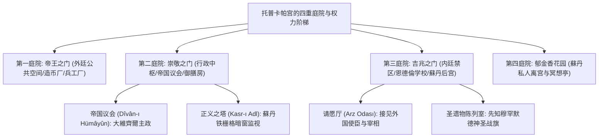
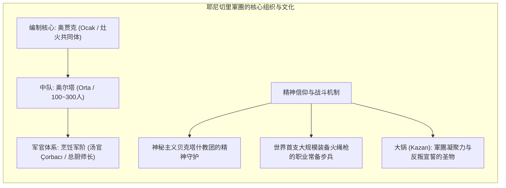
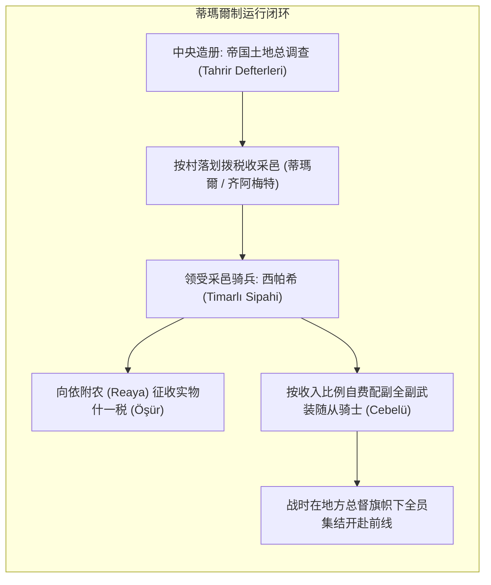

1453年5月29日，当乌尔班巨炮轰塌君士坦丁堡坚不可摧的狄奥多西三重城墙时，21岁的征服者穆罕默德二世宣告了横跨欧亚非三大洲的奥斯曼世界帝国的正式崛起。在苏莱曼一世（“大帝”或“立法者”）統治的鼎盛时期，奥斯曼帝国的疆域西起多瑙河畔与维也纳城郊，东抵波斯湾与里海之滨，南至尼罗河瀑布与阿尔及利亚海岸。在长达623年的漫长岁月里（1299–1922），奥斯曼皇室始终保持单一系列传承，未曾发生一次王朝更迭，这一稳定性在欧亚大陆古代帝国史上绝无仅有。

当同时期的西欧深陷宗教改革的残酷清洗、三十年战争的人间地狱与封建诸侯割据分裂时，奥斯曼帝国何以能在异质多元的庞大疆土上，高效维持数十个民族与多大宗教派别的秩序平衡？其核心密码并非源于蘇丹个人的神圣魅力，而是一套设计精绝、自我运转的冷酷制度网络：打破世袭贵族威胁的<strong>德夫希爾梅（Devşirme / 徵童制）</strong>奴隶官僚系统；人类历史上最早建立的大规模常备火器步兵——<strong>耶尼切里軍團（Yeniçeri）</strong>；以地养兵的封建骑兵采邑<strong>蒂瑪爾制（Tımar）</strong>；以及允许非穆斯林社区享有法权与宗教自治的多元共存机制——<strong>米勒特制（Millet）</strong>。

本文以政治制度史、军事史与比较文明论的宏阔视野，对奥斯曼帝国的权力中枢、军事组织、法制结构与近代化阵痛进行全方位的深度解剖。

---

## 1. 帝国权力的空间秩序与中枢中枢：托普卡帕宫与帝国议会（迪万）

在奥斯曼政治哲学中，統治权力的神秘与威严被高度空间化与仪式化。君士坦丁堡金角湾与博斯普鲁斯海峡交汇处的<strong>托普卡帕宫（Topkapı Sarayı）</strong>构成了帝国权力的终极圣殿。



### 1.1 隐匿政治与“正义之塔”的窥视之眼

与法国路易十四在凡尔赛宫打造的公开表演型宫廷截然相反，奥斯曼宫廷奉行<strong>“威严的隐匿”与极度肃静的礼仪</strong>。进入第二庭院后，任何人（包括宰相与外国特使）均须下马步行，数千人聚集的庭院中甚至听不到一声耳语。

在第二庭院圆顶大厅内召开的<strong>帝国议会（Dîvân-ı Hümâyûn）</strong>是帝国最高立法、司法与行政机关。早期的蘇丹亲自主持议会，但自穆罕默德二世起，蘇丹退居幕后，在议会大厅上方的一面带有重叠帘幕的金属铁栅暗窗（“正义之窗” Kasr-ı Adl）后冷眼俯瞰。大臣们终日不知蘇丹此时此刻是否端坐窗后聆听，这种“全景敞视式”的空间设计对文武百官产生了无与伦比的心理震慑。

### 1.2 帝国主脑：大維齊爾（Sadrazam）

在蘇丹超脱日常政务后，帝国的最高执行权完全集中于<strong>大維齊爾（Sadrazam / 首相）</strong>之手。大維齊爾作为蘇丹的“绝对代理人”，胸前常年佩戴刻有蘇丹花押的帝国玉玺，其签署的敕令即代表国家最高法令。

辅助大維齊爾的核心官僚由三大部分组成：
1. <strong>军务法官（Kazasker）</strong>：分别管辖欧洲（魯米利亞）与亚洲（安納托利亞）两大行省的伊斯兰教法官（卡迪）人事与最高上诉审判。
2. <strong>财政总长（Defterdar）</strong>：掌管帝国税收台账与国库平衡。
3. <strong>掌玺大臣（Nişancı）</strong>：负责在御令上加盖蘇丹花押（Tuğra），并审查敕令是否符合世俗法典（Kanun）与伊斯兰教法（Sharia）。

---

## 2. 奴隶精英的逆向崛起：德夫希爾梅制度与恩德倫学校

前现代王朝国家最致命的痼疾，莫过于世袭贵族凭借土地与宗族血缘对皇权的割据与篡夺。奥斯曼帝国对这一千年历史难题的破解，是通过制度化地推行<strong>“蘇丹的奴隶”（卡普库鲁 / Kapıkulu）</strong>体系。

```mermaid
flowchart TD
    subgraph DEVSHIRME ["德夫希爾梅制度的筛选与晋升链条"]
        direction TB
        B_VILL["巴尔干基督教乡村男童（10–18岁: 希腊、塞尔维亚、阿尔巴尼亚等）"] --> B_CENS["帝国特派员地毯式人口排查与身体/智力建档"]
        B_CENS --> B_CONV["皈依伊斯兰教、行割礼、语言文化同化"]
        
        B_CONV --> B_TEST["宫廷皇家严格遴选考核"]
        
        B_TEST -->|前5%~10%顶级聪慧俊美者| B_END["托普卡帕宫 恩德倫宫廷学院"]
        B_TEST -->|体格魁梧勇猛者 (约90%)| B_ANAT["安納托利亞土耳其农家劳动磨砺"]
        
        B_END --> B_ROOMS["内廷侍从殿堂逐级考核升迁"]
        B_ROOMS --> B_ADMIN["出任行省总督、帝国海军将领、大維齊爾"]
        
        B_ANAT --> B_CADET["阿杰米学兵营 (Acemi Oğlan)"]
        B_CADET --> B_YENI["正式列装耶尼切里軍團 (禁卫步兵火枪手)"]
    end
```

### 2.1 德夫希爾梅的选拔逻辑与法律拟制

每隔3至5年，奥斯曼征童特派员便会深入巴尔干半岛的东正教农庄，按比例征集健壮聪慧的少年。虽然伊斯兰教法禁止强迫异教徒改宗，但奥斯曼法学家通过国家安全至上主义的法律拟制，将其解释为国家行使征服者战利品权利的合法延伸。

选拔具有极其严苛的规范：严禁征集独生子以防农家断绝生计；严禁征集孤儿、手艺人之子与城镇居民，以防沾染市侩习气。对于巴尔干贫苦农民而言，德夫希爾梅不仅是骨肉分离的悲剧，更往往是其家族改写阶级命运的唯一阶梯——无数农民暗中行贿官员以求儿子被选入宫廷，因为在这里，一个原本注定终生犁地的农奴之子，完全可能一步步升至大維齊爾，号令天下。

### 2.2 恩德倫学校：中世纪最苛刻的高等精英学府

被选入托普卡帕宫恩德倫学校（Enderun Mektebi）的尖子少年，接受了远超欧洲骑士贵族的通识与专才教育：
- <strong>学术训练</strong>：精通奥斯曼土耳其语、阿拉伯语、波斯语，熟读伊斯兰神学、古典诗歌、天文历法与高等数学。
- <strong>宫廷技艺</strong>：书法、细密画、弓箭制造与骑兵战术。
- <strong>内廷升迁</strong>：少年们从下属寝室历经数年严苛品德审查，逐级升入“宝物殿”和“私臣寝殿”（Has Oda）。私臣寝殿内的40名青年亲随蘇丹左右，照料御剑与圣物，与蘇丹建立起深厚的人身信赖。

### 2.3 奴隶身份背后的理性权力制衡：财产抄没制（Musadere）

这些帝国最高官僚在法律上依然是蘇丹的<strong>私奴（Kul）</strong>。这一法律身份剥夺了他们繁衍独立贵族宗族的可能：
1. <strong>绝对人身依附</strong>：官僚完全没有本乡本土的贵族根基，其生命与权势百分之百仰仗蘇丹的宠信。
2. <strong>财产抄没制（Musadere）</strong>：卡普库鲁死后或被免职处决，其一生积累的巨额财富依法一律收归国库，严禁由其自由民身份的亲生子女世袭继承。通过这一机制，官僚阶层的资本世代归零，彻底消除了官僚财阀割据中枢的宪政威胁。

---

## 3. 常备火器軍團：耶尼切里（Yeniçeri）与火药帝国先驱

与恩德倫官僚系统并行的是其武力支柱——<strong>耶尼切里軍團（Yeniçeri / 禁卫军）</strong>。这是西方近代常备步兵制度的鼻祖。



### 3.1 锅与灶的拟家庭共同体

耶尼切里彻底摒弃了传统封建军阀私兵体制，将其组织精神熔铸于拟家庭式的<strong>“灶火（Ocak）”</strong>文化之中：
- 每个中队（Orta）均有一口巨大的铜铸大锅（Kazan-ı Şerif），士兵每日围绕大锅食用蘇丹赏赐的肉汤与抓饭。
- 军官名称全盘来自于后勤烹饪职务：中队长为“汤官（Çorbacı）”，副官为“总厨师长（Aşçıbaşı）”。
- 当軍團对朝政或军饷贬值爆发不满时，士兵们会在君士坦丁堡广场<strong>“掀翻大锅（Kazan kaldırmak）”</strong>，以此向蘇丹正式宣告武装起义。

耶尼切里在精神上信奉伊斯兰教神秘主义的<strong>贝克塔什教团（Bektaşi）</strong>，其特有的白色毡帽（Börk）后垂长布象征着教团圣人哈吉·贝克塔什的袍袖拂拭庇佑。

### 3.2 军事革命与火药帝国的降维打击

15世纪，当西欧骑士仍沉醉于单打独斗与骑兵冲锋时，奥斯曼耶尼切里軍團已率先全面换装早期火绳枪，并操练严密的排枪齐射战术（Volley fire）。

在1514年查尔迪兰战役中，蘇丹塞利姆一世利用耶尼切里的大规模火枪方阵与链条锁合的辎重车炮垒（Tabur Cengi），彻底粉碎了波斯萨法维帝国自矜勇武的骑兵冲锋；在1526年莫哈奇战役中，火枪齐射与数百门野战大炮在两小时内将匈牙利重装骑士团屠戮殆尽。奥斯曼帝国由此成为无可争议的早期“火药帝国”。

---

## 4. 地方土地与封建军事支柱：蒂瑪爾制（Tımar）

若说耶尼切里是帝国的常备近卫中坚，那么占据帝国陆军半数以上兵源的则是地方封建骑兵——<strong>西帕希（Sipahi）</strong>，其经济基础为<strong>蒂瑪爾制（Tımar）</strong>。



蒂瑪爾不同于西欧采邑的根本之处在于：<strong>土地绝对国有（Mîrî）</strong>。西帕希只有合法的定额收税权，绝无土地所有权，且严禁超额盘剥农民。帝国各省每隔数十年便实施地毯式检地调查，将人口、作物、牲畜与预计税收详实记录于<strong>检地册（Tahrir Defterleri）</strong>之中。这一制度使奥斯曼帝国无需中央国库直接发饷，便可随时动员逾十万纪律严明的高素质骑兵大军。

---

## 5. 多元共生的异质統治范式：米勒特制（Millet System）

在人口成分极其繁复的帝国疆土中，奥斯曼帝国创立了世界帝国史上最独特的非领土性自治制度——<strong>米勒特制（Millet）</strong>。

依据伊斯兰教法中的<strong>“齐米（Dhimmi / 被保护民）”</strong>契约，基督教徒与犹太教徒在承认伊斯兰最高主权并缴纳<strong>人头税（吉兹亚 / Jizya）</strong>的前提下，享有宗教信仰自由、人身财产不受侵犯的特权，并在民商事法权上享有高度自治。

三大米勒特组织赋予了被統治民族自决权：
1. <strong>希腊东正教米勒特</strong>：以君士坦丁堡牧首为首脑，管辖巴尔干与近东所有东正教徒，拥有独立的教会法庭，自主审判婚姻、继承等家族纠纷。
2. <strong>亚美尼亚使徒教会米勒特</strong>：管理高加索与安納托利亞的亚美尼亚教会信徒及其他东方古老教会。
3. <strong>犹太教米勒特</strong>：1492年西班牙驱逐犹太人后，奥斯曼蘇丹巴耶济德二世派遣舰队将数十万塞法迪犹太人迎接入境，并在伊斯坦布尔和萨洛尼卡建立自治社团。

这种分权式自治避免了西欧式的血腥宗教排斥与清洗，使奥斯曼帝国在数百年中成为欧洲被受压迫宗教少数派向往的避风港。

---

## 6. 十七世纪的结构危机与近卫军的异化

16世纪末，伴随美洲廉价白银涌入引发的恶性通貨膨脹（“价格革命”）与西欧军事革命火枪步兵的崛起，传统的蒂瑪爾骑兵迅速破产。帝国被迫急速扩张耶尼切里常备火枪兵规模（从1.3万人暴增至7万人以上），废除了严格的德夫希爾梅选拔，向自由平民大举开放军籍。

这一转变带来了灾难性的异化：
- 耶尼切里军纪废弛，士兵娶妻经商，垄断首都肉铺、咖啡馆与航运，沦为尾大不掉的武装利益集团。
- 军票（Esami）公开买卖，虚挂军籍吃空饷蔚然成风。
- 禁卫军屡次发动兵变屠戮重臣，甚至在1622年公然弑杀企图军改的年轻蘇丹<strong>奥斯曼二世</strong>。帝国政治滑入长期军阀勒索的泥潭。

---

## 7. 现代化的铁血阵痛：吉祥事變与坦志麥特改革

在经历1683年第二次围攻维也纳惨败与1699年《卡尔洛维茨条约》割地赔款的屈辱后，奥斯曼帝国拉开了近代化求存的帷幕。

塞林三世推行法国军制的“新秩序军（Nizam-ı Cedid）”遭禁卫军血腥扑杀。目睹惨状的<strong>马哈茂德二世</strong>卧薪尝胆18年，于1826年诱使耶尼切里叛乱后，调集忠诚的新式炮兵将其兵营彻底夷为平地，屠灭万余叛军——史称<strong>“吉祥事變（Vaka-i Hayriye）”</strong>，彻底拔除了阻碍帝国现代化两百年的毒瘤。

1839年，帝国颁布《花厅御诏》，开启了追求公民法律面前人人平等、打破米勒特藩篱的<strong>“坦志麥特（Tanzimat / 恩惠改革）”</strong>时代，确立了近代“奥斯曼主义”公民权理念。

---

## 8. 结论：大帝国治理的历史镜鉴

奥斯曼帝国的六百年兴衰，彻底粉碎了欧洲中心主义关于“东方专制停滞”的陈词滥调。从德夫希爾梅超越血缘门阀的功绩选拔，到米勒特制在异质信仰间构筑的契约共存，奥斯曼帝国以其精巧的制度工程，为广袤空间与多元人群的和平治理提供了人类文明史上最宏伟的治理范本。其制度遗产至今深刻烙印在当代巴尔干、中东与地中海世界的地缘政治图景之中。