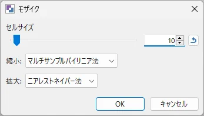

Here is how to apply a mosaic to specific parts of an image using paint.net.

When uploading an image to the internet, there may be times when you want to blur or pixelate a specific area.
With paint.net, you can quickly edit your images.

## Steps

#### 1. Open the image you want to pixelate in paint.net
#### 2. Use the selection tool to select the area you want to pixelate (multiple selections are possible)

#### 3. Select Menu > Effects > Distort > Pixelate

- Cell Size controls the size of the enlarged pixels. Higher values create larger squares; they do not guarantee that information is safely concealed.
- For square pixel blocks, choose `Multisample Bilinear` for [Scale Down] and `Nearest Neighbor` for [Scale Up].

Click `OK` to close the dialog.

#### 4. The mosaic effect will be applied to the image, so you can now save it.

## Privacy note

If information such as personal data must be reliably concealed, do not rely on pixelation or blur alone. Cover it completely with an opaque solid color, export to PNG or JPEG without layers or edit history, and inspect the exported file. Keep any editable original in a separate, secure location.

That's it.

## References

- [paint.net: Pixelate effect](https://paint.net/doc/latest/EffectsDistortMenu.html)
- [paint.net: Roadmap and change log](https://paint.net/roadmap.html)
- [UK Information Commissioner’s Office: Securely disclosing documents](https://ico.org.uk/media2/pbwchh24/disclosing-documents-to-the-public-securely-all-1-0-0.pdf)
