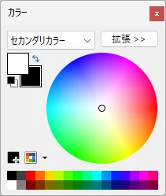

سأوضح لك كيفية إضافة إطار للصور باستخدام paint.net.

## الخطوات

#### 1. افتح الصورة التي تريد إضافة إطار لها في paint.net
#### 2. قم بتعيين اللون الثانوي (هذا سيكون لون الإطار)

إذا لم تكن لوحة الألوان معروضة، فاضغط على مفتاح `F8` على لوحة المفاتيح.

لتعيينه إلى اللون الأسود، انقر فوق .

#### 3. القائمة > الصورة > حدد تغيير حجم القماش

ابتداءً من paint.net 5.1.1، يتضمن مربع حجم اللوحة خيار Fill. ومنذ 5.1 تكون المساحات الجديدة في طبقة Background شفافة؛ لذلك لا يكفي ضبط اللون الثانوي في نافذة الألوان. اختر Secondary Color صراحةً من Fill.

قم بزيادة العرض والارتفاع بمقدار 2 بكسل لكل منهما. زيادة بمقدار 2 بكسل تعني أن الإطار سيكون 1 بكسل.
إذا كنت تريد أن يكون الإطار 5 بكسل، فقم بزيادة العرض والارتفاع بمقدار 10 بكسل لكل منهما.

حدد المرساة لتكون "الوسط"، ثم انقر فوق موافق.

#### 4. سيتم إضافة إطار للصورة، لذا قم بحفظ الصورة.

هذا كل شيء.

## المراجع

- [paint.net documentation: Image menu and Canvas Size](https://paint.net/doc/latest/ImageMenu.html)
- [paint.net documentation: Colors window](https://paint.net/doc/latest/ColorsWindow.html)
- [paint.net roadmap and change log](https://paint.net/roadmap.html)
