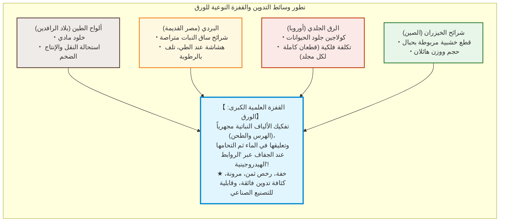
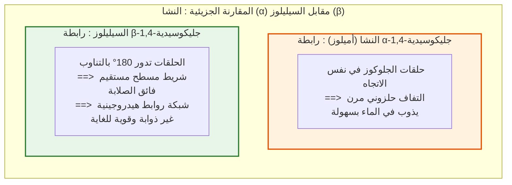
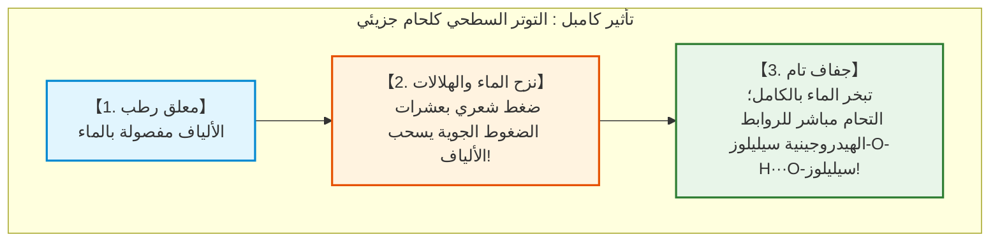
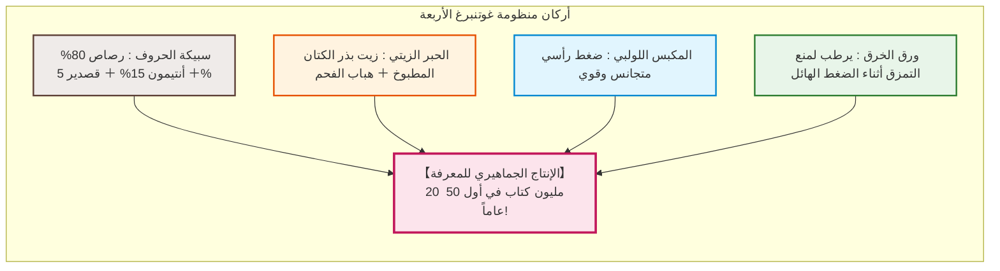
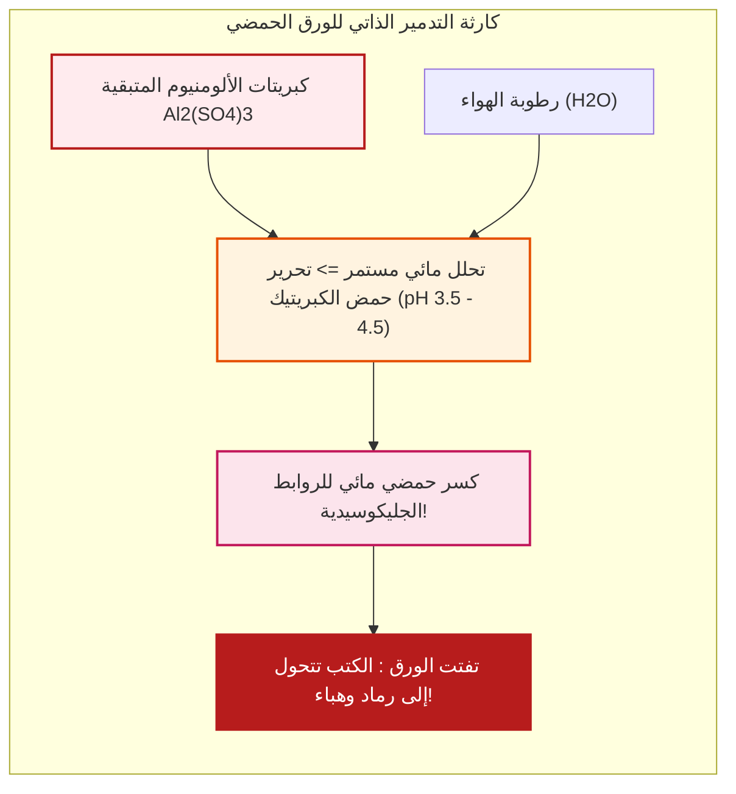

## مقدمة: الرقاقة النباتية الرقيقة التي سرعت وتيرة الحضارة

في تاريخ الحضارة الإنسانية الممتد، يبرز وسيط مادي واحد كان له الفضل الأكبر في تراكم المعارف ونقلها، ومكّن في الخفاء من انطلاق حركة الإصلاح الديني، وعصر النهضة، والثورة العلمية، ونشوء الديمقراطيات الحديثة: **الورق**.

في عصرنا الرقمي، اعتدنا حفظ النصوص كشحنات إلكترونية أو نبضات ضوئية على رقائق السيليكون. ولكن لآلاف السنين، كان الحاضن الرئيسي للفكر البشري والقوانين والعلوم والشعر مجرد ورقة لا يتعدى سمكها 0.1 مليمتر، تتشابك فيها ألياف مجهرية مستخلصة من جدران الخلايا النباتية.

قبل ظهور الورق، عانت وسائط التدوين من عيوب قاتلة:
- **ألواح الطين (بلاد الرافدين)**: بقاء جيولوجي مذهل، ولكنها ثقيلة للغاية ومستحيلة النقل الجماعي.
- **ورق البردي (مصر القديمة)**: شرائح نباتية مضغوطة؛ مرنة في المناخ الجاف، لكنها هشة للغاية في الرطوبة ومقيدة بشكل اللفائف.
- **الرق والجلد (أوروبا والعالم القديم)**: جلود حيوانات مكشوطة؛ متينة ومهدت لشكل الكتاب الحديث (المجلد)، ولكن بتكلفة باهظة (مئات الخراف لنسخ إنجيل واحد).
- **شرائح الخيزران والخشب (الصين القديمة)**: مربوطة بحبال؛ ضخمة وثقيلة تقتضي عربات لنقل مكتبة متواضعة.

يقوم جوهر الورق على هندسة كيميائية جزيئية متقدمة: **تفكيك الألياف النباتية، وتوزيعها في الماء، ثم إعادة التحامها ذاتياً على المستوى الجزيئي أثناء التجفيف دون الحاجة لأي غراء أو مادة لاصقة**.

إن قوة الشد في الورق الجاف تنشأ بالكامل من مليارات **الروابط الهيدروجينية** التلقائية بين جزيئات **السيليلوز**.

---

## الفصل الأول: البنية الجزيئية للسيليلوز وروابط الهيدروجين

### 1.1 سلاسل بوليمرية مستقيمة وروابط $\beta\text{-1,4-جليكوسيدية}$

السيليلوز ($(\text{C}_6\text{H}_{10}\text{O}_5)_n$) هو البوليمر العضوي الأكثر وفرة على وجه الأرض، ويتكون من وحدات **$\text{D-جلوكوز}$** متسلسلة عبر **روابط $\beta\text{-1,4-جليكوسيدية}$**.

وعلى عكس **النشا** ($\alpha$-جليكوسيدي) الذي يلتف في شكل حلزوني مرن قابل للذوبان، تجبر روابط $\beta$ في السيليلوز الحلقات المتجاورة على الدوران بمقدار **$180^\circ$ بالتناوب**، مما يشكل شريطاً جزيئياً مستقيماً فائق الصلابة ومقاوماً للالتواء.

### 1.2 قوة الروابط الهيدروجينية

تحتوي كل وحدة جلوكوز على 3 مجموعات هيدروكسيل ($-\text{OH}$):
1. **داخلية**: تقفل دوران السلسلة مانحة إياها صلابة محورية استثنائية.
2. **بينية**: تربط السلاسل المتوازية في **ألياف دقيقة متبلورة (Microfibrils)** بقطر 3 إلى 4 نانومتر.

ويصل معامل يونغ للألياف الدقيقة المتبلورة إلى **$130 \text{ إلى } 150\,\text{GPa}$**، متفوقاً على الألومنيوم ومنافساً للصلب في الصلابة النوعية.

### 1.3 تأثير كامبل: التوتر السطحي كقوة لحام جزيئية

أثناء التبخر، تشكل قطرات الماء المجهرية فجوات ذات ضغط شعري هائل وفق معادلة يونغ-لابلاس: $\Delta P = \frac{2\gamma \cos \theta}{r}$. وعندما يتقلص نصف القطر للنانومترات، يصل هذا الضغط إلى **عشرات الضغوط الجوية**، جاذباً الألياف لتتلامس على مسافة تقل عن $0.3\,\text{nm}$، حيث تنغلق الروابط الهيدروجينية $-\text{OH} \cdots \text{O}-$ تلقائياً.

---

## الفصل الثاني: تاريخ الورق – من تساي لون إلى أوروبا

- **تساي لون (105م)**: طور صناعة الورق في الصين مستخدماً خرق القنب ولحاء التوت وشباك الصيد المسلوقة في رماد الخشب القلوي.
- **معركة طلاس (751م)**: نقل الأسرى الصينيون أسرار المهنة إلى **سمرقند**. وفي 793م، اعتمدت بغداد الورق رسمياً، مما أطلق **بيت الحكمة**. وفي 1151م، دخل الورق أوروبا عبر **شاطبة (Játiva)** في الأندلس.
- **فابريانو (1268م)**: طورت إيطاليا المطارق المائية لطحن الألياف، واستخدمت الجيلاتين الحيواني للتغرية، وابتكرت **العلامة المائية**.
- **أزمة الخرق**: بحلول القرن الثامن عشر، حدت ندرة الملابس القديمة من التوسع في طباعة الكتب في أوروبا.

---

## الفصل الثالث: ورق الواشي الياباني مقابل عجينة الخشب

- **ألياف اللحاء (كوزو)**: يتميز شجر **الكوزو (توت الورق)** بألياف يتراوح طولها بين **10 إلى 15 ملم** (مقارنة بـ 1-3 ملم لعجينة الخشب)، مما يمنح الواشي مرونة وبقاءً لأكثر من ألف عام.
- **تقنية ناغاشيزوكي**: يقوم الحرفي بتحريك القالب في موجات إيقاعية. وتمنع مادة **النيري** النباتية تشابك الألياف الطويلة وتبطئ تصريف المياه.
- **طريقة كرافت (1884م)**: طهي رقائق الخشب عند $170^\circ\text{C}$ مع $\text{NaOH}$ و $\text{Na}_2\text{S}$ لإذابة **اللجنين** (المادة الصمغية البنية)، لإنتاج ألياف سيليلوزية نقية وفائقة المتانة.

---

## الفصل الرابع: التكامل مع مطبعة غوتنبرغ (حوالي 1450م)

في ماينتس، دمج **يوهانس غوتنبرغ** 4 ابتكارات كبرى:
1. **سبيكة الحروف**: رصاص (80%)، أنتيمون (15%)، قصدير (5%). يتمدد الأنتيمون عند التجمد مستنسخاً أدق تفاصيل الحرف.
2. **الحبر الزيتي**: زيت بذر الكتان مع الهباب الأسود، يلتصق بالمعدن دون أن يسيل على الورق.
3. **المكبس اللولبي الخشبي**: ضغط رأسي موحد مقتبس من معاصر العنب.
4. **ورق الخرق القوي**: يرطب قبل الطباعة ليتحمل الضغط الهائل دون تمزق.

خلال 50 عاماً، طُبع 20 مليون كتاب في أوروبا، مما أشعل شرارة حركة الإصلاح والثورة العلمية.

---

## الفصل الخامس: أزمة الورق الحمضي (النار البطيئة)

في عام 1807، ظهرت تغرية الورق باستخدام **القلفونية وكبريتات الألومنيوم ($\text{Al}_2(\text{SO}_4)_3$)** لمنع تداخل الحبر في آلات الورق السريعة.

إلا أن كبريتات الألومنيوم تتحلل مائياً باستمرار مع رطوبة الهواء مطلقة حمض الكبريتيك الحر، مما أدى لانخفاض الأس الهيدروجيني إلى **3.5 - 4.5**. تسبب هذا في تحلل روابط السيليلوز، وباتت مئات ملايين الكتب المطبوعة بين 1850 و1980 تتفتت كالبسكويت على رفوف المكتبات.

منذ ثمانينيات القرن العشرين، تحولت الصناعة كلياً إلى **الورق الدائم المتعادل (ISO 9706)** المعزز بكربونات الكالسيوم ($\text{CaCO}_3$)، مما يضمن بقاءه لأكثر من 500 إلى 1000 عام.

---

## الفصل السادس: الترميم وألياف النانوسيليلوز (CNF)

- **معالجة بوك كيبير لإزالة الحموضة**: جزيئات أكسيد المغنيسيوم ($\text{MgO}$) النانوية في سوائل مفلورة تعادل الحموضة دون تفكيك الكتب المجلدة.
- **التبطين بالواشي (أوراتشي)**: ورق تينغوتشو فائق الرقة (2 إلى 5 جم/م2) وعجين نشا القمح في متحف اللوفر والمتحف البريطاني. قابل للعكس تماماً بالماء الدافئ.
- **ألياف النانوسيليلوز (CNF)**: شعيرات نانوية بسمك 3-4 نانومتر، **أقوى بخمس مرات من الصلب وبخمس وزنه فقط**، وشفافة كالزجاج.

---

## خاتمة: مرساة الذاكرة البشرية عبر العصور

صُنع الورق من ضوء الشمس والماء، والتحم بالروابط الهيدروجينية، ليكون الوعاء المادي الذي خلد المعرفة وحرر الإنسانية من قيود الألواح والجلود. وفي عصرنا الرقمي السريع الاندثار، يظل الورق الدائم الحارس الأمين لتراث الحضارة الإنسانية.
