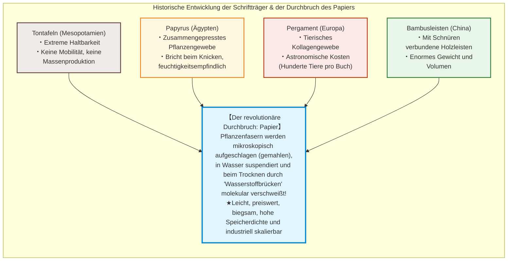
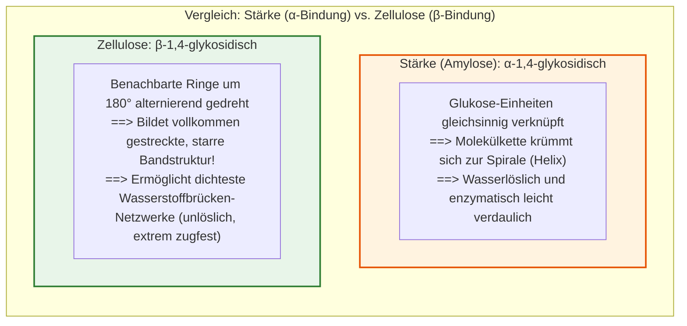
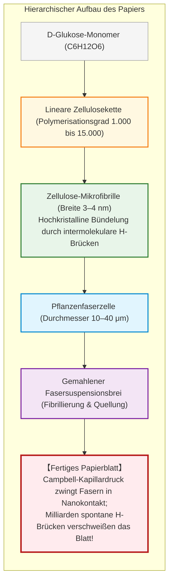

## Einleitung: Das hauchdünne Blatt aus Pflanzenfasern, das die Zivilisation beschleunigte

In der Geschichte der menschlichen Zivilisation gibt es ein materielles Medium, das die Speicherung und Verbreitung von Wissen revolutionierte und im Hintergrund die Reformation, die Renaissance, die wissenschaftliche Revolution und die Entstehung moderner Demokratien erst ermöglichte: **das Papier**.

In unserer heutigen digitalen Informationswelt sind wir daran gewöhnt, Texte und Bilder als elektrische Ladungen auf Siliziumchips, magnetische Spins oder Lichtimpulse zu speichern. Doch über Jahrtausende hinweg war der Träger des menschlichen Geistes, der Gesetze, wissenschaftlichen Erkenntnisse, Religionen und Poesie ein nur etwa 0,1 Millimeter dünnes Blatt aus ineinander verfilzten Pflanzenfasern.

Vor dem Aufkommen des Papiers nutzte die Menschheit verschiedene Trägermedien, die jedoch gravierende Nachteile aufwiesen:
- **Tontafeln (Mesopotamien)**: Nahezu unzerstörbar, aber extrem schwer und unhandlich; für längere Schriften oder massenhafte Verbreitung ungeeignet.
- **Papyrus (Altes Ägypten)**: Aus den Markstreifen der Papyrusstaude gepresst; leicht und biegsam im trockenen Wüstenklima, aber brüchig bei Feuchtigkeit und an die Schriftrollenform gebunden.
- **Pergament (Antike und mittelalterliches Europa)**: Aus enthaarten, gespannten Tierhäuten (Schaf, Ziege, Kalb); robust und beidseitig beschreibbar, aber astronomisch teuer (für eine einzige Bibel mussten Hunderte Tiere geschlachtet werden).
- **Bambus- und Holzleisten (Altes China)**: Zusammengebundene Holzstreifen; ungemein schwer, für eine Bibliothek waren mehrere Ochsenkarren nötig.

Das revolutionäre Wesen des Papiers beruht auf einem echten werkstoffwissenschaftlichen Prozess: **Pflanzenfasern werden mechanisch und chemisch voneinander getrennt (gemahlen), in Wasser suspendiert, auf einem Sieb geschöpft und beim Trocknen auf molekularer Ebene neu vernetzt.**

Das Erstaunlichste daran: **Zur Bindung der Papierfasern wird keinerlei Klebstoff benötigt!** Die hohe Reißfestigkeit von trockenem Papier entsteht vollkommen selbstorganisiert durch Milliarden mikroskopischer **Wasserstoffbrückenbindungen** zwischen den **Zellulosemolekülen**.

---

## Kapitel 1: Die supramolekulare Struktur der Zellulose und die Magie der Wasserstoffbrücken

### 1.1 Lineare Polymere durch $\beta\text{-1,4-glykosidische}$ Bindungen

Der Hauptbestandteil des Papiers ist **Zellulose** ($(\text{C}_6\text{H}_{10}\text{O}_5)_n$), das Gerüst der pflanzlichen Zellwand. Durch Photosynthese entstehen jährlich hunderte Milliarden Tonnen Zellulose – das mit Abstand am häufigsten vorkommende Biopolymer der Erde.

Zellulose ist ein lineares Polymer aus **$\text{D-Glukose}$**, das durch **$\beta\text{-1,4-glykosidische}$ Bindungen** verknüpft ist.

Im Gegensatz zur **Stärke**, deren $\alpha$-Bindungen eine schraubenförmige Spirale erzeugen, zwingt die $\beta$-Verknüpfung der Zellulose benachbarte Glukoseringe zu einer **alternierenden $180^\circ$-Drehung**. Dadurch entsteht eine vollkommen flache, starre Kette von enormer Zugfestigkeit.

### 1.2 Wie Wasserstoffbrücken Fasern ohne Klebstoff verschweißen

An jedem Glukosering befinden sich drei polare **Hydroxylgruppen ($-\text{OH}$)**:
1. **Intramolekulare Wasserstoffbrücken**: Versteifen die einzelne Zellulosekette und verleihen ihr eine enorme Längsstabilität.
2. **Intermolekulare Wasserstoffbrücken**: Vernetzen benachbarte parallele Zelluloseketten zu kristallinen **Mikrofibrillen** von 3 bis 4 Nanometern Durchmesser.

Der theoretische axiale Elastizitätsmodul einer Zellulose-Mikrofibrille erreicht **$130 \text{ bis } 150\,\text{GPa}$** – mehr als das Doppelte von Aluminium ($\approx 70\,\text{GPa}$) und mit einem weit besseren Festigkeits-Gewichts-Verhältnis als Stahl.

### 1.3 Der Campbell-Effekt: Wenn Oberflächenspannung Moleküle verschweißt

Beim Trocknen auf dem Sieb zieht die Oberflächenspannung des verdunstenden Wassers die flexiblen Fibrillen über den **Campbell-Effekt** (Kapillardruck nach Young-Laplace: $\Delta P = \frac{2\gamma \cos \theta}{r}$) mit einem Druck von **mehreren Megapascal (Dutzenden Atmosphären)** zusammen. Sobald der Abstand unter $0{,}3\,\text{nm}$ fällt, schließen sich die direkten $-\text{OH} \cdots \text{O}-$ Wasserstoffbrücken nahtlos.

Wird Papier nass, dringen polare Wassermoleküle zwischen die Zelluloseketten und verdrängen diese Brücken – das Papier reißt mühelos. Trocknet es erneut, bilden sich die Wasserstoffbrücken wieder aus.

---

## Kapitel 2: Die Evolution der Papierherstellung – Von Cai Lun bis Europa

### 2.1 Cai Luns Standardisierung (Osthansche Dynastie, 105 n. Chr.)

Im Jahr 105 n. Chr. perfektionierte der Hofbeamte **Cai Lun** in China das Verfahren durch die Nutzung von Altlumpen, Maulbeerbaumbast und Fischernetzen, gekocht in alkalischer Holzaschenlauge und zerstoßen im Holzmörser. Dies begründete die massenhafte Produktion des **„Cai-Marquis-Papiers“**.

### 2.2 Die Schlacht am Talas (751 n. Chr.) und das Goldene Zeitalter des Islam

751 n. Chr. besiegten die Abbasiden die chinesische Tang-Armee in der **Schlacht am Talas**. Unter den Kriegsgefangenen befanden sich Papiermacher, die nach **Samarkand** gebracht wurden. Von dort gelangte das Wissen nach Bagdad (793 n. Chr.), wo Kalif Harun al-Raschid Papyrus per Dekret abschaffte. Die Verfügbarkeit von Papier befeuerte das **„Haus der Weisheit“ (Bait al-Hikma)** und rettete das antike Wissen. Über Nordafrika erreichte die Technik 1151 das spanische **Játiva**.

### 2.3 Fabriano und der Hadernmangel

Ab 1268 revolutionierte das italienische **Fabriano** die europäische Produktion durch wasserkraftbetriebene Stampfwerke, tierische Gelatine-Leimung (resistent gegen Eisengallustinte) und das **Wasserzeichen**. Ende des 18. Jahrhunderts führte der Bildungshunger jedoch zum dramatischen **Hadernmangel (Lumpenmangel)**.

---

## Kapitel 3: Washi vs. Industrieller Holzzellstoff

### 3.1 Die Geometrie der Bastfasern (Kozo)

Japanisches **Washi** nutzt Bastfasern von Sträuchern wie **Kozo (Papiermaulbeere)**:
- Kozo-Fasern sind **10 bis 15 mm lang** (3- bis 10-mal länger als Holzzellstoff mit 1 bis 3 mm).
- Sie verfilzen dreidimensional zu einem extrem zähen Vlies, das tausende Faltungen schadlos übersteht.

### 3.2 Das Nagashizuki-Schöpfen und Neri-Schleim

Beim japanischen **Nagashizuki-Verfahren** bewegt der Schöpfer die Suspension in rhythmischen Wellen. Der pflanzliche Schleim **Neri** (aus Tororo-Aoi-Wurzeln) verhindert durch sterische Hinderung das Verklumpen der langen Fasern und verzögert das Ablaufen des Wassers.

### 3.3 Der chemische Holzaufschluss (Kraft-Verfahren)

Holz besteht aus Zellulose, Hemizellulose und **Lignin (20–30 %)**, das wie Zement wirkt und vergilbt. Das 1884 entwickelte **Kraft-Verfahren (Sulfatverfahren)** löst Lignin bei $170^\circ\text{C}$ in Natronlauge und Natriumsulfid selektiv heraus und liefert hochreine, zugfeste Zellulosefasern.

---

## Kapitel 4: Die Symbiose mit dem Buchdruck – Gutenberg

Um 1450 vereinte **Johannes Gutenberg** in Mainz vier Schlüsseltechnologien:
1. **Gusslegierung**: Blei (80 %), Antimon (15 %), Zinn (5 %) – Antimon dehnt sich beim Erstarren aus und bildet feinste Lettern exakt ab.
2. **Ölbasierte Druckfarbe**: Leinölfirnis mit Ruß haftet perfekt auf Metall.
3. **Spindelpresse**: Abgeleitet von Weinpressen für gleichmäßigen Druck.
4. **Hadernpapier**: Elastisch und druckfest.

Zwischen 1450 und 1500 entstanden 20 Millionen Bücher – mehr als in ganz Europa im vorherigen Jahrtausend handgeschrieben wurden. Dies ermöglichte Luthers Reformation und die moderne Naturwissenschaft.

---

## Kapitel 5: Die Krise des sauren Papiers (Slow Fire)

1807 erfand Moritz Illig die **Harz-Alaun-Leimung** mit **Aluminiumsulfat ($\text{Al}_2(\text{SO}_4)_3$)** zur Verhinderung des Tintenverlaufens auf Papiermaschinen.

Aluminiumsulfat hydrolysiert jedoch mit Luftfeuchtigkeit kontinuierlich zu freier Schwefelsäure:
$$[\text{Al(H}_2\text{O)}_6]^{3+} + \text{H}_2\text{O} \rightleftharpoons [\text{Al(OH)(H}_2\text{O)}_5]^{2+} + \text{H}_3\text{O}^+$$
Der pH-Wert im Papier stürzte auf **3,5 bis 4,5** ab. Die Säure spaltete die $\beta$-glykosidischen Bindungen (Säurehydrolyse). Bücher aus den Jahren 1850 bis 1980 zerbröseln heute in den Bibliotheken wie trockene Kekse („stilles Feuer“).

Seit den 1980er Jahren stellt die Industrie auf **säurefreies, neutrales Papier (ISO 9706)** mit Kalziumkarbonat ($\text{CaCO}_3$) als basischem Puffer um (Haltbarkeit > 500 bis 1.000 Jahre).

---

## Kapitel 6: Konservierung und Nanofasern (CNF)

- **Bookkeeper-Massenentsäuerung**: MgO-Nanopartikel in fluorierten Flüssigkeiten neutralisieren Säuren im intakten Buchblock.
- **Washi-Restaurierung (Urauchi)**: Ultradünnes Kozo-Papier (Tengucho, 2–5 g/m2) kaschiert Risse unsichtbar und reversibel mit Weizenstärkekleister.
- **Zellulose-Nanofasern (CNF)**: 3–4 nm dünne Fibrillen mit **5-facher Zugfestigkeit von Stahl bei einem Fünftel des Gewichts**, glasklar und thermisch formstabil.

---

## Fazit: Der materielle Anker des menschlichen Geistes

Papier ist aus Sonnenlicht, Wasser und Kohlendioxid gewebtes Wissen. Durch die molekulare Kraft der Wasserstoffbrücke schuf es das externe Gedächtnis der Menschheit. Selbst im Zeitalter flüchtiger digitaler Daten bleibt das beständige Papierblatt das verlässlichste Fundament unserer Zivilisation.
