## Introduction: The Thin Sheet of Plant Fibers That Accelerated Human Civilization

Across the vast panorama of human history, a single physical medium stands out as the catalyst for the accumulation and transmission of knowledge, quietly enabling the Protestant Reformation, the Renaissance, the Scientific Revolution, and the rise of modern constitutional democracies: **Paper**.

In our contemporary digital ecosystem, we take for granted the instantaneous storage and transmission of text and imagery as electric charges within silicon microchips, magnetic domain spins, or optical pulses across fiber-optic conduits. Yet for millennia, the bedrock upon which human thoughts, legal codices, mathematical discoveries, religious revelations, and poetry were preserved across space and time was a thin sheet—measuring a mere 0.1 millimeter in thickness—composed of intricately interwoven plant cell-wall microfibers.

Prior to the widespread availability of paper, human civilizations recorded their thoughts across a diverse, yet severely limited, array of physical substrates:
- **Clay Tablets (Mesopotamia)**: Unrivaled in geological durability, but exceptionally heavy and cumbersome. Transporting extended treatises or distributing mass literature was physical impossibility.
- **Papyrus (Ancient Egypt)**: Fabricated by beating and overlapping the pith of the marsh reed *Cyperus papyrus*. While lightweight and relatively flexible in the arid Mediterranean basin, papyrus turned brittle in humid climes, lacked tear resistance, and was constrained to scroll (rotulus) formats.
- **Parchment and Vellum (Pergamon, Greece, Rome, Medieval Europe)**: Produced from the scraped, lime-treated skins of sheep, goats, or newborn calves. Parchment was robust, could be written upon on both sides, and facilitated the codex (modern book) format. However, its economic cost was staggering: manufacturing a single illuminated Bible required the slaughter of an entire herd of several hundred animals.
- **Bamboo and Wooden Slips (Ancient China)**: Thin strips of bamboo or timber stitched together with hemp cords. Although widely used, their bulk was immense; transporting a philosophical library of a few hundred thousand characters required several ox-drawn carts.

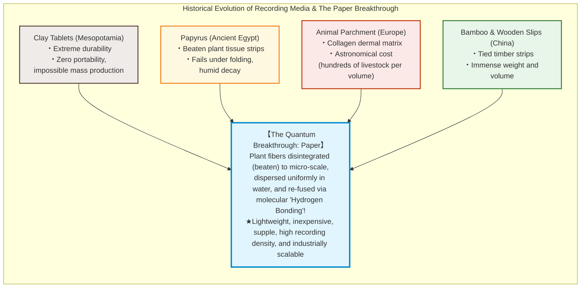

The profound revolution of paper lies in its manufacturing process: unlike papyrus, which merely glues together raw plant tissues, and unlike parchment, which merely preserves dried animal dermal collagen, **paper is an engineered polymer composite**. It requires that plant fibers be mechanically and chemically broken down (beaten), suspended freely as individual fibrils in water, collected on a permeable wire mesh, and reconstituted through liquid drainage and drying.

Astonishingly, **no external adhesive, glue, or chemical binder is required to hold paper together**. The tensile strength of dry paper arises purely from a fundamental quantum-chemical interaction: as water evaporates, the hydroxyl ($-\text{OH}$) groups of the **cellulose** polymers spontaneously self-assemble into a microscopic, three-dimensional network of billions of **hydrogen bonds**.

This treatise explores the comprehensive science of paper: from the supramolecular physics of cellulose and hydrogen bonding to the historical diffusion from China through the Islamic world to Europe, the distinct mechanical characteristics of Japanese *washi* versus Western wood pulp, the technical symbiosis with Gutenberg's printing press, the 19th-century acid paper self-destruction catastrophe, modern mass deacidification science, and the frontier of cellulose nanofibers (CNF) exceeding the strength of structural steel.

---

## Chapter 1: The Supramolecular Architecture of Cellulose and the Miracle of Hydrogen Bonding

### 1.1 Linear Polymeric Chains via $\beta\text{-1,4-Glycosidic}$ Linkages

The structural essence of paper is **cellulose** ($(\text{C}_6\text{H}_{10}\text{O}_5)_n$), the primary constituent of plant cell walls. Photosynthetic organisms synthesize hundreds of billions of metric tons of cellulose annually, making it by far the most abundant organic polymer on Earth.

Chemically, cellulose is a linear, unbranched polysaccharide composed of repeating **$\text{D-glucose}$ (dextrose)** monomers joined by dehydration condensation. The critical defining characteristic of cellulose is its **$\beta\text{-1,4-glycosidic}$ linkage**.

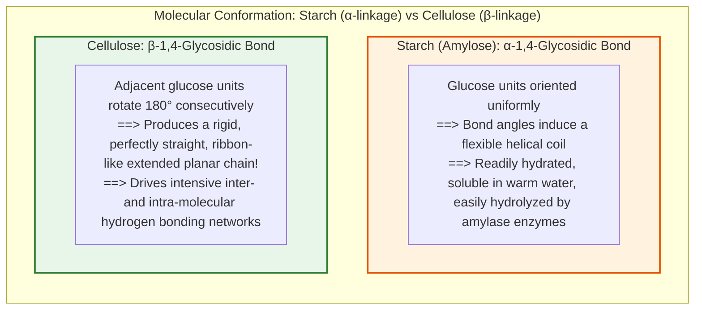

Consider the contrast between starch and cellulose. Both are composed exclusively of identical glucose monomers. However, because **starch (amylose)** is linked via **$\alpha\text{-1,4-glycosidic}$ bonds**, its polymer backbone bends continuously, forming a loose, flexible helix. This allows water molecules to penetrate easily, making starch water-soluble and digestible by metabolic enzymes (amylases).

In stark contrast, the **$\beta\text{-1,4-glycosidic}$ bond** of cellulose forces each successive glucose ring to flip **$180^\circ$ relative to its neighbor** along the glycosidic axis. This alternating symmetry creates an extraordinarily rigid, flat, ribbon-like linear polymer chain devoid of helical twisting.

The degree of polymerization (DP, number of repeating glucose units $n$) typically ranges from 1,000 to 5,000 in industrial wood pulps, and exceeds 10,000 to 15,000 in pristine natural plant fibers like flax, hemp, and cotton.

### 1.2 The Quantum Dynamics of Hydrogen Bonding

Why do isolated plant fibers floating in water solidify into a tough, cohesive sheet upon drying without any glue? The answer resides in the three **hydroxyl groups ($-\text{OH}$)** decorating each glucose ring (at carbon positions C2, C3, and C6).

A hydrogen bond is an electrostatic attraction between a hydrogen atom covalently bonded to an electronegative atom (oxygen, $\text{O}^{\delta-}-\text{H}^{\delta+}$) and the lone pair of electrons on an adjacent oxygen atom. While individual hydrogen bonds possess a modest binding energy ($10 \text{ to } 40\,\text{kJ/mol}$—roughly an order of magnitude weaker than covalent bonds), their collective sum across millions of overlapping cellulose fibrils generates immense mechanical strength.

Two distinct modalities of hydrogen bonding govern the architecture of cellulose:
1. **Intramolecular Hydrogen Bonds**:
   Formed within the same cellulose chain—specifically between the C3 hydroxyl group and the ring oxygen ($\text{O}_5$) of the adjacent glucose unit, and between C2 and C6 hydroxyls. These internal hydrogen bonds lock the polymer chain against torsional rotation, imparting exceptional axial stiffness and high tensile modulus.
2. **Intermolecular Hydrogen Bonds**:
   Formed laterally between parallel, adjacent cellulose chains. These side-to-side hydrogen bridges bundle dozens of cellulose molecules into tightly packed, crystalline arrays.

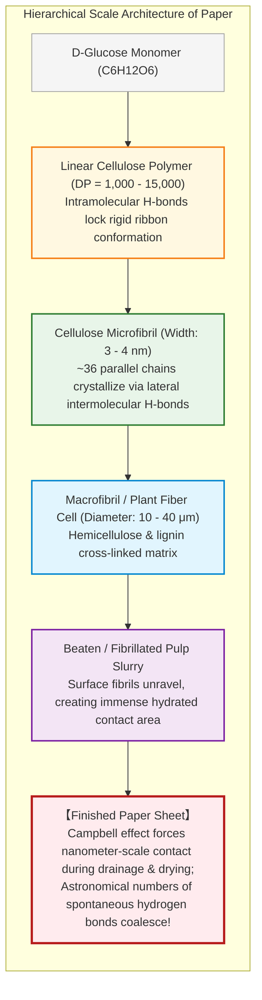

Bundles of approximately 36 parallel cellulose chains coalesce via intermolecular hydrogen bonds into **cellulose microfibrils** (3 to 4 nanometers in diameter). Within these microfibrils, cellulose achieves a near-perfect crystalline arrangement (Cellulose I lattice).

The theoretical axial Young's modulus (elastic modulus) of a single crystalline cellulose microfibril reaches an astonishing **$130 \text{ to } 150\,\text{GPa}$**—surpassing structural aluminum alloys ($\approx 70\,\text{GPa}$) and rivaling structural steel ($\approx 200\,\text{GPa}$) on an absolute basis, while possessing a vastly superior **specific modulus (stiffness-to-weight ratio)** due to its low density ($\approx 1.5\,\text{g/cm}^3$).

### 1.3 The Campbell Effect: How Surface Tension Pulls Fibrils Together

In an aqueous pulp suspension, why don't cellulose fibers simply slip past one another indefinitely? What physical mechanism forces them into intimate molecular contact so that hydrogen bonds can snap into place?

The driving mechanism is a remarkable physical phenomenon known in papermaking physics as the **Campbell Effect** (named after Canadian pulp and paper scientist W. Boyd Campbell):

1. **Hydrated Dispersion (Wet Web)**:
   In the wet state on the papermaking screen, individual pulp fibers are covered in fine, unraveling sub-micron fibrils (fibrillated surfaces). Vast numbers of water molecules hydrate the hydroxyl groups, acting as a molecular lubricant and preventing direct fiber-to-fiber bonding.
2. **Capillary Meniscus Formation**:
   As bulk water drains through the wire mesh and thermal drying begins, liquid recedes into the microscopic crevices and capillary pores between intersecting fibers. At each junction, curved liquid-vapor interfaces—**menisci**—are established.
3. **Laplace Capillary Pressure**:
   Under the laws of fluid mechanics, a curved liquid meniscus generates a negative capillary pressure governed by the **Young-Laplace equation**:
   $$\Delta P = \frac{2\gamma \cos \theta}{r}$$
   where $\gamma$ is the surface tension of water ($\approx 72.8\,\text{mN/m}$ at $20^\circ\text{C}$), $\theta$ is the contact angle (near zero for hydrophilic cellulose), and $r$ is the radius of curvature of the microscopic water meniscus.
   As water continues to evaporate and the meniscus radius $r$ contracts to nanometer dimensions ($r \approx 5 \text{ to } 10\,\text{nm}$), the capillary suction pressure $\Delta P$ skyrockets to **several megapascals (tens of atmospheres of compressive pressure)**.
4. **Molecular Fusion via Hydrogen Bonding**:
   This enormous Campbell pressure pulls the flexible, swollen fibrils into atomic proximity. The moment the separation distance shrinks below the critical hydrogen bonding threshold ($0.27 \text{ to } 0.30\,\text{nm}$), intervening water molecules vaporize, and direct $-\text{OH} \cdots \text{O}-$ hydrogen bonds lock into place across the entire contact surface.

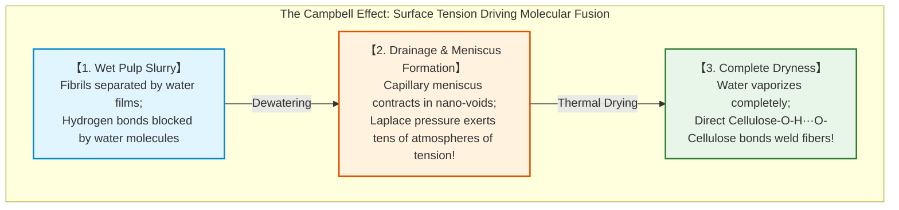

#### Why Does Paper Tear Effortlessly When Wet?

This exact thermodynamic model explains why paper loses almost all tensile strength when submerged in water.

When dry paper is exposed to liquid water, the polar $\text{H}_2\text{O}$ molecules aggressively compete with the existing inter-fiber hydrogen bonds. Water molecules insert themselves between the cellulose chains, establishing new hydrogen bonds between water and hydroxyl groups (hydration). The direct fiber-to-fiber hydrogen bonds are severed, and the fibers slide freely apart. However, because the covalent cellulose chains themselves remain intact, re-drying the wet paper reconstitutes the Campbell effect, allowing the sheet to recover a substantial fraction of its original tensile strength.

---

## Chapter 2: The Evolutionary History of Papermaking—From Cai Lun to Samarkand and Europe

### 2.1 Cai Lun’s Standardization of Papermaking (Eastern Han, 105 AD)

Archaeological excavations across China—such as the Baqiao tomb in Shaanxi (2nd century BC) and Fangmatan in Gansu (circa 179–141 BC)—have unearthed rudimentary proto-paper made from hemp. However, these Western Han specimens were coarse, uneven in caliper, and primarily utilized for packaging and wrapping rather than coherent calligraphy.

The monumental breakthrough that transformed papermaking into an industrialized medium of public administration occurred in **105 AD**, when **Cai Lun (蔡倫)**, a court eunuch serving Emperor He of the Eastern Han dynasty, systematized and revolutionized the manufacturing process. His standardized product, presented to the imperial court, was celebrated as **"Marquis Cai's Paper" (蔡侯紙)**.

Cai Lun's technological genius was rooted in **raw material diversification and alkaline maceration/beating protocols**:
1. **Upcycling Fibrous Waste**: Rather than relying on costly raw fibers, Cai Lun incorporated rags (discarded hemp garments), mulberry tree bark (bast fibers), worn fishing nets, and hemp cordage.
2. **Alkaline Retting & Cooking**: Raw plant materials were boiled in alkaline wood ash lye (potassium carbonate, $\text{K}_2\text{CO}_3$). This chemical treatment dissolved non-cellulosic encrustants: pectins, lignins, waxes, and natural resins.
3. **Mechanical Mashing (Beating)**: Boiled fibers were subjected to rigorous pounding with wooden mallets and stone mortars, separating the fiber bundles into individualized, fibrillated filaments.
4. **Sheet Formation & Drying**: Suspended in water, fibers were skimmed using a woven bamboo-screen mould (*sou*), drained, pressed to express water, and pasted onto heated drying walls.

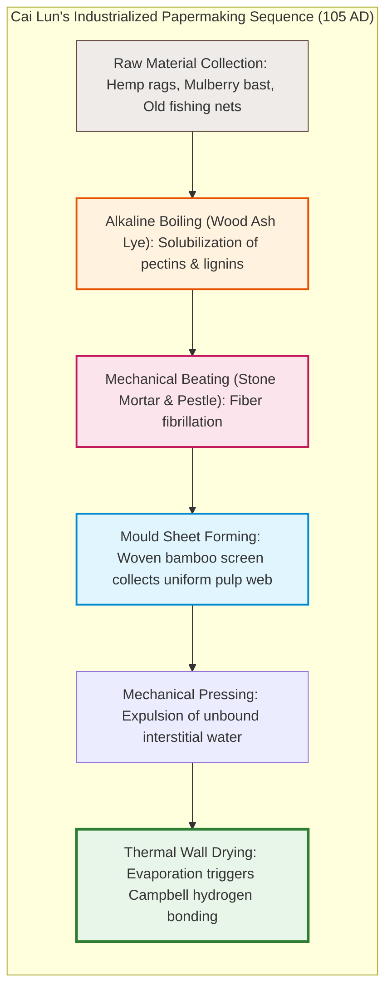

### 2.2 The Battle of Talas (751 AD) and the Islamic Renaissance

For over six centuries, papermaking remained an imperial secret confined to East and Central Asia. The geopolitical catalyst that propelled papermaking westward was one of world history’s most decisive military confrontations: **The Battle of Talas** (751 AD), fought along the border of modern-day Kazakhstan and Kyrgyzstan.

In this epic clash between the Tang Empire (commanded by General Gao Xianzhi) and the Abbasid Caliphate, the Tang forces suffered a catastrophic defeat. Among the thousands of Chinese soldiers taken prisoner were skilled **papermaking artisans**.

The Abbasids marched these prisoners to **Samarkand** (in modern Uzbekistan), a bustling Silk Road oasis renowned for abundant flowing alpine streams and agricultural crops of flax and hemp. Within months, Samarkand blossomed into the papermaking capital of the Islamic world. **"Samarkand Paper"** became legendary for its silken smoothness, pure white hue, and durability.

```mermaid
flowchart LR
    subgraph PaperDiffusion["The Transcontinental Diffusion of Papermaking"]
        direction LR
        China["China (105 AD)<br/>Cai Lun standardization"]
        Samarkand["Samarkand (751 AD)<br/>Battle of Talas<br/>Tang artisan prisoners"]
        Baghdad["Baghdad (793 AD)<br/>Harun al-Rashid<br/>House of Wisdom"]
        Cairo["Cairo & Damascus<br/>(10th Century)<br/>Extinction of papyrus"]
        Spain["Spain & Italy<br/>Játiva (1151)<br/>Fabriano (1268)"]
        Europe["Western Europe<br/>(14th - 15th Century)<br/>Gutenberg printing press"]
        
        China -->|751 AD| Samarkand
        Samarkand -->|793 AD| Baghdad
        Baghdad --> Cairo
        Cairo -->|North Africa| Spain
        Spain --> Europe
    end
    
    style China fill:#ffebee,stroke:#b71c1c,stroke-width:2px
    style Samarkand fill:#fff3e0,stroke:#e65100,stroke-width:2px
    style Baghdad fill:#e1f5fe,stroke:#0288d1,stroke-width:2px
    style Spain fill:#e8f5e9,stroke:#2e7d32,stroke-width:2px
    style Europe fill:#f3e5f5,stroke:#7b1fa2,stroke-width:3px
```

The technology rapidly spread to Baghdad under Caliph Harun al-Rashid in 793 AD. Papyrus was decisively abandoned by imperial decree. The sudden affordability of paper fueled the legendary **House of Wisdom (Bayt al-Hikma)** in Baghdad, facilitating an unprecedented translation movement that preserved Aristotle, Plato, Galen, Euclid, and Ptolemy, while fostering groundbreaking Islamic mathematics (algebra), astronomy, and medicine.

By the 10th century, papermaking expanded to Damascus, Cairo, and Fez (Morocco). In 1151, the craft entered Europe through Muslim-controlled Iberia at **Játiva** (Xàtiva, near Valencia).

### 2.3 The Italian Revolution at Fabriano and the Rag Bottleneck

In Christian Europe, papermaking achieved full industrial maturity in the town of **Fabriano**, located in the Marche region of central Italy, around 1268.

The papermakers of Fabriano introduced three seminal innovations that standardized Western paper production:
1. **Hydraulic Trip-Hammer Stamping Mills**:
   Replacing manual pestles and foot treadles, Fabriano engineers harnessed mountain streams to drive camshafts operating battery arrays of heavy wooden trip-hammers. This mechanized water power reduced the maceration time of linen and cotton rags from days to hours while delivering unprecedented uniformity.
2. **Gelatin Surface Sizing**:
   Islamic paper relied on wheat starch or rice paste for sizing (surface sealing to prevent ink feathering). Unfortunately, starch was vulnerable to mold growth and insect infestation in humid European climates. Fabriano artisans replaced starch with **gelatin extracted from boiled animal skins and hooves** (a byproduct of local tanneries). This animal-protein barrier formed a tough, water-repellent film that perfectly resisted corrosive acidic iron-gall inks.
3. **The Watermark (Wiremark)**:
   By weaving intricate wire emblems into the brass-wire laid mould, papermakers created localized thinned areas in the wet pulp web. Held up to the light, these watermarks authenticated paper origin, format, and guild quality.

However, by the late 18th century, European society hit the **"Rag Bottleneck"**. Because paper was derived strictly from worn linen shirts, cotton garments, and discarded naval canvas, book production was hard-capped by the global supply of discarded rags. Nations enacted strict embargoes criminalizing rag export; rag-pickers (*chiffonniers*) scoured city streets, and paper mills regularly stood idle awaiting shipments of shredded clothing. The Industrial Revolution urgently required a non-textile, limitless source of cellulose.

---

## Chapter 3: Comparative Science of Japanese Washi and Western Wood Pulp

The evolutionary divergence between East Asian and Western papermaking produced two completely different material philosophies: **Japanese Washi (和紙)**, engineered from long plant bast fibers, and **Western Industrial Paper**, engineered from chemical wood pulp.

### 3.1 The Geometry of Bast Fibers: Kozo, Mitsumata, and Gampi

The legendary longevity, flexibility, and mechanical resilience of Japanese washi stems directly from its primary raw materials: **bast fibers (phloem tissues)** harvestable from the inner bark of specific deciduous shrubs.

| Fiber Source | Botanical Classification | Key Structural & Mechanical Characteristics | Average Fiber Length | Fiber Width |
|---|---|---|---|---|
| **Kozo (Broussonetia papyrifera)** | Mulberry family (Moraceae) | Accounts for ~90% of washi. Exceptionally long, robust, thick-walled fibers. Supreme tensile and tear strength. Used for archival records, shoji, and art conservation. | **10 to 15 mm** | ~30 μm |
| **Mitsumata (Edgeworthia chrysantha)** | Mezereon family (Thymelaeaceae) | Fine, soft, pliable fibers yielding an exceptionally smooth, lustrous, dense sheet. The primary fiber in Japanese Yen banknotes. | **3 to 4 mm** | ~12 μm |
| **Gampi (Wikstroemia sikokiana)** | Mezereon family (Thymelaeaceae) | Wild-harvested only; impossible to cultivate. Naturally translucent, glossy, insect-resistant, highly resistant to moisture. Used for tracing paper and gold-leaf beating. | **3 to 5 mm** | ~10 μm |
| **Softwood Kraft Pulp (Coniferous)** | Pine, Spruce, Larch (Gymnosperms) | Derived from trunk wood xylem tracheids. Serves as the structural framework in Western industrial papers. | **2.5 to 4.5 mm** | 30 to 40 μm |
| **Hardwood Kraft Pulp (Deciduous)** | Birch, Eucalyptus, Aspen (Angiosperms) | Short libriform wood fibers. Imparts smoothness, opacity, and superior ink printability. | **0.8 to 1.5 mm** | 15 to 20 μm |

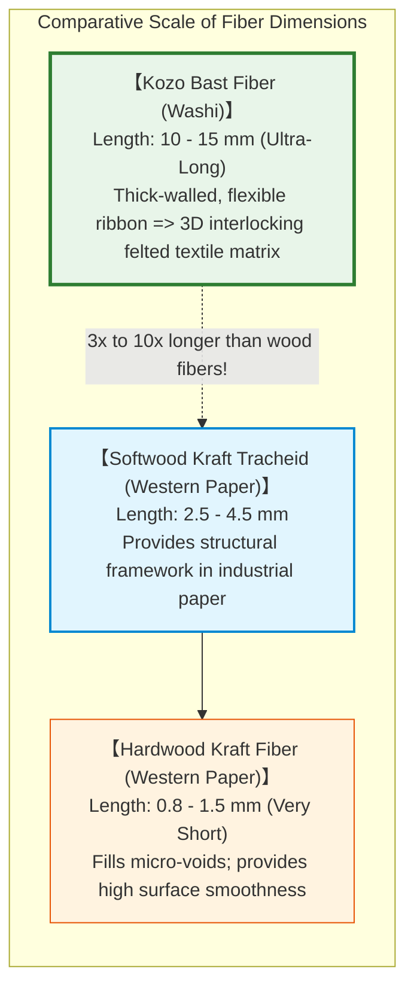

While wood fibers in standard printing paper measure a modest 1 to 3 millimeters, Kozo bast fibers reach an astounding **10 to 15 millimeters in length**. When processed without harsh chemical destruction, these elongated ribbons interlace three-dimensionally like spun yarn. Consequently, a sheet of washi can be folded tens of thousands of times along the exact same crease without fiber breakage.

### 3.2 The Fluid Dynamics of Nagashizuki and the Colloid Chemistry of Neri

The second defining pillar of washi is the unique sheet-forming technique known as **Nagashizuki (流し漉き)**, developed during the Heian period (8th–9th centuries):
- **Tamezuki (溜め漉き / Vat Dipping)**: The ancient static method where pulp slurry is poured onto a stationary mould, allowing water to drain downward under gravity while fibers settle passively. Flocculation (clumping) of long fibers is severe.
- **Nagashizuki (Discharge Action)**: Pulp slurry is scooped into a hinged bamboo mould (*suketa*), vigorously rocked and oscillated in multi-directional waves (**yuri / swaying**), and excess slurry containing unbound fibers is swiftly thrown back into the vat (**sutemizū / discharge water**). This action is repeated multiple times to build up thin laminations.

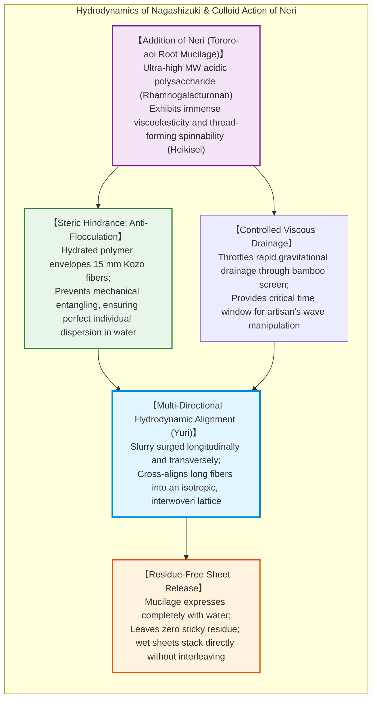

This dynamic fluid alignment is made possible exclusively by **Neri (粘剤)**, a viscous botanical mucilage extracted from the roots of the *Tororo-aoi* plant (*Abelmoschus manihot*).

The active component of Neri is a hyper-branched, ultra-high-molecular-weight polysaccharide (**rhamnogalacturonan**). Neri acts not as an adhesive, but as a sophisticated **colloidal rheology modifier**:
1. **Steric Stabilization**: Long 15-millimeter Kozo fibers would spontaneously coil and knot into lumps in pure water. Neri forms a hydrated lubricating envelope around each fiber, preventing physical entanglement through steric hindrance.
2. **Viscoelastic Drainage Retardation**: Neri imparts high extensional viscosity to water, preventing it from immediately rushing through the bamboo mesh. This gives the craftsman the essential seconds required to wave and interlace the fibers across orthogonal axes.
3. **Clean Desorption**: Unlike animal glues or starches, Neri drains away completely with water and leaves zero residue upon drying, allowing stacks of wet sheets (*shitagami*) to be pressed without adhering to one another.

### 3.3 The Chemical Pulping Revolution and Lignin Extraction

The solution to Europe's rag shortage emerged in the mid-19th century through the birth of **chemical wood pulping**.

Wood is a biological composite resembling reinforced concrete: **cellulose microfibrils** act as high-tensile steel rebar, embedded within a disordered, highly branched amorphous polymer matrix consisting of **hemicelluloses** and **lignin** (20–30% of wood mass). Lignin is a complex three-dimensional aromatic network of cross-linked phenylpropane units. It is dark, brittle, hydrophobic, and susceptible to rapid oxidative yellowing when exposed to UV light.

To manufacture strong, white, durable paper from wood, engineers had to dissolve the lignin matrix without hydrolyzing the structural cellulose chains.

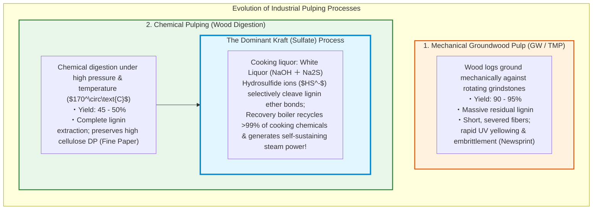

The pinnacle of chemical pulping is the **Kraft Process** (patented by Carl F. Dahl in 1884; "Kraft" meaning "strength" in German), which remains the workhorse of global papermaking:
- Wood chips are cooked in pressurized digesters at $170^\circ\text{C}$ in **"white liquor"**—an aqueous mixture of **sodium hydroxide ($\text{NaOH}$)** and **sodium sulfide ($\text{Na}_2\text{S}$)**.
- Hydrosulfide ions ($\text{HS}^-$) act as powerful nucleophiles, attacking and cleaving the recalcitrant $\beta\text{-O-4}$ ether linkages that bind lignin together, degrading it into water-soluble thiolignin fragments.
- The spent liquor ("black liquor") is concentrated and burned in towering **recovery boilers**, generating superheated steam that powers the entire mill while regenerating $\text{Na}_2\text{S}$ and $\text{NaOH}$ in a closed closed-loop thermodynamic cycle (>99% chemical recovery).

Kraft pulp yields long, unfragmented, pure cellulose fibers capable of immense hydrogen-bonding density.

---

## Chapter 4: Co-Evolution with Printing—From Woodblock to Gutenberg's Movable Type

Paper reached its full world-transforming potential only when it converged with mechanized **printing technology**, breaking the historic bottleneck of the manual scriptorium.

### 4.1 East Asian Precursors: Woodblock and Early Metal Type

The conceptual origins of printing developed in East Asia:
- **Xylography (Woodblock Printing)**: Flourished during China's Tang dynasty (7th century). Landmark survivals include Japan's *Hyakumanto Darani* (770 AD) and the Chinese *Diamond Sutra* (868 AD). Carving an entire page into a single pear-wood block was exquisitely suited for the vast logographic character sets of Chinese, and excelled at producing invariant Buddhist scriptures.
- **Movable Metal Type (Goryeo Korea)**: Movable clay types were trialed by Bi Sheng in Song China (circa 1040s), and the world's first cast bronze movable types emerged in Goryeo Korea in the early 13th century. The *Jikji* (*Baegun Hwasang Chorok Buljo Jikji Simche Yojeol*), printed in Korea in 1377, predates Gutenberg's Bible by 78 years.

However, metal type in Korea remained primarily a state-monopolized, elite endeavor, in part because the tens of thousands of individual Chinese ideograms demanded enormous capital investment to cast and sort. It did not immediately spark a commercial, decentralized publishing explosion.

### 4.2 Johannes Gutenberg's Unified Mechanical System (Mainz, c. 1450)

In Mainz, Germany, around 1450, a trained goldsmith named **Johannes Gutenberg** created a revolution not by inventing a single mechanism, but by engineering a **fully integrated mass-production system**.

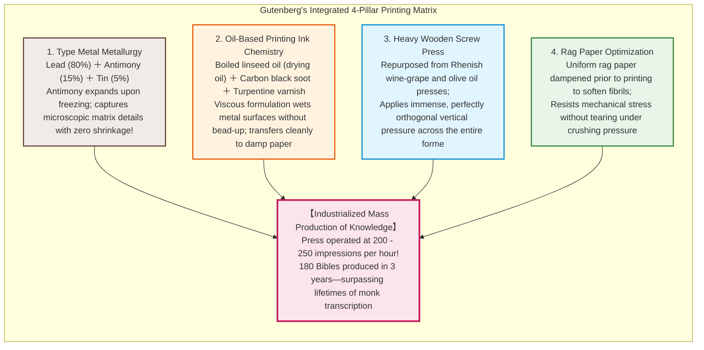

Gutenberg's masterwork was synthesized from four mutually dependent technologies:
1. **Type Metal Alloy Metallurgy**:
   Pure lead was too soft and deformed under press tonnage; iron was too refractory to cast into microscopic letter molds. Gutenberg developed a precision ternary alloy: **Lead (approx. 80%), Antimony (approx. 15%), and Tin (approx. 5%)**. Crucially, **antimony expands as it solidifies** from liquid to solid (anomalous expansion, identical to water freezing). This expansion forced the molten alloy into the microscopic corners of the brass matrix, replicating the delicate serifs of Gothic calligraphy with micron-level fidelity.
2. **Oil-Based Ink Formulation**:
   Traditional water-based calligraphy inks balled up and ran off metal type faces due to high surface tension. Gutenberg formulated an oil-based ink by cooking **linseed oil and walnut oil into a thick drying varnish**, blended with pine soot (carbon black). This ink adhered smoothly to the metal type, did not run or bleed, and polymerized rapidly via oxidation upon contact with paper fibers.
3. **The Mechanical Screw Press**:
   Adapting the powerful wooden screw presses used in the Rhineland wine harvest, Gutenberg engineered a rigid mechanism capable of delivering tons of uniform, perfectly perpendicular pressure across a broad bed.
4. **Co-Evolution with Rag Paper**:
   Parchment was too stiff, variable in thickness, and ruinously expensive to serve a mechanized press. Gutenberg chose premium rag paper, carefully moistening the sheets before printing to swell and soften the cellulose fibers, ensuring deep, crisp ink impression without structural tearing.

### 4.3 The Societal Shockwave: Reformation, Science, and the Public Sphere

Between 1450 and 1500—the period of **incunabula** (books printed in the infancy of the art)—printing presses spread to over 250 European cities. In those 50 years, European presses produced an estimated **20 million volumes**—exceeding the entire cumulative manuscript production of European scribes across the preceding millennium.

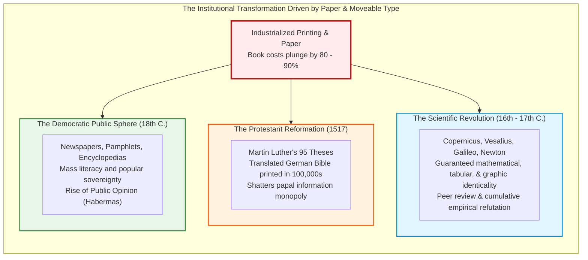

The societal consequences were seismic:
- **Eradication of Cumulative Scribal Error**: In manual copying, transcription errors, omissions, and glosses compounded exponentially with every copy. Printing guaranteed that thousands of scholars across the continent held identical texts, tables, and mathematical proofs.
- **The Protestant Reformation**: When Martin Luther nailed his *95 Theses* to the door of All Saints' Church in Wittenberg in 1517, Latin and German printed translations were circulating across Germany within two weeks, and across Europe within four. Luther's German vernacular New Testament became history's first runaway media bestseller, dismantling the Catholic Church’s monopoly over the scriptures.
- **The Scientific Revolution**: Modern science is impossible without standardized communication. The anatomical woodcuts of Vesalius's *De Humani Corporis Fabrica* (1543), the orbital diagrams of Copernicus's *De Revolutionibus*, the astronomical tables of Kepler, and Newton’s *Principia* (1687) were distributed globally with absolute visual and typographic fidelity, enabling simultaneous critique, replication, and synthesis.

---

## Chapter 5: The Acid Paper Crisis—Self-Destruction of 19th-Century Knowledge

In the mid-19th century, as industrial papermaking machines accelerated production to meet the soaring literacy of the industrial age, papermakers inadvertently planted a chemical time bomb within the pages of their books: **The Acid Paper Crisis (often termed "Slow Fire")**.

### 5.1 The Invention of Internal Rosin-Alum Sizing (1807)

With the advent of the continuous Fourdrinier paper machine, paper webs raced across drying cylinders at unprecedented speeds. However, raw cellulose paper is naturally absorbent; without treatment, liquid ink wicks into the porous network via capillarity, causing characters to feather into illegible blots.

To render paper ink-resistant, it must undergo **sizing**. Medieval papermakers painstakingly dipped finished sheets into tubs of gelatin. For high-speed mechanical reels, this was hopelessly slow.

In 1807, German inventor Moritz Friedrich Illig devised an ingenious solution: **internal engine sizing**:
1. Saponified **rosin soap** (derived from pine resin, primarily sodium abietate $\text{C}_{19}\text{H}_{29}\text{COONa}$) was dumped directly into the wet pulp vat.
2. Because both cellulose fibers and rosin molecules carry negative surface charges in water, they naturally repel each other electrostatically.
3. To bridge this repulsion, papermakers added large quantities of **papermaker's alum: aluminum sulfate ($\text{Al}_2(\text{SO}_4)_3 \cdot 14\text{H}_2\text{O} \text{ to } 18\text{H}_2\text{O}$)**.
4. Trivalent aluminum cations ($\text{Al}^{3+}$) coordinated onto the fiber surfaces, precipitating hydrophobic aluminum-resinate complexes directly onto the cellulose microfibrils.

Rosin-alum sizing was cheap, incredibly effective, and immediately adopted worldwide. From approximately 1850 through the 1980s, virtually every book, legal register, newspaper, and scholarly journal on Earth was manufactured using this chemical recipe.

### 5.2 The Chemistry of Acid Hydrolysis: The "Slow Fire"

What papermakers failed to foresee was that aluminum sulfate is a salt of a weak base ($\text{Al(OH)}_3$) and an exceptionally strong acid ($\text{H}_2\text{SO}_4$).

Trapped inside the dry paper sheet, aluminum ions undergo continuous **hydrolysis** whenever ambient atmospheric humidity ($\text{H}_2\text{O}$) is present:

$$\text{Al}^{3+} + 6\text{H}_2\text{O} \rightleftharpoons [\text{Al(H}_2\text{O)}_6]^{3+}$$

$$[\text{Al(H}_2\text{O)}_6]^{3+} + \text{H}_2\text{O} \rightleftharpoons [\text{Al(OH)(H}_2\text{O)}_5]^{2+} + \text{H}_3\text{O}^+$$

This ongoing equilibrium reaction continuously generates **hydronium ions ($\text{H}_3\text{O}^+$)**—effectively releasing free sulfuric acid inside the paper. Within months of manufacture, the internal pH of rosin-alum sized paper drops into the strongly acidic regime of **$\text{pH } 3.5 \text{ to } 4.5$**.

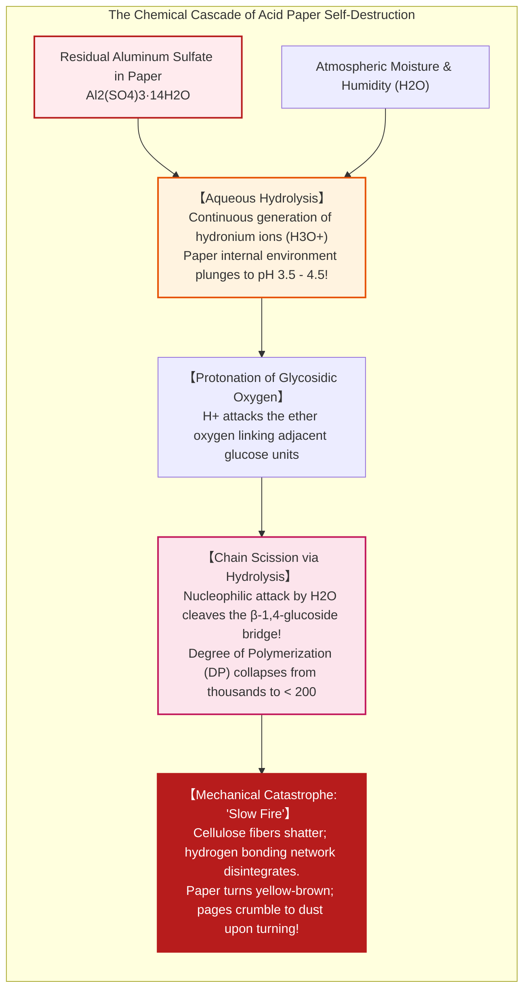

This persistent acidity attacks the structural backbone of paper via **acid-catalyzed hydrolysis**:
1. A proton ($\text{H}^+$) protonates the acetal oxygen atom bridging two glucose rings in the $\beta\text{-1,4-glycosidic}$ bond.
2. The protonated glycosidic bond undergoes heterolytic cleavage, forming a transient cyclic oxocarbenium cation.
3. Water attacks the carbocation, cleaving the covalent polymer chain irreversibly.

As acid hydrolysis progresses over decades, the cellulose **degree of polymerization (DP)** drops precipitously from several thousands down to the critical embrittlement threshold of **$\text{DP } \le 200 \text{ to } 300$**.

By the mid-20th century, research libraries worldwide—including the Library of Congress and the British Library—discovered that hundreds of millions of books published between 1850 and 1980 were disintegrating spontaneously on the shelves. Without ever being mishandled, their pages turned brittle and brown; attempting to open a volume caused the paper to fracture and shatter like a dry cracker. Meanwhile, medieval manuscripts on rag paper and ancient washi scrolls remained pristine. The peak centuries of human industrial progress were vanishing into dust.

### 5.3 The Transition to Alkaline and Neutral Sizing (ISO 9706)

To halt this cultural disaster, conservation scientists and paper chemists led a global crusade in the 1980s to convert paper mills to **neutral and alkaline papermaking**:
1. **Synthetic Sizing Agents**:
   Chemists synthesized reactive, non-acidic sizing compounds—specifically **Alkyl Ketene Dimers (AKD)** and **Alkenyl Succinic Anhydrides (ASA)**. These molecules react directly with the hydroxyl groups of cellulose under neutral-to-mildly-alkaline conditions ($\text{pH } 7.5 \text{ to } 8.5$), forming covalent ester bonds that repel ink without requiring any aluminum sulfate.
2. **Precipitated Calcium Carbonate (PCC)**:
   In an alkaline regime, papermakers could finally replace expensive kaolin clay with cheap, brilliant-white **calcium carbonate ($\text{CaCO}_3$)** as a mineral filler.
3. **The Alkaline Buffer**:
   Calcium carbonate acts as an active **alkaline reserve**. If acidic atmospheric pollutants ($\text{SO}_x, \text{NO}_x$) or environmental contaminants penetrate the paper over centuries, the carbonate sacrificial base neutralizes them instantly:
   $$\text{CaCO}_3 + \text{H}_2\text{SO}_4 \to \text{CaSO}_4 + \text{H}_2\text{O} + \text{CO}_2 \uparrow$$

Under **ISO 9706 (Information and documentation — Paper for documents — Requirements for permanence)**, permanent paper must have an aqueous extract pH between 7.5 and 10.0, an alkaline reserve of at least 2% calcium carbonate equivalent, and high tear resistance. Modern permanent paper is certified to endure for **500 to 1,000 years** under standard library storage conditions.

---

## Chapter 6: Conservation Science and the Future of Cellulose Nanofibers (CNF)

### 6.1 Mass Deacidification and Archival Restoration with Washi

How can society rescue the billions of acidic books and archival records manufactured during the 19th and 20th centuries?

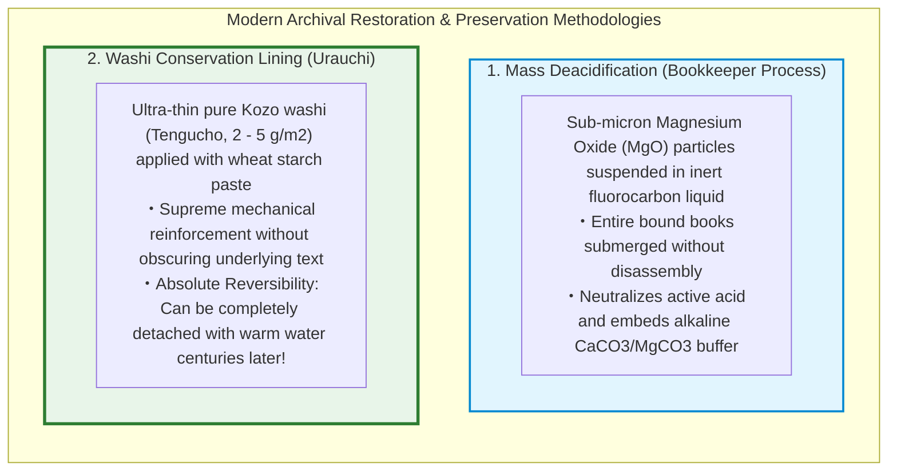

1. **The Bookkeeper Mass Deacidification Process**:
   Disassembling, bathing, and rebinding millions of brittle books individually is logistically impossible. In the **Bookkeeper Process**, complete, bound books are placed in processing chambers and submerged in an inert, non-aqueous fluorocarbon fluid containing suspended sub-micron particles of **magnesium oxide ($\text{MgO}$)**.
   The liquid penetrates deep into the paper pores without dissolving inks or softening glues. The $\text{MgO}$ nanoparticles deposit directly onto the fibers, neutralizing active acid and creating a permanent alkaline buffer:
   $$\text{MgO} + \text{H}_2\text{SO}_4 \to \text{MgSO}_4 + \text{H}_2\text{O}$$
2. **Washi Lining (Urauchi) in Global Conservation**:
   For precious historical manuscripts that have fractured, major cultural institutions around the world—including the Vatican Library, the Louvre Museum, and the British Museum—rely on traditional Japanese conservation techniques.
   Conservators use **Tengujo-shi (典具帖紙)**, an ultra-thin Kozo washi weighing as little as **2 to 5 grams per square meter** (often called "gossamer paper"). Applied to the back of damaged documents using pure, refined wheat starch paste (*jin shofu*), the microscopic Kozo fibers bridge tears with immense tensile strength while remaining almost completely invisible.
   Crucially, this complies with the core tenet of modern heritage conservation: **Reversibility**. If a future restorer needs to remove the backing centuries from now, applying a mild warm-water poultice hydrolyzes the starch paste, releasing the washi without harming the original document.

### 6.2 Cellulose Nanofibers (CNF): The Super-Material of the 21st Century

Far from being a quaint relic of the pre-digital era, the science of plant cellulose has expanded into one of the most promising frontiers of advanced nanotechnology: **Cellulose Nanofibers (CNF)**.

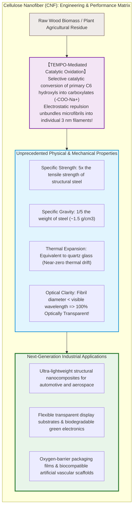

Pioneered by researchers such as Professor Akira Isogai at the University of Tokyo using **TEMPO-mediated catalytic oxidation**, individual cellulose microfibrils can be liberated from wood pulp down to their native crystalline dimensions: **3 to 4 nanometers in width and several micrometers in length**.

The physical attributes of CNF defy traditional materials science intuition:
- **Five times the tensile strength of steel**, at only **one-fifth the weight**.
- **A coefficient of thermal expansion comparable to quartz glass**, meaning it undergoes virtually zero dimensional distortion across vast temperature fluctuations.
- Because individual nanofibrils are dramatically thinner than the wavelengths of visible light ($400 \text{ to } 700\,\text{nm}$), CNF composites do not scatter photons. When embedded in polymer matrices, they produce **completely transparent, flexible, shatterproof plastics** derived entirely from trees.

From lightweight automotive body panels that dramatically reduce carbon emissions to flexible electronic display substrates, hyper-barrier food packaging, and biocompatible tissue scaffolding, plant cellulose is pioneering the post-petroleum material economy.

---

## Conclusion: The Memory Bank of Civilization Forged from Sunlight and Water

Consider the poetic elegance of the papermaking craft:
A tree harnesses sunlight, absorbing atmospheric carbon dioxide and water to synthesize chains of D-glucose via photosynthesis. Human metallurgy and mechanical ingenuity harvest these plant fibers, macerating them into individual fibrils, dispersing them in water, and drawing them through a permeable mesh. As water recedes under surface tension, the fundamental physics of hydrogen bonding spontaneously welds the fibers together into a smooth, pristine sheet.

Paper severed the ancient constraints of clay, stone, papyrus, and parchment. It gave flight to the ideas of Cai Lun, diffused through the battlefields of Talas to illuminate the Islamic Golden Age, provided the physical canvas for Gutenberg’s mechanical press, and sustained the intellectual infrastructure of the modern world.

Even in our current age of ephemeral digital data—where files can be silently deleted, encrypted by ransomware, or rendered unreadable by format obsolescence in a matter of decades—a sheet of permanent alkaline paper or hand-crafted washi created today will stand ready for a human reader a thousand years into the future. Rooted in the quantum mechanics of the hydrogen bond, paper remains humanity's most enduring, resilient, and transformative technology.
