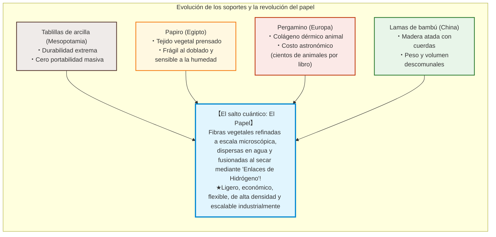
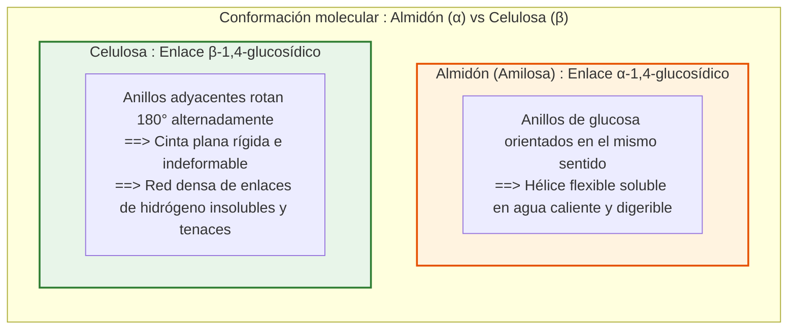
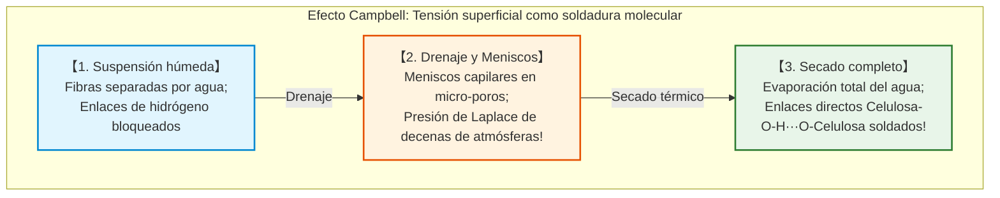
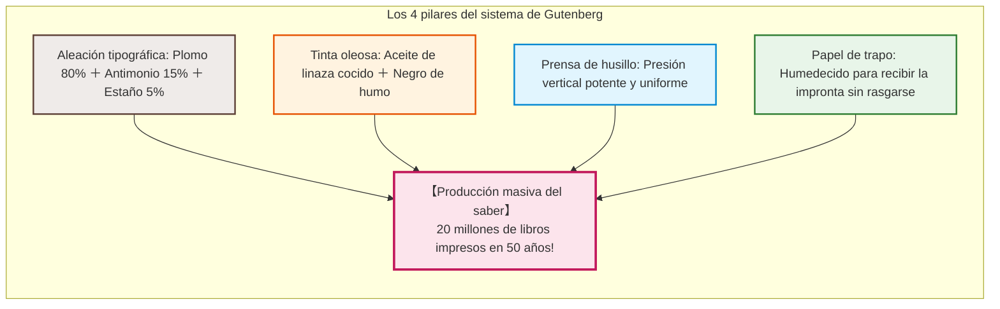
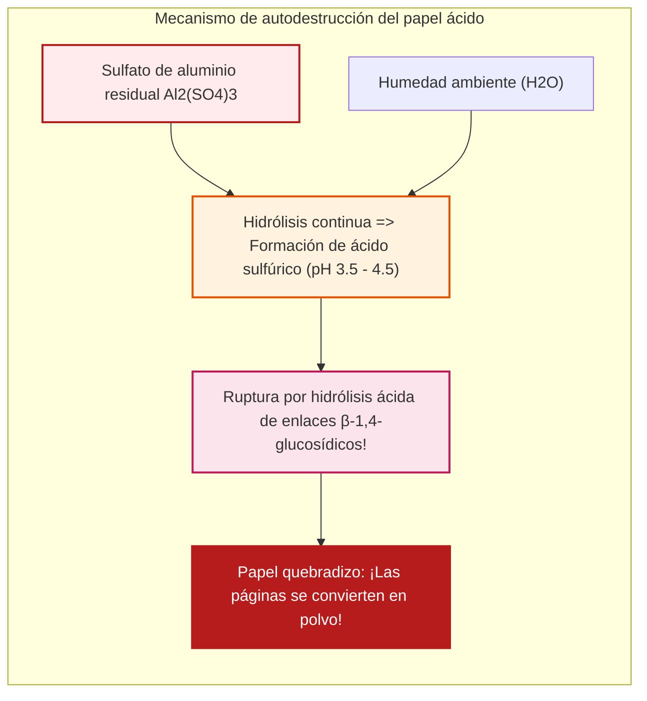

## Introducción: La delgada lámina de fibras vegetales que aceleró la civilización

En la historia universal, un soporte físico singular revolucionó la acumulación y transmisión del saber, haciendo posibles la Reforma protestante, el Renacimiento, la Revolución científica y el surgimiento de las democracias modernas: **el papel**.

En la era digital actual, almacenamos datos como cargas eléctricas en microchips. Sin embargo, durante milenios, el vehículo del intelecto, las leyes, la ciencia y la poesía fue una lámina de apenas 0,1 milímetros de grosor formada por microfibras vegetales entrelazadas.

Antes del papel, los soportes presentaban severas limitaciones:
- **Tablillas de arcilla (Mesopotamia)**: De durabilidad geológica, pero pesadas e imposibles de transportar masivamente.
- **Papiro (Antiguo Egipto)**: Tiras de médula vegetal superpuestas; flexible en climas áridos, pero quebradizo con la humedad y limitado al formato de rollo.
- **Pergamino (Europa medieval)**: Piel animal raspada; resistente y origen del códice, pero de un costo prohibitivo (rebaños enteros sacrificados para un solo libro).
- **Lamas de bambú y madera (China)**: Tablillas atadas con cuerdas; extraordinariamente pesadas y voluminosas.

La revolución del papel reside en su proceso físico-químico: **las fibras vegetales se desintegran (refinan), se suspenden en agua y se reensamblan molecularmente al secar sin pegamento alguno**.

La resistencia a la tracción del papel seco emana de miles de millones de **enlaces de hidrógeno** espontáneos entre moléculas de **celulosa**.

---

## Capítulo 1: Estructura supramolecular de la celulosa y enlaces de hidrógeno

### 1.1 Polímero lineal y enlaces $\beta\text{-1,4-glucosídicos}$

La celulosa ($(\text{C}_6\text{H}_{10}\text{O}_5)_n$) es el biopolímero más abundante del planeta. Es una cadena lineal de **$\text{D-glucosa}$** unida mediante enlaces **$\beta\text{-1,4-glucosídicos}$**.

Mientras que el **almidón** ($\alpha$-glucosídico) forma hélices flexibles y solubles, la unión $\beta$ de la celulosa obliga a cada anillo de glucosa a rotar **$180^\circ$** respecto al adyacente, generando una cinta plana, rígida e insoluble.

### 1.2 La fuerza de los enlaces de hidrógeno

Cada unidad de glucosa cuenta con tres grupos hidroxilo ($-\text{OH}$):
1. **Intramoleculares**: Inmovilizan la cadena en una conformación rígida de alta resistencia axial.
2. **Intermoleculares**: Ensamblan cadenas adyacentes en **microfibrillas cristalinas** de 3 a 4 nm.

El módulo de Young axial de una microfibrilla cristalina alcanza **$130 \text{ a } 150\,\text{GPa}$**, superando al aluminio y con una rigidez específica superior al acero.

### 1.3 El Efecto Campbell: Tensión superficial que suelda moléculas

Al evaporarse el agua, los meniscos microscópicos generan una presión capilar colosal (ecuación de Young-Laplace: $\Delta P = \frac{2\gamma \cos \theta}{r}$). A escala nanométrica, esta succión alcanza **varios megapascales (decenas de atmósferas)**, obligando a las fibras a entrar en contacto íntimo ($< 0{,}3\,\text{nm}$) donde los enlaces $-\text{OH} \cdots \text{O}-$ se cierran automáticamente.

---

## Capítulo 2: Historia del papel – De Cai Lun a Europa

- **Cai Lun (105 d. C.)**: Sistematizó la fabricación en China empleando trapos de cáñamo, corteza de morera y redes de pesca hervidas en lejía de ceniza vegetal alcalina.
- **Batalla de Talas (751 d. C.)**: Papeleros chinos capturados por el Califato Abasí introdujeron el oficio en **Samarcanda**. En 793, Bagdad adoptó el papel impulsando la **Casa de la Sabiduría**. En 1151 llegó a España a través de **Játiva**.
- **Fabriano (1268)**: En Italia se mecanizó el refinado mediante mazos hidráulicos, se introdujo el encolado con gelatina animal y se inventó la **marca de agua**.
- **La escasez de trapos**: Hacia el siglo XVIII, la escasez de trapos de lino y algodón estranguló el crecimiento editorial.

---

## Capítulo 3: Washi japonés frente a Pasta de madera

- **Fibras de corteza (Kozo)**: El **Kozo (morera de papel)** posee fibras de **10 a 15 mm** (frente a 1-3 mm de la madera), otorgando al washi una flexibilidad y resistencia que perduran más de mil años.
- **Técnica Nagashizuki**: El artesano agita el tamis en oleadas continuas. El mucílago vegetal **Neri** evita que las fibras largas se enreden (impedimento estérico) y regula el drenaje.
- **Proceso Kraft (1884)**: La cocción de madera a $170^\circ\text{C}$ con $\text{NaOH}$ y $\text{Na}_2\text{S}$ disuelve selectivamente la **lignina**, obteniendo celulosa pura de máxima tenacidad.

---

## Capítulo 4: La imprenta de Gutenberg (c. 1450)

En Maguncia, **Johannes Gutenberg** integró 4 pilares:
1. **Aleación tipográfica**: Plomo (80 %), Antimonio (15 %), Estaño (5 %). El antimonio se expande al enfriarse, copiando la matriz tipográfica a la perfección.
2. **Tinta oleosa**: Barniz de aceite de linaza con negro de humo, que no resbala del metal ni mancha el papel.
3. **Prensa de husillo**: Presión vertical uniforme adaptada de las prensas vinícolas.
4. **Papel de trapo**: Humedecido para aceptar la huella tipográfica sin desgarrarse.

Entre 1450 y 1500 se imprimieron 20 millones de libros, posibilitando la Reforma y la ciencia moderna.

---

## Capítulo 5: La crisis del papel ácido (Fuego lento)

En 1807 se introdujo el encolado interno con **colofonia y sulfato de aluminio ($\text{Al}_2(\text{SO}_4)_3$)** para evitar el corrimiento de la tinta a máquina.

El sulfato de aluminio se hidroliza con la humedad ambiental liberando ácido sulfúrico libre:
$$[\text{Al(H}_2\text{O)}_6]^{3+} + \text{H}_2\text{O} \rightleftharpoons [\text{Al(OH)(H}_2\text{O)}_5]^{2+} + \text{H}_3\text{O}^+$$
El pH interno bajó a **3,5 - 4,5**, desencadenando la **hidrólisis ácida** de la celulosa. Cientos de millones de libros de 1850 a 1980 se desintegran hoy en las bibliotecas.

Desde los años 80, la industria adoptó el **papel permanente neutro (ISO 9706)** con reserva alcalina de carbonato de calcio ($\text{CaCO}_3$), con una vida útil garantizada de 500 a 1.000 años.

---

## Capítulo 6: Conservación y Nanofibras de celulosa (CNF)

- **Desacidificación masiva Bookkeeper**: Nanopartículas de óxido de magnesio ($\text{MgO}$) suspendidas en fluidos fluorados neutros tratan libros enteros sin desmontar.
- **Restauración con Washi (Urauchi)**: Papel Tengucho ultrafino (2 a 5 g/m2) y pasta de almidón de trigo en museos como el Louvre o el Museo Británico. Totalmente reversible con agua tibia.
- **Nanofibras de celulosa (CNF)**: Fibrillas de 3 a 4 nm con **5 veces la resistencia del acero pesando un quinto**, transparentes como el vidrio y estables térmicamente.

---

## Conclusión: El ancla física de la memoria colectiva

Forjado a partir de la fotosíntesis y ensamblado por la química de los enlaces de hidrógeno, el papel superó las ataduras del papiro y el pergamino para sostener la civilización moderna. En un mundo digital efímero, el papel permanente sigue siendo el guardián más noble y seguro del conocimiento humano.
