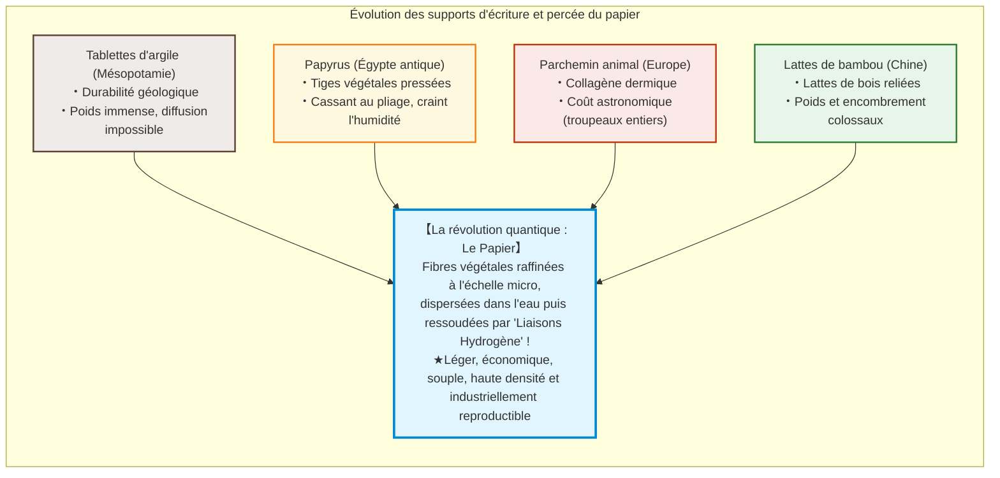
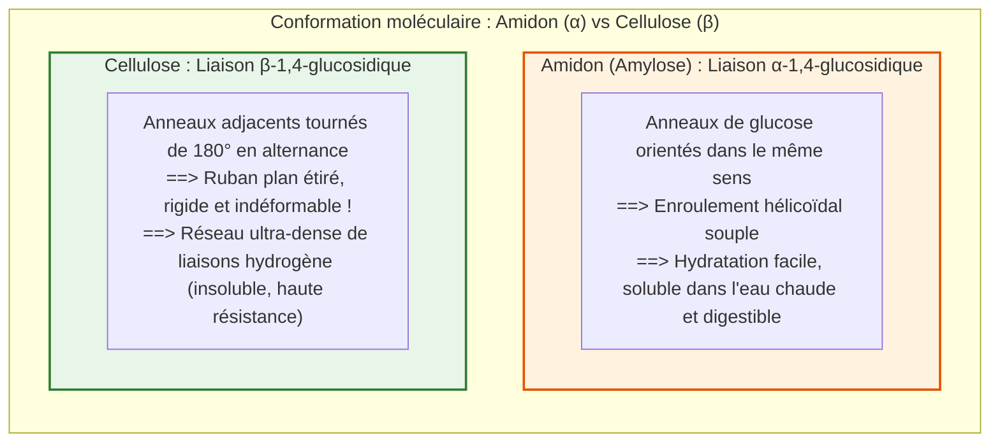
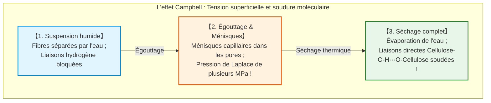
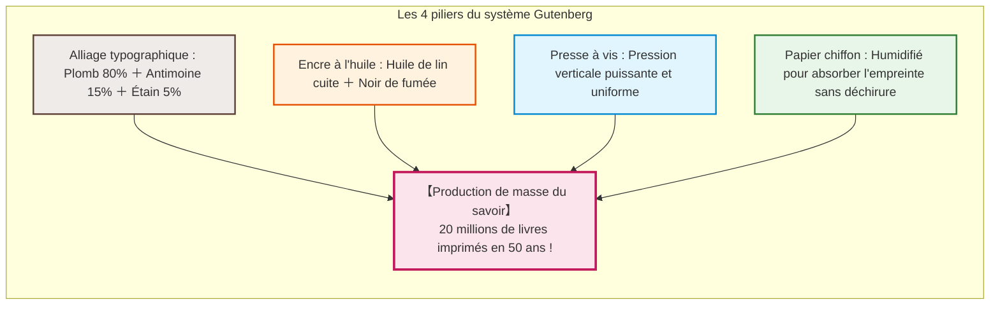
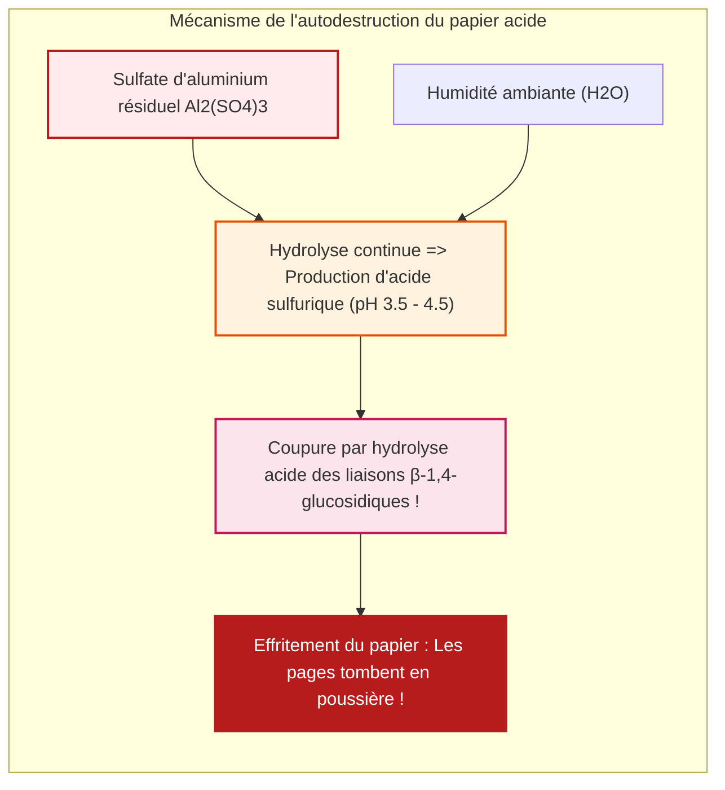

## Introduction : La fine feuille de fibres végétales qui a accéléré la civilisation

Dans toute l'histoire humaine, un support matériel unique a transformé l'accumulation et la transmission des connaissances, rendant possibles la Réforme protestante, la Renaissance, la Révolution scientifique et l'avènement des démocraties modernes : **le papier**.

Dans notre monde numérique, nous enregistrons des gigaoctets sous forme d'impulsions optiques et magnétiques. Pourtant, pendant des millénaires, le réceptacle de la pensée humaine, des lois, de la science et de la poésie fut une feuille de 0,1 millimètre d'épaisseur composée de microfibres végétales entrelacées.

Avant le papier, les supports présentaient de sévères limites :
- **Tablettes d'argile (Mésopotamie)** : D'une durabilité géologique, mais d'un poids prohibitif interdisant tout transport massif.
- **Papyrus (Égypte antique)** : Bandes de moelle végétale collées ; souple sous climat aride, mais cassant à l'humidité et limité au rouleau.
- **Parchemin (Europe)** : Peaux animales raclées ; robuste et ouvrant la voie au codex (livre relié), mais d'un coût exorbitant (des centaines d'animaux abattus pour une Bible).
- **Lattes de bambou (Chine)** : Volumineuses et pesantes, nécessitant des charrettes pour transporter une bibliothèque.

Le papier est un chef-d'œuvre de génie macromoléculaire : **les fibres végétales sont désolidarisées (raffinées), dispersées dans l'eau, puis réassemblées par auto-organisation moléculaire lors du séchage sans aucune colle**.

La résistance du papier provient entièrement des **liaisons hydrogène** spontanées établies entre les molécules de **cellulose**.

---

## Chapitre 1 : La structure supramoléculaire de la cellulose et les liaisons hydrogène

### 1.1 Polymère linéaire et liaisons $\beta\text{-1,4-glucosidiques}$

La cellulose ($(\text{C}_6\text{H}_{10}\text{O}_5)_n$) est le biopolymère le plus abondant sur Terre. C'est un polymère linéaire de **$\text{D-glucose}$** relié par des **liaisons $\beta\text{-1,4-glucosidiques}$**.

Alors que l'**amidon** ($\alpha$-glucosidique) forme une hélice souple soluble dans l'eau et digestible, la liaison $\beta$ de la cellulose force chaque anneau de glucose à pivoter de **$180^\circ$** par rapport au précédent, créant un ruban plan rigide et indéformable.

### 1.2 La force des liaisons hydrogène

Chaque unité de glucose possède trois groupements hydroxyle ($-\text{OH}$) :
1. **Liaisons hydrogène intramoléculaires** : Elles verrouillent la chaîne dans une conformation rectiligne très rigide.
2. **Liaisons hydrogène intermoléculaires** : Elles soudent latéralement les chaînes en **microfibrilles cristallines** de 3 à 4 nm de diamètre.

Le module d'Young d'une microfibrille cristalline atteint **$130 \text{ à } 150\,\text{GPa}$**, surpassant l'aluminium et rivalisant avec l'acier à densité égale.

### 1.3 L'effet Campbell : La tension de surface comme moteur de soudure

Lors du séchage, les ménisques d'eau microscopiques créent une dépression capillaire colossale gouvernée par l'équation de Young-Laplace : $\Delta P = \frac{2\gamma \cos \theta}{r}$.
À l'échelle nanométrique ($r \approx 5\,\text{nm}$), cette pression capillaire atteint **plusieurs mégapascals (des dizaines d'atmosphères)**, forçant les fibrilles à un contact atomique ($< 0{,}3\,\text{nm}$). L'eau s'évapore et les liaisons $-\text{OH} \cdots \text{O}-$ se scellent spontanément.

---

## Chapitre 2 : Histoire de la papeterie – De Cai Lun à l'Europe

- **Cai Lun (105 ap. J.-C.)** : Standardise la fabrication en Chine à partir de vieux chiffons de chanvre, écorces de mûrier et filets de pêche, lessivés à la cendre végétale alcaline.
- **Bataille de Talas (751 ap. J.-C.)** : Des papetiers chinois capturés par les Arabes introduisent l'art à **Samarcande**. En 793, Bagdad adopte le papier, finançant la **Maison de la Sagesse**. En 1151, le papier pénètre en Espagne à **Játiva**.
- **Fabriano (1268)** : L'Italie mécanise le raffinage par moulins à maillets hydrauliques, introduit l'encollage à la gélatine animale et invente le **filigrane**.
- **La crise des chiffons** : Au XVIIIe siècle, la pénurie de vieux chiffons de lin et coton bloque l'essor de l'imprimerie.

---

## Chapitre 3 : Washi japonais contre Pâte de bois occidentale

- **Fibres libériennes du Washi** : Le **Kozo (mûrier)** offre des fibres de **10 à 15 mm de long** (contre 1 à 3 mm pour la pâte de bois), conférant au washi une souplesse et une longévité millénaire.
- **Technique Nagashizuki** : L'artisan agite le tamis en vagues successives. Le mucilage végétal **Neri** empêche les longues fibres de s'agglomérer (stabilisation stérique) et régule l'égouttage.
- **Procédé Kraft (1884)** : La cuisson des copeaux de bois à $170^\circ\text{C}$ dans une solution de $\text{NaOH}$ et $\text{Na}_2\text{S}$ dissout sélectivement la **lignine** (le ciment brun du bois), produisant des pâtes chimiques d'une extrême résistance.

---

## Chapitre 4 : La révolution Gutenberg (vers 1450)

À Mayence, **Johannes Gutenberg** intègre 4 piliers technologiques :
1. **Alliage typographique** : Plomb (80 %), Antimoine (15 %), Étain (5 %). L'antimoine se dilate en se solidifiant, garantissant un moulage d'une précision micrométrique.
2. **Encre grasse à l'huile** : Huile de lin cuite et noir de fumée, adhérant parfaitement au métal sans tacher le papier.
3. **Presse à vis en bois** : Pression verticale puissante et uniforme.
4. **Papier chiffon résistant** : Humidifié avant impression pour recevoir l'empreinte sans se déchirer.

Entre 1450 et 1500, 20 millions de livres sont imprimés en Europe, déclenchant la Réforme luthérienne et la Révolution scientifique.

---

## Chapitre 5 : La crise du papier acide (Le feu lent)

En 1807, l'invention de l'encollage à la **colophane et au sulfate d'aluminium ($\text{Al}_2(\text{SO}_4)_3$)** permet de produire du papier à grande vitesse.

Cependant, le sulfate d'aluminium s'hydrolyse avec l'humidité de l'air pour libérer de l'acide sulfurique libre :
$$[\text{Al(H}_2\text{O)}_6]^{3+} + \text{H}_2\text{O} \rightleftharpoons [\text{Al(OH)(H}_2\text{O)}_5]^{2+} + \text{H}_3\text{O}^+$$
Le pH interne du papier chute à **3,5 - 4,5**, hydrolysant les liaisons glucosidiques. Des centaines de millions de livres imprimés entre 1850 et 1980 s'effritent spontanément dans les bibliothèques.

Depuis les années 1980, le passage au **papier permanent neutre (ISO 9706)** avec réserve alcaline de carbonate de calcium ($\text{CaCO}_3$) garantit une survie de 500 à 1 000 ans.

---

## Chapitre 6 : Conservation et Nanofibres de cellulose (CNF)

- **Désacidification de masse Bookkeeper** : Particules submicroniques d'oxyde de magnésium ($\text{MgO}$) déposées au cœur des livres reliés sans démontage.
- **Doublage au Washi (Urauchi)** : Papier Tengucho ultra-fin (2 à 5 g/m2) appliqué à la colle d'amidon de blé au Louvre et au British Museum. Réversibilité absolue à l'eau tiède.
- **Nanofibres de cellulose (CNF)** : Fibrilles de 3 à 4 nm de diamètre, **5 fois plus résistantes que l'acier pour un cinquième du poids**, transparentes et stables thermiquement.

---

## Conclusion : L'ancre matérielle de la mémoire humaine

Né de la photosynthèse, le papier est le réceptacle qui a immortalisé l'esprit humain grâce au miracle quantique de la liaison hydrogène. Face à l'obsolescence et à la fragilité des supports numériques, le papier reste le garant le plus pérenne de notre civilisation.
