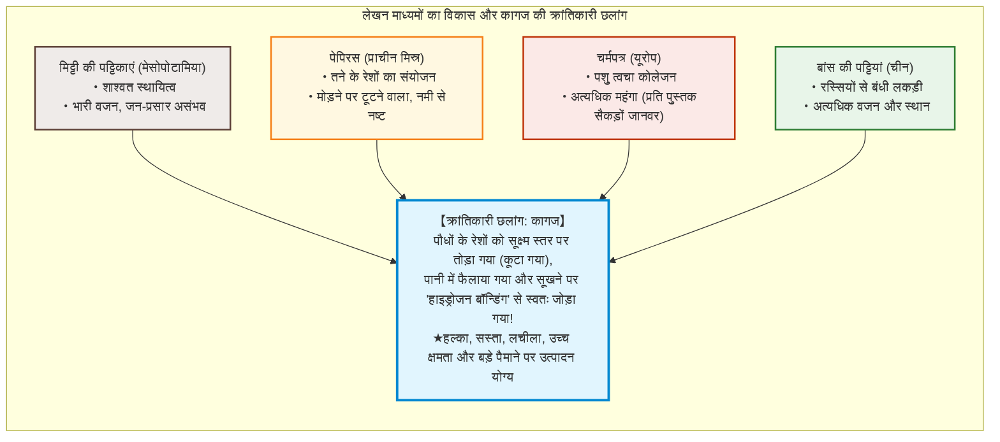
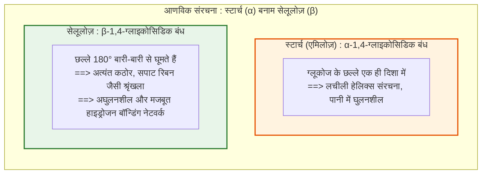
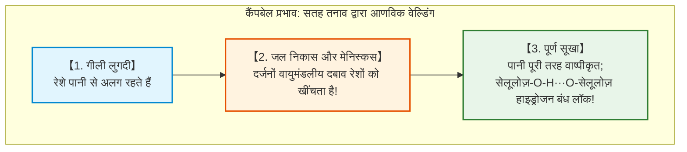
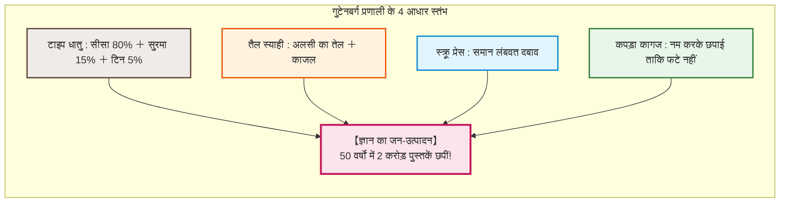
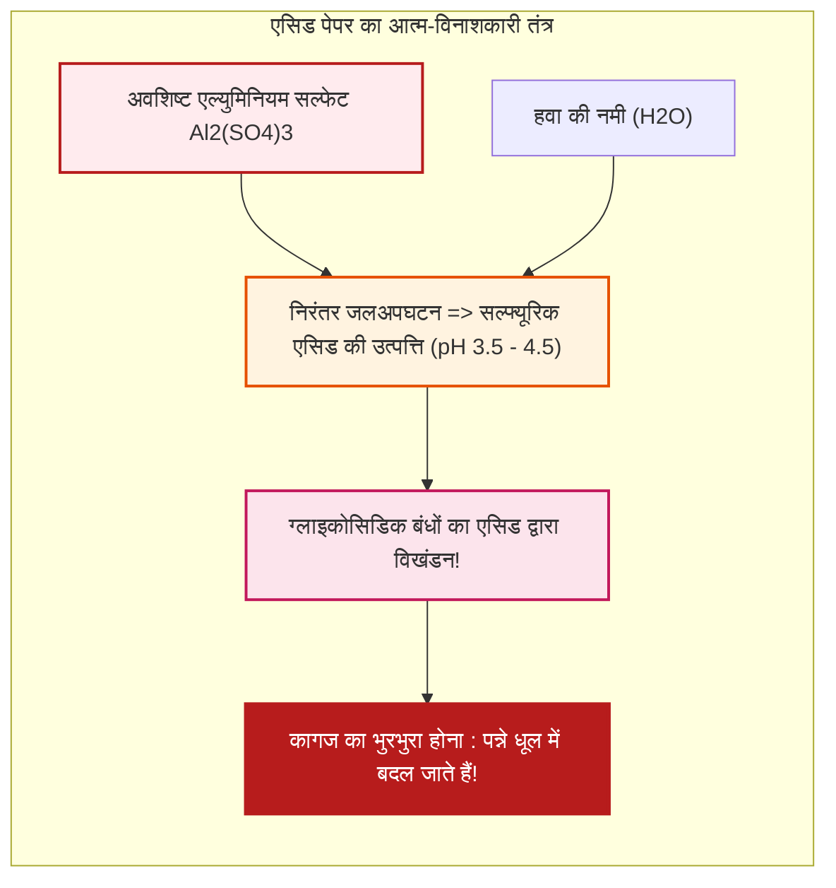

## प्रस्तावना: पौधों के रेशों की वह पतली चादर जिसने सभ्यता को गति दी

मानव सभ्यता के इतिहास में एक ऐसा भौतिक माध्यम है जिसने ज्ञान के संचय और प्रसारण में क्रांति ला दी, और पृष्ठभूमि में प्रोटेस्टेंट सुधार, पुनर्जागरण, वैज्ञानिक क्रांति और आधुनिक लोकतंत्रों के उदय को संभव बनाया: **कागज (Paper)**।

आज के डिजिटल युग में, हम सिलिकॉन चिप्स पर विद्युत आवेशों या प्रकाश दालों के रूप में भारी मात्रा में डेटा संग्रहीत करने के आदी हैं। लेकिन सहस्राब्दियों तक मानव विचारों, कानूनों, वैज्ञानिक खोजों, धर्म और कविता को सहेजने वाला मुख्य आधार पौधों की कोशिका भित्ति से निकले रेशों से बनी मात्र 0.1 मिमी मोटी चादर ही थी।

कागज से पूर्व के माध्यमों में गंभीर सीमाएं थीं:
- **मिट्टी की पट्टिकाएं (मेसोपोटामिया)**: भूवैज्ञानिक रूप से अमर, लेकिन अत्यंत भारी और बड़े पैमाने पर ले जाने में असमर्थ।
- **पेपिरस (प्राचीन मिस्र)**: पौधों के तनों को दबाकर बनाई गई पट्टियां; शुष्क जलवायु में लचीली, लेकिन नमी में भुरभुरी और केवल स्क्रॉल रूप तक सीमित।
- **चर्मपत्र / पार्चमेंट (यूरोप)**: जानवरों की खाल से निर्मित; मजबूत और आधुनिक पुस्तक प्रारूप (कोडेक्स) का जनक, लेकिन खर्चीला (एक बाइबिल के लिए सैकड़ों पशुओं की बलि)।
- **बांस और लकड़ी की पट्टियां (चीन)**: रस्सियों से बंधी; बहुत भारी, एक छोटी लाइब्रेरी को ले जाने के लिए कई गाड़ियों की आवश्यकता होती थी।

कागज की वास्तविक क्रांति आणविक इंजीनियरिंग में निहित है: **पौधों के रेशों को अलग किया जाता है, पानी में फैलाया जाता है, और सुखाने पर बिना किसी गोंद के आणविक स्तर पर पुनः जोड़ दिया जाता है**।

सूखे कागज की मजबूती पूरी तरह से **सेलूलोज़** अणुओं के बीच बनने वाले अरबों **हाइड्रोजन बंधों (Hydrogen Bonds)** से उत्पन्न होती है।

---

## अध्याय 1: सेलूलोज़ की संरचना और हाइड्रोजन बॉन्डिंग का चमत्कार

### 1.1 रैखिक बहुलक और $\beta\text{-1,4-ग्लाइकोसिडिक}$ बंधन

सेलूलोज़ ($(\text{C}_6\text{H}_{10}\text{O}_5)_n$) पृथ्वी पर सबसे प्रचुर मात्रा में पाया जाने वाला बायो-पॉलिमर है, जो **$\text{D-ग्लूकोज}$** से मिलकर बना है।

**स्टार्च** के विपरीत, जो एक लचीला और घुलनशील हेलिक्स बनाता है, सेलूलोज़ का **$\beta\text{-1,4-बॉन्ड}$** प्रत्येक ग्लूकोज रिंग को पिछले वाले के सापेक्ष **$180^\circ$ घुमाने** के लिए मजबूर करता है, जिससे एक अत्यधिक सीधी, कठोर और चपटी रिबन जैसी आणविक श्रृंखला बनती है।

### 1.2 हाइड्रोजन बॉन्डिंग की शक्ति

प्रत्येक ग्लूकोज इकाई में 3 हाइड्रॉक्सिल समूह ($-\text{OH}$) होते हैं:
1. **अंतःआणविक बंध**: श्रृंखला को एक कठोर सीधे रूप में लॉक करते हैं।
2. **अंतर-आणविक बंध**: समानांतर श्रृंखलाओं को 3 से 4 नैनोमीटर व्यास के **क्रिस्टलीय माइक्रोफाइब्रिल** में बांधते हैं।

क्रिस्टलीय माइक्रोफाइब्रिल का यंग मापांक **$130 \text{ से } 150\,\text{GPa}$** तक पहुंचता है, जो एल्यूमीनियम से दोगुना है और विशिष्ट मजबूती में स्टील को टक्कर देता है।

### 1.3 कैंपबेल प्रभाव: सतह तनाव द्वारा अणुओं का वेल्डिंग

सुखाने के दौरान पानी के वाष्पीकरण से बनने वाले सूक्ष्म मेनिस्कस भारी केशिका खिंचाव उत्पन्न करते हैं (यंग-लाप्लास समीकरण: $\Delta P = \frac{2\gamma \cos \theta}{r}$)। नैनोमीटर पैमाने पर यह दबाव **दर्जनों वायुमंडलीय दबाव** तक पहुंच जाता है, जिससे रेशे $0.3\,\text{nm}$ से भी कम दूरी पर आ जाते हैं और $-\text{OH} \cdots \text{O}-$ हाइड्रोजन बंध स्वतः लॉक हो जाते हैं।

गीला होने पर पानी इन बंधों को तोड़ देता है और कागज फट जाता है; पुनः सूखने पर हाइड्रोजन बंध फिर से जुड़ जाते हैं।

---

## अध्याय 2: कागज का इतिहास – त्साई लुन से यूरोप तक

- **त्साई लुन (105 ईस्वी)**: चीन में सन के चिथड़ों, शहतूत की छाल और पुरानी मछली पकड़ने वाली जालों को क्षारीय राख के पानी में उबालकर कागज बनाने की प्रक्रिया का मानकीकरण किया।
- **तलास की लड़ाई (751 ईस्वी)**: अब्बासी सेना द्वारा बंदी बनाए गए चीनी कारीगरों ने **समरकंद** में कागज उद्योग की नींव रखी। 793 ईस्वी में बगदाद में कागज का उपयोग अनिवार्य हुआ, जिससे **'हाउस ऑफ विजडम'** फला-फूला। 1151 ईस्वी में स्पेन के **जतीवा** के रास्ते कागज यूरोप पहुंचा।
- **फैब्रियानो (1268 ईस्वी)**: इटली में जल-चालित हथौड़ों, पशु जिलेटिन साइजिंग और **वॉटरमार्क** का आविष्कार हुआ।
- **चिथड़ों का संकट**: 18वीं सदी के अंत तक यूरोप में फटे पुराने कपड़ों की भारी कमी हो गई।

---

## अध्याय 3: जापानी वाशी बनाम लकड़ी का गूदा

- **छाल के रेशे (कोज़ो)**: **कागजी शहतूत (कोज़ो)** के रेशे **10 से 15 मिमी लंबे** होते हैं (लकड़ी के गूदे के 1-3 मिमी की तुलना में), जो वाशी को अद्वितीय लचीलापन और हजारों वर्षों का जीवन प्रदान करते हैं।
- **नागाशिज़ुकी तकनीक**: कारीगर फ्रेम को लहरों की तरह हिलाता है। **नेरी** पौधे का चिपचिपा तरल लंबे रेशों को आपस में उलझने से रोकता है।
- **क्राफ्ट प्रक्रिया (1884)**: लकड़ी को $170^\circ\text{C}$ पर $\text{NaOH}$ और $\text{Na}_2\text{S}$ के साथ पकाकर भूरे **लिग्निन** को घोल दिया जाता है, जिससे शुद्ध और मजबूत सेलूलोज़ प्राप्त होता है।

---

## अध्याय 4: गुटेनबर्ग प्रेस के साथ सह-विकास (लगभग 1450)

जर्मनी के मेंज में **जोहान्स गुटेनबर्ग** ने चार तकनीकों का संयोजन किया:
1. **टाइप धातु मिश्र धातु**: सीसा (80%), सुरमा (15%), टिन (5%)। सुरमा जमने पर फैलता है, जिससे अक्षर का बारीक सांचा हूबहू ढलता है।
2. **तैल-आधारित स्याही**: अलसी का तेल और काजल, जो धातु पर फिसलता नहीं।
3. **स्क्रू प्रेस**: समान ऊर्ध्वाधर दबाव।
4. **मजबूत कपड़ा कागज**: छपाई से पहले नम किया गया ताकि दबाव से फटे नहीं।

50 वर्षों में 2 करोड़ पुस्तकें छपीं, जिसने धर्मसुधार और आधुनिक विज्ञान को जन्म दिया।

---

## अध्याय 5: एसिड पेपर संकट (धीमी आग)

1807 में स्याही को फैलने से रोकने के लिए **रोजिन और एल्युमिनियम सल्फेट ($\text{Al}_2(\text{SO}_4)_3$)** साइजिंग की खोज हुई।

लेकिन एल्युमिनियम सल्फेट हवा की नमी से मिलकर सल्फ्यूरिक एसिड बनाता रहा, जिससे कागज का pH गिरकर **3.5 - 4.5** हो गया। इसने सेलूलोज़ श्रृंखला को तोड़ दिया। 1850 से 1980 के बीच छपी करोड़ों किताबें आज पुस्तकालयों में बिस्कुट की तरह बिखर रही हैं।

1980 के दशक से पूरी दुनिया **स्थायी तटस्थ कागज (ISO 9706)** की ओर मुड़ गई, जिसमें कैल्शियम कार्बोनेट ($\text{CaCO}_3$) बफर होता है जो 500 से 1000 वर्षों तक सुरक्षित रहता है।

---

## अध्याय 6: संरक्षण और नैनोसेलुलोज़ (CNF)

- **बुककीपर मास डीएसिडिफिकेशन**: मैग्नीशियम ऑक्साइड ($\text{MgO}$) के नैनोकण बिना किताब खोले एसिड को निष्क्रिय करते हैं।
- **वाशी लाइनिंग (उराउची)**: ब्रिटिश संग्रहालय और लौवर में 2-5 ग्राम/वर्ग मीटर के तेंगूचो कागज और गेहूं के स्टार्च से प्राचीन पांडुलिपियों की मरम्मत। गर्म पानी से यह प्रक्रिया पूरी तरह प्रतिवर्ती (Reversible) है।
- **सेलूलोज़ नैनोफाइबर (CNF)**: 3-4 नैनोमीटर पतले रेशे, **स्टील से 5 गुना मजबूत और वजन में 1/5**, कांच की तरह पारदर्शी और गर्मी प्रतिरोधी।

---

## निष्कर्ष: मानव स्मृति का शाश्वत भौतिक लंगर

सूरज की रोशनी और पानी से संश्लेषित सेलूलोज़ को हाइड्रोजन बंधों द्वारा पुनः जोड़कर बनाया गया 'कागज'। इसने ज्ञान को मिट्टी और पत्थरों की कैद से आजाद कर दिया। क्षणभंगुर डिजिटल युग में भी, स्थायी कागज मानव सभ्यता की बौद्धिक विरासत का सबसे निष्ठावान संरक्षक बना हुआ है।
