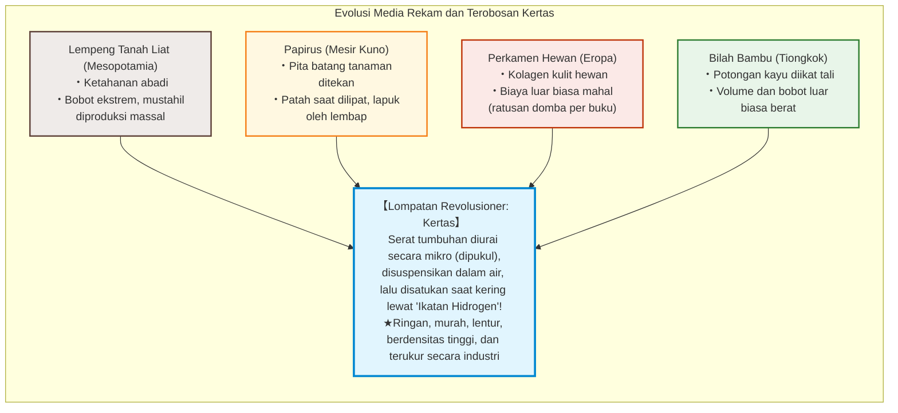
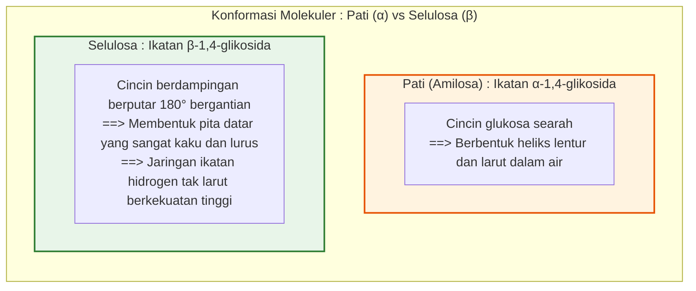
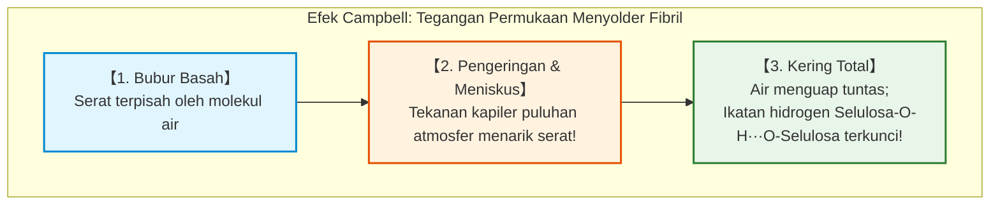
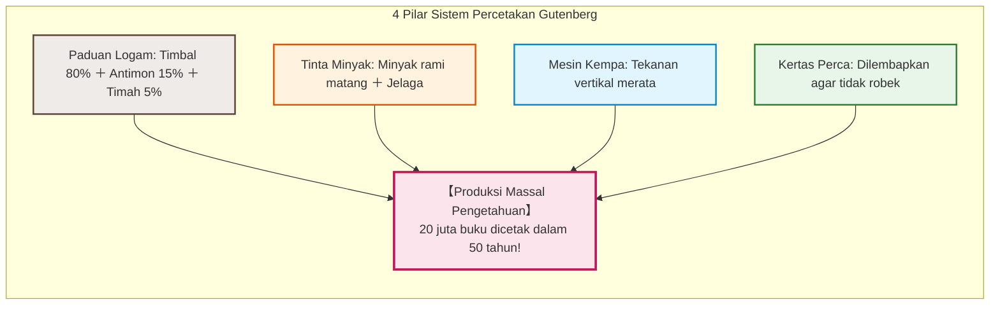
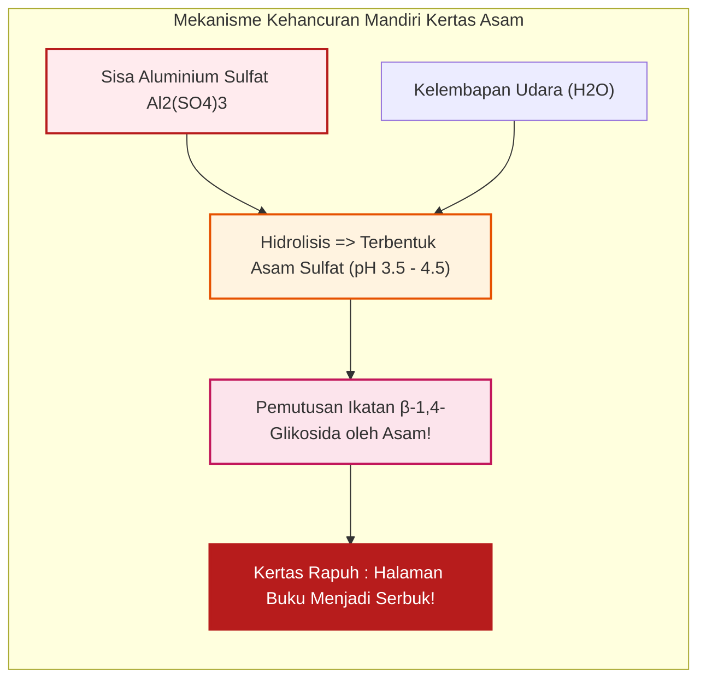

## Pendahuluan: Lembaran Tipis Serat Tumbuhan yang Mempercepat Peradaban

Sepanjang lintasan sejarah manusia, terdapat satu media fisik yang merevolusi akumulasi dan transmisi pengetahuan, memungkinkan terjadinya Reformasi Protestan, Renaisans, Revolusi Ilmiah, hingga lahirnya demokrasi modern: **Kertas**.

Di era digital saat ini, kita terbiasa menyimpan data sebagai muatan listrik atau denyut optik pada chip silikon. Namun selama ribuan tahun, wahana utama pikiran, hukum, sains, dan sastra manusia adalah selembar lembaran setebal 0,1 milimeter yang terbuat dari jalinan serat dinding sel tumbuhan.

Media pendahulu memiliki keterbatasan berat:
- **Lempeng Tanah Liat (Mesopotamia)**: Sangat awet secara geologis, namun luar biasa berat dan mustahil dibawa dalam jumlah besar.
- **Papirus (Mesir Kuno)**: Potongan batang tanaman yang ditekan; lentur di iklim kering tetapi rapuh terhadap kelembapan dan terbatas pada bentuk gulungan.
- **Perkamen (Eropa)**: Kulit hewan yang dikerik; kuat dan melahirkan format buku (kodeks), tetapi biayanya astronomis (ratusan ternak untuk satu kitab suci).
- **Bilah Bambu dan Kayu (Tiongkok)**: Diikat dengan tali; sangat berat dan memakan tempat (butuh kereta kuda untuk memindahkan perpustakaan).

Hakikat sejati kertas bertumpu pada rekayasa makromolekul: **serat tumbuhan dipisahkan, disuspensikan dalam air, lalu disusun kembali pada tingkat molekuler saat pengeringan tanpa menggunakan lem apa pun**.

Kekuatan tarik kertas kering murni berasal dari miliaran **ikatan hidrogen** spontan antar-molekul **selulosa**.

---

## Bab 1: Struktur Supramolekul Selulosa dan Ikatan Hidrogen

### 1.1 Polimer Linier dan Ikatan $\beta\text{-1,4-Glikosida}$

Selulosa ($(\text{C}_6\text{H}_{10}\text{O}_5)_n$) adalah biopolimer terbanyak di bumi, tersusun dari monomer **$\text{D-glukosa}$** yang terikat melalui **ikatan $\beta\text{-1,4-glikosida}$**.

Berbeda dengan **pati** ($\alpha$-glikosida) yang membentuk heliks lentur dan mudah larut, ikatan $\beta$ pada selulosa memaksa cincin glukosa berdampingan untuk berputar **$180^\circ$ secara bergantian**, menciptakan rantai pita yang sangat lurus, kaku, dan kuat.

### 1.2 Kekuatan Ikatan Hidrogen

Setiap unit glukosa memiliki 3 gugus hidroksil ($-\text{OH}$):
1. **Intramolekul**: Mengunci rantai dalam konformasi kaku dengan kekuatan aksial tinggi.
2. **Intermolekul**: Mengikat rantai-rantai sejajar menjadi **mikrofibril kristal** berdiameter 3 hingga 4 nm.

Modulus Young aksial mikrofibril kristal mencapai **$130 \text{ hingga } 150\,\text{GPa}$**, melampaui aluminium dan mengungguli baja dalam rasio kekuatan terhadap bobot.

### 1.3 Efek Campbell: Tegangan Permukaan Penyatu Molekul

Saat air menguap, meniskus cairan mikroskopis menimbulkan tekanan kapiler luar biasa (persamaan Young-Laplace: $\Delta P = \frac{2\gamma \cos \theta}{r}$). Pada skala nanometer, tekanan hisap ini mencapai **puluhan atmosfer**, memaksa fibril saling merapat hingga jarak $< 0{,}3\,\text{nm}$ di mana ikatan hidrogen $-\text{OH} \cdots \text{O}-$ langsung terkunci rapat.

---

## Bab 2: Sejarah Kertas – Dari Cai Lun hingga Eropa

- **Cai Lun (105 M)**: Menstandardisasi pembuatan kertas di Tiongkok menggunakan kain perca rami, kulit murbei, dan jaring ikan yang direbus dalam lindi abu alkali.
- **Pertempuran Talas (751 M)**: Pasukan Arab Abbasiyah menawan pembuat kertas Tiongkok dan mendirikan sentra kertas di **Samarkand**. Pada 793 M, Bagdad mewajibkan penggunaan kertas, mendorong berdirinya **Baitul Hikmah**. Pada 1151 M, kertas tiba di Eropa melalui **Jativa**, Spanyol.
- **Fabriano (1268 M)**: Di Italia diperkenalkan kincir penumbuk bertenaga air, pelapisan gelatin hewani, dan **tanda air (watermark)**.
- **Krisis Kain Perca**: Menjelang abad ke-18, kelangkaan kain perca membatasi produksi buku di Eropa.

---

## Bab 3: Washi Jepang vs Pulp Kayu Barat

- **Serat Kulit Kayu (Kozo)**: **Kozo (murbei kertas)** memiliki panjang serat **10 hingga 15 mm** (jauh di atas serat kayu yang hanya 1-3 mm), memberikan washi kelenturan dan ketahanan hingga ribuan tahun.
- **Teknik Nagashizuki**: Pengrajin mengayunkan saringan dalam gelombang berirama. Lendir tanaman **Neri** mencegah serat panjang menggumpal dan memperlambat laju tirisan air.
- **Proses Kraft (1884)**: Memasak serpihan kayu pada $170^\circ\text{C}$ dengan larutan $\text{NaOH}$ dan $\text{Na}_2\text{S}$ melarutkan **lignin** (perekat cokelat kayu), menghasilkan serat selulosa murni berkekuatan tinggi.

---

## Bab 4: Sinergi dengan Percetakan Gutenberg (c. 1450)

Di Mainz, **Johannes Gutenberg** menyatukan empat pilar teknologi:
1. **Paduan Huruf Logam**: Timbal (80%), Antimon (15%), Timah (5%). Antimon memuai saat membeku, menyalin detail cetakan dengan presisi mikron.
2. **Tinta Berbasis Minyak**: Minyak biji rami matang dengan jelaga, menempel sempurna pada logam tanpa blobor di kertas.
3. **Mesin Kempa Sekrup Kayu**: Tekanan vertikal yang merata.
4. **Kertas Perca yang Kuat**: Dilembapkan sebelum dicetak agar tidak robek di bawah tekanan mesin.

Dalam 50 tahun, 20 juta buku dicetak di Eropa, memicu Reformasi dan Revolusi Ilmiah.

---

## Bab 5: Krisis Kertas Asam (Slow Fire)

Pada 1807, ditemukan metode pelapisan dengan **rosin dan aluminium sulfat ($\text{Al}_2(\text{SO}_4)_3$)** untuk mencegah tinta blobor pada mesin kertas cepat.

Namun, aluminium sulfat mengalami hidrolisis terus-menerus dengan kelembapan udara, menghasilkan asam sulfat bebas dan menurunkan pH kertas menjadi **3,5 - 4,5**. Ini memicu hidrolisis asam yang memutuskan rantai selulosa. Ratusan juta buku dari kurun 1850-1980 kini hancur berkeping-keping di perpustakaan dunia.

Sejak 1980-an, industri beralih total ke **kertas permanen netral (ISO 9706)** dengan penyangga kalsium karbonat ($\text{CaCO}_3$) yang bertahan 500 hingga 1.000 tahun.

---

## Bab 6: Preservasi dan Nanofiber Selulosa (CNF)

- **Deasidifikasi Massal Bookkeeper**: Nanopartikel magnesium oksida ($\text{MgO}$) dalam cairan terfluorinasi menetralkan asam tanpa membongkar jilidan buku.
- **Restorasi dengan Washi (Urauchi)**: Kertas Tengucho ultra-tipis (2 hingga 5 g/m2) dan pasta pati gandum di British Museum dan Louvre. Sepenuhnya dapat dilepas kembali (*reversible*) dengan air hangat.
- **Selulosa Nanofiber (CNF)**: Fibril berukuran 3-4 nm, **5 kali lebih kuat dari baja dengan berat hanya 1/5-nya**, bening seperti kaca dan tahan panas.

---

## Kesimpulan: Jangkar Fisik Memori Peradaban Manusia

Tercipta dari sinar matahari dan dirangkai oleh ikatan hidrogen, kertas membebaskan manusia dari keterbatasan tanah liat dan perkamen. Di tengah kerentanan media digital, kertas permanen tetap menjadi benteng terkuat yang menjaga kelangsungan warisan peradaban kita.
