## 序論：知を記録し文明を加速させた「植物繊維のシート」

人類の歴史において、知の蓄積と伝達を根本から変革し、宗教改革、ルネサンス、科学革命、そして近代民主主義の成立を背後で可能にした単一の物理媒体が存在する。それが**「紙（Paper）」**である。

現代のデジタル情報社会において、私たちはテキストや画像をシリコンチップ内の電荷や磁気スピン、光パルスとして瞬時に保存・伝送することに慣れ親しんでいる。しかし、有史以来数千年にわたり、人類が獲得した思考、法典、科学的発見、信仰、詩情を空間と時間を超えて定着させ続けた主役は、植物の細胞壁から抽出された極小の繊維が絡み合う、厚さわずか0.1ミリメートル前後の薄いシートであった。

紙が登場する以前、人類は多様な媒体に文字を刻んできた：
- **粘土板（メソポタミア）**：耐久性には極めて優れるが、重くかさばり、長文の携帯や大量流通は不可能であった。
- **パピルス（古代エジプト）**：カヤツリグサ科植物の茎を叩いて並べたものであり、しなやかで軽量であったが、地中海乾燥地帯を離れると脆く崩れ、折り曲げに弱く、巻物（巻子本）の形態に縛られた。
- **羊皮紙・犢皮紙（古代ギリシャ・ローマ、中世ヨーロッパ）**：羊や子牛の皮膚を脱毛・展張したパーチメントは強靭で両面筆記が可能であり、冊子本（コーデックス）を生み出したが、聖書1冊を製作するために数百頭の家畜を屠殺せねばならず、極端に高価であった。
- **竹簡・木簡（古代中国）**：身近な竹や木を削った札を紐で編んだもので、普及はしたが、数十万字の書物を運ぶには荷車数台を要した。

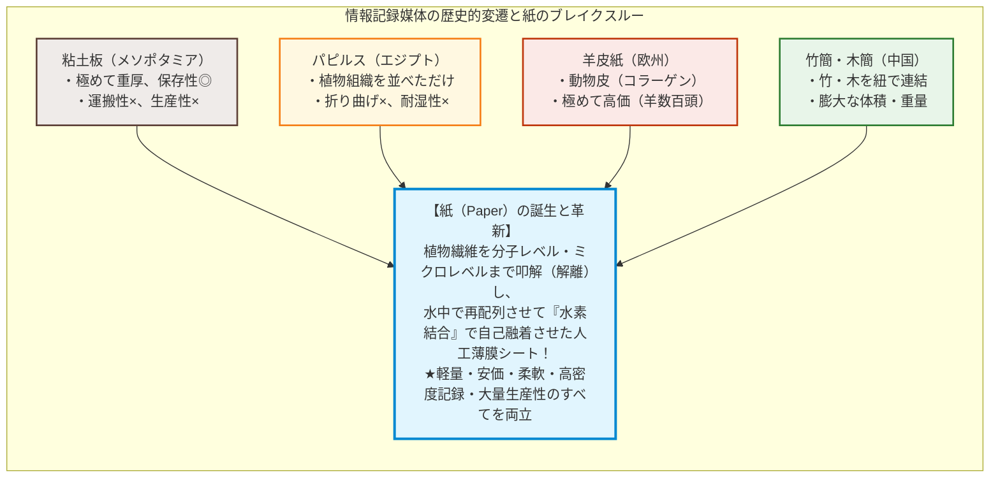

紙の真の革命性は、パピルスのように植物の組織構造をそのまま貼り合わせたものではなく、また羊皮紙のように動物組織を乾燥させたものでもなく、**「植物の繊維をいったん物理的・化学的にバラバラに解離（叩解）させ、水中で均一に分散させた後、抄き網の上で脱水・乾燥させて分子レベルで再結合させる」**という、極めて高度な高分子材料工学のプロセスに立脚している点にある。

驚くべきことに、紙の繊維同士を結びつけるために、**接着剤や糊は一切必要とされない**。乾いた紙が強固な引っ張り強度を持つ理由は、水が蒸発する過程で植物繊維の主成分である**「セルロース（Cellulose）」**分子同士が、無数の**「水素結合（Hydrogen Bonding）」**を自然に自己組織化させるからである。

本稿では、この身近でありながら驚異的な先端材料である「紙」の全貌を、分子スケールのナノ化学から、古代中国・イスラム世界を経てヨーロッパに至る技術伝播、和紙と洋紙の構造力学、グーテンベルク印刷革命との共進化、19世紀の「酸性紙クライシス」と近代保存科学、そして鋼鉄を超える新素材セルロースナノファイバー（CNF）に至るまで、徹底的に解明する。

---

## 第1章：セルロースの超分子構造と「水素結合」の奇跡

### 1.1 グルコースが織りなす直鎖状高分子（$\beta\text{-1,4-グルコシド結合}$）

紙の主成分は、植物の細胞壁を構成する骨格多糖類である**セルロース（$(\text{C}_6\text{H}_{10}\text{O}_5)_n$）**である。地球上の植物が光合成によって生み出すセルロースの総量は年間で数千億トンに達し、地球上で最も豊富に存在する有機ポリマーである。

セルロースの分子構造は、単糖である**$\text{D-グルコース}$（ブドウ糖）**が脱水縮合して長く連なった直鎖状ポリマーである。ここで決定的に重要なのが、グルコース同士を連結する結合様式である**$\beta\text{-1,4-グルコシド結合}$**である。

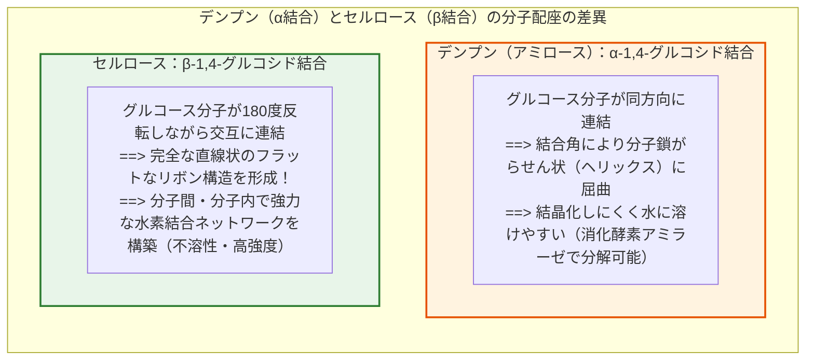

人間が主食として摂取する**デンプン（アミロース）**も、同じグルコースが連なったポリマーである。しかしデンプンは**$\alpha\text{-1,4-グルコシド結合}$**で繋がっているため、分子全体が緩やかならせん状に折れ曲がり、柔軟で水に親和しやすく、消化酵素によって容易に分解される。

対照的に、セルロースは**$\beta\text{-1,4-グルコシド結合}$**を持つため、隣り合うグルコース残基が**表裏交互に180度反転**しながら直線状に連結する。この幾何学的対称性により、セルロース鎖は一切のねじれを持たない「剛直なリボン状の平面分子」となる。

この直鎖状セルロース分子の重合度（$n$）は、木材パルプで約10,000、綿や麻の天然繊維では15,000以上に達する。

### 1.2 水素結合（Hydrogen Bonding）の力学：接着剤なしでなぜ結ばれるのか

紙の製造において、水に分散させた繊維を網ですくい上げて乾燥させるだけで、なぜ強靭なシートが出来上がるのか。その答えは、セルロース分子の各グルコース単位に3つずつ存在する**ヒドロキシ基（$-\text{OH}$）**が形成する**水素結合（Hydrogen Bond）**にある。

水素結合とは、電気陰性度の高い酸素原子（$\text{O}$）に共有結合した水素原子（$\text{H}^{\delta+}$）が、隣接する別の酸素原子の孤立電子対（$\text{O}^{\delta-}$）と静電的に引き合う強固な分子間力（結合エネルギー：約 $10 \sim 40\,\text{kJ/mol}$）である。

セルロース鎖には、2種類の水素結合が存在する：
1. **分子内水素結合（Intramolecular Hydrogen Bonds）**：
   同一のセルロース鎖の内部で、3位のヒドロキシ基と隣接するグルコースの環内酸素（$\text{O}_5$）との間、および2位のヒドロキシ基と6位のヒドロキシ基の間で形成される。これにより、セルロース分子鎖自身の回転運動が完全にロックされ、極めて高い剛直性（引張強度）が生まれる。
2. **分子間水素結合（Intermolecular Hydrogen Bonds）**：
   平行に並んだ隣接するセルロース分子鎖同士の間で、側方に無数の水素結合が架橋する。

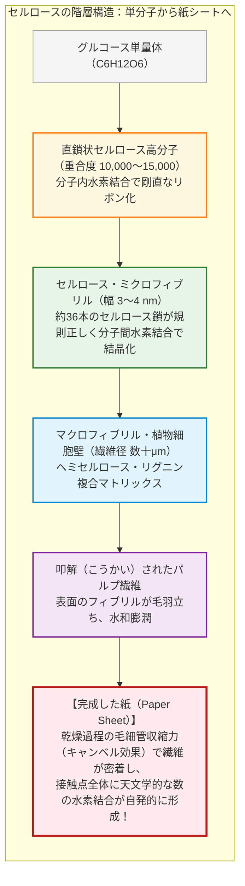

数十本のセルロース分子が分子間水素結合によって束ねられると、幅約3〜4ナノメートルの**「セルロース・ミクロフィブリル（Microfibril）」**を形成する。この内部は高度に規則的な結晶構造（セルロースI型結晶）を呈しており、その長軸方向のヤング率（弾性率）は約**$130 \sim 150\,\text{GPa}$**に達する。これは**アルミニウム（約 $70\,\text{GPa}$）の2倍以上**であり、**鉄鋼（約 $200\,\text{GPa}$）の比弾性率（弾性率/密度）を遥かに凌駕する**驚異的な機械的強度である。

### 1.3 キャンベル効果（Campbell Effect）と水による結合・破断のメカニズム

では、水の中でバラバラに浮遊していた植物繊維が、シートを乾燥させる過程でどのようにしてこの強大な水素結合を形成するのか。

ここには、製紙物理学において**「キャンベル効果（Campbell Effect）」**と呼ばれる表面張力・毛細管引力の物理現象が介在している：

1. **湿潤状態（抄紙直後）**：
   水中に分散したパルプ繊維の表面は、無数の極細フィブリルが毛羽立っており、多量の水分子が配位して水和膨潤している。この状態では、水分子（$\text{H}_2\text{O}$）がセルロースのヒドロキシ基の間に入り込んで水素結合を遮断しているため、繊維間に結合力は生じない。
2. **脱水・乾燥過程におけるメニスカス形成**：
   抄網の上で水分が脱水され、繊維間の水分が蒸発していくと、繊維と繊維の微小な間隙（ナノ〜マイクロ空間）に液体のメニスカス（湾曲した気液界面）が形成される。
3. **ラプラス圧による巨大な圧縮引力**：
   毛細管現象により、液面には**ラプラス圧（Laplace Pressure）**と呼ばれる強力な負圧が発生する：
   $$\Delta P = \frac{2\gamma \cos \theta}{r}$$
   ここで、$\gamma$は水の表面張力（約 $72.8\,\text{mN/m}$）、$\theta$は接触角、$r$は繊維間の微細空隙の曲率半径である。
   空隙の半径 $r$ がナノスケール（例えば $r \approx 5\,\text{nm}$）にまで縮小すると、この毛細管引力は**数十気圧（数メガパスカル）以上**の超高圧に達する。この「キャンベル効果」によって、外部からプレス機で押し固める以上の力で繊維同士がナノ単位の至近距離まで強制的に引き寄せられる。
4. **水素結合の直接架橋**：
   繊維間の距離が水素結合の結合距離（約 $0.27 \sim 0.30\,\text{nm}$）以下にまで接近した瞬間、介在していた水分子が気化して飛び去り、露出したセルロース同士のヒドロキシ基（$-\text{OH} \cdots \text{O}-$）が直接手を取り合って結合を完了する。

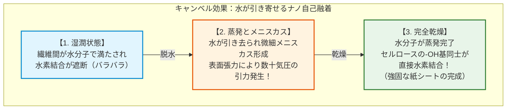

#### なぜ紙は水に濡れると破れるのか？

紙が水に濡れると、一瞬にして引っ張り強度が失われ、いとも容易に破れる理由も、このメカニズムで完全に説明される。

乾いた紙に水分子が浸入すると、極性分子である水（$\text{H}_2\text{O}$）が、セルロース鎖同士の間に割り込み、分子間の水素結合を奪って自らがヒドロキシ基と水素結合を形成してしまう（水和）。これにより、繊維同士を繋ぎ止めていた直接の水素結合ネットワークが解離し、シート構造が崩壊するのである。

逆に言えば、濡れて強度が落ちた紙も、繊維そのものが化学的に切断されたわけではないため、再び均一に乾燥させればキャンベル効果によって水素結合が再生し、一定の強度を取り戻す。

---

## 第2章：製紙技術の進化史——蔡倫の改良からサマルカンド、ヨーロッパへ

### 2.1 蔡倫による製紙法の確立（後漢・105年）：廃棄物リサイクルの知恵

紙の起源は古代中国の前漢時代（紀元前2世紀頃）に遡る。陝西省の覇橋墓（紀元前2世紀）や放馬灘（紀元前179〜前141年頃）などの遺跡から、世界最古級の麻紙の断片が出土している。しかし、これらの前漢の紙は厚く粗悪で繊維の分散が不均一であり、主に物品の包装や充填材として用いられていた。

文字を記録するための実用的な情報記録媒体として製紙技術を劇的に完成させたのが、後漢の宦官であった**蔡倫（さいりん、Cai Lun）**である。元興元年（105年）、蔡倫は製紙法の大規模な改良を完成させ、和帝に献上した。この紙は**「蔡侯紙（さいこうし）」**と称賛され、製紙技術の世界的画期となった。

蔡倫の最大の功績は、**原料の多様化と叩解・アルカリ処理プロセスの確立**にある：
1. **原料の選定**：麻屑（着古した麻布）、樹皮（クワ科コウゾなど）、破れた漁網（魚網）、ボロ布など、従来は廃棄されていたセルロース性廃棄物を原料として採用した。
2. **アルカリ煮熱**：植物原料やボロ布を草木灰汁（炭酸カリウム $\text{K}_2\text{CO}_3$ を含むアルカリ水溶液）とともに煮沸し、セルロースを拘束しているペクチン、リグニン、油脂分を溶出・除去した。
3. **叩解（マッシング）**：石臼や木槌で徹底的に繊維を打解し、繊維を1本ずつ物理的にほぐして表面を毛羽立たせた。
4. **抄造と乾燥**：竹ひごや布を張った「漉き桁（すきげた）」を用いて水中に浮遊する繊維を均一にすくい上げ、板に張り付けて天日で乾燥させた。

蔡倫の製紙術により、竹簡のような重さから解放され、絹布のような天文学的コストをかけずに、極めて安価で軽量・均一な筆記媒体が大量生産可能となった。

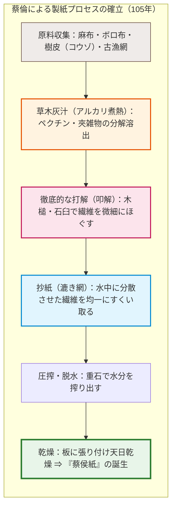

### 2.2 タラス河畔の戦い（751年）とイスラム世界への伝播

中国で独占的に発達した製紙術は、やがて朝鮮半島（4世紀頃）や日本（610年、高句麗の僧・曇徴によって伝来）へと東進した。一方、西方世界への伝播は、ユーラシア大陸の覇権を巡る世界史的一大決戦を契機として起きた。

天宝10年（751年）、現在の中央アジア・キルギス領タラス川河畔において、唐朝の安西節度使・高仙芝率いる軍勢と、イスラム帝国（アッバース朝）軍が激突した（**タラス河畔の戦い**）。

唐軍は大敗を喫し、数多くの唐兵がアッバース朝軍の捕虜となった。この捕虜の中に**製紙工（紙漉き職人）**が含まれていた。捕虜たちはソグディアナの中心都市**サマルカンド**へと連行され、そこで製紙工場が開設された。

サマルカンドは豊富な水資源と高品質の亜麻・麻布に恵まれており、製造された**「サマルカンド紙」**はその白さと滑らかさで瞬く間にイスラム世界全域で最高峰の評価を獲得した。

```mermaid
flowchart LR
    subgraph PaperDiffusion["製紙技術の世界伝播ルート（タラスの戦いから欧州へ）"]
        direction LR
        China["中国（後漢 105年）<br/>蔡倫の改良"]
        Samarkand["サマルカンド（751年）<br/>タラス河畔の戦い<br/>捕虜の製紙職人"]
        Baghdad["バグダード（793年）<br/>ハールーン・アッラシード<br/>知恵の館（翻訳事業）"]
        Cairo["カイロ・ダマスカス<br/>（10世紀）<br/>エジプトでパピルスを駆逐"]
        Spain["スペイン・イタリア<br/>シャティバ（1151年）<br/>ファブリアーノ（1268年）"]
        Mainland["ヨーロッパ全域<br/>（14〜15世紀）<br/>グーテンベルク印刷革命へ"]
        
        China -->|751年| Samarkand
        Samarkand -->|793年| Baghdad
        Baghdad --> Cairo
        Cairo -->|北アフリカ経由| Spain
        Spain --> Mainland
    end
    
    style China fill:#ffebee,stroke:#b71c1c,stroke-width:2px
    style Samarkand fill:#fff3e0,stroke:#e65100,stroke-width:2px
    style Baghdad fill:#e1f5fe,stroke:#0288d1,stroke-width:2px
    style Spain fill:#e8f5e9,stroke:#2e7d32,stroke-width:2px
    style Mainland fill:#f3e5f5,stroke:#7b1fa2,stroke-width:3px
```

製紙法は793年にアッバース朝の首都**バグダード**に達し、カリフのハールーン・アッラシードの下で公的文書への紙の使用が義務化された。これにより、古代ギリシャ・ローマの哲学や科学文献をアラビア語へと翻訳する一大知的事業**「知恵の館（バイト・アル＝ヒクマ）」**が爆発的に加速し、イスラム科学の黄金期が開花した。

その後、製紙術はダマスカス、カイロ、北アフリカ（モロッコ）を経て、12世紀中葉（1151年頃）にイスラム統治下にあったイベリア半島の**シャティバ（Játiva）**に伝来し、ついにヨーロッパ本土への上陸を果たした。

### 2.3 ヨーロッパへの定着と水力水車による粉砕、ボロ布（ラグ）の限界

ヨーロッパにおいて、製紙業の技術的革新を主導したのはイタリアのトスカーナ地方、特に**ファブリアーノ（Fabriano）**の紙漉き職人たちであった（1268年設立）。

ファブリアーノの職人たちは、イスラム伝来の手作業プロセスを機械化・工業化するために3大イノベーションを導入した：
1. **水力スタンプミル（水車駆動の木製破砕杵）**：
   人力の石臼や足踏み臼に代わり、水力水車で複数の重い木製スタンプを交互に上下させ、ボロ布を叩き潰して繊維を解離する装置を導入。叩解速度と処理容量を飛躍的に高めた。
2. **動物性膠（ゼラチン）サイジング**：
   イスラム紙がデンプン粉糊でサイズ処理（インクの滲み止め）されていたのに対し、屠殺場から出る動物の皮や軟骨を煮詰めたゼラチンを用いた。これにより、西洋の酸性没食子インクに対する耐性が格段に向上し、紙の耐久性と保存性が大幅に向上した。
3. **透かし（ウォーターマーク、Watermark）の発明**：
   漉き網の真鍮ワイヤーに針金細工を編み込むことで、紙の厚みに局所的な差をつけ、光に透かすと製造者や品質を示す紋章が浮かび上がる技術を確立。品質保証と偽造防止のシステムを築いた。

しかし、18世紀から19世紀にかけてヨーロッパの出版需要が爆発するにつれ、製紙業は決定的なボトルネックに直面する。**原料である「麻や木綿のボロ布（Rags、ラグ）」の絶対的枯渇**である。

当時の紙はすべて古着や帆船の廃棄帆布などのボロ布から作られていたため、古着の回収量が製紙の生産量の上限を規定していた。各国はボロ布の輸出を禁止し、ボロ布の奪い合いから戦争紛いの外交問題すら生じた。文明の知識欲を満たすためには、布の切れ端ではない「無尽蔵のセルロース資源」が必要とされていた。

---

## 第3章：和紙と洋紙の構造的・化学的対比

製紙技術は東洋（日本）と西洋において、利用可能な植物資源と文化的用途の違いから、全く異なる2つの進化経路を辿った。それが**「和紙（Washi）」**と、現代の産業用紙に繋がる**「洋紙（Western Paper）」**である。

### 3.1 靭皮繊維（コウゾ・ミツマタ・ガンピ）の長さと絡み合い

和紙の驚異的な強度としなやかさ、そして1000年を超える比類なき保存性の秘密は、原料となる樹木の**「靭皮（じんぴ）繊維（Bast Fiber）」**にある。

| 原料名 | 植物分類 | 主な特徴と用途 | 平均繊維長 | 繊維幅 |
|---|---|---|---|---|
| **コウゾ（楮）** | クワ科落葉低木 | 和紙原料の約9割を占める。繊維が極めて太く長く、強靭。障子紙、公文書、表具用紙に多用。 | **約 10 〜 15 mm** | 約 30 μm |
| **ミツマタ（三椏）** | ジンチョウゲ科落葉低木 | 繊維が細く柔軟で、緻密で光沢のある肌合い。日本銀行券（紙幣）の主要原料。 | **約 3 〜 4 mm** | 約 12 μm |
| **ガンピ（雁皮）** | ジンチョウゲ科落葉低木 | 栽培が極めて難しく自生種を採取。繊維が均一で光沢があり、半透明で虫害に強い。鳥の子紙、金箔打ち紙。 | **約 3 〜 5 mm** | 約 10 μm |
| **針葉樹パルプ（洋紙）** | マツ、スギ、トドマツ等 | 木材の幹（木部）から抽出。セルロース純度は高いがリグニン除去が必要。 | **約 2.5 〜 4.5 mm** | 約 30 〜 40 μm |
| **広葉樹パルプ（洋紙）** | ブナ、ユーカリ、ポプラ等 | 短い木部繊維。印刷適性（平滑性・不透明度）に優れる。 | **約 0.8 〜 1.5 mm** | 約 15 〜 20 μm |

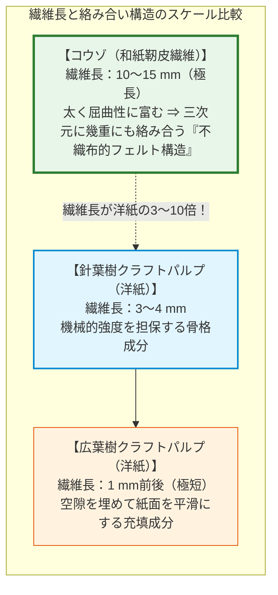

一般的な洋紙（木材パルプ紙）の繊維長がわずか1〜3mm程度であるのに対し、コウゾの靭皮繊維は**10〜15mm**と、実に数倍から10倍以上の長さを誇る。

この極めて長い繊維を穏やかに叩解し、繊維を傷つけずにほぐして抄造するため、和紙は繊維同士が立体的かつ幾重にも複雑に絡み合う。これが、和紙を極薄（典具帖紙など坪量数グラム）に漉き上げても破れず、揉んでもしなやかな強靭さを保ち続ける力学的理由である。

### 3.2 「流し漉き」と「溜め漉き」の流体力学、ネリ（トロロアオイ）のコロイド化学

和紙と洋紙を分かつもうひとつの決定打が、抄紙技法の流体力学的プロセスである。
- **溜め漉き（ためずき）**：中国伝来の原初形態であり、西洋の手漉き紙でも用いられる。網の上にパルプ懸濁液を一気に汲み入れ、水を下に落としながら繊維を静かに沈降させてシートを形成する。厚みが均一になりやすいが、繊維の配向はランダムで、長繊維はダマ（フロック）になりやすい。
- **流し漉き（ながしずき）**：平安時代初期の日本で独自に確立された高度な技法。漉き舟から原料液を汲み込み、簀（す）の上で縦横に激しく揺り動かし（**揺り**）、不要な液を素早く舟の外へ流し捨てる（**捨て水**）動作を何度も繰り返す。

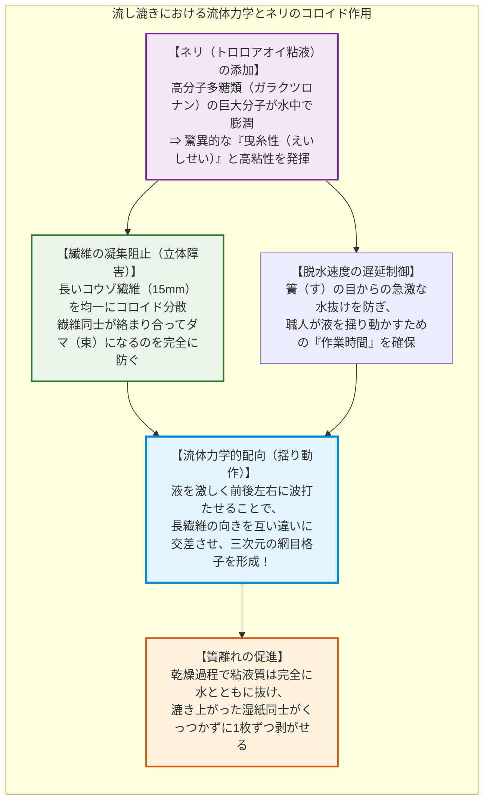

この流し漉きを可能にしているのが、アオイ科植物トロロアオイの根から抽出される粘液**「ネリ（粘剤）」**のコロイド化学的性質である。

ネリの主成分は、分子量数百万に達する酸性高分子多糖類（ラムノガラクツロナン）である。ネリは単なる糊（接着剤）ではない。乾燥すれば跡形もなく消え去るが、水中では以下の決定的役割を果たす：
1. **立体障害による繊維凝集防止**：10mmを超える長繊維は、水中で互いに絡まり合って容易に塊（フロック）を作ってしまう。ネリの巨大分子鎖が繊維表面を覆うことで、繊維同士が直接接触するのを物理的に阻害し、水中で完全に一本ずつ孤立分散させる。
2. **脱水速度のコントロール**：水の粘性を高めることで、簀の目から水が一瞬で抜け落ちるのを防ぎ、職人が繊維を揺り動かして交差配列させる十分な時間を提供する。
3. **無接着性の残渣**：ネリは乾燥するとセルロース同士の水素結合を全く阻害せず、湿紙を何枚も重ねておいても乾燥後に1枚ずつ綺麗に剥がすことができる。

### 3.3 木材パルプ製造技術の近代化とリグニンの除去工学

19世紀半ば、ボロ布の不足を克服するため、ドイツのフリードリヒ・ケラー（1840年代）による**砕木パルプ（GP: Groundwood Pulp）**の発明を皮切りに、木材から直接パルプ（繊維）を取り出す化学工学が急速に発達した。

樹木の幹は、セルロース（約40〜50%）、ヘミセルロース（約20〜30%）、そして**リグニン（Lignin、約20〜30%）**から成る強固な複合材料（鉄筋コンクリート構造）である。セルロースが「鉄筋」なら、リグニンはセルロース同士を強固に固着させている「コンクリート（高分子接着剤）」である。

良質な紙を作るためには、木材からリグニンを選択的に溶かし出して純粋なセルロース繊維を単離する必要がある。

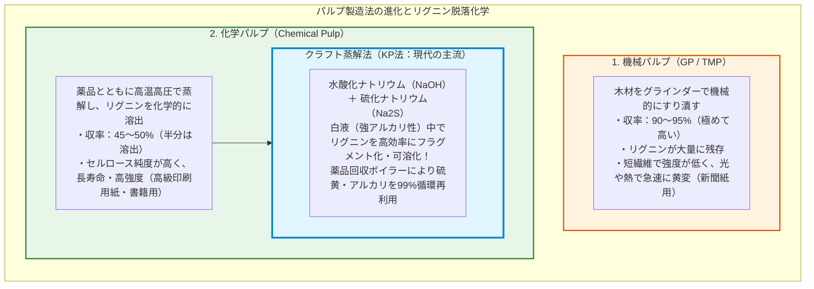

現代の製紙業界の基盤を成すのが**クラフトパルプ（KP: Kraft Pulp）**である。「クラフト」とはドイツ語で「力・強度」を意味する。水酸化ナトリウム（$\text{NaOH}$）と硫化ナトリウム（$\text{Na}_2\text{S}$）の混合アルカリ水溶液（白液）中で木材チップを約 $170^\circ\text{C}$ の高温高圧で蒸解する。

硫化水素イオン（$\text{HS}^-$）が求核剤としてリグニンのフェニルプロパン骨格のエーテル結合を選択的に開裂させ、リグニンを高分子から水溶性の低分子フラグメントへと解体する。これにより、セルロースの重合度低下を最小限に抑えながら、極めて強靭でリグニンフリーのパルプ繊維を取り出すことが可能となった。

---

## 第4章：印刷技術との共進化——木版印刷からグーテンベルクの活版印刷

紙という媒体が人類史を動かす真の起爆剤となったのは、文字を一文字ずつ手作業で書き写す「写本（Manuscript）」の時代を脱し、**「印刷技術（Printing）」**と邂逅した瞬間であった。

### 4.1 東アジアにおける先行技術：木版印刷と金属活字

印刷技術の萌芽もまた、東アジアで生まれた：
- **木版印刷（Xylography）**：7世紀の唐代中国で本格化し、現存する世界最古の印刷物とされる日本の『百万塔陀羅尼』（770年）や、唐の『金剛般若経』（868年）を生み出した。1枚の木板にページ全体を彫刻する木版印刷は、漢字のように数万字に及ぶ文字体系を持ち、かつ仏典のように不変のテキストを大量に刷るには極めて適していた。
- **活字印刷の先駆**：北宋の畢昇（ひつしょう、1040年代）が膠泥（陶器）による可動活字を試み、13世紀初頭には朝鮮の高麗において青銅製の**金属活字**が開発された（1377年の『白雲和尚抄録仏祖直指心体要節』は現存最古の金属活字本）。

しかし、東アジアにおいて金属活字は、西洋におけるグーテンベルクほどの爆発的社会変革を即座には引き起こさなかった。その理由は、漢字の文字数が多すぎて活字の鋳造・植字の初期コストが膨大であったこと、そして国家・王権による独占事業に留まり、民間の自律的出版市場へと開放されにくかった歴史的背景に起因する。

### 4.2 グーテンベルクの三大システム統合（1450年頃）

1450年頃、神聖ローマ帝国のマインツにおいて、金細工師であった**ヨハネス・グーテンベルク（Johannes Gutenberg）**が達成した偉業は、単一の「活字」の発明ではない。彼は印刷に関わる**機械・材料・化学のすべての要素を単一のシームレスな生産システムへと統合**した。

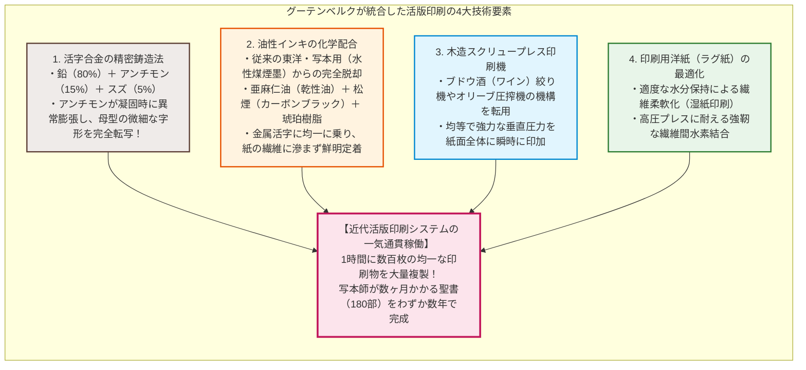

グーテンベルクが成し遂げた統合の核心は以下の4点である：
1. **活字合金（Type Metal）の冶金学**：
   単なる鉛では柔らかすぎてプレス圧で潰れ、鉄や青銅では融点が高すぎて精密鋳造が困難であった。グーテンベルクは**鉛（$\text{Pb}$ 約80%）、アンチモン（$\text{Sb}$ 約15%）、スズ（$\text{Sn}$ 約5%）**の三元合金を開発した。アンチモンは水と同様に「液体から固体へ凝固する際に体積が膨張する」という極めて特異な物理特性を持つ。これにより、溶湯が母型の隅々まで行き渡り、極小のアルファベットのセリフ（飾りの線）に至るまで完璧な寸法精度で数万本の活字を量産できた。
2. **油性インキの開発**：
   従来の写本や東洋の木版で使われていた水性インキは、金属活字の表面を弾いてしまい、玉になって均一に付着しなかった。グーテンベルクは亜麻仁油やテレピン油を煮詰めた**乾性油に松煙（煤）を練り込んだ油性インキ**を創出した。これは金属によく濡れ、紙の繊維へと適度に移り、空気中の酸素と重合反応を起こして強固な耐水性塗膜を作った。
3. **スクリュープレス印刷機**：
   ライン川流域のワイン醸造に用いられていた木製スクリュー圧搾機の機構を転用し、平らな版盤の上に置かれた紙に対して垂直かつ均等な巨大圧力を一瞬で加える機構を構築した。
4. **紙の適合**：
   当時、羊皮紙は厚みや硬さが不均一であり、金属活字の圧力を受けると活字を痛め、またあまりに高価であった。均質で平滑、かつ適度なクッション性を持つ高品質なラグ紙の存在こそが、グーテンベルクの印刷機を回し続ける燃料となった。

### 4.3 知識の大衆化、宗教改革、科学革命のインフラ

グーテンベルクの印刷技術は、瞬く間にライン川から全ヨーロッパへと燎原の火のごとく拡散した。1450年から1500年までのわずか50年間（この期間に印刷された書物は**「インキュナブラ（揺籃期本）」**と呼ばれる）に、ヨーロッパ全土の印刷工房は250都市以上に広がり、推計で約2,000万冊もの書物が印刷された。これは、それ以前の千年間に中世ヨーロッパ全土の修道院で手写された本の総数を一瞬で凌駕する数字であった。

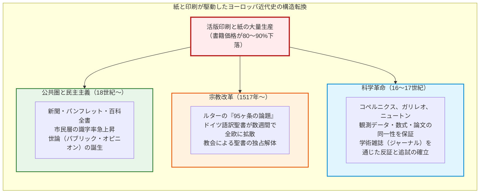

紙と印刷の結合がもたらした最大の衝撃は、**「情報の同一性（Standardization）」と「知識の不可逆的蓄積」**の確立である：
- **写本のエラーの連鎖を根絶**：手写ではコピーを重ねるごとに脱字、誤写、解釈の混入が不可避に増殖した。印刷は、一度校正された何千冊もの本が「完全に一言一句同じテキスト」であることを保証した。
- **宗教改革**：マルティン・ルターが1517年にヴィッテンベルクで発表した『95ヶ条の論題』は、わずか2週間でドイツ全土に、4週間で全ヨーロッパに印刷物として拡散した。ラテン語からドイツ語に翻訳されたルターの聖書は民衆の手に渡り、カトリック教会の権威独占を粉砕した。
- **近代科学革命の基盤**：コペルニクスの地動説、ヴェサリウスの解剖図譜、ティコ・ブラーエやケプラーの天体観測数値表、そしてニュートンの『プリンキピア』。これらが精緻な銅版画図面や数式とともに寸分の狂いもなく複製され、ヨーロッパ中の科学者によって同時に検証・追試・反証可能になったことこそが、近代自然科学の誕生そのものであった。

---

## 第5章：酸性紙の悲劇と「自己崩壊」の化学メカニズム

人類の知識を永久に記録するはずだった紙は、19世紀中頃、近代産業革命の熱狂の中で自らに**「時限爆弾」**を埋め込むこととなった。現在、世界中の図書館や公文書館を震撼させている**「酸性紙問題（Slow Fire / Acid Paper Crisis）」**である。

### 5.1 19世紀の大量生産革命：ロジン・硫酸アルミニウム定着法

19世紀前半、製紙機械（長網抄紙機＝フォールドリニア機）の実用化と木材パルプの導入により、紙の抄造速度は数千倍へと加速した。しかし、高速で紙を漉く現場で致命的な問題が生じた。**インクの滲み（ブリーディング）**である。

毛細管現象の塊であるセルロースシートは、そのままでは水性インクを吸い取って文字が激しく滲んでしまう。これを防ぐため、繊維の表面に撥水性を持たせる**「サイジング処理（Sizing）」**が不可欠となる。

中世の手漉き紙では、前述の通り高価なゼラチン溶液に紙を一枚ずつ浸す「後サイジング」を行っていたが、超高速で連続回転する長網抄紙機には到底間に合わない。

そこで1807年、ドイツのモーリッツ・イリヒ（Moritz Illig）が画期的な技術を発明した。**「内添ロジンサイズ法」**である：
1. 松脂（まつやに）から抽出した**ロジン石鹸（主成分：アビエチン酸ナトリウム $\text{C}_{19}\text{H}_{29}\text{COONa}$）**を、パルプを水に懸濁させた段階で直接投入する。
2. そのままでは負に帯電しているセルロース繊維と、同じく負に帯電しているロジン分子は静電反発して定着しない。
3. そこで、定着剤（沈殿剤）として極めて安価な**硫酸アルミニウム（硫酸バンド、$\text{Al}_2(\text{SO}_4)_3 \cdot 14 \sim 18\text{H}_2\text{O}$）**を大量に投入する。
4. 解離したアルミニウム多核錯イオン（正電荷）が架橋となり、ロジン酸の疎水基を外側に向けてセルロース表面に強固に定着させる。

この発明により、インクが滲まない平滑な洋紙が超高速・超低コストで無限に製造可能となり、世界中の新聞、雑誌、文芸書、教科書がこの「ロジン・硫酸バンド定着紙」へと全面的に切り替わった。

### 5.2 硫酸アルミニウムの加水分解と酸加水分解（Acid Hydrolysis）の連鎖

しかし、この硫酸アルミニウムこそが、紙の命を内側から食い破る悪魔の化学種であった。

硫酸アルミニウムは、強酸（硫酸 $\text{H}_2\text{SO}_4$）と弱塩基（水酸化アルミニウム $\text{Al(OH)}_3$）からなる塩であるため、水溶液中、および大気中の湿気（水分）を吸収することで、激しい**加水分解（Hydrolysis）**を起こす：

$$\text{Al}^{3+} + 6\text{H}_2\text{O} \rightleftharpoons [\text{Al(H}_2\text{O)}_6]^{3+}$$

$$[\text{Al(H}_2\text{O)}_6]^{3+} + \text{H}_2\text{O} \rightleftharpoons [\text{Al(OH)(H}_2\text{O)}_5]^{2+} + \text{H}_3\text{O}^+$$

この加水分解により、紙の内部に**遊離硫酸（$\text{H}_2\text{SO}_4$）**に匹敵する多量の水素イオン（オキソニウムイオン $\text{H}_3\text{O}^+$）が持続的に放出され続ける。結果として、製造された紙のpHは**$4.0 \sim 5.0$、劣悪なものでは $3.5$ 前後という極めて強い酸性**を示すようになった。これが**「酸性紙（Acidic Paper）」**である。

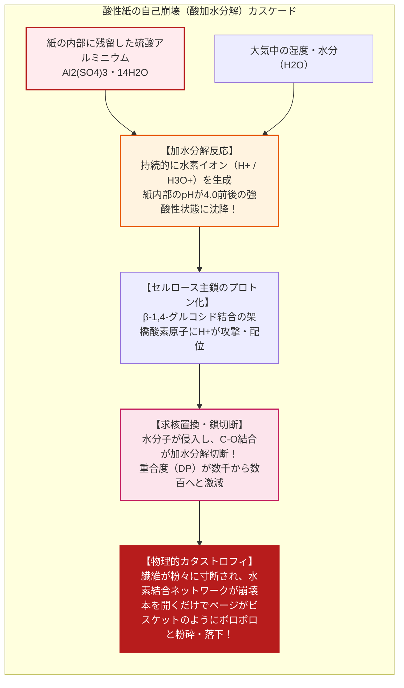

この内部に閉じ込められた酸は、数十年から百年の歳月をかけて、セルロース分子鎖の**$\beta\text{-1,4-グルコシド結合}$を不可逆的に切断（酸加水分解）**していく：

1. グルコシド結合を形成しているグリコシド酸素原子に、酸（$\text{H}^+$）がプロトン化する。
2. プロトン化された酸素が脱離基となり、C1位にカルボカチオン（オキソカルベニウム中間体）が形成される。
3. 水分子（$\text{H}_2\text{O}$）が求核攻撃して結合が完全に分断され、元の鎖は2本の短いセルロース鎖へと分断される。

木材パルプの元々の重合度（DP: Degree of Polymerization）は数千以上あったものが、酸加水分解によって**DPが $200 \sim 300$ 以下（臨界重合度）**にまで落ち込むと、もはや繊維としての引張強度を全く維持できなくなる。

20世紀後半、世界中の国立図書館で恐るべき事態が発覚した。19世紀半ば以降（おおむね1850年〜1980年代）に出版された書籍が、誰の手にも触れられずに書架に置かれていただけで、自ら発生させた酸によって茶褐色に変色し、ページをめくった瞬間にビスケットのように粉々に砕け散る現象が大量発生したのである。数百年前に漉かれた中世の和紙や手漉きラグ紙が純白と強靭さを保っている一方で、近代の「知識の大爆発」を記録した書物が、内側から燃え尽きるように崩壊していった（**「音なき火災＝Slow Fire」**）。

### 5.3 中性紙（Alkaline/Neutral Paper）への大転換

この文明的危機に直面した製紙業界と国際社会は、1980年代以降、硫酸アルミニウムを完全に排除した**「中性紙（Alkaline/Neutral Paper）」**への劇的な技術転換を果たした。

中性紙化を可能にしたのは、**合成サイズ剤（AKD: アルキルケテンダイマー、ASA: アルケニル無水コハク酸）**の開発である。これらは酸性塩の助けを借りることなく、中性〜弱アルカリ性（$\text{pH} \approx 7.5 \sim 8.5$）の環境下でセルロースのヒドロキシ基と直接エステル結合を形成して疎水性を付与できる。

さらに、抄紙工程の充填剤（填料）として、安価で白色度の高い**炭酸カルシウム（$\text{CaCO}_3$）**を大量に配合することが可能になった。酸性紙では炭酸塩を入れると硫酸と反応して二酸化炭素（$\text{CO}_2$）の発泡事故が起きるため使用できなかったが、中性環境下では安定に分散する。

炭酸カルシウムを内包した中性紙は、仮に将来的に大気中の酸性ガス（$\text{SO}_x, \text{NO}_x$）が紙に侵入してきても、炭酸カルシウムが自らを犠牲にして酸を中和する**「アルカリバッファー（アルカリ予備力）」**として機能する：

$$\text{CaCO}_3 + \text{H}_2\text{SO}_4 \to \text{CaSO}_4 + \text{H}_2\text{O} + \text{CO}_2 \uparrow$$

国際規格ISO 9706（恒久紙基準）では、中性紙の寿命は**数百年から1000年以上の保存性**を持つことが実証されている。現在、公文書や出版物の用紙のほとんどは中性紙へと置換されている。

---

## 第6章：紙の保存科学と未来のセルロースナノファイバー（CNF）

### 6.1 歴史的紙資料の修復工学：脱酸処理と和紙による裏打ち

すでに酸性劣化を起こして脆化した過去150年分の膨大な古文書・図書を救うため、現代の保存科学（Conservation Science）は先端化学を駆使した修復技術を確立している。

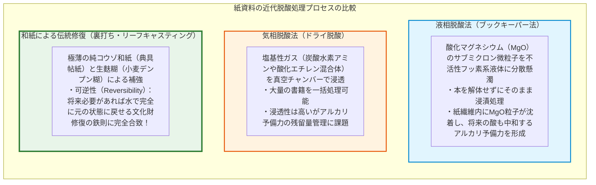

1. **マス脱酸処理（大量脱酸法）**：
   図書館に眠る数百万冊の酸性本を一冊ずつ解体して処理することは物理的に不可能である。そこで開発されたのが、本を綴じたまま丸ごと薬剤に浸漬する**「ブックキーパー法（Bookkeeper Process）」**である。
   化学的に不活性なフッ化炭素液体中に、サブミクロンスケール（ナノ粒子）の**酸化マグネシウム（$\text{MgO}$）**微粒子を均一に分散させる。本を液体に浸すと、微粒子が紙の細孔深くまで浸透し、繊維内の遊離硫酸を中和するとともに、紙の中に残留して将来の酸に対する強固なアルカリバッファーを形成する：
   $$\text{MgO} + \text{H}_2\text{SO}_4 \to \text{MgSO}_4 + \text{H}_2\text{O}$$
2. **和紙による文化財修復（裏打ち工学）**：
   すでにボロボロに崩れかけた西洋の古書や公文書の物理的修復において、世界中の名だたる公文書館（大英図書館、ルーヴル美術館、バチカン図書館など）で国際標準として採用されているのが、日本の**「極薄和紙（典具帖紙など）」を用いた裏打ち補強**である。
   コウゾの長い靭皮繊維で作られた極薄和紙を、小麦デンプンを精製した「生麩糊（しょうふのり）」を用いて資料の裏面に貼り合わせる。和紙は驚異的な透明度を持つため文字を一切隠蔽せず、長繊維が破損箇所を強靭に繋ぎ止める。
   さらに決定的なのは、文化財修復における大原則**「可逆性（Reversibility）」**を満たしている点である。化学合成接着剤を用いると二度と元に戻せなくなるが、和紙とデンプン糊による裏打ちは、数十年・数百年後に温水で湿らせれば、原本に一切の損傷を与えることなく完全に剥がして再修復することができる。

### 6.2 セルロースナノファイバー（CNF）：次世代バイオナノマテリアル

紙の主成分である植物繊維の科学は、単なる「インクを受け止めるシート」の枠を完全に飛び越え、21世紀の最先端ナノテクノロジーの最前線に立っている。その究極の到達点が**セルロースナノファイバー（CNF: Cellulose Nanofiber）**である。

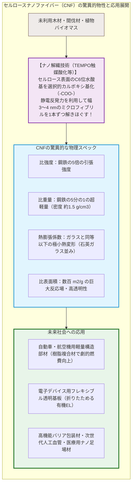

CNFは、木材パルプを化学的・機械的手法（東京大学の磯貝明教授らが開発したTEMPO触媒酸化法など）によってナノサイズ（幅3〜4nm、長さ数μm）にまで精密に解繊（ほぐ）した最先端繊維材料である。

その物理的特性は、従来の材料科学の常識を覆す：
- **鋼鉄の5倍の強度で、重量は5分の1**（比強度が極めて高い）。
- **線熱膨張係数は石英ガラス並みに極小**（熱を加えてもほとんど伸び縮みしない）。
- 繊維径が可視光線の波長（$400 \sim 700\,\text{nm}$）より遥かに細いため、樹脂に高濃度で練り込んでも光を散乱させず、**ガラスのように完全に透明なプラスチック**を作ることができる。

植物が光と水と二酸化炭素から自己組織化させたセルロースナノファイバーは、石油由来プラスチックの代替となる自動車の超軽量ボディ部材、折りたためる次世代ディスプレイの透明導電基板、さらには生体適合性を活かした人工血管やドラッグデリバリーシステムに至るまで、ポスト化石燃料時代の基幹マテリアルとして爆発的な進化を遂げている。

---

## 結語：植物の光合成産物が紡ぎ出した人類文明の記憶装置

太陽の光を浴びた植物が、大気中の二酸化炭素と水から合成した炭水化物——セルロース。

人類はこの無尽蔵の生体高分子を叩いて解きほぐし、水の中に解き放ち、水分子の毛細管引力と水素結合の力によって再びシートへと紡ぎ直した。それが「紙」という発明の本質であった。

パピルスや羊皮紙の物理的限界を破り、蔡倫による製紙技術の確立からタラス河畔の戦いを経た世界拡散、和紙職人たちが極めた流し漉きのコロイド制御、そしてグーテンベルクの活版印刷システムとの融合。紙という軽量・安価・高精細な記録媒体が地球上に行き渡ったことで、人類は自らの死を超えて思考を正確に継承する「集合知の外部脳」を手に入れた。

19世紀の酸性紙が引き起こした自己崩壊の危機は、材料化学の未熟さが招いた文明的試練であったが、現代の保存科学はその過ちを乗り越え、中性紙化と高度な脱酸・修復技術を確立させた。そして今日、セルロースはCNFという究極のナノマテリアルとして、再び産業と環境の未来を刷新しようとしている。

デジタルデータがいかに膨大化しようとも、電源喪失やフォーマットの風化によって数十年で消失しかねない脆さを抱える現代において、1000年を超えて光と文字を保持し続ける「紙」の物質的リアリティと水素結合の強靭さは、今なお人類文明の最も確かなアンカー（錨）であり続けている。
