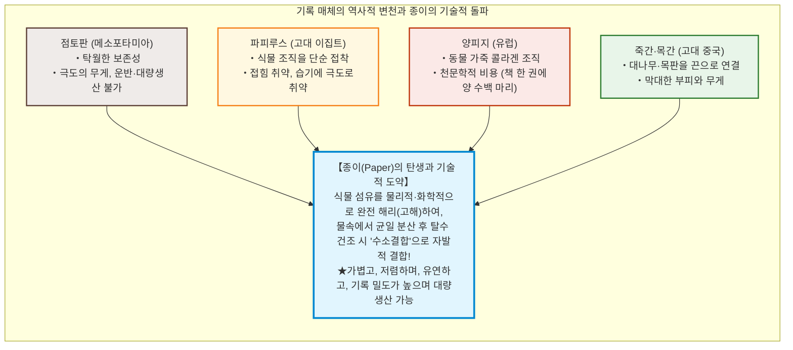
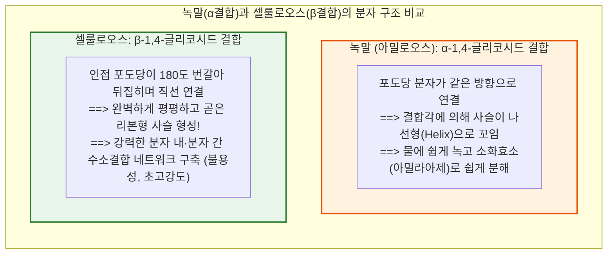
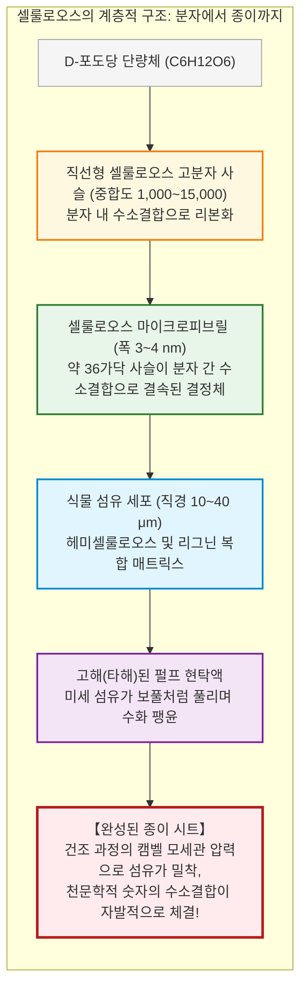

## 서론: 지식을 기록하고 문명을 가속화한 '식물 섬유 시트'

인류 역사 전반에 걸쳐 지식의 축적과 전달 방식을 근본적으로 혁신하고, 종교개혁, 르네상스, 과학혁명, 그리고 근대 민주주의의 기틀을 마련한 단 하나의 물리적 매체가 존재한다. 그것이 바로 **'종이(Paper)'**이다.

현대 디지털 사회에서 우리는 텍스트와 이미지를 실리콘 칩 내부의 전하나 광 펄스로 변환하여 즉각 저장하고 전송하는 데 익숙하다. 그러나 수천 년의 역사 동안 인류의 사상, 법률, 과학적 발견, 신앙, 문학을 공간과 시간을 초월하여 온전히 정착시켜 온 주역은, 식물 세포벽에서 추출한 미세 섬유들이 얽혀 있는 두께 0.1밀리미터 안팎의 얇은 시트였다.

종이가 널리 쓰이기 전, 인류는 다양한 기록 매체에 의존했으나 치명적인 한계가 있었다:
- **점토판 (메소포타미아)**: 지질학적 보존성은 탁월했으나 지나치게 무겁고 부피가 커서 방대한 문헌을 운반하거나 대중화할 수 없었다.
- **파피루스 (고대 이집트)**: 파피루스 줄기를 얇게 쪼개어 가로세로로 겹친 것으로, 가볍고 유연했으나 건조한 지중해 연안을 벗어나면 쉽게 부스러지고 접힘에 취약했다.
- **양피지 (고대 그리스·로마, 중세 유럽)**: 양이나 송아지 가죽을 털을 뽑고 무두질하여 만든 것으로, 질기고 양면 필사가 가능하여 현대 서적의 원형(코덱스)을 낳았으나 성경 한 권을 제작하는 데 수백 마리의 가축을 도살해야 할 만큼 극단적으로 비쌌다.
- **죽간과 목간 (고대 중국)**: 대나무나 나무를 깎아 끈으로 엮은 것으로, 수십만 자의 책을 옮기려면 수레 여러 대가 필요했다.

종이의 진정한 혁신성은 파피루스처럼 식물 조직을 그대로 이어 붙이거나 양피지처럼 동물 피부를 건조시킨 것이 아니라, **"식물 섬유를 분자 및 미세 수준까지 완전히 해리(고해)시킨 뒤, 물속에 균일 분산시키고, 망 위에서 탈수 및 건조시켜 분자 수준에서 재결합시킨다"**는 고도의 고분자 재료공학적 공정에 있다.

놀랍게도, 종이 섬유끼리 결합하는 데는 **어떠한 접착제나 풀도 필요하지 않다**. 건조된 종이가 질긴 인장 강도를 갖는 이유는, 물이 증발하는 과정에서 식물 섬유의 핵심 성분인 **셀룰로오스(Cellulose)** 분자들이 무수한 **수소결합(Hydrogen Bonding)**을 자발적으로 형성하기 때문이다.

---

## 제1장: 셀룰로오스의 초분자 구조와 '수소결합'의 기적

### 1.1 포도당이 엮어내는 직선형 고분자 ($\beta\text{-1,4-글리코시드 결합}$)

종이의 주성분은 식물 세포벽을 구성하는 다당류인 **셀룰로오스($(\text{C}_6\text{H}_{10}\text{O}_5)_n$)**이다. 지구상의 식물이 광합성을 통해 생산하는 셀룰로오스는 연간 수천억 톤에 달하며, 지구상에서 가장 풍부한 유기 고분자이다.

셀룰로오스는 단당류인 **$\text{D-포도당}$**이 탈수 축합되어 길게 이어진 선형 고분자이다. 결정적인 차이는 포도당 잔기들을 연결하는 **$\beta\text{-1,4-글리코시드 결합}$**에 있다.

우리가 섭취하는 **녹말(Starch)** 역시 동일한 포도당 중합체이지만, **$\alpha\text{-1,4-글리코시드 결합}$**을 취하고 있어 분자 사슬이 용수철처럼 꼬여 물에 잘 녹고 효소에 의해 쉽게 소화된다.

반면, 셀룰로오스는 **$\beta\text{-1,4-글리코시드 결합}$**을 가지므로, 인접한 포도당 고리가 **축을 중심으로 180도씩 번갈아 반전**된다. 이 대칭성으로 인해 분자 사슬은 일체의 꼬임 없이 팽팽하게 펴진 평면 리본 형태를 띠게 된다. 목재 펄프의 중합도(DP)는 1,000~5,000에 달하며, 천연 면이나 마 섬유는 15,000 이상에 이른다.

### 1.2 수소결합: 접착제 없이 종이가 결합하는 원리

포도당 단위체마다 3개씩 존재하는 **하이드록실기($-\text{OH}$)**는 전기음성도가 높은 산소와 수소 사이의 극성으로 인해 강력한 **수소결합(Hydrogen Bond)**을 형성한다.

1. **분자 내 수소결합**: 단일 사슬 내부에서 포도당 잔기끼리 단단히 결합하여 사슬의 회전을 막고 극도의 뻣뻣함(강도)을 부여한다.
2. **분자 간 수소결합**: 나란히 배열된 인접 셀룰로오스 사슬들을 측면에서 묶어 고결정성 **마이크로피브릴(Microfibril)**을 형성한다.

단일 셀룰로오스 결정 마이크로피브릴의 축 방향 영률(탄성률)은 무려 **$130 \sim 150\,\text{GPa}$**에 달해, 알루미늄($\approx 70\,\text{GPa}$)의 2배를 넘으며, 비강도 면에서 강철을 압도한다.

### 1.3 캠벨 효과(Campbell Effect): 물이 이끄는 나노 자기융착

물속에 떠 있던 섬유들이 건조 시 서로 끌어당겨져 수소결합을 이루는 물리적 원동력은 **'캠벨 효과(Campbell Effect)'**이다.

탈수가 진행되고 수분이 증발함에 따라 섬유 간극에 형성되는 미세한 물의 오목 메니스커스에서, **영-라플라스 식**에 따른 막대한 모세관 부압이 발생한다:
$$\Delta P = \frac{2\gamma \cos \theta}{r}$$
간극 반경 $r$이 나노 스케일($5 \sim 10\,\text{nm}$)로 줄어들면, 이 인력은 **수 메가파스칼(수십 기압)**에 이른다. 이 거대한 모세관 압력이 섬유들을 나노 단위로 강제 밀착시키고, 물 분자가 날아가는 순간 하이드록실기들이 직접 수소결합을 완결한다. 종이가 물에 젖으면 약해지는 이유 역시 물 분자가 이 수소결합 사이에 끼어들어 결합을 끊기 때문이다.

---

## 제2장: 제지 기술의 발전사——채륜에서 탈라스 전투, 유럽까지

### 2.1 채륜의 제지술 확립 (후한 105년)

기원전 2세기 한나라 시대의 거친 마지 유물이 출토되었으나, 실용적인 필기 매체로 제지술을 완성한 인물은 후한의 환관 **채륜(蔡倫)**이었다. 105년, 채륜은 뽕나무 껍질, 삼베 조각, 낡은 어망 등을 잿물(알칼리)에 삶아 펙틴과 리그닌을 제거하고, 절구로 찧어 섬유를 해리시킨 뒤 대발로 건져 말리는 공정을 체계화하여 **'채후지(蔡侯紙)'**를 완성했다.

### 2.2 탈라스 전투 (751년)와 이슬람의 번영

751년, 고선지 장군이 이끄는 당나라 군대와 이슬람 아바스 왕조 군대가 맞붙은 **탈라스 전투**에서 당군이 패배하며 제지 기술자들이 포로로 잡혔다. 이들은 우즈베키스탄의 **사마르칸트**로 이송되어 종이 공장을 세웠다.

793년 바그다드에 제지 공장이 들어서며 파피루스를 완전히 몰아냈고, 그리스 고전 철학과 과학 서적을 아랍어로 번역하는 **'지혜의 집(Bayt al-Hikma)'** 사업을 촉진하여 이슬람 학문의 황금기를 열었다. 이후 제지술은 북아프리카를 거쳐 1151년 스페인의 **하티바(Játiva)**를 통해 유럽에 전파되었다.

### 2.3 이탈리아 파브리아노와 걸레(Rag) 품귀 위기

1268년 이탈리아 **파브리아노(Fabriano)** 공방은 수력 쇠방망이 분쇄기, 동물성 젤라틴 사이징, 위조 방지용 워터마크를 도입하여 서양 종이 생산을 공업화했다. 그러나 18세기 말, 출판 수요가 폭증하면서 원료인 린넨·면 넝마(Rag)의 절대적 고갈이라는 병목에 직면하게 되었다.

---

## 제3장: 한지·화지와 서양 목재 펄프의 비교

### 3.1 인피섬유의 길이와 3차원 얽힘

동양의 전통 종이는 닥나무(닥/코조), 삼지닥(미츠마타) 등 관목의 줄기 내피인 **인피섬유(Bast Fiber)**를 사용한다.

닥나무 인피섬유의 평균 길이는 **10~15mm**로, 서양 목재 펄프(1~3mm)의 5~10배에 달한다. 이 극도로 긴 섬유가 3차원 그물처럼 얽혀 있어, 한지와 화지는 천 년이 지나도 바스러지지 않고 수만 번 접어도 찢어지지 않는 경이적인 강도를 유지한다.

### 3.2 '흘려뜨기(흘림뜨기)'와 황촉규근(닥풀)의 유체역학

닥풀(황촉규 뿌리 점액)은 고분자 다당류로서, 긴 섬유가 물속에서 서로 뭉치는 것을 방지(입체 장애)하고 탈수 속도를 늦춰 장인이 발을 상하좌우로 격렬히 흔들어 섬유를 직교 교차시킬 수 있는 작업 시간을 제공한다.

### 3.3 목재 크라프트 펄프 공학

19세기 중반 발명된 **크라프트 공정(Kraft Process)**은 수산화나트륨($\text{NaOH}$)과 황화나트륨($\text{Na}_2\text{S}$)을 혼합한 백액으로 $170^\circ\text{C}$에서 목재 칩을 삶아, 셀룰로오스를 묶고 있는 착색 불순물인 **리그닌(Lignin)**만을 선택적으로 분해·용출해 내어 고강도의 목재 종이를 대량생산할 수 있게 만들었다.

---

## 제4장: 인쇄술과의 공진화——구텐베르크의 혁명

1450년경 독일 마인츠의 **요하네스 구텐베르크(Johannes Gutenberg)**는 활판 인쇄의 4대 핵심 요소를 통합했다:
1. **활자 합금**: 납(80%), 안티몬(15%), 주석(5%) 합금으로, 안티몬의 냉각 시 팽창 특성을 이용해 미세한 글꼴을 완벽 복제;
2. **유성 잉크**: 아마인유 기반 잉크로 금속 활자에 뭉침 없이 안착;
3. **나선형 압착기**: 포도주 압착기를 개량하여 균일한 수직 고압 인가;
4. **인쇄용 종이**: 수분을 적셔 섬유를 부드럽게 만든 양질의 넝마 종이.

1450~1500년 사이 유럽 전역에서 2,000만 권 이상의 서적이 쏟아져 나오며 종교개혁과 과학혁명이 촉발되었다.

---

## 제5장: 산성지 위기와 '조용한 불꽃(Slow Fire)'의 화학

19세기 고속 윤전기 도입에 맞춰 잉크 번짐을 막기 위해 고안된 **로진-황산알루미늄 사이징법**은 인류 지식에 시한폭탄을 심었다.

황산알루미늄($\text{Al}_2(\text{SO}_4)_3$)이 공기 중 수분과 반응하여 지속적으로 **수화 가수분해**를 일으켜 황산을 생성했다:
$$[\text{Al(H}_2\text{O)}_6]^{3+} + \text{H}_2\text{O} \rightleftharpoons [\text{Al(OH)(H}_2\text{O)}_5]^{2+} + \text{H}_3\text{O}^+$$
종이 내부 pH가 3.5~4.5의 강산성으로 떨어졌고, 셀룰로오스 사슬이 끊어지는 **산 가수분해**가 진행되어 1850~1980년대 출판된 수억 권의 책들이 책장에서 과자처럼 바스러지는 **'산성지 위기'**가 발생했다.

1980년대 이후 전 세계 제지업계는 합성 사이징제(AKD)와 탄산칼슘($\text{CaCO}_3$)을 첨가한 **중성지(Alkaline Paper, ISO 9706)**로 전환하여 500~1,000년 이상의 보존 수명을 달성했다.

---

## 제6장: 종이 보존 과학과 셀룰로오스 나노파이버(CNF)

- **북키퍼(Bookkeeper) 대량 탈산법**: 산화마그네슘($\text{MgO}$) 나노입자를 비수성 용매에 분산시켜 책을 분해하지 않고 침적 처리, 산을 중화하고 알칼리 예비력을 부여.
- **전통 한지·화지 배접 복원**: 극도로 얇은 순수 닥나무 종이(2~5 g/m2)와 소맥전분풀을 이용한 보강. 문화재 복원의 철칙인 **가역성(Reversibility)**을 완벽히 충족하여 수백 년 후에도 온수로 원본 손상 없이 분리 가능.
- **셀룰로오스 나노파이버 (CNF)**: 나노 단위(폭 3~4 nm)로 해리한 차세대 바이오 소재. **강철의 5배 강도, 5분의 1 무게**, 극저 열팽창성, 유리처럼 투명한 나노 복합재로 자동차 및 첨단 전자소재로 급부상.

---

## 결론: 햇빛과 물이 엮어낸 인류 문명의 기억 장치

광합성을 통해 합성된 탄수화물 셀룰로오스를 두드려 풀고, 물속에서 건져 올려 수소결합으로 재탄생시킨 '종이'. 종이는 파피루스와 양피지의 물리적 한계를 부수고 지식의 대중화와 과학 문명을 견인했다.

디지털 데이터가 전원 상실이나 포맷 풍화로 순식간에 소멸할 수 있는 오늘날, 1,000년을 넘어 빛과 글을 지켜내는 종이의 물질적 실재성과 수소결합의 끈기는 여전히 인류 문명의 가장 든든한 닻이다.
