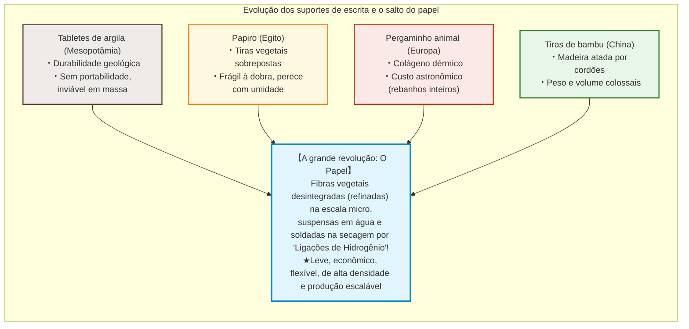
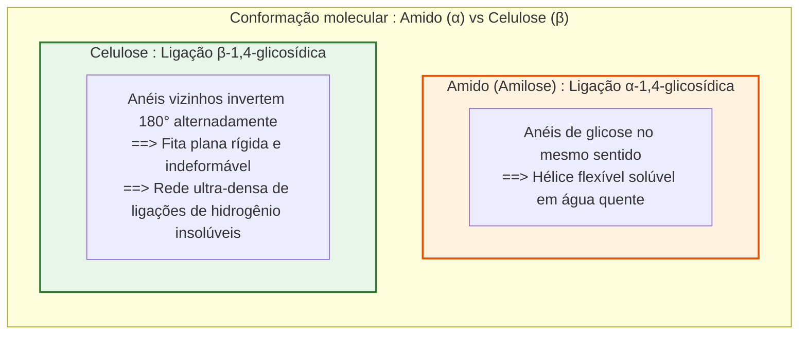
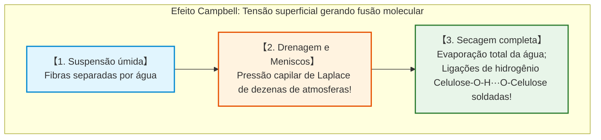
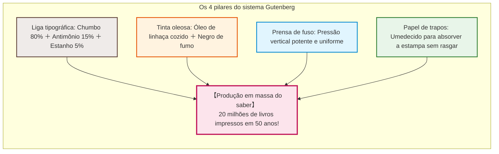
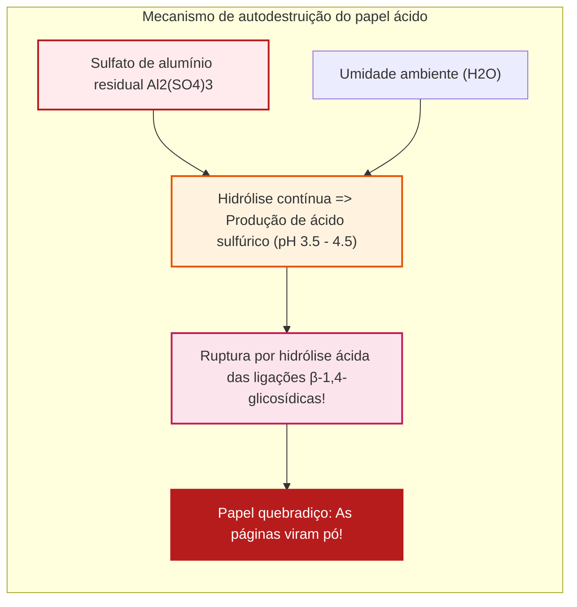

## Introdução: A folha de fibras vegetais que acelerou a civilização

Ao longo da história da civilização humana, um único suporte material transformou de forma indelével a acumulação e transmissão do conhecimento, tornando possíveis a Reforma Protestante, o Renascimento, a Revolução Científica e as democracias modernas: **o papel**.

Na era digital, habituamo-nos a salvar textos como pulsos ópticos ou cargas elétricas em silício. Contudo, durante milênios, o veículo do pensamento, das leis, da ciência e da poesia foi uma lâmina de apenas 0,1 milímetro de espessura, constituída por microfibras vegetais entrelaçadas.

Antes do papel, os suportes sofriam de sérias limitações:
- **Tabletes de argila (Mesopotâmia)**: De durabilidade geológica, mas pesadíssimos e impróprios para difusão em massa.
- **Papiro (Antigo Egito)**: Tiras de medula vegetal prensadas; maleáveis em climas áridos, mas quebradiças com umidade e limitadas ao rolo.
- **Pergaminho (Europa)**: Couro animal raspado; resistente e berço do códice (livro encadernado), mas de custo exorbitante (centenas de animais para uma Bíblia).
- **Tiras de bambu e madeira (China)**: Amarradas com cordas; extremamente volumosas e pesadas.

A revolução do papel reside na engenharia macromolecular: **as fibras vegetais são desfibradas, dispersas em água e reorganizadas molecularmente na secagem sem qualquer cola**.

A tenacidade do papel seco advém de bilhões de **ligações de hidrogênio** formadas espontaneamente entre as moléculas de **celulose**.

---

## Capítulo 1: Estrutura supramolecular da celulose e ligações de hidrogênio

### 1.1 Polímero linear e ligações $\beta\text{-1,4-glicosídicas}$

A celulose ($(\text{C}_6\text{H}_{10}\text{O}_5)_n$) é o biopolímero mais abundante da Terra, formada por unidades de **$\text{D-glicose}$** unidas por **ligações $\beta\text{-1,4-glicosídicas}$**.

Diferente do **amido** ($\alpha$-glicosídico), que forma espirais helicoidais flexíveis e solúveis, a conformação $\beta$ da celulose força anéis vizinhos a girarem **$180^\circ$ alternadamente**, gerando uma fita perfeitamente plana, reta e rígida.

### 1.2 Ligações de hidrogênio: União sem cola

Cada unidade de glicose contém 3 grupos hidroxila ($-\text{OH}$):
1. **Intramoleculares**: Imobilizam a cadeia numa conformação reta de alta rigidez axial.
2. **Intermoleculares**: Agrupam cadeias adjacentes em **microfibrilas cristalinas** de 3 a 4 nm.

O módulo de Young axial de uma microfibrila atinge **$130 \text{ a } 150\,\text{GPa}$**, superando o alumínio e competindo com o aço em rigidez específica.

### 1.3 O Efeito Campbell: A tensão superficial como força soldadora

Durante a secagem, meniscos microscópicos geram uma pressão capilar imensa (equação de Young-Laplace: $\Delta P = \frac{2\gamma \cos \theta}{r}$). Em escala nanométrica, a sucção alcança **dezenas de atmosferas**, obrigando as fibras a um contato atômico íntimo ($< 0{,}3\,\text{nm}$) onde as pontes de hidrogênio $-\text{OH} \cdots \text{O}-$ se fecham instantaneamente.

---

## Capítulo 2: História do papel – De Cai Lun à Europa

- **Cai Lun (105 d.C.)**: Na China, padronizou o uso de trapos de cânhamo, cascas de amoreira e redes velhas fervidas em lixívia alcalina de cinzas.
- **Batalha de Talas (751 d.C.)**: Prisioneiros chineses transmitiram o ofício a **Samarcanda**. Em 793, Bagdá oficializou o papel, alimentando a **Casa da Sabedoria**. Em 1151, chegou à Espanha por **Játiva**.
- **Fabriano (1268)**: Na Itália, introduziu-se martelos hidráulicos, colagem com gelatina animal e a **marca d'água**.
- **Crise dos trapos**: No século XVIII, a escassez de trapos de linho e algodão limitou a produção de livros na Europa.

---

## Capítulo 3: Washi japonês vs. Celulose de madeira ocidental

- **Fibras de casca (Kozo)**: O **Kozo (amoreira-papel)** possui fibras de **10 a 15 mm** (contra 1-3 mm da madeira), conferindo ao washi uma maleabilidade e durabilidade milenares.
- **Técnica Nagashizuki**: O artesão agita a suspensão em ondas contínuas. A mucilagem vegetal **Neri** evita que as fibras se enrosquem e modula a drenagem.
- **Processo Kraft (1884)**: Cozimento da madeira a $170^\circ\text{C}$ com $\text{NaOH}$ e $\text{Na}_2\text{S}$, que dissolve a **lignina** (cimento marrom escuro da madeira), preservando celulose pura e de alta resistência.

---

## Capítulo 4: A simbiose com a imprensa de Gutenberg (c. 1450)

Em Mainz, **Johannes Gutenberg** uniu 4 tecnologias vitais:
1. **Liga tipográfica**: Chumbo (80%), Antimônio (15%), Estanho (5%). O antimônio expande ao solidificar, copiando as matrizes com fidelidade microscópica.
2. **Tinta oleosa**: À base de óleo de linhaça e negro de fumo, que adere ao metal sem escorrer no papel.
3. **Prensa de fuso de madeira**: Pressão vertical uniforme.
4. **Papel de trapos flexível**: Umedecido antes da impressão para receber a tinta sem rasgar.

Em 50 anos, 20 milhões de livros foram impressos, permitindo a Reforma e a ciência empírica.

---

## Capítulo 5: A crise do papel ácido (Fogo Lento)

Em 1807, surgiu a colagem interna com **breu e sulfato de alumínio ($\text{Al}_2(\text{SO}_4)_3$)** para conter o borramento da tinta.

O sulfato de alumínio sofre contínua hidrólise com a umidade do ar, liberando ácido sulfúrico e rebaixando o pH interno para **3,5 - 4,5**. Isso provocou a quebra por hidrólise ácida das cadeias de celulose. Centenas de milhões de livros impressos entre 1850 e 1980 esfarelam-se hoje espontaneamente nas bibliotecas.

Desde os anos 1980, adotou-se o **papel neutro permanente (ISO 9706)** com reserva alcalina de carbonato de cálcio ($\text{CaCO}_3$), garantindo longevidade de 500 a 1.000 anos.

---

## Capítulo 6: Preservação e Nanofibras de Celulose (CNF)

- **Desacidificação em massa Bookkeeper**: Nanopartículas de óxido de magnésio ($\text{MgO}$) em fluidos fluorados inertes neutralizam a acidez sem desmanchar livros encadernados.
- **Restauração com Washi (Urauchi)**: Papel Tengucho ultrafino (2 a 5 g/m2) e cola de amido de trigo usados no Museu Britânico e no Louvre. Totalmente reversível com água morna.
- **Nanofibras de celulose (CNF)**: Fibrilas de 3 a 4 nm com **5 vezes a resistência do aço pesando 1/5**, transparentes e estáveis termicamente.

---

## Conclusão: A âncora material do espírito humano

Gerado pelo sol e moldado pela química das ligações de hidrogênio, o papel libertou a humanidade das limitações do papiro e do pergaminho. Diante de mídias digitais efêmeras, o papel permanece como o suporte físico mais fiel e nobre de nossa civilização.
