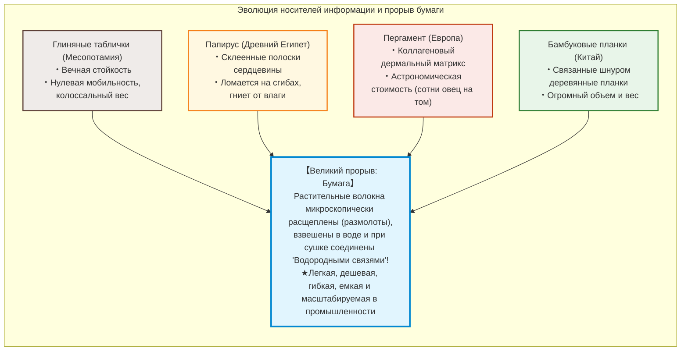
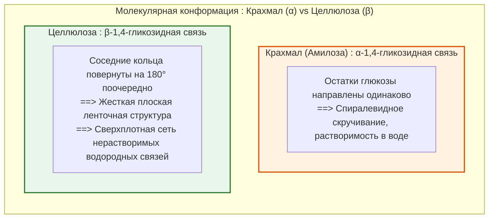
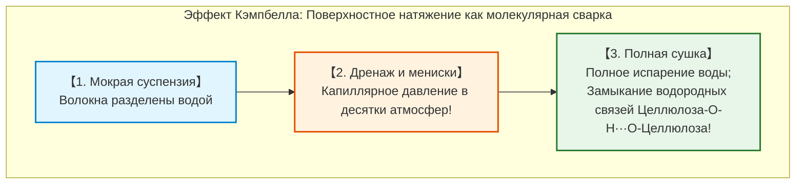
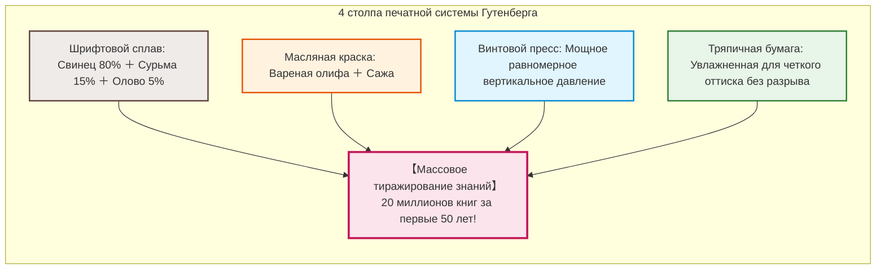
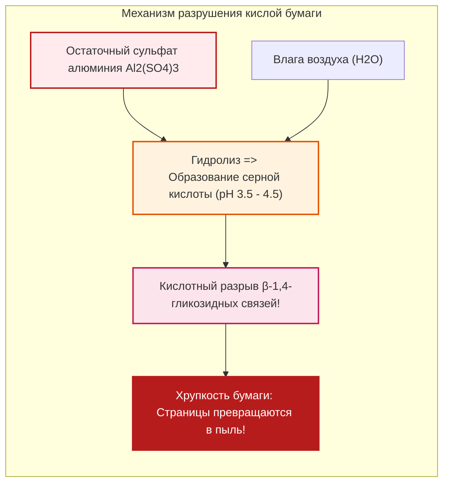

## Введение: Лист растительных волокон, ускоривший поступь цивилизации

В истории человечества существует единственный материальный носитель, фундаментально изменивший накопление и передачу знаний и подготовивший почву для Реформации, Ренессанса, Научной революции и современной демократии: **бумага**.

Сегодня мы привыкли мгновенно передавать терабайты данных в виде электрических зарядов на кремниевых чипах. Но на протяжении тысячелетий главным хранилищем человеческой мысли, законов, науки и поэзии оставался тонкий лист толщиной всего 0,1 миллиметра, сотканный из переплетенных микроволокон растительных клеток.

Предшествующие носители имели непреодолимые изъяны:
- **Глиняные таблички (Месопотамия)**: Невероятно долговечны, но чудовищно тяжелы и непригодны для массового перемещения.
- **Папирус (Древний Египет)**: Спрессованные полоски стеблей; эластичен в пустыне, но хрупок во влажном климате и ограничен формой свитка.
- **Пергамент (Европа)**: Выделанная кожа животных; прочен и породил форму кодекса (книги), но астрономически дорог (целое стадо на одну Библию).
- **Бамбуковые планки (Китай)**: Тяжелы и громоздки; для перевозки библиотеки требовались караваны повозок.

Суть бумаги заключается в глубокой макромолекулярной инженерии: **растительные волокна разделяются (размалываются), диспергируются в воде и при высыхании самособираются на молекулярном уровне без применения клея**.

Прочность сухой бумаги обеспечивается миллиардами спонтанных **водородных связей** между макромолекулами **целлюлозы**.

---

## Глава 1: Супрамолекулярная структура целлюлозы и водородные связи

### 1.1 Линейный полимер и $\beta\text{-1,4-гликозидная}$ связь

Целлюлоза ($(\text{C}_6\text{H}_{10}\text{O}_5)_n$) — самый распространенный биополимер Земли, состоящий из остатков **$\text{D-глюкозы}$**.

В отличие от **крахмала** ($\alpha$-связь), закручивающегося в гибкую спираль, **$\beta\text{-1,4-связь}$** целлюлозы заставляет каждое последующее кольцо глюкозы поворачиваться на **$180^\circ$** относительно предыдущего, создавая идеально прямую жесткую ленточную макромолекулу.

### 1.2 Магия водородных связей

Каждое звено глюкозы несет 3 гидроксильные группы ($-\text{OH}$):
1. **Внутримолекулярные**: Блокируют вращение цепи, обеспечивая колоссальную прочность на растяжение.
2. **Межмолекулярные**: Связывают соседние цепи в кристаллическую **микрофибриллу** диаметром 3–4 нм.

Модуль Юнга кристаллической микрофибриллы достигает **$130 \text{--} 150\,\text{ГПа}$**, превосходя алюминий и конкурируя со сталью по удельной жесткости.

### 1.3 Эффект Кэмпбелла: Поверхностное натяжение сваривает волокна

При испарении воды микроскопические вогнутые мениски создают капиллярное разрежение (уравнение Юнга-Лапласа: $\Delta P = \frac{2\gamma \cos \theta}{r}$). На нанометровых масштабах это давление достигает **десятков атмосфер**, сближая фибриллы на дистанцию менее $0{,}3\,\text{нм}$, где водородные связи $-\text{OH} \cdots \text{O}-$ замыкаются самопроизвольно.

---

## Глава 2: История бумаги — От Цай Луня до Европы

- **Цай Лунь (105 г. н. э.)**: В Китае стандартизировал технологию, используя пеньковые тряпки, кору шелковицы и старые сети, вываренные в щелочном древесном зольном щелоке.
- **Таласская битва (751 г.)**: Арабы захватили китайских мастеров, открыв бумажное производство в **Самарканде**. В 793 г. бумага пришла в Багдад, став основой **«Дома Мудрости»**. В 1151 г. через мусульманскую Испанию (**Хатива**) бумага проникла в Европу.
- **Фабриано (1268 г.)**: В Италии механизировали размол водяными молотами, внедрили проклейку животным желатином и изобрели **водяные знаки**.
- **Кризис ветоши**: К концу XVIII века нехватка тряпья ограничила книгопечатание в Европе.

---

## Глава 3: Японская бумага васи против древесной целлюлозы

- **Лубяные волокна (кодзо)**: Волокна **бумажной шелковицы (кодзо)** достигают **10–15 мм в длину** (против 1–3 мм у древесины), что обеспечивает бумаге васи тысячелетнюю гибкость и устойчивость к истиранию.
- **Техника Нагасидзуки**: Мастер непрерывно покачивает сетку волнами. Растительная слизь **нэри** предотвращает комкование длинных волокон и замедляет сход воды.
- **Крафт-процесс (1884 г.)**: Варка древесной щепы при $170^\circ\text{C}$ со смесью $\text{NaOH}$ и $\text{Na}_2\text{S}$ растворяет бурый **лигнин**, сохраняя длинные прочные целлюлозные волокна.

---

## Глава 4: Симбиоз с печатным станком Гутенберга (ок. 1450 г.)

В Майнце **Иоганн Гутенберг** объединил четыре ключевых изобретения:
1. **Шрифтовой сплав**: Свинец (80%), сурьма (15%), олово (5%). Сурьма расширяется при остывании, идеально заполняя форму.
2. **Масляная типографская краска**: Вареная олифа с сажей идеально ложится на металл.
3. **Винтовой пресс**: Модернизированный винный пресс для создания мощного равномерного давления.
4. **Прочная тряпичная бумага**: Увлажненная перед печатью для мягкого приема оттиска.

За 50 лет в Европе было отпечатано 20 миллионов книг, что сделало возможной Реформацию и Научную революцию.

---

## Глава 5: Кризис кислой бумаги («Медленный пожар»)

В 1807 г. Мориц Иллиг внедрил проклейку **канифолью и сульфатом алюминия ($\text{Al}_2(\text{SO}_4)_3$)**.

Сульфат алюминия гидролизуется с влагой воздуха с образованием свободной серной кислоты. Внутренний pH упал до **3,5–4,5**, запустив кислотный гидролиз целлюлозы. Миллионы книг 1850–1980 годов сегодня рассыпаются в пыль на библиотечных полках.

С 1980-х годов весь мир перешел на **бескислотную нейтральную бумагу (ISO 9706)** с буфером карбоната кальция ($\text{CaCO}_3$), сохраняющуюся более 500–1000 лет.

---

## Глава 6: Консервация и наноцеллюлоза (CNF)

- **Массовая деацидификация Bookkeeper**: Наночастицы оксида магния ($\text{MgO}$) в жидких хладонах нейтрализуют кислоту в книгах без их расшивки.
- **Реставрация бумагой васи (Ураути)**: Сверхтонкая бумага тэнгусё (2–5 г/м2) и пшеничный клей в Лувре и Британском музее. Полная обратимость теплой водой.
- **Нанофибриллярная целлюлоза (CNF)**: Волокна толщиной 3–4 нм, **в 5 раз прочнее стали при пятикратно меньшем весе**, прозрачные как стекло.

---

## Заключение: Материальный якорь цивилизации

Рожденная солнцем и скрепленная водородными связями, бумага стала внешним мозгом человечества. В эпоху уязвимых цифровых технологий долговечная бумага остается самым надежным хранилищем нашей культуры.
