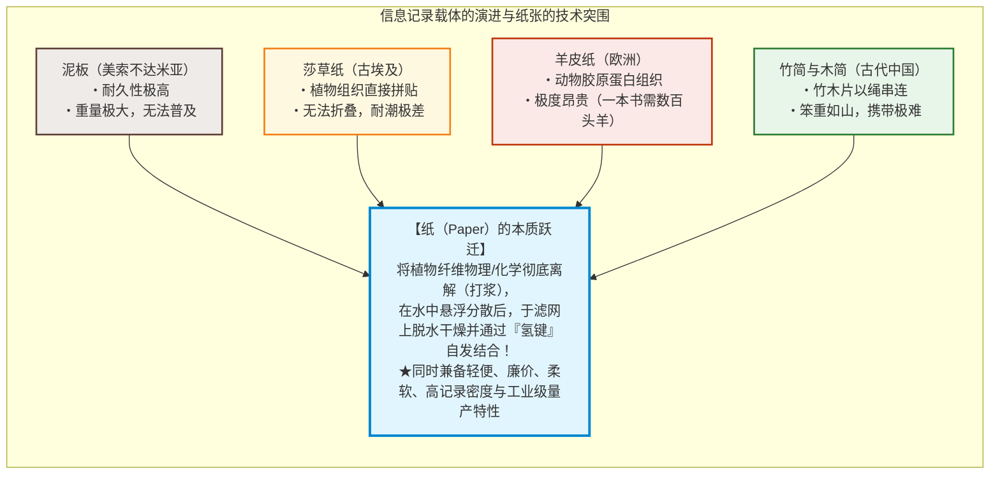
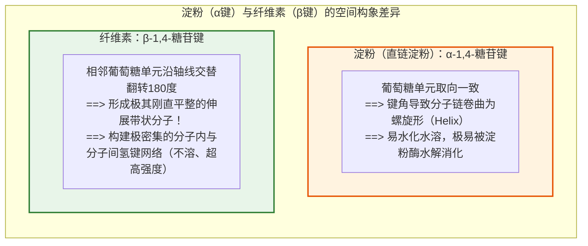
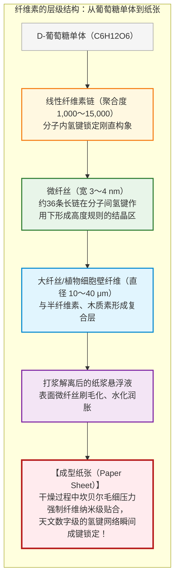
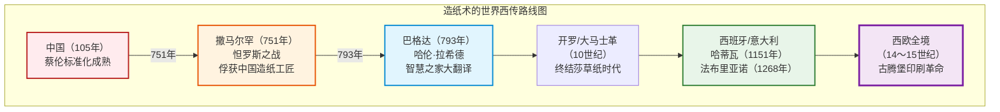
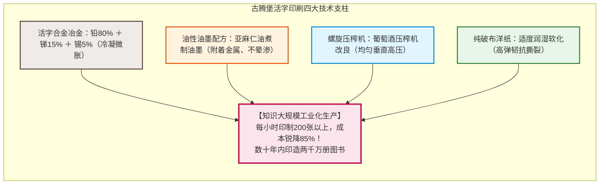
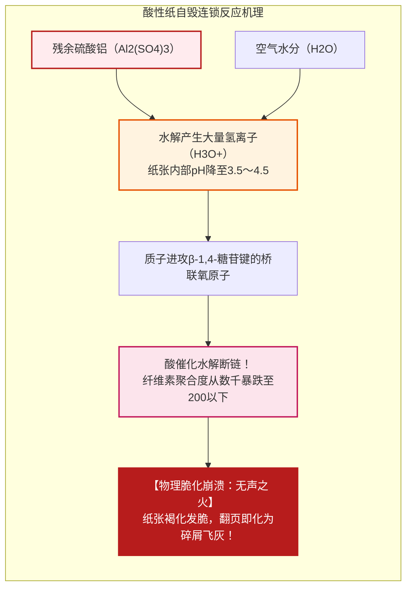

## 引言：记录知识、加速文明演进的“植物纤维薄片”

在人类跨越数千年的漫长文明史中，唯有一种实体介质真正打破了知识传播与积累的时空桎梏，并在无声处孕育了宗教改革、文艺复兴、科学革命以及现代民主政治的诞生：那便是**“纸（Paper）”**。

在数字化信息高度发达的今天，我们早已习惯将文字与图像转化为微芯片中的电荷、磁极或光脉冲进行瞬时传输与存储。然而在有文字记载的漫长岁月中，承载人类智慧、法典、科学发现、宗教信仰与文学艺术的核心媒介，始终是由植物细胞壁中分离出的微观纤维相互交织而成、厚度仅约0.1毫米的薄层材料。

在纸张普及之前，人类曾尝试过多种记录载体，但均受制于其天然缺陷：
- **泥板（美索不达米亚）**：虽具卓越的地质耐久性，但沉重笨拙，无法长途运输或大规模普及；
- **莎草纸（古埃及）**：利用纸莎草茎部切片压制而成，轻便柔软，但在干燥地中海以外极易脆化受潮，抗折性差且受限于卷轴形态；
- **羊皮纸/犊皮纸（古希腊、古罗马与中世纪欧洲）**：以羊皮或牛皮经脱毛刮削制成，坚韧结实且可双面书写，催生了现代书籍的前身（抄本），但制作一部手抄圣经需屠宰数百头牲畜，成本堪比天文数字；
- **竹简与木简（中国先秦与汉代）**：取资天然，但体积极为庞大沉重，运载一部数十万字的著作往往需数辆牛车。

纸张的真正革命性在于其**完全重构了材料微观结构**：它不是莎草纸那样简单的组织粘连，也不是羊皮纸那样的动物皮层干燥，而是**“将植物纤维完全打散解离，在水相中均匀分散，经滤网脱水抄造，利用水分子蒸发诱导分子级自组装重新交联”**的先进高分子材料工程。

尤为令人惊叹的是：**纸张的成型不需要任何外加胶水或粘合剂！** 干燥纸张之所以具备极高的抗张强度，纯粹源于植物纤维核心成分——**纤维素（Cellulose）**分子间自发形成的数以亿万计的**“氢键（Hydrogen Bonding）”**网络。

---

## 第一章：纤维素的超分子结构与“氢键”的奇迹

### 1.1 直链高分子与 $\beta\text{-1,4-糖苷键}$

纸张的骨架由植物细胞壁主要成分**纤维素（$(\text{C}_6\text{H}_{10}\text{O}_5)_n$）**构成。全球植物光合成每年制造出数千亿吨纤维素，是地球上最富集的可再生有机高分子。

纤维素是由单糖**$\text{D-葡萄糖}$**脱水缩合而成的直链均聚物。决定纤维素神奇物理性质的关键，在于其单体间的连接模式：**$\beta\text{-1,4-糖苷键}$**。

人类主食中的**淀粉（Amylose）**同样由葡萄糖缩聚而成，但淀粉分子是以**$\alpha\text{-1,4-糖苷键}$**连接，使分子链呈弹簧般的螺旋状卷曲，分子间排列疏松，易于水解与消化。

相反，纤维素的**$\beta\text{-1,4-糖苷键}$**迫使相邻的葡萄糖环**沿轴向交替颠倒180度**。这种空间对称性消除了链的卷曲应力，使单条纤维素分子成为完全伸直、刚硬平展的带状刚性链。木材纸浆的聚合度（DP）通常在1,000至5,000之间，天然棉麻纤维更可高达15,000以上。

### 1.2 氢键的超分子力量：为何无需胶水就能成纸

在每个葡萄糖残基上，均分布着3个羟基（$-\text{OH}$，分别位于C2、C3和C6位）。这些极性极强的羟基构成了**氢键（Hydrogen Bond）**的能量之源。

在纤维素超分子体系中，存在两类关键氢键：
1. **分子内氢键**：存在于同一分子链内相邻葡萄糖环之间。这些氢键将分子链彻底“锁死”在平展伸展构象中，赋予单链极高的轴向刚度与抗拉强度。
2. **分子间氢键**：存在于平行排列的相邻纤维素长链之间。横向架桥的无数微观氢键将数十条纤维素分子严密拼合为高结晶度的**微纤丝（Microfibril）**。

单根结晶微纤丝的轴向理论杨氏模量高达**$130 \sim 150\,\text{GPa}$**，不仅是铝合金（约$70\,\text{GPa}$）的两倍，且在**比刚度（强度与密度之比）**上大幅超越结构钢。

### 1.3 坎贝尔效应（Campbell Effect）：水分子驱动的自组装

水悬浮液中互不接触的纤维，是如何在干燥时被拽入形成氢键的纳米接触距离内的？

在制纸物理学中，这由著名的**“坎贝尔效应（Campbell Effect）”**主导：
1. **水化状态**：湿纸浆纤维表面被水分子包覆，水分子阻断了纤维间羟基的直接重叠。
2. **弯液面与拉普拉斯负压**：随着滤网脱水与水分蒸发，纤维间纳米级缝隙中形成凹液面。依据杨-拉普拉斯方程：
   $$\Delta P = \frac{2\gamma \cos \theta}{r}$$
   随着毛细孔径 $r$ 缩减至纳米量级（如 $5 \sim 10\,\text{nm}$），毛细吸附负压 $\Delta P$ 剧增至**数兆帕至数十个大气压**。
3. **分子级贴合与氢键锁定**：在这股宏大的天然吸力下，柔软膨胀的微纤丝被强行压向彼此。当间距缩小至 $0.3\,\text{nm}$ 这一氢键成键阈值瞬间，游离水分子蒸发逸散，纤维素表面的 $-\text{OH}$ 基团自发咬合，完成了宏观纸张的物理成型。

这也是纸张遇水即破的化学机理：极性水分子强势侵入，打断了纤维素间的直接氢键，导致网络瓦解；而纸张重新干燥后，毛细作用与氢键网络再次复原。

---

## 第二章：造纸术演进史——从蔡伦、怛罗斯战役到欧洲

### 2.1 蔡伦对造纸术的划时代革新（公元105年）

考古证实，西汉时期（如灞桥纸、放马滩纸）已有以大麻纤维制作的粗糙纸状物，但多用于包装填充。

真正将造纸确立为成熟官定书写介质的是东汉尚方令**蔡伦**。元兴元年（105年），蔡伦总结民间经验并实现技术跃迁，献上**“蔡侯纸”**：
- **原料革命**：打破麻纤维单一来源，引入树皮（桑科构树皮）、废旧麻布、破旧鱼网等废弃纤维；
- **碱液沤煮（脱胶）**：以草木灰汁（碳酸钾碱性液）蒸煮，高效溶除植物果胶、杂质与木质素；
- **机械打浆**：以石臼木槌反复捣碎，将纤维充分解离为细小游离丝；
- **抄造烘干**：利用竹篾滤网抄起薄浆，贴于烘墙受热干燥。

蔡侯纸的诞生，将文字记录介质的成本降低了99%，为知识的平民化奠定了物理基础。

### 2.2 怛罗斯之战（751年）与伊斯兰黄金时代

公元751年，唐朝安西节度使高仙芝率部与大食（阿拉伯阿拔斯王朝）联军在碎叶水畔爆发**怛罗斯战役**。唐军战败，被俘士兵中含有造纸工匠，被押解至丝路重镇**撒马尔罕**。

撒马尔罕水源充沛，盛产亚麻。“撒马尔罕纸”一经量产便以白皙坚韧闻名。793年，造纸厂引入阿拔斯王朝首都巴格达，哈里发下令官方文书全数废除羊皮纸改用纸张。纸张的充裕直接引爆了著名的**“智慧之家（Bayt al-Hikma）”**翻译运动，希腊古典典籍、波斯文学、印度数学被浩瀚译为阿拉伯文，催生了伊斯兰文明的黄金时代。

随后，造纸术顺北非传入摩洛哥，于1151年经由穆斯林统治下的西班牙**哈蒂瓦（Játiva）**传入欧洲本土。

### 2.3 意大利法布里亚诺与破布原料危机

1268年，意大利**法布里亚诺（Fabriano）**建立造纸工坊，确立了西欧近代手工纸的三大技术支柱：
1. **水力落锤打浆机**：取代人工捣料，以水车动力驱动重锤批量破碎亚麻破布；
2. **动物明胶施胶**：改东方的淀粉浆糊为熬煮牛皮胶质，耐受欧洲酸性没食子墨水；
3. **水印（Watermark）发明**：在抄网编织铜丝图案，确立防伪与品质认证标准。

然而到18世纪末，欧洲出版业剧烈膨胀，遭遇严重的**“破布饥荒（Rag Shortage）”**。全欧洲的旧衣服收集量逼近物理极限，各国竞相出台禁止旧破布出口的法令，寻找替代纤维成为工业界的迫切命题。

---

## 第三章：和纸与洋纸的纤维结构力学

### 3.1 韧皮纤维的几何长径比

日本“和纸（Washi）”与西方工业木浆纸在选材上截然不同。和纸选用灌木植物内皮的**韧皮纤维（Bast Fiber）**：

| 原料名称 | 植物学分类 | 纤维特征与应用 | 平均纤维长度 |
|---|---|---|---|
| **楮（Kozo）** | 桑科落叶低木 | 占和纸九成以上。纤维极粗极长，强韧无匹。用于障子纸、公文、文物修复。 | **10 〜 15 mm** |
| **三桠（Mitsumata）** | 瑞香科落叶灌木 | 纤维细腻柔滑，光泽内敛。日本银行券（纸币）核心原料。 | **3 〜 4 mm** |
| **雁皮（Gampi）** | 瑞香科落叶灌木 | 纯野生采集无法人工种植。防虫抗湿，透明度高。鸟之子纸。 | **3 〜 5 mm** |
| **针叶树木浆（洋纸）** | 松、杉等裸子植物 | 木材木质部管胞。洋纸抗拉强度的主要骨架。 | **2.5 〜 4.5 mm** |
| **阔叶树木浆（洋纸）** | 桉木、桦木等被子植物 | 短小木纤维。填充空隙，提供极高纸面平滑度。 | **0.8 〜 1.5 mm** |

楮皮纤维长度达**10至15毫米**，是木浆纤维（1至3毫米）的5至10倍。这种超长纤维如三维纺织布般深度咬合，赋予了和纸历经千年不散、万次折叠不裂的超常柔韧性。

### 3.2 “流漉”流体力学与黄蜀葵胶质控制

中国传统造纸多采用**“留漉（溜漉）”**，即将稀浆舀入固定滤网上静置滤水；而日本发展出的**“流漉（Nagashizuki）”**，则是工匠双手持漉桁在纸浆槽中反复作纵横激荡的波浪摇晃（**摇晃操作**），并迅速将多余纸浆排出（**舍水**）。

这一流体取向得以实现，归功于**“黄蜀葵根黏液（Neri）”**。其高分子酸性多糖具有非凡的抗凝集性（位阻效应），使15毫米的超长纤维在水中完全不结团，并适度延缓滤水速度，赋予工匠摇晃交错纤维的宝贵操作窗口，干燥后不留任何黏性残留。

### 3.3 木材化学制浆工程与木质素脱除

19世纪中叶，木材制浆技术终结了破布危机。木材由纤维素（40〜50%）、半纤维素（20〜30%）与**木质素（Lignin，20〜30%）**紧密交织而成。木质素如混凝土般包裹着纤维素，极易光化发黄且脆化。

1884年诞生的**硫酸盐法制浆（Kraft Process）**成为全球化学制浆的支柱：以氢氧化钠（$\text{NaOH}$）与硫化钠（$\text{Na}_2\text{S}$）在 $170^\circ\text{C}$ 高温蒸煮，硫氢根离子（$\text{HS}^-$）精准进攻木质素分子，将其降解溶解，完好保留纤维素的高聚合度与长纤维，造就了高强度的纸浆原料。

---

## 第四章：印刷技术的共生进化与古腾堡革命

纸张之所以引发人类文明的跃迁，核心在于其与**印刷技术（Printing）**的完美协同。

### 4.1 东亚雕版与活字先驱

唐代开创的雕版印刷术，以整版雕刻木板为核心，完美契合汉字浩瀚字符集与佛经文献恒久复印的需求。北宋毕昇试制泥活字，13世纪高丽王朝铸造出世界上现存最早的金属活字本（1377年《白云和尚抄录佛祖直指心体要节》）。但由于汉字数量巨大且多为宫廷垄断，东亚金属活字未能催生出平民化市场网络。

### 4.2 约翰内斯·古腾堡的四大系统集成（约1450年）

古腾堡在德国美因茨实现的突破，在于他打造了一整套标准化的工业装配流水线：
1. **活字合金冶金学**：采用**铅（80%）、锑（15%）、锡（5%）**合金。锑具有“冷凝微膨胀”的物理特性，确保熔融金属完全填充模具最细微的笔锋笔划；
2. **油性油墨化学**：改水性墨为**煮沸亚麻仁油基底油墨**，能在金属活字表面均匀铺展并不向纸张纤维外渗晕染；
3. **螺旋压榨机**：改造莱茵河流域葡萄压榨机，实现向版面瞬时垂直施加均匀吨级压力；
4. **印刷纸张配合**：湿润手工破布纸以软化纤维，承受高压冲压而不穿孔破裂。

1450年至1500年的“摇篮本”时期，全欧洲印刷出版了约2000万册图书，一举超越中世欧洲千年抄本总和。马丁·路德的德语《九十五条论纲》数周传遍全欧；哥白尼日心说、维萨里解剖图谱、牛顿《自然哲学的数学原理》得以分毫不差地广泛复制，实证自然科学革命由此奠基。

---

## 第五章：酸性纸危机与“无声之火”的自毁化学

19世纪机械化大生产在普及知识的同时，也在纸张内部埋下了化学自毁炸弹：**酸性纸危机（Acid Paper Crisis / Slow Fire）**。

### 5.1 松香-硫酸铝施胶的灾难

为解决长网造纸机高速运转时的墨水渗透，1807年莫里茨·伊利希发明**内加松香施胶法**：在纸浆悬浮液中加入松香皂，并大量添加**硫酸铝（明矾，$\text{Al}_2(\text{SO}_4)_3 \cdot 14\sim 18\text{H}_2\text{O}$）**作为沉淀固定剂。

硫酸铝是强酸弱碱盐，吸收空气水汽后发生持续**水解**：

$$[\text{Al(H}_2\text{O)}_6]^{3+} + \text{H}_2\text{O} \rightleftharpoons [\text{Al(OH)(H}_2\text{O)}_5]^{2+} + \text{H}_3\text{O}^+$$

纸张内部长期保持在 **pH 3.5 至 4.5 的强酸性环境**！

酸性环境催化纤维素主链的**酸水解反应**，聚合度暴跌至200临界值以下。20世纪末，全球各大国家图书馆惊觉：1850至1980年间印造的数以亿计图书正在书架上自行粉碎解体，宛如无火自焚。

### 5.2 中性纸的大逆转（ISO 9706标准）

1980年代起，全球造纸业彻底转向**中性/碱性造纸**：
- 采用合成施胶剂（AKD烷基烯酮二聚体、ASA烯基琥珀酸酐）；
- 引入**碳酸钙（$\text{CaCO}_3$）**作为填料。碳酸钙不仅增白，更构成了**碱性缓冲储备**，随时中和空气酸性气体：
  $$\text{CaCO}_3 + \text{H}_2\text{SO}_4 \to \text{CaSO}_4 + \text{H}_2\text{O} + \text{CO}_2 \uparrow$$

依据国际ISO 9706永久纸标准，现代中性纸保存寿命达 **500至1000年以上**。

---

## 第六章：纸质文物保护与纳米纤维素（CNF）未来

### 6.1 大规模脱酸与和纸托裱修复

- **图书管理员（Bookkeeper）气相/液相脱酸法**：将整本书浸入分散有微米级氧化镁（$\text{MgO}$）微粒的惰性氟碳溶剂中，在不散页前提下中和酸并构建持久碱储备；
- **和纸托裱（Urauchi）**：大英博物馆、卢浮宫等采用日本极薄楮皮和纸（典具帖纸，2〜5克/平方米）以精制小麦淀粉糊托裱脆化善本。其长纤维提供超高拉伸强度，且满足**可逆性（Reversibility）**原则——百年后温水一浸即可无损揭除。

### 6.2 纤维素纳米纤维（CNF）：超越钢铁的新材料

植物纤维科学已迈入最前沿的纳米科技——**纤维素纳米纤维（CNF）**：
- 经TEMPO催化氧化等纳米解纤，直径仅3〜4纳米；
- **强度为钢铁的5倍，重量仅为钢铁的五分之一**；
- 热膨胀系数接近石英玻璃；
- 纤维直径远小于可见光波长，与树脂复合成型为**完全透明如玻璃的防弹塑料**。

---

## 结语：阳光与水分编织的人类记忆之锚

纸，源于植物的光合产物，经由工匠的打浆解离，在水相中以氢键重新锁定。它终结了泥板与羊皮纸的沉重枷锁，承载了蔡伦的智慧，照亮了伊斯兰黄金时代，激活了古腾堡印刷革命，铸就了近代科学与民主社会。

尽管当今数字时代数据汹涌，但磁介质与硅芯片极易随断电与格式变迁在数十年内灰飞烟灭。唯有基于微观氢键网络的纸张，能在千年风霜后依然清晰静默地向后人诉说文明的初衷。纸张，不仅是一项古老的技术，更是人类对抗遗忘与熵增的最伟大物理锚点。
