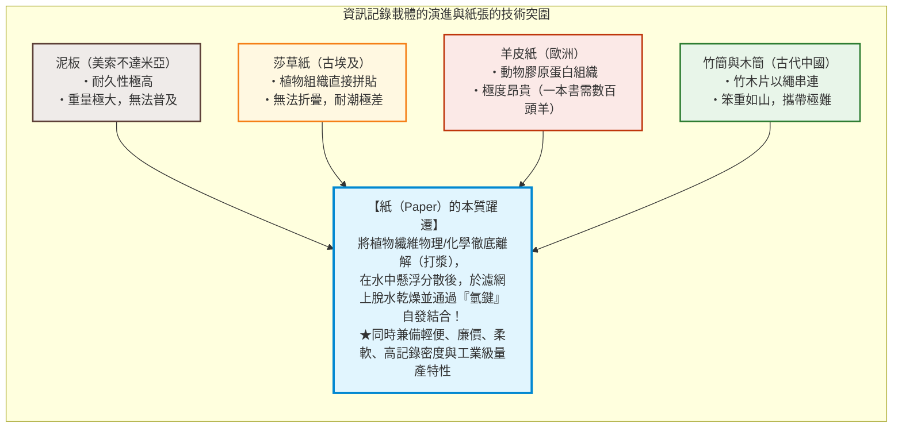
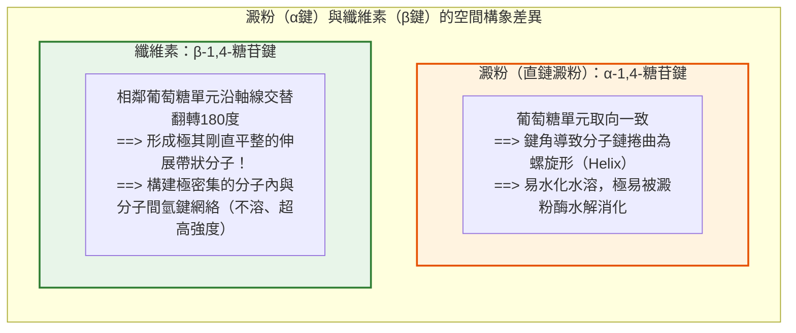
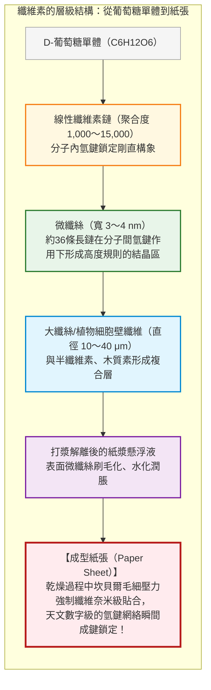
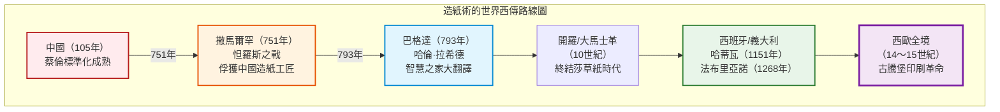
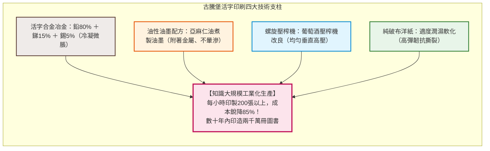
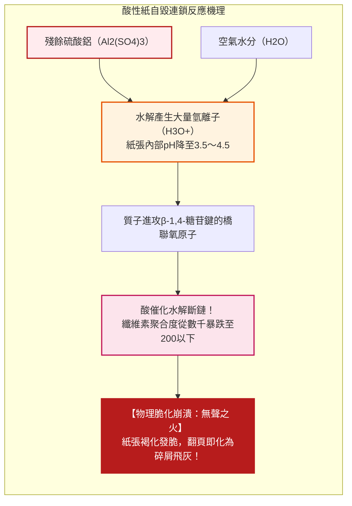

## 引言：記錄知識、加速文明演進的「植物纖維薄片」

在人類跨越數千年的漫長文明史中，唯有一種實體介質真正打破了知識傳播與累積的時空桎梏，並在無聲處孕育了宗教改革、文藝復興、科學革命以及現代民主政治的誕生：那便是**「紙（Paper）」**。

在數位化資訊高度發達的今天，我們早已習慣將文字與圖像轉化為微晶片中的電荷、磁極或光脈衝進行瞬時傳輸與儲存。然而在有文字記載的漫長歲月中，承載人類智慧、法典、科學發現、宗教信仰與文學藝術的核心媒介，始終是由植物細胞壁中分離出的微觀纖維相互交織而成、厚度僅約0.1毫米的薄層材料。

在紙張普及之前，人類曾嘗試過多種記錄載體，但均受制於其天然缺陷：
- **泥板（美索不達米亞）**：雖具卓越的地質耐久性，但沉重笨拙，無法長途運輸或大規模普及；
- **莎草紙（古埃及）**：利用紙莎草莖部切片壓製而成，輕便柔軟，但在乾燥地中海以外極易脆化受潮，抗折性差且受限於卷軸形態；
- **羊皮紙/犢皮紙（古希臘、古羅馬與中世紀歐洲）**：以羊皮或牛皮經脫毛刮削製成，堅韌結實且可雙面書寫，催生了現代書籍的前身（抄本），但製作一部手抄聖經需屠宰數百頭牲畜，成本堪比天文數字；
- **竹簡與木簡（中國先秦與漢代）**：取資天然，但體積極為龐大沉重，運載一部數十萬字的著作往往需數輛牛車。

紙張的真正革命性在於其**完全重構了材料微觀結構**：它不是莎草紙那樣簡單的組織粘連，也不是羊皮紙那樣的動物皮層乾燥，而是**「將植物纖維完全打散解離，在水相中均勻分散，經濾網脫水抄造，利用水分子蒸發誘導分子級自組裝重新交聯」**的先進高分子材料工程。

尤為令人驚嘆的是：**紙張的成型不需要任何外加膠水或粘合劑！** 乾燥紙張之所以具備極高的抗張強度，純粹源於植物纖維核心成分——**纖維素（Cellulose）**分子間自發形成的數以億萬計的**「氫鍵（Hydrogen Bonding）」**網絡。

---

## 第一章：纖維素的超分子結構與「氫鍵」的奇蹟

### 1.1 直鏈高分子與 $\beta\text{-1,4-糖苷鍵}$

紙張的骨架由植物細胞壁主要成分**纖維素（$(\text{C}_6\text{H}_{10}\text{O}_5)_n$）**構成。全球植物光合成每年製造出數千億噸纖維素，是地球上最富集的可再生有機高分子。

纖維素是由單糖**$\text{D-葡萄糖}$**脫水縮合而成的直鏈均聚物。決定纖維素神奇物理性質的關鍵，在於其單體間的連接模式：**$\beta\text{-1,4-糖苷鍵}$**。

人類主食中的**澱粉（Amylose）**同樣由葡萄糖縮聚而成，但澱粉分子是以**$\alpha\text{-1,4-糖苷鍵}$**連接，使分子鏈呈彈簧般的螺旋狀捲曲，分子間排列疏鬆，易於水解與消化。

相反，纖維素的**$\beta\text{-1,4-糖苷鍵}$**迫使相鄰的葡萄糖環**沿軸向交替顛倒180度**。這種空間對稱性消除了鏈的捲曲應力，使單條纖維素分子成為完全伸直、剛硬平展的帶狀剛性鏈。木材紙漿的聚合度（DP）通常在1,000至5,000之間，天然棉麻纖維更可高達15,000以上。

### 1.2 氫鍵的超分子力量：為何無需膠水就能成紙

在每個葡萄糖殘基上，均分佈著3個羥基（$-\text{OH}$，分別位於C2、C3和C6位）。這些極性極強的羥基構成了**氫鍵（Hydrogen Bond）**的能量之源。

在纖維素超分子體系中，存在兩類關鍵氫鍵：
1. **分子內氫鍵**：存在於同一分子鏈內相鄰葡萄糖環之間。這些氫鍵將分子鏈徹底「鎖死」在平展伸展構象中，賦予單鏈極高的軸向剛度與抗拉強度。
2. **分子間氫鍵**：存在於平行排列的相鄰纖維素長鏈之間。橫向架橋的無數微觀氫鍵將數十條纖維素分子嚴密拼合為高結晶度的**微纖絲（Microfibril）**。

單根結晶微纖絲的軸向理論楊氏模量高達**$130 \sim 150\,\text{GPa}$**，不僅是鋁合金（約$70\,\text{GPa}$）的兩倍，且在**比剛度（強度與密度之比）**上大幅超越結構鋼。

### 1.3 坎貝爾效應（Campbell Effect）：水分子驅動的自組裝

水懸浮液中互不接觸的纖維，是如何在乾燥時被拽入形成氫鍵的奈米接觸距離內的？

在製紙物理學中，這由著名的**「坎貝爾效應（Campbell Effect）」**主導：
1. **水化狀態**：濕紙漿纖維表面被水分子包覆，水分子阻斷了纖維間羥基的直接重疊。
2. **彎液面與拉普拉斯負壓**：隨著濾網脫水與水分蒸發，纖維間奈米級縫隙中形成凹液面。依據楊-拉普拉斯方程：
   $$\Delta P = \frac{2\gamma \cos \theta}{r}$$
   隨著毛細孔徑 $r$ 縮減至奈米量級（如 $5 \sim 10\,\text{nm}$），毛細吸附負壓 $\Delta P$ 劇增至**數兆帕至數十個大氣壓**。
3. **分子級貼合與氫鍵鎖定**：在這股宏大的天然吸力下，柔軟膨脹的微纖絲被強行壓向彼此。當間距縮小至 $0.3\,\text{nm}$ 這一氫鍵成鍵閾值瞬間，游離水分子蒸發逸散，纖維素表面的 $-\text{OH}$ 基團自發咬合，完成了宏觀紙張的物理成型。

這也是紙張遇水即破的化學機理：極性水分子強勢侵入，打斷了纖維素間的直接氫鍵，導致網絡瓦解；而紙張重新乾燥後，毛細作用與氫鍵網絡再次復原。

---

## 第二章：造紙術演進史——從蔡倫、怛羅斯戰役到歐洲

### 2.1 蔡倫對造紙術的劃時代革新（公元105年）

考古證實，西漢時期（如灞橋紙、放馬灘紙）已有以大麻纖維製作的粗糙紙狀物，但多用於包裝填充。

真正將造紙確立為成熟官定書寫介質的是東漢尚方令**蔡倫**。元興元年（105年），蔡倫總結民間經驗並實現技術躍遷，獻上**「蔡侯紙」**：
- **原料革命**：打破麻纖維單一來源，引入樹皮（桑科構樹皮）、廢舊麻布、破舊魚網等廢棄纖維；
- **鹼液漚煮（脫膠）**：以草木灰汁（碳酸鉀鹼性液）蒸煮，高效溶除植物果膠、雜質與木質素；
- **機械打漿**：以石臼木槌反覆搗碎，將纖維充分解離為細小游離絲；
- **抄造烘乾**：利用竹篾濾網抄起薄漿，貼於烘牆受熱乾燥。

蔡侯紙的誕生，將文字記錄介質的成本降低了99%，為知識的平民化奠定了物理基礎。

### 2.2 怛羅斯之戰（751年）與伊斯蘭黃金時代

公元751年，唐朝安西節度使高仙芝率部與大食（阿拉伯阿拔斯王朝）聯軍在碎葉水畔爆發**怛羅斯戰役**。唐軍戰敗，被俘士兵中含有造紙工匠，被押解至絲路重鎮**撒馬爾罕**。

撒馬爾罕水源充沛，盛產亞麻。「撒馬爾罕紙」一經量產便以白皙堅韌聞名。793年，造紙廠引入阿拔斯王朝首都巴格達，哈里發下令官方文書全數廢除羊皮紙改用紙張。紙張的充裕直接引爆了著名的**「智慧之家（Bayt al-Hikma）」**翻譯運動，希臘古典典籍、波斯文學、印度數學被浩瀚譯為阿拉伯文，催生了伊斯蘭文明的黃金時代。

隨後，造紙術順北非傳入摩洛哥，於1151年經由穆斯林統治下的西班牙**哈蒂瓦（Játiva）**傳入歐洲本土。

### 2.3 義大利法布里亞諾與破布原料危機

1268年，義大利**法布里亞諾（Fabriano）**建立造紙工坊，確立了西歐近代手工紙的三大技術支柱：
1. **水力落錘打漿機**：取代人工搗料，以水車動力驅動重錘批量破碎亞麻破布；
2. **動物明膠施膠**：改東方的澱粉漿糊為熬煮牛皮膠質，耐受歐洲酸性沒食子墨水；
3. **水印（Watermark）發明**：在抄網編織銅絲圖案，確立防偽與品質認證標準。

然而到18世紀末，歐洲出版業劇烈膨脹，遭遇嚴重的**「破布飢荒（Rag Shortage）」**。全歐洲的舊衣服收集量逼近物理極限，各國競相出台禁止舊破布出口的法令，尋找替代纖維成為工業界的迫切命題。

---

## 第三章：和紙與洋紙的纖維結構力學

### 3.1 韌皮纖維的幾何長徑比

日本「和紙（Washi）」與西方工業木漿紙在選材上截然不同。和紙選用灌木植物內皮的**韌皮纖維（Bast Fiber）**：

| 原料名稱 | 植物學分類 | 纖維特徵與應用 | 平均纖維長度 |
|---|---|---|---|
| **楮（Kozo）** | 桑科落葉低木 | 占和紙九成以上。纖維極粗極長，強韌無匹。用於障子紙、公文、文物修復。 | **10 〜 15 mm** |
| **三椏（Mitsumata）** | 瑞香科落葉灌木 | 纖維細膩柔滑，光澤內斂。日本銀行券（紙幣）核心原料。 | **3 〜 4 mm** |
| **雁皮（Gampi）** | 瑞香科落葉灌木 | 純野生採集無法人工種植。防蟲抗濕，透明度高。鳥之子紙。 | **3 〜 5 mm** |
| **針葉樹木漿（洋紙）** | 松、杉等裸子植物 | 木材木質部管胞。洋紙抗拉強度的主要骨架。 | **2.5 〜 4.5 mm** |
| **闊葉樹木漿（洋紙）** | 桉木、樺木等被子植物 | 短小木纖維。填充空隙，提供極高紙面平滑度。 | **0.8 〜 1.5 mm** |

楮皮纖維長度達**10至15毫米**，是木漿纖維（1至3毫米）的5至10倍。這種超長纖維如三維紡織布般深度咬合，賦予了和紙歷經千年不散、萬次折疊不裂的超常柔韌性。

### 3.2 「流漉」流體力學與黃蜀葵膠質控制

中國傳統造紙多採用**「留漉（溜漉）」**，即將稀漿舀入固定濾網上靜置濾水；而日本發展出的**「流漉（Nagashizuki）」**，則是工匠雙手持漉桁在紙漿槽中反覆作縱橫激盪的波浪搖晃（**搖晃操作**），並迅速將多餘紙漿排出（**捨水**）。

這一流體取向得以實現，歸功於**「黃蜀葵根黏液（Neri）」**。其高分子酸性多糖具有非凡的抗凝集性（位阻效應），使15毫米的超長纖維在水中完全不結團，並適度延緩濾水速度，賦予工匠搖晃交錯纖維的寶貴操作窗口，乾燥後不留任何黏性殘留。

### 3.3 木材化學制漿工程與木質素脫除

19世紀中葉，木材製漿技術終結了破布危機。木材由纖維素（40〜50%）、半纖維素（20〜30%）與**木質素（Lignin，20〜30%）**緊密交織而成。木質素如混凝土般包裹著纖維素，極易光化發黃且脆化。

1884年誕生的**硫酸鹽法製漿（Kraft Process）**成為全球化學製漿的支柱：以氫氧化鈉（$\text{NaOH}$）與硫化鈉（$\text{Na}_2\text{S}$）在 $170^\circ\text{C}$ 高溫蒸煮，硫氫根離子（$\text{HS}^-$）精準進攻木質素分子，將其降解溶解，完好保留纖維素的高聚合度與長纖維，造就了高強度的紙漿原料。

---

## 第四章：印刷技術的共生進化與古騰堡革命

紙張之所以引發人類文明的躍遷，核心在於其與**印刷技術（Printing）**的完美協同。

### 4.1 東亞雕版與活字先驅

唐代開創的雕版印刷術，以整版雕刻木板為核心，完美契合漢字浩瀚字符集與佛經文獻恆久複印的需求。北宋畢昇試製泥活字，13世紀高麗王朝鑄造出世界上現存最早的金屬活字本（1377年《白雲和尚抄錄佛祖直指心體要節》）。但由於漢字數量巨大且多為宮廷壟斷，東亞金屬活字未能催生出平民化市場網絡。

### 4.2 約翰內斯·古騰堡的四大系統集成（約1450年）

古騰堡在德國美因茨實現的突破，在於他打造了一整套標準化的工業裝配流水線：
1. **活字合金冶金學**：採用**鉛（80%）、銻（15%）、錫（5%）**合金。銻具有「冷凝微膨脹」的物理特性，確保熔融金屬完全填充模具最細微的筆鋒筆劃；
2. **油性油墨化學**：改水性墨為**煮沸亞麻仁油基底油墨**，能在金屬活字表面均勻鋪展並不向紙張纖維外滲暈染；
3. **螺旋壓榨機**：改造萊茵河流域葡萄壓榨機，實現向版面瞬時垂直施加均勻噸級壓力；
4. **印刷紙張配合**：濕潤手工破布紙以軟化纖維，承受高壓衝壓而不穿孔破裂。

1450年至1500年的「搖籃本」時期，全歐洲印刷出版了約2000萬冊圖書，一舉超越中世歐洲千年抄本總和。馬丁·路德的德語《九十五條論綱》數周傳遍全歐；哥白尼日心說、維薩里解剖圖譜、牛頓《自然哲學的數學原理》得以分毫不差地廣泛複製，實證自然科學革命由此奠基。

---

## 第五章：酸性紙危機與「無聲之火」的自毀化學

19世紀機械化大生產在普及知識的同時，也在紙張內部埋下了化學自毀炸彈：**酸性紙危機（Acid Paper Crisis / Slow Fire）**。

### 5.1 松香-硫酸鋁施膠的災難

為解決長網造紙機高速運轉時的墨水滲透，1807年莫里茨·伊利希發明**內加松香施膠法**：在紙漿懸浮液中加入松香皂，並大量添加**硫酸鋁（明礬，$\text{Al}_2(\text{SO}_4)_3 \cdot 14\sim 18\text{H}_2\text{O}$）**作為沉澱固定劑。

硫酸鋁是強酸弱鹼鹽，吸收空氣水汽後發生持續**水解**：

$$[\text{Al(H}_2\text{O)}_6]^{3+} + \text{H}_2\text{O} \rightleftharpoons [\text{Al(OH)(H}_2\text{O)}_5]^{2+} + \text{H}_3\text{O}^+$$

紙張內部長期保持在 **pH 3.5 至 4.5 的強酸性環境**！

酸性環境催化纖維素主鏈的**酸水解反應**，聚合度暴跌至200臨界值以下。20世紀末，全球各大國家圖書館驚覺：1850至1980年間印造的數以億計圖書正在書架上自行粉碎解體，宛如無火自焚。

### 5.2 中性紙的大逆轉（ISO 9706標準）

1980年代起，全球造紙業徹底轉向**中性/鹼性造紙**：
- 採用合成施膠劑（AKD烷基烯酮二聚體、ASA烯基琥珀酸酐）；
- 引入**碳酸鈣（$\text{CaCO}_3$）**作為填料。碳酸鈣不僅增白，更構成了**鹼性緩衝儲備**，隨時中和空氣酸性氣體：
  $$\text{CaCO}_3 + \text{H}_2\text{SO}_4 \to \text{CaSO}_4 + \text{H}_2\text{O} + \text{CO}_2 \uparrow$$

依據國際ISO 9706永久紙標準，現代中性紙保存壽命達 **500至1000年以上**。

---

## 第六章：紙質文物保護與奈米纖維素（CNF）未來

### 6.1 大規模脫酸與和紙托裱修復

- **圖書管理員（Bookkeeper）氣相/液相脫酸法**：將整本書浸入分散有微米級氧化鎂（$\text{MgO}$）微粒的惰性氟碳溶劑中，在不散頁前提下中和酸並構建持久鹼儲備；
- **和紙托裱（Urauchi）**：大英博物館、羅浮宮等採用日本極薄楮皮和紙（典具帖紙，2〜5克/平方米）以精製小麥澱粉糊托裱脆化善本。其長纖維提供超高拉伸強度，且滿足**可逆性（Reversibility）**原則——百年後溫水一浸即可無損揭除。

### 6.2 纖維素奈米纖維（CNF）：超越鋼鐵的新材料

植物纖維科學已邁入最前沿的奈米科技——**纖維素奈米纖維（CNF）**：
- 經TEMPO催化氧化等奈米解纖，直徑僅3〜4奈米；
- **強度為鋼鐵的5倍，重量僅為鋼鐵的五分之一**；
- 熱膨脹係數接近石英玻璃；
- 纖維直徑遠小於可見光波長，與樹脂複合成型為**完全透明如玻璃的防彈塑料**。

---

## 結語：陽光與水分編織的人類記憶之錨

紙，源於植物的光合產物，經由工匠的打漿解離，在水相中以氫鍵重新鎖定。它終結了泥板與羊皮紙的沉重枷鎖，承載了蔡倫的智慧，照亮了伊斯蘭黃金時代，激活了古騰堡印刷革命，鑄就了近代科學與民主社會。

儘管當今數位時代數據洶湧，但磁介質與矽晶片極易隨斷電與格式變遷在數十年內灰飛煙滅。唯有基於微觀氫鍵網絡的紙張，能在千年風霜後依然清晰靜默地向後人訴說文明的初衷。紙張，不僅是一項古老的技術，更是人類對抗遺忘與熵增的最偉大物理錨點。
