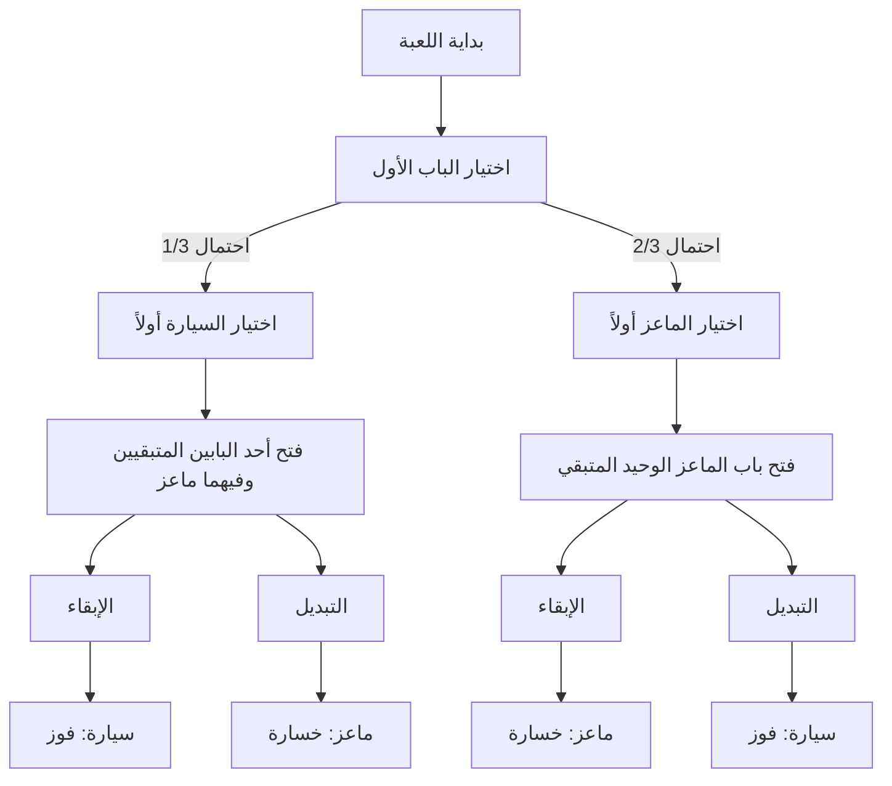
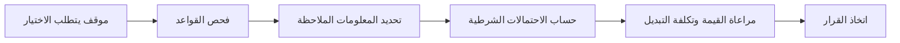

## 1. تحديد القواعد قبل مناقشة الحدس

تختار بابًا من ثلاثة أبواب، ثم يفتح المقدم بابًا آخر ليُظهر ماعزًا، ويسألك إن كنت تريد الانتقال إلى الباب المتبقي. توضح [مسألة مونتي هول](https://kenji.blog/ar/p/monty-hall-problem/) أن عدد الخيارات المتبقية وحده لا يحدد احتمالاتها. تناقش [ورقة غيل](https://pub.math.leidenuniv.nl/~gillrd/montyhall3.pdf) تاريخ المسألة، بما فيه النقاش في عمود «Ask Marilyn» بمجلة *Parade* عام 1990، وصياغاتها الرياضية المختلفة.

لنحدد أولاً النموذج المستخدم هنا.

1. خلف الأبواب A وB وC سيارة واحدة وماعزان. يتوزع مكان السيارة بالتساوي بين الأبواب الثلاثة. تختار A أولاً دون استخدام معلومات عن مكانها.
2. يعرف المقدم مكان السيارة، ولا يفتح A ولا الباب الذي توجد خلفه السيارة.
3. في كل لعبة، يفتح بابًا غير مختار توجد خلفه ماعز، ويعرض دائمًا الانتقال إلى الباب الوحيد الآخر غير المختار الذي بقي مغلقًا.
4. عندما تكون السيارة خلف A، يفتح B أو C باحتمال 1/2 لكل منهما.

تساوي الاحتمالات افتراض عن توزيع مكان السيارة، وليس نتيجة لمجرد جهلنا بمكانها. نرمز بالأحداث C_A وC_B وC_C إلى وجود السيارة خلف A وB وC، على الترتيب.

$$
\Pr(C_A)=\Pr(C_B)=\Pr(C_C)=\frac13
$$

في هذا النموذج، تفوز استراتيجية «التبديل دائمًا» باحتمال 2/3. لكن احتمال فوز الاستراتيجية إجمالاً يختلف عن الاحتمال الشرطي بعد ملاحظة محددة، مثل فتح B. ترتبط نتيجة 2/3 في الحسابين هنا بقواعد المقدم.

يمكن للرياضيات فحص ما ينقص استنتاج «بقي بابان، إذن الاحتمال نصف لكل منهما». أما لماذا يجيب شخص بهذه الطريقة أو يتردد في التبديل، فذلك سؤال آخر يحتاج إلى بحث نفسي.

## 2. تقسيم الحالات ومليون باب

### تقسيم الحالات بحسب المكان الأولي

نقسم الحالات بحسب مكان السيارة في البداية، قبل الاشتراط على اسم الباب المفتوح.

| مكان السيارة، باحتمال 1/3 لكل حالة | الباب الذي يفتحه المقدم | الإبقاء على A | التبديل |
| --- | --- | --- | --- |
| A | B أو C | فوز | خسارة |
| B | C | خسارة | فوز |
| C | B | خسارة | فوز |

لأن المقدم يستبعد دائمًا بابًا فيه ماعز ويعرض التبديل، يفوز التبديل إذا وفقط إذا كانت خلف الباب المختار أولاً ماعز.

$$
\Pr(\mathrm{stay\ wins})=\frac13,\qquad\Pr(\mathrm{switch\ wins})=\frac23
$$

هذه احتمالات داخل النموذج، ولا تضمن فوزين بالضبط في كل ثلاث ألعاب. يوضح الرسم فروعًا نظرية، وليس نتائج تجربة.

### حتى مع أبواب أكثر يجب تحديد الملاحظة

ليكن n عددًا صحيحًا لا يقل عن 3، مع ترقيم الأبواب من 1 إلى n. يتوزع مكان السيارة C بالتساوي، ويثبت الاختيار الأول عند الباب 1. في كل لعبة، يفتح المقدم n−2 بابًا غير مختار توجد خلفها ماعز، ويعرض الانتقال إلى الباب الوحيد غير المختار المتبقي R. الاحتمالات الإجمالية هي:

$$
\Pr(C=1)=\frac1n,\qquad\Pr(C=R)=\frac{n-1}{n}
$$

مع مليون باب، تفوز استراتيجية التبديل دائمًا باحتمال 999999/1000000.

لاستخدام معلومة أن الرقم R يساوي رقمًا محددًا r، نحتاج إلى قاعدة إضافية. هنا r أحد الأرقام من 2 إلى n. لنفترض أن المقدم، كلما كانت السيارة خلف الباب الأول، اختار R بالتساوي من الأبواب الأخرى وعددها n−1. عندئذ:

$$
\Pr(C=r\mid R=r)=\frac{1/n}{(1/n)+(1/n)(1/(n-1))}=\frac{n-1}{n}
$$

وفق هذه القاعدة المتناظرة، تؤدي ملاحظة بقاء الباب 777777 مغلقًا من بين مليون باب إلى الاحتمال المرتفع نفسه. لكن إذا كان المقدم يُبقي دائمًا الرقم الثابت نفسه r عندما تكون السيارة خلف الباب الأول، فإن:

$$
\Pr(C=r\mid R=r)=\frac{1/n}{(1/n)+(1/n)}=\frac12
$$

قد يظل التبديل أفضل إجمالاً، بينما يتغير الاحتمال بعد ملاحظة رقم بعينه. يشمل الشرط هنا R وحده، دون معلومات إضافية مثل ترتيب فتح الأبواب. لا يصح الاستنتاج أن وجود السيارة خلف الباب المتبقي شبه مؤكد دون فحص القواعد.

## 3. تطبيق مبرهنة بايز بعد الملاحظة

نعود إلى نموذج الأبواب الثلاثة، ولنرمز بـM_B إلى حدث فتح المقدم للباب B. تعطينا قواعد القسم 1 قيم دالة الإمكان التالية، أي احتمالات فتح B المشروطة بمكان السيارة:

$$
\Pr(M_B\mid C_A)=\frac12,\qquad\Pr(M_B\mid C_B)=0,\qquad\Pr(M_B\mid C_C)=1
$$

تعطينا [مبرهنة بايز](https://kenji.blog/ar/p/bayes-theorem/):

$$
\Pr(C_i\mid M_B)=\frac{\Pr(M_B\mid C_i)\Pr(C_i)}{\sum_{j\in\{A,B,C\}}\Pr(M_B\mid C_j)\Pr(C_j)}
$$

من قانون الاحتمال الكلي، يساوي المقام:

$$
\Pr(M_B)=\frac12\cdot\frac13+0\cdot\frac13+1\cdot\frac13=\frac12
$$

إذن الاحتمال البعدي لوجود السيارة خلف الباب الأصلي A هو:

$$
\Pr(C_A\mid M_B)=\frac{(1/2)(1/3)}{1/2}=\frac13
$$

واحتمال وجودها خلف باب التبديل C هو:

$$
\Pr(C_C\mid M_B)=\frac{1\cdot(1/3)}{1/2}=\frac23
$$

قبل الاشتراط على M_B، كان احتمال وجود السيارة خلف C يساوي 1/3. تحوله إلى 2/3 بعد الملاحظة، والشرح بأن «التبديل يفوز عندما كان الاختيار الأول خاطئًا»، منظوران مختلفان للنموذج نفسه.

نغيّر فقط احتمال فتح B عندما تكون السيارة خلف A إلى q، مع إبقاء القواعد الأخرى. عندئذ:

$$
q=\Pr(M_B\mid C_A),\quad0\le q\le1,\qquad\Pr(C_C\mid M_B)=\frac1{1+q}
$$

مثلاً، عند q يساوي 1، يتساوى احتمال وجود السيارة خلف A أو C بعد فتح B. حتى مع معرفة المقدم بمكان السيارة، يؤثر تفضيله بين بابَي الماعز في الاحتمالات الشرطية.

لننظر الآن في نموذج آخر: لا يعرف المقدم مكان السيارة، ويختار B أو C باحتمال 1/2 لكل منهما، بصورة مستقلة عن مكانها. قد يكشف هذا السيارة أيضًا. لنرمز بـU_B إلى حدث فتح هذا المقدم للباب B، وبـG إلى حدث وجود ماعز خلف الباب المفتوح. بعد ملاحظة «فُتح B وظهرت ماعز» معًا:

$$
\Pr(C_A\mid U_B\cap G)=\Pr(C_C\mid U_B\cap G)=\frac12
$$

إظهار ماعز دائمًا وإظهارها بالمصادفة آليتان مختلفتان للملاحظة. تبحث [ورقة روزنتال](https://probability.ca/jeff/writing/montyfall.pdf) أيضًا في بدائل لسلوك المقدم.

## 4. فصل الفرضيات النفسية عن الأخطاء الرياضية

### فحص استنتاج تساوي الاحتمالات

يناقش علم النفس التعامل مع الخيارات المتبقية بوصفها متساوية الاحتمال، ضمن مفاهيم مثل استدلال تساوي الاحتمالات. لكن يمكن التحقق من أن «بابين، إذن نصف لكل منهما» لا يوافق نموذج القسم 1 دون طرح تفسير سببي للدماغ. يجب أن يتضمن الحساب العملية التي أبقت هذين البابين مغلقين.

### فصل معرفة المقدم عن آلية الفتح

القول فقط إن «المقدم لا يفتح عشوائيًا» غير دقيق. فحتى المقدم العارف بالمحتويات يستطيع الاختيار عشوائيًا بين B وC عندما تكون السيارة خلف A. كذلك لا يعني إبقاء C مغلقًا أنه لم يكن يستطيع فتحه بسبب السيارة؛ فعندما تكون السيارة خلف A كان فتح C ممكنًا أيضًا. نحتاج إلى قاعدة اختيار محددة، لا إلى تخمين النية وحده.

### التردد والندم المتوقع

فهم الاحتمال واختيار الفعل مسألتان مختلفتان. يمكن تخيل الشعور «سأندم إذا بدّلت وخسرت»، لكن ذلك لا يفسر سلوك الجميع. الادعاء بأن الحفاظ على الوضع الراهن أو تجنب الندم آليتان شاملتان للدماغ يحتاج إلى أدلة تجريبية مناسبة.

قارن [Mazur وKahlbaugh‏ (2012)](https://pmc.ncbi.nlm.nih.gov/articles/PMC3435463/) بين اختيارات متكررة لحمام وطلاب جامعيين وأطفال في سن ما قبل المدرسة. ظهرت فروق فردية كبيرة في ظروف الاحتمالات القياسية. وفي ظروف ترتفع فيها احتمالات المكافأة عند التبديل، بدّل الطلاب والحمام أكثر. ناقش الباحثان صعوبة التمييز بين احتمالات المكافأة في المهام المتكررة. تختلف هذه الظروف عن الإجابة مرة واحدة عن مسألة لفظية، ولا تثبت أن الجميع يخطئون بسبب انحياز الوضع الراهن.

الرسم التالي إجراء مقترح لتنظيم التفكير، ولا يعرض أسبابًا نفسية مثبتة تجريبيًا.

## 5. تحتاج التطبيقات إلى نماذج خاصة بها

### اختبار افتراضي والنتائج الإيجابية الكاذبة

الحساسية والنوعية وحدهما لا تحددان الاحتمال بعد نتيجة إيجابية. كمثال حسابي، نفترض أن الاحتمال القبلي للمرض p يساوي 1/10000، وأن الحساسية s تساوي 99% والنوعية t تساوي 99%. الحساسية هي احتمال نتيجة إيجابية عند وجود المرض؛ والنوعية هي احتمال نتيجة سلبية عند غيابه.

$$
p=\frac1{10000},\qquad s=\frac{99}{100},\qquad t=\frac{99}{100}
$$

لنرمز بـD إلى حدث وجود المرض، وبـ+ إلى نتيجة إيجابية. عندئذ:

$$
\Pr(D\mid +)=\frac{sp}{sp+(1-t)(1-p)}=\frac{0.000099}{0.000099+0.009999}=\frac1{102}\approx0.009804
$$

أي نحو 0.98%. في مجتمع افتراضي من 10000 شخص، العدد المتوقع للنتائج الإيجابية الحقيقية هو 0.99، وللإيجابية الكاذبة 99.99. تظهر أعداد كسرية لأنها قيم متوقعة، وليست أعداد مرضى لوحظوا فعليًا.

ينتج هذا المثال من الاحتمالات الثلاثة المفترضة. ولا يحدد احتمال مرض قدره 0.98% لاختبار حقيقي أو لشخص بعينه. التمييز بين وجود المرض أو غيابه وبين نتيجة الاختبار الإيجابية أو السلبية ضروري لفهم الصيغة أيضًا.

### استراتيجية الشركات ومعايير تتجاوز احتمال الفوز

قد تدعو استجابات السوق إلى مراجعة الاستراتيجية. لكن السوق لا يستبعد بالضرورة خيارًا فاشلاً وفق قاعدة معلومة، ولا يصبح احتمال نجاح تغيير الاستراتيجية 2/3 بسبب ذلك. تحتاج المنافسة وجمع المعلومات إلى نماذج خاصة بكل منهما.

حتى داخل اللعبة، لنرمز إلى منفعتَي السيارة والماعز بـu_car وu_goat، وإلى تكلفة التبديل بـk مقاسة بوحدات المنفعة نفسها. باستخدام احتمالات القسم 1، يكون الفرق بين المنفعتين المتوقعتين:

$$
\mathrm{EU}(\mathrm{switch})-\mathrm{EU}(\mathrm{stay})=\frac{u_{\mathrm{car}}-u_{\mathrm{goat}}}{3}-k
$$

تعظيم احتمال الحصول على السيارة وتعظيم القيمة بعد طرح التكاليف هدفان مختلفان. ينبغي في قرار حقيقي فحص قيمة الخيارات وتكلفة التغيير وكيفية الحصول على المعلومات.

## 6. خاتمة: فحص افتراضات الحدس والحساب

مسألة مونتي هول تدريب على توضيح آلية إنتاج الملاحظة، بدلاً من توزيع الاحتمالات بعدّ الخيارات وحده. تعطي الرياضيات نتائج ضمن نموذج محدد، ويبحث علم النفس تجريبيًا في كيفية فهم الناس وتعلمهم واختيارهم.

عند تلقي معلومات جديدة، حدد ما لوحظ، والقواعد التي أنتجت الملاحظة، وما تريد تعظيمه. قد يساعد هذا الإجراء، لكنه ليس قاعدة عامة بأن تغيير الاختيار يضاعف النجاح دائمًا.
