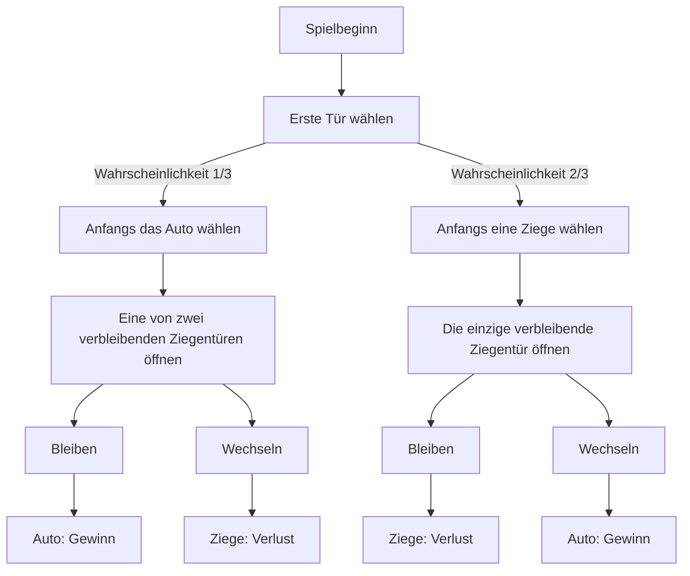
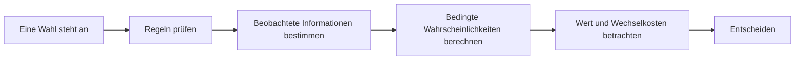

## 1. Erst die Regeln festlegen, dann die Intuition prüfen

Sie wählen eine von drei Türen. Der Moderator öffnet eine andere und zeigt eine Ziege. Dann fragt er, ob Sie zur verbleibenden Tür wechseln möchten. Das [Monty-Hall-Problem](https://kenji.blog/de/p/monty-hall-problem/) zeigt, warum die Anzahl der verbleibenden Möglichkeiten allein deren Wahrscheinlichkeiten nicht bestimmt. [Gills Aufsatz](https://pub.math.leidenuniv.nl/~gillrd/montyhall3.pdf) behandelt die Geschichte einschließlich der Diskussion von 1990 in der *Parade*-Kolumne „Ask Marilyn“ sowie verschiedene mathematische Formulierungen.

Zunächst legen wir das hier verwendete Modell fest.

1. Hinter den Türen A, B und C befinden sich ein Auto und zwei Ziegen. Die Position des Autos ist auf die drei Türen gleichverteilt. Sie wählen zunächst A, ohne Informationen über diese Position zu verwenden.
2. Der Moderator kennt die Position des Autos und öffnet weder A noch die Tür mit dem Auto.
3. In jeder Runde öffnet er eine nicht gewählte Tür mit einer Ziege und bietet immer den Wechsel zur anderen noch geschlossenen, nicht gewählten Tür an.
4. Ist das Auto hinter A, öffnet er B oder C mit einer Wahrscheinlichkeit von jeweils 1/2.

Gleiche Wahrscheinlichkeiten sind eine Annahme über die Platzierung des Autos und folgen nicht allein daraus, dass wir dessen Position nicht kennen. C_A, C_B und C_C bezeichnen die Ereignisse, dass sich das Auto hinter A, B beziehungsweise C befindet.

$$
\Pr(C_A)=\Pr(C_B)=\Pr(C_C)=\frac13
$$

In diesem Modell gewinnt die Strategie „immer wechseln“ mit Wahrscheinlichkeit 2/3. Die gesamte Gewinnwahrscheinlichkeit einer Strategie ist jedoch von der bedingten Wahrscheinlichkeit nach einer bestimmten Beobachtung zu unterscheiden, etwa nachdem B geöffnet wurde. Dass beide Rechnungen hier 2/3 ergeben, hängt mit den Regeln des Moderators zusammen.

Mathematisch lässt sich prüfen, welche Voraussetzung im Schluss „zwei bleiben übrig, also jeweils die Hälfte“ fehlt. Warum eine Person so antwortet oder beim Wechsel zögert, ist eine andere Frage, die psychologische Forschung erfordert.

## 2. Fallunterscheidung und eine Million Türen

### Nach der anfänglichen Position unterscheiden

Wir unterscheiden nach der ursprünglichen Position des Autos, ohne bereits auf den Namen der geöffneten Tür zu bedingen.

| Position des Autos, jeweils mit Wahrscheinlichkeit 1/3 | Vom Moderator geöffnete Tür | Bei A bleiben | Wechseln |
| --- | --- | --- | --- |
| A | B oder C | Gewinn | Verlust |
| B | C | Verlust | Gewinn |
| C | B | Verlust | Gewinn |

Weil der Moderator immer eine Ziegentür ausschließt und den Wechsel anbietet, gewinnt der Wechsel genau dann, wenn hinter der zuerst gewählten Tür eine Ziege stand.

$$
\Pr(\mathrm{stay\ wins})=\frac13,\qquad\Pr(\mathrm{switch\ wins})=\frac23
$$

Das sind Modellwahrscheinlichkeiten und keine Garantie für genau zwei Gewinne in je drei Runden. Das Diagramm zeigt theoretische Verzweigungen, keine Versuchsergebnisse.

### Auch bei mehr Türen muss die Beobachtung klar sein

Sei n eine ganze Zahl mit n ≥ 3; die Türen sind von 1 bis n nummeriert. Die Position C des Autos ist gleichverteilt, die erste Wahl auf 1 festgelegt. In jeder Runde öffnet der Moderator n−2 nicht gewählte Ziegentüren und bietet den Wechsel zur einzigen verbleibenden, nicht gewählten Tür R an. Die unbedingten Gewinnwahrscheinlichkeiten sind:

$$
\Pr(C=1)=\frac1n,\qquad\Pr(C=R)=\frac{n-1}{n}
$$

Bei einer Million Türen gewinnt die Strategie „immer wechseln“ mit Wahrscheinlichkeit 999999/1000000.

Um die Information zu verwenden, dass R eine bestimmte Nummer r hat, brauchen wir eine zusätzliche Regel. Dabei ist r eine der Nummern 2 bis n. Angenommen, wenn die zuerst gewählte Tür das Auto verbirgt, wählt der Moderator R gleichverteilt aus den anderen n−1 Türen. Dann gilt:

$$
\Pr(C=r\mid R=r)=\frac{1/n}{(1/n)+(1/n)(1/(n-1))}=\frac{n-1}{n}
$$

Unter dieser symmetrischen Regel ergibt die Beobachtung, dass von einer Million Türen die Tür 777777 geschlossen bleibt, dieselbe hohe Wahrscheinlichkeit. Lässt der Moderator dagegen immer dieselbe feste Nummer r übrig, wenn die erste Tür das Auto verbirgt, gilt:

$$
\Pr(C=r\mid R=r)=\frac{1/n}{(1/n)+(1/n)}=\frac12
$$

Wechseln kann insgesamt vorteilhaft bleiben, während sich die Wahrscheinlichkeit nach Beobachtung einer bestimmten Nummer ändert. Hier wird nur auf R bedingt; zusätzliche Informationen wie die Öffnungsreihenfolge sind nicht enthalten. Ohne die Regeln zu prüfen, lässt sich daraus nicht schließen, dass hinter der verbleibenden Tür fast sicher das Auto steht.

## 3. Den Satz von Bayes nach einer Beobachtung anwenden

Zurück zum Modell mit drei Türen: M_B bezeichnet das Ereignis, dass der Moderator B öffnet. Aus den Regeln in Abschnitt 1 ergeben sich folgende Likelihoods:

$$
\Pr(M_B\mid C_A)=\frac12,\qquad\Pr(M_B\mid C_B)=0,\qquad\Pr(M_B\mid C_C)=1
$$

Der [Satz von Bayes](https://kenji.blog/de/p/bayes-theorem/) liefert:

$$
\Pr(C_i\mid M_B)=\frac{\Pr(M_B\mid C_i)\Pr(C_i)}{\sum_{j\in\{A,B,C\}}\Pr(M_B\mid C_j)\Pr(C_j)}
$$

Nach dem Satz der totalen Wahrscheinlichkeit ist der Nenner:

$$
\Pr(M_B)=\frac12\cdot\frac13+0\cdot\frac13+1\cdot\frac13=\frac12
$$

Die A-posteriori-Wahrscheinlichkeit, dass das Auto hinter der ursprünglich gewählten Tür A steht, ist daher:

$$
\Pr(C_A\mid M_B)=\frac{(1/2)(1/3)}{1/2}=\frac13
$$

Für die Tür C, zu der Sie wechseln würden, beträgt die A-posteriori-Wahrscheinlichkeit:

$$
\Pr(C_C\mid M_B)=\frac{1\cdot(1/3)}{1/2}=\frac23
$$

Bevor wir auf M_B bedingen, hat das Ereignis „Auto hinter C“ Wahrscheinlichkeit 1/3. Dass diese nach der Beobachtung 2/3 beträgt, und die Erklärung „Wechseln gewinnt bei einer falschen ersten Wahl“ sind unterschiedliche Sichtweisen auf dasselbe Modell.

Ändern wir nur die Wahrscheinlichkeit, B zu öffnen, wenn das Auto hinter A steht, auf q und behalten die anderen Regeln bei. Dann gilt:

$$
q=\Pr(M_B\mid C_A),\quad0\le q\le1,\qquad\Pr(C_C\mid M_B)=\frac1{1+q}
$$

Bei q gleich 1 befindet sich das Auto nach dem Öffnen von B beispielsweise mit gleicher Wahrscheinlichkeit hinter A oder C. Auch wenn der Moderator die Position des Autos kennt, ist seine Vorliebe zwischen den Ziegentüren für die bedingten Wahrscheinlichkeiten relevant.

Betrachten wir nun ein anderes Modell: Der Moderator kennt die Position des Autos nicht und wählt unabhängig von ihr B oder C mit Wahrscheinlichkeit 1/2 für jede Tür. Dabei kann das Auto aufgedeckt werden. U_B sei das Ereignis, dass dieser Moderator B öffnet, und G das Ereignis, dass hinter der geöffneten Tür eine Ziege steht. Nach der gemeinsamen Beobachtung „B geöffnet und Ziege gesehen“ gilt:

$$
\Pr(C_A\mid U_B\cap G)=\Pr(C_C\mid U_B\cap G)=\frac12
$$

Immer eine Ziege zu zeigen und zufällig eine Ziege zu zeigen sind unterschiedliche Beobachtungsmechanismen. [Rosenthals Aufsatz](https://probability.ca/jeff/writing/montyfall.pdf) untersucht ebenfalls Varianten des Moderatorverhaltens.

## 4. Psychologische Hypothesen und mathematische Fehler trennen

### Den Schluss auf gleiche Wahrscheinlichkeiten prüfen

Die Annahme, verbleibende Möglichkeiten seien gleich wahrscheinlich, wird in der Psychologie etwa als Gleichwahrscheinlichkeitsheuristik diskutiert. Dass „zwei Türen, also jeweils die Hälfte“ nicht zum Modell aus Abschnitt 1 passt, lässt sich jedoch ohne eine kausale Erklärung des Gehirns feststellen. Die Rechnung muss den Vorgang berücksichtigen, durch den diese Türen geschlossen blieben.

### Wissen des Moderators und Öffnungsmechanismus unterscheiden

Die Aussage „der Moderator öffnet nicht zufällig“ ist zu ungenau. Auch ein informierter Moderator kann zufällig zwischen B und C wählen, wenn das Auto hinter A steht. Dass C geschlossen bleibt, bedeutet außerdem nicht, dass er sie wegen des Autos nicht öffnen konnte: Steht das Auto hinter A, wäre auch C möglich gewesen. Benötigt wird eine konkrete Auswahlregel, nicht nur eine Vermutung über die Absicht.

### Zögern und erwartetes Bedauern

Eine Wahrscheinlichkeit zu verstehen und eine Handlung zu wählen sind unterschiedliche Fragen. Das Gefühl „ich würde es bereuen, zu wechseln und zu verlieren“ ist vorstellbar, erklärt aber nicht das Verhalten aller Menschen. Wer das Festhalten am Status quo oder die Vermeidung von Bedauern als universelle Gehirnmechanismen bezeichnet, braucht entsprechende empirische Belege.

[Mazur und Kahlbaugh (2012)](https://pmc.ncbi.nlm.nih.gov/articles/PMC3435463/) verglichen wiederholte Entscheidungen von Tauben, Studierenden und Vorschulkindern. Unter den Standardwahrscheinlichkeiten bestanden große individuelle Unterschiede. Bei höherer Belohnungswahrscheinlichkeit für das Wechseln wechselten Studierende und Tauben häufiger. Die Autoren diskutieren, wie schwierig es bei wiederholten Aufgaben ist, Belohnungswahrscheinlichkeiten zu unterscheiden. Das ist nicht dieselbe Situation wie eine einmalige Textaufgabe und belegt nicht, dass alle wegen einer Status-quo-Verzerrung falsch antworten.

Das folgende Diagramm ist ein vorgeschlagener Ablauf zur Strukturierung des Denkens. Es zeigt keine empirisch gesicherten psychologischen Ursachen.

## 5. Anwendungen brauchen eigene Modelle

### Ein hypothetischer Test und falsch positive Ergebnisse

Sensitivität und Spezifität allein bestimmen nicht die Wahrscheinlichkeit nach einem positiven Ergebnis. Als Rechenbeispiel nehmen wir eine A-priori-Krankheitswahrscheinlichkeit p von 1/10000, eine Sensitivität s von 99 % und eine Spezifität t von 99 % an. Sensitivität ist die Wahrscheinlichkeit eines positiven Ergebnisses bei bestehender Krankheit; Spezifität ist die Wahrscheinlichkeit eines negativen Ergebnisses ohne Krankheit.

$$
p=\frac1{10000},\qquad s=\frac{99}{100},\qquad t=\frac{99}{100}
$$

D bezeichne das Ereignis, dass die Krankheit vorliegt, und + ein positives Ergebnis. Dann gilt:

$$
\Pr(D\mid +)=\frac{sp}{sp+(1-t)(1-p)}=\frac{0.000099}{0.000099+0.009999}=\frac1{102}\approx0.009804
$$

Das sind etwa 0,98 %. In einer hypothetischen Population von 10000 Personen erwarten wir 0,99 richtig positive und 99,99 falsch positive Ergebnisse. Die Anzahlen sind Bruchzahlen, weil es Erwartungswerte sind und keine tatsächlich beobachteten Patienten.

Dieses Beispiel folgt aus den drei angenommenen Wahrscheinlichkeiten. Es weist keinem realen Test und keiner bestimmten Person eine Krankheitswahrscheinlichkeit von 0,98 % zu. Für das Verständnis der Formel ist es wichtig, Krankheit beziehungsweise Nichtkrankheit von einem positiven oder negativen Testergebnis zu unterscheiden.

### Unternehmensstrategien und Kriterien jenseits der Gewinnwahrscheinlichkeit

Marktreaktionen können Anlass sein, eine Strategie zu überdenken. Märkte schließen aber nicht notwendigerweise nach einer bekannten Regel eine erfolglose Möglichkeit aus, und ein Strategiewechsel erhält dadurch keine Erfolgswahrscheinlichkeit von 2/3. Wettbewerb und Informationsbeschaffung brauchen eigene Modelle.

Selbst im Spiel seien u_car und u_goat die Nutzenwerte für ein Auto und eine Ziege. Die Wechselkosten k werden in denselben Nutzeneinheiten gemessen. Mit den Wahrscheinlichkeiten aus Abschnitt 1 ergibt sich für den Unterschied im erwarteten Nutzen:

$$
\mathrm{EU}(\mathrm{switch})-\mathrm{EU}(\mathrm{stay})=\frac{u_{\mathrm{car}}-u_{\mathrm{goat}}}{3}-k
$$

Die Wahrscheinlichkeit des Autogewinns zu maximieren und den Wert nach Abzug der Kosten zu maximieren sind verschiedene Ziele. Bei einer realen Entscheidung sind die Werte der Möglichkeiten, die Wechselkosten und die Entstehung der Informationen zu prüfen.

## 6. Fazit: Voraussetzungen von Intuition und Rechnung prüfen

Am Monty-Hall-Problem lässt sich üben, den Entstehungsmechanismus einer Beobachtung zu benennen, statt Wahrscheinlichkeiten allein aus der Anzahl der Optionen abzuleiten. Die Mathematik liefert Folgerungen innerhalb eines festgelegten Modells. Die Psychologie untersucht empirisch, wie Menschen verstehen, lernen und wählen.

Prüfen Sie bei neuen Informationen, was beobachtet wurde, welche Regeln diese Beobachtung erzeugt haben und was Sie maximieren möchten. Dieses Vorgehen kann helfen, ist aber keine allgemeine Regel, dass eine Änderung der Wahl den Erfolg stets verdoppelt.
