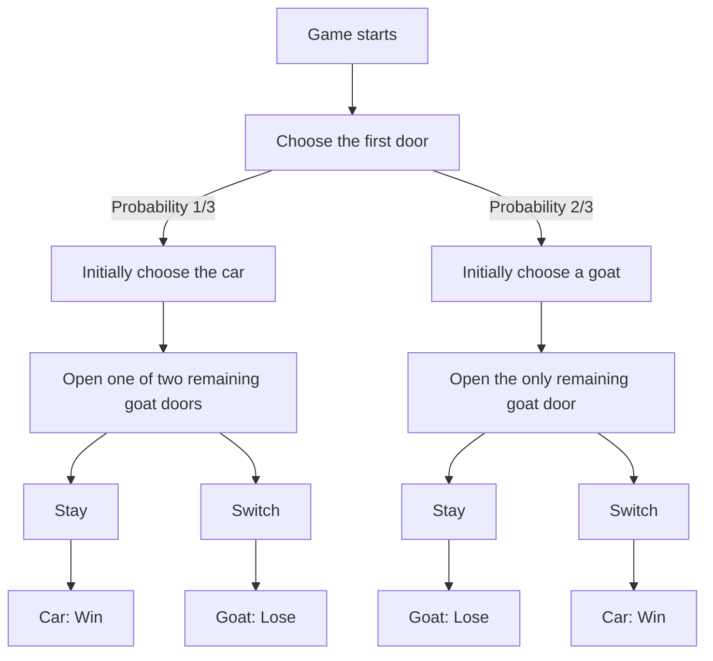
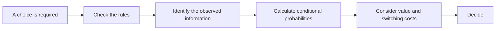

## 1. Specify the rules before examining intuition

Choose one of three doors. A host opens another door to show a goat, then asks whether you want to switch to the remaining door. The [Monty Hall problem](https://kenji.blog/en/p/monty-hall-problem/) illustrates why the number of remaining options alone does not determine their probabilities. [Gill's paper](https://pub.math.leidenuniv.nl/~gillrd/montyhall3.pdf) examines its history, including the 1990 discussion in *Parade*'s “Ask Marilyn” column, and different mathematical formulations.

We first state the model used in this article.

1. One car and two goats are behind doors A, B and C. The car's location is uniform over the three doors. You initially choose A without using information about its location.
2. The host knows where the car is and opens neither A nor the car's door.
3. Every time, the host opens one unchosen goat door and always offers a switch to the remaining unchosen door.
4. When A has the car, the host opens B or C with probability 1/2 each.

Equal probabilities are an assumption about placement, rather than a consequence of ignorance. Write C_A, C_B and C_C for the events that the car is behind A, B and C respectively.

$$
\Pr(C_A)=\Pr(C_B)=\Pr(C_C)=\frac13
$$

In this model, always switching wins with probability 2/3. However, distinguish a strategy's overall winning probability from a conditional probability after a particular observation, such as B being opened. The host's rules matter to why both calculations give 2/3 here.

Mathematics can identify what is missing from the inference “two remain, so each has half the probability.” Why a person gives that answer or hesitates to switch is a separate question requiring psychological research.

## 2. Case analysis and a million doors

### Separate cases by the initial arrangement

Divide by the car's initial location, rather than by the name of the opened door.

| Car location (each with probability 1/3) | Door the host opens | Stay at A | Switch |
| --- | --- | --- | --- |
| A | B or C | Win | Lose |
| B | C | Lose | Win |
| C | B | Lose | Win |

Because the host always removes a goat and offers a switch, switching wins exactly when the initial choice was a goat.

$$
\Pr(\mathrm{stay\ wins})=\frac13,\qquad\Pr(\mathrm{switch\ wins})=\frac23
$$

These are model probabilities, not a guarantee of exactly two wins in every three games. The diagram shows theoretical branches rather than experimental results.

### More doors still require a specified observation

Let n be an integer at least 3, and number the doors from 1 to n. The car's location C is uniform and the initial choice is 1. Every time, the host opens n−2 unchosen goat doors and offers a switch to the single remaining unchosen door R. The overall probabilities are

$$
\Pr(C=1)=\frac1n,\qquad\Pr(C=R)=\frac{n-1}{n}
$$

With a million doors, always switching wins with probability 999999/1000000.

Using the information that R has a particular label r requires another rule. Here r is one of 2 through n. Suppose that whenever the initial door has the car, the host chooses R uniformly from the other n−1 doors. Then

$$
\Pr(C=r\mid R=r)=\frac{1/n}{(1/n)+(1/n)(1/(n-1))}=\frac{n-1}{n}
$$

Under this symmetric rule, observing that door 777777 remains closed out of a million gives the same high probability. But if the host always leaves that fixed label r whenever the initial door has the car, then

$$
\Pr(C=r\mid R=r)=\frac{1/n}{(1/n)+(1/n)}=\frac12
$$

Switching can be advantageous overall while the probability after observing a particular label changes. These calculations condition only on R, excluding additional information such as the opening order. Without checking the rules, this example does not justify saying that the remaining door almost certainly has the car.

## 3. Use Bayes' theorem for probabilities after an observation

Return to the three-door model, and let M_B be the event that the host opens B. The rules in Section 1 give these likelihoods:

$$
\Pr(M_B\mid C_A)=\frac12,\qquad\Pr(M_B\mid C_B)=0,\qquad\Pr(M_B\mid C_C)=1
$$

[Bayes' theorem](https://kenji.blog/en/p/bayes-theorem/) gives

$$
\Pr(C_i\mid M_B)=\frac{\Pr(M_B\mid C_i)\Pr(C_i)}{\sum_{j\in\{A,B,C\}}\Pr(M_B\mid C_j)\Pr(C_j)}
$$

By the law of total probability, the denominator is

$$
\Pr(M_B)=\frac12\cdot\frac13+0\cdot\frac13+1\cdot\frac13=\frac12
$$

The posterior probability that the original door A has the car is therefore

$$
\Pr(C_A\mid M_B)=\frac{(1/2)(1/3)}{1/2}=\frac13
$$

and the posterior probability that the switching destination C has the car is

$$
\Pr(C_C\mid M_B)=\frac{1\cdot(1/3)}{1/2}=\frac23
$$

The event that C has the car had probability 1/3 before conditioning on M_B. Its probability becoming 2/3 after this observation and the explanation “switching wins whenever the initial choice was wrong” are different views of the same model.

Change only the probability of opening B when A has the car to q, keeping the other rules. Then

$$
q=\Pr(M_B\mid C_A),\quad0\le q\le1,\qquad\Pr(C_C\mid M_B)=\frac1{1+q}
$$

For example, with q equal to 1, A and C are equally likely after B is opened. Even when the host knows where the car is, a preference between goat doors matters to conditional probabilities.

Now consider a different model: the host does not know the car's location and chooses B or C with probability 1/2 each, independently of that location. This can reveal the car. Let U_B be the event that this host opens B, and G the event that the opened door reveals a goat. After observing both that B was opened and that it revealed a goat,

$$
\Pr(C_A\mid U_B\cap G)=\Pr(C_C\mid U_B\cap G)=\frac12
$$

Always revealing a goat and happening to reveal a goat are different observation mechanisms. [Rosenthal's paper](https://probability.ca/jeff/writing/montyfall.pdf) also examines variants of the host's behavior.

## 4. Separate psychological hypotheses from mathematical errors

### Examine the inference of equal probabilities

Treating remaining options as equally likely is discussed in psychology in terms such as the equiprobability heuristic. However, we can establish that “two doors, so half each” does not fit the Section 1 model without a causal claim about the brain. The calculation must include the process that left those doors closed.

### Separate the host's knowledge from the opening mechanism

Simply saying “the host does not open randomly” is inaccurate. An informed host can still choose randomly between B and C when A has the car. Leaving C closed also does not mean that the host could not open it because it held the car: if A had the car, opening C was possible. We need a specific selection rule, rather than a guess about intent alone.

### Hesitation and anticipated regret

Understanding a probability and choosing an action are separate issues. We can imagine feeling “I would regret switching and losing,” but this does not explain everyone's behavior. Claims that maintaining the status quo or avoiding regret are universal brain mechanisms require appropriate empirical evidence.

[Mazur and Kahlbaugh (2012)](https://pmc.ncbi.nlm.nih.gov/articles/PMC3435463/) compared repeated choices by pigeons, college students and preschool children. There were large individual differences under the standard probability conditions. In conditions with higher probabilities of reward for switching, students and pigeons switched more. The authors argued that difficulty discriminating reward probabilities matters in repeated tasks. These differ from answering a one-shot verbal problem and do not establish that everyone errs because of status quo bias.

The next diagram is a procedure for organizing reasoning. It does not depict established psychological causes.

## 5. Applications need their own models

### A hypothetical test and false positives

Sensitivity and specificity alone do not determine the probability after a positive result. For an arithmetic example, suppose the prior disease probability p is 1/10000, sensitivity s is 99%, and specificity t is 99%. Sensitivity is the probability of a positive result given disease; specificity is the probability of a negative result given no disease.

$$
p=\frac1{10000},\qquad s=\frac{99}{100},\qquad t=\frac{99}{100}
$$

Let D be the event that disease is present, and + a positive result. Then

$$
\Pr(D\mid +)=\frac{sp}{sp+(1-t)(1-p)}=\frac{0.000099}{0.000099+0.009999}=\frac1{102}\approx0.009804
$$

which is about 0.98%. In a hypothetical population of 10000, the expected counts are 0.99 true positives and 99.99 false positives. Fractional counts occur because these are expectations, rather than observed patient counts.

This example follows from the three assumed probabilities. It does not assign a probability of 0.98% to an actual test or individual. Distinguishing disease status from a positive or negative test result is also essential to reading the formula.

### Business strategy and criteria beyond winning probability

Market reactions can prompt a strategy review. However, markets do not necessarily remove an unsuccessful option under a known rule, and a change of strategy does not acquire a success probability of 2/3. Competition and information gathering each need their own models.

Even within the game, let the utilities of a car and a goat be u_car and u_goat, and let the switching cost k be measured in the same utility units. Using the Section 1 probabilities, the expected-utility difference is

$$
\mathrm{EU}(\mathrm{switch})-\mathrm{EU}(\mathrm{stay})=\frac{u_{\mathrm{car}}-u_{\mathrm{goat}}}{3}-k
$$

Maximizing the chance of getting the car and maximizing value after costs are distinct objectives. In an actual decision, examine option values, switching costs and how information was obtained.

## 6. Conclusion: check the assumptions behind intuition and calculation

The Monty Hall problem is practice in specifying how an observation arises, rather than assigning probabilities from the number of options alone. Mathematics gives conclusions within a stated model. Psychology empirically examines how people understand, learn and choose.

After receiving information, identify what was observed, which rules generated it, and what you want to maximize. This procedure can help, but it is not a general rule that changing a choice always doubles success.
