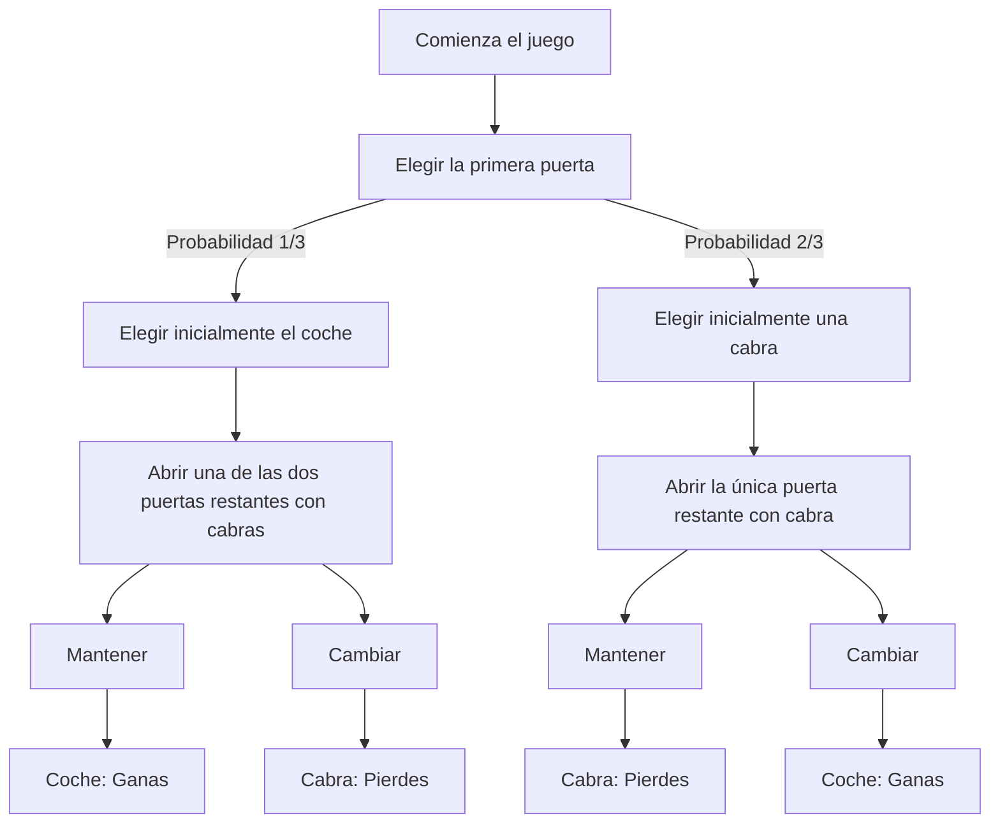
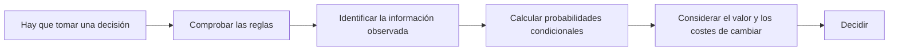

## 1. Especificar las reglas antes de examinar la intuición

Eliges una de tres puertas. El presentador abre otra para mostrar una cabra y pregunta si quieres cambiar a la puerta restante. El [problema de Monty Hall](https://kenji.blog/es/p/monty-hall-problem/) ilustra por qué el número de opciones restantes no determina por sí solo sus probabilidades. [El artículo de Gill](https://pub.math.leidenuniv.nl/~gillrd/montyhall3.pdf) examina su historia, incluido el debate de 1990 en la columna «Ask Marilyn» de *Parade*, y distintas formulaciones matemáticas.

Primero definimos el modelo utilizado aquí.

1. Detrás de las puertas A, B y C hay un coche y dos cabras. La ubicación del coche tiene distribución uniforme entre las tres puertas. Inicialmente eliges A sin utilizar información sobre esa ubicación.
2. El presentador sabe dónde está el coche y no abre ni A ni la puerta del coche.
3. En cada partida abre una puerta no elegida con una cabra y siempre ofrece cambiar a la otra puerta no elegida que sigue cerrada.
4. Cuando el coche está detrás de A, abre B o C con probabilidad 1/2 para cada una.

La equiprobabilidad es un supuesto sobre la ubicación del coche, no una consecuencia del desconocimiento. Denotamos por C_A, C_B y C_C los sucesos de que el coche esté detrás de A, B y C, respectivamente.

$$
\Pr(C_A)=\Pr(C_B)=\Pr(C_C)=\frac13
$$

En este modelo, cambiar siempre permite ganar con probabilidad 2/3. Sin embargo, hay que distinguir la probabilidad global de ganar con una estrategia de la probabilidad condicional tras una observación concreta, como que se haya abierto B. Las reglas del presentador importan para que ambos cálculos den 2/3 aquí.

Las matemáticas permiten identificar qué falta en el razonamiento «quedan dos, así que cada una tiene la mitad de probabilidad». Por qué una persona da esa respuesta o duda en cambiar es otra pregunta que requiere investigación psicológica.

## 2. Análisis de casos y un millón de puertas

### Separar los casos por la ubicación inicial

Clasificamos según la ubicación inicial del coche, sin condicionar todavía por el nombre de la puerta abierta.

| Ubicación del coche, cada una con probabilidad 1/3 | Puerta que abre el presentador | Mantener A | Cambiar |
| --- | --- | --- | --- |
| A | B o C | Ganas | Pierdes |
| B | C | Pierdes | Ganas |
| C | B | Pierdes | Ganas |

Como el presentador siempre elimina una cabra y ofrece cambiar, el cambio gana exactamente cuando la puerta elegida inicialmente tenía una cabra.

$$
\Pr(\mathrm{stay\ wins})=\frac13,\qquad\Pr(\mathrm{switch\ wins})=\frac23
$$

Son probabilidades del modelo, no una garantía de ganar exactamente dos veces cada tres partidas. El diagrama muestra ramas teóricas, no resultados experimentales.

### Más puertas también exigen precisar lo observado

Sea n un entero mayor o igual que 3, con puertas numeradas de 1 a n. La ubicación C del coche es uniforme y la elección inicial es 1. En cada partida el presentador abre n−2 puertas no elegidas con cabras y ofrece cambiar a la única puerta no elegida restante, R. Las probabilidades globales son:

$$
\Pr(C=1)=\frac1n,\qquad\Pr(C=R)=\frac{n-1}{n}
$$

Con un millón de puertas, la estrategia de cambiar siempre gana con probabilidad 999999/1000000.

Para utilizar la información de que R tiene un número concreto r hace falta otra regla. Aquí r es uno de los números de 2 a n. Supongamos que, siempre que la puerta inicial contiene el coche, el presentador elige R uniformemente entre las otras n−1 puertas. Entonces:

$$
\Pr(C=r\mid R=r)=\frac{1/n}{(1/n)+(1/n)(1/(n-1))}=\frac{n-1}{n}
$$

Con esta regla simétrica, observar que queda cerrada la puerta 777777 de un millón da la misma probabilidad alta. Pero si, cuando la puerta inicial contiene el coche, el presentador siempre deja ese mismo número fijo r, entonces:

$$
\Pr(C=r\mid R=r)=\frac{1/n}{(1/n)+(1/n)}=\frac12
$$

Cambiar puede ser ventajoso globalmente, mientras que la probabilidad tras observar un número concreto varía. Estos cálculos condicionan solo por R y excluyen información adicional, como el orden de apertura. Sin comprobar las reglas, el ejemplo no justifica afirmar que la puerta restante contiene el coche casi con certeza.

## 3. Aplicar el teorema de Bayes tras una observación

Volvamos al modelo de tres puertas. Sea M_B el suceso de que el presentador abra B. Las reglas de la sección 1 dan las siguientes verosimilitudes:

$$
\Pr(M_B\mid C_A)=\frac12,\qquad\Pr(M_B\mid C_B)=0,\qquad\Pr(M_B\mid C_C)=1
$$

El [teorema de Bayes](https://kenji.blog/es/p/bayes-theorem/) da:

$$
\Pr(C_i\mid M_B)=\frac{\Pr(M_B\mid C_i)\Pr(C_i)}{\sum_{j\in\{A,B,C\}}\Pr(M_B\mid C_j)\Pr(C_j)}
$$

Por la ley de la probabilidad total, el denominador es:

$$
\Pr(M_B)=\frac12\cdot\frac13+0\cdot\frac13+1\cdot\frac13=\frac12
$$

Por tanto, la probabilidad a posteriori de que la puerta original A contenga el coche es:

$$
\Pr(C_A\mid M_B)=\frac{(1/2)(1/3)}{1/2}=\frac13
$$

Y la probabilidad a posteriori de que el coche esté detrás de C, la puerta a la que cambiarías, es:

$$
\Pr(C_C\mid M_B)=\frac{1\cdot(1/3)}{1/2}=\frac23
$$

El suceso de que C contenga el coche tenía probabilidad 1/3 antes de condicionar por M_B. Que pase a tener probabilidad 2/3 tras esa observación y la explicación «cambiar gana cuando la elección inicial era incorrecta» son perspectivas diferentes del mismo modelo.

Cambiemos únicamente a q la probabilidad de abrir B cuando el coche está detrás de A, manteniendo las demás reglas. Entonces:

$$
q=\Pr(M_B\mid C_A),\quad0\le q\le1,\qquad\Pr(C_C\mid M_B)=\frac1{1+q}
$$

Por ejemplo, si q es 1, A y C son equiprobables después de abrir B. Aunque el presentador conozca la ubicación del coche, su preferencia entre las puertas con cabras importa para las probabilidades condicionales.

Consideremos ahora otro modelo: el presentador no sabe dónde está el coche y elige B o C con probabilidad 1/2 cada una, independientemente de esa ubicación. Puede descubrir el coche. Sea U_B el suceso de que este presentador abra B, y G el de que la puerta abierta muestre una cabra. Tras observar tanto que B se abrió como que mostró una cabra:

$$
\Pr(C_A\mid U_B\cap G)=\Pr(C_C\mid U_B\cap G)=\frac12
$$

Mostrar siempre una cabra y mostrarla por casualidad son mecanismos de observación diferentes. [El artículo de Rosenthal](https://probability.ca/jeff/writing/montyfall.pdf) también examina variantes del comportamiento del presentador.

## 4. Distinguir las hipótesis psicológicas de los errores matemáticos

### Examinar la inferencia de equiprobabilidad

En psicología se analiza la tendencia a considerar equiprobables las opciones restantes mediante conceptos como la heurística de equiprobabilidad. Sin embargo, podemos comprobar que «dos puertas, así que mitad y mitad» no corresponde al modelo de la sección 1 sin hacer afirmaciones causales sobre el cerebro. El cálculo debe incorporar el proceso que dejó esas puertas cerradas.

### Separar el conocimiento del presentador del mecanismo de apertura

Decir únicamente «el presentador no abre al azar» es inexacto. Un presentador informado puede elegir al azar entre B y C cuando el coche está detrás de A. Dejar C cerrada tampoco significa que no pudiera abrirla porque contuviera el coche: si el coche está detrás de A, abrir C también era posible. Necesitamos una regla de selección concreta, no solo una suposición sobre la intención.

### Dudas y arrepentimiento anticipado

Entender una probabilidad y elegir una acción son cuestiones diferentes. Podemos imaginar el sentimiento «me arrepentiría de cambiar y perder», pero eso no explica el comportamiento de todos. Afirmar que mantener el statu quo o evitar el arrepentimiento son mecanismos cerebrales universales requiere pruebas empíricas apropiadas.

[Mazur y Kahlbaugh (2012)](https://pmc.ncbi.nlm.nih.gov/articles/PMC3435463/) compararon elecciones repetidas de palomas, estudiantes universitarios y niños de edad preescolar. En las condiciones de probabilidad estándar hubo grandes diferencias individuales. En condiciones con mayor probabilidad de recompensa al cambiar, estudiantes y palomas cambiaron más. Los autores señalaron la dificultad de distinguir probabilidades de recompensa en tareas repetidas. Estas difieren de responder una sola vez a un problema verbal y no establecen que todos se equivoquen por el sesgo del statu quo.

El siguiente diagrama es un procedimiento para organizar el razonamiento. No representa causas psicológicas establecidas empíricamente.

## 5. Las aplicaciones necesitan sus propios modelos

### Una prueba hipotética y los falsos positivos

La sensibilidad y la especificidad por sí solas no determinan la probabilidad tras un resultado positivo. Como ejemplo aritmético, supongamos una probabilidad a priori de enfermedad p de 1/10000, una sensibilidad s del 99% y una especificidad t del 99%. La sensibilidad es la probabilidad de un resultado positivo dada la enfermedad; la especificidad es la probabilidad de un resultado negativo dada la ausencia de enfermedad.

$$
p=\frac1{10000},\qquad s=\frac{99}{100},\qquad t=\frac{99}{100}
$$

Sea D el suceso de que la enfermedad esté presente y + un resultado positivo. Entonces:

$$
\Pr(D\mid +)=\frac{sp}{sp+(1-t)(1-p)}=\frac{0.000099}{0.000099+0.009999}=\frac1{102}\approx0.009804
$$

Es aproximadamente el 0,98%. En una población hipotética de 10000 personas, los recuentos esperados son 0,99 verdaderos positivos y 99,99 falsos positivos. Los recuentos son fraccionarios porque se trata de valores esperados, no de pacientes observados.

El ejemplo se deduce de las tres probabilidades supuestas. No asigna una probabilidad del 0,98% a una prueba real ni a una persona concreta. Distinguir el estado de enfermedad de un resultado positivo o negativo también es esencial para interpretar la fórmula.

### Estrategia empresarial y criterios más allá de la probabilidad de ganar

Las reacciones del mercado pueden impulsar una revisión de la estrategia. Sin embargo, los mercados no necesariamente eliminan una opción fallida siguiendo una regla conocida, ni un cambio de estrategia adquiere una probabilidad de éxito de 2/3. La competencia y la obtención de información necesitan sus propios modelos.

Incluso en el juego, sean u_car y u_goat las utilidades de un coche y una cabra, y k el coste de cambiar, medido en las mismas unidades de utilidad. Con las probabilidades de la sección 1, la diferencia de utilidad esperada es:

$$
\mathrm{EU}(\mathrm{switch})-\mathrm{EU}(\mathrm{stay})=\frac{u_{\mathrm{car}}-u_{\mathrm{goat}}}{3}-k
$$

Maximizar la probabilidad de obtener el coche y maximizar el valor después de los costes son objetivos distintos. Una decisión real exige examinar el valor de las opciones, los costes del cambio y cómo se obtuvo la información.

## 6. Conclusión: comprobar los supuestos de la intuición y del cálculo

El problema de Monty Hall permite practicar cómo especificar el mecanismo que produce una observación, en lugar de asignar probabilidades contando opciones. Las matemáticas dan conclusiones dentro de un modelo definido. La psicología estudia empíricamente cómo las personas comprenden, aprenden y eligen.

Al recibir información, identifica qué se observó, qué reglas generaron esa observación y qué quieres maximizar. Este procedimiento puede ayudar, pero no es una regla general según la cual cambiar una elección siempre duplica el éxito.
