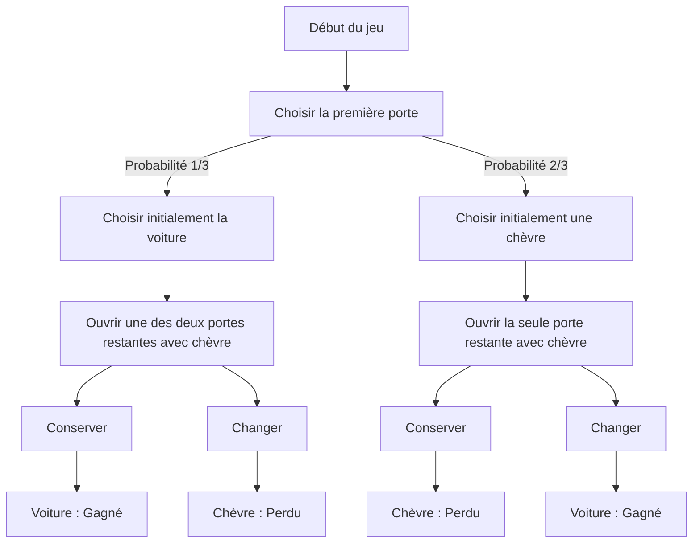
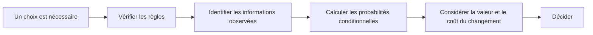

## 1. Préciser les règles avant d'examiner l'intuition

Vous choisissez une porte parmi trois. Le présentateur en ouvre une autre pour montrer une chèvre, puis vous demande si vous voulez passer à la porte restante. Le [problème de Monty Hall](https://kenji.blog/fr/p/monty-hall-problem/) illustre pourquoi le nombre d'options restantes ne détermine pas, à lui seul, leurs probabilités. [L'article de Gill](https://pub.math.leidenuniv.nl/~gillrd/montyhall3.pdf) examine son histoire, notamment le débat de 1990 dans la chronique « Ask Marilyn » de *Parade*, ainsi que différentes formulations mathématiques.

Définissons d'abord le modèle utilisé dans cet article.

1. Derrière les portes A, B et C se trouvent une voiture et deux chèvres. La position de la voiture suit une loi uniforme sur les trois portes. Vous choisissez initialement A sans utiliser d'information sur cette position.
2. Le présentateur sait où se trouve la voiture et n'ouvre ni A ni la porte de la voiture.
3. À chaque partie, il ouvre une porte non choisie cachant une chèvre et propose toujours de passer à l'autre porte non choisie qui reste fermée.
4. Lorsque la voiture est derrière A, il ouvre B ou C avec une probabilité de 1/2 pour chacune.

L'égalité des probabilités est une hypothèse sur le placement de la voiture, et non une conséquence de notre ignorance. Notons C_A, C_B et C_C les événements selon lesquels la voiture est derrière A, B et C respectivement.

$$
\Pr(C_A)=\Pr(C_B)=\Pr(C_C)=\frac13
$$

Dans ce modèle, la stratégie consistant à toujours changer gagne avec une probabilité de 2/3. Il faut toutefois distinguer la probabilité globale de réussite d'une stratégie de la probabilité conditionnelle après une observation particulière, telle que l'ouverture de B. Les règles du présentateur interviennent dans le fait que les deux calculs donnent ici 2/3.

Les mathématiques permettent d'identifier ce qui manque au raisonnement « il en reste deux, donc chacune a une probabilité de moitié ». Pourquoi une personne répond ainsi ou hésite à changer relève d'une autre question, qui demande des recherches psychologiques.

## 2. Étudier les cas et un million de portes

### Classer les cas selon la position initiale

Distinguons les cas selon la position initiale de la voiture, sans encore conditionner sur le nom de la porte ouverte.

| Position de la voiture, chacune de probabilité 1/3 | Porte ouverte par le présentateur | Conserver A | Changer |
| --- | --- | --- | --- |
| A | B ou C | Gagné | Perdu |
| B | C | Perdu | Gagné |
| C | B | Perdu | Gagné |

Puisque le présentateur élimine toujours une porte cachant une chèvre et propose de changer, changer fait gagner exactement lorsque la porte choisie initialement cachait une chèvre.

$$
\Pr(\mathrm{stay\ wins})=\frac13,\qquad\Pr(\mathrm{switch\ wins})=\frac23
$$

Ce sont des probabilités du modèle, pas une garantie de gagner exactement deux fois toutes les trois parties. Le diagramme représente des branches théoriques, et non des résultats expérimentaux.

### Davantage de portes exige aussi de préciser l'observation

Soit n un entier au moins égal à 3, avec des portes numérotées de 1 à n. La position C de la voiture est uniforme et le choix initial est fixé à 1. À chaque partie, le présentateur ouvre n−2 portes non choisies cachant des chèvres et propose de passer à la seule porte non choisie restante, R. Les probabilités globales sont :

$$
\Pr(C=1)=\frac1n,\qquad\Pr(C=R)=\frac{n-1}{n}
$$

Avec un million de portes, toujours changer fait gagner avec une probabilité de 999999/1000000.

Utiliser l'information selon laquelle R porte un numéro particulier r exige une règle supplémentaire. Ici, r est un numéro de 2 à n. Supposons que, chaque fois que la porte initiale cache la voiture, le présentateur choisisse R uniformément parmi les n−1 autres portes. Alors :

$$
\Pr(C=r\mid R=r)=\frac{1/n}{(1/n)+(1/n)(1/(n-1))}=\frac{n-1}{n}
$$

Selon cette règle symétrique, observer que la porte 777777 reste fermée parmi un million donne la même probabilité élevée. Mais si le présentateur laisse toujours ce même numéro fixe r lorsque la porte initiale cache la voiture, alors :

$$
\Pr(C=r\mid R=r)=\frac{1/n}{(1/n)+(1/n)}=\frac12
$$

Changer peut rester avantageux globalement, tandis que la probabilité après observation d'un numéro particulier varie. Ces calculs conditionnent uniquement sur R, sans information supplémentaire telle que l'ordre d'ouverture. Sans vérifier les règles, cet exemple ne permet pas d'affirmer que la porte restante cache presque certainement la voiture.

## 3. Appliquer le théorème de Bayes après une observation

Revenons au modèle à trois portes. Soit M_B l'événement selon lequel le présentateur ouvre B. Les règles de la section 1 donnent les vraisemblances suivantes :

$$
\Pr(M_B\mid C_A)=\frac12,\qquad\Pr(M_B\mid C_B)=0,\qquad\Pr(M_B\mid C_C)=1
$$

Le [théorème de Bayes](https://kenji.blog/fr/p/bayes-theorem/) donne :

$$
\Pr(C_i\mid M_B)=\frac{\Pr(M_B\mid C_i)\Pr(C_i)}{\sum_{j\in\{A,B,C\}}\Pr(M_B\mid C_j)\Pr(C_j)}
$$

D'après la formule des probabilités totales, le dénominateur est :

$$
\Pr(M_B)=\frac12\cdot\frac13+0\cdot\frac13+1\cdot\frac13=\frac12
$$

La probabilité a posteriori que la voiture soit derrière la porte initiale A est donc :

$$
\Pr(C_A\mid M_B)=\frac{(1/2)(1/3)}{1/2}=\frac13
$$

Et la probabilité a posteriori qu'elle soit derrière C, la porte vers laquelle vous changeriez, est :

$$
\Pr(C_C\mid M_B)=\frac{1\cdot(1/3)}{1/2}=\frac23
$$

L'événement selon lequel C cache la voiture avait une probabilité de 1/3 avant de conditionner sur M_B. Le passage à 2/3 après cette observation et l'explication « changer fait gagner lorsque le choix initial était mauvais » sont deux points de vue sur le même modèle.

Modifions seulement en q la probabilité d'ouvrir B lorsque la voiture est derrière A, en conservant les autres règles. Alors :

$$
q=\Pr(M_B\mid C_A),\quad0\le q\le1,\qquad\Pr(C_C\mid M_B)=\frac1{1+q}
$$

Par exemple, avec q égal à 1, la voiture a la même probabilité de se trouver derrière A ou C après l'ouverture de B. Même lorsque le présentateur sait où se trouve la voiture, sa préférence entre les portes cachant des chèvres intervient dans les probabilités conditionnelles.

Considérons maintenant un autre modèle : le présentateur ignore la position de la voiture et choisit B ou C avec une probabilité de 1/2 pour chacune, indépendamment de cette position. Il peut donc révéler la voiture. Soit U_B l'événement selon lequel ce présentateur ouvre B, et G celui selon lequel la porte ouverte révèle une chèvre. Après avoir observé à la fois l'ouverture de B et la présence d'une chèvre :

$$
\Pr(C_A\mid U_B\cap G)=\Pr(C_C\mid U_B\cap G)=\frac12
$$

Toujours montrer une chèvre et en montrer une par hasard sont des mécanismes d'observation différents. [L'article de Rosenthal](https://probability.ca/jeff/writing/montyfall.pdf) examine également des variantes du comportement du présentateur.

## 4. Séparer les hypothèses psychologiques des erreurs mathématiques

### Examiner le raisonnement d'équiprobabilité

Le fait de considérer les options restantes comme équiprobables est discuté en psychologie à travers des notions telles que l'heuristique d'équiprobabilité. Mais nous pouvons établir que « deux portes, donc moitié-moitié » ne correspond pas au modèle de la section 1 sans formuler d'explication causale du cerveau. Le calcul doit intégrer le processus qui a laissé ces portes fermées.

### Distinguer les connaissances du présentateur du mécanisme d'ouverture

Dire simplement « le présentateur n'ouvre pas au hasard » est inexact. Un présentateur informé peut encore choisir au hasard entre B et C lorsque la voiture est derrière A. Laisser C fermée ne signifie pas non plus qu'il ne pouvait pas l'ouvrir parce qu'elle cachait la voiture : si la voiture était derrière A, ouvrir C était possible. Il faut une règle de sélection précise, et pas seulement une supposition sur l'intention.

### Hésitation et regret anticipé

Comprendre une probabilité et choisir une action sont deux questions distinctes. Nous pouvons imaginer le sentiment « je regretterais d'avoir changé et perdu », mais cela n'explique pas le comportement de tout le monde. Affirmer que le maintien du statu quo ou l'évitement du regret sont des mécanismes cérébraux universels nécessite des données empiriques appropriées.

[Mazur et Kahlbaugh (2012)](https://pmc.ncbi.nlm.nih.gov/articles/PMC3435463/) ont comparé des choix répétés chez des pigeons, des étudiants et des enfants d'âge préscolaire. Dans les conditions de probabilité standard, les différences individuelles étaient importantes. Lorsque la probabilité de récompense après un changement était plus élevée, étudiants et pigeons changeaient davantage. Les auteurs soulignent la difficulté à distinguer les probabilités de récompense dans une tâche répétée. Celle-ci diffère d'un problème verbal posé une seule fois et ne démontre pas que tout le monde se trompe à cause du biais du statu quo.

Le diagramme suivant propose une procédure pour organiser le raisonnement. Il ne représente pas des causes psychologiques établies empiriquement.

## 5. Les applications exigent leurs propres modèles

### Un test hypothétique et les faux positifs

La sensibilité et la spécificité ne suffisent pas, à elles seules, à déterminer la probabilité après un résultat positif. Comme exemple de calcul, supposons une probabilité a priori de maladie p de 1/10000, une sensibilité s de 99 % et une spécificité t de 99 %. La sensibilité est la probabilité d'un résultat positif en présence de la maladie ; la spécificité est la probabilité d'un résultat négatif en son absence.

$$
p=\frac1{10000},\qquad s=\frac{99}{100},\qquad t=\frac{99}{100}
$$

Notons D l'événement selon lequel la maladie est présente, et + un résultat positif. Alors :

$$
\Pr(D\mid +)=\frac{sp}{sp+(1-t)(1-p)}=\frac{0.000099}{0.000099+0.009999}=\frac1{102}\approx0.009804
$$

Soit environ 0,98 %. Dans une population hypothétique de 10000 personnes, les effectifs attendus sont de 0,99 vrai positif et de 99,99 faux positifs. Les effectifs sont fractionnaires parce qu'il s'agit d'espérances, et non de patients observés.

Cet exemple découle des trois probabilités supposées. Il n'attribue pas une probabilité de 0,98 % à un test réel ou à une personne précise. Distinguer l'état de santé d'un résultat positif ou négatif est aussi essentiel pour interpréter la formule.

### Stratégie d'entreprise et critères au-delà de la probabilité de gagner

Les réactions du marché peuvent conduire à réexaminer une stratégie. Mais les marchés n'éliminent pas nécessairement une option vouée à l'échec selon une règle connue, et changer de stratégie ne donne pas une probabilité de réussite de 2/3. La concurrence et la collecte d'informations exigent chacune leur propre modèle.

Même dans le jeu, notons u_car et u_goat les utilités d'une voiture et d'une chèvre, et k le coût du changement, mesuré dans les mêmes unités d'utilité. Avec les probabilités de la section 1, la différence d'utilité espérée est :

$$
\mathrm{EU}(\mathrm{switch})-\mathrm{EU}(\mathrm{stay})=\frac{u_{\mathrm{car}}-u_{\mathrm{goat}}}{3}-k
$$

Maximiser la probabilité d'obtenir la voiture et maximiser la valeur après prise en compte des coûts sont deux objectifs distincts. Dans une décision réelle, il faut examiner la valeur des options, les coûts du changement et la manière dont l'information a été obtenue.

## 6. Conclusion : vérifier les hypothèses de l'intuition et du calcul

Le problème de Monty Hall permet de s'exercer à préciser comment une observation est produite, plutôt qu'à attribuer des probabilités en comptant les options. Les mathématiques donnent des conclusions dans un modèle défini. La psychologie examine empiriquement comment les personnes comprennent, apprennent et choisissent.

Après avoir reçu une information, identifiez ce qui a été observé, les règles qui ont produit cette observation et ce que vous voulez maximiser. Cette démarche peut aider, mais elle n'est pas une règle générale selon laquelle changer de choix double toujours les chances de réussite.
