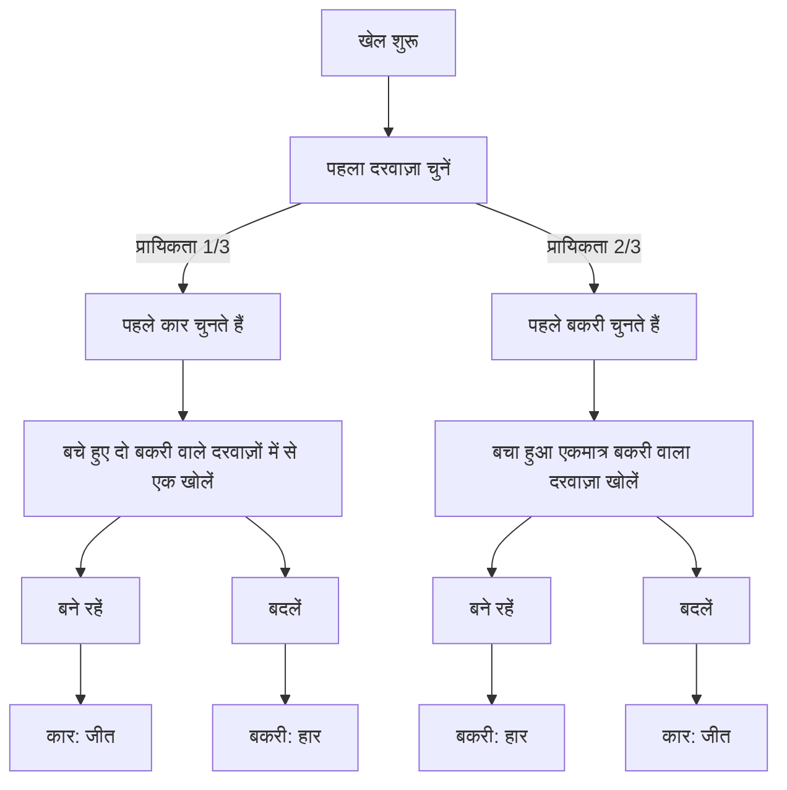
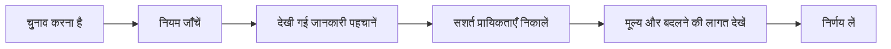

## 1. अंतर्ज्ञान पर विचार करने से पहले नियम स्पष्ट करें

आप तीन दरवाज़ों में से एक चुनते हैं। संचालक दूसरा दरवाज़ा खोलकर बकरी दिखाता है और पूछता है कि क्या आप बचे हुए दरवाज़े को चुनना चाहेंगे। [मोंटी हॉल समस्या](https://kenji.blog/hi/p/monty-hall-problem/) बताती है कि केवल बचे हुए विकल्पों की संख्या से उनकी प्रायिकताएँ तय नहीं होतीं। [Gill का शोधपत्र](https://pub.math.leidenuniv.nl/~gillrd/montyhall3.pdf) इसके इतिहास, जिसमें 1990 में *Parade* के “Ask Marilyn” स्तंभ की चर्चा शामिल है, और अलग-अलग गणितीय रूपों की जाँच करता है।

पहले इस लेख का मॉडल तय करते हैं।

1. A, B और C दरवाज़ों के पीछे एक कार और दो बकरियाँ हैं। कार का स्थान तीनों दरवाज़ों पर एकसमान वितरण का अनुसरण करता है। उसके स्थान की जानकारी का उपयोग किए बिना आप पहले A चुनते हैं।
2. संचालक कार का स्थान जानता है। वह न A खोलता है, न कार वाला दरवाज़ा।
3. हर खेल में वह न चुने गए किसी बकरी वाले दरवाज़े को खोलता है और हमेशा दूसरे, अब भी बंद और न चुने गए दरवाज़े पर बदलने का अवसर देता है।
4. कार A के पीछे हो तो वह B और C में से प्रत्येक को 1/2 की प्रायिकता से खोलता है।

समान प्रायिकताएँ कार के स्थान के बारे में एक मान्यता हैं; केवल स्थान न जानने से यह निष्कर्ष नहीं निकलता। C_A, C_B और C_C क्रमशः कार के A, B और C के पीछे होने की घटनाएँ हैं।

$$
\Pr(C_A)=\Pr(C_B)=\Pr(C_C)=\frac13
$$

इस मॉडल में हमेशा बदलने की रणनीति 2/3 प्रायिकता से जीतती है। लेकिन रणनीति की समग्र जीत की प्रायिकता और “B खोला गया” जैसे किसी विशेष अवलोकन के बाद की सशर्त प्रायिकता अलग गणनाएँ हैं। यहाँ दोनों के 2/3 होने में संचालक के नियमों की भूमिका है।

“दो विकल्प बचे हैं, इसलिए दोनों की प्रायिकता आधी है” वाले तर्क में कौन-सी मान्यता छूट गई है, यह गणित से जाँचा जा सकता है। कोई व्यक्ति ऐसा उत्तर क्यों देता है या बदलने से क्यों हिचकता है, यह मनोवैज्ञानिक शोध का अलग प्रश्न है।

## 2. मामलों की तुलना और दस लाख दरवाज़े

### शुरुआती स्थान के अनुसार मामले बाँटें

अभी खुले दरवाज़े के नाम पर शर्त लगाए बिना, कार के शुरुआती स्थान के अनुसार मामले बाँटते हैं।

| कार का स्थान, प्रत्येक की प्रायिकता 1/3 | संचालक कौन-सा दरवाज़ा खोलता है | A पर बने रहें | बदलें |
| --- | --- | --- | --- |
| A | B या C | जीत | हार |
| B | C | हार | जीत |
| C | B | हार | जीत |

संचालक हमेशा बकरी वाला दरवाज़ा हटाता है और बदलने का अवसर देता है। इसलिए बदलकर जीतना ठीक उसी स्थिति में होता है जब पहले चुने गए दरवाज़े के पीछे बकरी हो।

$$
\Pr(\mathrm{stay\ wins})=\frac13,\qquad\Pr(\mathrm{switch\ wins})=\frac23
$$

ये मॉडल की प्रायिकताएँ हैं, हर तीन खेलों में ठीक दो जीत की गारंटी नहीं। चित्र सैद्धांतिक शाखाएँ दिखाता है, प्रयोग के परिणाम नहीं।

### दरवाज़े अधिक हों तब भी अवलोकन स्पष्ट करें

n कम-से-कम 3 वाला पूर्णांक हो और दरवाज़ों के क्रमांक 1 से n तक हों। कार का स्थान C एकसमान वितरित है और पहली पसंद 1 पर निश्चित है। हर खेल में संचालक न चुने गए n−2 बकरी वाले दरवाज़े खोलता है और न चुने गए एकमात्र बचे दरवाज़े R पर बदलने का अवसर देता है। समग्र प्रायिकताएँ हैं:

$$
\Pr(C=1)=\frac1n,\qquad\Pr(C=R)=\frac{n-1}{n}
$$

दस लाख दरवाज़े होने पर हमेशा बदलने की रणनीति की जीत की प्रायिकता 999999/1000000 है।

लेकिन “बचे दरवाज़े का क्रमांक R कोई खास r था” वाली जानकारी के उपयोग के लिए एक और नियम चाहिए। यहाँ r, 2 से n तक के क्रमांकों में से एक है। मानें कि पहले चुने गए दरवाज़े के पीछे कार होने पर संचालक बाकी n−1 दरवाज़ों में से R को समान प्रायिकता से चुनता है। तब:

$$
\Pr(C=r\mid R=r)=\frac{1/n}{(1/n)+(1/n)(1/(n-1))}=\frac{n-1}{n}
$$

इस सममित नियम के अंतर्गत दस लाख में से 777777 क्रमांक वाला दरवाज़ा बंद बचने का अवलोकन भी वही ऊँची प्रायिकता देता है। लेकिन अगर पहले चुने गए दरवाज़े के पीछे कार होने पर संचालक हमेशा उसी निश्चित क्रमांक r को छोड़ता है, तो:

$$
\Pr(C=r\mid R=r)=\frac{1/n}{(1/n)+(1/n)}=\frac12
$$

समग्र रूप से बदलना लाभदायक रह सकता है, फिर भी किसी खास क्रमांक को देखने के बाद की प्रायिकता बदल सकती है। यहाँ शर्त में केवल R शामिल है, दरवाज़े खोलने का क्रम जैसी अतिरिक्त जानकारी नहीं। नियम जाँचे बिना यह नहीं कहा जा सकता कि बचे दरवाज़े के पीछे लगभग निश्चित रूप से कार है।

## 3. अवलोकन के बाद बेज़ का प्रमेय लगाएँ

तीन दरवाज़ों के मॉडल पर लौटें। M_B, संचालक द्वारा B खोलने की घटना हो। खंड 1 के नियमों से लाइकलीहुड हैं:

$$
\Pr(M_B\mid C_A)=\frac12,\qquad\Pr(M_B\mid C_B)=0,\qquad\Pr(M_B\mid C_C)=1
$$

[बेज़ का प्रमेय](https://kenji.blog/hi/p/bayes-theorem/) देता है:

$$
\Pr(C_i\mid M_B)=\frac{\Pr(M_B\mid C_i)\Pr(C_i)}{\sum_{j\in\{A,B,C\}}\Pr(M_B\mid C_j)\Pr(C_j)}
$$

कुल प्रायिकता के नियम से सूत्र का हर इस प्रकार मिलता है:

$$
\Pr(M_B)=\frac12\cdot\frac13+0\cdot\frac13+1\cdot\frac13=\frac12
$$

इसलिए पहले चुने गए A के पीछे कार होने की पश्च प्रायिकता है:

$$
\Pr(C_A\mid M_B)=\frac{(1/2)(1/3)}{1/2}=\frac13
$$

और बदलकर चुने जाने वाले C के पीछे कार होने की पश्च प्रायिकता है:

$$
\Pr(C_C\mid M_B)=\frac{1\cdot(1/3)}{1/2}=\frac23
$$

M_B पर शर्त लगाने से पहले कार के C के पीछे होने की प्रायिकता 1/3 थी। अवलोकन के बाद उसका 2/3 होना और “पहली पसंद गलत हो तो बदलने से जीत होती है” वाला रणनीतिक तर्क, एक ही मॉडल के अलग दृष्टिकोण हैं।

कार A के पीछे होने पर B खोलने की प्रायिकता को ही q करें और बाकी नियम समान रखें। तब:

$$
q=\Pr(M_B\mid C_A),\quad0\le q\le1,\qquad\Pr(C_C\mid M_B)=\frac1{1+q}
$$

उदाहरण के लिए q बराबर 1 हो तो B खुलने के बाद कार के A और C के पीछे होने की प्रायिकता समान होती है। संचालक कार का स्थान जानता हो तब भी बकरी वाले दरवाज़ों में उसकी पसंद सशर्त प्रायिकता को प्रभावित करती है।

अब दूसरा मॉडल लें: संचालक कार का स्थान नहीं जानता और उस स्थान से स्वतंत्र रूप से B या C में से प्रत्येक को 1/2 प्रायिकता से चुनकर खोलता है। इससे कार भी दिख सकती है। U_B इस संचालक द्वारा B खोलने की घटना हो और G खुले दरवाज़े के पीछे बकरी होने की घटना। “B खोला गया और बकरी दिखाई दी” दोनों बातें देखने के बाद:

$$
\Pr(C_A\mid U_B\cap G)=\Pr(C_C\mid U_B\cap G)=\frac12
$$

हमेशा बकरी दिखाने का नियम और संयोग से बकरी दिखने का अवलोकन अलग तंत्र हैं। [Rosenthal का शोधपत्र](https://probability.ca/jeff/writing/montyfall.pdf) भी संचालक के व्यवहार के अलग रूपों पर विचार करता है।

## 4. मनोवैज्ञानिक परिकल्पनाओं और गणितीय त्रुटियों में अंतर करें

### समान प्रायिकता वाले तर्क को जाँचें

बचे विकल्पों को समान प्रायिकता वाला मानने पर मनोविज्ञान में समान प्रायिकता ह्युरिस्टिक जैसे विचारों के अंतर्गत चर्चा होती है। फिर भी मस्तिष्क के बारे में कोई कारणात्मक दावा किए बिना जाँचा जा सकता है कि “दो दरवाज़े, इसलिए आधा-आधा” खंड 1 के मॉडल से मेल नहीं खाता। गणना में उस प्रक्रिया को शामिल करना होगा जिससे ये दरवाज़े बंद बचे।

### संचालक की जानकारी और खोलने के तरीके को अलग रखें

केवल “संचालक यादृच्छिक ढंग से नहीं खोलता” कहना सही नहीं है। कार A के पीछे हो तो जानकार संचालक भी B और C में से यादृच्छिक चुनाव कर सकता है। C बंद छोड़ने का अर्थ यह भी नहीं कि कार होने के कारण वह उसे खोल नहीं सकता था: कार A के पीछे हो तो C खोलना संभव था। केवल इरादे का अनुमान नहीं, एक स्पष्ट चयन नियम चाहिए।

### हिचकिचाहट और संभावित पछतावा

प्रायिकता समझना और कार्रवाई चुनना अलग प्रश्न हैं। हम कल्पना कर सकते हैं कि “बदलकर हारने पर मुझे पछतावा होगा”, लेकिन इससे सबके व्यवहार का कारण नहीं समझाया जाता। यथास्थिति बनाए रखने या पछतावे से बचने को सार्वभौमिक मस्तिष्क तंत्र कहने के लिए उपयुक्त अनुभवजन्य प्रमाण चाहिए।

[Mazur और Kahlbaugh (2012)](https://pmc.ncbi.nlm.nih.gov/articles/PMC3435463/) ने कबूतरों, विश्वविद्यालय के विद्यार्थियों और विद्यालय-पूर्व आयु के बच्चों के बार-बार किए गए चुनावों की तुलना की। मानक प्रायिकता स्थितियों में प्रत्येक समूह में बड़े व्यक्तिगत अंतर थे। बदलने पर पुरस्कार की प्रायिकता अधिक होने की स्थितियों में विद्यार्थियों और कबूतरों ने अधिक बार बदला। लेखकों ने दोहराए गए कार्यों में पुरस्कार की प्रायिकताओं का अंतर पहचानने की कठिनाई पर चर्चा की। ये परिस्थितियाँ लिखित समस्या का केवल एक बार उत्तर देने से अलग हैं और यह सिद्ध नहीं करतीं कि सभी यथास्थिति पूर्वाग्रह के कारण गलत होते हैं।

अगला चित्र तर्क को व्यवस्थित करने की प्रस्तावित प्रक्रिया है। यह अनुभवजन्य रूप से स्थापित मनोवैज्ञानिक कारण नहीं दिखाता।

## 5. व्यावहारिक उपयोग के लिए अलग मॉडल चाहिए

### काल्पनिक जाँच और गलत धनात्मक परिणाम

केवल संवेदनशीलता और विशिष्टता से धनात्मक परिणाम के बाद की प्रायिकता तय नहीं होती। गणना के उदाहरण के लिए मानें कि रोग की पूर्व प्रायिकता p, 1/10000 है, संवेदनशीलता s, 99% है और विशिष्टता t, 99% है। संवेदनशीलता रोग होने पर धनात्मक परिणाम की प्रायिकता है; विशिष्टता रोग न होने पर ऋणात्मक परिणाम की प्रायिकता है।

$$
p=\frac1{10000},\qquad s=\frac{99}{100},\qquad t=\frac{99}{100}
$$

D रोग होने की घटना और + धनात्मक परिणाम हो। तब:

$$
\Pr(D\mid +)=\frac{sp}{sp+(1-t)(1-p)}=\frac{0.000099}{0.000099+0.009999}=\frac1{102}\approx0.009804
$$

यह लगभग 0.98% है। काल्पनिक 10000 व्यक्तियों में सही धनात्मक परिणामों की अपेक्षित संख्या 0.99 और गलत धनात्मक परिणामों की अपेक्षित संख्या 99.99 है। संख्याएँ दशमलव में इसलिए हैं कि ये अपेक्षित मान हैं, वास्तव में देखे गए रोगियों की गिनती नहीं।

यह उदाहरण मानी गई तीन प्रायिकताओं से निकलता है। यह किसी वास्तविक जाँच या व्यक्ति के लिए रोग की प्रायिकता 0.98% तय नहीं करता। रोग की मौजूदगी या गैरमौजूदगी को धनात्मक या ऋणात्मक जाँच परिणाम से अलग रखना सूत्र समझने के लिए भी जरूरी है।

### व्यावसायिक रणनीति और जीत की प्रायिकता से आगे के मानदंड

बाजार की प्रतिक्रिया देखकर रणनीति पर फिर विचार किया जा सकता है। लेकिन बाजार जरूरी नहीं कि किसी ज्ञात नियम से हमेशा एक असफल विकल्प हटा दे, और रणनीति बदलने की सफलता की प्रायिकता इससे 2/3 नहीं हो जाती। प्रतिस्पर्धा और जानकारी जुटाने के लिए अपने अलग मॉडल चाहिए।

खेल में भी कार और बकरी की उपयोगिताएँ क्रमशः u_car और u_goat मानें। बदलने की लागत k भी उन्हीं उपयोगिता इकाइयों में मापी जाए। खंड 1 की प्रायिकताओं से अपेक्षित उपयोगिताओं का अंतर है:

$$
\mathrm{EU}(\mathrm{switch})-\mathrm{EU}(\mathrm{stay})=\frac{u_{\mathrm{car}}-u_{\mathrm{goat}}}{3}-k
$$

कार पाने की प्रायिकता अधिकतम करना और लागत घटाने के बाद का मूल्य अधिकतम करना अलग लक्ष्य हैं। वास्तविक निर्णय में विकल्पों का मूल्य, बदलने की लागत और जानकारी मिलने का तरीका देखना होगा।

## 6. निष्कर्ष: अंतर्ज्ञान और गणना, दोनों की मान्यताएँ जाँचें

मोंटी हॉल समस्या केवल विकल्पों की संख्या गिनकर प्रायिकता बाँटने के बजाय अवलोकन पैदा होने की प्रक्रिया को स्पष्ट करने का अभ्यास है। गणित तय मॉडल के भीतर निष्कर्ष देता है। मनोविज्ञान अनुभवजन्य रूप से जाँचता है कि लोग कैसे समझते, सीखते और चुनते हैं।

नई जानकारी मिलने पर पहचानें कि क्या देखा गया, किन नियमों से वह अवलोकन उत्पन्न हुआ और आप क्या अधिकतम करना चाहते हैं। यह तरीका उपयोगी हो सकता है, लेकिन “चुनाव बदलने से सफलता हमेशा दोगुनी होती है” जैसा सामान्य नियम नहीं है।
