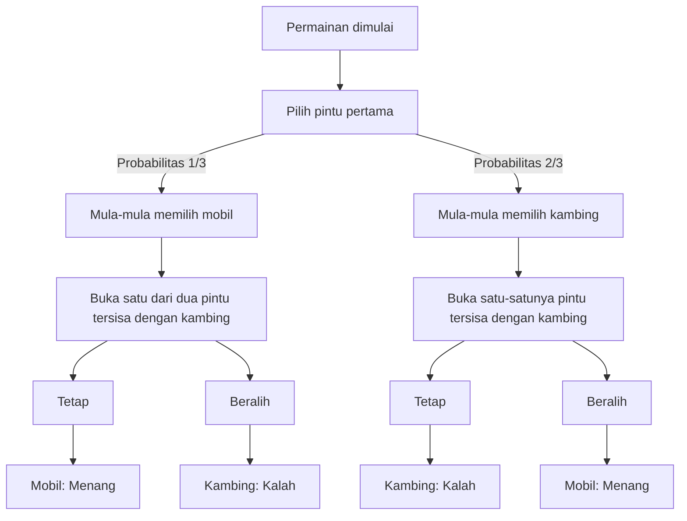
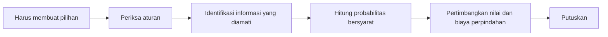

## 1. Tetapkan aturan sebelum membahas intuisi

Anda memilih satu dari tiga pintu. Pembawa acara membuka pintu lain untuk menunjukkan kambing, lalu bertanya apakah Anda ingin beralih ke pintu yang tersisa. [Masalah Monty Hall](https://kenji.blog/id/p/monty-hall-problem/) menunjukkan mengapa jumlah pilihan yang tersisa saja tidak menentukan probabilitasnya. [Makalah Gill](https://pub.math.leidenuniv.nl/~gillrd/montyhall3.pdf) membahas sejarahnya, termasuk perdebatan tahun 1990 dalam kolom “Ask Marilyn” di *Parade*, serta berbagai perumusan matematis.

Pertama, kita tetapkan model yang digunakan di sini.

1. Di belakang pintu A, B, dan C terdapat satu mobil dan dua kambing. Posisi mobil berdistribusi seragam di antara ketiga pintu. Anda mula-mula memilih A tanpa menggunakan informasi tentang posisi itu.
2. Pembawa acara mengetahui posisi mobil dan tidak membuka A maupun pintu yang menyembunyikan mobil.
3. Pada setiap permainan, ia membuka satu pintu yang tidak dipilih, dengan seekor kambing di belakangnya, serta selalu menawarkan perpindahan ke satu-satunya pintu lain yang tidak dipilih dan masih tertutup.
4. Jika mobil berada di belakang A, ia membuka B atau C dengan probabilitas masing-masing 1/2.

Probabilitas yang sama merupakan asumsi tentang penempatan mobil, bukan kesimpulan dari ketidaktahuan kita. C_A, C_B, dan C_C menyatakan kejadian mobil berada di belakang A, B, dan C.

$$
\Pr(C_A)=\Pr(C_B)=\Pr(C_C)=\frac13
$$

Dalam model ini, strategi selalu beralih menang dengan probabilitas 2/3. Namun, probabilitas kemenangan strategi secara keseluruhan berbeda dari probabilitas bersyarat setelah pengamatan tertentu, misalnya B dibuka. Aturan pembawa acara berperan dalam menghasilkan nilai 2/3 pada kedua perhitungan tersebut.

Matematika dapat menguji asumsi yang hilang dari penalaran “tersisa dua, jadi masing-masing setengah”. Mengapa seseorang menjawab demikian atau ragu beralih merupakan pertanyaan berbeda yang memerlukan penelitian psikologis.

## 2. Analisis kasus dan satu juta pintu

### Pisahkan kasus menurut posisi awal

Kita membedakan kasus menurut posisi awal mobil, tanpa lebih dahulu menjadikan nama pintu yang dibuka sebagai syarat.

| Posisi mobil, masing-masing berprobabilitas 1/3 | Pintu yang dibuka pembawa acara | Tetap di A | Beralih |
| --- | --- | --- | --- |
| A | B atau C | Menang | Kalah |
| B | C | Kalah | Menang |
| C | B | Kalah | Menang |

Karena pembawa acara selalu menyingkirkan satu pintu dengan kambing dan menawarkan perpindahan, beralih menang tepat ketika pintu yang dipilih pertama kali menyembunyikan kambing.

$$
\Pr(\mathrm{stay\ wins})=\frac13,\qquad\Pr(\mathrm{switch\ wins})=\frac23
$$

Ini adalah probabilitas dalam model, bukan jaminan menang tepat dua kali dalam setiap tiga permainan. Diagram memperlihatkan cabang teoretis, bukan hasil eksperimen.

### Lebih banyak pintu tetap memerlukan pengamatan yang jelas

Misalkan n adalah bilangan bulat minimal 3, dengan pintu bernomor 1 sampai n. Posisi mobil C berdistribusi seragam dan pilihan awal ditetapkan pada 1. Setiap kali, pembawa acara membuka n−2 pintu yang tidak dipilih, yang masing-masing memiliki kambing di belakangnya, lalu menawarkan perpindahan ke satu-satunya pintu tidak dipilih yang tersisa, R. Probabilitas keseluruhannya adalah:

$$
\Pr(C=1)=\frac1n,\qquad\Pr(C=R)=\frac{n-1}{n}
$$

Dengan satu juta pintu, strategi selalu beralih menang dengan probabilitas 999999/1000000.

Untuk menggunakan informasi bahwa R memiliki nomor tertentu r, diperlukan aturan tambahan. Di sini r adalah salah satu nomor dari 2 sampai n. Anggap bahwa setiap kali mobil berada di belakang pintu pilihan awal, pembawa acara memilih R secara seragam di antara n−1 pintu lainnya. Maka:

$$
\Pr(C=r\mid R=r)=\frac{1/n}{(1/n)+(1/n)(1/(n-1))}=\frac{n-1}{n}
$$

Dengan aturan simetris ini, pengamatan bahwa pintu 777777 tetap tertutup di antara satu juta pintu memberikan probabilitas tinggi yang sama. Tetapi jika pembawa acara selalu menyisakan nomor tetap r tersebut ketika mobil berada di belakang pintu awal, maka:

$$
\Pr(C=r\mid R=r)=\frac{1/n}{(1/n)+(1/n)}=\frac12
$$

Beralih bisa tetap menguntungkan secara keseluruhan, sementara probabilitas setelah mengamati nomor tertentu berubah. Perhitungan ini hanya menggunakan pengamatan nomor R sebagai syarat, tanpa informasi tambahan seperti urutan pembukaan. Tanpa memeriksa aturan, contoh ini tidak membenarkan pernyataan bahwa pintu tersisa hampir pasti menyembunyikan mobil.

## 3. Gunakan teorema Bayes setelah suatu pengamatan

Kembali ke model tiga pintu, misalkan M_B adalah kejadian pembawa acara membuka B. Aturan pada bagian 1 memberikan likelihood berikut:

$$
\Pr(M_B\mid C_A)=\frac12,\qquad\Pr(M_B\mid C_B)=0,\qquad\Pr(M_B\mid C_C)=1
$$

[Teorema Bayes](https://kenji.blog/id/p/bayes-theorem/) memberikan:

$$
\Pr(C_i\mid M_B)=\frac{\Pr(M_B\mid C_i)\Pr(C_i)}{\sum_{j\in\{A,B,C\}}\Pr(M_B\mid C_j)\Pr(C_j)}
$$

Menurut hukum probabilitas total, penyebutnya adalah:

$$
\Pr(M_B)=\frac12\cdot\frac13+0\cdot\frac13+1\cdot\frac13=\frac12
$$

Jadi, probabilitas posterior mobil berada di belakang pintu awal A adalah:

$$
\Pr(C_A\mid M_B)=\frac{(1/2)(1/3)}{1/2}=\frac13
$$

Probabilitas posterior mobil berada di belakang C, tujuan perpindahan Anda, adalah:

$$
\Pr(C_C\mid M_B)=\frac{1\cdot(1/3)}{1/2}=\frac23
$$

Sebelum menggunakan M_B sebagai syarat, kejadian mobil berada di belakang C memiliki probabilitas 1/3. Perubahannya menjadi 2/3 setelah pengamatan dan penjelasan “beralih menang ketika pilihan awal salah” adalah sudut pandang berbeda terhadap model yang sama.

Ubah hanya probabilitas membuka B ketika mobil berada di belakang A menjadi q, dan pertahankan aturan lainnya. Maka:

$$
q=\Pr(M_B\mid C_A),\quad0\le q\le1,\qquad\Pr(C_C\mid M_B)=\frac1{1+q}
$$

Misalnya, jika q sama dengan 1, setelah B dibuka mobil memiliki probabilitas sama untuk berada di belakang A atau C. Meskipun pembawa acara mengetahui posisi mobil, preferensinya di antara pintu dengan kambing memengaruhi probabilitas bersyarat.

Sekarang pertimbangkan model lain: pembawa acara tidak mengetahui posisi mobil dan memilih B atau C dengan probabilitas masing-masing 1/2, secara independen dari posisi itu. Mobil bisa ikut terungkap. Misalkan U_B adalah kejadian pembawa acara ini membuka B, dan G adalah kejadian pintu yang dibuka menunjukkan kambing. Setelah mengamati bahwa B dibuka dan kambing terlihat:

$$
\Pr(C_A\mid U_B\cap G)=\Pr(C_C\mid U_B\cap G)=\frac12
$$

Selalu menunjukkan kambing dan kebetulan menunjukkan kambing merupakan mekanisme pengamatan yang berbeda. [Makalah Rosenthal](https://probability.ca/jeff/writing/montyfall.pdf) juga membahas variasi perilaku pembawa acara.

## 4. Bedakan hipotesis psikologis dari kesalahan matematis

### Periksa kesimpulan tentang probabilitas yang sama

Menganggap pilihan tersisa memiliki probabilitas sama dibahas dalam psikologi melalui konsep seperti heuristik ekuiprobabilitas. Namun, kita dapat memastikan bahwa “dua pintu, jadi masing-masing setengah” tidak sesuai dengan model bagian 1 tanpa membuat klaim sebab-akibat tentang otak. Perhitungan perlu memasukkan proses yang membuat pintu-pintu itu tetap tertutup.

### Pisahkan pengetahuan pembawa acara dari mekanisme pembukaan

Mengatakan hanya bahwa “pembawa acara tidak membuka secara acak” tidaklah tepat. Pembawa acara yang mengetahui posisi mobil tetap bisa memilih B atau C secara acak ketika mobil berada di belakang A. Membiarkan C tertutup juga tidak berarti ia tidak dapat membukanya karena ada mobil di sana: jika mobil berada di belakang A, C juga bisa dibuka. Yang diperlukan adalah aturan pemilihan yang konkret, bukan sekadar dugaan tentang niat.

### Keraguan dan penyesalan yang dibayangkan

Memahami probabilitas dan memilih tindakan adalah pertanyaan berbeda. Kita dapat membayangkan perasaan “saya akan menyesal jika beralih lalu kalah”, tetapi ini tidak menjelaskan perilaku semua orang. Klaim bahwa mempertahankan status quo atau menghindari penyesalan merupakan mekanisme otak universal memerlukan bukti empiris yang sesuai.

[Mazur dan Kahlbaugh (2012)](https://pmc.ncbi.nlm.nih.gov/articles/PMC3435463/) membandingkan pilihan berulang pada merpati, mahasiswa, dan anak usia prasekolah. Pada kondisi probabilitas standar terdapat perbedaan individu yang besar. Ketika probabilitas imbalan untuk beralih lebih tinggi, mahasiswa dan merpati lebih sering beralih. Penulis membahas kesulitan membedakan probabilitas imbalan dalam tugas berulang. Ini berbeda dari menjawab soal verbal sekali saja dan tidak membuktikan bahwa semua orang salah karena bias status quo.

Diagram berikut adalah prosedur yang diusulkan untuk menata penalaran. Diagram ini tidak menunjukkan penyebab psikologis yang telah dibuktikan secara empiris.

## 5. Penerapan memerlukan model tersendiri

### Tes hipotetis dan positif palsu

Sensitivitas dan spesifisitas saja tidak menentukan probabilitas setelah hasil positif. Sebagai contoh perhitungan, anggap probabilitas prior penyakit p adalah 1/10000, sensitivitas s adalah 99%, dan spesifisitas t adalah 99%. Sensitivitas adalah probabilitas hasil positif jika penyakit ada; spesifisitas adalah probabilitas hasil negatif jika penyakit tidak ada.

$$
p=\frac1{10000},\qquad s=\frac{99}{100},\qquad t=\frac{99}{100}
$$

Misalkan D adalah kejadian penyakit ada, dan + adalah hasil positif. Maka:

$$
\Pr(D\mid +)=\frac{sp}{sp+(1-t)(1-p)}=\frac{0.000099}{0.000099+0.009999}=\frac1{102}\approx0.009804
$$

Hasilnya sekitar 0,98%. Dalam populasi hipotetis sebanyak 10000 orang, jumlah yang diharapkan adalah 0,99 positif benar dan 99,99 positif palsu. Jumlah itu berupa pecahan karena merupakan nilai harapan, bukan jumlah pasien yang benar-benar diamati.

Contoh ini mengikuti tiga probabilitas yang diasumsikan. Contoh ini tidak menetapkan probabilitas penyakit sebesar 0,98% untuk tes nyata atau individu tertentu. Membedakan ada-tidaknya penyakit dari hasil tes positif atau negatif juga penting untuk memahami rumus.

### Strategi perusahaan dan kriteria selain probabilitas menang

Reaksi pasar dapat mendorong peninjauan strategi. Namun, pasar tidak selalu menghapus satu pilihan yang gagal menurut aturan yang diketahui, dan perubahan strategi tidak otomatis memiliki probabilitas sukses 2/3. Persaingan dan pengumpulan informasi memerlukan model masing-masing.

Bahkan dalam permainan, misalkan utilitas mobil dan kambing masing-masing u_car dan u_goat. Biaya perpindahan k diukur dalam satuan utilitas yang sama. Dengan probabilitas bagian 1, selisih nilai harapan utilitas adalah:

$$
\mathrm{EU}(\mathrm{switch})-\mathrm{EU}(\mathrm{stay})=\frac{u_{\mathrm{car}}-u_{\mathrm{goat}}}{3}-k
$$

Memaksimalkan probabilitas memperoleh mobil dan memaksimalkan nilai setelah biaya merupakan tujuan berbeda. Keputusan nyata perlu mempertimbangkan nilai pilihan, biaya perubahan, dan bagaimana informasi diperoleh.

## 6. Penutup: periksa asumsi di balik intuisi dan perhitungan

Masalah Monty Hall melatih kita menjelaskan mekanisme yang menghasilkan pengamatan, bukan menentukan probabilitas hanya dengan menghitung pilihan. Matematika memberikan kesimpulan dalam model yang ditetapkan. Psikologi mempelajari secara empiris bagaimana orang memahami, belajar, dan memilih.

Ketika memperoleh informasi baru, tentukan apa yang diamati, aturan apa yang menghasilkan pengamatan tersebut, dan apa yang ingin Anda maksimalkan. Langkah ini bisa membantu, tetapi bukan aturan umum bahwa mengubah pilihan selalu melipatgandakan keberhasilan.
