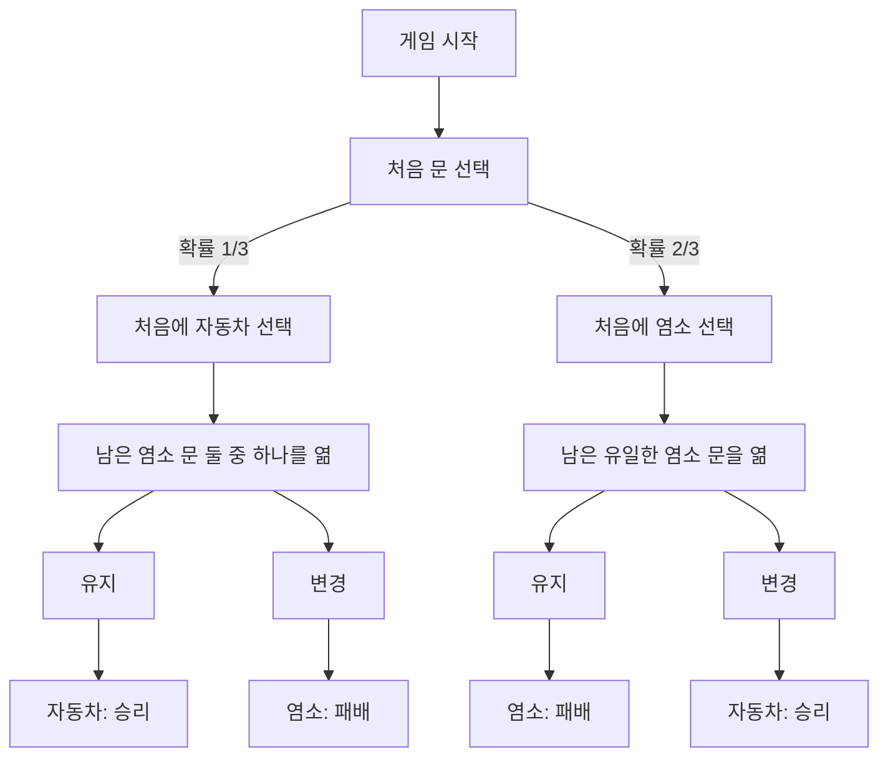
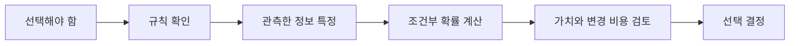

## 1. 직관을 살펴보기 전에 규칙부터 정하기

세 문 중 하나를 고르면 진행자가 다른 문을 열어 염소를 보여 주고, 남은 문으로 바꿀지 묻습니다. [몬티 홀 문제](https://kenji.blog/ko/p/monty-hall-problem/)는 남은 선택지의 개수만으로 확률을 정할 수 없다는 점을 생각하게 합니다. [Gill의 논문](https://pub.math.leidenuniv.nl/~gillrd/montyhall3.pdf)은 1990년 *Parade*의 ‘Ask Marilyn’ 칼럼을 둘러싼 논의를 포함한 역사와 여러 수학적 정식화를 다룹니다.

먼저 이 글에서 사용할 모형을 명시하겠습니다.

1. A, B, C 중 한 문 뒤에는 자동차가, 나머지 두 문 뒤에는 염소가 있습니다. 자동차의 위치는 세 문에 대해 균등분포를 따릅니다. 그 위치에 관한 정보를 이용하지 않고 처음에 A를 고릅니다.
2. 진행자는 자동차의 위치를 알고 있으며 A와 자동차가 있는 문은 열지 않습니다.
3. 매번 선택하지 않은 염소 문 하나를 열고, 선택하지 않았고 아직 닫혀 있는 다른 문으로 바꿀 기회를 반드시 줍니다.
4. 자동차가 A 뒤에 있으면 B와 C를 각각 확률 1/2로 엽니다.

같은 확률이라는 것은 자동차의 배치에 관한 가정입니다. 위치를 모른다는 이유만으로 나오는 결론이 아닙니다. 자동차가 A, B, C 뒤에 있는 사건을 각각 C_A, C_B, C_C로 씁니다.

$$
\Pr(C_A)=\Pr(C_B)=\Pr(C_C)=\frac13
$$

이 모형에서 항상 바꾸는 전략은 확률 2/3로 이깁니다. 다만 전략의 전체 승률과 ‘B가 열렸다’는 특정 관측 뒤의 조건부 확률은 구분해야 합니다. 여기서 두 계산이 모두 2/3이 되는 데에는 위의 진행자 규칙이 관련됩니다.

‘두 개가 남았으니 반반’이라는 추론에 어떤 전제가 빠졌는지는 수학으로 검토할 수 있습니다. 사람이 왜 그렇게 답하거나 변경을 망설이는지는 심리학 연구가 필요한 별개의 질문입니다.

## 2. 경우 나누기와 백만 개의 문

### 처음 배치에 따라 나누기

아직 열린 문의 이름을 조건으로 삼지 않고, 자동차의 처음 위치로 나눕니다.

| 자동차 위치, 각각 확률 1/3 | 진행자가 여는 문 | A 유지 | 변경 |
| --- | --- | --- | --- |
| A | B 또는 C | 승리 | 패배 |
| B | C | 패배 | 승리 |
| C | B | 패배 | 승리 |

진행자가 항상 염소 문 하나를 제외하고 변경을 제안하므로, 바꿔서 이기는 경우는 처음에 염소를 고른 경우와 정확히 같습니다.

$$
\Pr(\mathrm{stay\ wins})=\frac13,\qquad\Pr(\mathrm{switch\ wins})=\frac23
$$

이는 모형 안의 확률이지, 세 번마다 정확히 두 번 이긴다는 보장이 아닙니다. 그림은 이론적 분기를 나타내며 실험 결과가 아닙니다.

### 문이 많아져도 관측한 정보를 명시하기

n은 3 이상의 정수이고 문 번호는 1부터 n까지라고 합시다. 자동차 위치 C는 균등분포를 따르고 처음 선택은 1로 고정합니다. 진행자는 매번 선택하지 않은 염소 문 n−2개를 열고, 선택하지 않은 문 중 유일하게 닫혀 있는 문 R로 바꿀 기회를 줍니다. 전체 확률은 다음과 같습니다.

$$
\Pr(C=1)=\frac1n,\qquad\Pr(C=R)=\frac{n-1}{n}
$$

문이 백만 개라면 항상 바꾸는 전략의 승률은 999999/1000000입니다.

하지만 남은 문 번호 R이 특정 번호 r이었다는 정보를 이용하려면 규칙이 하나 더 필요합니다. r은 2부터 n까지 중 한 번호입니다. 처음 선택한 문 뒤에 자동차가 있을 때 진행자가 나머지 n−1개에서 R을 균등하게 고른다고 가정하면 다음과 같습니다.

$$
\Pr(C=r\mid R=r)=\frac{1/n}{(1/n)+(1/n)(1/(n-1))}=\frac{n-1}{n}
$$

이 대칭적 규칙에서는 백만 개 중 777777번 문이 남았다고 관측해도 같은 높은 확률을 얻습니다. 그러나 처음 선택한 문 뒤에 자동차가 있을 때 진행자가 항상 동일한 고정 번호 r을 남기는 규칙이라면 다음과 같습니다.

$$
\Pr(C=r\mid R=r)=\frac{1/n}{(1/n)+(1/n)}=\frac12
$$

전체적으로는 변경이 유리하더라도 특정 번호를 관측한 뒤의 확률은 달라질 수 있습니다. 여기서는 남은 번호 R만 조건으로 삼으며, 문이 열린 순서 같은 추가 정보는 포함하지 않습니다. 규칙을 확인하지 않고 ‘남은 문에는 거의 확실히 자동차가 있다’고 해석할 수는 없습니다.

## 3. 베이즈 정리로 관측 뒤의 확률 계산하기

세 문 모형으로 돌아가 M_B를 진행자가 B를 여는 사건이라고 합시다. 1절의 규칙에 따른 우도는 다음과 같습니다.

$$
\Pr(M_B\mid C_A)=\frac12,\qquad\Pr(M_B\mid C_B)=0,\qquad\Pr(M_B\mid C_C)=1
$$

[베이즈 정리](https://kenji.blog/ko/p/bayes-theorem/)를 사용하면 다음을 얻습니다.

$$
\Pr(C_i\mid M_B)=\frac{\Pr(M_B\mid C_i)\Pr(C_i)}{\sum_{j\in\{A,B,C\}}\Pr(M_B\mid C_j)\Pr(C_j)}
$$

전체 확률의 법칙에 따라 분모는 다음과 같습니다.

$$
\Pr(M_B)=\frac12\cdot\frac13+0\cdot\frac13+1\cdot\frac13=\frac12
$$

따라서 처음 선택한 A 뒤에 자동차가 있을 사후확률은 다음과 같습니다.

$$
\Pr(C_A\mid M_B)=\frac{(1/2)(1/3)}{1/2}=\frac13
$$

변경할 문 C 뒤에 자동차가 있을 사후확률은 다음과 같습니다.

$$
\Pr(C_C\mid M_B)=\frac{1\cdot(1/3)}{1/2}=\frac23
$$

M_B를 조건으로 삼기 전에는 자동차가 C 뒤에 있을 확률이 1/3이었습니다. 관측 뒤에 이 확률이 2/3이 된다는 설명과 ‘처음에 틀리게 골랐으면 바꿔서 이긴다’는 전략 설명은 같은 모형을 다른 관점에서 본 것입니다.

다른 규칙은 유지하면서 자동차가 A 뒤에 있을 때 B를 여는 확률만 q로 바꾸면 다음과 같습니다.

$$
q=\Pr(M_B\mid C_A),\quad0\le q\le1,\qquad\Pr(C_C\mid M_B)=\frac1{1+q}
$$

예를 들어 q가 1이면 B가 열린 뒤 A와 C 뒤에 자동차가 있을 확률은 같습니다. 진행자가 자동차 위치를 알아도 염소 문 중 어느 쪽을 선호하는지가 조건부 확률에 영향을 줍니다.

이번에는 다른 모형을 생각해 봅시다. 진행자는 자동차 위치를 모르며, 그 위치와 독립적으로 B와 C를 각각 확률 1/2로 골라 엽니다. 이때는 자동차가 드러날 수도 있습니다. U_B를 이 진행자가 B를 여는 사건, G를 열린 문 뒤에 염소가 있는 사건이라고 하면, ‘B가 열렸고 염소가 보였다’는 두 사실을 관측한 뒤에는 다음과 같습니다.

$$
\Pr(C_A\mid U_B\cap G)=\Pr(C_C\mid U_B\cap G)=\frac12
$$

항상 염소를 보여 주는 규칙과 우연히 염소가 보인 관측은 서로 다른 관측 메커니즘입니다. [Rosenthal의 논문](https://probability.ca/jeff/writing/montyfall.pdf)에서도 진행자 행동의 여러 변형을 살펴봅니다.

## 4. 심리학의 가설과 수학적 추론 오류 구분하기

### 반반이라는 추론 검토하기

남은 선택지의 확률이 같다고 보는 생각은 심리학에서 균등 확률 휴리스틱 등으로 논의됩니다. 하지만 뇌에 관한 인과적 설명 없이도 ‘두 문이니 반반’이 1절 모형에 맞지 않음을 확인할 수 있습니다. 문이 몇 개 남았는지만이 아니라, 어떤 과정을 거쳐 남았는지를 계산에 포함해야 합니다.

### 진행자의 지식과 문을 여는 방식 구분하기

단순히 ‘진행자는 무작위로 열지 않는다’고 말하면 부정확합니다. 자동차가 A 뒤에 있으면 위치를 아는 진행자도 B와 C 중 무작위로 고를 수 있습니다. C를 열지 않았다는 사실 역시 ‘자동차 때문에 C를 열 수 없었다’는 뜻은 아닙니다. 자동차가 A 뒤에 있었다면 C를 열 수도 있었습니다. 의도에 관한 추측뿐 아니라 구체적인 선택 규칙이 필요합니다.

### 망설임과 예상되는 후회

확률을 이해하는 것과 행동을 고르는 것은 별개의 문제입니다. ‘바꿨다가 지면 후회하겠다’는 마음을 상상할 수는 있지만, 그것으로 모든 사람의 행동 원인을 설명한 것은 아닙니다. 현상 유지나 후회 회피를 보편적 뇌 메커니즘이라고 주장하려면 그에 맞는 실증 근거가 필요합니다.

[Mazur와 Kahlbaugh(2012)](https://pmc.ncbi.nlm.nih.gov/articles/PMC3435463/)는 비둘기, 대학생, 취학 전 아동의 반복 선택을 비교했습니다. 표준 확률 조건에서 각 집단에 큰 개인차가 있었고, 변경의 보상 확률을 높인 조건에서는 대학생과 비둘기의 변경 행동이 늘었습니다. 저자들은 반복 과제에서 보상 확률의 차이를 구별하기 어렵다는 점이 중요하다고 논의했습니다. 이는 글로 된 문제에 한 번 답하는 상황과 다르며, ‘모두 현상 유지 편향 때문에 틀린다’는 결론도 아닙니다.

다음 그림은 사고를 정리하는 절차입니다. 실증적으로 확립된 심리적 인과관계를 나타내는 그림이 아닙니다.

## 5. 일상에 적용하려면 별도의 모형 세우기

### 가상 검사와 위양성

민감도와 특이도만으로 양성 결과 뒤의 확률이 정해지지는 않습니다. 계산 예시로 질병의 사전확률 p가 1/10000, 민감도 s가 99%, 특이도 t가 99%인 가상 검사를 생각해 봅시다. 민감도는 질병이 있을 때 양성이 나올 확률이고, 특이도는 질병이 없을 때 음성이 나올 확률입니다.

$$
p=\frac1{10000},\qquad s=\frac{99}{100},\qquad t=\frac{99}{100}
$$

D를 질병이 있는 사건, +를 양성 결과라고 하면 다음과 같습니다.

$$
\Pr(D\mid +)=\frac{sp}{sp+(1-t)(1-p)}=\frac{0.000099}{0.000099+0.009999}=\frac1{102}\approx0.009804
$$

약 0.98%입니다. 가상의 10000명을 생각하면 진양성 기대 인원은 0.99명, 위양성 기대 인원은 99.99명입니다. 소수 인원이 나오는 이유는 실제 관측 환자 수가 아닌 기대값이기 때문입니다.

이 값은 가정한 세 확률에서 계산한 예시입니다. 실제 검사나 특정 개인의 질병 확률을 그대로 0.98%라고 추정하는 것이 아닙니다. 질병 유무와 양성·음성이라는 검사 결과를 구분하는 것은 수식을 이해할 때도 중요합니다.

### 기업 전략과 승률 이외의 판단 기준

시장 반응을 보고 전략을 재검토할 수는 있습니다. 그러나 시장이 알려진 규칙에 따라 항상 실패할 선택지 하나를 제거한다고 볼 수는 없으며, 전략 변경의 성공 확률이 2/3이 되는 것도 아닙니다. 기업의 경쟁과 정보 수집은 각각 별도의 모형이 필요합니다.

게임 안에서도 자동차와 염소의 효용을 각각 u_car와 u_goat, 변경 비용을 같은 효용 단위의 k라고 두면, 1절의 확률에 따른 기대효용 차이는 다음과 같습니다.

$$
\mathrm{EU}(\mathrm{switch})-\mathrm{EU}(\mathrm{stay})=\frac{u_{\mathrm{car}}-u_{\mathrm{goat}}}{3}-k
$$

자동차를 얻을 확률을 최대화하는 것과 비용을 뺀 가치를 최대화하는 것은 다른 목표입니다. 실제 판단에서는 선택지의 가치, 변경 비용, 정보를 얻은 방식을 살펴봐야 합니다.

## 6. 결론: 직관과 계산 모두 전제 확인하기

몬티 홀 문제는 선택지 개수만으로 확률을 정하지 않고 관측이 생기는 방식을 명시하는 연습입니다. 수학은 지정한 모형의 결론을 제공하고, 심리학은 사람이 어떻게 이해하고 배우고 선택하는지 실증적으로 살펴봅니다.

새로운 정보를 얻으면 무엇을 관측했는지, 어떤 규칙이 그 관측을 만들었는지, 무엇을 최대화하려는지 확인합니다. 이 절차는 도움이 되지만, ‘언제나 선택을 바꾸면 성공이 두 배’라는 일반 법칙은 아닙니다.
