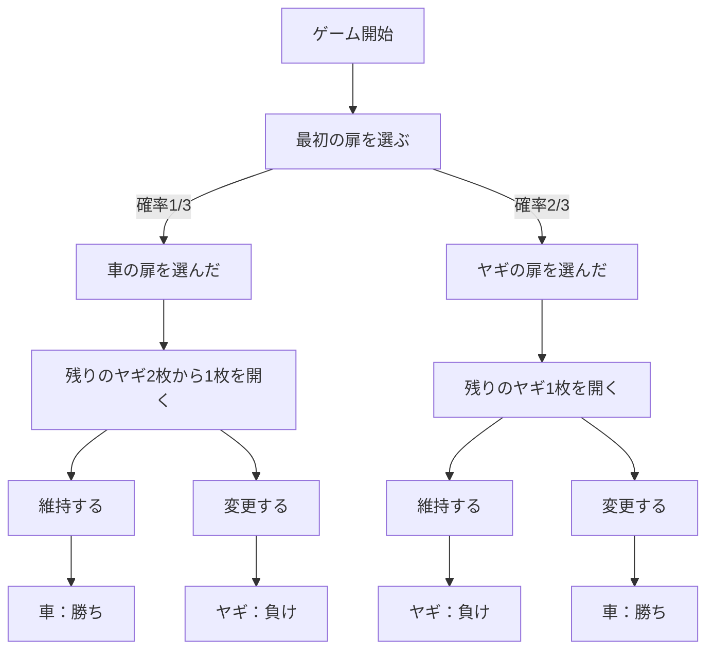
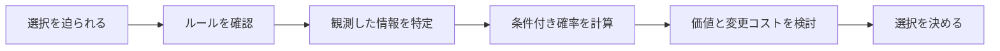

## 1. 直感を検討する前に、問題のルールをそろえる

3枚の扉から1枚を選び、司会者が別の扉を開けてヤギを見せた後、残る扉へ変更するかを決める。[モンティ・ホール問題](https://kenji.blog/p/monty-hall-problem/)は、選択肢の数だけでは確率が決まらないことを考える題材です。1990年の *Parade* 誌「Ask Marilyn」での議論を含む経緯と数理的な定式化は、[Gillの論文](https://pub.math.leidenuniv.nl/~gillrd/montyhall3.pdf)で検討されています。

まず、この記事で使うモデルを明示します。

1. 扉A・B・Cのうち1枚の後ろに車、残り2枚の後ろにヤギがいます。車の位置は3通りの一様分布とし、その位置の情報を使わず最初にAを選びます。
2. 司会者は車の位置を知っており、Aと車の扉を開けません。
3. 毎回、選ばれていないヤギの扉を1枚開け、必ず残る未選択の扉への変更を提案します。
4. 車がAにある場合は、BとCをそれぞれ確率1/2で開けます。

「位置を知らないから等確率」なのではなく、等確率という配置の仮定を置いています。車がA・B・Cにある事象をC_A・C_B・C_Cと書きます。

$$
\Pr(C_A)=\Pr(C_B)=\Pr(C_C)=\frac13
$$

このモデルでは変更し続ける戦略の勝率は2/3です。ただし、全体の戦略の勝率と「Bが開いた」という特定の観測後の条件付き確率は区別します。両方が2/3になることには、上の司会者の規則が関わります。

「2枚残ったから半々」という推論のどこに前提不足があるかは、数学で調べられます。一方、人がなぜそう答えたり変更をためらったりするかは、別途、心理学の研究が必要な問いです。

## 2. 場合分けと100万枚の扉

### 初めの配置で場合分けする

開いた扉の名前ではなく、最初の車の位置で分けます。

| 車の位置（各確率1/3） | 司会者が開く扉 | Aを維持 | 残る扉へ変更 |
| --- | --- | --- | --- |
| A | BまたはC | 勝ち | 負け |
| B | C | 負け | 勝ち |
| C | B | 負け | 勝ち |

司会者が毎回ヤギを除いて変更を提案するため、変更が当たるのは、最初にヤギを選んだ場合とちょうど一致します。

$$
\Pr(\mathrm{stay\ wins})=\frac13,\qquad\Pr(\mathrm{switch\ wins})=\frac23
$$

これはモデル上の確率であり、3回ごとに必ず2回勝つ保証ではありません。図は理論上の分岐で、実験結果ではありません。

### 扉を増やしても、観測する情報を明示する

nを3以上の整数とし、扉に1からnの番号を付けます。車の位置Cは一様分布、最初の選択は1です。司会者は毎回、選ばれていないヤギの扉をn−2枚開き、残る未選択の1枚Rへの変更を提案します。全体の勝率は、

$$
\Pr(C=1)=\frac1n,\qquad\Pr(C=R)=\frac{n-1}{n}
$$

となります。100万枚なら、変更し続ける戦略の勝率は999999/1000000です。

一方、「Rが特定の番号rだった」という情報を使う場合は規則がもう一つ必要です。rは2からnのいずれかです。最初の扉に車がある場合、司会者がRを残りn−1枚から一様に選ぶなら、

$$
\Pr(C=r\mid R=r)=\frac{1/n}{(1/n)+(1/n)(1/(n-1))}=\frac{n-1}{n}
$$

です。100万枚中777777番が残った場合にも、この対称な規則の下で同じ高い確率になります。ところが最初の扉に車があるとき、司会者が常にその固定番号rを残す規則なら、

$$
\Pr(C=r\mid R=r)=\frac{1/n}{(1/n)+(1/n)}=\frac12
$$

です。全体では変更が有利でも、特定の番号を見た後の確率は変わります。ここでの条件は残る番号Rだけで、開いた順序などの追加情報は含めていません。この例を、規則の確認なしに「残った扉はほぼ確実に車」と読むことはできません。

## 3. ベイズの定理で観測後の確率を求める

3枚のモデルに戻り、M_Bを司会者がBを開く事象とします。第1節の規則から尤度は、

$$
\Pr(M_B\mid C_A)=\frac12,\qquad\Pr(M_B\mid C_B)=0,\qquad\Pr(M_B\mid C_C)=1
$$

です。[ベイズの定理](https://kenji.blog/p/bayes-theorem/)を使うと、

$$
\Pr(C_i\mid M_B)=\frac{\Pr(M_B\mid C_i)\Pr(C_i)}{\sum_{j\in\{A,B,C\}}\Pr(M_B\mid C_j)\Pr(C_j)}
$$

となります。分母は全確率の公式から、

$$
\Pr(M_B)=\frac12\cdot\frac13+0\cdot\frac13+1\cdot\frac13=\frac12
$$

です。従って、最初のAに車がある事後確率は、

$$
\Pr(C_A\mid M_B)=\frac{(1/2)(1/3)}{1/2}=\frac13
$$

変更先Cに車がある事後確率は、

$$
\Pr(C_C\mid M_B)=\frac{1\cdot(1/3)}{1/2}=\frac23
$$

となります。車がCにある事象は、M_Bを条件にする前から確率1/3を持っています。その確率が観測後に2/3になることと、「最初に選んだ扉が外れなら変更が当たる」という戦略の説明は、同じモデルの異なる見方です。

車がAにある場合にBを開く確率だけをqに変え、他の規則を保つと、

$$
q=\Pr(M_B\mid C_A),\quad0\le q\le1,\qquad\Pr(C_C\mid M_B)=\frac1{1+q}
$$

です。例えばqが1なら、Bを開いた後のAとCは半々です。司会者が車の位置を知っていても、どのヤギの扉を好むかは条件付き確率に関係します。

また、車の位置を知らない司会者が、その位置と独立にB・Cをそれぞれ確率1/2で選んで開く別のモデルを考えます。車が見えることもあります。U_Bをこの司会者がBを開く事象、Gを開いた扉がヤギである事象とすると、「Bを開き、かつヤギだった」と観測した後は、

$$
\Pr(C_A\mid U_B\cap G)=\Pr(C_C\mid U_B\cap G)=\frac12
$$

です。必ずヤギを見せる規則と、たまたまヤギが見えた観測は異なります。こうした司会者の変種は[Rosenthalの論文](https://probability.ca/jeff/writing/montyfall.pdf)でも検討されています。

## 4. 心理学の仮説と、数学上の誤りを分ける

### 半々という推論を検討する

残る選択肢を等確率とみなす考え方は、心理学で等確率ヒューリスティックなどとして議論されています。ただし、「2枚だから半々」という推論が第1節のモデルに合わないことは、人の脳についての因果説明をしなくても確認できます。見た目だけでなく、扉が残る過程を計算に入れる必要があります。

### 司会者の知識と、扉を開く仕組みを分ける

「司会者はランダムには開かない」とだけ言うと不正確です。車がAにある場合、知識のある司会者でもBとCからランダムに選べます。また、Cを開かなかったことは「車があるのでCを開けられなかった」ことを意味しません。車がAにあればCを開くこともできました。必要なのは意図の推測だけでなく、具体的な選択規則です。

### 変更へのためらいと後悔

確率をどう理解するかと、何を選ぶかは別の問題です。「変更して負けたら後悔しそうだ」という気持ちを想像することはできますが、それだけで全員の行動原因を説明したことにはなりません。現状維持や後悔回避を普遍的な脳の仕組みとして断定するには、対応する実証的な根拠が必要です。

[Mazur・Kahlbaugh（2012）](https://pmc.ncbi.nlm.nih.gov/articles/PMC3435463/)は、ハト・大学生・就学前児の反復選択を比較しました。標準的な確率条件で各群に大きな個人差があり、変更による報酬確率を高めた条件では、大学生とハトの変更行動が増えました。著者らは、反復課題では報酬確率の差を見分ける難しさが重要だと論じています。これは一度だけ文章問題に答える状況と同一ではなく、「全員が現状維持バイアスで間違う」という結論にもなりません。

次の図は思考を整理する手順です。実証済みの心理的な因果関係を示す図ではありません。

## 5. 日常への応用では、別のモデルを立てる

### 仮想的な検査と偽陽性

ベイズの定理では、感度と特異度から直ちに陽性後の確率が決まるわけではありません。計算例として、病気の事前確率pが1/10000、感度sが99%、特異度tが99%という仮想的な検査を考えます。感度は病気がある場合の陽性確率、特異度は病気がない場合の陰性確率です。

$$
p=\frac1{10000},\qquad s=\frac{99}{100},\qquad t=\frac{99}{100}
$$

Dを病気がある事象、+を陽性結果とすると、

$$
\Pr(D\mid +)=\frac{sp}{sp+(1-t)(1-p)}=\frac{0.000099}{0.000099+0.009999}=\frac1{102}\approx0.009804
$$

で、約0.98%になります。1万人を想定した期待人数では、真陽性が0.99人、偽陽性が99.99人です。人数が小数になるのは期待値だからであり、実際に観察された患者数ではありません。

この値は置いた3つの確率から計算した例です。実際の検査や個人の状態について、そのまま0.98%と推定するものではありません。病気の有無と陽性・陰性という検査結果を混同しないことが、式を読む上でも重要です。

### 企業の戦略と、成功確率以外の判断材料

市場の反応を見て戦略を見直すことはできます。ただし、市場が既知の規則で必ず不成功の選択肢を除くとは限らず、戦略変更の成功確率が2/3になるわけではありません。企業の競争や情報収集は、それぞれ別のモデルを必要とします。

ゲーム内でも、車とヤギの効用をそれぞれu_car、u_goat、変更コストを同じ効用単位でkと置くと、第1節の確率を使った期待効用の差は、

$$
\mathrm{EU}(\mathrm{switch})-\mathrm{EU}(\mathrm{stay})=\frac{u_{\mathrm{car}}-u_{\mathrm{goat}}}{3}-k
$$

です。車を得る確率を最大化することと、費用込みの価値を最大化することは区別されます。実際の判断では、選択肢の価値、変更費用、情報を得る仕組みを確認します。

## 6. 結論：直感も計算も、前提を確かめる

モンティ・ホール問題は、選択肢の数だけで確率を決めず、観測が生じる仕組みを明示する練習になります。数学は指定したモデルの結論を与え、心理学は人がどのように理解・学習・選択するかを実証的に調べます。

新しい情報を得たら、何を観測したのか、どの規則がその観測を生んだのか、何を最大化したいのかを確認する。その手順は役立ちますが、「いつでも変更すれば成功が倍になる」という一般則ではありません。
