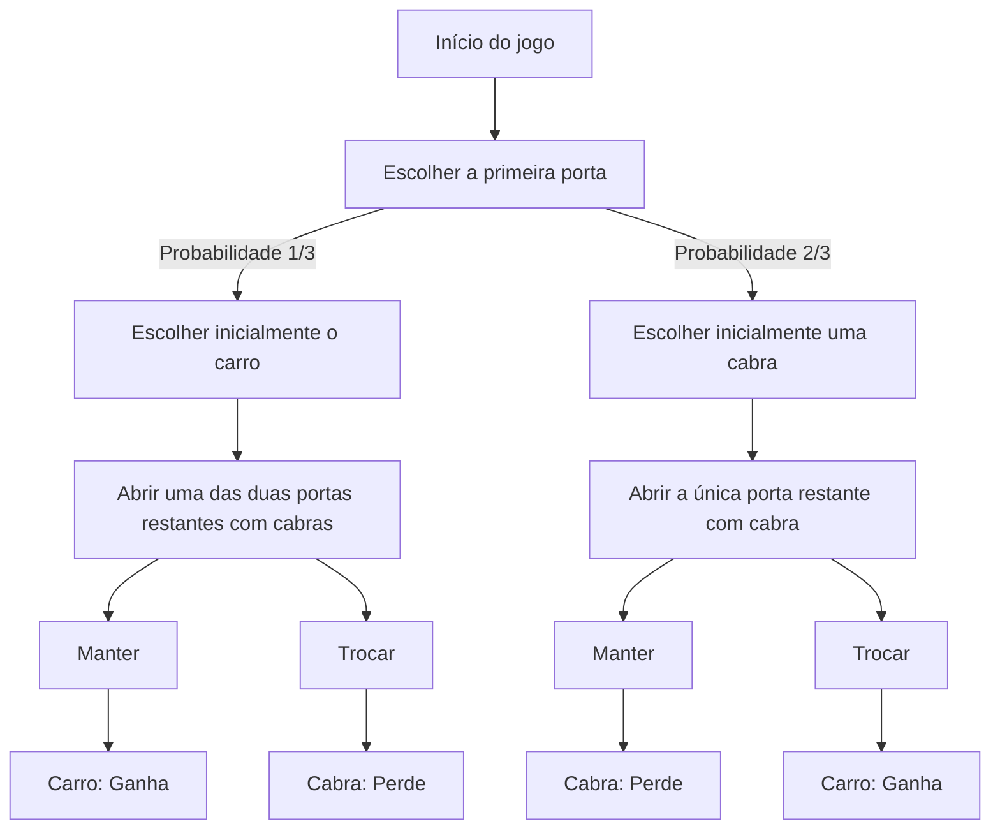
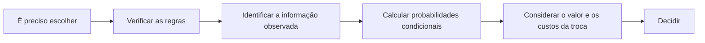

## 1. Definir as regras antes de examinar a intuição

Você escolhe uma de três portas. O apresentador abre outra para mostrar uma cabra e pergunta se você quer trocar para a porta restante. O [problema de Monty Hall](https://kenji.blog/pt/p/monty-hall-problem/) ilustra por que o número de opções restantes, por si só, não determina suas probabilidades. [O artigo de Gill](https://pub.math.leidenuniv.nl/~gillrd/montyhall3.pdf) examina a história do problema, incluindo a discussão de 1990 na coluna “Ask Marilyn” da revista *Parade*, e diferentes formulações matemáticas.

Primeiro, vamos explicitar o modelo usado neste artigo.

1. Atrás das portas A, B e C há um carro e duas cabras. A posição do carro tem distribuição uniforme entre as três portas. Você escolhe A inicialmente, sem usar informações sobre essa posição.
2. O apresentador sabe onde está o carro e não abre A nem a porta com o carro.
3. Em toda partida, abre uma porta não escolhida com uma cabra e sempre oferece a troca para a outra porta não escolhida que continua fechada.
4. Quando o carro está atrás de A, abre B ou C com probabilidade 1/2 para cada uma.

Probabilidades iguais são uma hipótese sobre a posição do carro, e não uma consequência de desconhecê-la. Denotamos por C_A, C_B e C_C os eventos de o carro estar atrás de A, B e C, respectivamente.

$$
\Pr(C_A)=\Pr(C_B)=\Pr(C_C)=\frac13
$$

Nesse modelo, a estratégia de sempre trocar vence com probabilidade 2/3. No entanto, é preciso distinguir a probabilidade global de vitória de uma estratégia da probabilidade condicional após uma observação específica, como B ter sido aberta. As regras do apresentador importam para que os dois cálculos deem 2/3 aqui.

A matemática permite identificar o que falta no raciocínio “restam duas, então cada uma tem metade da probabilidade”. Por que uma pessoa dá essa resposta ou hesita em trocar é outra pergunta, que exige pesquisa psicológica.

## 2. Análise de casos e um milhão de portas

### Separar os casos pela posição inicial

Vamos separar os casos pela posição inicial do carro, ainda sem condicionar ao nome da porta aberta.

| Posição do carro, cada uma com probabilidade 1/3 | Porta que o apresentador abre | Manter A | Trocar |
| --- | --- | --- | --- |
| A | B ou C | Ganha | Perde |
| B | C | Perde | Ganha |
| C | B | Perde | Ganha |

Como o apresentador sempre elimina uma porta com cabra e oferece a troca, trocar vence exatamente quando a porta escolhida inicialmente tinha uma cabra.

$$
\Pr(\mathrm{stay\ wins})=\frac13,\qquad\Pr(\mathrm{switch\ wins})=\frac23
$$

São probabilidades do modelo, não uma garantia de exatamente duas vitórias a cada três partidas. O diagrama mostra ramificações teóricas, não resultados experimentais.

### Mais portas também exigem especificar a observação

Seja n um inteiro maior ou igual a 3, com portas numeradas de 1 a n. A posição C do carro é uniforme e a escolha inicial é 1. Em toda partida, o apresentador abre n−2 portas não escolhidas com cabras e oferece a troca para a única porta não escolhida restante, R. As probabilidades globais são:

$$
\Pr(C=1)=\frac1n,\qquad\Pr(C=R)=\frac{n-1}{n}
$$

Com um milhão de portas, a estratégia de sempre trocar vence com probabilidade 999999/1000000.

Para usar a informação de que R tem um número específico r, precisamos de mais uma regra. Aqui, r é um dos números de 2 a n. Suponha que, sempre que a porta inicial tiver o carro, o apresentador escolha R uniformemente entre as outras n−1 portas. Então:

$$
\Pr(C=r\mid R=r)=\frac{1/n}{(1/n)+(1/n)(1/(n-1))}=\frac{n-1}{n}
$$

Sob essa regra simétrica, observar que a porta 777777 ficou fechada entre um milhão de portas dá a mesma probabilidade alta. Mas, se o apresentador sempre deixar esse mesmo número fixo r quando a porta inicial tiver o carro, então:

$$
\Pr(C=r\mid R=r)=\frac{1/n}{(1/n)+(1/n)}=\frac12
$$

Trocar pode ser vantajoso globalmente, enquanto a probabilidade após observar um número específico muda. Esses cálculos condicionam apenas a R, sem informações adicionais como a ordem de abertura. Sem verificar as regras, o exemplo não justifica dizer que a porta restante quase certamente tem o carro.

## 3. Aplicar o teorema de Bayes após uma observação

Voltando ao modelo de três portas, seja M_B o evento de o apresentador abrir B. As regras da seção 1 dão as seguintes verossimilhanças:

$$
\Pr(M_B\mid C_A)=\frac12,\qquad\Pr(M_B\mid C_B)=0,\qquad\Pr(M_B\mid C_C)=1
$$

O [teorema de Bayes](https://kenji.blog/pt/p/bayes-theorem/) fornece:

$$
\Pr(C_i\mid M_B)=\frac{\Pr(M_B\mid C_i)\Pr(C_i)}{\sum_{j\in\{A,B,C\}}\Pr(M_B\mid C_j)\Pr(C_j)}
$$

Pela lei da probabilidade total, o denominador é:

$$
\Pr(M_B)=\frac12\cdot\frac13+0\cdot\frac13+1\cdot\frac13=\frac12
$$

Portanto, a probabilidade a posteriori de o carro estar atrás da porta original A é:

$$
\Pr(C_A\mid M_B)=\frac{(1/2)(1/3)}{1/2}=\frac13
$$

E a probabilidade a posteriori de o carro estar atrás de C, a porta para a qual você trocaria, é:

$$
\Pr(C_C\mid M_B)=\frac{1\cdot(1/3)}{1/2}=\frac23
$$

O evento de o carro estar atrás de C tinha probabilidade 1/3 antes de condicionarmos a M_B. Essa probabilidade passar a 2/3 após a observação e a explicação “trocar vence quando a escolha inicial estava errada” são perspectivas diferentes do mesmo modelo.

Vamos mudar apenas para q a probabilidade de abrir B quando o carro está atrás de A, mantendo as demais regras. Então:

$$
q=\Pr(M_B\mid C_A),\quad0\le q\le1,\qquad\Pr(C_C\mid M_B)=\frac1{1+q}
$$

Por exemplo, com q igual a 1, A e C são equiprováveis depois de B ser aberta. Mesmo que o apresentador saiba onde está o carro, sua preferência entre portas com cabras importa para as probabilidades condicionais.

Agora considere outro modelo: o apresentador não sabe a posição do carro e escolhe B ou C com probabilidade 1/2 para cada uma, independentemente dessa posição. Isso pode revelar o carro. Seja U_B o evento de esse apresentador abrir B, e G o evento de a porta aberta mostrar uma cabra. Após observar tanto que B foi aberta quanto que havia uma cabra atrás dela:

$$
\Pr(C_A\mid U_B\cap G)=\Pr(C_C\mid U_B\cap G)=\frac12
$$

Sempre mostrar uma cabra e mostrar uma cabra por acaso são mecanismos de observação diferentes. [O artigo de Rosenthal](https://probability.ca/jeff/writing/montyfall.pdf) também examina variantes do comportamento do apresentador.

## 4. Separar hipóteses psicológicas de erros matemáticos

### Examinar a inferência de probabilidades iguais

Tratar as opções restantes como equiprováveis é discutido na psicologia em termos como heurística de equiprobabilidade. Entretanto, podemos verificar que “duas portas, então metade para cada uma” não corresponde ao modelo da seção 1 sem fazer uma afirmação causal sobre o cérebro. O cálculo precisa incluir o processo que deixou essas portas fechadas.

### Separar o conhecimento do apresentador do mecanismo de abertura

Dizer apenas que “o apresentador não abre ao acaso” é impreciso. Um apresentador informado ainda pode escolher aleatoriamente entre B e C quando o carro está atrás de A. Deixar C fechada também não significa que ele não pudesse abri-la porque ela tinha o carro: se o carro estivesse atrás de A, abrir C seria possível. Precisamos de uma regra de seleção específica, não apenas de uma suposição sobre a intenção.

### Hesitação e arrependimento antecipado

Entender uma probabilidade e escolher uma ação são questões diferentes. Podemos imaginar o sentimento “eu me arrependeria de trocar e perder”, mas isso não explica o comportamento de todas as pessoas. Afirmar que manter o status quo ou evitar o arrependimento são mecanismos cerebrais universais exige evidências empíricas adequadas.

[Mazur e Kahlbaugh (2012)](https://pmc.ncbi.nlm.nih.gov/articles/PMC3435463/) compararam escolhas repetidas de pombos, universitários e crianças em idade pré-escolar. Nas condições de probabilidade padrão, houve grandes diferenças individuais. Em condições com maior probabilidade de recompensa ao trocar, universitários e pombos trocaram mais. Os autores discutiram a dificuldade de distinguir probabilidades de recompensa em tarefas repetidas. Essas tarefas diferem de responder uma única vez a um problema verbal e não estabelecem que todos errem por viés de status quo.

O próximo diagrama é um procedimento para organizar o raciocínio. Ele não representa causas psicológicas estabelecidas empiricamente.

## 5. Aplicações precisam de modelos próprios

### Um teste hipotético e falsos positivos

Sensibilidade e especificidade, por si sós, não determinam a probabilidade após um resultado positivo. Como exemplo aritmético, suponha uma probabilidade a priori de doença p de 1/10000, sensibilidade s de 99% e especificidade t de 99%. A sensibilidade é a probabilidade de um resultado positivo dada a presença da doença; a especificidade é a probabilidade de um resultado negativo dada a ausência da doença.

$$
p=\frac1{10000},\qquad s=\frac{99}{100},\qquad t=\frac{99}{100}
$$

Seja D o evento de a doença estar presente, e + um resultado positivo. Então:

$$
\Pr(D\mid +)=\frac{sp}{sp+(1-t)(1-p)}=\frac{0.000099}{0.000099+0.009999}=\frac1{102}\approx0.009804
$$

Isso corresponde a aproximadamente 0,98%. Em uma população hipotética de 10000 pessoas, as contagens esperadas são 0,99 verdadeiros positivos e 99,99 falsos positivos. As contagens são fracionárias porque são valores esperados, não pacientes observados.

O exemplo decorre das três probabilidades supostas. Ele não atribui uma probabilidade de 0,98% a um teste real ou a uma pessoa específica. Distinguir a presença ou ausência de doença de um resultado positivo ou negativo também é essencial para interpretar a fórmula.

### Estratégia empresarial e critérios além da probabilidade de vencer

As reações do mercado podem motivar uma revisão da estratégia. Porém, o mercado não necessariamente elimina uma opção malsucedida segundo uma regra conhecida, e uma mudança de estratégia não passa a ter probabilidade de sucesso de 2/3. A concorrência e a coleta de informações precisam de modelos próprios.

Mesmo dentro do jogo, sejam u_car e u_goat as utilidades de um carro e de uma cabra, e k o custo da troca, medido nas mesmas unidades de utilidade. Usando as probabilidades da seção 1, a diferença de utilidade esperada é:

$$
\mathrm{EU}(\mathrm{switch})-\mathrm{EU}(\mathrm{stay})=\frac{u_{\mathrm{car}}-u_{\mathrm{goat}}}{3}-k
$$

Maximizar a probabilidade de obter o carro e maximizar o valor após os custos são objetivos distintos. Uma decisão real exige examinar o valor das opções, os custos da mudança e como a informação foi obtida.

## 6. Conclusão: verificar os pressupostos da intuição e do cálculo

O problema de Monty Hall permite praticar como especificar o mecanismo que produz uma observação, em vez de atribuir probabilidades contando opções. A matemática fornece conclusões dentro de um modelo definido. A psicologia examina empiricamente como as pessoas compreendem, aprendem e escolhem.

Ao receber uma informação, identifique o que foi observado, quais regras geraram essa observação e o que você quer maximizar. Esse procedimento pode ajudar, mas não é uma regra geral de que mudar uma escolha sempre duplica o sucesso.
