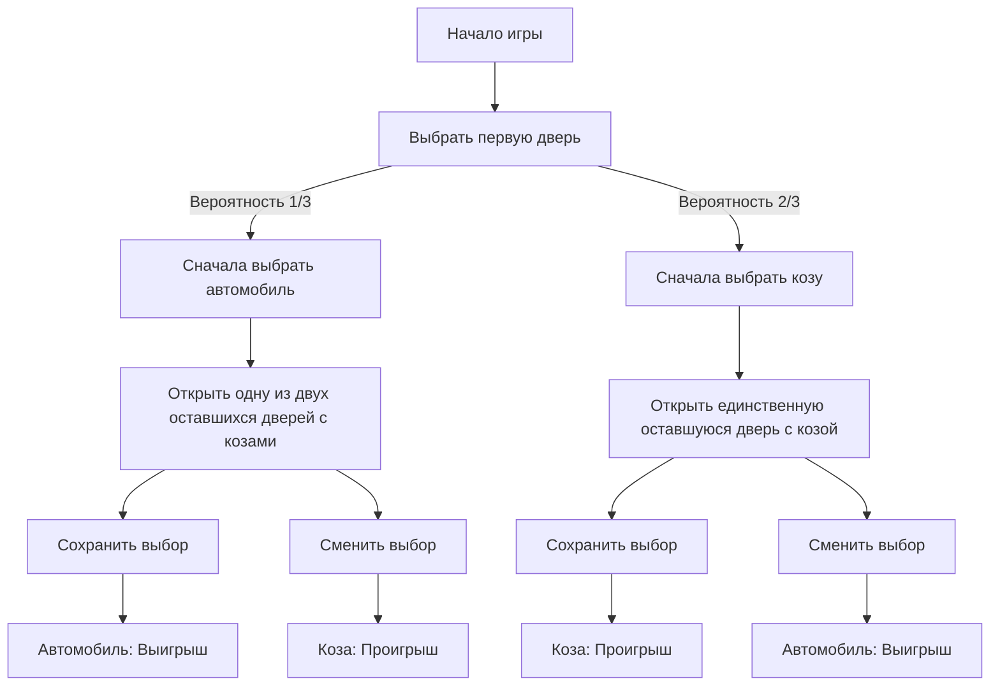
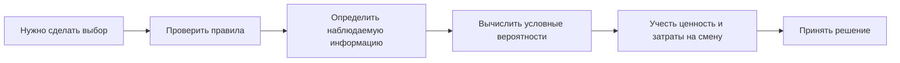

## 1. Сначала задать правила, затем обсуждать интуицию

Вы выбираете одну из трёх дверей. Ведущий открывает другую и показывает козу, а затем предлагает перейти к оставшейся двери. [Задача Монти Холла](https://kenji.blog/ru/p/monty-hall-problem/) показывает, почему количество оставшихся вариантов само по себе не определяет их вероятности. [Статья Гилла](https://pub.math.leidenuniv.nl/~gillrd/montyhall3.pdf) рассматривает историю, включая обсуждение 1990 года в колонке «Ask Marilyn» журнала *Parade*, и разные математические постановки.

Сначала явно зададим модель этой статьи.

1. За дверями A, B и C находятся один автомобиль и две козы. Место автомобиля равномерно распределено между тремя дверями. Вы сначала выбираете A, не используя информацию об этом месте.
2. Ведущий знает, где автомобиль, и не открывает ни A, ни дверь с автомобилем.
3. В каждой игре он открывает одну невыбранную дверь с козой и всегда предлагает перейти к другой невыбранной двери, которая остаётся закрытой.
4. Если автомобиль за A, ведущий открывает B или C с вероятностью 1/2 для каждой.

Равные вероятности — предположение о размещении автомобиля, а не следствие одного лишь незнания. События C_A, C_B и C_C означают, что автомобиль находится за A, B и C соответственно.

$$
\Pr(C_A)=\Pr(C_B)=\Pr(C_C)=\frac13
$$

В этой модели стратегия «всегда менять выбор» выигрывает с вероятностью 2/3. Однако общая вероятность выигрыша стратегии и условная вероятность после конкретного наблюдения, например открытия B, — разные расчёты. То, что оба здесь дают 2/3, связано с правилами ведущего.

Математика позволяет проверить, каких предположений недостаёт рассуждению «остались две двери, значит, шансы равны». Почему человек так отвечает или не решается сменить выбор — другой вопрос, требующий психологических исследований.

## 2. Разбор случаев и миллион дверей

### Разделить случаи по исходному положению

Разделим случаи по исходному положению автомобиля, пока не ставя условие о том, какая именно дверь была открыта.

| Место автомобиля, каждое с вероятностью 1/3 | Дверь, которую открывает ведущий | Оставить A | Сменить выбор |
| --- | --- | --- | --- |
| A | B или C | Выигрыш | Проигрыш |
| B | C | Проигрыш | Выигрыш |
| C | B | Проигрыш | Выигрыш |

Ведущий всегда исключает дверь с козой и предлагает сменить выбор. Поэтому смена выбора выигрывает тогда и только тогда, когда за первой выбранной дверью была коза.

$$
\Pr(\mathrm{stay\ wins})=\frac13,\qquad\Pr(\mathrm{switch\ wins})=\frac23
$$

Это вероятности в модели, а не гарантия ровно двух выигрышей в каждых трёх играх. Диаграмма показывает теоретические ветви, а не результаты эксперимента.

### Больше дверей — всё ещё нужно уточнять наблюдение

Пусть n — целое число не меньше 3, а двери пронумерованы от 1 до n. Место автомобиля C равномерно распределено, первый выбор фиксирован: дверь 1. В каждой игре ведущий открывает n−2 невыбранные двери с козами и предлагает перейти к единственной оставшейся невыбранной двери R. Общие вероятности равны:

$$
\Pr(C=1)=\frac1n,\qquad\Pr(C=R)=\frac{n-1}{n}
$$

При миллионе дверей стратегия «всегда менять выбор» выигрывает с вероятностью 999999/1000000.

Если использовать информацию о том, что номер R равен конкретному r, требуется ещё одно правило. Здесь r — один из номеров от 2 до n. Предположим, что всякий раз, когда за первой выбранной дверью автомобиль, ведущий равномерно выбирает R среди остальных n−1 дверей. Тогда:

$$
\Pr(C=r\mid R=r)=\frac{1/n}{(1/n)+(1/n)(1/(n-1))}=\frac{n-1}{n}
$$

При этом симметричном правиле наблюдение, что из миллиона дверей закрытой оставлена дверь 777777, даёт такую же высокую вероятность. Но если автомобиль находится за первой дверью и ведущий в этом случае всегда оставляет один и тот же фиксированный номер r, то:

$$
\Pr(C=r\mid R=r)=\frac{1/n}{(1/n)+(1/n)}=\frac12
$$

Смена выбора может оставаться выгодной в целом, хотя вероятность после наблюдения конкретного номера изменится. Здесь условие содержит только R, без дополнительной информации, например о порядке открытия дверей. Не проверив правила, нельзя заключать, что за оставшейся дверью почти наверняка автомобиль.

## 3. Применить теорему Байеса после наблюдения

Вернёмся к модели с тремя дверями. Пусть M_B — событие открытия B ведущим. Правила раздела 1 дают следующие значения правдоподобия:

$$
\Pr(M_B\mid C_A)=\frac12,\qquad\Pr(M_B\mid C_B)=0,\qquad\Pr(M_B\mid C_C)=1
$$

[Теорема Байеса](https://kenji.blog/ru/p/bayes-theorem/) даёт:

$$
\Pr(C_i\mid M_B)=\frac{\Pr(M_B\mid C_i)\Pr(C_i)}{\sum_{j\in\{A,B,C\}}\Pr(M_B\mid C_j)\Pr(C_j)}
$$

По формуле полной вероятности знаменатель равен:

$$
\Pr(M_B)=\frac12\cdot\frac13+0\cdot\frac13+1\cdot\frac13=\frac12
$$

Поэтому апостериорная вероятность автомобиля за первоначально выбранной дверью A равна:

$$
\Pr(C_A\mid M_B)=\frac{(1/2)(1/3)}{1/2}=\frac13
$$

А апостериорная вероятность автомобиля за дверью C, к которой предлагается перейти, равна:

$$
\Pr(C_C\mid M_B)=\frac{1\cdot(1/3)}{1/2}=\frac23
$$

До введения условия M_B событие «автомобиль за C» имело вероятность 1/3. Её изменение до 2/3 после наблюдения и объяснение «смена выбора выигрывает при неверном первом выборе» — разные взгляды на одну модель.

Изменим только вероятность открытия B при автомобиле за A на q, сохранив остальные правила. Тогда:

$$
q=\Pr(M_B\mid C_A),\quad0\le q\le1,\qquad\Pr(C_C\mid M_B)=\frac1{1+q}
$$

Например, при q, равном 1, после открытия B автомобиль с одинаковой вероятностью находится за A или C. Даже если ведущий знает место автомобиля, его предпочтения между дверями с козами важны для условных вероятностей.

Теперь рассмотрим другую модель: ведущий не знает места автомобиля и независимо от него выбирает B или C с вероятностью 1/2 для каждой. В результате может открыться дверь с автомобилем. Пусть U_B — событие открытия B этим ведущим, а G — событие «за открытой дверью коза». После совместного наблюдения «B открыта и показана коза»:

$$
\Pr(C_A\mid U_B\cap G)=\Pr(C_C\mid U_B\cap G)=\frac12
$$

Всегда показывать козу и случайно показать козу — разные механизмы наблюдения. [Статья Розенталя](https://probability.ca/jeff/writing/montyfall.pdf) также рассматривает варианты поведения ведущего.

## 4. Отделить психологические гипотезы от математических ошибок

### Проверить вывод о равных вероятностях

Представление, что оставшиеся варианты равновероятны, обсуждается в психологии, в частности как эвристика равновероятности. Но установить, что «две двери, значит, по половине» не соответствует модели раздела 1, можно без причинного объяснения работы мозга. В расчёт нужно включить процесс, благодаря которому эти двери остались закрытыми.

### Разделить знания ведущего и механизм открытия

Просто сказать «ведущий открывает не случайно» неточно. Знающий ведущий тоже может случайно выбирать между B и C, если автомобиль за A. То, что C не открыта, также не означает, что он не мог открыть её из-за автомобиля: если автомобиль за A, открыть C было возможно. Нужна конкретная процедура выбора, а не только предположение о намерении.

### Нерешительность и ожидаемое сожаление

Понимать вероятность и выбирать действие — разные вопросы. Можно представить чувство «я пожалею, если сменю выбор и проиграю», но это не объясняет поведение всех людей. Утверждения, что сохранение статус-кво или избегание сожалений — универсальные механизмы мозга, требуют соответствующих эмпирических данных.

[Mazur и Kahlbaugh (2012)](https://pmc.ncbi.nlm.nih.gov/articles/PMC3435463/) сравнивали повторные выборы голубей, студентов и дошкольников. При стандартных вероятностях наблюдались большие индивидуальные различия. В условиях с большей вероятностью вознаграждения за смену выбора студенты и голуби меняли выбор чаще. Авторы обсуждают трудность различения вероятностей вознаграждения в повторяющихся заданиях. Это не то же самое, что один ответ на текстовую задачу, и не доказывает, что все ошибаются из-за склонности сохранять статус-кво.

Следующая диаграмма — предлагаемый порядок рассуждения. Она не изображает эмпирически установленные психологические причины.

## 5. Для приложений нужны собственные модели

### Гипотетический тест и ложноположительные результаты

Чувствительность и специфичность сами по себе не определяют вероятность после положительного результата. Для примера расчёта предположим, что априорная вероятность заболевания p равна 1/10000, чувствительность s — 99%, специфичность t — 99%. Чувствительность — вероятность положительного результата при наличии заболевания; специфичность — вероятность отрицательного результата при его отсутствии.

$$
p=\frac1{10000},\qquad s=\frac{99}{100},\qquad t=\frac{99}{100}
$$

Пусть D — событие наличия заболевания, а + — положительный результат. Тогда:

$$
\Pr(D\mid +)=\frac{sp}{sp+(1-t)(1-p)}=\frac{0.000099}{0.000099+0.009999}=\frac1{102}\approx0.009804
$$

Это примерно 0,98%. В гипотетической популяции из 10000 человек ожидаются 0,99 истинноположительного и 99,99 ложноположительного результата. Числа дробные, поскольку это математические ожидания, а не фактически наблюдавшиеся пациенты.

Пример следует из трёх заданных вероятностей. Он не приписывает вероятность заболевания 0,98% реальному тесту или конкретному человеку. Различать наличие или отсутствие заболевания и положительный или отрицательный результат теста важно и для понимания формулы.

### Стратегия компании и критерии помимо вероятности выигрыша

Реакция рынка может стать поводом пересмотреть стратегию. Но рынок не обязательно исключает неудачный вариант по известному правилу, а смена стратегии не получает от этого вероятность успеха 2/3. Для конкуренции и сбора информации нужны собственные модели.

Даже внутри игры обозначим полезности автомобиля и козы через u_car и u_goat, а затраты на смену выбора — через k в тех же единицах полезности. При вероятностях раздела 1 разность ожидаемых полезностей равна:

$$
\mathrm{EU}(\mathrm{switch})-\mathrm{EU}(\mathrm{stay})=\frac{u_{\mathrm{car}}-u_{\mathrm{goat}}}{3}-k
$$

Максимизировать вероятность получить автомобиль и максимизировать ценность с учётом затрат — разные цели. В реальном решении нужно учитывать ценность вариантов, затраты на изменение и способ получения информации.

## 6. Заключение: проверять предпосылки интуиции и расчёта

Задача Монти Холла позволяет упражняться в явном описании механизма наблюдения, а не назначать вероятности только по количеству вариантов. Математика даёт выводы внутри заданной модели. Психология эмпирически исследует, как люди понимают, учатся и выбирают.

Получив информацию, определите, что именно наблюдалось, какие правила породили это наблюдение и что вы хотите максимизировать. Такой порядок может помочь, но не является общим правилом, что смена выбора всегда удваивает успех.
