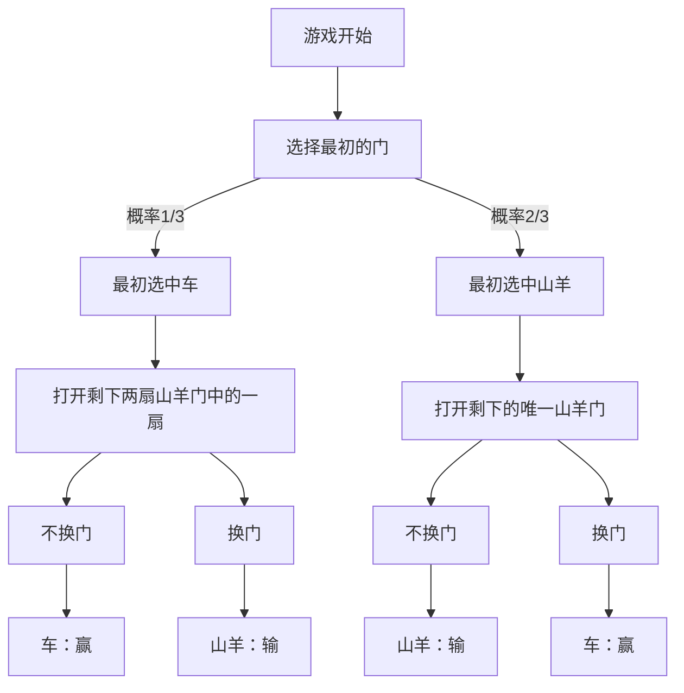
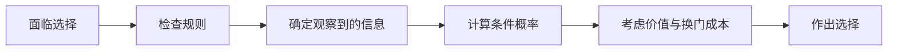

## 1. 讨论直觉之前，先明确规则

从三扇门中选一扇，主持人打开另一扇门展示山羊，再问你是否换到剩下的门。[蒙提霍尔问题](https://kenji.blog/zh-cn/p/monty-hall-problem/)说明，剩余选项的数量本身不能决定它们的概率。[Gill的论文](https://pub.math.leidenuniv.nl/~gillrd/montyhall3.pdf)讨论了问题的历史，包括1990年《Parade》杂志“Ask Marilyn”专栏引发的讨论，以及不同的数学表述。

本文采用以下明确的模型。

1. A、B、C三扇门后有一辆车和两只山羊。车的位置在三扇门之间均匀分布。你不利用有关车的位置的信息，最初选择A。
2. 主持人知道车的位置，不打开A，也不打开有车的门。
3. 每局都打开一扇未选中的山羊门，并且总是提出让你换到另一扇仍关闭的未选中门。
4. 如果车在A后，主持人以各1/2的概率打开B或C。

等概率是对车的位置分布所作的假设，并非仅凭“不知道位置”就能推出。用C_A、C_B、C_C分别表示车在A、B、C后的事件。

$$
\Pr(C_A)=\Pr(C_B)=\Pr(C_C)=\frac13
$$

在这个模型中，始终换门的策略以2/3的概率获胜。不过，策略的总体胜率与观察到“B被打开”后的条件概率需要区分。这里两个计算都得到2/3，与上述主持人规则有关。

数学可以检验“剩下两扇门，所以各占一半”的推理缺少什么前提。一个人为什么这样回答，或为什么不愿换门，则是需要心理学研究的另一类问题。

## 2. 分类讨论与一百万扇门

### 按初始位置分类

先按车最初的位置分类，而不以打开的门的名称为条件。

| 车的位置，各概率1/3 | 主持人打开的门 | 留在A | 换门 |
| --- | --- | --- | --- |
| A | B或C | 赢 | 输 |
| B | C | 输 | 赢 |
| C | B | 输 | 赢 |

主持人总是排除一扇山羊门并提供换门机会，因此，换门获胜恰好对应最初选中山羊的情况。

$$
\Pr(\mathrm{stay\ wins})=\frac13,\qquad\Pr(\mathrm{switch\ wins})=\frac23
$$

这些是模型中的概率，不保证每三局恰好赢两局。图中展示的是理论分支，而非实验结果。

### 门再多，也要明确观察到的信息

设n是至少为3的整数，门编号从1到n。车的位置C均匀分布，最初选择固定为1。主持人每局打开n−2扇未选中的山羊门，再提出换到唯一剩余的未选中门R。总体概率为：

$$
\Pr(C=1)=\frac1n,\qquad\Pr(C=R)=\frac{n-1}{n}
$$

如果有一百万扇门，始终换门的策略胜率就是999999/1000000。

但若利用“剩余门的编号R是某个特定的r”这一信息，就需要另一条规则。这里r是2至n中的一个编号。假设最初选中的门后有车时，主持人从其余n−1扇门中均匀选择R，则：

$$
\Pr(C=r\mid R=r)=\frac{1/n}{(1/n)+(1/n)(1/(n-1))}=\frac{n-1}{n}
$$

按照这个对称规则，观察到一百万扇门中留下的是777777号门，也会得到同样高的概率。但如果最初选中的门后有车时，主持人总是留下同一个固定编号r，那么：

$$
\Pr(C=r\mid R=r)=\frac{1/n}{(1/n)+(1/n)}=\frac12
$$

换门在总体上可能仍有优势，但观察到某个具体编号后的概率会改变。这里的条件只包括剩余编号R，不包括开门顺序等额外信息。未经规则检查，就不能把这个例子理解为“留下的门几乎肯定有车”。

## 3. 用贝叶斯定理计算观察后的概率

回到三扇门模型，令M_B表示主持人打开B的事件。根据第1节的规则，似然为：

$$
\Pr(M_B\mid C_A)=\frac12,\qquad\Pr(M_B\mid C_B)=0,\qquad\Pr(M_B\mid C_C)=1
$$

利用[贝叶斯定理](https://kenji.blog/zh-cn/p/bayes-theorem/)，得到：

$$
\Pr(C_i\mid M_B)=\frac{\Pr(M_B\mid C_i)\Pr(C_i)}{\sum_{j\in\{A,B,C\}}\Pr(M_B\mid C_j)\Pr(C_j)}
$$

由全概率公式，分母为：

$$
\Pr(M_B)=\frac12\cdot\frac13+0\cdot\frac13+1\cdot\frac13=\frac12
$$

因此，车在最初选择的A后的后验概率为：

$$
\Pr(C_A\mid M_B)=\frac{(1/2)(1/3)}{1/2}=\frac13
$$

车在换门目标C后的后验概率为：

$$
\Pr(C_C\mid M_B)=\frac{1\cdot(1/3)}{1/2}=\frac23
$$

在以M_B为条件之前，车在C后的事件本来具有1/3的概率。观察后这个概率变为2/3，与“最初选错时换门就会赢”的策略解释，是同一模型的不同视角。

只把“车在A后时打开B的概率”改为q，其余规则保持不变，则：

$$
q=\Pr(M_B\mid C_A),\quad0\le q\le1,\qquad\Pr(C_C\mid M_B)=\frac1{1+q}
$$

例如，q等于1时，在B被打开后，A和C有车的概率相等。即使主持人知道车的位置，对山羊门的选择偏好也会影响条件概率。

再考虑另一个模型：主持人不知道车的位置，独立于车的位置，以各1/2的概率选择打开B或C。这可能展示出车。令U_B为这个主持人打开B的事件，G为打开的门后是山羊的事件。观察到“打开了B，并且展示了山羊”后：

$$
\Pr(C_A\mid U_B\cap G)=\Pr(C_C\mid U_B\cap G)=\frac12
$$

“总是展示山羊”与“碰巧展示山羊”是不同的观察机制。[Rosenthal的论文](https://probability.ca/jeff/writing/montyfall.pdf)也讨论了主持人行为的不同变体。

## 4. 区分心理学假说与数学推理错误

### 检查等概率的推理

把剩余选项视为等概率，在心理学中有等概率启发式等相关讨论。不过，无须对大脑作因果解释，也能检验“两扇门，所以各占一半”不符合第1节模型。计算必须包括这些门如何被留下，而不能只看它们的数量。

### 区分主持人的知识与开门机制

只说“主持人不是随机开门”并不准确。车在A后时，知情的主持人仍可以随机选择B或C。留下C也不表示“因为C后有车，所以他不能打开C”：车在A后时，打开C也是可能的。需要的是具体的选择规则，而不只是对意图的猜测。

### 犹豫与预期的后悔

理解概率与采取行动是不同的问题。我们可以想象“如果换门后输了，我会后悔”，但这不等于解释了每个人的行为。若断言维持现状或避免后悔是普遍的大脑机制，需要相应的实证证据。

[Mazur与Kahlbaugh（2012）](https://pmc.ncbi.nlm.nih.gov/articles/PMC3435463/)比较了鸽子、大学生和学龄前儿童的重复选择。在标准概率条件下，各组都有明显的个体差异。在换门获得奖励的概率更高的条件下，大学生和鸽子的换门行为增加。作者认为，分辨奖励概率差异的困难对重复任务很重要。这与只回答一次文字题的情形不同，也不能证明“每个人都是因为维持现状偏差而犯错”。

下图是整理思路的步骤，不是在展示已被实证确认的心理因果关系。

## 5. 应用到日常问题时，需要另建模型

### 假想检测与假阳性

仅有灵敏度和特异度，并不能确定阳性结果后的患病概率。作为计算例子，假设患病的先验概率p为1/10000，灵敏度s为99%，特异度t为99%。灵敏度是已患病时检测为阳性的概率，特异度是未患病时检测为阴性的概率。

$$
p=\frac1{10000},\qquad s=\frac{99}{100},\qquad t=\frac{99}{100}
$$

令D表示患病事件，+表示阳性结果，则：

$$
\Pr(D\mid +)=\frac{sp}{sp+(1-t)(1-p)}=\frac{0.000099}{0.000099+0.009999}=\frac1{102}\approx0.009804
$$

即约0.98%。在假想的一万人中，真阳性的期望人数为0.99，假阳性的期望人数为99.99。人数出现小数，是因为这些数是期望值，而非实际观察到的患者人数。

这个例子来自所假设的三个概率，不能直接把真实检测或某个人的患病概率定为0.98%。区分疾病状态与阳性、阴性这些检测结果，也是理解公式的关键。

### 企业战略与胜率以外的判断依据

市场反馈可以促使企业重新审视战略。但市场未必按照已知规则，总是排除一个不成功的选项；改变战略的成功概率也不会因此变成2/3。竞争与信息收集都需要各自的模型。

即使只看游戏，设车和山羊的效用分别为u_car与u_goat，换门成本k也以相同的效用单位计量。使用第1节的概率，期望效用之差为：

$$
\mathrm{EU}(\mathrm{switch})-\mathrm{EU}(\mathrm{stay})=\frac{u_{\mathrm{car}}-u_{\mathrm{goat}}}{3}-k
$$

最大化获得车的概率，与最大化扣除成本后的价值，是不同的目标。实际决策需要考虑选项的价值、改变选择的成本，以及信息是如何获得的。

## 6. 结语：直觉与计算都需要检查前提

蒙提霍尔问题让我们练习明确观察是如何产生的，而不是仅凭选项数量来分配概率。数学给出指定模型下的结论；心理学则通过实证研究考察人如何理解、学习与选择。

获得新信息后，确认自己观察到了什么、哪些规则产生了这一观察、自己想最大化什么。这个步骤可以提供帮助，但并不构成“改变选择总能让成功翻倍”的一般规律。
