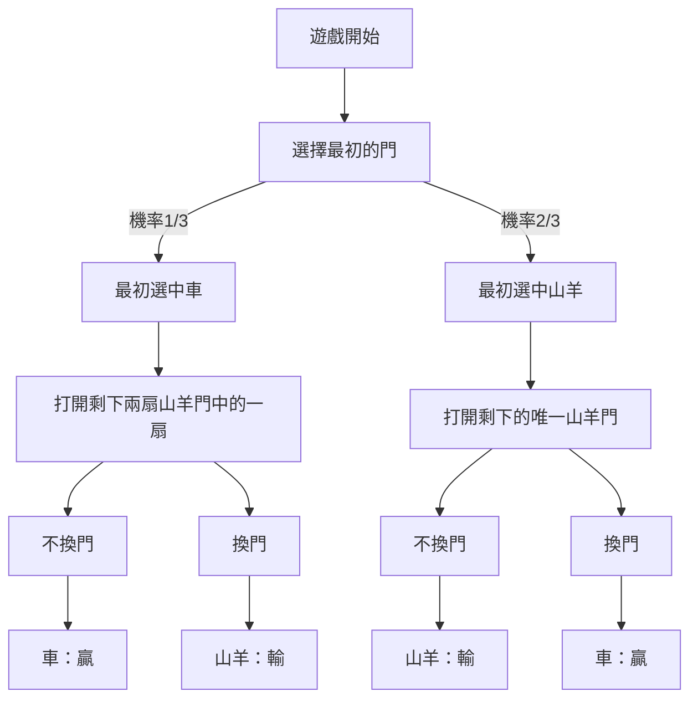
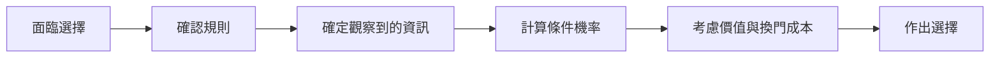

## 1. 討論直覺之前，先說清楚規則

從三扇門中選一扇，主持人打開另一扇門展示山羊，再問你是否換到剩下的門。[蒙提霍爾問題](https://kenji.blog/zh-tw/p/monty-hall-problem/)讓我們思考：剩餘選項的數量，本身並不能決定各選項的機率。[Gill的論文](https://pub.math.leidenuniv.nl/~gillrd/montyhall3.pdf)探討了問題的歷史，包括1990年《Parade》雜誌「Ask Marilyn」專欄引發的討論，以及不同的數學表述。

本文採用以下明確的模型。

1. A、B、C三扇門後有一輛車和兩隻山羊。車的位置在三扇門之間均勻分布。你不利用車的位置資訊，最初選擇A。
2. 主持人知道車的位置，不打開A，也不打開有車的門。
3. 每局都打開一扇未選中的山羊門，而且一定提出讓你換到另一扇仍關閉的未選中門。
4. 車在A後時，主持人以各1/2的機率打開B或C。

等機率是對車的位置分布所作的假設，並不是只憑「不知道位置」就能推出的結論。以C_A、C_B、C_C分別表示車在A、B、C後的事件。

$$
\Pr(C_A)=\Pr(C_B)=\Pr(C_C)=\frac13
$$

在這個模型中，始終換門的策略以2/3的機率獲勝。不過，策略的整體勝率與觀察到「B被打開」後的條件機率，需要區分。這裡兩個計算都得到2/3，與上述主持人的規則有關。

數學可以檢查「剩下兩扇門，所以各占一半」的推論缺少什麼前提。一個人為何這樣回答，或為何猶豫不願換門，則是需要心理學研究的另一個問題。

## 2. 分情況討論與一百萬扇門

### 依初始位置分類

先依車最初的位置分類，不以打開的門的名稱為條件。

| 車的位置，各機率1/3 | 主持人打開的門 | 留在A | 換門 |
| --- | --- | --- | --- |
| A | B或C | 贏 | 輸 |
| B | C | 輸 | 贏 |
| C | B | 輸 | 贏 |

主持人總是排除一扇山羊門並提供換門機會，因此換門獲勝，恰好對應最初選中山羊的情況。

$$
\Pr(\mathrm{stay\ wins})=\frac13,\qquad\Pr(\mathrm{switch\ wins})=\frac23
$$

這些是模型中的機率，不保證每三局恰好贏兩局。圖中展示的是理論分支，而非實驗結果。

### 門再多，也要說清楚觀察到的資訊

設n是至少為3的整數，門編號從1到n。車的位置C均勻分布，最初選擇固定為1。主持人每局打開n−2扇未選中的山羊門，再提出換到唯一剩餘的未選中門R。整體機率為：

$$
\Pr(C=1)=\frac1n,\qquad\Pr(C=R)=\frac{n-1}{n}
$$

若有一百萬扇門，始終換門的策略勝率為999999/1000000。

但若利用「剩餘門的編號R是某個特定的r」這項資訊，就需要另一條規則。r是2至n中的一個編號。假設最初選中的門後有車時，主持人從其他n−1扇門中均勻選擇R，則：

$$
\Pr(C=r\mid R=r)=\frac{1/n}{(1/n)+(1/n)(1/(n-1))}=\frac{n-1}{n}
$$

按照這個對稱規則，觀察到一百萬扇門中留下的是777777號門，也會得到同樣高的機率。但若最初選中的門後有車時，主持人總是留下同一個固定編號r，那麼：

$$
\Pr(C=r\mid R=r)=\frac{1/n}{(1/n)+(1/n)}=\frac12
$$

換門在整體上仍可能有利，但觀察到某個具體編號後的機率會改變。這裡的條件只包括剩餘編號R，不包括開門順序等額外資訊。未確認規則，就不能把這個例子理解成「留下的門幾乎肯定有車」。

## 3. 用貝氏定理計算觀察後的機率

回到三扇門模型，令M_B表示主持人打開B的事件。根據第1節的規則，概似為：

$$
\Pr(M_B\mid C_A)=\frac12,\qquad\Pr(M_B\mid C_B)=0,\qquad\Pr(M_B\mid C_C)=1
$$

利用[貝氏定理](https://kenji.blog/zh-tw/p/bayes-theorem/)，得到：

$$
\Pr(C_i\mid M_B)=\frac{\Pr(M_B\mid C_i)\Pr(C_i)}{\sum_{j\in\{A,B,C\}}\Pr(M_B\mid C_j)\Pr(C_j)}
$$

由全機率公式，分母為：

$$
\Pr(M_B)=\frac12\cdot\frac13+0\cdot\frac13+1\cdot\frac13=\frac12
$$

因此，車在最初選擇的A後的後驗機率為：

$$
\Pr(C_A\mid M_B)=\frac{(1/2)(1/3)}{1/2}=\frac13
$$

車在換門目標C後的後驗機率為：

$$
\Pr(C_C\mid M_B)=\frac{1\cdot(1/3)}{1/2}=\frac23
$$

在以M_B為條件之前，車在C後的事件原本具有1/3的機率。觀察後這個機率變成2/3，與「最初選錯時換門就會贏」的策略說明，是同一模型的不同觀點。

只把「車在A後時打開B的機率」改為q，其他規則不變，則：

$$
q=\Pr(M_B\mid C_A),\quad0\le q\le1,\qquad\Pr(C_C\mid M_B)=\frac1{1+q}
$$

例如，q等於1時，在B被打開後，A與C有車的機率相等。即使主持人知道車的位置，對山羊門的選擇偏好仍會影響條件機率。

再考慮另一個模型：主持人不知道車的位置，獨立於車的位置，以各1/2的機率選擇打開B或C。這可能展示出車。令U_B為這位主持人打開B的事件，G為打開的門後是山羊的事件。觀察到「打開了B，而且展示了山羊」後：

$$
\Pr(C_A\mid U_B\cap G)=\Pr(C_C\mid U_B\cap G)=\frac12
$$

「總是展示山羊」與「碰巧展示山羊」是不同的觀察機制。[Rosenthal的論文](https://probability.ca/jeff/writing/montyfall.pdf)也探討了主持人行為的不同變形。

## 4. 區分心理學假說與數學推論錯誤

### 檢查等機率的推論

將剩餘選項視為等機率，在心理學中有等機率捷思等相關討論。不過，不必先對大腦作因果解釋，也能檢查「兩扇門，所以各占一半」不符合第1節模型。計算必須納入這些門如何被留下，不能只看數量。

### 區分主持人的知識與開門機制

只說「主持人不是隨機開門」並不準確。車在A後時，知情的主持人仍可隨機選擇B或C。留下C也不表示「因為C後有車，所以他不能打開C」：車在A後時，打開C也是可能的。需要的是具體選擇規則，不只是對意圖的猜測。

### 猶豫與預期的後悔

理解機率與採取行動是不同的問題。我們可以想像「換門後若輸了，我會後悔」，但這不等於解釋了每個人的行為。若斷言維持現狀或避免後悔是普遍的大腦機制，就需要相應的實證證據。

[Mazur與Kahlbaugh（2012）](https://pmc.ncbi.nlm.nih.gov/articles/PMC3435463/)比較了鴿子、大學生和學齡前兒童的重複選擇。標準機率條件下，各組都有明顯的個別差異。在換門獲得獎勵的機率更高的條件下，大學生和鴿子的換門行為增加。作者認為，辨別獎勵機率差異的困難，對重複任務很重要。這與只回答一次文字題的情況不同，也不能證明「每個人都是因為現狀維持偏誤而犯錯」。

下圖是整理思路的步驟，不是在呈現已經實證確認的心理因果關係。

## 5. 應用到日常問題，需要另外建立模型

### 假想檢測與偽陽性

只有敏感度與特異度，還不能決定陽性結果後的患病機率。作為計算例子，假設患病的先驗機率p為1/10000，敏感度s為99%，特異度t為99%。敏感度是已患病時檢測為陽性的機率；特異度是未患病時檢測為陰性的機率。

$$
p=\frac1{10000},\qquad s=\frac{99}{100},\qquad t=\frac{99}{100}
$$

令D表示患病事件，+表示陽性結果，則：

$$
\Pr(D\mid +)=\frac{sp}{sp+(1-t)(1-p)}=\frac{0.000099}{0.000099+0.009999}=\frac1{102}\approx0.009804
$$

即約0.98%。在假想的一萬人中，真陽性的期望人數為0.99，偽陽性的期望人數為99.99。人數出現小數，是因為這些數是期望值，並非實際觀察到的患者人數。

這個例子來自假設的三個機率，不能直接將真實檢測或某個人的患病機率定為0.98%。區分疾病狀態與陽性、陰性這些檢測結果，也是理解公式的關鍵。

### 企業策略與勝率以外的判斷依據

市場回饋可以促使企業重新檢視策略。但市場未必遵循已知規則，總是排除一個不成功的選項；改變策略的成功機率也不會因此變成2/3。競爭與資訊蒐集都需要各自的模型。

即使只看遊戲，設車與山羊的效用分別為u_car和u_goat，換門成本k也以相同的效用單位計量。使用第1節的機率，期望效用之差為：

$$
\mathrm{EU}(\mathrm{switch})-\mathrm{EU}(\mathrm{stay})=\frac{u_{\mathrm{car}}-u_{\mathrm{goat}}}{3}-k
$$

最大化獲得車的機率，與最大化扣除成本後的價值，是不同的目標。實際決策需要考慮選項的價值、改變選擇的成本，以及資訊如何取得。

## 6. 結語：直覺與計算都需要檢查前提

蒙提霍爾問題讓我們練習說清楚觀察如何產生，而不是僅憑選項數量分配機率。數學提供指定模型下的結論；心理學則以實證研究考察人如何理解、學習與選擇。

獲得新資訊後，確認自己觀察到了什麼、哪些規則產生了這項觀察，以及自己想最大化什麼。這個步驟能提供幫助，但不構成「改變選擇總能讓成功加倍」的一般法則。
