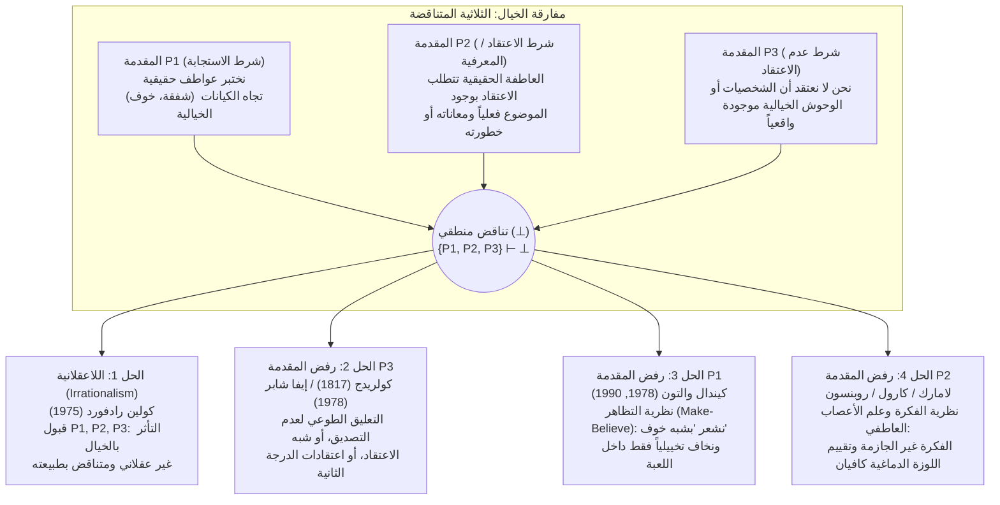

## مقدمة: دموع القديس أوغسطين على ديدو ودهشة هاملت أمام هيكوبا

نختبر في حياتنا اليومية ظاهرة نفسية مألوفة للغاية إلى حد أننا نادراً ما نتوقف لنلاحظ مدى غرابتها الفلسفية — بل وبدايتها غير العقلانية ظاهرياً. عندما نقرأ الفصول الأخيرة من رائعة ليف تولستوي *«آنا كارنينا»*، حيث تقف آنا اليائسة عند الغسق على رصيف محطة القطار وتلقي بنفسها تحت العجلات الحديدية لقطار شحن قادم، نشعر بغصة في الحلق، وتترقرق الدموع في أعيننا، وتجتاحنا موجة عميقة من الشفقة والحزن. أو لنتأمل عرضاً سينمائياً لفيلم رعب في منتصف الليل: عندما يزحف وحش هلامي أخضر (*Green Slime*) بشراسة نحو عدسة الكاميرا، تتسارع نبضات قلوبنا، ويتدفق الأدرينالين في عروقنا، وتتعرق أكفنا، ونتشبث بمساند المقاعد في ذعر حقيقي.

غير أننا إذا فحصنا هذه الانفعالات من منظور علم النفس العقلاني، فإننا نواجه على الفور هوة فلسفية سحيقة. فالقارئ الذي يبكي على آنا كارنينا لا يعاني من هلوسة؛ إنه يعلم بيقين تام أن آنا كارنينا لم توجد قط في التاريخ، وأن المأساة بأكملها ليست سوى علامات حبر مطبوعة على ورق. وكذلك يعلم المشاهد في دار السينما دون أدنى شك أنه يجلس بأمان تام في قاعة مكيفة محدقاً في إسقاطات ضوئية على شاشة مسطحة. فلماذا إذن يبكي البالغون العقلاء ويحزنون ويغضبون ويرتجفون لمصير كيانات يعلمون علم اليقين أنها غير موجودة أصلاً؟

لقد أرّق هذا اللغز الفكر الغربي لما يقرب من ألفي عام. ففي حوالي عام 397 للميلاد، استذكر <strong>القديس أوغسطينوس (354–430)</strong> بندم شديد في الكتاب الثالث من *«الاعترافات»* (III.ii.2) كيف كان يبكي بحرقة في شبابه عند قراءة *«الإنيادة»* لفيرجيل حزناً على انتحار ملكة قرطاج ديدو (Dido) بعد أن هجرها إينياس، بينما لم يذرف دمعة واحدة على موته الروحي لبعده عن الله، متسائلاً: *«أي جنون أكثر هذياناً من هذا الجنون؟»* وبعد اثني عشر قرناً، حوالي عام 1601، وضع <strong>ويليام شكسبير</strong> على لسان الأمير <strong>هاملت</strong> (الفصل الثاني، المشهد الثاني) مناجاة شهيرة بعد أن رأى ممثلاً جوالاً يشحب وجهه ويذرف دموعاً حقيقية وهو يلقي خطبة تصف فجيعة ملكة طروادة العجوز <strong>هيكوبا (Hecuba)</strong>:

> «أليس من الفظاعة أن هذا الممثل هنا، / لمجرد خيال (*in a fiction*)، في حلم من العاطفة، / استطاع أن يُخضع روحه هكذا لتصوره الخاص (*conceit*) / حتى شحب وجهه كله بفعلها، / واغرورقت عيناه بالدموع، وارتسم الذهول في ملامحه، / وتهدج صوته... وكل هذا من أجل لا شيء! / من أجل هيكوبا! / <strong>ما هيكوبا بالنسبة إليه، أو ما هو بالنسبة إلى هيكوبا، / حتى يبكي من أجلها هكذا؟</strong> (*What's Hecuba to him, or he to Hecuba, / That he should weep for her?*)»

وفي عام 1975، نشر الفيلسوف التحليلي البريطاني <strong>كولين رادفورد (Colin Radford, 1935–2001)</strong> في مجلة *Proceedings of the Aristotelian Society* بحثه التاريخي <strong>«كيف يمكن أن نتأثر بمصير آنا كارنينا؟» ("How Can We Be Moved by the Fate of Anna Karenina?")</strong>، محولاً هذا التساؤل الكلاسيكي إلى إحدى المعضلات المركزية في علم الجمال التحليلي وفلسفة العقل: <strong>مفارقة الخيال (The Paradox of Fiction)</strong>. سنقوم في هذه المقالة بتحليل البنية المنطقية لهذه الثلاثية المتناقضة، والاستراتيجيات الفلسفية الأربع الكبرى لحلها، ونتائج علم الأعصاب العاطفي المعاصر، فضلاً عن القضايا الشقيقة لها: *مفارقة التراجيديا*، و*المقاومة التخيلية*، و*أنطولوجيا الكيانات الخيالية*.

---

## الفصل الأول: البنية المنطقية للمفارقة — الثلاثية المتناقضة (Inconsistent Triad)

صاغ كولين رادفورد مفارقة الخيال بوصفها <strong>ثلاثية متناقضة (Inconsistent Triad)</strong> تتألف من ثلاث مقدمات ($P_1, P_2, P_3$) تبدو كل واحدة منها على حدة مقنعة وبديهية للغاية، لكن الجمع بينها يؤدي حتماً إلى تناقض منطقي صوري ($\{P_1, P_2, P_3\} \vdash \bot$):

### المقدمة $P_1$: شرط الاستجابة العاطفية (الحقيقة الفينومينولوجية)

> <strong>($P_1$) نحن نختبر بالفعل عواطف حقيقية وحرفية موجهة نحو موضوع (مثل الشفقة، والحزن، والخوف، والغضب، والإعجاب) تجاه الشخصيات والأحداث الخيالية.</strong>

عندما نبكي على آنا كارنينا أو نرتعد خوفاً من الوحش في الفيلم، فنحن لا نتظاهر بالحزن أو الخوف لخداع الآخرين. إن انفعالنا صادق فينومينولوجياً وحقيقي فسيولوجياً: $\text{Emotion}_E(S, X)$.

### المقدمة $P_2$: الشرط المعرفي للاعتقاد بالوجود (النظرية المعرفية للعواطف)

> <strong>($P_2$) لكي يختبر الفاعل $S$ عاطفة حقيقية $E$ موجهة نحو موضوع $X$، يجب أن يعتقد $S$ (اعتقاداً جازماً) أن $X$ موجود فعلاً ويمتلك حقاً الخصائص التقييمية ذات الصلة (كأن يعاني ظلماً أو يشكل خطراً وشيكاً).</strong>

وبالصياغة المنطقية المعرفية المكممة:

$$\forall S \forall X \Big( \text{Emotion}_E(S, X) \implies \text{Bel}_S\big(\exists x (x = X \land \text{Eval}_E(x))\big) \Big)$$

تستند هذه المقدمة إلى <strong>النظرية المعرفية للعواطف (Cognitivism about Emotions)</strong> التي تطورت منذ <strong>أرسطو (*الخطابة*، الكتاب الثاني)</strong> و<strong>سبينوزا (*الأخلاق*)</strong> وصولاً إلى <strong>أنتوني كيني (1963)</strong>، و<strong>روبرت سولومون (1976)</strong>، و<strong>مارثا نوسباوم (2001)</strong>. فعلى خلاف المزاج العام غير الموجه (*mood*) أو الإحساس الجسدي المحض (*sensation* كألم الأسنان)، تتميز العاطفة <strong>بالقصدية (Intentionality)</strong> وتتحدد <strong>بموضوعها الصوري (Formal Object)</strong>: فالشفقة على $X$ تستلزم الحكم بأن $X$ يتألم حقاً؛ والخوف من $X$ يستلزم الاعتقاد بأن $X$ يمثل تهديداً حقيقياً.

لنتأمل تجربة رادفورد الفكرية: يخبرك زميل لك وهو ينتحب أن شقيقته تعرضت للتو لحادث سير مروع وهي تحتضر في العناية المركزة. ستشعر فوراً بشفقة عميقة وألم شديد من أجلها. وفي اللحظة التالية يبتسم الزميل ويقول: *«كانت مجرد خدعة لاختبار قدرتي على التمثيل! ليس لديّ شقيقة أصلاً!»* في الثانية نفسها التي تدرك فيها أن الشقيقة غير موجودة، <strong>تتلاشى شفقتك على الشقيقة فوراً</strong> (وتتحول إلى غضب من الزميل المخادع). ولو أنك بعد علمك التام بكذب القصة واصلت البكاء والنحيب قائلاً: *«ولكني ما زلت أشفق بشدة على تلك الفتاة المسكينة في المستشفى!»* لَحَكم عليك الجميع باللاعقلانية التامة.

### المقدمة $P_3$: شرط عدم الاعتقاد (Non-Belief Condition)

> <strong>($P_3$) القراء والمشاهدون البالغون الأسوياء لا يعتقدون على الإطلاق أن الشخصيات أو الوحوش الخيالية موجودة في الواقع: $\neg \text{Bel}_S(\exists x (x = X))$.</strong>

وسلوكنا العملي يبرهن على ذلك بصورة قاطعة: فلا أحد من المشاهدين الخائفين في السينما يتصل بالشرطة أو يهرع إلى مخرج الطوارئ؛ ولا أحد من القراء يحاول إيقاف القطار في موسكو.

---

## الفصل الثاني: الحلان الأول والثاني — لاعقلانية رادفورد و«تعليق عدم التصديق» عند كولريدج

### 1. الاستراتيجية الأولى: اللاعقلانية عند كولين رادفورد (1975)

بعد استبعاد شتى المخارج، خلص رادفورد إلى أن <strong>المقدمات $P_1, P_2, P_3$ كلها صادقة</strong>، وبالتالي فإن تأثرنا العاطفي بالأعمال الخيالية يوقعنا في <strong>تناقض وعدم اتساق ولاعقلانية صريحة</strong>، تشبه تماماً <strong>الرهاب (Phobia)</strong> (مثل المصاب برهاب العناكب الذي يرتجف رعباً أمام عنكبوت غير سام داخل وعاء زجاجي مغلق رغم علمه العقلي التام بأنه آمن).

<strong>نقد اللاعقلانية</strong>:
يرفض معظم فلاسفة الجمال المعاصرين نتيجة رادفورد. أولاً، لأنها تقع في <strong>قلب معياري (Normative Inversion)</strong>: فبينما يُعدّ الرهاب خللاً عقلانياً نسعى لعلاجه، فإن القدرة على التأثر العميق برواية *«آنا كارنينا»* أو مسرحية *«الملك لير»* تُعدّ علامة على النضج العاطفي والحساسية الأخلاقية والتذوق الفني السليم. ثانياً، على عكس المصاب بالرهاب الذي يفقد السيطرة ويهرب، يحتفظ مشاهد السينما بتحكم سلوكي كامل.

### 2. الاستراتيجية الثانية: رفض $P_3$ — «التعليق الطوعي لعدم التصديق»

صاغ الشاعر الرومانسي الإنجليزي <strong>صامويل تايلور كولريدج</strong> عام 1817 في كتابه *«سيرة أدبية»* (الفصل 14) عبارته الشهيرة عن <strong>«ذلك التعليق الطوعي لعدم التصديق للحظة، والذي يشكل الإيمان الشعري» (*that willing suspension of disbelief for the moment, which constitutes poetic faith*)</strong>. ولاحقاً قدمت <strong>إيفا شابر (Eva Schaper, 1978)</strong> نموذجاً من مستويين للاعتقاد: لدينا اعتقادات من الدرجة الأولى بأن آنا غير موجودة، واعتقادات حقيقية من الدرجة الثانية عما يحدث داخل القصة.

<strong>لماذا يفشل رفض $P_3$؟</strong>
1. <strong>اللاإرادية الاعتقادية (Doxastic Involuntarism)</strong>: لا يمكن للإنسان أن يقرر بمحض إرادته أن يصدق أو يوقف عدم تصديقه لشيء ما.
2. <strong>التباين السلوكي</strong>: لو علّق المشاهد عدم تصديقه ولو لخمس ثوانٍ أمام وحش قاتل، لفرّ فوراً من صالة السينما.
3. <strong>انهيار أطروحة شابر</strong>: الاعتقاد بأنه *وفقاً لنص تولستوي* فإن آنا تتألم هو مجرد اعتقاد أدبي حول نص، وليس اعتقاداً بأن إنساناً حقيقياً يتألم في الواقع ($P_2$).

---

## الفصل الثالث: الحل الثالث — نظرية «لعب التظاهر (Make-Believe)» و«شبه الخوف» عند كيندال والتون (رفض $P_1$)

في مقالته الرائدة <strong>«الخوف من الخيالات» ("Fearing Fictions", 1978)</strong> وكتابه العمدة <strong>*«المحاكاة كلعب تظاهر» (Mimesis as Make-Believe, 1990)</strong>*، قدّم الفيلسوف <strong>كيندال والتون (Kendall L. Walton)</strong> نظرية فذة <strong>تحافظ بصرامة على $P_2$ و$P_3$ وتحل المفارقة عبر رفض المقدمة $P_1$ وإعادة تفسيرها</strong>.

### 1. الدعائم (Props) وألعاب التظاهر (Games of Make-Believe)

يتخذ والتون من <strong>ألعاب التظاهر عند الأطفال</strong> نموذجاً لتفسير كافة الفنون التمثيلية. فعندما يتفق طفلان في الغابة على أن جميع جذوع الأشجار المقطوعة هي «دببة»، تعمل الجذوع الحقيقية بوصفها <strong>دعائم أو ركائز (*props*)</strong> تفرض، وفق مبادئ توليد معينة، ما يكون <strong>صادقاً تخييلياً ($\mathcal{F}(\phi)$)</strong> في عالم اللعبة. وبالمثل، فإن رواية *«آنا كارنينا»* أو فيلم الرعب هما دعائم مؤسسية ثقافياً تفرض على المتلقي المشاركة في لعبة تظاهر ($\mathcal{F}_G$).

### 2. تشارلز والهلام الأخضر (Charles and the Green Slime): الخوف الحقيقي مقابل شبه الخوف

يحلل والتون الحالة الشهيرة للمشاهد <strong>تشارلز</strong> الذي يتابع فيلم رعب يندفع فيه وحش الهلام الأخضر (*Green Slime*) نحو الكاميرا. يقبض تشارلز على مقعده، ويتسارع نبضه، ويتصبب عرقاً بارداً. <strong>هل يخاف تشارلز حرفياً من الهلام الأخضر في العالم الواقعي ($\text{LiteralFear}$)؟</strong>
يجيب والتون: <strong>كلا ($\neg P_1$)!</strong> لأن الخوف الحرفي يتطلب الاعتقاد بوجود خطر حقيقي ($P_2$) ووجود دافع سلوكي للهرب، وهما عنصران غائبان لدى تشارلز.

غير أن تشارلز لا يتصنع ببرود! إنه يختبر حالة فسيولوجية ووجدانية حقيقية تماماً (تسارع القلب، تدفق الأدرينالين، رعشة فينومينولوجية) يطلق عليها والتون اسم <strong>«شبه الخوف» (*quasi-fear*، وعموماً *quasi-emotions*)</strong>.
وتعمل الحلقة السببية والتمثيلية على النحو التالي:
1. تدفع الصورة على الشاشة (دعامة خارجية) تشارلز إلى أن يتخيل عن نفسه (*de se*): *«الهلام يهاجمني!»*
2. هذا التخيل الذاتي الحي يسبب مباشرة في جسد تشارلز حالة <strong>شبه خوف</strong> حقيقية.
3. يعمل شبه الخوف الحقيقي هذا بدوره بوصفه <strong>دعامة داخلية انعكاسية (*reflexive prop*)</strong> تجعل من <strong>الصادق تخييلياً داخل لعبة تشارلز أنه يخاف حرفياً من الهلام</strong>:

$$\text{Imagine}_{\text{Charles}}(\text{خطر}) \xrightarrow{\text{يسبب}} \text{QuasiFear}(\text{Charles}) \xrightarrow{\text{يولّد}} \mathcal{F}_G\big(\text{LiteralFear}(\text{Charles}, \text{Slime})\big)$$

وهذا يماثل تماماً الطفل الذي يلعب لعبة «الوحش» مع والده: فالطفل يعلم أن والده لن يؤذيه، لكنه يختبر *شبه خوف* حقيقي ومثير يجعل من الصادق *داخل اللعبة* أنه مرعوب من الوحش. (وقد أعاد <strong>غريغوري كوري / Gregory Currie 1990</strong> صياغة ذلك في العلوم المعرفية تحت اسم <strong>نظرية المحاكاة خارج الخط / *off-line simulation</strong>*).

---

## الفصل الرابع: الحل الرابع — رفض $P_2$: «نظرية الفكرة (Thought Theory)» وعلم الأعصاب العاطفي

في مقابل والتون، اعترض فلاسفة مثل <strong>بيتر لامارك (Peter Lamarque, 1981)</strong>، و<strong>نويل كارول (Noël Carroll, *The Philosophy of Horror*, 1990)</strong>، و<strong>ريتشارد موران (1994)</strong>، و<strong>جينيفر روبنسون (2005)</strong>، و<strong>تامار جيندلر (2008)</strong> بأن اختزال حزننا على آنا كارنينا إلى مجرد «لعبة تظاهر» يشوه خبرتنا المعيشة: <strong>فنحن نشعر بعواطف حقيقية ($P_1$ صادقة)، والمقدمة الخاطئة هي $P_2$ (شرط اعتقاد الوجود)!</strong>

### 1. نظرية الفكرة (Thought Theory: لامارك وكارول)

وفقاً <strong>لنظرية الفكرة</strong>، لا تتطلب العواطف الحقيقية اعتقاداً جازماً بوجود موضوعها؛ بل يكفي <strong>استحضار فكرة قضوية غير مسبوقة بجزم بصورة حية في الذهن (*vividly entertaining an unasserted thought*)</strong>.
- فإذا وقفت بأمان تام خلف حاجز فولاذي متين في أعلى ناطحة سحاب ($\neg \text{Bel}(\text{خطر})$) ومجرد استحضرت في ذهنك بحيوية *فكرة* سقوطك من فوق الحاجز إلى الهاوية، فستجتاحك موجة من الخوف الحقيقي والدوار.
- وإذا تخيلت بحيوية مضغ ديدان أرض حية، فستشعر <strong>باشمئزاز (Disgust)</strong> حقيقي.

إن ما يسبب خوفنا الحقيقي من دراكولا أو شفقتنا الحقيقية على آنا كارنينا هو <strong>مضمون الفكرة (*Thought-content*)</strong> الذي يبنيه العمل الفني. ولأن العاطفة ناتجة عن فكرة غير جازمة وليست عن اعتقاد وجودي، فإن البرامج الحركية للهرب الجسدي لا تنطلق.

### 2. علم الأعصاب العاطفي (المسار المزدوج للوزة الدماغية) ومفهوم «Alief»

يدحض علم الأعصاب العاطفي المعاصر (<strong>جوزيف ليدو / Joseph LeDoux</strong>, *The Emotional Brain*, 1996) المقدمة $P_2$ تجريبياً عبر نموذج <strong>المسار المزدوج</strong>:
1. <strong>المسار السفلي تحت القشري السريع (Low Road: المهاد $\to$ اللوزة الدماغية Amygdala / الفص الجزيري)</strong>: تصل التمثيلات الإدراكية أو التخيلية في أجزاء من الثانية إلى <strong>اللوزة الدماغية</strong>، وهي «عمياء عن الخيال» (*fiction-blind*) وعاجزة عن إجراء فحص أنطولوجي للوجود، فتطلق فوراً <strong>عاطفة فسيولوجية ووجدانية حقيقية</strong> (إثبات $P_1$ ودحض $P_2$).
2. <strong>المسار العلوي القشري البطيء (High Road: المهاد $\to$ القشرة الجبهية الأمامية PFC)</strong>: تقيّم القشرة الجبهية الأمامية السياق (*«أنا أجلس في سينما أشاهد فيلماً»*, $P_3$) <strong>وتثبط الأمر الحركي بالهرب</strong>، مما يتيح لنا تذوق العاطفة بأمان في مقاعدنا.

وقدمت <strong>تامار جيندلر (Tamar Szabó Gendler, 2008)</strong> مفهوم <strong>«Alief» (الحالة الترابطية الانفعالية التلقائية)</strong>: فبينما يكون <strong>الاعتقاد (Belief)</strong> الصريح لتشارلز هو *«الهلام غير موجود»*، تنشط الصورة المرئية حالة <strong>Alief</strong> تلقائية (*«وحش خطير! اشعر بالرعب! تراجع!»*).

| استراتيجية الحل | المقدمة المرفوضة | أبرز الفلاسفة | طبيعة العاطفة تجاه الخيال | لماذا لا نهرب من صالة السينما؟ | نقطة القوة الرئيسية والنقد الأبرز |
| :--- | :---: | :--- | :--- | :--- | :--- |
| <strong>1. اللاعقلانية</strong> | <strong>لا شيء</strong> (تقبل التناقض $\bot$) | كولين رادفورد (1975) | عاطفة حقيقية وحرفية، لكنها غير عقلانية ومتناقضة (كالرهاب). | الاعتقاد العقلاني ($P_3$) يمنع الفعل بينما يبكي القلب بلا عقلانية. | تحترم الحدوس الثلاثة، لكنها تحط من التعاطف الأدبي إلى مستوى الرهاب المرضي. |
| <strong>2. تعليق عدم التصديق</strong> | <strong>ترفض $P_3$</strong> | كولريدج (1817) إيفا شابر (1978) | عاطفة حقيقية مبنية على وهم مؤقت أو اعتقادات من الدرجة الثانية حول الحبكة. | اعتقاد الدرجة الأولى عن الواقع يمنع الهرب؛ والدرجة الثانية يولد العاطفة. | تفسر الانغماس، لكنها تفشل أمام اللاإرادية الاعتقادية وغياب الذعر العملي. |
| <strong>3. نظرية Make-Believe</strong> | <strong>ترفض $P_1$</strong> | كيندال والتون (1978, 1990) غريغوري كوري (1990) | <strong>شبه عاطفة</strong> حقيقية تعمل كدعامة تجعل من <strong>الصادق تخييلياً ($\mathcal{F}_G$)</strong> أننا نخاف أو نشفق. | غياب اعتقاد الخطر ($P_3$) والخوف الحرفي؛ المحاكاة الذهنية تعمل «خارج الخط». | تنقذ المعرفية ($P_2$)، لكن تسمية الحزن التراجيدي العميق «لعبة تظاهر» تبدو مصطنعة. |
| <strong>4. نظرية الفكرة وعلم الأعصاب</strong> | <strong>ترفض $P_2$</strong> | بيتر لامارك (1981) نويل كارول (1990) جينيفر روبنسون (2005) تامار جيندلر (2008) | <strong>عاطفة حقيقية وحرفية</strong> تطلقها <strong>أفكار غير جازمة</strong> أو حالات <strong>Alief</strong> تحت قشرية. | مراقبة الواقع في القشرة الجبهية الأمامية ($P_3$) تثبط المخرجات الحركية للهرب. | تنسجم تماماً مع الفينومينولوجيا اليومية ($P_1$) وعلم أعصاب الدماغ الحديث. |

---

## الفصل الخامس: المفارقات الشقيقة — مفارقة التراجيديا، والمقاومة التخيلية، والأنطولوجيا

### 1. مفارقة التراجيديا والرعب

لماذا نسعى طواعية في الفن وراء عواطف مؤلمة (كالحزن والشفقة والرعب) نتجنبها بكل جهدنا في الحياة الواقعية؟
- <strong>نظرية *التطهير (Katharsis)* عند أرسطو (*فن الشعر*، الفصل 6)</strong>: تحقق التراجيديا، عبر إثارة الشفقة (*eleos*) والخوف (*phobos*)، تطهير هذه الانفعالات وتفريغها وتهذيبها العقلي.
- <strong>«نظرية التحويل» عند ديفيد هيوم (1757، *«في التراجيديا Of Tragedy»*)</strong>: اللذة الجمالية المهيمنة الناشئة عن البلاغة والإيقاع الشعري وبراعة المحاكاة تستولي على الطاقة الانفعالية المؤلمة للحزن <strong>وتحولها (*converts*) بالكامل إلى متعة جمالية</strong>.
- <strong>«الاستجابة الفوقية (Meta-Response)» عند سوزان فيغين (1983)</strong>: يعقب الألم المباشر استجابة فوقية سارة نشعر فيها بالرضا الأخلاقي لإدراكنا قدرتنا الإنسانية على التعاطف مع آلام الآخرين.
- <strong>الفضول المعرفي عند نويل كارول (1990)</strong>: في أدب وأفلام الرعب، نتحمل الخوف والاشمئزاز كثمن (أو مضخم) لإشباع افتتاننا المعرفي بوحوش تنتهك مقولاتنا التصورية.

### 2. لغز المقاومة التخيلية (هيوم، والتون، جيندلر)

بينما نتخيل بسهولة تامة المستحيلات الفيزيائية (التنانين الطائرة، السفر عبر الزمن)، فإننا نبدي <strong>مقاومة تخيلية (Imaginative Resistance)</strong> شديدة عندما يحاول المؤلف فرض حقيقة أخلاقية منحرفة — كما في الجملة الشهيرة التي صاغها <strong>كيندال والتون</strong>:

> <strong>«بقتلها لطفلها الرضيع، فعلت جيزيلدا الشيء الصحيح؛ فبعد كل شيء، كانت طفلة أنثى (*In killing her baby, Giselda did the right thing; after all, it was a girl*).»</strong>

وفقاً <strong>لوالتون (1994)</strong>، نحن *لا نستطيع* تخيل ذلك (*Can't*) لأن الخصائص الأخلاقية <strong>تابعة تبعية فائقة (supervene)</strong> مفاهيمياً للحقائق الطبيعية. ووفقاً <strong>لتامار جيندلر (2000)</strong>، نحن *نرفض* تخيل ذلك (*Won't*) لكي نمنع «تصدير» منظور أخلاقي شنيع من الخيال وتلويث حساسيتنا الأخلاقية الواقعية.

### 3. أنطولوجيا الكيانات الخيالية (ماينونغ مقابل النظرية الاصطلاحية لتوماسون)

ما هو الوضع الأنطولوجي لـ «آنا كارنينا»؟
1. <strong>الماينونغية (أليكسيوس ماينونغ، تيرينس بارسونز، إدوارد زالتا)</strong>: آنا كارنينا هي <strong>موضوع غير موجود (*non-existent object*)</strong> عيني أو مجرد يُرمّز الخصائص المنسوبة إليها في الرواية.
2. <strong>دلالات التظاهر اللاواقعية (كيندال والتون)</strong>: لا توجد كيانات خيالية إطلاقاً؛ والحديث عن آنا ليس سوى مشاركة في لعبة التظاهر التي تفرضها الرواية.
3. <strong>النظرية الاصطلاحية/المصنوعية للخيال (شاؤول كريبكي، بيتر فان إنواغن، إيمي توماسون / Amie L. Thomasson 1999 *Fiction and Metaphysics*)</strong>: الموقف الواقعي السائد اليوم. فمثلما أن القوانين والسيمفونيات ولعبة الشطرنج موجودة، فإن الشخصيات الخيالية هي <strong>مصنوعات ثقافية مجردة (*Abstract Cultural Artifacts*)</strong> أبدعها مؤلفوها في لحظة تاريخية محددة وتوجد فعلياً في عالمنا الثقافي. ولذلك فإن القضية *«آنا كارنينا شخصية أبدعها تولستوي ويشفق عليها ملايين القراء»* صادقة حرفياً!

---

## خاتمة: المخيلة العاطفية كمختبر للإنسانية

يُظهر نصف قرن من النقاشات الفلسفية منذ مقالة كولين رادفورد (1975) أن دموعنا على آنا كارنينا ليست خللاً لاعقلانياً ولا وهماً إدراكياً. فبفضل قدرتنا على <strong>المحاكاة التخيلية (والتون)</strong> وبنية المسار المزدوج لدماغنا العاطفي (<strong>لامارك، كارول، روبنسون، ليدو</strong>)، حيث توقظ <strong>الأفكار الحية</strong> تعاطفاً تحت قشري أصيل تحت المراقبة الآمنة للقشرة الجبهية الأمامية، يعمل الخيال بوصفه أعمق مختبر أخلاقي ووجداني للبشرية: إذ يتيح لنا تجاوز الحدود الضيقة لذواتنا لنشعر من الداخل بمعاناة وكرامة الكائنات الأخرى.
