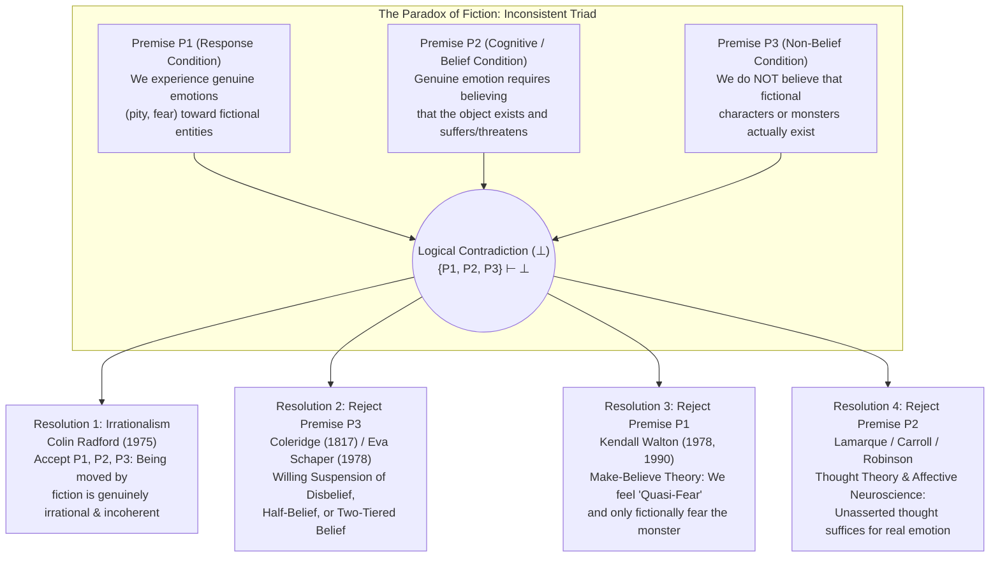
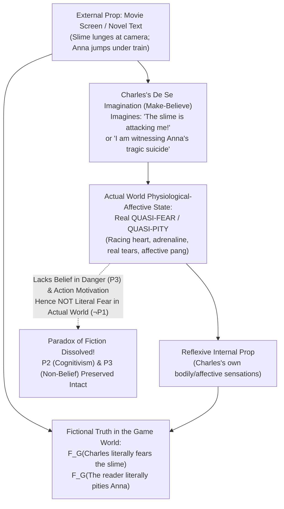
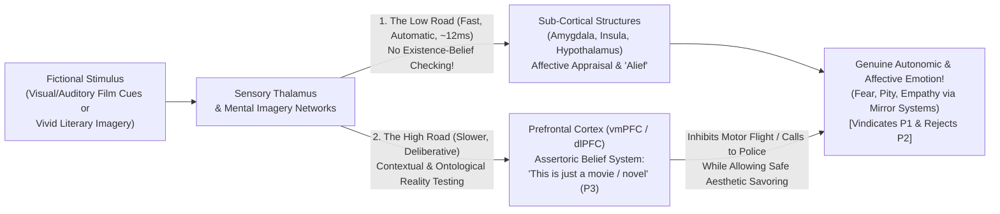
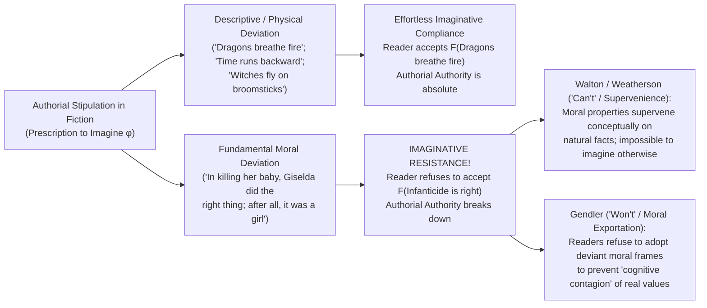

## Introduction: Saint Augustine's Tears for Dido and Hamlet's Wonder at Hecuba

Every day, billions of human beings participate in a psychological phenomenon so familiar that we rarely pause to notice how profoundly mysterious—and seemingly irrational—it is. Toward the end of Leo Tolstoy's nineteenth-century masterpiece *Anna Karenina*, as the despairing Anna stands on a railway platform at dusk and throws herself beneath the iron wheels of an oncoming freight train, readers across the globe feel a tightness in their throats, tears welling in their eyes, and an aching wave of pity and sorrow. Or consider a packed midnight screening of a science-fiction horror film: as a grotesque, ravenous green slime oozes toward the camera lens, the audience's heart rates spike, adrenaline floods their bloodstreams, their palms sweat, and they clutch their armrests in visceral terror.

Yet if we step back and examine these reactions from the standpoint of rational psychology, we immediately confront a philosophical abyss. The reader weeping over *Anna Karenina* is not suffering from a hallucination or a historical delusion; she knows with complete certainty that Anna Karenina never existed, that no woman by that name died beneath that train, and that the entire tragedy consists solely of typographic marks inked onto paper by a Russian novelist. Likewise, the moviegoer recoiling from the green slime knows beyond a shadow of a doubt that he is sitting safely in an air-conditioned theater staring at flickering patterns of light projected onto a flat cloth screen. Why, then, do rational adults weep, grieve, rage, and tremble over the fates of entities they know full well are utterly non-existent?

For nearly two millennia, Western thinkers have marveled at—and sometimes agonized over—this enigmatic power of fiction. Around 397 CE, <strong>Saint Augustine of Hippo (354–430)</strong> looked back in Book III of his *Confessions* at his youth as a student of rhetoric, recalling how deeply he had wept while reading Book IV of Virgil's *Aeneid*, in which the Carthaginian Queen Dido commits suicide upon being abandoned by the Trojan hero Aeneas:

> "What is more pitiful than a wretched man who does not pity himself—weeping over the death of Dido, which was caused by her love for Aeneas, yet weeping not a tear over his own spiritual death, caused by not loving You, O God? ... For if I had been forbidden to read these tales, I would have grieved because I could not read what made me grieve. What madness is more insane than this?" (*Confessions*, III.ii.2–3)

Twelve centuries later, around 1601, <strong>William Shakespeare</strong> placed an equally penetrating meditation on the lips of <strong>Prince Hamlet</strong> (Act II, Scene 2). After watching a traveling player deliver a speech recounting the slaughter of King Priam at the fall of Troy—and seeing the actor grow pale, choke up, and shed real tears for Priam's widowed queen, <strong>Hecuba</strong>—Hamlet is dumbstruck by the disparity between the actor's genuine emotional upheaval over a mere figment of imagination and his own paralysis in the face of his real father's murder:

> "Is it not monstrous that this player here,  
> But in a fiction, in a dream of passion,  
> Could force his soul so to his own conceit  
> That from her working all his visage wann'd,  
> Tears in his eyes, distraction in's aspect,  
> A broken voice, and his whole function suiting  
> With forms to his conceit? and all for nothing!  
> For Hecuba!  
> <strong>What's Hecuba to him, or he to Hecuba, / That he should weep for her?</strong>"

What Augustine lamented as spiritual madness and Hamlet marveled at as theatrical monstrosity was transformed into one of the defining puzzles of twentieth- and twenty-first-century analytic aesthetics and philosophy of mind by the British philosopher <strong>Colin Radford (1935–2001)</strong>. In his seminal 1975 paper in the *Proceedings of the Aristotelian Society*, <strong>"How Can We Be Moved by the Fate of Anna Karenina?"</strong> (co-presented in a symposium with Michael Weston), Radford crystallized this ancient puzzle into a rigorous logical antinomy now universally known as <strong>The Paradox of Fiction</strong> (or the Paradox of Emotional Response to Fiction).

Why has Radford's 1975 paper generated half a century of intense debate involving philosophers such as <strong>Kendall Walton, Peter Lamarque, Noël Carroll, Gregory Currie, Richard Moran, Jenefer Robinson, Tamar Szabó Gendler, and Amie Thomasson</strong>? Because resolving the Paradox of Fiction is not merely a matter of literary criticism. It forces us to answer foundational questions at the intersection of philosophy of mind, epistemology, cognitive neuroscience, and metaphysics:
1. <strong>What is an emotion?</strong> Does experiencing a genuine object-directed emotion (like pity or fear) logically or causally require an assertoric belief in the existence of its object?
2. <strong>How does imagination differ from belief?</strong> What is the functional architecture of mental simulation ("make-believe"), and how does it interface with our autonomic nervous system and behavioral motivation?
3. <strong>Why do we seek painful emotions in art?</strong> How does the Paradox of Fiction relate to the <strong>Paradox of Tragedy and Horror</strong> and the puzzle of <strong>Imaginative Resistance</strong>?
4. <strong>What is the ontological status of fictional characters?</strong> When we say *"I pity Anna Karenina"* or *"Sherlock Holmes is more famous than any real detective,"* what—if anything—are we referring to?

In this comprehensive treatise, we will dissect the logical architecture of the Paradox of Fiction, examine the four major philosophical strategies for resolving it, integrate insights from contemporary affective neuroscience (dual-process appraisal pathways and "alief"), and explore its sister paradoxes and metaphysical foundations.

---

## Chapter 1: The Logical Structure of the Paradox — An Inconsistent Triad

In analytic philosophy, a genuine paradox consists of a set of propositions that are <strong>individually plausible</strong>—supported by strong pre-theoretical intuition, empirical phenomenology, or well-established philosophical theory—yet <strong>jointly inconsistent</strong> (their conjunction entails a logical contradiction, $\bot$). Colin Radford formulated the Paradox of Fiction as an <strong>Inconsistent Triad</strong> composed of three premises: $P_1, P_2,$ and $P_3$.

### Premise $P_1$: The Response Condition (Phenomenological Fact)

> <strong>($P_1$) We genuinely experience real, literal, object-directed emotions (such as pity, grief, fear, anger, and admiration) toward fictional characters and events.</strong>

On its face, $P_1$ is an undeniable empirical and phenomenological truth. When we weep for Anna Karenina, Mercutio in *Romeo and Juliet*, or Little Nell in Dickens's *The Old Curiosity Shop*, we are not pretending to be sad in order to fool someone in the room. Our grief feels heartfelt and unfeigned; our tears contain the same stress hormones and neurochemical markers as tears shed in ordinary life; and our heart rate and electrodermal skin conductance when watching a horror film are physiologically indistinguishable from genuine fear. Furthermore, in ordinary language and serious literary criticism, statements like *"The audience was terrified by the monster"* or *"We feel profound pity for Anna"* are treated as literally true descriptions of our mental states.

### Premise $P_2$: The Cognitive / Existence-Belief Condition on Emotion

> <strong>($P_2$) In order for a subject $S$ to experience a genuine object-directed emotion $E$ toward an object or event $X$, $S$ must believe that $X$ actually exists (or existed, or will exist) and actually possesses the relevant evaluative properties (e.g., suffering harm or posing a threat).</strong>

We can formalize $P_2$ in quantified modal-doxastic logic. Let $\text{Emotion}_E(S, X)$ denote that subject $S$ experiences genuine emotion $E$ directed at $X$; let $\text{Bel}_S(\phi)$ denote that $S$ holds the assertoric belief that $\phi$; and let $\text{Eval}_E(x)$ denote that $x$ instantiates the formal evaluative property appropriate to emotion $E$ (such as undergoing undeserved suffering in the case of pity, or posing imminent danger in the case of fear). Premise $P_2$ states:

$$\forall S \forall X \Big( \text{Emotion}_E(S, X) \implies \text{Bel}_S\big(\exists x (x = X \land \text{Eval}_E(x))\big) \Big)$$

Why is $P_2$ so compelling? Consider Radford's famous real-life thought experiment. Suppose a man tells you a harrowing story about his sister: she has just been mangled in a horrific car crash on the highway and is dying in agony in the intensive care unit. As you listen to the gruesome details, you are overcome with horror, anguish, and deep pity for the young woman and her family; tears come to your eyes. Then, once you are thoroughly moved, the man grins and tells you: *"Relax! I made the whole thing up as a performance test—I don't even have a sister!"*

What happens to your pity and anguish for the mangled sister at the exact instant you learn she does not exist? Your autonomic arousal (racing heart, shaky hands) may take a minute to subside, and your pity will immediately be replaced by a very different emotion—indignation or anger directed at the prankster who deceived you. <strong>But your pity and grief for the sister vanish instantaneously.</strong> Why? Because you no longer believe that anyone was hurt or that the sister exists! Indeed, if—after being completely convinced that the story was a fabrication and that no sister exists—you continued to sob inconsolably, crying *"Oh, but I still feel so terribly sorry for that poor girl dying in the hospital!"*, we would judge your emotional state to be bizarre, unintelligible, or downright pathological.

Thus, our ordinary concept of object-directed emotions (as distinct from objectless moods like free-floating anxiety or melancholy) embeds a strict <strong>Existence-Belief Requirement</strong>: you cannot genuinely pity someone unless you believe they actually suffer, and you cannot genuinely fear something unless you believe it actually threatens harm.

### Premise $P_3$: The Non-Belief Condition

> <strong>($P_3$) Normal, rational adult readers and audiences do not believe that fictional characters and events actually exist.</strong>

Formally, for any normal consumer of fiction $S$ and any known fictional entity $X$:

$$\neg \text{Bel}_S\big(\exists x (x = X)\big)$$

Premise $P_3$ is attested by our entire pattern of action and deliberation. A reader weeping over *Anna Karenina* does not attempt to contact the Russian authorities to investigate rail safety in Moscow; a spectator watching Shakespeare's *Othello* does not leap onto the stage to rescue Desdemona from being strangled, nor does he dial emergency services to report a murder; and a moviegoer terrified by the green slime remains seated in the theater eating popcorn rather than sprinting for the fire exit. Only someone suffering from a severe cognitive breakdown (like Cervantes's Don Quixote smashing Master Pedro's puppet theater to save fugitive lovers) confuses theatrical representation with reality.

### The Contradiction and the Four Philosophical Escape Routes

When we combine the three premises, a formal contradiction follows immediately via *modus ponens*:
1. <strong>($P_1$)</strong> $\text{Emotion}_E(S, X)$
2. <strong>($P_2$)</strong> $\text{Emotion}_E(S, X) \implies \text{Bel}_S\big(\exists x (x = X)\big)$
3. <strong>($P_3$)</strong> $\neg \text{Bel}_S\big(\exists x (x = X)\big)$
4. <strong>Conclusion ($\bot$):</strong> From (1) and (2), $\text{Bel}_S(\exists x(x=X))$, which directly contradicts (3): $\{P_1, P_2, P_3\} \vdash \bot$.

As the diagram illustrates, every possible philosophical response to the Paradox of Fiction must adopt one of four structural strategies:
1. <strong>Irrationalism (Colin Radford)</strong>: Accept all three premises ($P_1, P_2, P_3$) and conclude that human emotional responses to fiction are <strong>genuinely irrational, inconsistent, and incoherent</strong>.
2. <strong>Rejecting or Modifying $P_3$ (Suspension of Disbelief / Illusionism)</strong>: Argue that while immersed in fiction, we temporarily suspend our disbelief, enter a state of "half-belief," or rely on genuine beliefs about what is true within the story.
3. <strong>Rejecting or Reinterpreting $P_1$ (Make-Believe Theory / Simulationism — Kendall Walton)</strong>: Uphold $P_2$ and $P_3$ strictly, arguing that our responses to fiction are not literal real-world emotions (like real fear or real pity), but rather physiological/affective <strong>quasi-emotions</strong> (*quasi-fear*, *quasi-pity*) integrated into a <strong>game of make-believe</strong> within which it is *fictionally true* that we pity Anna or fear the slime.
4. <strong>Rejecting or Weakening $P_2$ (Thought Theory / Anti-Cognitivism — Peter Lamarque, Noël Carroll, Jenefer Robinson)</strong>: Uphold $P_1$ and $P_3$, arguing that genuine emotions do <strong>not</strong> require existential belief; vividly entertaining an unasserted propositional <strong>thought</strong> (or triggering sub-cortical affective appraisals prior to prefrontal belief-checking) is wholly sufficient to generate real emotion.

Before evaluating these four resolutions, we must first understand why Premise $P_2$—the cognitive theory of emotion—occupied such a dominant position in twentieth-century philosophy of mind.

---

## Chapter 2: Why Belief Seems Indispensable — The Cognitive Theory of Emotion

To a layperson influenced by romanticism or early psychology, emotions might seem like raw, non-rational bodily feelings—mere "ushes of adrenaline" or "visceral pangs" similar to an itch, a headache, or a shiver. That non-cognitive view—famously associated with <strong>William James</strong> and <strong>Carl Lange</strong> (the James-Lange theory, 1884, which identified an emotion with the conscious perception of bodily changes) and early twentieth-century Logical Positivism—treated emotions as non-intentional sensations devoid of cognitive content.

However, beginning in the late 1950s and 1960s, philosophers of mind—drawing inspiration from <strong>Aristotle's *Rhetoric* (Book II)</strong> and <strong>Baruch Spinoza's *Ethics* (Part III)</strong>—staged a massive theoretical revolution known as <strong>Cognitivism about Emotions</strong> (or <strong>Judgmentalism</strong>). Led by <strong>Errol Bedford (1957)</strong>, <strong>Anthony Kenny (*Action, Emotion and Will*, 1963)</strong>, <strong>Robert C. Solomon (*The Passions*, 1976)</strong>, and later <strong>Martha C. Nussbaum (*Upheavals of Thought: The Intelligence of Emotions*, 2001)</strong>, cognitivists demonstrated that emotions cannot be reduced to bodily sensations for three fundamental reasons:

### 1. Intentionality and Individuation by Formal Objects

Unlike a bodily sensation (a toothache or a stomach cramp) or a diffuse mood (generalized irritability or boredom), an <strong>emotion is essentially intentional</strong>: it is directed *at* or *about* an object or state of affairs in the world ($\text{Emotion}_E(S, X)$). You are never merely "proud" or "ashamed" in a vacuum; you are proud *of* an achievement or ashamed *of* a transgression.

More importantly, physiologically identical states of autonomic arousal (elevated heart rate, rapid breathing, catecholamine release—as demonstrated in <strong>Stanley Schachter and Jerome Singer's classic 1962 two-factor adrenaline experiments</strong>) can be experienced as <strong>fear, anger, indignation, jealousy, or euphoria</strong> depending entirely on how the subject <strong>cognitively appraises or judges</strong> the situation. Each emotion type $E$ is defined by its <strong>Formal Object</strong>—an evaluative category that the target object must be judged to instantiate:
- <strong>Fear (*phobos*)</strong>: Appraising $X$ as posing an imminent, significant threat or danger to oneself or what one cares about.
- <strong>Pity / Compassion (*eleos*)</strong>: Appraising $X$ as suffering serious, undeserved misfortune (as Aristotle analyzed in *Rhetoric* 1385b13).
- <strong>Anger (*orgē*)</strong>: Appraising $X$ as having committed an unjustified slight or offense against oneself or one's circle.
- <strong>Remorse</strong>: Appraising oneself as morally culpable for a past wrong.

Without the cognitive judgment or belief that $X$ exists and instantiates this evaluative property, there is nothing to individuate the emotion as *pity* rather than *indignation* or *indigestion*.

### 2. Rational Assessability and Belief-Sensitivity

We do not criticize a person's headache or shiver as "irrational," "unwarranted," or "unjustified." Yet we routinely subject emotions to <strong>rational assessment</strong> based on the truth and justification of their underlying beliefs. If you are furious at your colleague because you believe he stole your wallet, and you suddenly find your wallet in your own coat pocket, your anger at your colleague becomes rationally indefensible—and in a normal agent, it immediately dissipates.

This direct sensitivity of emotion to existential and evaluative belief is precisely what makes Premise $P_2$ the cornerstone of rational psychology. And it is precisely why our emotional response to fiction—where the existential belief is completely absent from the outset—poses such an acute philosophical crisis.

---

## Chapter 3: Resolution 1 — Colin Radford's Irrationalism and Its Discontents

In his landmark 1975 article *"How Can We Be Moved by the Fate of Anna Karenina?"*, Colin Radford systematically examined five plausible ways of trying to dissolve the paradox (including suspension of disbelief, pretending, and comparing fictional characters to real people) and argued that every single one of them fails to capture the phenomenology and logic of our actual experience.

Radford's bold conclusion was that <strong>all three premises ($P_1, P_2,$ and $P_3$) are strictly true</strong>, and therefore <strong>our being moved to tears or terror by fictional works involves us in brute inconsistency, incoherence, and irrationality</strong>:

> "I am left with the conclusion that our being moved in certain ways by works of art, though very 'natural' to us and in that way only too intelligible, involves us in inconsistency and so incoherence." (Radford 1975, p. 78)

To make this conclusion palatable, Radford pointed out that human beings exhibit similar islands of cognitive-affective irrationality in non-fictional domains as well. For instance:
- <strong>Phobias and irrational fears</strong>: A person with arachnophobia or acrophobia may know with 100% rational certainty that a harmless house spider in a sealed glass jar—or standing on the reinforced glass floor of the CN Tower—poses zero danger ($\neg \text{Bel}(\text{Danger})$), yet still experience acute, genuine terror ($P_1$).
- <strong>Grief after acceptance of death</strong>: A bereaved parent who knows that her deceased child is no longer conscious and cannot feel cold may nevertheless feel anguish at the thought of rain falling on the child's grave.

According to Radford, weeping for Anna Karenina or fearing a movie monster is simply a culturally ubiquitous, benign species of this same split-minded human irrationality: our emotional heart responds as if Anna were real, while our cognitive head knows she is not.

### Why Philosophers Reject Radford's Irrationalism

While Radford's paper brilliantly framed the debate, virtually no contemporary aesthetician accepts his irrationalist conclusion, for three decisive reasons:

1. <strong>The Normative Inversion Objection (Artistic Sensitivity vs. Psychopathology)</strong>:
   In the case of a phobia (fear of a harmless spider in a jar), we recognize the fear as a *defect* of rationality—something to be overcome through cognitive-behavioral therapy. If someone lacks the phobia and feels calm around harmless spiders, they are functioning *more rationally and properly*. By contrast, in the realm of literature and drama, a person who reads *Anna Karenina*, *King Lear*, or *The Brothers Karamazov* with complete emotional detachment—saying *"Why should I feel anything? None of these people ever existed"*—is not praised as a paragon of superior rationality! Rather, we judge such a reader to have <strong>failed to understand and appreciate the work properly</strong>, or to suffer from a stunting of moral and aesthetic sensibility. Any theory that classifies our deepest, most cultivated aesthetic responses as a cognitive malfunction on par with a phobia gets the normative epistemology of art entirely backward.
2. <strong>Intact Behavioral Control</strong>:
   When a genuinely phobic person is gripped by irrational terror, their behavior is disrupted: they freeze, tremble uncontrollably, and flee the room despite their better judgment. When an audience member "fears" Hannibal Lecter or the Alien xenomorph in a cinema, their behavioral control remains 100% intact—they sit calmly, admire the cinematography, and sip their drink. This systematic decoupling from action shows that fictional emotion is not a chaotic breakdown of rational control, but a structured cognitive capacity operating exactly as designed.
3. <strong>Methodological Charity</strong>:
   When an almost universal human capacity (emotional engagement with storytelling across all cultures and epochs) conflicts with a philosophical theory of emotion (Premise $P_2$) or a naive linguistic interpretation of emotion reports (Premise $P_1$), sound philosophical methodology dictates that we revise our theory of emotion or representation rather than convict the entire human species of ubiquitous incoherence.

---

## Chapter 4: Resolution 2 — Rejecting $P_3$: Coleridge's "Willing Suspension of Disbelief" and Two-Tiered Belief

If we reject Radford's irrationalism, could the solution lie in rejecting or qualifying <strong>Premise $P_3$ (The Non-Belief Condition)</strong>? Perhaps, while absorbed in a compelling novel or play, we temporarily forget that it is fiction and actually *believe* (or "half-believe") in the existence of the characters!

### 1. Coleridge and "Poetic Faith"

The most famous formulation of this idea in literary history comes from the English Romantic poet and philosopher <strong>Samuel Taylor Coleridge (1772–1834)</strong>. In Chapter XIV of his *Biographia Literaria* (1817), explaining the division of labor between himself and William Wordsworth in composing the *Lyrical Ballads*, Coleridge wrote that his task in treating supernatural and romantic characters was to infuse enough human interest and semblance of truth to procure from the reader:

> <strong>"...that willing suspension of disbelief for the moment, which constitutes poetic faith."</strong>

Taken literally as a psychological explanation of the Paradox of Fiction, the "Suspension of Disbelief" (or <strong>Illusionist / Half-Belief</strong>) hypothesis claims that when we enter a theater or open a novel, we voluntarily suspend our critical awareness that the events are fictional ($\neg \text{Bel}(\neg \exists X)$) and slip into a temporary illusion or partial belief that Anna Karenina is actually dying before our eyes. Once $P_3$ is suspended, $P_2$ is satisfied, and our tears are explained.

A much more sophisticated philosophical defense of modifying $P_3$ was offered by <strong>Eva Schaper</strong> in her 1978 paper <strong>"Fiction and the Suspension of Disbelief"</strong> (*British Journal of Aesthetics*). Rejecting the crude idea that we suffer from delusions in the theater, Schaper argued for a <strong>two-tiered structure of beliefs</strong>:
- <strong>First-order beliefs about reality</strong>: We know that Anna Karenina is a fictional character and that no flesh-and-blood woman is jumping under a train (which explains why we do not call the police).
- <strong>Second-order beliefs about the fictional world (Fictional Entailments)</strong>: We hold genuine, literal *beliefs* about what is happening *in the story*—for example, we truly believe the proposition that *(in Tolstoy's novel) Anna Karenina is driven to despair by Vronsky's cooling affection and takes her own life*. According to Schaper, these genuine beliefs about fictional truths are sufficient to satisfy the cognitive requirement for emotion.

### 2. Why Rejecting $P_3$ Fails

Despite the enduring popularity of Coleridge's phrase in everyday speech, both the literal "Suspension of Disbelief" and Schaper's two-tiered belief account fail to resolve the paradox:

1. <strong>Doxastic Involuntarism</strong>:
   As David Hume, Bernard Williams ("Deciding to Believe," 1970), and contemporary epistemologists have shown, <strong>belief is not under direct voluntary control</strong>. You cannot simply decide by an act of will to suspend your disbelief that a stage actor is pretending, any more than you can decide to believe for the next ten minutes that the moon is made of green cheese. We can *imagine* at will, but we cannot *believe* at will.
2. <strong>The Behavioral and Aesthetic Asymmetry</strong>:
   Even if our disbelief were somehow involuntarily suspended for a few seconds during a horror movie, a genuine belief (or even a 50% "half-belief") that a lethal monster is ten feet away would immediately trigger self-protective action: if you believed there was even a 10% chance that a man-eating slime was oozing into the auditorium, you would bolt for the exit immediately! Furthermore, aesthetic appreciation requires <strong>simultaneous dual awareness</strong>: to admire the brilliance of Anthony Hopkins's performance as Hannibal Lecter or Tolstoy's prose craftsmanship in describing Anna's death, we must remain continuously aware *at the very moment of highest emotional intensity* that we are experiencing an artwork.
3. <strong>The Collapse of Schaper's Account into $P_2$-Revision</strong>:
   Eva Schaper is completely right that we hold genuine beliefs of the form $\text{Bel}_S(\text{In the story, Anna suffers})$. However, believing that *according to a text, a non-existent character suffers* is merely believing a literary fact about a text—it is <strong>not</strong> believing that any sentient being is actually suffering ($\text{Bel}_S(\exists x \, \text{Suffers}(x))$), which is what Premise $P_2$ requires! If believing that *in the story Anna suffers* is enough to cause pity, then Premise $P_2$ (which requires believing in the real existence of the sufferer) has actually been abandoned in favor of a Thought Theory or Make-Believe Theory.

Thus, the decisive philosophical battleground narrows to two monumental alternatives: <strong>Kendall Walton's Make-Believe Theory (rejecting $P_1$)</strong> and <strong>The Thought Theory / Affective Neuroscience Account (rejecting $P_2$)</strong>.

---

## Chapter 5: Resolution 3 — Kendall Walton's Theory of Make-Believe and "Quasi-Fear" (Rejecting $P_1$)

In his groundbreaking 1978 *Journal of Philosophy* article <strong>"Fearing Fictions"</strong> and his magisterial 1990 book <strong>*Mimesis as Make-Believe: On the Foundations of the Representational Arts</strong>*, <strong>Kendall L. Walton</strong> (University of Michigan) developed one of the most original, comprehensive, and influential theories in the history of aesthetics.

Walton's strategy is uncompromising: <strong>he defends Premise $P_2$ (the Existence-Belief Condition on genuine emotion) and Premise $P_3$ (the Non-Belief Condition) in their strictest forms, and resolves the paradox by denying Premise $P_1$</strong>. According to Walton, when we watch a horror movie or read a tragedy, we do <strong>not</strong> literally fear the monster or literally pity Anna Karenina in the real world. Instead, we experience real physiological-affective states he calls <strong>Quasi-Emotions</strong> (*quasi-fear*, *quasi-pity*) while participating in a structured <strong>Game of Make-Believe</strong> within which it is <strong>fictionally true</strong> that we fear the monster or pity Anna.

To grasp the power of Walton's solution, we must examine its three architectural pillars: (1) Props and Games of Make-Believe, (2) Charles and the Green Slime (*Quasi-Fear* vs. *Real Fear*), and (3) Reflexive Psychological Participation.

### 1. Props, Principles of Generation, and Fictional Truths

Walton begins by modeling all representational arts (novels, paintings, theater, cinema) on children's <strong>games of make-believe</strong> (pretend play).

Imagine two children, Gregory and Eric, playing a game in the woods in which they agree—explicitly or implicitly—that <strong>all tree stumps are bears</strong>. In Walton's terminology:
- The real tree stumps in the forest serve as <strong>Props</strong>: real-world objects whose actual features mandate or prescribe certain imaginings according to the rules of the game (<strong>Principles of Generation</strong>).
- A proposition $\phi$ is <strong>Fictionally True</strong> (or true in the world of the game of make-believe, written $\mathcal{F}(\phi)$) if and only if there is a prescription to imagine $\phi$ generated by the props and the principles of generation.
- Crucially, <strong>fictional truth is objective relative to the game</strong>: if there is a tree stump hidden behind a bush that neither Gregory nor Eric has noticed yet, it is *already fictionally true* that a bear is lurking behind the bush ($\mathcal{F}(\text{A bear is behind the bush})$)!

Now, Walton argues, <strong>works of representational art—Tolstoy's *Anna Karenina*, Leonardo's *Mona Lisa*, Hitchcock's *Psycho*—are culturally institutionalized props designed specifically for games of make-believe</strong>.
Here Walton draws a vital distinction between two worlds of make-believe:
1. <strong>The Work World ($\mathcal{F}_W$)</strong>: The set of propositions that are fictionally true *in the work itself* (e.g., $\mathcal{F}_W(\text{Anna Karenina throws herself under a train})$).
2. <strong>The Appreciator's Game World ($\mathcal{F}_G$)</strong>: When a reader reads *Anna Karenina* or a spectator views a painting or film, the appreciator uses the work as a prop to play their own <strong>authorized game of make-believe</strong> in which <strong>the appreciator himself or herself is a reflexive participant</strong>! For example, when looking at Georges Seurat's painting *A Sunday Afternoon on the Island of La Grande Jatte*, it is fictionally true in your game ($\mathcal{F}_G$) that *you are actually seeing people strolling in a park* (even though in reality you are looking at flat dabs of oil paint on canvas).

### 2. Charles and the Green Slime: Dissecting "Quasi-Fear"

With this machinery in place, Walton introduces his famous case study: <strong>Charles and the Green Slime</strong>.

Charles is watching a horror movie about a terrifying green slime that oozes across the earth, engulfing and dissolving every living creature in its path. Midway through the film, the slime suddenly lunges directly toward the camera—straight at the viewer! Charles gasps, clutches the arms of his seat, feels his heart pounding furiously in his chest, breaks into a cold sweat, and feels an acute knot of dread in his stomach. Afterward, Charles confesses to his friends: *"I was genuinely terrified of that slime!"*

Did Charles <strong>literally fear</strong> the green slime in the real world? Walton answers: <strong>No ($\neg P_1$)</strong>.
Why? Because real, literal fear has two essential components that Charles completely lacks:
1. <strong>Cognitive Component (Belief in Danger)</strong>: Real fear requires believing that the object poses an actual causal threat to one's safety ($P_2$). Charles knows he is in a cinema watching a projection of light ($P_3$).
2. <strong>Conative / Behavioral Component (Motivation to Flee or Defend)</strong>: Real fear is functionally connected to action—it motivates the agent to run away, hide, fight, or call for help. Charles never even considers fleeing the theater or calling the police; he stays glued to his seat voluntarily.

However, Walton emphasizes that Charles is <strong>not</strong> coldly pretending or faking his reaction! Something very real and intense is happening inside Charles's body and conscious phenomenology. Walton coins the technical term <strong>Quasi-Fear</strong> (and more generally, <strong>Quasi-Emotion</strong>) to designate the <strong>purely physiological and affective-phenomenological state</strong> characteristic of fear: the racing pulse, the surge of adrenaline, the muscular tension, the involuntary flinch, and the conscious sensation of butterflies or dread—<strong>stripped of existential belief and behavioral motivation</strong>.

### 3. How Quasi-Fear Generates Fictional Fear ($\mathcal{F}_G(\text{Fear})$)

How do Charles's imagination and his real *quasi-fear* fit together? Walton traces a brilliant causal-representational loop:

1. <strong>Perception of the External Prop</strong>: Charles sees the image of the green slime rushing toward the camera on the movie screen.
2. <strong>De Se (Self-Referential) Make-Believe</strong>: Prompted by the camera angle (an external prop), Charles imagines *of himself* ($de\ se$) that the green slime is lunging straight at *him* and that he is in mortal danger:
   $$\mathcal{F}_G\big(\text{The slime is attacking Charles}\big)$$
3. <strong>Causal Triggering of Real Quasi-Fear</strong>: This vivid $de\ se$ imagining automatically triggers Charles's autonomic nervous system, causing him to experience <strong>real, actual quasi-fear</strong> (racing heart, sweaty palms, phenomenological dread) in the actual world!
4. <strong>Quasi-Fear as a Reflexive Prop</strong>: In Charles's game of make-believe, his own actual bodily and affective state of *quasi-fear* acts as a <strong>second, internal prop</strong>! According to the principles of generation governing his game, the fact that Charles is experiencing real *quasi-fear* because of his realization that the slime is attacking him makes it <strong>fictionally true in his game that he is literally afraid of the slime</strong>:
   $$\text{Imagine}_{\text{Charles}}(\text{Danger}) \xrightarrow{\text{causes}} \text{QuasiFear}(\text{Charles}) \xrightarrow{\text{generates}} \mathcal{F}_G\big(\text{LiteralFear}(\text{Charles}, \text{Slime})\big)$$

When Charles tells his friend after the movie, *"I was terrified of the slime,"* his statement is not false or irrational; it is simply a statement made <strong>within the scope of the game of make-believe</strong> (i.e., *"Fictionally, I was terrified of the slime"*), or a loose conversational report that he experienced intense *quasi-fear* while playing the game!

Walton compares this directly to a father playing "Monster" with his young child. When the father growls and lunges at the child, the child shrieks with delight and terror, his heart pounding as he dives behind the sofa. The child knows full well that his father loves him and will not eat him ($\neg \text{Bel}(\text{Danger})$). The child experiences thrilling <strong>quasi-fear</strong> in reality, which makes it <strong>fictionally true in their game</strong> that the child is terrified of the ferocious monster!

<strong>(A Brief Note on Gregory Currie's Simulation Theory, 1990)</strong>: Building on Walton's insight and cognitive science, <strong>Gregory Currie</strong> (*The Nature of Fiction*, 1990) reformulated make-believe in terms of <strong>Mental Simulation (Off-line Simulation)</strong>. According to Currie, when we read fiction, we take our standard belief-desire-emotion psychological system <strong>"off-line"</strong>—disconnecting it from perceptual belief inputs and behavioral motor outputs—and feed it <strong>simulated beliefs and desires (imaginings)</strong>. Those off-line inputs run through our real emotional processing hardware, generating real somatic and affective feedback without ever producing real-world beliefs or actions.

---

## Chapter 6: Resolution 4 — Rejecting $P_2$: The Thought Theory and Affective Neuroscience

Despite its extraordinary ingenuity, Kendall Walton's Make-Believe Theory provoked fierce resistance from philosophers who insisted that <strong>denying Premise $P_1$ distorts the phenomenology and psychology of our emotional lives</strong>. Beginning in the 1980s and 1990s, <strong>Peter Lamarque (1981)</strong>, <strong>Noël Carroll (1990)</strong>, <strong>Richard Moran (1994)</strong>, <strong>Bijoy Boruah (1988)</strong>, <strong>Jenefer Robinson (2005)</strong>, and <strong>Tamar Szabó Gendler (2008)</strong> argued that the true culprit in the Paradox of Fiction is <strong>Premise $P_2$ (the Existence-Belief Condition)</strong>.

Before presenting their positive alternative—<strong>The Thought Theory</strong> and <strong>Dual-Process Affective Neuroscience</strong>—let us examine the three devastating objections they leveled against Walton's account.

### 1. Three Major Objections to Walton's Make-Believe Theory

1. <strong>The Phenomenological and Psychological Continuity Objection</strong>:
   According to Walton, Charles does not experience *real fear*, and the reader of *Anna Karenina* or *Uncle Tom's Cabin* does not experience *real pity* or *real moral indignation*—they only experience physiological *quasi-emotions* and "make-believe" that they pity or fear. Critics respond that this draws an artificial, *ad hoc* boundary where none exists in psychology or neuroscience. If you read a heart-wrenching newspaper report about an orphan freezing to death and weep with pity, and the next day you learn it was a short story by Dostoevsky, did your mental state yesterday retroactively cease to be "pity" and become "quasi-pity"? Phenomenologically, neurobiologically, and emotionally, the sorrow we feel for Anna Karenina or for Holocaust victims in a fictionalized drama is <strong>genuine emotion</strong>, not a game of pretend!
2. <strong>The Implausibility of Ubiquitous $De\ Se$ Self-Projection</strong>:
   Walton's account works smoothly for the green slime lunging directly at the camera (where Charles imagines *of himself* that he is being attacked). But what about third-person literary narratives like *Anna Karenina* or *Oedipus Rex*? When you weep for Anna Karenina, are you really playing a game of make-believe in which <strong>you yourself exist inside nineteenth-century Russia, standing invisible on the Moscow train platform watching Anna jump</strong>? Clearly not! You do not imagine yourself in the story world at all; you sit in the real world, contemplate the tragic fate of Anna, and feel genuine pity for her.
3. <strong>The Involuntariness of Emotion vs. Voluntary Make-Believe</strong>:
   As Noël Carroll (1990) pointed out, participating in a game of make-believe is normally an intentional, rule-guided activity. Yet our emotional responses to fiction are frequently <strong>involuntary and even unwelcome</strong>: we try *not* to cry during a sentimental tearjerker, or we try *not* to be terrified by a horror film, yet the emotion overwhelms us anyway. We are not using our tears as "props" to pretend we are sad; we are genuinely moved to tears!

### 2. The Thought Theory (Peter Lamarque & Noël Carroll)

If $P_1$ (we feel genuine emotions) and $P_3$ (we do not believe the characters exist) are both true, then <strong>Premise $P_2$ must be false</strong>: experiencing a genuine object-directed emotion does <strong>not</strong> require an assertoric belief that the object exists!

In his 1981 paper <strong>"How Can We Fear and Pity Fictions?"</strong> (*British Journal of Aesthetics*) and in <strong>Noël Carroll's</strong> landmark 1990 book <strong>*The Philosophy of Horror, or Paradoxes of the Heart</strong>*, the <strong>Thought Theory</strong> was formulated as follows:

> <strong>The Thought Theory of Emotional Response</strong>: While genuine emotions *can* be caused by assertoric beliefs (as in ordinary life), they can equally well be caused—and sustained—by <strong>vividly entertaining a propositional thought (or mental representation / sense-cluster) in imagination without asserting its truth</strong>.

Carroll illustrates this with clean, non-fictional examples from everyday life:
- <strong>The Cliffside Thought Experiment</strong>: Stand securely behind a sturdy steel railing on a high balcony overlooking a 1,000-foot sheer drop. You believe with 100% certainty that you are completely safe ($\neg \text{Bel}(\text{Danger})$). Now, vividly <strong>entertain the thought</strong> (visualize in your mind's eye) of your body pitching forward over the railing and plummeting headfirst onto the rocks below. Instantly, a wave of genuine fear and vertigo washes over you, and you step back from the railing! Your fear was caused not by a *belief* that you are falling, but by the <strong>content of your unasserted thought</strong> ($\text{Thought}(\text{I am plummeting off the cliff})$).
- <strong>The Disgust Thought Experiment</strong>: Vividly imagine chewing on a mouthful of live, wriggling earthworms or drinking from a glass filled with warm pus. Even though you know there are no worms in your mouth ($\neg \text{Bel}(\exists x)$), the mere mental representation triggers genuine <strong>disgust</strong> and nausea.

Applied to fiction, Carroll argues that when we read Bram Stoker's *Dracula* or watch the green slime movie, we form a complex mental representation—a <strong>Thought-Content</strong> (in Fregean terms, an intensional *Sinn* or cluster of descriptive properties: *an impure, lethal, slimy creature that dissolves human flesh*). What causes our genuine emotion of "art-horror" (a compound of fear and disgust), and what serves as its <strong>intentional object</strong>, is this <strong>unasserted Thought-Content</strong> held vividly before the mind! Because the emotion is generated by entertaining a *thought* rather than holding an *existential belief*, two puzzles are solved at a single stroke:
1. Why we experience <strong>real, genuine emotion</strong> ($P_1$ is vindicated).
2. Why we <strong>do not flee the theater or call the police</strong> (because action-programs for physical flight are triggered only when an emotion is coupled with an *assertoric belief* in clear and present danger, whereas thought-generated emotions remain decoupled from motor flight!).

### 3. Affective Neuroscience and "Alief": Sub-Cortical Appraisal vs. Prefrontal Monitoring

In the twenty-first century, the philosophical debate over $P_2$ has been profoundly enriched by discoveries in <strong>Affective Neuroscience</strong> (led by <strong>Joseph LeDoux</strong>, <strong>Antonio Damasio</strong>, and <strong>Jaak Panksepp</strong>) and incorporated into aesthetics by <strong>Jenefer Robinson (*Deeper than Reason: Emotion and its Role in Literature, Music, and Art*, 2005)</strong> and <strong>Tamar Szabó Gendler ("Alief and Belief," 2008)</strong>.

Traditional philosophical cognitivism ($P_2$) assumed that an emotion is a unified, high-level propositional attitude seated in the rational cortex. Modern neuroscience has revealed that human emotion is actually a <strong>multi-stage, dual-pathway process</strong>:

1. <strong>The Fast Sub-Cortical Pathway ("The Low Road" / Non-Cognitive Affective Appraisal)</strong>:
   As Joseph LeDoux (*The Emotional Brain*, 1996) demonstrated, sensory and imaginative representations are routed directly to sub-cortical limbic structures—most notably the <strong>amygdala</strong> (for fear and threat detection), the <strong>anterior insula</strong> (for disgust and visceral pain empathy), and the <strong>anterior cingulate cortex</strong>. Crucially, <strong>the amygdala is evolutionarily ancient and "fiction-blind"</strong>: it does not possess the syntactic or ontological machinery to distinguish between *an actual predator*, *a cinematic projection of a predator*, or *a vividly imagined tragedy*. It responds immediately and automatically to the perceptual or imaginative gestalt, launching a <strong>genuine physiological and affective emotional response</strong> before the rational cortex has even finished parsing the ontological status of the stimulus!
2. <strong>The Slower Cortical Pathway ("The High Road" / Prefrontal Cognitive Monitoring)</strong>:
   Milliseconds later, the <strong>ventromedial and dorsolateral prefrontal cortex (vmPFC / dlPFC)</strong> evaluates the context: *"I am sitting in a movie theater; this is a fictional story"* ($P_3$). Instead of completely shutting down the sub-cortical emotional response, the prefrontal cortex <strong>inhibits the motor output</strong> (preventing you from running out of the theater) and reappraises the emotional arousal within a safe aesthetic frame, allowing you to savor and reflect upon the emotional experience.
3. <strong>Tamar Gendler's Concept of "Alief" (2008)</strong>:
   To capture this architecture within philosophy of mind, Yale philosopher <strong>Tamar Szabó Gendler</strong> introduced the concept of <strong>Alief</strong>—an innate or habitual mental state that is associative, automatic, and arational, consisting of a cluster of <strong>Representational-Affective-Behavioral ($R\text{-}A\text{-}B$)</strong> propensities. When Charles watches the green slime, his explicit cortical <strong>Belief</strong> is *"The slime is a harmless fictional projection,"* but the vivid visual stimulus activates an automatic <strong>Alief</strong> with the content: *" Slimy, dangerous monster rushing at me! Feel terror! Recoil!"* Because our emotional hardware is wired to respond to perceptual and imaginative representations (*aliefs* and *thoughts*) rather than solely to truth-evaluated *beliefs*, Premise $P_2$ is empirically false.

---

## Chapter 7: Comprehensive Comparison Matrix of the Four Resolutions

To synthesize the debate, the following table compares the four major philosophical solutions to the Paradox of Fiction across their logical structure, emotional ontology, behavioral explanation, and chief vulnerabilities:

| Resolution Strategy | Target Premise Rejected | Key Proponents & Landmark Works | What Is Our Emotional State Toward Fiction? | Why Don't We Flee the Theater or Call 911? | Primary Philosophical Strength | Primary Vulnerability / Critique |
| :--- | :---: | :--- | :--- | :--- | :--- | :--- |
| <strong>1. Irrationalism</strong> | <strong>None</strong> (Accepts $P_1, P_2, P_3$ & embraces $\bot$) | <strong>Colin Radford</strong> (1975) *"How Can We Be Moved by the Fate of Anna Karenina?"* | <strong>Genuine, literal emotion</strong> that is rationally incoherent and inconsistent (akin to a phobia). | We hold contradictory attitudes simultaneously; our rational belief ($P_3$) blocks overt action while our irrational heart weeps. | Takes all three pre-theoretical intuitions ($P_1, P_2, P_3$) at full face value without semantic revision. | <strong>Normative Inversion</strong>: Degrades cultivated literary empathy and tragic appreciation to the level of a psychiatric phobia. |
| <strong>2. Suspension of Disbelief / Two-Tiered Belief</strong> | <strong>Rejects $P_3$</strong> (Claims we do hold relevant beliefs) | <strong>S. T. Coleridge</strong> (1817) <strong>Eva Schaper</strong> (1978) | <strong>Genuine, literal emotion</strong> grounded in temporary illusion, half-belief, or second-order belief in story-truths. | For Schaper: first-order beliefs about reality inhibit action while second-order beliefs about the plot trigger emotion. | Captures the phenomenology of aesthetic "absorption" and narrative immersion. | <strong>Doxastic Involuntarism & Action</strong>: We cannot will beliefs on/off; even a momentary belief in a monster would cause immediate panic and flight. |
| <strong>3. Make-Believe / Simulation Theory</strong> | <strong>Rejects $P_1$</strong> (Denies literal emotion in the actual world) | <strong>Kendall Walton</strong> (1978, 1990) <strong>Gregory Currie</strong> (1990) | <strong>Actual Quasi-Emotion</strong> (physiological/affective arousal) which serves as a prop making it <strong>fictionally true ($\mathcal{F}_G$)</strong> that we fear or pity. | Because we lack actual belief in danger ($P_3$) and lack literal fear ($\neg P_1$); our simulation is run "off-line" from motor output. | Preserves strict Cognitivism ($P_2$) while embedding emotional response into a unified general theory of all representational art. | <strong>Phenomenological Artificiality</strong>: implausibly claims our sorrow for Anna is "make-believe" and requires ubiquitous $de\ se$ self-projection into the story. |
| <strong>4. Thought Theory & Affective Neuroscience</strong> | <strong>Rejects $P_2$</strong> (Denies that real emotion requires belief) | <strong>Peter Lamarque</strong> (1981) <strong>Noël Carroll</strong> (1990) <strong>Jenefer Robinson</strong> (2005) <strong>Tamar Gendler</strong> (2008) | <strong>Genuine, literal emotion</strong> triggered by unasserted propositional <strong>Thoughts</strong>, mental simulations, or sub-cortical <strong>Aliefs</strong>. | Prefrontal reality-monitoring ($P_3$) inhibits motor flight programs while sub-cortical appraisal systems generate genuine affect. | Vindicates ordinary phenomenology ($P_1$) and aligns seamlessly with modern neurobiology (amygdala vs. prefrontal cortex). | Must explain how an emotion can be genuinely *directed at* a non-existent intentional object (e.g., pitying *Anna* vs. pitying a *thought*). |

---

## Chapter 8: Sister Paradoxes of Aesthetics — The Paradox of Tragedy and Imaginative Resistance

No investigation of the Paradox of Fiction is complete without examining its two closest philosophical siblings, which probe thehedonic value and the moral boundaries of our imaginative engagement with art: <strong>The Paradox of Tragedy (and Horror)</strong> and <strong>The Puzzle of Imaginative Resistance</strong>.

### 1. The Paradox of Tragedy and Horror: Why Do We Seek Painful Emotions in Art?

Whereas the Paradox of Fiction asks a question of <strong>possibility</strong> (*How is it possible for us to feel pity and terror for things we know do not exist?*), the <strong>Paradox of Tragedy</strong> (and its modern counterpart, the <strong>Paradox of Horror</strong>) asks a question of <strong>hedonic motivation and value</strong>:

> <strong>In real life, grief, pity, terror, anxiety, and disgust are intrinsically unpleasant, aversive emotions that rational agents go to great lengths to avoid. Why, then, do we eagerly pay money and seek out tragic dramas (*Oedipus Rex*, *King Lear*, *Anna Karenina*) and horror films (*The Exorcist*, *Alien*) precisely in order to experience these painful, negative emotions—and why does the experience give us profound aesthetic pleasure?</strong>

As <strong>David Hume</strong> famously observed in opening his classic 1757 essay <strong>"Of Tragedy"</strong>:
> *"It seems an unaccountable pleasure, which the spectators of a well-wrote tragedy receive from sorrow, terror, anxiety, and other passions, which are in themselves disagreeable and uneasy. The more they are touched and affected, the more are they delighted with the spectacle..."*

Philosophers from antiquity to the present have proposed four major solutions to this hedonic paradox:

1. <strong>Aristotle's Theory of *Katharsis* (*Poetics*, Chapter 6, 1449b24–28)</strong>:
   Aristotle defined tragedy as an imitation of a serious action that, *"through pity (eleos) and fear (phobos), accomplishes the <strong>katharsis</strong> of such emotions."* Whether interpreted through the <strong>medical-purgation model</strong> (Jacob Bernays: safely discharging pent-up emotional pressure so the soul feels lightened and relieved afterward) or the <strong>cognitive-clarification / moral-calibration model</strong> (Martha Nussbaum, Stephen Halliwell: educating and refining our emotions by directing them toward universal human vulnerabilities in a structured tragic plot), the pleasure derives from the restorative emotional clarity and equilibrium achieved through the tragic journey.
2. <strong>David Hume's "Conversion Theory" ("Of Tragedy", 1757)</strong>:
   Rejecting the idea that we merely enjoy knowing the play is fictitious, Hume argued for a dynamic psychological transformation. A great tragedy arouses two simultaneous emotional forces: (a) the <strong>predominant passion of aesthetic delight</strong> excited by the genius of the artistic representation—its eloquence, poetic meter, dramatic structure, and mastery of imitation—and (b) the <strong>subordinate passion of sorrow and pity</strong> excited by the tragic events. Because the artistic pleasure is dominant, it <strong>seizes the raw emotional energy (the agitation of the spirits) of the painful sorrow and *converts* it entirely into aesthetic pleasure</strong>, vastly amplifying our delight! (However, Hume noted a crucial boundary condition: if a play depicts raw, unmitigated atrocity—such as graphic torture without poetic eloquence—the painful passion overwhelms the artistic beauty, the conversion fails, and the audience feels only revulsion).
3. <strong>Susan Feagin's "Meta-Response" / Compensatory Theory (1983)</strong>:
   In *"The Pleasures of Tragedy"* (*American Philosophical Quarterly*, 1983), <strong>Susan L. Feagin</strong> distinguished two levels of response: our <strong>direct response</strong> to Desdemona's murder or Anna's suicide is genuinely painful grief; however, we immediately experience a pleasurable <strong>meta-response</strong>—a feeling of moral satisfaction and human solidarity upon recognizing that we are the kind of compassionate beings who care deeply about the unjust suffering of others.
4. <strong>Noël Carroll's Cognitive-Curiosity Theory of Horror (1990) & Control Accounts (John Morreall)</strong>:
   Regarding horror, <strong>Noël Carroll</strong> argued that we do not enjoy fear or disgust for its own sake; rather, monstrous entities (which violate our conceptual schemes by straddling categories like living/dead or human/insect) awaken an intense <strong>cognitive fascination and narrative curiosity</strong>. We endure—or are energized by—the physiological arousal of fear as the price (or amplifier) of satisfying our cognitive drive to see the monster discovered, understood, and confronted. Complementing this, <strong>Control Theorists</strong> note that because Premise $P_3$ guarantees our physical safety and allows us to stop reading or look away at any moment, we can explore the full phenomenological intensity of terror and sorrow free from their real-world existential costs.

### 2. The Puzzle of Imaginative Resistance (Hume, Walton, Moran, Gendler)

A second profound puzzle reveals an unexpected asymmetry in our power of make-believe. Originally noticed by <strong>David Hume</strong> at the end of *"Of the Standard of Taste"* (1757) and revived in contemporary philosophy by <strong>Kendall Walton (1990, 1994)</strong>, <strong>Richard Moran (1994)</strong>, and <strong>Tamar Szabó Gendler ("The Puzzle of Imaginative Resistance," *Journal of Philosophy*, 2000)</strong>, <strong>Imaginative Resistance</strong> concerns the breakdown of authorial authority over moral truth.

Ordinarily, a fiction writer enjoys nearly unlimited <strong>Authorial Authority</strong> to stipulate what is fictionally true ($\mathcal{F}(\phi)$) in the story world. If Tolkien writes that elves are immortal, or if a sci-fi author writes that spaceships travel faster than light and time flows backward, or even if Franz Kafka writes that Gregor Samsa woke up transformed into a giant insect, readers effortlessly comply with the prescription to imagine these physical, biological, and metaphysical impossibilities.

Now compare that effortless compliance with what happens when an author attempts to stipulate a <strong>deviant moral truth</strong>—as in Kendall Walton's famous one-sentence story:

> <strong>"In killing her baby, Giselda did the right thing; after all, it was a girl."</strong>

Suddenly, the reader hits a brick wall of <strong>Imaginative Resistance</strong>! We can easily imagine that *Giselda killed her baby because it was a girl*, and we can easily imagine that *everyone in Giselda's patriarchal village believes that female infanticide is morally noble*. <strong>What we cannot—or fiercely refuse to—imagine is that in that fictional world, killing a newborn baby simply because she is female is *actually, objectively morally right and noble* ($\mathcal{F}(\text{Female infanticide is morally right})$)!</strong> Instead of accepting the author's stipulation, we immediately strip the narrator of authority, judging that the narrator is morally deluded or evil.

Why does imagination balk at moral deviance when it gladly swallows flying dragons and time travel? Two major explanations dominate the literature:
- <strong>The "Can't" / Supervenience Account (Kendall Walton 1994; Brian Weatherson 2004)</strong>: Moral properties (rightness, wrongness, cruelty) <strong>supervene</strong> conceptually and metaphysically on lower-level natural/descriptive facts (causing gratuitous pain, taking an innocent life). Even across all possible and fictional worlds, the same natural base facts necessarily determine the same moral evaluations. Asking a reader to imagine a world identical to ours in natural facts where killing a baby merely for being female is morally virtuous is like asking a reader to imagine a <strong>four-sided triangle</strong>: our moral concepts simply cannot execute the coherent combination.
- <strong>The "Won't" / Moral Exportation Account (Tamar Szabó Gendler 2000; Richard Moran 1994)</strong>: Gendler argues that we resist not because it is logically impossible, but because of how imagination interacts with our real-world psychology. When we imagine physical falsehoods (*"broomsticks can fly in Hogwarts"*), we keep them quarantined inside the "fiction box" and never <strong>export</strong> them into our real-world beliefs. By contrast, <strong>moral, emotional, and evaluative perspectives are highly permeable and contagious</strong>: adopting a way of feeling and valuing in imagination risks altering how we feel and value in reality! Because the reader refuses to taint her real-world moral sensibility by viewing female infanticide through an approving lens, she <strong>voluntarily refuses ("won't")</strong> to comply with the author's deviant moral invitation.

---

## Chapter 9: The Ontology of Fictional Entities — Who (or What) Is Anna Karenina?

Finally, the Paradox of Fiction forces us to confront a deep metaphysical question that lurks behind all talk of pitying Anna Karenina or admiring Sherlock Holmes: <strong>What is the ontological status of a fictional character?</strong>

When we assert a true proposition such as:
1. *"Anna Karenina threw herself under a train"* (an <strong>internal / intrafictional</strong> statement), or
2. *"Anna Karenina was created by Leo Tolstoy in the 1870s and is pitied by millions of readers"* (an <strong>external / metafictional / transfictional</strong> statement),

what is the referent of the singular term *"Anna Karenina"*? If there is literally nothing there (if *"Anna Karenina"* is an empty name like *"the present King of France"*), then by <strong>Bertrand Russell's Theory of Descriptions (1905)</strong>, every sentence asserting a property of Anna Karenina would turn out to be strictly <strong>false</strong>! And if our emotion of pity in Premise $P_1$ is an intentional relation ($\text{Pity}(S, X)$), how can a real relation hold if the second relatum $X$ does not exist at all?

Contemporary metaphysics of fiction divides into three primary camps:

### 1. Meinongianism and Neo-Meinongian Object Theory (Parsons, Zalta)

Inspired by the Austrian philosopher <strong>Alexius Meinong (1853–1920)</strong>, Neo-Meinongians such as <strong>Terence Parsons (*Nonexistent Objects*, 1980)</strong> and <strong>Edward N. Zalta (*Abstract Objects*, 1983)</strong> reject Quine's dogma that *"to be is to be an existing entity."* They distinguish between <strong>existing</strong> in space-time and <strong>being an intentional object</strong> that encodes a set of properties:
- <strong>Parsons's Nuclear vs. Extranuclear Properties</strong>: Anna Karenina is a <strong>concrete non-existent object</strong> constituted by the exact set of "nuclear" (ordinary) properties ascribed to her in Tolstoy's novel (being a woman, being married to Karenin, loving Vronsky, dying under a train), while possessing "extranuclear" properties such as *being fictional*, *being non-existent*, and *being pitied by readers*.
- <strong>Zalta's Dual-Copula Theory</strong>: Fictional characters are eternal abstract objects that do not *exemplify* the property of being a Russian noblewoman, but rather <strong>encode</strong> the properties attributed to them in the relevant story.

While Neo-Meinongianism provides a unified semantic referent for *"Anna Karenina,"* critics (following Russell and Kripke) object that it populates the universe with an infinite jungle of eternal unactualized objects and fails to explain how <strong>Tolstoy actually *created* Anna Karenina in 1873</strong> (rather than merely pointing his pen at a pre-existing eternal bundle of properties!).

### 2. Anti-Realist Pretense Semantics (Kendall Walton, Anthony Everett)

Following Bertrand Russell and W. V. O. Quine in insisting that <strong>there are no fictional entities whatsoever</strong> ($\neg \exists x (x = \text{Anna Karenina})$), <strong>Kendall Walton (1990)</strong> and <strong>Anthony Everett (*The Nonexistent*, 2013)</strong> apply the <strong>Make-Believe / Pretense</strong> framework directly to semantics and metaphysics.
When we say *"Anna Karenina died under a train,"* we are not asserting a proposition about a mysterious Meinongian ghost; we are <strong>participating in the game of make-believe authorized by Tolstoy's novel</strong>, within which it is fictionally true ($\mathcal{F}_W$) that there exists a woman named Anna who died under a train. Even external statements like *"Anna Karenina is more tragic than Emma Bovary"* are analyzed by Walton as <strong>betraying or piggybacking on extended unofficial games of make-believe</strong> comparing the prescriptions of two different literary props.

### 3. The Artifactual Theory of Fiction (Saul Kripke, Peter van Inwagen, Amie Thomasson)

Today, the most widely endorsed realist middle ground in analytic metaphysics is the <strong>Artifactual Theory of Fictional Characters</strong>, pioneered by <strong>Saul Kripke (*Reference and Existence*, 1973/2013)</strong> and <strong>Peter van Inwagen ("Creatures of Fiction," 1977)</strong>, and systematically developed by <strong>Amie L. Thomasson</strong> in her landmark book <strong>*Fiction and Metaphysics* (1999)</strong>.

Thomasson argues that fictional characters like Anna Karenina, Hamlet, and Sherlock Holmes <strong>actually exist</strong> in the real world—not as flesh-and-blood people in space-time, and not as timeless Platonic or Meinongian abstractions, but as <strong>Abstract Cultural Artifacts</strong> created at a specific point in history by the intentional mental and literary acts of their authors!

Consider other familiar abstract cultural artifacts whose real existence nobody doubts: <strong>laws (the U.S. Constitution), musical works (Beethoven's Ninth Symphony), games (Chess), marriages, and corporations</strong>. None of these entities has a spatial location or physical mass, yet none of them is an eternal Platonic form either: they <strong>come into existence</strong> at a specific historical moment through human intentional creation, they <strong>depend ontologically</strong> for their continued existence on physical copies (texts, scores, memories) and competent cultural communities, and they have real causal-intentional roles in our cultural life.

According to Thomasson's Artifactual Theory:
- <strong>Ontological Status</strong>: Anna Karenina is a created, dependent <strong>abstract cultural artifact</strong>.
- <strong>Metafictional Truths</strong>: Statements like *"Anna Karenina was created by Tolstoy in 1873"* and *"Anna Karenina is one of the most deeply pitied characters in world literature"* are <strong>literally and straightforwardly true</strong> about that cultural artifact!
- <strong>Intrafictional Truths</strong>: Statements like *"Anna Karenina was a flesh-and-blood woman who threw herself under a train"* are true *according to the novel* ($\mathcal{F}_W$), which defines the representational content associated with that cultural artifact.

By combining the <strong>Artifactual Theory</strong> in metaphysics with the <strong>Thought / Dual-Process Appraisal Theory</strong> (and Walton's insights into imaginative simulation) in the philosophy of mind, we achieve a complete, non-paradoxical synthesis: Tolstoy created a rich cultural artifact (*Anna Karenina*) whose textual prescriptions guide us to construct vivid mental simulations and thoughts about a woman's tragic despair—thoughts that engage our sub-cortical empathy and emotional appraisal systems to produce genuine, deeply human sorrow and compassion.

---

## Conclusion: Emotional Imagination as the Crucible of Humanity

Half a century after Colin Radford asked *"How can we be moved by the fate of Anna Karenina?"*, the philosophical journey through the Paradox of Fiction has transformed our understanding of both art and the human mind.

We now see why Radford's charge of "irrationality" missed the mark, and why Coleridge's "suspension of disbelief" was too crude a tool. We do not weep for Anna Karenina because we suffer from a cognitive defect akin to a phobia, nor because we momentarily forget that we are reading a book. Rather, as <strong>Kendall Walton</strong> showed, human beings are masters of <strong>norm-governed imaginative simulation (make-believe)</strong>, capable of using words on a page or light on a screen as props to enter immersive counterfactual worlds with our entire physiological and affective apparatus engaged. And as <strong>Peter Lamarque, Noël Carroll, Jenefer Robinson, and modern affective neuroscience</strong> have established, our emotional architecture was never restricted to cold, assertoric beliefs about our immediate physical surroundings ($P_2$). Instead, evolution equipped the human brain with a dual-process emotional system in which vivid <strong>imaginative thoughts and sub-cortical appraisals</strong> can awaken genuine compassion, terror, grief, and moral awe, while <strong>prefrontal reality-monitoring</strong> keeps us safely anchored in our seats.

When Saint Augustine rebuked himself in the *Confessions* for shedding tears over the fictional Dido, he feared that weeping for unreal sorrows alienated the soul from reality. Yet the philosophy of fiction reveals the exact opposite truth. Our capacity to be deeply, genuinely moved by the fates of people who never existed is <strong>the very engine of human moral and cognitive expansion</strong>. In ordinary life, our emotions are notoriously parochial, biased toward our own survival, our own tribe, and our immediate present. Fiction leverages our emotional imagination to break open that parochialism: it allows us to inhabit from the inside the inner lives of a fallen Russian noblewoman, an agonized Danish prince, a persecuted stranger, or a future world not yet born—experiencing their joys and sufferings with genuine emotional urgency in a safe reflective sanctuary. Far from being an irrational glitch in human nature, our tears for Anna Karenina are among the highest expressions of our rational and empathetic humanity.

---

## References and Further Reading

- Aristotle. *Poetics* (trans. S. Halliwell, 1995, Harvard University Press) & *Rhetoric* (Book II).
- Augustine of Hippo. *Confessions* (Book III, trans. H. Chadwick, 1991, Oxford University Press).
- Boruah, Bijoy H. (1988). *Fiction and Emotion: A Study in Aesthetics and the Philosophy of Mind*. Oxford: Clarendon Press.
- Carroll, Noël. (1990). *The Philosophy of Horror, or Paradoxes of the Heart*. New York: Routledge.
- Coleridge, Samuel Taylor. (1817). *Biographia Literaria; or Biographical Sketches of My Literary Life and Opinions* (Chapter XIV). London.
- Currie, Gregory. (1990). *The Nature of Fiction*. Cambridge: Cambridge University Press.
- Everett, Anthony. (2013). *The Nonexistent*. Oxford: Oxford University Press.
- Feagin, Susan L. (1983). "The Pleasures of Tragedy." *American Philosophical Quarterly*, 20(1), 95–104.
- Gendler, Tamar Szabó. (2000). "The Puzzle of Imaginative Resistance." *The Journal of Philosophy*, 97(2), 55–81.
- Gendler, Tamar Szabó. (2008). "Alief and Belief." *The Journal of Philosophy*, 105(10), 634–663.
- Hume, David. (1757). "Of Tragedy" & "Of the Standard of Taste." In *Four Dissertations*. London: A. Millar.
- Kripke, Saul A. (2013). *Reference and Existence: The John Locke Lectures* (originally delivered 1973). Oxford: Oxford University Press.
- Lamarque, Peter. (1981). "How Can We Fear and Pity Fictions?" *British Journal of Aesthetics*, 21(4), 291–304.
- LeDoux, Joseph. (1996). *The Emotional Brain: The Mysterious Underpinnings of Emotional Life*. New York: Simon & Schuster.
- Moran, Richard. (1994). "The Expression of Feeling in Imagination." *The Philosophical Review*, 103(1), 75–106.
- Nussbaum, Martha C. (2001). *Upheavals of Thought: The Intelligence of Emotions*. Cambridge: Cambridge University Press.
- Parsons, Terence. (1980). *Nonexistent Objects*. New Haven: Yale University Press.
- Radford, Colin, and Michael Weston. (1975). "How Can We Be Moved by the Fate of Anna Karenina?" *Proceedings of the Aristotelian Society, Supplementary Volumes*, 49, 67–93.
- Robinson, Jenefer. (2005). *Deeper than Reason: Emotion and its Role in Literature, Music, and Art*. Oxford: Oxford University Press.
- Schaper, Eva. (1978). "Fiction and the Suspension of Disbelief." *British Journal of Aesthetics*, 18(1), 31–44.
- Solomon, Robert C. (1976). *The Passions: Emotions and the Meaning of Life*. Garden City, NY: Anchor Press/Doubleday.
- Thomasson, Amie L. (1999). *Fiction and Metaphysics*. Cambridge: Cambridge University Press.
- van Inwagen, Peter. (1977). "Creatures of Fiction." *American Philosophical Quarterly*, 14(4), 299–308.
- Walton, Kendall L. (1978). "Fearing Fictions." *The Journal of Philosophy*, 75(1), 5–27.
- Walton, Kendall L. (1990). *Mimesis as Make-Believe: On the Foundations of the Representational Arts*. Cambridge, MA: Harvard University Press.
- Walton, Kendall L. (1994). "Morals in Fiction and Fictional Morality." *Proceedings of the Aristotelian Society, Supplementary Volumes*, 68, 27–50.
- Weatherson, Brian. (2004). "Morality, Fiction, and Possibility." *Philosophers' Imprint*, 4(3), 1–27.
- Zalta, Edward N. (1983). *Abstract Objects: An Introduction to Axiomatic Metaphysics*. Dordrecht: D. Reidel.
