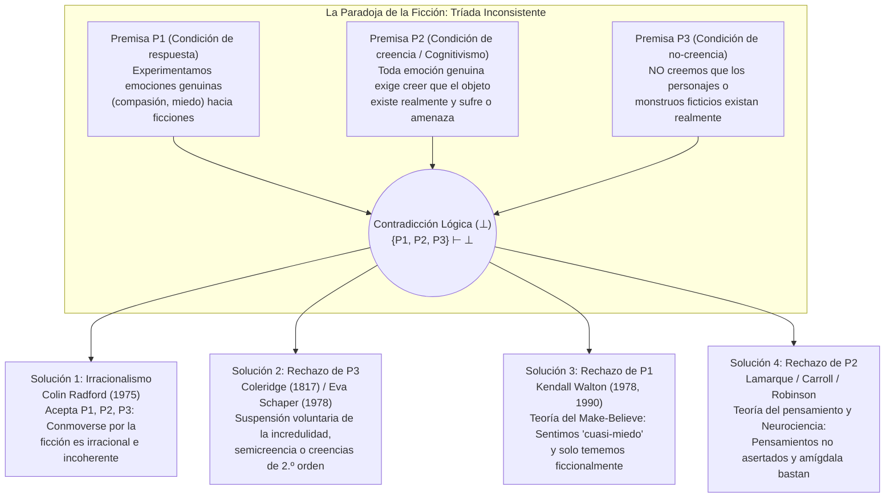

## Introducción: Las lágrimas de San Agustín por Dido y el asombro de Hamlet ante Hécuba

Todos los días experimentamos un fenómeno psicológico tan cotidiano que rara vez nos detenemos a advertir cuán profundamente misterioso —y aparentemente irracional— resulta. Cuando hacia el final de la obra maestra de León Tolstói, *Anna Karenina*, la desesperada Anna se arroja al anochecer bajo las ruedas de hierro de un tren de mercancías en el andén de una estación, sentimos un nudo en la garganta, las lágrimas asoman a nuestros ojos y nos invade una ola de profunda compasión y tristeza. O pensemos en una función de medianoche de una película de terror: cuando un grotesco monstruo de limo verde (*Green Slime*) se abalanza hacia la lente de la cámara, nuestro ritmo cardíaco se dispara, la adrenalina inunda nuestra sangre, nos sudan las palmas de las manos y nos aferramos al reposabrazos con terror visceral.

Sin embargo, si examinamos estas reacciones desde la psicología racional, nos topamos de inmediato con un abismo filosófico. El lector que llora por Anna Karenina no sufre ninguna alucinación; sabe con absoluta certeza que Anna Karenina jamás existió y que toda la tragedia consiste únicamente en marcas de tinta impresas sobre papel por un novelista ruso. Del mismo modo, el espectador en el cine sabe sin sombra de duda que está sentado a salvo en una sala climatizada contemplando haces de luz proyectados sobre una pantalla plana. ¿Por qué, entonces, adultos racionales lloran, sufren, se indignan y tiemblan ante el destino de entidades que saben perfectamente que son inexistentes?

Este enigma ha fascinado al pensamiento occidental durante casi dos milenios. Hacia el año 397 d. C., <strong>San Agustín de Hipona (354–430)</strong> recordaba con remordimiento en el Libro III de sus *Confesiones* (III.ii.2) cómo en su juventud lloraba desconsoladamente al leer en la *Eneida* de Virgilio el suicidio de la reina cartaginesa Dido tras ser abandonada por Eneas, mientras no derramaba ni una sola lágrima por su propia muerte espiritual al estar alejado de Dios: *«¿Qué locura hay más insensata que esta?»* Doce siglos más tarde, hacia 1601, <strong>William Shakespeare</strong> puso en labios del príncipe <strong>Hamlet</strong> (Acto II, Escena 2) un célebre monólogo tras observar cómo un actor ambulante palidecía y derramaba lágrimas reales al recitar el dolor de la anciana reina troyana <strong>Hécuba</strong>:

> «¿No es monstruoso que este cómico aquí presente, / tan solo en una ficción (*in a fiction*), en un sueño de pasión, / pueda forzar su alma hasta tal punto a su propia imaginación (*conceit*) / que por su obra todo su rostro palidezca, / tenga lágrimas en los ojos, desconcierto en el semblante, / la voz quebrada… y todo por nada! / ¡Por Hécuba! / <strong>¿Qué es Hécuba para él, o él para Hécuba, / para que así llore por ella?</strong> (*What's Hecuba to him, or he to Hecuba, / That he should weep for her?*)»

En 1975, el filósofo analítico británico <strong>Colin Radford (1935–2001)</strong> publicó en los *Proceedings of the Aristotelian Society* su histórico artículo <strong>«How Can We Be Moved by the Fate of Anna Karenina?»</strong> (*¿Cómo podemos conmovernos por el destino de Anna Karenina?*), cristalizando este antiguo asombro en uno de los problemas centrales de la estética analítica y la filosofía de la mente: <strong>la paradoja de la ficción (The Paradox of Fiction)</strong>. En este artículo analizaremos rigurosamente la estructura lógica de su tríada inconsistente, las cuatro grandes estrategias filosóficas de resolución, los hallazgos de la neurociencia afectiva contemporánea y sus problemas hermanos: la *paradoja de la tragedia*, la *resistencia imaginativa* y la *ontología de las entidades ficticias*.

---

## Capítulo 1: La estructura lógica de la paradoja — Una tríada inconsistente

Colin Radford formuló la paradoja de la ficción como una <strong>tríada inconsistente (Inconsistent Triad)</strong> compuesta por tres premisas ($P_1, P_2, P_3$) que, consideradas individualmente, resultan sumamente plausibles, pero cuya conjunción implica una contradicción lógica formal ($\{P_1, P_2, P_3\} \vdash \bot$):

### Premisa $P_1$: La condición de respuesta emocional (Hecho fenomenológico)

> <strong>($P_1$) Experimentamos emociones genuinas, literales y dirigidas a un objeto (tales como compasión, tristeza, miedo, ira y admiración) hacia personajes y sucesos ficticios.</strong>

Cuando lloramos por Anna Karenina o nos asustamos ante el monstruo en la pantalla, no estamos fingiendo estar tristes o asustados para engañar a nadie. Nuestra conmoción es fenomenológica y fisiológicamente auténtica: $\text{Emotion}_E(S, X)$.

### Premisa $P_2$: La condición cognitiva de creencia existencial (Cognitivismo emocional)

> <strong>($P_2$) Para que un sujeto $S$ experimente una emoción genuina $E$ dirigida hacia un objeto $X$, $S$ debe creer (mantener la creencia asertórica) que $X$ existe realmente y posee efectivamente las propiedades evaluativas pertinentes (sufrimiento inmerecido, peligro inminente, etc.).</strong>

En lógica doxástica cuantificada, la premisa $P_2$ se expresa así:

$$\forall S \forall X \Big( \text{Emotion}_E(S, X) \implies \text{Bel}_S\big(\exists x (x = X \land \text{Eval}_E(x))\big) \Big)$$

Esta premisa se fundamenta en el <strong>cognitivismo de las emociones (Cognitivism about Emotions)</strong>, desarrollado desde <strong>Aristóteles (*Retórica*, Libro II)</strong> y <strong>Spinoza (*Ética*)</strong> hasta <strong>Anthony Kenny (1963)</strong>, <strong>Robert C. Solomon (1976)</strong> y <strong>Martha Nussbaum (2001)</strong>. A diferencia de un estado de ánimo difuso sin objeto (*mood*) o de una mera sensación corporal (*sensation*, como un dolor de muelas), una emoción posee <strong>intencionalidad</strong> y se define por su <strong>objeto formal (Formal Object)</strong>: sentir compasión por $X$ requiere juzgar que $X$ sufre realmente; temer a $X$ requiere creer que $X$ constituye una amenaza real.

Consideremos el experimento mental de Radford: un compañero de trabajo le cuenta entre sollozos que su hermana acaba de sufrir un terrible accidente automovilístico y agoniza en cuidados intensivos. Usted siente de inmediato una profunda compasión y angustia por ella. Al instante siguiente, el compañero sonríe y le dice: *«¡Era una broma para probar mi actuación! ¡Ni siquiera tengo hermana!»* En el preciso segundo en que usted descubre que la hermana no existe, <strong>su compasión por la hermana se evapora instantáneamente</strong> (dando paso a la indignación contra el bromista). Si tras saber que todo era falso usted siguiera llorando desconsoladamente diciendo: *«¡Pero igual me da muchísima lástima esa pobre chica en el hospital!»*, cualquiera juzgaría que su reacción es irracional.

### Premisa $P_3$: La condición de no-creencia (Non-Belief Condition)

> <strong>($P_3$) Los lectores y espectadores adultos normales no creen en absoluto que los personajes o monstruos ficticios existan realmente: $\neg \text{Bel}_S(\exists x (x = X))$.</strong>

Nuestro comportamiento lo demuestra de manera concluyente: ningún espectador aterrorizado en el cine llama a la policía ni huye por la salida de emergencia; ningún lector intenta detener el tren en Moscú.

---

## Capítulo 2: Soluciones 1 y 2 — El irracionalismo de Radford y la «suspensión de la incredulidad» de Coleridge

### 1. Estrategia 1: El irracionalismo de Colin Radford (1975)

Tras descartar diversas vías de escape, Radford concluyó que <strong>$P_1, P_2$ y $P_3$ son todas verdaderas</strong>, por lo que el hecho de conmovernos ante obras de ficción nos sumerge en una <strong>inconsistencia e irracionalidad brutas</strong>, análogas a una <strong>fobia</strong> (como el aracnofóbico que siente terror real ante una araña inofensiva dentro de un frasco de vidrio sabiendo perfectamente que está a salvo).

<strong>Crítica al irracionalismo</strong>:
Casi todos los estetas contemporáneos rechazan esta conclusión. En primer lugar, incurre en una <strong>inversión normativa</strong>: mientras que una fobia es un defecto de la racionalidad que deseamos curar, la capacidad de conmoverse profundamente con *Anna Karenina* o *El rey Lear* se valora como signo de madurez emocional, sensibilidad moral y comprensión artística adecuada. En segundo lugar, a diferencia del fóbico que entra en pánico y huye, el espectador de cine mantiene intacto su control conductual.

### 2. Estrategia 2: El rechazo de $P_3$ — «Willing Suspension of Disbelief»

El poeta romántico inglés <strong>Samuel Taylor Coleridge</strong> acuñó en 1817 en su *Biographia Literaria* (cap. XIV) la famosa fórmula de <strong>«esa suspensión voluntaria de la incredulidad por el momento, que constituye la fe poética» (*that willing suspension of disbelief for the moment, which constitutes poetic faith*)</strong>. Más tarde, <strong>Eva Schaper (1978)</strong> propuso una estructura de creencias en dos niveles: mantenemos creencias de primer orden de que Anna no existe, pero creencias genuinas de segundo orden sobre lo que ocurre dentro de la historia.

<strong>Por qué fracasa el rechazo de $P_3$</strong>:
1. <strong>Involuntarismo doxástico</strong>: No podemos decidir creer o dejar de creer algo a voluntad.
2. <strong>Asimetría conductual</strong>: Si un espectador suspendiera su incredulidad aunque fuera por cinco segundos ante un monstruo letal, saldría corriendo del cine de inmediato.
3. <strong>Colapso de la tesis de Schaper</strong>: Creer que *según el texto de Tolstói* Anna sufre es solo una creencia literaria sobre un texto, no la creencia de que un ser humano real está sufriendo ($P_2$).

---

## Capítulo 3: Solución 3 — La teoría del «Hacer-Creer (Make-Believe)» y el «Cuasi-Miedo» de Kendall Walton (Rechazo de $P_1$)

En su célebre artículo <strong>«Fearing Fictions» (1978)</strong> y su obra cumbre <strong>*Mimesis as Make-Believe: On the Foundations of the Representational Arts* (1990)</strong>, el filósofo <strong>Kendall L. Walton</strong> (Universidad de Míchigan) formuló una teoría monumental que <strong>preserva estrictamente $P_2$ y $P_3$ y resuelve la paradoja rechazando y reinterpretando la premisa $P_1$</strong>.

### 1. Accesorios (Props) y juegos de hacer-creer (Games of Make-Believe)

Walton modela todas las artes representativas a partir de los <strong>juegos infantiles de simulación o hacer-creer</strong>. Cuando dos niños acuerdan en el bosque que todos los tocones de árboles son osos, los tocones reales funcionan como <strong>accesorios o soportes (*props*)</strong> que prescriben, según principios de generación, qué proposiciones son <strong>ficcionalmente verdaderas ($\mathcal{F}(\phi)$)</strong> en el juego. Del mismo modo, la novela *Anna Karenina* o una película de terror son soportes culturalmente institucionalizados que prescriben al apreciador participar en un juego de hacer-creer ($\mathcal{F}_G$).

### 2. Charles y el Limo Verde (Charles and the Green Slime): Miedo real vs. Cuasi-miedo

Walton analiza el famoso caso de <strong>Charles</strong>, quien ve una película de terror en la que un limo verde (*Green Slime*) se abalanza hacia la cámara. Charles se aferra a su butaca, su corazón late con fuerza y suda frío. <strong>¿Teme Charles literalmente al limo verde en el mundo real ($\text{LiteralFear}$)?</strong>
Walton responde: <strong>¡No ($\neg P_1$)!</strong> Porque el miedo literal exige creer que uno está en peligro real ($P_2$) y tener la motivación conductual de huir, dos elementos ausentes en Charles.

¡Pero Charles no está fingiendo fríamente! Experimenta un estado fisiológico y afectivo completamente real (taquicardia, descarga de adrenalina, estremecimiento fenomenológico) que Walton denomina <strong>«cuasi-miedo» (*quasi-fear*, y en general *quasi-emotions*)</strong>.
El bucle causal y representacional opera así:
1. La imagen en la pantalla (soporte externo) lleva a Charles a imaginar sobre sí mismo (*de se*): *«¡El limo me está atacando!»*
2. Esta vívida imaginación *de se* causa directamente en el cuerpo de Charles un <strong>cuasi-miedo</strong> real.
3. Ese cuasi-miedo real actúa a su vez como un <strong>soporte interno reflexivo (*reflexive prop*)</strong> que hace que sea <strong>ficcionalmente verdadero dentro del juego de Charles que él teme literalmente al limo</strong>:

$$\text{Imagine}_{\text{Charles}}(\text{Peligro}) \xrightarrow{\text{causa}} \text{QuasiFear}(\text{Charles}) \xrightarrow{\text{genera}} \mathcal{F}_G\big(\text{LiteralFear}(\text{Charles}, \text{Slime})\big)$$

Es exactamente igual que el niño que juega al monstruo con su padre: el niño sabe que su padre no le hará daño, pero experimenta un emocionante *cuasi-miedo* real gracias al cual, *dentro del juego*, está aterrorizado por el monstruo. (<strong>Gregory Currie 1990</strong> reformuló esto en ciencia cognitiva como la <strong>teoría de la simulación fuera de línea / *off-line simulation</strong>*).

---

## Capítulo 4: Solución 4 — El rechazo de $P_2$: La «Teoría del Pensamiento (Thought Theory)» y la neurociencia afectiva

Frente a Walton, filósofos como <strong>Peter Lamarque (1981)</strong>, <strong>Noël Carroll (*The Philosophy of Horror*, 1990)</strong>, <strong>Richard Moran (1994)</strong>, <strong>Jenefer Robinson (2005)</strong> y <strong>Tamar Szabó Gendler (2008)</strong> objetaron que reducir nuestra tristeza por Anna Karenina a un «juego de simulación» distorsiona nuestra experiencia vivida: <strong>sentimos emociones genuinas ($P_1$ es verdadera), y la premisa falsa es $P_2$ (el requisito de creencia existencial)</strong>.

### 1. La Teoría del Pensamiento (Thought Theory: Lamarque y Carroll)

Según la <strong>Thought Theory</strong>, las emociones genuinas no requieren una creencia asertórica en la existencia del objeto; basta con <strong>albergar vívidamente en la mente un pensamiento proposicional no asertado (*vividly entertaining an unasserted thought*)</strong>.
- Si usted se encuentra completamente seguro detrás de una barandilla de acero en lo alto de un rascacielos ($\neg \text{Bel}(\text{Peligro})$) y simplemente contempla vívidamente el *pensamiento* de precipitarse al vacío, sentirá una oleada de miedo y vértigo genuinos.
- Si imagina vívidamente masticar lombrices vivas, experimentará un <strong>asco (Disgust)</strong> real.

Lo que causa nuestro miedo genuino ante Drácula o nuestra compasión real por Anna Karenina es el <strong>contenido de pensamiento (*Thought-content*)</strong> configurado por la obra. Al estar generado por un pensamiento no asertado y no por una creencia existencial, los programas motores de huida física no se activan.

### 2. Neurociencia afectiva (la doble vía de la amígdala) y «Alief»

La neurociencia afectiva contemporánea (<strong>Joseph LeDoux</strong>, *The Emotional Brain*, 1996) refuta empíricamente $P_2$ mediante el modelo de la <strong>doble vía</strong>:
1. <strong>La vía baja subcortical rápida (Low Road: Tálamo $\to$ Amígdala / Ínsula)</strong>: Las representaciones perceptivas o imaginativas llegan en milisegundos a la <strong>amígdala</strong>, la cual es «ciega a la ficción» (*fiction-blind*) e incapaz de realizar comprobaciones ontológicas de existencia. La amígdala dispara de inmediato una <strong>emoción fisiológica y afectiva genuina</strong> ($P_1$ confirmada, $P_2$ refutada).
2. <strong>La vía alta cortical lenta (High Road: Tálamo $\to$ Corteza prefrontal PFC)</strong>: La corteza prefrontal evalúa el contexto (*«Estoy en un cine viendo una película»*, $P_3$) e <strong>inhibe la orden motora de huida</strong>, permitiéndonos saborear la emoción de forma segura en la butaca.

<strong>Tamar Szabó Gendler (2008)</strong> introdujo el concepto de <strong>«Alief»</strong>: mientras que la <strong>creencia (Belief)</strong> explícita de Charles es *«El limo no existe»*, la imagen activa un <strong>Alief</strong> asociativo y automático (*«¡Monstruo peligroso! ¡Siente terror! ¡Retrocede!»*).

| Estrategia de resolución | Premisa rechazada | Filósofos principales | Naturaleza de la emoción ficticia | ¿Por qué no huimos del cine? | Fortaleza principal y Crítica mayor |
| :--- | :---: | :--- | :--- | :--- | :--- |
| <strong>1. Irracionalismo</strong> | <strong>Ninguna</strong> (Acepta $\bot$) | Colin Radford (1975) | Emoción genuina y literal, pero irracional e incoherente (como una fobia). | La creencia racional ($P_3$) frena la acción mientras el corazón llora irracionalmente. | Respeta las 3 intuiciones, pero degrada la empatía literaria al nivel de una patología fóbica. |
| <strong>2. Suspensión de la incredulidad</strong> | <strong>Rechaza $P_3$</strong> | S. T. Coleridge (1817) Eva Schaper (1978) | Emoción genuina basada en ilusión temporal o creencias de segundo orden sobre la trama. | La creencia de 1.er orden sobre la realidad inhibe la huida; la de 2.º orden crea la emoción. | Explica la inmersión, pero falla ante el involuntarismo doxástico y la ausencia de pánico. |
| <strong>3. Teoría del Make-Believe</strong> | <strong>Rechaza $P_1$</strong> | Kendall Walton (1978, 1990) Gregory Currie (1990) | <strong>Cuasi-emoción</strong> real que sirve de soporte haciendo <strong>ficcionalmente verdadero ($\mathcal{F}_G$)</strong> que tememos o compadecemos. | Sin creencia en peligro ($P_3$) ni miedo literal; simulación mental «fuera de línea». | Salva el cognitivismo ($P_2$), pero resulta artificial llamar «juego» al dolor trágico profundo. |
| <strong>4. Thought Theory y Neurociencia</strong> | <strong>Rechaza $P_2$</strong> | Peter Lamarque (1981) Noël Carroll (1990) Jenefer Robinson (2005) Tamar Gendler (2008) | <strong>Emoción genuina y literal</strong> disparada por <strong>pensamientos no asertados</strong> o <strong>Aliefs</strong> subcorticales. | El monitoreo de realidad de la corteza prefrontal ($P_3$) inhibe la salida motora de huida. | Plenamente coherente con la fenomenología ordinaria ($P_1$) y la neurobiología actual. |

---

## Capítulo 5: Paradojas hermanas — Paradoja de la tragedia, Resistencia imaginativa y Ontología

### 1. La paradoja de la tragedia y del terror

¿Por qué buscamos voluntariamente en el arte emociones dolorosas (tristeza, compasión, terror) que evitamos a toda costa en la vida real?
- <strong>La *Catarsis* de Aristóteles (*Poética*, cap. 6)</strong>: La tragedia logra, mediante la compasión (*eleos*) y el temor (*phobos*), la purga, descarga y calibración racional de tales pasiones.
- <strong>La «teoría de la conversión» de David Hume (1757, *«Of Tragedy»*)</strong>: El placer estético predominante despertado por la elocuencia, el ritmo poético y la maestría imitativa del artista se apodera de la energía emocional dolorosa de la tristeza y <strong>la convierte por completo en deleite estético</strong>.
- <strong>La «meta-respuesta» de Susan Feagin (1983)</strong>: Al dolor directo le sigue una meta-respuesta placentera en la que nos sentimos moralmente reconfortados al experimentar nuestra propia capacidad de empatía humana.
- <strong>La curiosidad cognitiva de Noël Carroll (1990)</strong>: En el terror, soportamos el miedo y el asco como el precio (o amplificador) de una intensa fascinación cognitiva por monstruos que transgreden nuestras categorías conceptuales.

### 2. El rompecabezas de la resistencia imaginativa (Hume, Walton, Gendler)

Mientras que imaginamos sin esfuerzo imposibilidades físicas (dragones que escupen fuego, viajes en el tiempo), oponemos una férrea <strong>resistencia imaginativa (Imaginative Resistance)</strong> cuando un autor intenta estipular una verdad moral aberrante —como en la famosa frase de <strong>Kendall Walton</strong>:

> <strong>«Al matar a su bebé, Giselda hizo lo correcto; después de todo, era una niña (*In killing her baby, Giselda did the right thing; after all, it was a girl*).»</strong>

Según <strong>Walton (1994)</strong>, *no podemos* imaginarlo (*Can't*) porque las propiedades morales <strong>supervienen (supervene)</strong> conceptualmente sobre los hechos naturales. Según <strong>Tamar Szabó Gendler (2000)</strong>, *nos negamos* a imaginarlo (*Won't*) para evitar «exportar» una perspectiva moral perversa fuera de la ficción y contaminar nuestra sensibilidad moral real.

### 3. La ontología de las entidades ficticias (Meinong vs. la teoría artefactual de Thomasson)

¿Cuál es el estatus ontológico de «Anna Karenina»?
1. <strong>Meinongianismo (Alexius Meinong, Terence Parsons, Edward Zalta)</strong>: Anna Karenina es un <strong>objeto inexistente</strong> concreto o abstracto que codifica las propiedades atribuidas en la novela.
2. <strong>Semántica antirrealista de la simulación (Kendall Walton)</strong>: No existen entidades ficticias en absoluto; hablar de Anna es solo participar en el juego de hacer-creer prescrito por la novela.
3. <strong>La teoría artefactual de la ficción (Saul Kripke, Peter van Inwagen, Amie L. Thomasson 1999 *Fiction and Metaphysics*)</strong>: La posición realista hoy dominante. Al igual que las leyes, las sinfonías o el ajedrez, los personajes de ficción son <strong>artefactos culturales abstractos (*Abstract Cultural Artifacts*)</strong> creados en un momento histórico concreto por sus autores y que existen realmente en nuestro mundo cultural. Por ello, la proposición *«Anna Karenina fue creada por Tolstói y es compadecida por millones de lectores»* es literalmente verdadera.

---

## Conclusión: La imaginación emocional como laboratorio de la humanidad

Medio siglo de debates desde el artículo de Colin Radford (1975) demuestra que nuestras lágrimas por Anna Karenina no son ni un fallo irracional ni una ilusión óptica. Gracias a nuestra capacidad de <strong>simulación imaginativa (Walton)</strong> y a la arquitectura de doble vía de nuestro cerebro emocional (<strong>Lamarque, Carroll, Robinson, LeDoux</strong>), donde los <strong>pensamientos vívidos</strong> despiertan una empatía subcortical auténtica bajo la vigilancia segura de la corteza prefrontal, la ficción opera como el laboratorio moral y afectivo más profundo del ser humano: nos permite trascender las estrechas fronteras de nuestro yo para sentir desde dentro el sufrimiento y la dignidad de otros seres.
