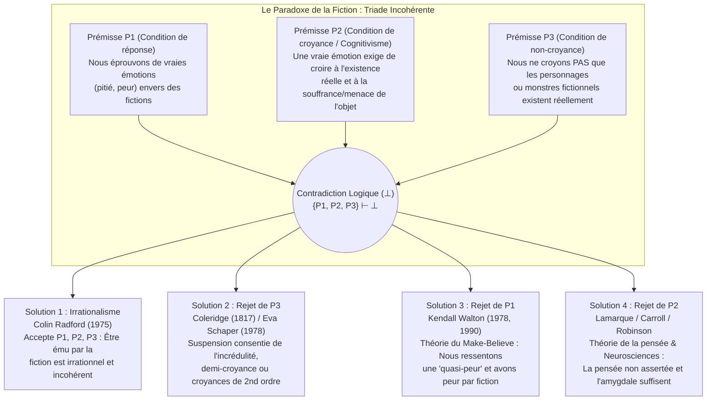

## Introduction : Les larmes de saint Augustin pour Didon et l'étonnement d'Hamlet devant Hécube

Chaque jour, nous faisons l'expérience d'un prodige psychologique si familier que nous oublions à quel point il est philosophiquement déroutant. Lorsqu'à la fin du chef-d'œuvre de Léon Tolstoï, *Anna Karénine*, l'héroïne désespérée se jette sous les roues d'un train de marchandises sur le quai d'une gare au crépuscule, notre gorge se noue, les larmes nous montent aux yeux et nous éprouvons une pitié et un chagrin profonds. De même, lorsque nous regardons un film d'horreur dans l'obscurité d'une salle de cinéma et qu'un monstre gélatineux verdâtre (*Green Slime*) rampe férocement vers la caméra, notre rythme cardiaque s'emballe, nos paumes deviennent moites et nos muscles se tendent d'effroi.

Pourtant, du point de vue de la psychologie rationnelle, ces réactions semblent receler une contradiction flagrante. Le lecteur qui pleure sur Anna Karénine n'est victime d'aucune hallucination : il sait avec une certitude absolue qu'Anna Karénine n'a jamais existé et que toute cette tragédie n'est qu'un assemblage de signes typographiques imprimés sur du papier. De même, le spectateur de cinéma sait pertinemment qu'il est assis en toute sécurité face à une simple projection lumineuse sur un écran plat. Pourquoi donc des adultes rationnels pleurent-ils, s'affligent-ils et tremblent-ils devant le sort d'entités dont ils savent parfaitement qu'elles n'existent pas ?

Cette énigme hante la pensée occidentale depuis près de deux millénaires. Vers 397 après J.-C., <strong>saint Augustin (354–430)</strong>, au livre III de ses *Confessions* (III.ii.2), se remémorait avec remords comment, dans sa jeunesse, la lecture de l'*Énéide* de Virgile lui faisait verser des torrents de larmes sur le suicide de la reine Didon abandonnée par Énée, alors qu'il ne versait pas une seule larme sur sa propre mort spirituelle : *« Quelle folie est plus insensée que celle-là ? »* Douze siècles plus tard, vers 1601, <strong>William Shakespeare</strong> plaçait dans la bouche du prince <strong>Hamlet</strong> (Acte II, scène 2) une méditation célèbre après avoir vu un comédien pâlir et verser de vraies larmes en déclamant le deuil de la vieille reine de Troie, <strong>Hécube</strong> :

> « N'est-il pas monstrueux que ce comédien, ici, / Dans une pure fiction (*in a fiction*), dans un rêve de passion, / Puisse forcer son âme à se plier si bien à sa propre chimère (*conceit*) / Que sous son action tout son visage a pâli, / Qu'il a les larmes aux yeux, l'aspect bouleversé, / La voix brisée… et tout cela pour rien ! / Pour Hécube ! / <strong>Qu'est-ce qu'Hécube pour lui, ou lui pour Hécube, / Pour qu'il pleure ainsi sur elle ?</strong> (*What's Hecuba to him, or he to Hecuba, / That he should weep for her?*) »

En 1975, le philosophe analytique britannique <strong>Colin Radford (1935–2001)</strong> a publié dans les *Proceedings of the Aristotelian Society* un article fondateur intitulé <strong>« How Can We Be Moved by the Fate of Anna Karenina? »</strong> (*Comment pouvons-nous être émus par le destin d'Anna Karénine ?*), transformant ce mystère classique en l'un des problèmes centraux de l'esthétique analytique et de la philosophie de l'esprit : <strong>le paradoxe de la fiction (The Paradox of Fiction)</strong>. Dans cet article, nous analyserons la structure logique de cette triade incohérente, les quatre grandes stratégies philosophiques de résolution, les apports des neurosciences affectives contemporaines, ainsi que les problèmes connexes du *paradoxe de la tragédie*, de la *résistance imaginative* et de l'*ontologie des entités fictionnelles*.

---

## Chapitre 1 : La structure logique du paradoxe — Une triade incohérente

Colin Radford a formulé le paradoxe de la fiction sous la forme d'une <strong>triade incohérente (Inconsistent Triad)</strong> composée de trois prémisses ($P_1, P_2, P_3$) qui sont chacune individuellement très plausibles, mais dont la conjonction entraîne une contradiction logique formelle ($\{P_1, P_2, P_3\} \vdash \bot$) :

### Prémisse $P_1$ : La condition de réponse émotionnelle (Fait phénoménologique)

> <strong>($P_1$) Nous éprouvons de véritables émotions littérales dirigées vers un objet (telles que la pitié, le chagrin, la peur, la colère ou l'admiration) à l'égard de personnages et d'événements fictionnels.</strong>

Lorsque nous pleurons sur Anna Karénine ou frissonnons devant un film d'horreur, nous ne faisons pas semblant d'être tristes ou effrayés pour tromper notre entourage. Notre émotion est phénoménologiquement et physiologiquement authentique : $\text{Emotion}_E(S, X)$.

### Prémisse $P_2$ : La condition cognitive de croyance existentielle (Cognitivisme des émotions)

> <strong>($P_2$) Pour qu'un sujet $S$ éprouve une véritable émotion $E$ dirigée vers un objet $X$, $S$ doit croire (avoir la croyance assertorique) que $X$ existe réellement et possède effectivement les propriétés évaluatives pertinentes (souffrance injuste, menace imminente, etc.).</strong>

Formellement, en logique doxastique quantifiée :

$$\forall S \forall X \Big( \text{Emotion}_E(S, X) \implies \text{Bel}_S\big(\exists x (x = X \land \text{Eval}_E(x))\big) \Big)$$

Cette prémisse repose sur le <strong>cognitivisme des émotions (Cognitivism about Emotions)</strong>, défendu depuis <strong>Aristote (*Rhétorique*, livre II)</strong> et <strong>Spinoza (*Éthique*)</strong> jusqu'à <strong>Anthony Kenny (1963)</strong>, <strong>Robert C. Solomon (1976)</strong> et <strong>Martha Nussbaum (2001)</strong>. Contrairement à une simple humeur sans objet (*mood*, comme la mélancolie diffuse) ou à une sensation corporelle (*sensation*, comme une crampe d'estomac), une émotion possède une <strong>intentionnalité</strong> et un <strong>objet formel (Formal Object)</strong> : avoir pitié de $X$ implique de juger que $X$ souffre réellement ; avoir peur de $X$ implique de croire que $X$ constitue un danger réel.

Prenons l'expérience de pensée de Radford : un collègue vous raconte en sanglotant que sa sœur vient d'être grièvement blessée dans un terrible accident de la route. Vous êtes aussitôt submergé par la pitié et l'angoisse. Puis le collègue éclate de rire : *« Je t'ai bien eu ! J'ai tout inventé, je n'ai même pas de sœur ! »* À la seconde même où vous apprenez que cette sœur n'existe pas, <strong>votre pitié pour la sœur s'évapore instantanément</strong> (pour laisser place à la colère contre le farceur). Si, tout en sachant que l'histoire est fausse, vous continuiez à pleurer en disant : *« Mais j'ai quand même tellement pitié de cette pauvre fille à l'hôpital ! »*, on vous jugerait totalement irrationnel.

### Prémisse $P_3$ : La condition de non-croyance (Non-Belief Condition)

> <strong>($P_3$) Les lecteurs et spectateurs adultes normaux ne croient nullement que les personnages ou les monstres de fiction existent réellement : $\neg \text{Bel}_S(\exists x (x = X))$.</strong>

La preuve irréfutable en est notre comportement : aucun spectateur effrayé au cinéma n'appelle la police ni ne s'enfuit par la sortie de secours ; aucun lecteur ne tente d'empêcher le train d'écraser Anna Karénine.

---

## Chapitre 2 : Solutions 1 et 2 — L'irrationalisme de Radford et la « suspension de l'incrédulité » de Coleridge

### 1. Stratégie 1 : L'irrationalisme de Colin Radford (1975)

Après avoir réfuté diverses échappatoires, Radford conclut que <strong>$P_1, P_2$ et $P_3$ sont toutes trois vraies</strong>, et que le fait d'être ému par des œuvres de fiction implique donc chez l'être humain une <strong>incohérence et une irrationalité fondamentales</strong>, comparables à une <strong>phobie</strong> (comme l'arachnophobe qui tremble devant une araignée inoffensive enfermée dans un bocal tout en sachant qu'il ne court aucun danger).

<strong>Critique de l'irrationalisme</strong> :
Cette conclusion est quasi unanimement rejetée par les esthéticiens contemporains. Premièrement, elle opère une <strong>inversion normative</strong> : alors qu'une phobie est un trouble pathologique que l'on cherche à guérir, la capacité d'être profondément ému par *Anna Karénine* ou *Le Roi Lear* est valorisée comme la marque d'une maturité émotionnelle, d'une finesse morale et d'une compréhension esthétique réussie. Deuxièmement, contrairement au phobique en proie à la panique, le spectateur de cinéma conserve un contrôle comportemental parfait.

### 2. Stratégie 2 : Le rejet de $P_3$ — « Willing Suspension of Disbelief »

Le poète romantique anglais <strong>Samuel Taylor Coleridge</strong> a formulé en 1817 dans sa *Biographia Literaria* (chap. XIV) la célèbre expression de <strong>« cette suspension consentie de l'incrédulité pour un moment, qui constitue la foi poétique » (*that willing suspension of disbelief for the moment, which constitutes poetic faith*)</strong>. Plus récemment, <strong>Eva Schaper (1978)</strong> a proposé une théorie des croyances à deux niveaux : nous savons au premier ordre qu'Anna n'existe pas, mais nous avons de vraies croyances de second ordre sur ce qui se passe dans le roman.

<strong>Pourquoi le rejet de $P_3$ échoue</strong> :
1. <strong>L'involontarisme doxastique</strong> : On ne peut pas décider par un acte de volonté de croire ou de ne plus croire quelque chose.
2. <strong>L'asymétrie comportementale</strong> : Si un spectateur suspendait son incrédulité ne serait-ce que cinq secondes devant un monstre tueur, il s'enfuirait immédiatement de la salle en hurlant.
3. <strong>L'effondrement de la thèse de Schaper</strong> : Croire que *selon le texte de Tolstoï* Anna se suicide est simplement une croyance littéraire sur un texte, et non la croyance qu'un être humain réel souffre ($P_2$).

---

## Chapitre 3 : Solution 3 — La théorie du « Faire-Semblant (Make-Believe) » et la « Quasi-Peur » de Kendall Walton (Rejet de $P_1$)

Dans son article majeur <strong>« Fearing Fictions » (1978)</strong> et son chef-d'œuvre <strong>*Mimesis as Make-Believe: On the Foundations of the Representational Arts* (1990)</strong>, le philosophe <strong>Kendall L. Walton</strong> (Université du Michigan) a élaboré une solution monumentale qui <strong>maintient strictement $P_2$ et $P_3$ tout en rejetant et réinterprétant la prémisse $P_1$</strong>.

### 1. Supports (Props) et jeux de faire-semblant (Games of Make-Believe)

Walton prend pour modèle de tous les arts représentatifs les <strong>jeux de faire-semblant des enfants</strong>. Lorsque deux enfants décrètent dans une forêt que toutes les souches d'arbres sont des ours, les souches réelles servent de <strong>supports (*props*)</strong> qui prescrivent, selon des principes de génération, ce qui est <strong>fictionnellement vrai ($\mathcal{F}(\phi)$)</strong> dans le jeu. De même, le roman *Anna Karénine* ou un film d'horreur sont des supports institutionnalisés permettant au lecteur ou au spectateur de participer lui-même à un jeu de faire-semblant autorisé ($\mathcal{F}_G$).

### 2. Charles et le Monstre Vert Gélatineux (Charles and the Green Slime) : Vraie peur vs Quasi-peur

Walton examine le cas de <strong>Charles</strong>, qui regarde un film d'horreur où un monstre vert gélatineux (*Green Slime*) rampe vers la caméra. Charles s'agrippe à son fauteuil, son cœur bat la chamade, ses mains transpirent. <strong>Charles a-t-il littéralement peur du monstre dans le monde réel ($\text{LiteralFear}$) ?</strong>
Walton répond : <strong>Non ($\neg P_1$) !</strong> Car la vraie peur exige la croyance en un danger réel ($P_2$) et une motivation comportementale à fuir, deux éléments absents chez Charles.

Mais Charles ne simule pas froidement ! Il éprouve un état physiologique et affectif parfaitement réel (accélération cardiaque, poussée d'adrénaline, frisson phénoménologique) que Walton nomme <strong>« quasi-peur » (*quasi-fear*, et plus généralement *quasi-emotion*)</strong>.
La boucle causale et représentationnelle fonctionne ainsi :
1. L'image sur l'écran (support externe) amène Charles à imaginer de lui-même (*de se*) : *« Le monstre m'attaque ! »*
2. Cette imagination *de se* déclenche causalement en Charles une véritable <strong>quasi-peur</strong> physiologique et affective.
3. Cette quasi-peur réelle sert à son tour de <strong>support interne réflexif (*reflexive prop*)</strong> qui rend <strong>fictionnellement vrai dans le jeu de Charles qu'il a littéralement peur du monstre</strong> :

$$\text{Imagine}_{\text{Charles}}(\text{Danger}) \xrightarrow{\text{cause}} \text{QuasiFear}(\text{Charles}) \xrightarrow{\text{génère}} \mathcal{F}_G\big(\text{LiteralFear}(\text{Charles}, \text{Slime})\big)$$

C'est exactement comme l'enfant qui joue au monstre avec son père : l'enfant sait qu'il ne risque rien, mais il ressent une délicieuse *quasi-peur* réelle grâce à laquelle, *dans le jeu*, il est terrifié par le monstre. (<strong>Gregory Currie 1990</strong> a reformulé cela en sciences cognitives sous le nom de <strong>théorie de la simulation hors-ligne / *off-line simulation</strong>*).

---

## Chapitre 4 : Solution 4 — Le rejet de $P_2$ : La « Théorie de la Pensée (Thought Theory) » et les neurosciences affectives

Contre Walton, <strong>Peter Lamarque (1981)</strong>, <strong>Noël Carroll (*The Philosophy of Horror*, 1990)</strong>, <strong>Richard Moran (1994)</strong>, <strong>Jenefer Robinson (2005)</strong> et <strong>Tamar Szabó Gendler (2008)</strong> ont soutenu que réduire notre chagrin pour Anna Karénine à un simple « jeu de faire-semblant » dénature notre expérience vécue : <strong>nous éprouvons de vraies émotions ($P_1$ est vraie), et c'est la prémisse $P_2$ (l'exigence de croyance existentielle) qui est fausse !</strong>

### 1. La Théorie de la Pensée (Thought Theory : Lamarque & Carroll)

Selon la <strong>Thought Theory</strong>, une émotion authentique ne requiert pas de croyance assertorique en l'existence de son objet ; il suffit d'<strong>entretenir vivement à l'esprit une pensée propositionnelle non assertée (*vividly entertaining an unasserted thought*)</strong>.
- Si vous vous tenez en toute sécurité derrière une rambarde métallique au sommet d'un gratte-ciel ($\neg \text{Bel}(\text{Danger})$) et que vous vous représentez vivement la *pensée* de basculer dans le vide, vous éprouvez une bouffée de peur et de vertige bien réelle.
- Si vous imaginez vivement mâcher des vers de terre vivants, vous ressentez un véritable <strong>dégoût (Disgust)</strong>.

Ce qui cause notre vraie peur devant Dracula ou notre vraie pitié pour Anna Karénine, c'est le <strong>contenu de pensée (*Thought-content*)</strong> construit par l'œuvre. Puisqu'il s'agit d'une pensée non assertée et non d'une croyance existentielle, les programmes moteurs de fuite ne sont pas déclenchés.

### 2. Neurosciences affectives (double voie de l'amygdale) et « Alief »

Les neurosciences affectives contemporaines (<strong>Joseph LeDoux</strong>, *The Emotional Brain*, 1996) réfutent empiriquement $P_2$ grâce au modèle de la <strong>double voie</strong> :
1. <strong>La voie basse sous-corticale rapide (Low Road : Thalamus $\to$ Amygdale / Insula)</strong> : Les représentations perceptives ou imaginatives atteignent en quelques millisecondes l'<strong>amygdale</strong>, qui est « aveugle à la fiction » (*fiction-blind*) et incapable de vérifier l'existence ontologique de l'objet. Elle déclenche immédiatement une <strong>véritable émotion physiologique et affective</strong> ($P_1$ validée, $P_2$ réfutée).
2. <strong>La voie haute corticale lente (High Road : Thalamus $\to$ Cortex préfrontal PFC)</strong> : Le cortex préfrontal évalue le contexte (*« Ce n'est qu'un film »*, $P_3$) et <strong>inhibe la commande motrice de fuite</strong>, permettant au spectateur de savourer l'émotion en toute sécurité.

<strong>Tamar Szabó Gendler (2008)</strong> a introduit le concept d'<strong>« Alief »</strong> : alors que la <strong>croyance (Belief)</strong> explicite de Charles est *« Le monstre n'existe pas »*, l'image active un <strong>Alief</strong> associatif et automatique (*« Monstre dangereux ! Aie peur ! Recule ! »*).

| Stratégie de résolution | Prémisse rejetée | Principaux philosophes | Nature de l'émotion fictionnelle | Pourquoi ne fuit-on pas la salle ? | Force principale & Critique majeure |
| :--- | :---: | :--- | :--- | :--- | :--- |
| <strong>1. Irrationalisme</strong> | <strong>Aucune</strong> (Accepte $\bot$) | Colin Radford (1975) | Émotion réelle et littérale, mais irrationnelle et incohérente (comme une phobie). | La croyance rationnelle ($P_3$) bloque l'action tandis que le cœur pleure irrationnellement. | Respecte les 3 intuitions, mais ravale la sensibilité littéraire au rang de pathologie phobique. |
| <strong>2. Suspension de l'incrédulité</strong> | <strong>Rejette $P_3$</strong> | S. T. Coleridge (1817) Eva Schaper (1978) | Émotion réelle fondée sur une illusion temporaire ou une croyance de second ordre. | La croyance de 1er ordre sur le réel inhibe l'action ; celle de 2nd ordre crée l'émotion. | Rend compte de l'immersion, mais échoue face à l'involontarisme doxastique et l'absence de fuite. |
| <strong>3. Théorie du Make-Believe</strong> | <strong>Rejette $P_1$</strong> | Kendall Walton (1978, 1990) Gregory Currie (1990) | <strong>Quasi-émotion</strong> réelle servant de support pour rendre <strong>fictionnellement vrai ($\mathcal{F}_G$)</strong> que nous avons peur/pitié. | Pas de croyance au danger ($P_3$) ni de vraie peur ; simulation mentale « hors-ligne ». | Sauve le cognitivisme ($P_2$), mais paraît artificiel pour expliquer la profonde douleur tragique. |
| <strong>4. Thought Theory & Neurosciences</strong> | <strong>Rejette $P_2$</strong> | Peter Lamarque (1981) Noël Carroll (1990) Jenefer Robinson (2005) Tamar Gendler (2008) | <strong>Émotion réelle et littérale</strong> déclenchée par des <strong>pensées non assertées</strong> ou des <strong>Aliefs</strong> sous-corticaux. | Le contrôle de réalité du cortex préfrontal ($P_3$) inhibe les programmes moteurs de fuite. | En parfait accord avec la phénoménologie vécue ($P_1$) et la neurobiologie contemporaine. |

---

## Chapitre 5 : Paradoxes frères — Paradoxe de la tragédie, Résistance imaginative et Ontologie

### 1. Le paradoxe de la tragédie et de l'horreur

Pourquoi recherchons-nous volontairement dans l'art des émotions douloureuses (chagrin, pitié, terreur) que nous fuyons dans la vie réelle ?
- <strong>La *Catharsis* d'Aristote (*Poétique*, chap. 6)</strong> : La tragédie accomplit par la pitié (*eleos*) et la crainte (*phobos*) la purgation et l'éducation harmonieuse de ces passions.
- <strong>La « théorie de la conversion » de David Hume (1757, *« Of Tragedy »*)</strong> : Le plaisir esthétique prédominant suscité par l'éloquence, le rythme poétique et le génie de l'imitation s'empare de l'agitation émotionnelle douloureuse du chagrin et <strong>la convertit entièrement en plaisir esthétique</strong>.
- <strong>La « méta-réponse » de Susan Feagin (1983)</strong> : À la douleur directe succède une méta-réponse gratifiante où nous prenons conscience avec satisfaction de notre propre humanité compatissante.
- <strong>La curiosité cognitive de Noël Carroll (1990)</strong> : Dans l'horreur, nous acceptons l'effroi et le dégoût comme le prix (ou l'amplificateur) d'une fascination cognitive pour des monstres transgressant nos catégories conceptuelles.

### 2. L'énigme de la résistance imaginative (Hume, Walton, Gendler)

Alors que nous imaginons sans effort des impossibilités physiques (dragons volants, voyages dans le temps), nous opposons une <strong>résistance imaginative (Imaginative Resistance)</strong> farouche lorsqu'un auteur tente de décréter une vérité morale perverse — comme dans la célèbre phrase de <strong>Kendall Walton</strong> :

> <strong>« En tuant son bébé, Giselda a fait ce qu'il fallait ; après tout, c'était une fille (*In killing her baby, Giselda did the right thing; after all, it was a girl*). »</strong>

Selon <strong>Walton (1994)</strong>, nous *ne pouvons pas* l'imaginer (*Can't*) parce que les propriétés morales <strong>surviennent (supervene)</strong> conceptuellement sur les faits naturels. Selon <strong>Tamar Szabó Gendler (2000)</strong>, nous *refusons* de l'imaginer (*Won't*) pour éviter qu'une perspective morale odieuse ne soit « exportée » hors de la fiction et ne contamine notre sensibilité morale réelle.

### 3. L'ontologie des entités fictionnelles (Meinong vs la théorie artéfactuelle de Thomasson)

Quel est le statut ontologique d'« Anna Karénine » ?
1. <strong>Le meinongianisme (Alexius Meinong, Terence Parsons, Edward Zalta)</strong> : Anna Karénine est un <strong>objet non existant</strong> concret ou abstrait qui encode les propriétés décrites dans le roman.
2. <strong>L'anti-réalisme de la feinte (Kendall Walton)</strong> : Il n'existe aucune entité fictionnelle ; parler d'Anna n'est qu'un acte de faire-semblant au sein du jeu prescrit par le roman.
3. <strong>La théorie artéfactuelle de la fiction (Saul Kripke, Peter van Inwagen, Amie L. Thomasson 1999 *Fiction and Metaphysics*)</strong> : Position réaliste aujourd'hui dominante. Tout comme les lois, les symphonies ou le jeu d'échecs, les personnages de fiction sont des <strong>artéfacts culturels abstraits (*Abstract Cultural Artifacts*)</strong> créés à un moment précis de l'histoire par leurs auteurs et existant réellement dans notre monde culturel. C'est pourquoi l'énoncé *« Anna Karénine a été créée par Tolstoï et inspire la pitié de millions de lecteurs »* est littéralement vrai !

---

## Conclusion : L'imagination émotionnelle comme laboratoire de l'humanité

Un demi-siècle de débats depuis l'article de Colin Radford (1975) démontre que nos larmes pour Anna Karénine ne sont ni une absurdité pathologique ni une illusion cognitive. Grâce à notre capacité de <strong>simulation imaginative (Walton)</strong> et à l'architecture à double voie de notre cerveau émotionnel (<strong>Lamarque, Carroll, Robinson, LeDoux</strong>), où des <strong>pensées vives</strong> éveillent une empathie sous-corticale authentique sous la veille sécurisante du cortex préfrontal, la fiction constitue le plus profond laboratoire moral et affectif de l'être humain : elle nous permet de franchir les frontières étroites de notre ego pour éprouver de l'intérieur la souffrance et la dignité d'autrui.
