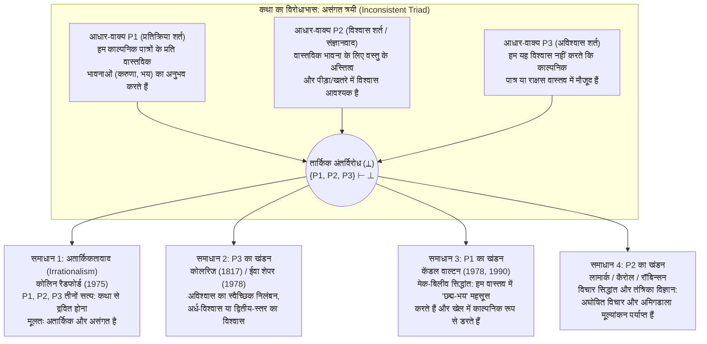

## प्रस्तावना: डीडो के लिए संत ऑगस्टीन के आँसू और हेक्यूबा पर हैमलेट का विस्मय

हम अपने दैनिक जीवन में एक ऐसी मनोवैज्ञानिक घटना का अनुभव करते हैं जो इतनी सामान्य है कि हम शायद ही कभी यह सोचने के लिए रुकते हैं कि वह दार्शनिक रूप से कितनी रहस्यमय—और प्रथम दृष्टया कितनी अतार्किक—है। जब लियो टॉल्स्टॉय के कालजयी उपन्यास *'अन्ना कारेनिना' (Anna Karenina)* के अंत में, निराशा से घिरी अन्ना गोधूलि बेला में रेलवे प्लेटफॉर्म पर खड़ी होती है और एक आती हुई मालगाड़ी के लोहे के पहियों के नीचे कूद जाती है, तो हमारा गला भर आता है, आँखों में आँसू छलक पड़ते हैं और हमारे भीतर गहरी करुणा तथा शोक की लहर दौड़ जाती है। या फिर आधी रात को सिनेमाघर के अंधेरे में देखी जाने वाली किसी हॉरर फिल्म की कल्पना करें: जब पर्दे पर एक भयानक हरा लसलसा राक्षस (*Green Slime*) कैमरे की ओर तेजी से लपकता है, तो हमारे दिल की धड़कन बढ़ जाती है, रक्त में एड्रेनालाईन दौड़ जाता है, हथेलियाँ पसीने से भीग जाती हैं और हम डर के मारे अपनी सीट के हत्थे को कसकर पकड़ लेते हैं।

किंतु यदि हम तर्कसंगत मनोविज्ञान के दृष्टिकोण से इन प्रतिक्रियाओं की जाँच करें, तो हम तुरंत एक दार्शनिक पहेली के सामने खड़े होते हैं। *अन्ना कारेनिना* पढ़कर रोने वाला पाठक किसी मतिभ्रम (hallucination) का शिकार नहीं है; वह पूर्ण निश्चय के साथ जानता है कि अन्ना कारेनिना नाम की किसी महिला का अस्तित्व कभी नहीं था और यह पूरी त्रासदी केवल कागज पर छपी स्याही के निशानों का समूह है। इसी तरह, सिनेमाघर में बैठा दर्शक बिना किसी संदेह के जानता है कि वह वातानुकूलित हॉल में पूरी तरह सुरक्षित बैठा है और केवल समतल पर्दे पर प्रकाश के प्रक्षेपण को देख रहा है। फिर समझदार वयस्क लोग उन पात्रों और राक्षसों के भाग्य पर क्यों रोते हैं, दुखी होते हैं और काँपते हैं जिनके बारे में वे भली-भाँति जानते हैं कि वे अस्तित्वहीन हैं?

यह पहेली लगभग दो सहस्राब्दियों से पश्चिमी चिंतन को मथती रही है। लगभग 397 ईस्वी में, <strong>संत ऑगस्टीन (Saint Augustine, 354–430)</strong> ने अपनी आत्मकथा *'कन्फेशंस' (Confessions*, पुस्तक III.ii.2) में गहरे पश्चाताप के साथ याद किया कि कैसे अपनी युवावस्था में वर्जिल के महाकाव्य *'एनीड' (Aeneid)* को पढ़ते समय वे एनियास द्वारा त्यागे जाने पर कार्थेज की रानी डीडो (Dido) की आत्महत्या पर फूट-फूट कर रोए थे, जबकि ईश्वर से दूर होने के कारण अपनी स्वयं की आध्यात्मिक मृत्यु पर उन्होंने एक आँसू भी नहीं बहाया: *"इससे बड़ा पागलपन और क्या हो सकता है?"* बारह शताब्दियों बाद, लगभग 1601 में, <strong>विलियम शेक्सपियर</strong> ने नाटक *'हैमलेट' (Hamlet*, अंक II, दृश्य 2) में राजकुमार हैमलेट के मुख से एक प्रसिद्ध स्वगत-भाषण कहलाया, जब हैमलेट ने देखा कि एक भ्रमणशील अभिनेता ट्रॉय की वृद्ध रानी <strong>हेक्यूबा (Hecuba)</strong> के शोक का वर्णन करते हुए सचमुच पीला पड़ गया और उसकी आँखों से असली आँसू बहने लगे:

> "क्या यह अत्यंत विचित्र बात नहीं है कि यह अभिनेता यहाँ, / केवल एक कल्पना में (*in a fiction*), आवेग के एक स्वप्न में, / अपनी आत्मा को अपनी ही कल्पना (*conceit*) के अधीन इस प्रकार कर सका / कि उसके प्रभाव से उसका पूरा चेहरा पीला पड़ गया, / आँखों में आँसू आ गए, चेहरे पर व्याकुलता छा गई, / आवाज रुँध गई... और यह सब कुछ नहीं (*nothing*) के लिए! / हेक्यूबा के लिए! / <strong>उसके लिए हेक्यूबा कौन है, या हेक्यूबा के लिए वह कौन है, / जो वह उसके लिए इस तरह रोए?</strong> (*What's Hecuba to him, or he to Hecuba, / That he should weep for her?*)"

1975 में, ब्रिटिश विश्लेषणात्मक दार्शनिक <strong>कोलिन रैडफोर्ड (Colin Radford, 1935–2001)</strong> ने *Proceedings of the Aristotelian Society* में अपना ऐतिहासिक शोध-पत्र <strong>"अन्ना कारेनिना के भाग्य से हम कैसे द्रवित हो सकते हैं?" ("How Can We Be Moved by the Fate of Anna Karenina?")</strong> प्रकाशित किया, जिसने इस प्राचीन पहेली को आधुनिक विश्लेषणात्मक सौंदर्यशास्त्र (Analytic Aesthetics) और मन के दर्शन की केंद्रीय समस्या—<strong>'कथा का विरोधाभास' (The Paradox of Fiction)</strong>—के रूप में स्थापित कर दिया। इस लेख में हम इस असंगत त्रयी की तार्किक संरचना, इसके समाधान के चार प्रमुख दार्शनिक दृष्टिकोणों, आधुनिक भावात्मक तंत्रिका विज्ञान (Affective Neuroscience) के साक्ष्यों, और इसकी सहयोगी समस्याओं—*त्रासदी का विरोधाभास*, *काल्पनिक प्रतिरोध* तथा *काल्पनिक सत्तामीमांसा*—का विस्तृत विश्लेषण करेंगे।

---

## अध्याय 1: विरोधाभास की तार्किक संरचना — एक असंगत त्रयी (Inconsistent Triad)

कोलिन रैडफोर्ड ने कथा के विरोधाभास को तीन आधार-वाक्यों ($P_1, P_2, P_3$) की एक <strong>असंगत त्रयी (Inconsistent Triad)</strong> के रूप में सूत्रबद्ध किया, जिनमें से प्रत्येक अलग-अलग देखने पर अत्यंत प्रामाणिक लगता है, किंतु तीनों को एक साथ सत्य मानने पर तार्किक अंतर्विरोध ($\{P_1, P_2, P_3\} \vdash \bot$) उत्पन्न होता है:

### आधार-वाक्य $P_1$: भावनात्मक प्रतिक्रिया की शर्त (प्रघटनाशास्त्रीय तथ्य)

> <strong>($P_1$) हम काल्पनिक पात्रों और घटनाओं के प्रति वास्तविक, शाब्दिक और वस्तु-उन्मुख भावनाओं (जैसे करुणा, शोक, भय, क्रोध और प्रशंसा) का अनुभव करते हैं।</strong>

जब हम अन्ना कारेनिना के लिए रोते हैं या हॉरर फिल्म के राक्षस से डरते हैं, तो हम किसी को धोखा देने के लिए दुखी या भयभीत होने का अभिनय नहीं कर रहे होते। हमारी भावना आंतरिक अनुभव और शारीरिक प्रतिक्रिया दोनों स्तरों पर पूर्णतः वास्तविक होती है: $\text{Emotion}_E(S, X)$।

### आधार-वाक्य $P_2$: भावना की अस्तित्वगत-विश्वास शर्त (भावनाओं का संज्ञानवाद)

> <strong>($P_2$) किसी कर्ता $S$ के लिए किसी वस्तु या पात्र $X$ के प्रति वास्तविक वस्तु-उन्मुख भावना $E$ का अनुभव करने के लिए यह आवश्यक है कि $S$ यह विश्वास करे (assertoric belief रखे) कि $X$ वास्तव में अस्तित्वमान है और वास्तव में संबंधित मूल्यांकनात्मक गुणों (जैसे अन्यायपूर्ण पीड़ा या वास्तविक खतरा) से युक्त है।</strong>

परिमाणित विश्वास-तर्कशास्त्र (Quantified Doxastic Logic) में इसे इस प्रकार लिखा जाता है:

$$\forall S \forall X \Big( \text{Emotion}_E(S, X) \implies \text{Bel}_S\big(\exists x (x = X \land \text{Eval}_E(x))\big) \Big)$$

यह आधार-वाक्य <strong>'भावनाओं के संज्ञानवाद' (Cognitivism about Emotions)</strong> पर आधारित है, जिसकी परंपरा <strong>अरस्तू (*रेटोरिक*, पुस्तक II)</strong> और <strong>स्पिनोज़ा (*एथिक्स*)</strong> से लेकर <strong>एंथनी केनी (1963)</strong>, <strong>रॉबर्ट सोलोमन (1976)</strong> और <strong>मार्था नुसबॉम (2001)</strong> तक विकसित हुई है। किसी विषय-रहित मनोदशा (*mood*) या कोरी शारीरिक संवेदना (*sensation*, जैसे दाँत का दर्द) के विपरीत, भावना में <strong>अभिप्रायिकता (Intentionality)</strong> और एक निश्चित <strong>औपचारिक विषय (Formal Object)</strong> होता है: $X$ के प्रति करुणा के लिए यह संज्ञानात्मक निर्णय आवश्यक है कि $X$ वास्तव में कष्ट में है; $X$ से भय के लिए यह विश्वास आवश्यक है कि $X$ से वास्तविक खतरा है।

रैडफोर्ड के विचार-प्रयोग पर गौर करें: मान लीजिए आपका कोई सहकर्मी रोते हुए आपको बताता है कि उसकी बहन का अभी-अभी भीषण कार दुर्घटना में एक्सीडेंट हो गया है और वह अस्पताल में मौत से जूझ रही है। आप तुरंत उस लड़की के प्रति गहरी करुणा और व्यथा से भर उठते हैं। लेकिन अगले ही पल वह सहकर्मी हँसते हुए कहता है: *"अरे, मैं तो अपनी एक्टिंग परखने के लिए झूठ बोल रहा था! मेरी कोई बहन है ही नहीं!"* जिस क्षण आपको पता चलता है कि बहन का अस्तित्व नहीं है, <strong>उस बहन के प्रति आपकी करुणा और शोक तत्क्षण समाप्त हो जाते हैं</strong> (और सहकर्मी के प्रति क्रोध में बदल जाते हैं)। यदि सच जानने के बाद भी आप फूट-फूट कर रोते रहें कि *"फिर भी मुझे अस्पताल में पड़ी उस बेचारी लड़की पर बहुत तरस आ रहा है!"*, तो हर कोई आपको पूरी तरह अतार्किक (irrational) मानेगा।

### आधार-वाक्य $P_3$: अविश्वास की शर्त (Non-Belief Condition)

> <strong>($P_3$) सामान्य, विवेकशील वयस्क पाठक और दर्शक यह बिल्कुल भी विश्वास नहीं करते कि काल्पनिक पात्र या राक्षस वास्तव में अस्तित्व में हैं: $\neg \text{Bel}_S(\exists x (x = X))$।</strong>

हमारा व्यवहार इसका अकाट्य प्रमाण है: सिनेमाघर में डरा हुआ कोई भी दर्शक पुलिस को फोन नहीं करता और न ही आपातकालीन द्वार से बाहर भागता है; कोई भी पाठक मास्को में ट्रेन रोकने की कोशिश नहीं करता।

---

## अध्याय 2: समाधान 1 और 2 — रैडफोर्ड का 'अतार्किकतावाद' और कोलरिज का 'अविश्वास का निलंबन'

### 1. रणनीति 1: कोलिन रैडफोर्ड का अतार्किकतावाद (Irrationalism, 1975)

अन्य सभी समाधानों को खारिज करने के बाद रैडफोर्ड इस चौंकाने वाले निष्कर्ष पर पहुँचे कि <strong>$P_1, P_2$ और $P_3$ तीनों सत्य हैं</strong>, और इसलिए कलाकृतियों से हमारा भावनात्मक रूप से द्रवित होना हमें <strong>मूलभूत असंगति और अतार्किकता</strong> में धकेलता है—ठीक किसी <strong>फोबिया (Phobia)</strong> की तरह (जैसे मकड़ी से डरने वाला व्यक्ति काँच के जार में बंद हानिरहित मकड़ी को देखकर पूरी तरह सुरक्षित जानते हुए भी असली आतंक महसूस करता है)।

<strong>अतार्किकतावाद की आलोचना</strong>:
लगभग सभी आधुनिक सौंदर्यशास्त्री रैडफोर्ड के इस निष्कर्ष को अस्वीकार करते हैं। पहला, यह <strong>मानकीय उलटफेर (Normative Inversion)</strong> का दोष करता है: जहाँ फोबिया एक मानसिक विकार है जिसका हम इलाज करना चाहते हैं, वहीं *अन्ना कारेनिना* या *किंग लियर* को पढ़कर गहरी संवेदना महसूस करने की क्षमता को भावनात्मक परिपक्वता, नैतिक संवेदनशीलता और उत्कृष्ट कला-बोध का प्रमाण माना जाता है। दूसरा, फोबिया से ग्रस्त व्यक्ति की तरह सिनेमा का दर्शक अपना व्यवहारिक नियंत्रण नहीं खोता।

### 2. रणनीति 2: $P_3$ का खंडन — 'अविश्वास का स्वैच्छिक निलंबन'

अंग्रेजी रोमांटिक कवि <strong>सैमुअल टेलर कोलरिज (Samuel Taylor Coleridge)</strong> ने 1817 में अपनी पुस्तक *Biographia Literaria* (अध्याय XIV) में प्रसिद्ध वाक्यांश गढ़ा: <strong>"उस क्षण के लिए अविश्वास का वह स्वैच्छिक निलंबन, जो काव्यात्मक आस्था का निर्माण करता है" (*that willing suspension of disbelief for the moment, which constitutes poetic faith*)</strong>। बाद में <strong>ईवा शेपर (Eva Schaper, 1978)</strong> ने द्वि-स्तरीय विश्वास का सिद्धांत दिया: हमारे पास प्रथम-स्तर का विश्वास है कि अन्ना अस्तित्व में नहीं है, किंतु कहानी के भीतर घटित घटनाओं के बारे में द्वितीय-स्तर के वास्तविक विश्वास हैं।

<strong>$P_3$ का खंडन क्यों विफल होता है</strong>:
1. <strong>विश्वास की अनैच्छिकता (Doxastic Involuntarism)</strong>: हम अपनी इच्छा-शक्ति के बटन से किसी बात पर विश्वास करना या न करना चालू-बंद नहीं कर सकते।
2. <strong>व्यवहारिक विषमता</strong>: यदि दर्शक पाँच सेकंड के लिए भी राक्षस के अस्तित्व पर से अपना अविश्वास हटा ले, तो वह तुरंत चीखता हुआ सिनेमाघर से बाहर भाग जाएगा।
3. <strong>शेपर के तर्क का पतन</strong>: यह विश्वास करना कि *टॉल्स्टॉय के उपन्यास के अनुसार* अन्ना दुखी है, केवल एक साहित्यिक पाठ के बारे में विश्वास है, न कि यह विश्वास कि कोई वास्तविक जीवित इंसान कष्ट झेल रहा है ($P_2$)।

---

## अध्याय 3: समाधान 3 — केंडल वाल्टन का 'मेक-बिलीव (बनावटी खेल)' सिद्धांत और 'छद्म-भय (Quasi-Fear)' ($P_1$ का खंडन)

अपने युगांतरकारी लेख <strong>"Fearing Fictions" (1978)</strong> और अपनी महान कृति <strong>*Mimesis as Make-Believe: On the Foundations of the Representational Arts* (1990)</strong> में मिशिगन विश्वविद्यालय के दार्शनिक <strong>केंडल एल. वाल्टन (Kendall L. Walton)</strong> ने एक भव्य सिद्धांत प्रस्तुत किया जो <strong>$P_2$ और $P_3$ को पूर्णतः सुरक्षित रखता है और आधार-वाक्य $P_1$ का खंडन व पुनर्व्याख्या करके विरोधाभास को हल करता है</strong>।

### 1. प्रॉप्स (Props / सहारे) और मेक-बिलीव के खेल

वाल्टन सभी प्रतिनिध्यात्मक कलाओं को बच्चों के <strong>बनावटी खेल (Games of Make-Believe / गुड्डे-गुड़ियों या कल्पना के खेल)</strong> के मॉडल पर समझाते हैं। जब जंगल में खेलते हुए दो बच्चे यह नियम बनाते हैं कि जंगल के सभी कटे हुए पेड़ के ठूँठ 'भालू' हैं, तो वे वास्तविक ठूँठ <strong>'प्रॉप्स' (Props)</strong> का काम करते हैं जो यह निर्धारित करते हैं कि खेल की दुनिया में क्या <strong>'काल्पनिक रूप से सत्य' ($\mathcal{F}(\phi)$)</strong> है। इसी प्रकार, उपन्यास *अन्ना कारेनिना* या कोई हॉरर फिल्म सांस्कृतिक रूप से संस्थागत प्रॉप्स हैं, जिनके माध्यम से पाठक या दर्शक स्वयं मेक-बिलीव के खेल ($\mathcal{F}_G$) में भागीदार बनता है।

### 2. चार्ल्स और ग्रीन स्लाइम (Charles and the Green Slime): वास्तविक भय बनाम छद्म-भय

वाल्टन <strong>चार्ल्स</strong> का प्रसिद्ध उदाहरण देते हैं, जो हरे लसलसे राक्षस (*Green Slime*) की हॉरर फिल्म देख रहा है। जब स्लाइम कैमरे की ओर झपटता है, तो चार्ल्स सीट को जकड़ लेता है, उसका दिल तेजी से धड़कता है और पसीना छूटने लगता है। <strong>क्या चार्ल्स वास्तविक दुनिया में शाब्दिक रूप से उस स्लाइम से डरता है ($\text{LiteralFear}$)?</strong>
वाल्टन का उत्तर है: <strong>नहीं ($\neg P_1$)!</strong> क्योंकि असली भय के लिए खतरे में विश्वास ($P_2$) और भागने की व्यवहारिक प्रेरणा आवश्यक है, जो चार्ल्स में नहीं है।

किंतु चार्ल्स कोई कोरा नाटक भी नहीं कर रहा है! वह एक पूर्णतः वास्तविक शारीरिक और भावात्मक अवस्था (धड़कन बढ़ना, एड्रेनालाईन का प्रवाह, सिहरन) का अनुभव कर रहा है जिसे वाल्टन <strong>'छद्म-भय' (Quasi-fear / Quasi-emotion)</strong> कहते हैं।
इसकी कार्य-प्रणाली इस प्रकार है:
1. पर्दे का दृश्य (बाहरी प्रॉप) चार्ल्स को अपने बारे में (*de se*) यह कल्पना करने को प्रेरित करता है: *"स्लाइम मुझ पर हमला कर रहा है!"*
2. यह जीवंत कल्पना चार्ल्स के शरीर में वास्तविक <strong>छद्म-भय (Quasi-fear)</strong> उत्पन्न करती है।
3. यह वास्तविक छद्म-भय स्वयं एक <strong>आंतरिक प्रॉप (Reflexive Prop)</strong> के रूप में कार्य करता है और <strong>चार्ल्स के मेक-बिलीव खेल के भीतर यह काल्पनिक सत्य ($\mathcal{F}_G$) उत्पन्न करता है कि चार्ल्स सचमुच स्लाइम से डर रहा है</strong>:

$$\text{Imagine}_{\text{Charles}}(\text{खतरा}) \xrightarrow{\text{उत्पन्न करता है}} \text{QuasiFear}(\text{Charles}) \xrightarrow{\text{निर्मित करता है}} \mathcal{F}_G\big(\text{LiteralFear}(\text{Charles}, \text{Slime})\big)$$

यह ठीक वैसा ही है जैसे कोई बच्चा अपने पिता के साथ 'राक्षस-राक्षस' खेलता है: बच्चा जानता है कि पिता उसे नुकसान नहीं पहुँचाएंगे, फिर भी वह रोमांचक वास्तविक *छद्म-भय* महसूस करता है जिसके कारण *खेल के भीतर* वह राक्षस से डरकर भागता है। (बाद में <strong>ग्रेगरी करी / Gregory Currie 1990</strong> ने इसे संज्ञानात्मक विज्ञान में <strong>ऑफ-लाइन सिमुलेशन सिद्धांत</strong> के रूप में विकसित किया)।

---

## अध्याय 4: समाधान 4 — $P_2$ का खंडन: 'विचार सिद्धांत (Thought Theory)' और भावात्मक तंत्रिका विज्ञान

वाल्टन के विरुद्ध <strong>पीटर लामार्क (Peter Lamarque, 1981)</strong>, <strong>नोएल कैरोल (Noël Carroll, *The Philosophy of Horror*, 1990)</strong>, <strong>रिचर्ड मोरन (1994)</strong>, <strong>जेनेफर रॉबिन्सन (2005)</strong> और <strong>तामार जेंडलर (2008)</strong> ने तर्क दिया कि अन्ना कारेनिना के प्रति हमारे गहरे शोक को मात्र "बनावटी खेल" कहना हमारे वास्तविक अनुभव को विकृत करना है: <strong>हम वास्तविक भावनाओं का अनुभव करते हैं ($P_1$ सत्य है), और गलत आधार-वाक्य वास्तव में $P_2$ (अस्तित्वगत विश्वास की शर्त) है!</strong>

### 1. विचार सिद्धांत (Thought Theory: लामार्क और कैरोल)

<strong>विचार सिद्धांत</strong> के अनुसार, वास्तविक भावनाओं के उत्पन्न होने के लिए वस्तु के अस्तित्व में विश्वास की आवश्यकता नहीं है; किसी <strong>अघोषित विचारात्मक सामग्री (unasserted Thought / मानसिक निरूपण) को मन में जीवंत रूप से धारण करना (*vividly entertaining a thought*)</strong> ही वास्तविक भावना जगाने के लिए पर्याप्त है।
- यदि आप किसी गगनचुंबी इमारत की छत पर मजबूत लोहे की रेलिंग के पीछे पूरी तरह सुरक्षित खड़े हैं ($\neg \text{Bel}(\text{खतरा})$) और केवल मन में रेलिंग के पार नीचे खाई में गिरने के *विचार* की जीवंत कल्पना करते हैं, तो आपके भीतर वास्तविक भय और सिहरन पैदा हो जाती है।
- यदि आप जीवित केंचुओं को चबाने की जीवंत कल्पना करें, तो वास्तविक <strong>घृणा (Disgust)</strong> उत्पन्न होती है।

ड्रैकुला के प्रति हमारे वास्तविक भय या अन्ना कारेनिना के प्रति हमारी वास्तविक करुणा का कारण कृति द्वारा निर्मित <strong>विचार-सामग्री (*Thought-content*)</strong> है। चूँकि यह भावना अस्तित्वगत विश्वास के बजाय मात्र विचार से उत्पन्न होती है, इसलिए भागने की शारीरिक क्रिया सक्रिय नहीं होती।

### 2. भावात्मक तंत्रिका विज्ञान (अमिगडाला का दोहरा मार्ग) और 'Alief'

आधुनिक भावात्मक तंत्रिका विज्ञान (<strong>जोसेफ लेडू / Joseph LeDoux</strong>, *The Emotional Brain*, 1996) <strong>दोहरे मार्ग (Dual Pathway)</strong> के माध्यम से $P_2$ का अनुभवजन्य खंडन करता है:
1. <strong>तीव्र अधो-वल्कुटीय मार्ग (Low Road: थैलेमस $\to$ अमिगडाला Amygdala / इंसुला)</strong>: दृश्य या काल्पनिक संकेत कुछ मिलीसेकंड में <strong>अमिगडाला</strong> तक पहुँचते हैं। अमिगडाला "कथा-अंधा" (*fiction-blind*) होता है—वह यह जाँच नहीं कर सकता कि वस्तु वास्तव में मौजूद है या नहीं, और तुरंत <strong>वास्तविक शारीरिक एवं भावात्मक प्रतिक्रिया</strong> शुरू कर देता है ($P_1$ सिद्ध, $P_2$ खंडित)।
2. <strong>धीमा वल्कुटीय मार्ग (High Road: थैलेमस $\to$ प्रीफ्रंटल कॉर्टेक्स PFC)</strong>: प्रीफ्रंटल कॉर्टेक्स संदर्भ का मूल्यांकन करता है (*"मैं सिनेमाघर में फिल्म देख रहा हूँ"*, $P_3$) और <strong>भागने के मोटर आदेश को रोक (inhibit) देता है</strong>, जिससे हम सीट पर सुरक्षित बैठकर भावना का आस्वादन कर पाते हैं।

<strong>तामार जेंडलर (Tamar Szabó Gendler, 2008)</strong> ने इसके लिए <strong>'Alief'</strong> की अवधारणा दी: जहाँ चार्ल्स का सचेत <strong>विश्वास (Belief)</strong> है कि *"स्लाइम वास्तविक नहीं है"*, वहीं पर्दे का दृश्य एक स्वचालित <strong>Alief</strong> (*"खतरनाक राक्षस! डरो! पीछे हटो!"*) को सक्रिय कर देता है।

| समाधान रणनीति | खंडित आधार-वाक्य | प्रमुख दार्शनिक | काल्पनिक भावना की प्रकृति | हम सिनेमाघर से बाहर क्यों नहीं भागते? | मुख्य शक्ति और प्रमुख आलोचना |
| :--- | :---: | :--- | :--- | :--- | :--- |
| <strong>1. अतार्किकतावाद</strong> | <strong>कोई नहीं</strong> ($\bot$ को स्वीकारता है) | कोलिन रैडफोर्ड (1975) | वास्तविक और शाब्दिक भावना, किंतु फोबिया की तरह अतार्किक और असंगत। | तार्किक विश्वास ($P_3$) क्रिया को रोकता है जबकि हृदय अतार्किक रूप से रोता है। | तीनों अंतर्ज्ञानों को बचाता है, पर साहित्यिक संवेदना को मानसिक रोग के स्तर पर गिरा देता है। |
| <strong>2. अविश्वास का निलंबन</strong> | <strong>$P_3$ का खंडन</strong> | एस. टी. कोलरिज (1817) ईवा शेपर (1978) | क्षणिक भ्रम या कथानक के बारे में द्वितीय-स्तर के विश्वास पर आधारित वास्तविक भावना। | वास्तविकता का प्रथम-स्तर विश्वास पलायन रोकता है; द्वितीय-स्तर भावना जगाता है। | तल्लीनता को समझाता है, पर विश्वास की अनैच्छिकता और पलायन के अभाव के आगे विफल है। |
| <strong>3. मेक-बिलीव सिद्धांत</strong> | <strong>$P_1$ का खंडन</strong> | केंडल वाल्टन (1978, 1990) ग्रेगरी करी (1990) | वास्तविक <strong>छद्म-भावना (Quasi-emotion)</strong> जो खेल में हमारे डर या करुणा को <strong>काल्पनिक सत्य ($\mathcal{F}_G$)</strong> बनाती है। | खतरे में विश्वास ($P_3$) और असली भय का अभाव; मानसिक सिमुलेशन 'ऑफ-लाइन' चलता है। | संज्ञानवाद ($P_2$) की रक्षा करता है, किंतु गहरे त्रासद शोक को 'खेल' कहना कृत्रिम लगता है। |
| <strong>4. विचार सिद्धांत व तंत्रिका विज्ञान</strong> | <strong>$P_2$ का खंडन</strong> | पीटर लामार्क (1981) नोएल कैरोल (1990) जेनेफर रॉबिन्सन (2005) तामार जेंडलर (2008) | <strong>अघोषित विचारों (Thoughts)</strong> या अधो-वल्कुटीय <strong>Aliefs</strong> द्वारा उत्पन्न <strong>वास्तविक भावना</strong>। | प्रीफ्रंटल कॉर्टेक्स की वास्तविकता-निगरानी ($P_3$) भागने की मोटर क्रिया को रोकती है। | सामान्य अनुभव ($P_1$) और आधुनिक मस्तिष्क विज्ञान के साथ पूर्णतः सुसंगत। |

---

## अध्याय 5: सहयोगी विरोधाभास — त्रासदी का विरोधाभास, काल्पनिक प्रतिरोध और सत्तामीमांसा

### 1. त्रासदी और हॉरर का विरोधाभास (The Paradox of Tragedy and Horror)

जिन दुखद भावनाओं (शोक, करुणा, आतंक) से हम वास्तविक जीवन में हमेशा बचते हैं, कला में हम उन्हीं का अनुभव करने के लिए स्वेच्छा से पैसे क्यों खर्च करते हैं और उनसे आनंद क्यों पाते हैं?
- <strong>अरस्तू का *विरेचन (Katharsis)* सिद्धांत (*काव्यशास्त्र*, अध्याय 6)</strong>: त्रासदी करुणा (*eleos*) और भय (*phobos*) को जगाकर इन मनोवेगों का सुरक्षित निष्कासन, शुद्धिकरण और भावनात्मक संतुलन संपन्न करती है।
- <strong>डेविड ह्यूम का 'रूपांतरण सिद्धांत' (1757, *"Of Tragedy"*)</strong>: कलाकार की वाग्मिता, काव्यात्मक लय और अनुकरण की कुशलता से उत्पन्न प्रबल 'सौंदर्यशास्त्रीय आनंद' शोक की पीड़ादायक भावनात्मक ऊर्जा को अपने अधिकार में ले लेता है और <strong>उसे पूरी तरह सौंदर्य-आनंद में रूपांतरित (*convert*) कर देता है</strong>।
- <strong>सूजन फीगिन की 'मेटा-प्रतिक्रिया' (Susan Feagin, 1983)</strong>: प्रत्यक्ष दुख के बाद एक सुखद मेटा-प्रतिक्रिया होती है जिसमें हम दूसरों के दुख के प्रति अपनी मानवीय सहानुभूति की क्षमता को पहचानकर नैतिक संतोष अनुभव करते हैं।
- <strong>नोएल कैरोल की संज्ञानात्मक जिज्ञासा (1990)</strong>: हॉरर में हम वैचारिक श्रेणियों का उल्लंघन करने वाले राक्षसों के प्रति अपनी संज्ञानात्मक जिज्ञासा को शांत करने के मूल्य (या उत्तेजक) के रूप में भय और घृणा को स्वीकार करते हैं।

### 2. काल्पनिक प्रतिरोध की पहेली (Imaginative Resistance: ह्यूम, वाल्टन, जेंडलर)

जहाँ हम भौतिक असंभवताओं (उड़ने वाले ड्रैगन, समय-यात्रा) की कल्पना बिना किसी कठिनाई के कर लेते हैं, वहीं जब कोई लेखक किसी विकृत नैतिक सत्य को स्थापित करने का प्रयास करता है तो हम कड़ा <strong>काल्पनिक प्रतिरोध (Imaginative Resistance)</strong> करते हैं—जैसे <strong>केंडल वाल्टन</strong> के प्रसिद्ध वाक्य में:

> <strong>"अपनी नवजात बच्ची को मारकर गिज़ेल्डा ने सही काम किया; आखिरकार, वह एक लड़की थी (*In killing her baby, Giselda did the right thing; after all, it was a girl*)."</strong>

<strong>वाल्टन (1994)</strong> के अनुसार, हम इसकी कल्पना *नहीं कर सकते* (*Can't*) क्योंकि नैतिक गुण प्राकृतिक तथ्यों पर अवधारणात्मक रूप से <strong>अध्यारोपित (supervene)</strong> होते हैं। <strong>तामार जेंडलर (2000)</strong> के अनुसार, हम इसकी कल्पना करने से *इनकार करते हैं* (*Won't*) ताकि कथा के भीतर का विकृत नैतिक दृष्टिकोण बाहर आकर हमारी वास्तविक नैतिक संवेदना को दूषित न कर दे।

### 3. काल्पनिक संस्थाओं की सत्तामीमांसा (माइनॉन्ग बनाम थॉमसन का कलाकृति सिद्धांत)

"अन्ना कारेनिना" की सत्तामीमांसीय (ontological) स्थिति क्या है?
1. <strong>माइनॉन्गवाद (Alexius Meinong, Terence Parsons, Edward Zalta)</strong>: अन्ना कारेनिना एक मूर्त या अमूर्त <strong>अस्तित्वहीन वस्तु (*non-existent object*)</strong> है जो उपन्यास में वर्णित गुणों को धारण करती है।
2. <strong>यथार्थवाद-विरोधी अभिनय शब्दार्थिकी (Kendall Walton)</strong>: काल्पनिक संस्थाओं का कोई अस्तित्व नहीं है; अन्ना के बारे में बात करना केवल उपन्यास द्वारा निर्धारित मेक-बिलीव खेल में भाग लेना है।
3. <strong>कथा का कलाकृति सिद्धांत (Artifactual Theory — Saul Kripke, Peter van Inwagen, Amie L. Thomasson 1999 *Fiction and Metaphysics*)</strong>: आज का सबसे प्रमुख यथार्थवादी सिद्धांत। <strong>एमी थॉमसन</strong> के अनुसार, जैसे कानून, सिम्फनी या शतरंज के नियम वास्तविक हैं, वैसे ही काल्पनिक पात्र लेखकों द्वारा इतिहास के एक निश्चित बिंदु पर रची गई <strong>'अमूर्त सांस्कृतिक कलाकृतियाँ' (*Abstract Cultural Artifacts*)</strong> हैं जो हमारे सांस्कृतिक जगत में वास्तव में अस्तित्वमान हैं। इसीलिए यह कथन शाब्दिक रूप से सत्य है कि *"अन्ना कारेनिना की रचना टॉल्स्टॉय ने की थी और करोड़ों पाठक उसके प्रति करुणा महसूस करते हैं"*!

---

## निष्कर्ष: मानवता की प्रयोगशाला के रूप में भावनात्मक कल्पना

कोलिन रैडफोर्ड के 1975 के लेख के बाद से आधी सदी की दार्शनिक बहस यह सिद्ध करती है कि अन्ना कारेनिना के लिए हमारे आँसू न तो कोई अतार्किक दोष हैं और न ही कोई संज्ञानात्मक भ्रम। हमारे <strong>काल्पनिक सिमुलेशन (वाल्टन)</strong> की क्षमता और हमारे भावनात्मक मस्तिष्क की दोहरी कार्य-प्रणाली (<strong>लामार्क, कैरोल, रॉबिन्सन, लेडू</strong>) के कारण—जहाँ प्रीफ्रंटल कॉर्टेक्स की सुरक्षित निगरानी में <strong>जीवंत विचार</strong> वास्तविक सहानुभूति जगाते हैं—साहित्य और कला मानवता की सबसे गहरी नैतिक और भावनात्मक प्रयोगशाला के रूप में कार्य करते हैं, जो हमें अपने संकीर्ण अहं की सीमाओं से परे जाकर दूसरे प्राणियों की पीड़ा और गरिमा को भीतर से महसूस करने की शक्ति देते हैं।
