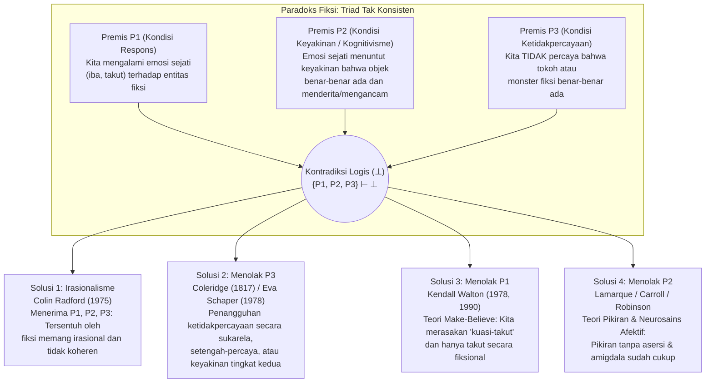

## Pendahuluan: Air Mata Santo Agustinus untuk Dido dan Kekaguman Hamlet atas Hecuba

Setiap hari kita mengalami fenomena psikologis yang begitu akrab sehingga kita jarang berhenti sejenak untuk menyadari betapa misterius—dan tampak irasional—fenomena tersebut. Ketika menjelang akhir mahakarya Leo Tolstoy, *Anna Karenina*, Anna yang putus asa berdiri di peron stasiun kereta api saat senja dan menjatuhkan dirinya ke bawah roda besi kereta barang yang melaju, tenggorokan kita terasa tercekat, air mata menggenang, dan gelombang rasa iba serta kesedihan yang mendalam menyelimuti dada kita. Atau bayangkan pemutaran film horor tengah malam di bioskop: saat monster lendir hijau (*Green Slime*) yang mengerikan merayap ganas ke arah lensa kamera, detak jantung kita melonjak, adrenalin membanjiri pembuluh darah, telapak tangan berkeringat dingin, dan kita mencengkeram sandaran kursi dalam ketakutan viseral.

Namun, jika kita memeriksa reaksi-reaksi ini dari sudut pandang psikologi rasional, kita segera berhadapan dengan jurang filosofis. Pembaca yang menangisi Anna Karenina tidak sedang mengalami halusinasi; ia tahu dengan kepastian mutlak bahwa Anna Karenina tidak pernah ada dalam sejarah dan seluruh tragedi itu hanyalah rangkaian tinta cetak di atas kertas. Demikian pula, penonton bioskop tahu tanpa keraguan sedikit pun bahwa ia duduk dengan aman di ruangan ber-AC sambil menatap proyeksi cahaya di layar datar. Mengapa, kalau begitu, orang dewasa yang rasional menangis, berduka, marah, dan gemetar atas nasib entitas yang mereka tahu sepenuhnya tidak pernah ada?

Teka-teki ini telah memikat pemikiran Barat selama hampir dua milenium. Sekitar tahun 397 M, <strong>Santo Agustinus dari Hippo (354–430)</strong> mengenang dengan penuh penyesalan dalam Buku III *Pengakuan-Pengakuan* (*Confessions*, III.ii.2) bagaimana di masa mudanya ia menangis tersedu-sedu saat membaca *Aeneid* karya Virgil tentang bunuh diri Ratu Kartago Dido setelah ditinggalkan oleh Aeneas, sementara ia tidak meneteskan satu air mata pun atas kematian rohaninya sendiri karena menjauh dari Tuhan: *"Kegilaan apa yang lebih gila daripada ini?"* Dua belas abad kemudian, sekitar tahun 1601, <strong>William Shakespeare</strong> menempatkan monolog terkenal di bibir Pangeran <strong>Hamlet</strong> (Babak II, Adegan 2) setelah melihat seorang aktor keliling memucat dan meneteskan air mata sungguhan saat mendeklamasikan duka ratu tua Troya, <strong>Hecuba</strong>:

> "Bukankah mengerikan bahwa aktor di sini ini, / Hanya dalam sebuah cerita rekaan (*in a fiction*), dalam mimpi penuh gairah, / Dapat memaksa jiwanya sedemikian rupa mengikuti khayalannya sendiri (*conceit*) / Hingga karena kerjanya seluruh wajahnya memucat, / Air mata di matanya, kekacauan di wajahnya, / Suara yang tercekat... dan semuanya demi ketiadaan! / Demi Hecuba! / <strong>Siapakah Hecuba baginya, atau dia bagi Hecuba, / Hingga ia harus menangisinya?</strong> (*What's Hecuba to him, or he to Hecuba, / That he should weep for her?*)"

Pada tahun 1975, filsuf analitik Inggris <strong>Colin Radford (1935–2001)</strong> menerbitkan makalah bersejarah di *Proceedings of the Aristotelian Society* berjudul <strong>"How Can We Be Moved by the Fate of Anna Karenina?"</strong> (*Bagaimana Kita Bisa Tersentuh oleh Nasib Anna Karenina?*), yang mengkristalkan kebingungan klasik ini menjadi salah satu masalah utama estetika analitik dan filsafat budi: <strong>Paradoks Fiksi (The Paradox of Fiction)</strong>. Dalam artikel ini, kita akan membedah secara sistematis struktur logis dari triad tak konsisten tersebut, empat strategi resolusi filosofis utama, temuan нейроsains afektif kontemporer, serta masalah-masalah saudaranya: *paradoks tragedi*, *resistensi imajinatif*, dan *ontologi entitas fiksi*.

---

## Bab 1: Struktur Logis Paradoks — Triad Tak Konsisten (Inconsistent Triad)

Colin Radford merumuskan Paradoks Fiksi sebagai sebuah <strong>Triad Tak Konsisten (Inconsistent Triad)</strong> yang terdiri dari tiga premis ($P_1, P_2, P_3$) yang masing-masing tampak sangat masuk akal secara independen, namun konjungsi ketiganya menghasilkan kontradiksi logis formal ($\{P_1, P_2, P_3\} \vdash \bot$):

### Premis $P_1$: Kondisi Respons Emosional (Fakta Fenomenologis)

> <strong>($P_1$) Kita benar-benar mengalami emosi sejati yang harfiah dan terarah pada objek (seperti rasa iba, kesedihan, ketakutan, kemarahan, dan kekaguman) terhadap tokoh dan peristiwa fiksi.</strong>

Ketika kita menangisi Anna Karenina atau ketakutan melihat monster di layar, kita tidak sedang berpura-pura sedih atau takut untuk menipu orang lain. Emosi kita terasa tulus secara fenomenologis dan nyata secara fisiologis: $\text{Emotion}_E(S, X)$.

### Premis $P_2$: Kondisi Keyakinan Eksistensial Kognitif (Kognitivisme Emosi)

> <strong>($P_2$) Agar subjek $S$ mengalami emosi sejati $E$ yang terarah pada suatu objek $X$, $S$ harus meyakini (memiliki keyakinan asertorik) bahwa $X$ benar-benar ada dan sungguh-sungguh memiliki sifat evaluatif yang relevan (menderita secara tidak adil, menimbulkan bahaya nyata, dll.).</strong>

Dalam logika doksastik berkuantor, premis $P_2$ dirumuskan sebagai berikut:

$$\forall S \forall X \Big( \text{Emotion}_E(S, X) \implies \text{Bel}_S\big(\exists x (x = X \land \text{Eval}_E(x))\big) \Big)$$

Premis ini berakar kuat pada <strong>Kognitivisme tentang Emosi (Cognitivism about Emotions)</strong> yang dikembangkan sejak <strong>Aristoteles (*Retorika*, Buku II)</strong> dan <strong>Spinoza (*Etika*)</strong> hingga <strong>Anthony Kenny (1963)</strong>, <strong>Robert C. Solomon (1976)</strong>, dan <strong>Martha Nussbaum (2001)</strong>. Berbeda dengan suasana hati tanpa objek (*mood*) atau sensasi tubuh belaka (*sensation*, seperti sakit gigi), sebuah emosi memiliki <strong>intensionalitas</strong> dan didefinisikan oleh <strong>objek formalnya (Formal Object)</strong>: merasa iba pada $X$ menuntut penilaian kognitif bahwa $X$ benar-benar menderita; takut pada $X$ menuntut keyakinan bahwa $X$ benar-benar mengancam.

Perhatikan eksperimen pikiran Radford: seorang rekan kerja menceritakan kepada Anda sambil terisak-isak bahwa adik perempuannya baru saja mengalami kecelakaan mobil yang mengerikan dan sedang sekarat di ICU. Anda seketika merasakan rasa iba dan kepedihan yang mendalam untuk gadis itu. Namun detik berikutnya, rekan itu menyeringai dan berkata: *"Tenang, aku hanya mengarang cerita itu untuk menguji aktingku! Aku bahkan tidak punya adik perempuan!"* Pada detik Anda mengetahui bahwa adik perempuan itu tidak ada, <strong>rasa iba Anda terhadap adik perempuan itu langsung lenyap seketika</strong> (berganti menjadi kemarahan terhadap sang penipu). Jika setelah tahu cerita itu bohong Anda masih terus menangis tersedu-sedu sambil berkata: *"Tapi aku tetap merasa sangat kasihan pada gadis malang di rumah sakit itu!"*, semua orang akan menilai Anda tidak rasional.

### Premis $P_3$: Kondisi Ketidakpercayaan (Non-Belief Condition)

> <strong>($P_3$) Pembaca dan penonton dewasa yang normal dan rasional sama sekali tidak percaya bahwa tokoh atau monster fiksi benar-benar ada di dunia nyata: $\neg \text{Bel}_S(\exists x (x = X))$.</strong>

Perilaku kita membuktikan hal ini secara mutlak: tidak ada penonton yang ketakutan di bioskop yang menelepon polisi atau berlari keluar lewat pintu darurat; tidak ada pembaca yang mencoba menghentikan kereta api di Moskow.

---

## Bab 2: Solusi 1 dan 2 — Irasionalisme Radford dan "Penangguhan Ketidakpercayaan" Coleridge

### 1. Strategi 1: Irasionalisme Colin Radford (1975)

Setelah menepis berbagai jalan keluar, Radford menyimpulkan bahwa <strong>$P_1, P_2,$ dan $P_3$ semuanya benar</strong>, sehingga fakta bahwa kita tersentuh oleh karya fiksi melibatkan kita dalam <strong>inkonsistensi dan irasionalitas murni</strong>, serupa dengan sebuah <strong>fobia</strong> (seperti penderita araknofobia yang merasakan teror nyata terhadap laba-laba tak berbahaya di dalam stoples kaca meskipun tahu sepenuhnya bahwa ia aman).

<strong>Kritik terhadap Irasionalisme</strong>:
Hampir semua ahli estetika kontemporer menolak kesimpulan Radford. Pertama, pandangan ini melakukan <strong>inversi normatif</strong>: sementara fobia adalah cacat rasionalitas yang ingin kita sembuhkan, kemampuan untuk tersentuh secara mendalam oleh *Anna Karenina* atau *Raja Lear* justru dihargai sebagai tanda kedewasaan emosional, kepekaan moral, dan apresiasi seni yang tepat. Kedua, tidak seperti penderita fobia yang panik dan kabur, penonton bioskop mempertahankan kendali perilaku secara utuh.

### 2. Strategi 2: Menolak $P_3$ — "Willing Suspension of Disbelief"

Penyair Romantik Inggris <strong>Samuel Taylor Coleridge</strong> pada tahun 1817 dalam *Biographia Literaria* (Bab XIV) mencetuskan ungkapan terkenal tentang <strong>"penangguhan ketidakpercayaan secara sukarela untuk sesaat, yang membentuk iman puitis" (*that willing suspension of disbelief for the moment, which constitutes poetic faith*)</strong>. Kemudian, <strong>Eva Schaper (1978)</strong> mengajukan struktur keyakinan dua tingkat: kita memiliki keyakinan tingkat pertama bahwa Anna tidak ada, tetapi keyakinan tingkat kedua yang sejati tentang apa yang terjadi di dalam cerita.

<strong>Mengapa penolakan terhadap $P_3$ gagal</strong>:
1. <strong>Involuntarisme doksastik</strong>: Kita tidak dapat memutuskan untuk percaya atau berhenti percaya pada sesuatu hanya dengan kehendak bebas.
2. <strong>Asimetri perilaku</strong>: Jika seorang penonton menangguhkan ketidakpercayaannya walau hanya lima detik di hadapan monster mematikan, ia pasti langsung berlari keluar gedung bioskop.
3. <strong>Runtuhnya tesis Schaper</strong>: Percaya bahwa *menurut teks Tolstoy* Anna menderita hanyalah keyakinan literer tentang sebuah teks, bukan keyakinan bahwa ada manusia nyata yang sedang menderita ($P_2$).

---

## Bab 3: Solusi 3 — Teori "Permainan Pura-Pura (Make-Believe)" dan "Kuasi-Takut" Kendall Walton (Menolak $P_1$)

Dalam artikel klasiknya <strong>"Fearing Fictions" (1978)</strong> dan mahakaryanya <strong>*Mimesis as Make-Believe: On the Foundations of the Representational Arts* (1990)</strong>, filsuf <strong>Kendall L. Walton</strong> (Universitas Michigan) merumuskan teori monumental yang <strong>mempertahankan $P_2$ dan $P_3$ secara ketat serta menyelesaikan paradoks dengan menolak dan menafsirkan ulang premis $P_1$</strong>.

### 1. Properti (Props) dan Permainan Pura-Pura (Games of Make-Believe)

Walton memodelkan seluruh seni representasional berdasarkan <strong>permainan pura-pura anak-anak (Games of Make-Believe)</strong>. Ketika dua anak di hutan sepakat bahwa semua tunggul pohon adalah beruang, tunggul pohon nyata berfungsi sebagai <strong>properti atau alat bantu (*props*)</strong> yang menetapkan, menurut prinsip generasi, proposisi mana yang <strong>benar secara fiksional ($\mathcal{F}(\phi)$)</strong> di dalam permainan. Demikian pula, novel *Anna Karenina* atau film horor adalah *props* yang dilembagakan secara kultural yang mengarahkan apresiator untuk berpartisipasi dalam permainan pura-pura ($\mathcal{F}_G$).

### 2. Charles dan Lendir Hijau (Charles and the Green Slime): Takut Sejati vs. Kuasi-Takut

Walton menganalisis kasus terkenal <strong>Charles</strong>, yang menonton film horor tentang Lendir Hijau (*Green Slime*) yang menerjang ke arah kamera. Charles mencengkeram kursinya, jantungnya berdegup kencang, dan ia berkeringat dingin. <strong>Apakah Charles secara harfiah takut pada lendir hijau itu di dunia nyata ($\text{LiteralFear}$)?</strong>
Walton menjawab: <strong>Tidak ($\neg P_1$)!</strong> Karena rasa takut harfiah menuntut keyakinan bahwa seseorang berada dalam bahaya nyata ($P_2$) dan dorongan perilaku untuk melarikan diri—dua hal yang tidak dimiliki Charles.

Namun Charles sama sekali tidak sedang berpura-pura secara dingin! Ia mengalami kondisi fisiologis dan afektif yang sepenuhnya nyata (detak jantung cepat, lonjakan adrenalin, sensasi ngeri fenomenologis) yang oleh Walton disebut <strong>"kuasi-takut" (*quasi-fear*, dan secara umum *quasi-emotions*)</strong>.
Lingkaran kausal dan representasionalnya bekerja sebagai berikut:
1. Gambar di layar (*prop* eksternal) membuat Charles membayangkan tentang dirinya sendiri (*de se*): *"Lendir itu sedang menyerangku!"*
2. Imajinasi *de se* yang hidup ini secara kausal memicu <strong>kuasi-takut</strong> yang nyata di dalam tubuh Charles.
3. Kuasi-takut nyata itu pada gilirannya berfungsi sebagai <strong>*prop* internal refleksif (*reflexive prop*)</strong> yang menjadikannya <strong>benar secara fiksional di dalam permainan Charles bahwa ia secara harfiah takut pada lendir tersebut</strong>:

$$\text{Imagine}_{\text{Charles}}(\text{Bahaya}) \xrightarrow{\text{menyebabkan}} \text{QuasiFear}(\text{Charles}) \xrightarrow{\text{menghasilkan}} \mathcal{F}_G\big(\text{LiteralFear}(\text{Charles}, \text{Slime})\big)$$

Ini persis seperti anak kecil yang bermain "monster-monsteran" dengan ayahnya: sang anak tahu ayahnya tidak akan menyakitinya, tetapi ia merasakan *kuasi-takut* nyata yang mendebarkan sehingga, *di dalam permainan*, ia ketakutan oleh sang monster. (<strong>Gregory Currie 1990</strong> merumuskan ulang hal ini dalam sains kognitif sebagai <strong>teori simulasi luring / *off-line simulation</strong>*).

---

## Bab 4: Solusi 4 — Menolak $P_2$: "Teori Pikiran (Thought Theory)" dan Neurosains Afektif

Menentang Walton, para filsuf seperti <strong>Peter Lamarque (1981)</strong>, <strong>Noël Carroll (*The Philosophy of Horror*, 1990)</strong>, <strong>Richard Moran (1994)</strong>, <strong>Jenefer Robinson (2005)</strong>, dan <strong>Tamar Szabó Gendler (2008)</strong> mengajukan keberatan bahwa mereduksi kesedihan kita atas Anna Karenina menjadi sekadar "permainan pura-pura" mendistorsi pengalaman batin kita: <strong>kita merasakan emosi sejati ($P_1$ benar), dan premis yang salah adalah $P_2$ (syarat keyakinan eksistensial)!</strong>

### 1. Teori Pikiran (Thought Theory: Lamarque dan Carroll)

Menurut <strong>Thought Theory</strong>, emosi sejati tidak memerlukan keyakinan asertorik atas keberadaan objeknya; cukup dengan <strong>menghadirkan secara hidup di dalam pikiran suatu gagasan proposisional tanpa mengasersi kebenarannya (*vividly entertaining an unasserted thought*)</strong>.
- Jika Anda berdiri dengan aman di balik pagar baja kokoh di puncak gedung pencakar langit ($\neg \text{Bel}(\text{Bahaya})$) dan hanya membayangkan secara hidup *pikiran* bahwa tubuh Anda terjatuh melewati pagar ke jurang di bawah, Anda akan merasakan gelombang rasa takut dan vertigo yang sejati.
- Jika Anda membayangkan secara hidup mengunyah cacing tanah hidup, Anda akan merasakan <strong>rasa jijik (Disgust)</strong> yang nyata.

Apa yang menyebabkan rasa takut sejati kita pada Dracula atau rasa iba sejati kita pada Anna Karenina adalah <strong>isi pikiran (*Thought-content*)</strong> yang dibentuk oleh karya tersebut. Karena emosi itu dibangkitkan oleh pikiran yang tidak diasersi dan bukan oleh keyakinan eksistensial, program motorik untuk melarikan diri secara fisik tidak diaktifkan.

### 2. Neurosains Afektif (Jalur Ganda Amigdala) dan "Alief"

Neurosains afektif kontemporer (<strong>Joseph LeDoux</strong>, *The Emotional Brain*, 1996) secara empiris membantah $P_2$ melalui model <strong>jalur ganda</strong>:
1. <strong>Jalur Bawah Subkortikal Cepat (Low Road: Talamus $\to$ Amigdala / Insula)</strong>: Representasi perseptual atau imajinatif mencapai <strong>amigdala</strong> dalam hitungan milidetik. Amigdala bersifat "buta-fiksi" (*fiction-blind*) dan tidak mampu melakukan pemeriksaan ontologis atas keberadaan objek; ia langsung memicu <strong>emosi fisiologis dan afektif yang sejati</strong> ($P_1$ terbukti, $P_2$ terbantahkan).
2. <strong>Jalur Atas Kortikal Lambat (High Road: Talamus $\to$ Korteks Prefrontal PFC)</strong>: Korteks prefrontal mengevaluasi konteks (*"Aku sedang duduk di bioskop menonton film"*, $P_3$) dan <strong>menghambat perintah motorik untuk kabur</strong>, sehingga kita dapat menikmati emosi tersebut dengan aman di kursi.

<strong>Tamar Szabó Gendler (2008)</strong> memperkenalkan konsep <strong>"Alief"</strong>: sementara <strong>keyakinan (Belief)</strong> eksplisit Charles adalah *"Lendir itu tidak ada"*, citra visual di layar mengaktifkan <strong>Alief</strong> asosiatif dan otomatis (*"Monster berbahaya! Rasakan teror! Mundur!"*).

| Strategi Resolusi | Premis yang Ditolak | Tokoh Utama | Hakikat Emosi Fiksi | Mengapa Kita Tidak Kabur dari Bioskop? | Kekuatan Utama & Kritik Utama |
| :--- | :---: | :--- | :--- | :--- | :--- |
| <strong>1. Irasionalisme</strong> | <strong>Tidak Ada</strong> (Menerima $\bot$) | Colin Radford (1975) | Emosi sejati dan harfiah, tetapi irasional dan tidak koheren (seperti fobia). | Keyakinan rasional ($P_3$) menahan tindakan sementara hati menangis secara irasional. | Menghormati ke-3 intuisi, tetapi merendahkan empati sastra setara dengan patologi fobia. |
| <strong>2. Penangguhan Ketidakpercayaan</strong> | <strong>Menolak $P_3$</strong> | S. T. Coleridge (1817) Eva Schaper (1978) | Emosi sejati berdasarkan ilusi sementara atau keyakinan tingkat kedua tentang alur cerita. | Keyakinan tingkat pertama tentang realitas menahan pelarian; tingkat kedua memicu emosi. | Menjelaskan imersi, tetapi gagal menghadapi involuntarisme doksastik dan ketiadaan kepanikan. |
| <strong>3. Teori Make-Believe</strong> | <strong>Menolak $P_1$</strong> | Kendall Walton (1978, 1990) Gregory Currie (1990) | <strong>Kuasi-emosi</strong> nyata yang berfungsi sebagai *prop* sehingga <strong>benar secara fiksional ($\mathcal{F}_G$)</strong> bahwa kita takut atau iba. | Tanpa keyakinan bahaya ($P_3$) maupun takut harfiah; simulasi mental berjalan "luring". | Menyelamatkan kognitivisme ($P_2$), tetapi terasa artifisial menyebut duka tragis mendalam sebagai "permainan". |
| <strong>4. Thought Theory & Neurosains</strong> | <strong>Menolak $P_2$</strong> | Peter Lamarque (1981) Noël Carroll (1990) Jenefer Robinson (2005) Tamar Gendler (2008) | <strong>Emosi sejati dan harfiah</strong> yang dipicu oleh <strong>pikiran tanpa asersi</strong> atau <strong>Alief</strong> subkortikal. | Pemantauan realitas oleh korteks prefrontal ($P_3$) menghambat keluaran motorik pelarian. | Sepenuhnya selaras dengan fenomenologi sehari-hari ($P_1$) dan neurobiologi modern. |

---

## Bab 5: Paradoks Saudara — Paradoks Tragedi, Resistensi Imajinatif, dan Ontologi

### 1. Paradoks Tragedi dan Horor

Mengapa kita secara sukarela mencari emosi yang menyakitkan dalam seni (kesedihan, rasa iba, teror) yang justru kita hindari sekuat tenaga dalam kehidupan nyata?
- <strong>Teori *Katarsis* Aristoteles (*Poetics*, Bab 6)</strong>: Tragedi mencapai, melalui rasa iba (*eleos*) dan rasa takut (*phobos*), pemurnian, pelepasan, dan kalibrasi rasional atas emosi-emosi tersebut.
- <strong>"Teori Konversi" David Hume (1757, *"Of Tragedy"*)</strong>: Kenikmatan estetis dominan yang dibangkitkan oleh kefasihan bahasa, ritme puitis, dan keahlian imitasi sang seniman mengambil alih energi emosional yang menyakitkan dari kesedihan dan <strong>mengubahnya (*converts*) sepenuhnya menjadi kenikmatan estetis</strong>.
- <strong>"Meta-Respons" Susan Feagin (1983)</strong>: Rasa sakit langsung pada tingkat pertama diikuti oleh meta-respons yang menyenangkan di mana kita merasa puas secara moral karena menyadari kapasitas empati kemanusiaan kita sendiri.
- <strong>Keingintahuan Kognitif Noël Carroll (1990)</strong>: Dalam horor, kita menanggung rasa takut dan jijik sebagai harga (atau penguat) demi memuaskan daya tarik kognitif terhadap monster yang melanggar kategori konseptual kita.

### 2. Teka-Teki Resistensi Imajinatif (Hume, Walton, Gendler)

Sementara kita dengan mudah membayangkan kemustahilan fisik (naga penyembur api, perjalanan waktu), kita melakukan <strong>resistensi imajinatif (Imaginative Resistance)</strong> yang keras ketika seorang penulis mencoba menetapkan kebenaran moral yang menyimpang—seperti dalam kalimat terkenal <strong>Kendall Walton</strong>:

> <strong>"Dalam membunuh bayinya, Giselda melakukan hal yang benar; lagi pula, bayi itu perempuan (*In killing her baby, Giselda did the right thing; after all, it was a girl*)."</strong>

Menurut <strong>Walton (1994)</strong>, kita *tidak dapat* membayangkannya (*Can't*) karena sifat-sifat moral <strong>supervenien (supervene)</strong> secara konseptual di atas fakta-fakta alamiah. Menurut <strong>Tamar Szabó Gendler (2000)</strong>, kita *menolak* membayangkannya (*Won't*) demi mencegah "mengekspor" perspektif moral yang keji keluar dari fiksi dan mencemari kepekaan moral nyata kita.

### 3. Ontologi Entitas Fiksi (Meinong vs. Teori Artefaktual Thomasson)

Apa status ontologis dari "Anna Karenina"?
1. <strong>Meinongianisme (Alexius Meinong, Terence Parsons, Edward Zalta)</strong>: Anna Karenina adalah <strong>objek tak-ada (*non-existent object*)</strong> konkret atau abstrak yang mengkodekan sifat-sifat yang диatribusikan dalam novel.
2. <strong>Semantik Kepura-puraan Anti-Realis (Kendall Walton)</strong>: Tidak ada entitas fiksi sama sekali; berbicara tentang Anna hanyalah berpartisipasi dalam permainan pura-pura yang ditetapkan oleh novel.
3. <strong>Teori Artefaktual Fiksi (Saul Kripke, Peter van Inwagen, Amie L. Thomasson 1999 *Fiction and Metaphysics*)</strong>: Posisi realis paling berpengaruh saat ini. Sama seperti hukum, simfoni, atau permainan catur, tokoh-tokoh fiksi adalah <strong>artefak budaya abstrak (*Abstract Cultural Artifacts*)</strong> yang diciptakan pada titik sejarah tertentu oleh penulisnya dan benar-benar ada di dunia budaya kita. Oleh karena itu, pernyataan *"Anna Karenina diciptakan oleh Tolstoy dan dikasihani oleh jutaan pembaca"* adalah benar secara harfiah!

---

## Kesimpulan: Imajinasi Emosional sebagai Laboratorium Kemanusiaan

Setengah abad perdebatan sejak makalah Colin Radford (1975) membuktikan bahwa air mata kita untuk Anna Karenina bukanlah cacat irasional maupun ilusi kognitif. Berkat kapasitas <strong>simulasi imajinatif (Walton)</strong> dan arsitektur jalur ganda otak emosional kita (<strong>Lamarque, Carroll, Robinson, LeDoux</strong>), di mana <strong>pikiran-pikiran hidup</strong> membangkitkan empati subkortikal sejati di bawah pengawasan aman korteks prefrontal, fiksi bekerja sebagai laboratorium moral dan afektif terdalam bagi umat manusia: ia memungkinkan kita melampaui batas-batas sempit ego kita sendiri untuk merasakan dari dalam penderitaan dan martabat sesama makhluk.
