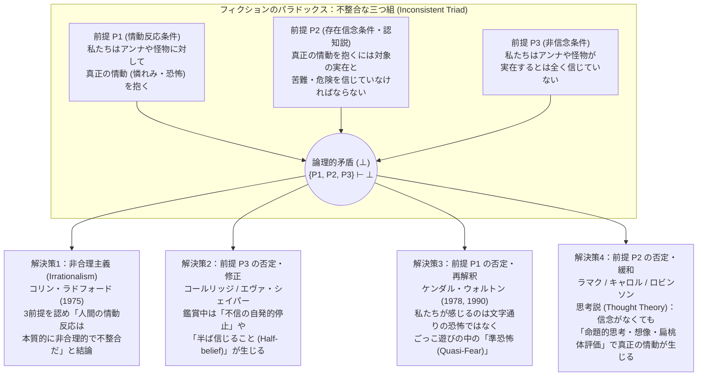
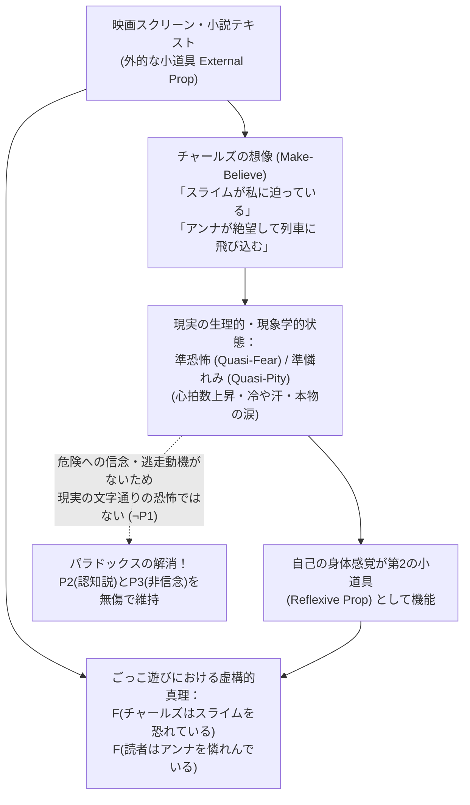
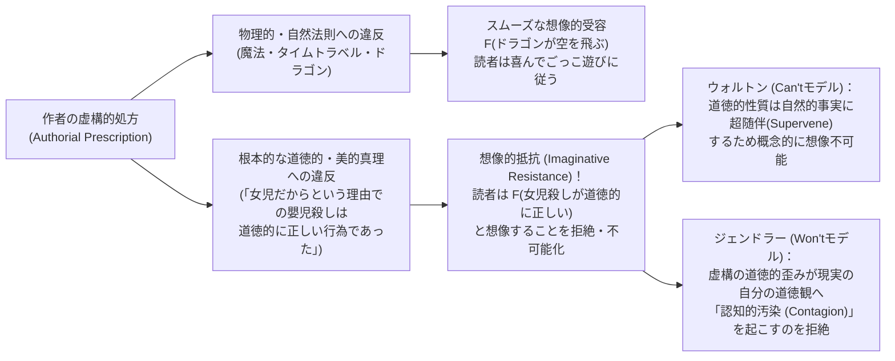

## 序論：ディドの死に流す涙と、ハムレットが驚嘆した役者の慟哭

私たちは日常的に、極めて奇妙で、しかしあまりにもありふれた「精神の奇跡」を経験している。トルストイの長編小説『アンナ・カレーニナ』の終盤、絶望に追い詰められたアンナが夜の駅のプラットホームに立ち、近づいてくる貨物列車の車輪の下へと身を投げる場面を読むとき、私たちの胸は締めつけられ、目頭は熱くなり、深い悲哀と憐れみの情が込み上げてくる。あるいは、深夜の映画館の暗闇の中で、スクリーン上の緑色の粘液状の怪物（グリーンスライム）がカメラに向かって猛スピードで迫ってくるホラー映画を観るとき、私たちの心拍数は跳ね上がり、手のひらには冷たい脂汗が滲み、全身の筋肉が硬直する。

しかし、冷静に立ち止まって考えてみると、この現象は人間の合理性に関する私たちの根本的な理解と真っ向から衝突している。私たちは幼児ではないし、精神的な錯乱状態にあるわけでもない。私たちは、アンナ・カレーニナという女性が19世紀のロシアに実在したことは一度もなく、すべてはレフ・トルストイという作家が紙の上に並べたインクの染み（文字列）が生み出した「作り話（フィクション）」であることを、最初から最後まで完全に熟知している。映画館の観客もまた、スクリーン上の怪物がただの光の投影（ピクセルの配列）であり、自分が座っている劇場の座席に怪物が飛び出してきて自分を捕食する危険など「文字通りゼロ」であることを百も承知している。それにもかかわらず、なぜ私たちは「実在しない」と確信している対象に対して、これほどまでに生々しく、本気で泣き、本気で怯え、心を揺さぶられるのだろうか。

この問いは、西洋の思想史において二千年近く前から繰り返し意識されてきた。4世紀末、キリスト教最大の教父<strong>アウグスティヌス（Saint Augustine of Hippo, 354–430）</strong>は、自伝的著作『告白（Confessions）』第3巻において、若き日の自分がウェルギリウスの叙事詩『アエネーイス』を読み、英雄アエネーイスに捨てられて自害したカルタゴの女王ディド（Dido）の悲劇的な運命に熱い涙を流したことを振り返り、深い自己嫌悪と困惑を吐露した。

> 「神よ、当時の私はなんと惨めであったことでしょう。あなたを愛さずに離れた私自身の死（霊的な死）については一滴の涙も流さなかったというのに、アエネーイスの恋に破れて死んだディドのために、私は涙を流して泣いたのです。……もし私がその物語を読むことを禁じられたなら、私は物語の中の出来事が『真実ではない（作り話である）』という理由ではなく、ただその甘美な悲しみを味わえなくなるという理由で嘆き悲しんだことでしょう。これほどまでに狂気じみたことが他にあるでしょうか？」（アウグスティヌス『告白』第3巻第2章・要旨）

それから約1200年後、<strong>ウィリアム・シェイクスピア（William Shakespeare）</strong>は悲劇『ハムレット（Hamlet）』（1601年頃）第2幕第2場において、旅芸人の一座の役者がトロイア戦争で夫プリアモス王を惨殺された老王妃ヘキュバ（Hecuba）の嘆きを演じながら、実際に顔を蒼白にし、目に本物の涙を浮かべ、声を震わせている姿を見て、主人公ハムレットに有名な独白を語らせている。

> 「なんという恐ろしいことだ、この役者は、ただの作り話（in a fiction）、ただの情熱の夢（in a dream of passion）の中で、自らの魂を自分の思い描いた想像に従わせ、その働きによって顔色を変え、目に涙を溢れさせ、取り乱した表情を見せ、声を詰まらせている。そしてその全身の振る舞いが、彼自身の思い描いた概念（conceit）にピタリと一致しているのだ。しかも、すべては『無（nothing）』のために！ ヘキュバのために！ <strong>彼にとってヘキュバが何だというのか、ヘキュバにとって彼が何だというのか、彼が彼女のために泣くとは？（What's Hecuba to him, or he to Hecuba, / That he should weep for her?）</strong>」

アウグスティヌスやハムレットが直観的に捉えていたこの深い謎を、20世紀の分析美学（Analytic Aesthetics）および心の哲学（Philosophy of Mind）の中心的なアポリアとして厳密な論理形式で定式化したのが、イギリスの哲学者<strong>コリン・ラドフォード（Colin Radford, 1935–2001）</strong>が1975年に『アリストテレス協会紀要補遺（Proceedings of the Aristotelian Society, Supplementary Volumes）』に発表した歴史的論文<strong>「アンナ・カレーニナの運命にどうして心を動かされうるのか？（How Can We Be Moved by the Fate of Anna Karenina?）」</strong>である。

ラドフォードの論文以降、この問題は<strong>「フィクションのパラドックス（The Paradox of Fiction）」</strong>（あるいは「虚構に対する情動反応のパラドックス」）と呼ばれ、ケンダル・ウォルトン（Kendall Walton）、ピーター・ラマク（Peter Lamarque）、ノエル・キャロル（Noël Carroll）、グレゴリー・カリー（Gregory Currie）、リチャード・モラン（Richard Moran）、ジェネファー・ロビンソン（Jenefer Robinson）ら第一線の哲学者・認知科学者を巻き込む巨大な論争へと発展した。なぜなら、このパラドックスを解くことは単に「小説や映画をどう楽しむか」という芸術批評の問題にとどまらず、<strong>「人間の『情動（Emotion）』とはそもそも何か？」「『信じること（Belief）』と『想像すること（Imagination）』は心のアーキテクチャにおいてどう異なるのか？」「存在しない対象（虚構的対象）について語ったり感じたりするとはどういうことか？」</strong>という、人間の心と合理性の根幹に関わる問いに答えることを要求するからである。

本稿では、ラドフォードが定式化した「3つの前提の不整合な三つ組（Inconsistent Triad）」の論理構造から出発し、情動の認知説（Cognitivism about Emotions）、ラドフォード自身の急進的な「非合理主義（Irrationalism）」、コールリッジの「不信の自発的停止」、ケンダル・ウォルトンの記念碑的な「ごっこ遊び（Make-Believe）」理論と「準恐怖（Quasi-Fear）」、そしてピーター・ラマクやノエル・キャロルらの「思考説（Thought Theory）」と最新の神経科学（扁桃体と前頭前野の二重過程モデル）までを体系的に検証する。さらに議論を広げ、姉妹問題である「悲劇とホラーのパラドックス（Paradox of Tragedy / Horror）」「想像的抵抗（Imaginative Resistance）」、および「虚構的対象の存在論（Ontology of Fictional Entities）」までを徹底的に解剖する。

---

## 第1章：フィクションのパラドックスの論理構造――不整合な三つ組（Inconsistent Triad）

哲学における「パラドックス（逆理）」とは、直観的にも経験的にもそれぞれ独立して極めてもっともらしい（真であるように見える）複数の前提を同時に受け入れると、論理的な矛盾（$\bot$）が導き出されてしまう事態を指す。コリン・ラドフォードが明らかにした「フィクションのパラドックス」は、以下の3つの命題（$P_1, P_2, P_3$）からなる<strong>「不整合な三つ組（Inconsistent Triad）」</strong>として厳密に定式化される。

### 前提 $P_1$：情動反応条件（The Response Condition / 現象学的・経験的事実）

> <strong>（$P_1$）私たちは、虚構の登場人物や出来事に対して、真正の情動（genuine emotions：憐れみ、悲しみ、恐怖、怒り、称賛など）を実際に経験する。</strong>

これは私たちの日常的な読書経験や映画鑑賞経験に根ざした、否定しがたい現象学的事実（Phenomenological Fact）に見える。『アンナ・カレーニナ』を読んで涙を流すとき、私たちが感じている胸の痛みや悲哀は、決して「泣いているふり（演技）」ではない。映画『エイリアン』や『エクソシスト』を観て飛び上がるとき、私たちの恐怖感は極めてリアルな実感を伴っている。文芸批評や日常会話においても、「私はアンナを心から気の毒に思う（I pity Anna Karenina）」「あのホラー映画の怪物には本当に震え上がった（I was terrified of the monster）」という発話は、文字通り真なる命題として自然に通用している。

### 前提 $P_2$：情動に関する存在信念条件（The Cognitive / Existence-Belief Condition on Emotion）

> <strong>（$P_2$）ある主体 $S$ が対象 $X$ に対して真正の対象志向的情動（object-directed emotion）$E$ を抱くためには、$S$ は「$X$ が実際に存在しており、かつその情動を正当化する性質（苦難や危険など）を実際に持っている」と信じていなければならない。</strong>

論理記号を用いて形式化すれば、主体 $S$ が対象 $X$ に対して情動 $E$（例えば憐れみや恐怖）を抱くことを $\text{Emotion}_E(S, X)$、主体 $S$ が命題 $\phi$ を信じていること（信念演算子）を $\text{Bel}_S(\phi)$、対象 $X$ が存在し情動 $E$ に対応する評価的性質（苦しんでいる、危害を加えようとしている等）を持つことを $\text{Eval}_E(X)$ と書くとき、前提 $P_2$ は次の必要条件として表される。

$$\forall S \forall X \Big( \text{Emotion}_E(S, X) \implies \text{Bel}_S\big(\exists x (x = X \land \text{Eval}_E(x))\big) \Big)$$

なぜこの前提 $P_2$ がこれほど強力な説得力を持つのかを理解するためには、心の哲学における<strong>「情動の認知説（Cognitivism about Emotions / 情動の判断説 Judgmentalism）」</strong>の伝統を知る必要がある（この点は次章で詳しく掘り下げる）。

ラドフォード自身が挙げた鮮烈な思考実験を考えてみよう。ある日、あなたの同僚が真っ青な顔をしてあなたのデスクに駆け寄り、「大変だ！ 君の大切な妹が先ほど高速道路で凄惨な玉突き事故に遭い、重体で集中治療室に運ばれたそうだ！」と告げたとしよう。その瞬間、あなたの全身からは血の気が引き、激しい悲嘆と恐怖、妹への深い憐れみがあなたを襲う。あなたは泣き崩れそうになりながら病院へ駆けつけようとする。ところがその直後、その同僚がニヤリと笑って、「ごめんごめん、今の話は全部僕の悪質な嘘（作り話）だよ。君の妹ならさっきカフェで元気にコーヒーを飲んでいたよ」と種明かしをしたとする。

この瞬間、あなたの「妹の事故に対する悲嘆と憐れみ」はどうなるだろうか？ もちろん、悪質な嘘をついた同僚に対する「激しい怒り」という別の情動に取って代わられるだろうし、一度上がった心拍数や手の震え（生理的覚醒）が収まるまでには数分かかるかもしれない。しかし、<strong>「妹の悲惨な事故に対する悲嘆や憐れみ」そのものは、それが「事実ではない（妹は事故に遭っていない）」と知った瞬間に、文字通り雲散霧消する</strong>はずである。もし種明かしを聞いて「ああ、嘘だったのか、よかった！」と完全に納得した後になってもなお、あなたがハンカチで涙を拭いながら「それでもやっぱり、高速道路で血まみれになっている妹がかわいそうでたまらないんだ……」と本気で泣き続けていたとしたら、周囲の人間はあなたを「完全に非合理的である（あるいは精神的に何か異常をきたしている）」と見なすだろう。

つまり、私たちの通常の情動概念においては、「対象が実際に存在し、実際に苦しんでいる（あるいは実際に自分を脅かしている）という<strong>存在信念（Existential Belief）</strong>」は、憐れみや恐怖といった情動が成立するための不可欠な構成要素（あるいは論理的前提条件）なのである。

### 前提 $P_3$：非信念条件（The Non-Belief Condition）

> <strong>（$P_3$）通常の正常な成人読者や観客は、虚構の登場人物や怪物が現実に存在しているとは全く信じていない。</strong>

これもまた、議論の余地がないほど明白な事実である。どれほど『アンナ・カレーニナ』に没頭して涙を流している読者であっても、19世紀のモスクワ鉄道警察に電話をかけて自殺防止の通報をしようとはしないし、アンナの遺族に香典を送ろうともしない。どれほどホラー映画のグリーンスライムに悲鳴を上げている観客であっても、映画館の非常口から表の通りへ逃げ出して110番通報したりはしない。もし誰かが劇場で「舞台の上でデズデモーナがオセロに絞め殺されようとしている！」と本気で信じて舞台に駆け上がり、俳優を取り押さえたとしたら（ Cervantes の『ドン・キホーテ』のように）、その人物は「フィクションという芸術制度」を理解し損ねた精神的錯乱者である。したがって、正常な鑑賞者 $S$ においては、虚構的対象 $X$ について次の命題が成り立つ。

$$\neg \text{Bel}_S\big(\exists x (x = X)\big)$$

### 論理的破綻と4つの解決戦略のマップ

ここで $P_1, P_2, P_3$ の3つを並べてみよう。
1. <strong>（$P_1$）</strong> 主体 $S$ は虚構的対象 $X$ に対して真正の情動 $E$ を抱いている：$\text{Emotion}_E(S, X)$
2. <strong>（$P_2$）</strong> $S$ が $X$ に真正の情動 $E$ を抱くならば、$S$ は $X$ の実在を信じている：$\text{Emotion}_E(S, X) \implies \text{Bel}_S(\exists x(x=X))$
3. <strong>（$P_3$）</strong> $S$ は $X$ の実在を信じていない：$\neg \text{Bel}_S(\exists x(x=X))$

命題論理の基本規則（モーダス・ポネンス）により、$P_1$ と $P_2$ から $\text{Bel}_S(\exists x(x=X))$ が導かれるが、これは $P_3$ の $\neg \text{Bel}_S(\exists x(x=X))$ と直接的に矛盾する（$\{P_1, P_2, P_3\} \vdash \bot$）。

この図が示す通り、論理的矛盾を回避するための哲学的選択肢は原理的に以下の4つしか存在しない。
1. <strong>非合理主義（Irrationalism / ラドフォード）</strong>：$P_1, P_2, P_3$ をすべて受け入れ、矛盾が生じるのは「私たち人間自身が、フィクションに感動するときに本質的に非合理的で不整合な状態に陥っているからだ」と開き直る。
2. <strong>前提 $P_3$ の否定（Illusionism / Suspension of Disbelief）</strong>：鑑賞中の私たちは、一時的に「アンナや怪物が実在する」と（少なくとも部分的に、あるいは無意識下で）信じているのだと主張する。
3. <strong>前提 $P_1$ の否定（Make-Believe Theory / ケンダル・ウォルトン）</strong>：私たちがアンナやグリーンスライムに対して抱いているのは、現実の人間や危険に対する「文字通りの真正な憐れみや恐怖」ではなく、想像のごっこ遊びの中で体験される「準情動（Quasi-emotion / ごっこ遊びの恐怖）」であると主張する。
4. <strong>前提 $P_2$ の否定（Thought Theory / Anti-Cognitivism）</strong>：真正の情動が成立するために「対象の実在に関する信念」はそもそも必要ではなく、命題を心の中で生き生きと思い描くこと（思考・想像・知覚的表象）だけで本物の情動が引き起こされると主張する。

以下、まず前提 $P_2$ の背後にある「情動の認知説」の哲学的基盤を確認した上で、これら4つの解決戦略の攻防を順を追って詳細に検討していこう。

---

## 第2章：なぜ「信念」が必要なのか？――情動の認知説（Cognitivism about Emotions）の系譜

「感情や情動（Emotion）などというものは、ただの胸のドキドキや気分の高ぶりといった非合理的な身体感覚にすぎないのだから、信念の有無など最初から関係ないのではないか？」と素朴に疑問を持つ読者もいるかもしれない。実は、そうした「情動＝単なる主観的感覚（Feeling）や生理的興奮」と見なす立場（初期のウィリアム・ジェームズらの身体感覚説や、論理実証主義的な情動観）に対して、20世紀後半の心の哲学が成し遂げた最大の理論的達成こそが<strong>「情動の認知説（Cognitivism about Emotions）」</strong>であった。

その淵源は古代ギリシアの<strong>アリストテレス（Aristotle）</strong>の『弁論術（Rhetoric）』第2巻にまで遡る。アリストテレスは、例えば「怒り（orgē）」を単なる「心臓の周りの血液の沸騰」としてだけでなく、「自分や自分の親しい者に対する、不当な軽蔑（oligōria）に向けられた、苦痛を伴う復讐への欲求」として定義した。また「憐れみ（eleos）」については、「それに値しない人が被っている、破滅的あるいは苦痛に満ちた災難（しかも自分や自分の親しい者にも降りかかりうると予想されるような災難）に対する苦痛の感情」と定義した。すなわち、ある感情が「怒り」や「憐れみ」であるためには、単なる生理的な胸の痛みだけでなく、<strong>「相手が不当に自分を傷つけた」「あの人は不当な災難に苦しんでいる」という世界についての認知的判断（Cognitive Judgment / Appraisal）</strong>が本質的に組み込まれていなければならないのである。

この洞察は、近代の<strong>スピノザ（Baruch Spinoza）</strong>の『エチカ』における感情の幾何学的分析を経て、20世紀後半にアンソニー・ケニー（Anthony Kenny）、<strong>ロバート・ソロモン（Robert C. Solomon, *The Passions*, 1976）</strong>、そして<strong>マーサ・ヌスバウム（Martha Nussbaum, *Upheavals of Thought: The Intelligence of Emotions*, 2001）</strong>らによって強力に復興された。認知説が明らかにした情動の3つの決定的な特徴は以下の通りである。

### 1. 志向性（Intentionality）と形式的対象（Formal Object）

単なる「気分（Mood：なんとなく憂鬱だ、理由もなくイライラする）」や「身体感覚（Sensation：胃がキリキリ痛む、寒気がする）」とは異なり、<strong>情動（Emotion）は必ず「何かについて（about something）」の心状態である</strong>という<strong>志向性（Intentionality）</strong>を持つ。私は単に「恐れている」のではなく、「目の前の猛犬を」恐れているのであり、単に「誇らしい」のではなく、「自分の娘がピアノコンクールで優勝したことを」誇りに思うのである。

さらに重要なのは、それぞれの情動には固有の<strong>「形式的対象（Formal Object / 評価的基準）」</strong>があるという点だ。
- <strong>恐怖（Fear）</strong>の形式的対象は「私（または私が気にかける対象）に対する差し迫った危険・脅威（the dangerous / threatening）」である。
- <strong>憐れみ（Pity / Compassion）</strong>の形式的対象は「他者が被っている不当な苦難・不幸（undeserved misfortune）」である。
- <strong>悔恨（Remorse）</strong>の形式的対象は「自分自身が過去に行った道徳的過ち（one's own moral transgression）」である。

もしある人が、「私はあの小石を心から悔恨している（ただし、私はあの小石に対して何も悪いことをしていないし、そもそもあの小石が単なる無生物であることも知っている）」と言ったなら、その人は「悔恨」という概念を論理的に誤用している。同じ生理的覚醒（心拍数の上昇、アドレナリンの分泌）であっても、それを「恐怖」と「歓喜」と「怒り」に区別しているのは、まさに「相手は危険だ」「素晴らしいことが起きた」「不当に侮辱された」という<strong>認知的信念・評価判断の違い</strong>なのである。

### 2. 合理的評価可能性（Rational Assessability）と信念への感度

気分や単なる身体の痛み（「歯が痛い」）に対して、「あなたのその歯痛は非合理的だ（根拠が間違っている）」と批判することはできない。しかし、情動に対しては私たちは日常的に<strong>合理的批判や正当化の要求</strong>を行う。「なぜそんなに怒っているの？ 彼は君を助けるために言ったんだよ（＝君の『侮辱された』という信念は偽である）」「あの犬は鎖に繋がれているしおとなしい老犬だから、怖がる理由はないよ（＝君の『危険だ』という信念は根拠がない）」。

そして正常な合理的エージェントにおいては、その情動を支えていた基礎的信念（Factual / Evaluative Belief）が誤りであったと判明すれば、情動もまた解消される（先述の「妹の交通事故の嘘」の例）。これこそが、前提 $P_2$（真正の情動には対象の存在と性質に関する信念が必要である）が単なる独断ではなく、情動の合理性と志向性を説明するための極めて強固な哲学的基盤を持っている理由なのである。

---

## 第3章：解決策1――コリン・ラドフォードの「非合理主義（Irrationalism）」とその限界

1975年の論文において、コリン・ラドフォードはあらゆる脱出路（後述する「不信の停止」や「ごっこ遊び理論」の原型など）を一つずつ検討しては論破し、最終的に驚くべき結論へと到達した。それは、<strong>「$P_1, P_2, P_3$ はすべて真であり、したがって私たちがフィクションの登場人物の運命に心を動かされるという現象は、文字通り非合理的（irrational）で、首尾一貫しておらず（incoherent）、不整合（inconsistent）な人間本性の事実である」</strong>という<strong>非合理主義（Irrationalism）</strong>の立場である。

ラドフォードは言う。人間は常に完全に論理的で整合的な存在であるとは限らない。例えば、高所恐怖症の人が、分厚い強化ガラスの床で完全に安全だと頭では100%理解して信じている展望台に立ったとき、それでも足がすくんで激しい恐怖に襲われることがある。あるいは、すでに死んでしまって痛みを感じるはずがないと分かっている遺体が冷たい雨の中に放置されているのを見て、「寒そうでかわいそうだ」と同情してしまうことがある。ラドフォードによれば、私たちがアンナ・カレーニナのために涙を流すのもこれと全く同じ構造であり、私たちは「実在しないと知りながら、実在する人間にしか適切でありえないはずの憐れみを抱く」という認知的不整合（Brute Irrationality）を犯しているのである。

### ラドフォードの非合理主義に対する徹底的な批判

ラドフォードのこの挑発的な結論は、美学界に激しい反発を引き起こし、多くの哲学者たちが「ラドフォードの結論を受け入れるくらいなら、前提 $P_1, P_2, P_3$ のどれかに隠れた誤りがあるはずだ」と探究を始める原動力となった。非合理主義に対する主要な批判は以下の3点に集約される。

1. <strong>規範的評価の逆転（芸術的感受性と恐怖症の違い）</strong>：
   もしフィクションに感動することが蜘蛛恐怖症や高所恐怖症と同じ「認知的不整合・非合理性」であるならば、最も理想的で合理的な人間とは、『アンナ・カレーニナ』や『リア王』を読んでも眉毛一つ動かさず、「ふむ、インクの記述としては興味深いが、実在しない人物だから何も感じないね」と冷淡に本を閉じる人間だということになる。しかし実際にはその逆である。私たちは、悲劇の傑作を読んで深い憐れみや悲しみを経験する能力を、<strong>人間的な成熟、道徳的感受性の豊かさ、そして作品を正しく理解していることの証（規範的に適切で賞賛されるべき反応）</strong>として高く評価している。心理療法で治療すべき「恐怖症（Phobia）」と、教育によって涵養すべき「文学的・芸術的共感」を同じ「非合理性」のバスケットに放り込む理論は、私たちの美的実践の規範性を根本から破壊してしまう。
2. <strong>行動的帰結の完全な制御</strong>：
   本物の恐怖症（例えば閉所恐怖症や先端恐怖症）に陥った人は、理性では「安全だ」と分かっていてもパニックを起こしてその場から逃げ出してしまう（行動の制御を失う）。ところが、ホラー映画を観て「怖がっている」観客は、ポップコーンを食べ続けながら座席に座り続け、カメラワークや音響の巧みさを鑑賞する余裕すら持っている。これは単なる「理性のタガが外れた非合理的発作」ではなく、高度に制御された認知的メカニズムが働いていることを強く示唆している。
3. <strong>普遍性と日常性</strong>：
   一部の特殊な神経症ではなく、人類のほぼすべての文化・時代において、神話・演劇・小説・映画に対する情動反応が普遍的に見られる以上、それを「人間の体系的な論理バグ」と呼ぶよりは、「私たちの『情動に関する理論（特に前提 $P_2$ や $P_1$ の定式化）』の方が狭すぎるのだ」と考える方が、方法論的にもはるかに健全である。

---

## 第4章：解決策2――前提 $P_3$ の否定：「不信の自発的停止」と「半信（Half-Belief）」

もし非合理主義を避けたいならば、3つの前提のどれかを否定しなければならない。伝統的な文芸批評において最も古くから口にされてきたのは、<strong>前提 $P_3$（非信念条件：私たちは虚構の対象が実在するとは信じていない）を否定、あるいは弱めるアプローチ</strong>である。

### サミュエル・テイラー・コールリッジの「不信の自発的停止」

イギリスのロマン派詩人・批評家<strong>サミュエル・テイラー・コールリッジ（Samuel Taylor Coleridge, 1772–1834）</strong>は、1817年の主著『文学評伝（Biographia Literaria）』第14章において、超自然的な題材を扱った詩が読者に力を及ぼす仕組みについて、文学史上最も有名なフレーズを記した。それは、詩的幻想に没入する読者の中に生じる<strong>「その瞬間における不信の自発的停止（that willing suspension of disbelief for the moment, which constitutes poetic faith）」</strong>という言葉である。

この考え方を文字通りに受け取れば、小説を読んだり劇を観たりしている最中の私たちは、「アンナ・カレーニナは実在しない」「舞台の上の男は俳優である」という日常の不信（disbelief）を自発的に一時停止（suspend）し、鑑賞しているその瞬間だけは「アンナは実在する」「目の前で本当に殺人が起きている」という幻想的信念（あるいは「半ば信じること Half-belief」）の状態に入っているのだ、ということになる。だからこそ前提 $P_2$（信念条件）が満たされ、本物の涙や恐怖が生じるというわけである。

また、より洗練された形で前提 $P_3$ を修正しようとした哲学者として<strong>エヴァ・シェイパー（Eva Schaper, 1978, "Fiction and the Suspension of Disbelief"）</strong>がいる。シェイパーは、私たちが二つのレベルの信念を持っていると論じた。第一階の信念（first-order belief）としては「アンナは実在しない」と知っているが、虚構世界の内側に関わる第二階の信念（second-order belief）としては「（物語世界の中で）アンナはウロンスキーとの愛に苦しみ、列車に飛び込んだ」と文字通り信じている。この第二階の信念が情動を引き起こすのに十分なのだとシェイパーは主張した。

### なぜ「不信の停止（P3の否定）」は失敗するのか？

しかし、現代の分析美学において、コールリッジ的な「不信の停止」を文字通りの意味（一時的に実在を信じ込むこと）として擁護する哲学者はほとんどいない。その理由は極めて明快である。

1. <strong>信念は意志によって自在にオン・オフできない（Doxastic Involuntarism）</strong>：
   認識論における基本原則として、「何かを信じる／信じない」ということは、証拠や知覚に基づかず自分の意志（will）だけでスイッチのように切り替えられるものではない（「今から5分間だけ、自分の目の前にピンク色の象が実在すると本気で信じてみよ」と言われても、想像することはできても本気で信じることは不可能である）。
2. <strong>行動との決定的な乖離（Behavioral Disconnection）</strong>：
   心の哲学（機能主義や解釈主義）において、「ある命題 $p$ を本当に信じている（あるいは不信を停止している）」かどうかを判定する最大の基準は、その信念が欲求と結びついて<strong>行動（Action）</strong>を生み出すかどうかである。もし観客が映画『リング』を観ている最中に、「貞子がテレビ画面から這い出してきて自分を呪い殺す」という不信を本当に停止して（たとえ10秒間だけでも）信じたのならば、観客は直ちに劇場から全力疾走で逃げ出すか、スクリーンの電源を引き抜こうとするはずである。私たちが座席に微動だにせず座り続け、しかも「なんて素晴らしいホラー映画なんだ！」と美的に堪能しているという事実は、私たちが鑑賞の一瞬たりとも「これは現実ではない（フィクションである）」というメタ信念（$P_3$）を失っていないことの決定的な証拠である。
3. <strong>シェイパーの「虚構内信念」への反論</strong>：
   エヴァ・シェイパーが言う「『物語の中ではアンナは苦しんでいる』と信じている」という命題自体は完全に正しい。しかし、それは言い換えれば「『アンナが苦しんでいる』と書いてある小説テキストが存在する」と信じていることにすぎず、前提 $P_2$ が要求する「苦しんでいる生身の人間が現実に存在する」という信念ではない。したがって、シェイパーの説明は実は $P_3$ を否定しているのではなく、「虚構的真理についての信念（あるいは想像）だけで情動が起きる」という前提 $P_2$ の修正（あるいは後述するウォルトンの理論）へと吸収されてしまうのである。

こうして、真の哲学的決戦の舞台は、<strong>前提 $P_1$ を再解釈するケンダル・ウォルトンの「ごっこ遊び（メイク・ビリーブ）理論」</strong>と、<strong>前提 $P_2$ を突き崩す「思考説（Thought Theory）」</strong>という二大陣営の対決へと絞られることになった。

---

## 第5章：解決策3――ケンダル・ウォルトンの「ごっこ遊び（Make-Believe）」理論と「準恐怖（Quasi-Fear）」

1978年の画期的な論文<strong>「フィクションを恐れること（Fearing Fictions）」</strong>（*Journal of Philosophy*）、および1990年に刊行された20世紀分析美学の最高傑作の一つ<strong>『ごっこ遊びとしてのミメーシス：表象芸術の基礎（Mimesis as Make-Believe: On the Foundations of the Representational Arts）』</strong>において、ミシガン大学の哲学者<strong>ケンダル・ウォルトン（Kendall L. Walton, 1939–）</strong>は、芸術表象とフィクションの本質を根本から書き換える壮大な理論を打ち立てた。

ウォルトンの戦略は、<strong>前提 $P_2$（情動の存在信念条件）と前提 $P_3$（非信念条件）を完全に無傷のまま維持し、代わりに前提 $P_1$（私たちは虚構に対して文字通りの真正な情動を抱く）を精巧に再解釈して棄却する</strong>というものである。

### 1. 小道具（Props）と「ごっこ遊び（Make-Believe）」のゲーム

ウォルトンは、芸術作品（小説、絵画、演劇、映画）を理解するための最も基本的なモデルとして、<strong>子どもたちの「ごっこ遊び（Game of Make-Believe）」</strong>に着目する。

森の中で遊ぶ2人の子ども、トムとサラを想像してみよう。彼らは「森の中の切り株（tree stumps）はすべて『熊（bears）』である」という暗黙のルール（<strong>生成原理 Principles of Generation</strong>）を決めて探検ごっこを始める。
このゲームにおいて、切り株は想像を導くための実在の物体、すなわち<strong>「小道具（Prop）」</strong>として機能する。
- もし目の前に大きな切り株があれば、ゲームのルールによって「目の前に大きな熊がいる！」という命題が<strong>「虚構的に真（Fictionally true / ごっこ遊びの中で真）」</strong>となる。
- 重要なのは、何が「虚構的に真」であるかは、トムやサラの勝手な主観的空想だけで決まるのではなく、現実の小道具（切り株の位置や大きさ）という客観的な事実によって制約されているという点である（例えば、草むらの中に隠れている切り株にまだ誰も気づいていなくても、「草むらの中に熊が潜んでいる」ということはそのゲームにおいて客観的に「虚構的に真」なのである！）。

ウォルトンによれば、大人が鑑賞する小説『アンナ・カレーニナ』やゴッホの絵画、ヒッチコックの映画もまた、子どもたちの切り株と本質的に同じ<strong>「ごっこ遊びのための高度に洗練された小道具（Props for games of make-believe）」</strong>に他ならない。
私たちが『アンナ・カレーニナ』というテキスト（小道具）を読むとき、その文字列は「アンナという貴婦人がウロンスキーという将校と恋に落ち、最後に鉄道自殺を遂げる」という一連の命題を想像するよう私たちに処方（prescribe）する。そして鑑賞者である私たちは、ただ外側から作品世界を眺める傍観者にとどまるのではなく、<strong>自分自身もその作品を小道具として用いた「自己関与的なごっこ遊びのゲーム（Game of Make-Believe）」の参加者（プレイヤー）となる</strong>のである。

### 2. チャールズとグリーンスライム――「本当の恐怖」と「準恐怖（Quasi-Fear）」の峻別

では、私たちがフィクションに対して抱く激しい感情はこの枠組みの中でどう説明されるのか。ウォルトンは有名な思考実験<strong>「チャールズとグリーンスライム（Charles and the Green Slime）」</strong>を提示する。

チャールズは劇場で、地球外からやってきた緑色の粘液状の怪物（グリーンスライム）が街中の人々を次々と溶かして飲み込んでいくSFホラー映画を観ている。ある瞬間、スクリーン上のグリーンスライムがカメラ（観客席の方向）に向かって猛烈な勢いで這い寄ってくる。チャールズは座席の肘掛けを強く握りしめ、「うわっ！」と息を呑み、心臓はバクバクと激しく脈打ち、手のひらには冷や汗が吹き出し、胃のあたりがキュッと収縮する。映画が終わった後、チャールズは友人に「いやあ、あのグリーンスライムには本当に怖くて震え上がったよ！」と語る。

ここでウォルトンは問う。<strong>チャールズは現実世界において、本当に（文字通りの意味で）グリーンスライムを恐れていた（literally feared the slime）のだろうか？</strong>
ウォルトンの答えは明確な<strong>「否（No）」</strong>である。

なぜなら、もしチャールズが本当にグリーンスライムを恐れていたなら、彼は自分が実際に危険に晒されていると信じているはずであり（前提 $P_2$）、劇場から逃げ出したり警察を呼んだりしようとする行動的動機（behavioral motivation）を持つはずだからである。チャールズはスライムが実在しないことを完全に知っており（前提 $P_3$）、したがって文字通りの恐怖（Real / Literal Fear）は抱いていない。

しかし、ウォルトンはチャールズが「ただ怖がる演技をしていた（ふりをしていた）」と言っているわけでは断じてない！ チャールズの心拍数の上昇、アドレナリンの放出、筋肉の緊張、そして主観的に感じられた戦慄の感覚は、<strong>100%本物の生理的・現象学的状態</strong>である。ウォルトンはこの状態（本物の恐怖から「危険への信念」と「逃走への行動的動機」を差し引いた、純粋な生理的・感覚的・情動的覚醒状態）を<strong>「準恐怖（Quasi-fear）」</strong>（一般化すれば<strong>「準情動 Quasi-emotions」</strong>）と名付けた。

### 3. ごっこ遊びの内部で生成される「虚構的な恐怖」

ウォルトン理論の最も独創的でエレガントな核心は、この「現実の準恐怖（Quasi-fear）」が、チャールズが参加している「ごっこ遊び（Make-Believe）」の中でどのように機能するかを説明する部分にある。

映画のスクリーン（小道具）にグリーンスライムが迫ってくる映像が映し出されたとき、チャールズは心の中で「グリーンスライムが自分に向かって突進してきている」と鮮明に想像（メイク・ビリーブ）する。この<strong>想像（心的表象）が直接の原因となって、チャールズの身体には現実の「準恐怖（心拍数上昇、冷や汗、戦慄感）」が自動的に引き起こされる</strong>。
そして、このチャールズ自身の身体に生じた「現実の準恐怖の感覚」そのものが、チャールズのごっこ遊びにおける<strong>追加の小道具（Prop）</strong>として機能し、<strong>「ごっこ遊びの世界の中で、チャールズはグリーンスライムを本気で恐れている」という虚構的真理（Fictional Truth）を生成する</strong>のである！

これを様相論理的な虚構演算子 $\mathcal{F}(\phi)$（「ごっこ遊びのゲームにおいて $\phi$ であることが虚構的に真である」）を用いて表現すれば、事態の正確な構造は次のようになる。

1. <strong>現実世界（Actual World $w_0$）における事実</strong>：
   - チャールズはスライムの存在を信じていない：$\neg \text{Bel}_{\text{Charles}}(\exists x \, \text{Slime}(x))$
   - チャールズは「スライムが自分に迫っている」と想像（Make-believe）している：$\text{Imagine}_{\text{Charles}}(\text{Threat}(\text{Slime}))$
   - その想像によって、チャールズには現実の生理的・現象学的な「準恐怖」が生じている：$\text{QuasiFear}(\text{Charles})$
   - したがって、現実世界においてチャールズは文字通りの意味ではスライムを恐れていない：$\neg \text{LiteralFear}(\text{Charles}, \text{Slime})$（これにより前提 $P_1$ は文字通りの意味では偽となり、パラドックスは完全に解消される！）

2. <strong>ごっこ遊びの世界（Make-Believe World）における虚構的真理</strong>：
   - スクリーン映像と自らの準恐怖（$\text{QuasiFear}$）を小道具として、ごっこ遊びの中では「チャールズがスライムを文字通り恐れている」ことが真となる：
   $$\mathcal{F}\big(\text{LiteralFear}(\text{Charles}, \text{Slime})\big)$$

このメカニズムは、森やリビングで遊ぶ親子の例を考えると直観的にすぐ理解できる。父親が「怪獣だぞー！」と唸りながら幼い息子を追いかけ回す「怪獣ごっこ」をするとき、息子は「キャー！」と本気で悲鳴を上げ、心臓をドキドキさせながらソファの後ろへ逃げ込む。息子は父親が本物の人食い怪獣に変身したなどとは露ほども信じていないし、本気で命の危険を感じているわけでもない（もし本気で信じていたら、それは楽しい遊びではなく児童虐待的なトラウマになる）。息子が現実世界で経験しているのはスリリングな「準恐怖」であり、ごっこ遊びのルールの中で息子は「怪獣を恐れて逃げる子ども」を本物の生理的興奮を伴って生き生きと演じ（メイク・ビリーブし）ているのである。

そして映画が終わった後、チャールズが「あのスライムは本当に怖かったよ」と発話するとき、彼は「ごっこ遊びの内部で真であったこと（$\mathcal{F}(\text{Fear})$）」を記述しているか、あるいは「強烈な準恐怖を体験した」ということを日常言語の慣用としてそう表現しているにすぎない。同様に、『アンナ・カレーニナ』を読んで流す本物の涙も、私たちの「準憐れみ（Quasi-pity）」が小道具となって、「ごっこ遊びの中で私たちがアンナを深く憐れんでいる（$\mathcal{F}(\text{Pity}(\text{Reader}, \text{Anna}))$）」という虚構的真理を生み出しているのである。

---

## 第6章：ウォルトン理論への批判と解決策4――「思考説（Thought Theory）」と神経科学的反撃

ケンダル・ウォルトンの「ごっこ遊びと準情動」の理論は、その圧倒的な精緻さと体系性によって分析美学の金字塔となった。しかし1980年代から1990年代にかけて、多くの哲学者たちがウォルトンの「前提 $P_1$ の否定（私たちが感じているのは本当の情動ではなく準情動・ごっこ遊びの情動にすぎない）」という結論に対して強い違和感を表明し、<strong>「いや、私たちがアンナに感じる憐れみやホラー映画に感じる恐怖は、文字通り本物の情動（Genuine Emotion）である（$P_1$ は真である）。間違っているのは『本物の情動には存在信念が必要だ』という前提 $P_2$ の方なのだ！」</strong>という猛烈な反撃を開始した。

この陣営の代表格が、<strong>ピーター・ラマク（Peter Lamarque, 1981, "How Can We Fear and Pity Fictions?"）</strong>、映画哲学者<strong>ノエル・キャロル（Noël Carroll, 1990, *The Philosophy of Horror*）</strong>、<strong>リチャード・モラン（Richard Moran, 1994）</strong>、および情動理論家の<strong>ジェネファー・ロビンソン（Jenefer Robinson, 2005, *Deeper than Reason*）</strong>らが提唱する<strong>「思考説（Thought Theory）」</strong>および<strong>「反認知説（Anti-Cognitivism / 非認知的評価説）」</strong>である。

### 1. ウォルトン理論に対する3つの鋭い批判

思考説の論者たちは、まずウォルトンの理論が抱える以下の不自然さを突いた。

1. <strong>現象学的・心理学的リアリティの歪曲</strong>：
   『アンナ・カレーニナ』やドストエフスキーの『カラマーゾフの兄弟』、あるいはホロコーストを描いたフィクション映画を読んで深い悲しみや道徳的憤りを覚えている読者に、「あなたは今、『自分が悲しんでいる』というごっこ遊び（メイク・ビリーブ）をしているだけですよ」と言ってみよう。読者は「ふざけるな、私はごっこ遊びで泣いているふりをしているのではなく、本当に胸が張り裂けそうなほど悲しんでいるのだ！」と反論するだろう。ウォルトンは「準情動」をただの生理的・身体的な感覚（心拍数や涙）に還元し、情動としての資格をごっこ遊びの内部（$\mathcal{F}$ のスコープ内）に閉じ込めてしまったが、私たちが経験している悲哀や恐怖は、現実の悲哀や恐怖と心理学的にも神経科学的にも同じ種類の「本物の情動」ではないのか。
2. <strong>「自己関与的ごっこ遊び」の過剰な要求</strong>：
   子どもが森で「熊ごっこ」をするとき、子どもは確かに「自分自身が森の中で熊に追いかけられている」と自分自身を虚構世界の中に登場人物として投影している。しかし、私たちが『アンナ・カレーニナ』を読むとき、私たちは「自分自身が19世紀のモスクワの駅に立っていて、目の前でアンナが飛び込むのを目撃し、アンナに同情している」というごっこ遊びを本当にしているだろうか？ 多くの場合、読者は虚構世界の中に自分自身を登場させてはおらず、ただ現実世界の読者として、アンナの悲劇的な運命そのものに直接心を動かされているはずである。
3. <strong>情動の受動性（Passivity / Involuntariness）</strong>：
   ごっこ遊び（何を想像するか）はある程度自発的なルールに従う営みであるが、情動反応はしばしば私たちの意図に反して受動的に襲ってくる（泣きたくないのに涙が止まらない、怖がりたくないのに震えてしまう）。これは「ごっこ遊びのルールに従って虚構的真理を生成している」というよりは、心の表象メカニズムが直接的に本物の情動を引き起こしていることを示している。

### 2. 思考説（Thought Theory）：信念なき命題的思考が本物の情動を生む

では、前提 $P_2$（存在信念条件）をどのように修正すればよいのか。ピーター・ラマクやノエル・キャロルが提唱した<strong>「思考説（Thought Theory）」</strong>の核心的主張は極めてシンプルかつ強力である。

> <strong>真正の情動（恐怖、憐れみ、嫌悪など）が引き起こされるためには、対象が実在するという「断定的信念（Assertoric Belief）」は必要ない。ある命題的内容（思考 Thought / 心的表象 Mental Representation）を、真理値の断定を伴わずに心の中で生き生きと思い描くこと（unasserted entertaining of a thought / vivid imagining）だけで、本物の情動を因果的に引き起こすのに十分である。</strong>

例えば、高いビルの屋上の安全なフェンスの内側に立っているとき、「もし今自分がフェンスを乗り越えてここから真っ逆さまに地面へ落下したらどうなるか」という情景（思考）を頭の中で鮮明に思い描いただけで、実際に「自分は今落下しつつある」と信じていなくても、ゾッとするような本物の恐怖や足のすくみが生じる。あるいは、不潔で悍ましい光景（例えばスープの中にゴキブリが浮かんでいる光景）を頭の中で具体的に想像しただけで、目の前に本物のスープがなくても、本物の「嫌悪感（Disgust）」が込み上げてくる。

ノエル・キャロルは名著『ホラーの哲学（The Philosophy of Horror, or Paradoxes of the Heart, 1990）』において、ホラー作品が引き起こす特有の情動である「アート・ホラー（Art-Horror：恐怖と嫌悪の複合情動）」を分析し、次のように論じた。私たちが吸血鬼ドラキュラやグリーンスライムに対して感じる恐怖の対象（志向的対象）は、「現実世界に存在する怪物」ではなく、テキストや映像によって私たちの心の中に形成された<strong>「ドラキュラやグリーンスライムについての思考内容（Thought-content：不浄で恐ろしい性質を持った存在という概念的表象）」</strong>である。私たちは「ドラキュラが実在する」と信じる必要はなく、「ドラキュラとはかくかくしかじかの恐ろしく不浄な怪物である」という思考（Thought）を心の中で保持（entertain）することによって、文字通り本物のアート・ホラーを体験するのである。

同様に、ピーター・ラマクによれば、私たちがアンナ・カレーニナに対して抱く憐れみは、トルストイの記述を通じて私たちの心の中に構築された「アンナ・カレーニナの絶望的な状況についての思考（Thought-cluster）」によって因果的に引き起こされ、かつその思考内容へと向けられた本物の憐れみなのである。

### 3. 現代神経科学と二重過程理論による裏付け（扁桃体 vs 前頭前野）

この「信念がなくても表象や想像だけで本物の情動が生じる」という思考説・反認知説の主張は、1990年代以降の情動神経科学（Affective Neuroscience）、とりわけ<strong>ジョセフ・ルドゥー（Joseph LeDoux）</strong>や<strong>アントニオ・ダマシオ（Antonio Damasio）</strong>の研究、および哲学者<strong>ジェネファー・ロビンソン（Jenefer Robinson）</strong>や<strong>タマル・ジェンドラー（Tamar Szabó Gendler）</strong>の理論によって強力な経験的裏付けを得た。

ルドゥーが解明した脳内の恐怖回路には、有名な<strong>「2つの経路（Two Roads to Fear）」</strong>が存在する。
1. <strong>低次の道（Low Road：視床 $\to$ 扁桃体 Amygdala）</strong>：
   目や耳から入った感覚情報（例えば、目の前にヘビのような細長い物体が現れた、あるいはスクリーン上で巨大な怪物が咆哮とともに迫ってきたという視覚・聴覚パターン）は、大脳皮質での高度な認知処理を経由せず、視床から直接、情動の中枢である<strong>扁桃体（Amygdala）</strong>へと数ミリ秒で伝達される。扁桃体は「これは現実かフィクションか？」「本当に存在するのか？」といった命題的・存在論的な信念チェック（Belief-checking）を行う能力を持たない。扁桃体はただ知覚的・想像的パターンのみに反応して、即座に自律神経系や内分泌系に指令を出し、心拍数を上げ、筋肉を硬直させ、本物の恐怖反応（Affective Appraisal）を起動する。
2. <strong>高次の道（High Road：視床 $\to$ 感覚皮質・前頭前野 Prefrontal Cortex $\to$ 扁桃体）</strong>：
   それよりわずかに遅れて、情報は大脳新皮質および<strong>前頭前野（Prefrontal Cortex）</strong>へと到達する。ここで初めて、「待てよ、今自分は映画館の座席に座っており、目の前の怪物はスクリーン上の映像（フィクション）にすぎない（$\neg \text{Bel}(\exists X)$）」という高次の認知的評価（Cognitive Monitoring）が行われる。前頭前野はこのメタ認知に基づいて、「劇場から逃げ出す」という運動出力（行動プログラム）にブレーキをかける（抑制する）が、扁桃体や島皮質、ミラーニューロン系が引き起こす情動的・共感的反応そのものを完全に消去するのではなく、むしろ安全な環境下でその情動体験を味わうことを許容する。

タマル・ジェンドラー（Tamar Szabó Gendler, 2008）は、このような「命題的な『信念（Belief）』とは独立に、知覚や想像の鮮明な表象に自動的に反応して情動や行動傾向を引き起こす、進化的に古い認知状態」を、信念（Belief）と対比させて<strong>「アレフ（Alief：連想的・自動的・情動的反応状態）」</strong>と名付けた。映画館でグリーンスライムを観ているチャールズは、「スライムは存在しないし安全だ」という明確な<strong>信念（Belief）</strong>を持ちながら、同時に「危険で気味の悪いものが迫っている、身構えろ！」という強烈な<strong>アレフ（Alief）</strong>を活性化させているのである。

---

## 第7章：4大解決アプローチの体系的比較マトリクス

ここまで検討してきた「フィクションのパラドックス」に対する4つの主要な哲学的解決アプローチを、それぞれの論理的立場・代表論者・強み・弱点とともに一覧表に整理しよう。

| 解決アプローチ | 否定・修正する前提 | 代表的な哲学者・著作 | 理論の核心的メカニズム | 最大の強み（メリット） | 主要な批判・弱点（デメリット） |
| :--- | :---: | :--- | :--- | :--- | :--- |
| <strong>1. 非合理主義</strong> (Irrationalism) | <strong>なし</strong> （$P_1, P_2, P_3$ をすべて認め矛盾を受容） | コリン・ラドフォード (Colin Radford, 1975) | 人間は恐怖症と同様に、実在しないと知りながら本気で泣き怖がるという「本質的に非合理的で不整合な存在」である。 | 日常の素朴な実感（$P_1$）、情動の認知説（$P_2$）、非信念の事実（$P_3$）のどれ一つとして人工的に歪めずに済む。 | 文学や芸術に深く感動する能力（成熟した美的・道徳的感受性）を、精神医学的な「恐怖症や論理的バグ」と同列に貶めてしまう。 |
| <strong>2. 不信の停止 / 半信説</strong> (Suspension of Disbelief / Illusionism) | <strong>前提 $P_3$ を否定</strong> （鑑賞中は一時的に信じている） | S.T.コールリッジ (1817) エヴァ・シェイパー (1978) | 物語に没入している瞬間、私たちは「これは作り話だ」という不信を一時停止し、部分的に（あるいは虚構世界レベルで）実在を信じている。 | なぜ私たちが現実を忘れて作品世界に「没入（Immersion）」するのかという心理的感覚に合致しやすい。 | もし本当に一瞬でも怪物の実在や殺人を信じたなら、観客は警察を呼ぶか劇場から逃げ出すはずであり、着席し続ける行動と矛盾する。 |
| <strong>3. ごっこ遊び理論</strong> (Make-Believe Theory / Simulationism) | <strong>前提 $P_1$ を否定</strong> （文字通りの情動ではなく「準情動」） | ケンダル・ウォルトン (Kendall Walton, 1978, 1990) グレゴリー・カリー (1990) | 作品は想像の「ごっこ遊び」の小道具である。私たちは現実には生理的な「準恐怖（Quasi-fear）」を感じており、ごっこ遊びの内部で「恐れている」ことが虚構的に真となる。 | なぜ私たちが劇場から逃げ出さないのか（行動との切断）、かつなぜ身体は本気で反応するのかを、認知説（$P_2$）を守りつつ完璧に説明できる。 | 悲劇を読んで流す深い涙や道徳的感動を「ごっこ遊びのふり（Make-believe）」と呼ぶのは現象学的実感に反し、自己関与的想像を過剰に要求する。 |
| <strong>4. 思考説 / 反認知説</strong> (Thought Theory / Anti-Cognitivism) | <strong>前提 $P_2$ を否定</strong> （本物の情動に存在信念は不要） | ピーター・ラマク (1981) ノエル・キャロル (1990) ジェネファー・ロビンソン (2005) | 本物の情動が生じるには、対象の実在を信じる必要はなく、命題的思考（Thought）や知覚的表象を生き生きと思い描く（あるいは扁桃体の自動評価）だけで十分である。 | 「私たちは本当にアンナを憐れみ、怪物を怖がっている」という直観（$P_1$）をそのまま救い出し、現代の脳神経科学（扁桃体回路）とも極めて整合的。 | もし思考だけで本物の情動が起きるなら、なぜ私たちは「実在しないアンナ」を憐れむのか（志向的対象の不在問題）や、なぜ逃げ出さないのかの追加説明が必要。 |

---

## 第8章：美学の姉妹アポリア――「悲劇のパラドックス」と「想像的抵抗」

「フィクションのパラドックス」を深く掘り下げていくと、私たちは必然的に、美学および心の哲学におけるさらに2つの深遠な姉妹パラドックスへと導かれる。それが<strong>「悲劇（およびホラー）のパラドックス」</strong>と<strong>「想像的抵抗（Imaginative Resistance）」</strong>である。

### 1. 悲劇のパラドックス（The Paradox of Tragedy / Horror）：なぜ私たちは「苦痛」を求めてお金を払うのか？

フィクションのパラドックスが「なぜ私たちは実在しない物語に悲しみや恐怖を<strong>感じることができるのか（可能性の問い）</strong>」であったのに対し、<strong>「悲劇のパラドックス」</strong>は「そもそも悲しみ、憐れみ、恐怖、絶望といった情動は、現実生活においては誰もが全力で避けようとする不快で苦痛な（aversive / unpleasant）情動であるにもかかわらず、なぜ私たちはわざわざ高いチケット代や本代を払ってまで、悲劇やホラー映画からそうした<strong>苦痛な情動を積極的に体験したがるのか（動機・快楽の問い）</strong>」という謎である。

この問いに対して歴史上提示されてきた代表的な解答には以下の4つがある。

1. <strong>アリストテレスの「カタルシス（Katharsis / 浄化・排泄）」説（『詩学』第6章）</strong>：
   悲劇は「憐れみ（eleos）と恐れ（phobos）を引き起こすことによって、そうした感情の<strong>カタルシス（浄化・排泄・純化）</strong>を成し遂げる」とアリストテレスは述べた。医学的比喩（体内に溜まった過剰な黒胆汁や感情の澱を安全な形で外へ吐き出してスッキリする）として解釈にせよ、教育的・認知的比喩（感情を適切な対象と尺度に向けて調律・洗練する）として解釈するにせよ、私たちは悲しみそのものを楽しんでいるのではなく、悲劇を通じた魂の浄化と秩序の回復に快を見出しているという立場である。
2. <strong>デイヴィッド・ヒュームの「転換説（Conversion Theory）」（1757年論文「悲劇について Of Tragedy」 Let's note!）</strong>：
   18世紀スコットランドの哲学者<strong>デイヴィッド・ヒューム（David Hume）</strong>は、名高いエッセイ「悲劇について」の中で見事な心理学的メカニズムを提案した。ヒュームによれば、悲劇が引き起こす悲哀や苦痛の情動エネルギー（動物精気の興奮）そのものは、芸術家の圧倒的な<strong>「雄弁さ（Eloquence）、詩的韻律の美しさ、模倣の巧妙さ」</strong>という美的快楽の運動によって飲み込まれ、支配され、<strong>苦痛のエネルギー全体が「美的快楽（Pleasure）」へと転換（convert）されて増幅される</strong>のである。（ただし、もし現実の凄惨すぎる暴力描写のように苦痛の力が芸術的表現の美しさを上回ってしまうと、転換は失敗し、ただの不快感だけが残る）。
3. <strong>スーザン・フィーギンらの「メタ反応（Meta-Response）補償説」</strong>：
   <strong>スーザン・フィーギン（Susan Feagin, 1983）</strong>は、悲劇に対する私たちの反応を二段階に分けた。第一段階（Direct response）として私たちがアンナやデズデモーナの悲劇に感じる涙や悲しみは確かに苦痛である。しかしその直後に第二段階（Meta-response）として、私たちは「他者の不幸に対してこれほど深く共感し、涙を流すことができる自分自身の人間的な感受性・道徳的共感能力」を誇らしく思い、人類の連帯を確認する深い満足感（快）を得るのだという。
4. <strong>ノエル・キャロルの「認知的・好奇心駆動説（Cognitive / Curiosity Theory）」</strong>：
   ホラー映画についてキャロル（1990）は、私たちが恐怖や嫌悪そのものをマゾヒスティックに楽しんでいるのではなく、既存のカテゴリーを侵犯する未知の怪物（生者と死者の境界にあるゾンビや吸血鬼など）の正体がいかにして暴かれ、いかにして対処されるのかという<strong>「物語的・認知的好奇心（Narrative curiosity / fascination）」</strong>の知的快楽のために、その代償（コスト）として恐怖や嫌悪を受け入れている（あるいはスリルという覚醒状態が好奇心を増幅する）のだと論じた。

### 2. 想像的抵抗（Imaginative Resistance）：なぜ私たちは「物理的不可能」は想像できるのに「道徳的倒錯」は想像できないのか？

もう一つの魅惑的な現象が、ヒュームが「趣味の基準について（Of the Standard of Taste, 1757）」の末尾で指摘し、現代においてケンダル・ウォルトン、リチャード・モラン、そして<strong>タマル・ジェンドラー（Tamar Szabó Gendler, 2000, "The Puzzle of Imaginative Resistance"）</strong>が徹底的に分析した<strong>「想像的抵抗（Imaginative Resistance）」</strong>のパズルである。

通常、フィクションの作者は作品世界において「神」のような絶対的権威（Authorial Authority）を持っている。もしJ.K.ローリングが『ハリー・ポッター』の中で「ホグワーツの周りではホウキに乗って空を飛ぶことができ、呪文を唱えれば死者が蘇る」と書けば、読者は現実の物理学や生物学の法則にどれほど反していようとも、何の抵抗もなく「その物語世界では魔法が存在し、ホウキで空を飛べるのだ」と喜んで想像（メイク・ビリーブ）を受け入れる。

ところが、もしある小説家が物語の中で次のような一文を書いたとしたらどうだろうか（ウォルトンが挙げた有名な一文）。

> <strong>「グrizelda（グリゼルダ）は生まれたばかりの自分の赤ん坊を殺害した。女児であったためである。そして彼女がそうしたのは、道徳的に正しく、高潔な行為であった（In killing her baby, Giselda did the right thing; after all, it was a girl）。」</strong>

この瞬間、読者の想像力はピタリと急停止し、激しい拒絶反応（<strong>想像的抵抗</strong>）を引き起こす。読者は「この物語世界の住人たちが『女児殺しは正しい』と迷信的に信じている」ということは容易に想像できる。しかし、「その世界においては、単に女児であるという理由だけで赤ん坊を殺すことが<strong>本当に（客観的な道徳的真理として）正しく高潔な行為である</strong>」と想像することに対しては、どうしても心が拒絶し、「作者はこの道徳的真理について間違っている（あるいは信頼できない語り手だ）」と判定してしまうのである！

なぜ私たちは、物理法則の破壊（魔法や超光速航法）はいくらでも想像できるのに、道徳法則の破壊（無고の赤ん坊殺しが善である世界）は想像できないのか？
- <strong>ケンダル・ウォルトンの「不可能（Can't / Conceptual Impossibility）」モデル</strong>：道徳的性質（善・悪）は、自然的な事実（苦痛を与えること、命を奪うこと）の上に概念的に<strong>超随伴（Supervene）</strong>している。同じ自然的条件（ただ女児であるという理由で赤ん坊を殺すこと）が成立しているのに、そこに正反対の道徳的価値（善）が付随するというのは、まるで「4つの角がある丸い三角形」を想像せよと言われるのと同じくらい、私たちの道徳概念の構造上<strong>想像不可能（Can't imagine）</strong>なのである。
- <strong>タマル・ジェンドラーの「拒絶（Won't / Desire not to export）」モデル</strong>：物理的な虚構（「この物語ではホウキで飛べる」）は、現実世界と明確に隔離されているため、物語の中でそう想像しても現実の自分の物理的信念が汚染される危険はない。しかし、道徳的評価や感情的態度は、物語世界から現実世界へと持ち出されやすい（Exportation / 認知的浸透性が高い）。もし「女児殺しは立派なことだ」という道徳的視点を心の中で本気で採用・シミュレートしてしまったら、自分自身の現実の道徳的感受性が汚されてしまうと感じるため、読者は道徳的自己防衛としてそのような想像を行うことを<strong>自発的に拒絶（Won't imagine）</strong>するのである。

この「想像的抵抗」の議論は、フィクションの体験が決して現実の私たちの道徳的人格から完全に切り離された「ただの無害な遊び」ではなく、私たちの最も深い価値観や情動システムと地続きで結びついていることを鮮やかに照らし出している。

---

## 第9章：虚構的対象の存在論――アンナ・カレーニナは「どこに」「どのように」存在するのか？

本稿の締めくくりとして、フィクションのパラドックスの根底に横たわる形而上学的・存在論的（Ontological）な問いに触れておこう。私たちが「私はアンナ・カレーニナを憐れんでいる」「シャーロック・ホームズは実在のどの探偵よりも有名だ」と語るとき、しかもその命題が文字通り「真」であるとき、<strong>「アンナ・カレーニナ」や「シャーロック・ホームズ」という対象は、存在論的に一体何なのか？</strong>

もしアンナ・カレーニナが全くの「無（Nothing / 非存在）」であるならば、「アンナ・カレーニナはウロンスキーを愛した」という文も「アンナ・カレーニナは宇宙飛行士だった」という文も、どちらも指示対象を欠いた無意味な文（あるいはバートランド・ラッセルの記述理論によればどちらも「偽」）になってしまうはずである。この問題に対して、現代の形而上学は以下の3つの主要なアプローチを発展させてきた。

1. <strong>マイノング主義（Meinongianism / 非存在対象論）</strong>：
   オーストリアの哲学者<strong>アレクシウス・マイノング（Alexius Meinong, 1853–1920）</strong>や、現代のテレンス・パーソンズ（Terence Parsons）、エドワード・ザルタ（Edward Zalta）らの立場。「ある対象が存在すること（Existence）」と「ある対象が性質を持つこと（Being an object）」を切り離し、<strong>「存在しない対象（Non-existent objects）」</strong>というカテゴリーを認める。アンナ・カレーニナは時空内に実在（exist）はしないが、トルストイが与えた性質（女性であること、既婚者であること、列車に飛び込むこと）を内包した具体的な「非存在対象」として客観的に対象領域に属しており、私たちの憐れみはその対象に正しく向けられているとする。
2. <strong>反実在論・ごっこ遊び意味論（Anti-Realism / Pretense Semantics）</strong>：
   バートランド・ラッセルやクワインの流れを汲み、ケンダル・ウォルトンが徹底化した立場。虚構的対象などという奇妙な存在者は一切存在しない。「アンナ・カレーニナは鉄道自殺をした」と語るとき、私たちは実在しない幽霊のような対象について語っているのではなく、『アンナ・カレーニナ』という小説（小道具）が規定するごっこ遊びのルールに則って、「アンナが存在して自殺したかのように語るごっこ遊び（Pretense）」を行っている（あるいは「小説『アンナ・カレーニナ』によれば、アンナは自殺した」というメタ言明の省略形を語っている）とする。
3. <strong>人工物理論（Artifactual Theory of Fiction / 抽象的アーティファクト論）</strong>：
   後期クリプキ（Saul Kripke, *Reference and Existence*）、ピーター・ヴァン・インワーゲン（Peter van Inwagen）、そして現代において<strong>エイミー・トマソン（Amie L. Thomasson, 1999, *Fiction and Metaphysics*）</strong>が精緻化した、現在最も有力視されている実在論的立場である。
   トマソンによれば、アンナ・カレーニナやシャーロック・ホームズは、マイノング的な「永遠の非存在対象」でもなければ「単なる無」でもない。それらは、19世紀にトルストイやコナン・ドイルという生身の人間が特定の執筆行為によって歴史のある時点で創造した<strong>「抽象的な文化的・社会的アーティファクト（Abstract Cultural Artifacts / 人工物）」</strong>として<strong>現実に存在（actually exist）している</strong>！
   ちょうど「日本の憲法」「ベートーヴェンの交響曲第9番」「チェスのルール」「株式会社」といったものが、物理的な石や木のように手で触れることはできなくても、人間の意図的行為とテキスト（物理的基盤）と社会的慣習に依存して歴史の中に実在しているのと同じように、「虚構のキャラクター」もまた、文学史と文化空間の中に実在する抽象的創造物なのである。だからこそ私たちは、「アンナ・カレーニナはトルストイによって1870年代に創造されたキャラクターであり、世界中の読者から深く愛され、憐れまれている」と、何の矛盾もなく文字通りの真理として語ることができるのである。

---

## 結論：想像力という人間性の実験室

コリン・ラドフォードが1975年に「アンナ・カレーニナの運命にどうして心を動かされうるのか？」と問いかけて以来、半世紀にわたって繰り広げられてきた「フィクションのパラドックス」をめぐる哲学的探究は、私たちに人間の心の驚くべき豊かさと重層性を教えてくれる。

私たちが作り話に涙を流し、映画の怪物に震え上がるとき、私たちは決してラドフォードが危惧したような「非合理的で支離滅裂なバグ」に陥っているのでもなければ、コールリッジが表現したように「現実と虚構の区別を忘れて騙されている」のでもない。
ケンダル・ウォルトンが解き明かしたように、私たちはテキストや映像という精巧な「小道具」を手がかりにして、自らの身体の生理的・情動的反応（準情動）までも巻き込みながら、虚構世界を内側から生き生きとシミュレートする<strong>「ごっこ遊び（Make-Believe）」の達人</strong>である。そして同時に、ピーター・ラマクやノエル・キャロル、現代の情動神経科学が明らかにしたように、人間の情動システムは、現実の狭隘な「今・ここにある信念」だけに縛り付けられているのではなく、<strong>「もしこうであったなら（What if...）」という想像的思考（Thought）の翼に乗って、まだ見ぬ可能性や他者の内面へと直接的に共鳴するように進化した、高度に柔軟な認知的アーキテクチャ</strong>なのである。

アウグスティヌスは若き日にディドの死に流した涙を「罪深い狂気」として悔いたが、現代の哲学と心理学の視点から見れば、その涙こそが人間を単なる生存機械から道徳的・文化的存在へと引き上げる力の源泉であったと言える。なぜなら、自分自身とは異なる時代、異なる境遇、さらには「存在しない他者」の苦しみや絶望を想像の中でリアルに追体験し、その運命に本気で胸を痛めることができるこの能力――<strong>虚構への情動的想像力（Emotional Imagination）</strong>――があるからこそ、私たちは現実世界においても他者の痛みに寄り添い、自らの狭量な視点を超え出て、より深い共感と理解へと至ることができるからである。フィクションとは単なる現実からの逃避ではなく、私たちが自らの感情と人間性を試し、耕し、拡張するための最も安全で最も深遠な「魂の実験室」なのである。

---

## 参考文献（References）

- Radford, Colin, and Michael Weston. (1975). "How Can We Be Moved by the Fate of Anna Karenina?" *Proceedings of the Aristotelian Society, Supplementary Volumes*, 49, 67–93.
- Walton, Kendall L. (1978). "Fearing Fictions." *The Journal of Philosophy*, 75(1), 5–27.
- Walton, Kendall L. (1990). *Mimesis as Make-Believe: On the Foundations of the Representational Arts*. Harvard University Press. （ケンダル・ウォルトン『ごっこ遊びとしてのミメーシス』）
- Lamarque, Peter. (1981). "How Can We Fear and Pity Fictions?" *British Journal of Aesthetics*, 21(4), 291–304.
- Carroll, Noël. (1990). *The Philosophy of Horror: Or, Paradoxes of the Heart*. Routledge.
- Schaper, Eva. (1978). "Fiction and the Suspension of Disbelief." *British Journal of Aesthetics*, 18(1), 31–44.
- Currie, Gregory. (1990). *The Nature of Fiction*. Cambridge University Press.
- Moran, Richard. (1994). "The Expression of Feeling in Imagination." *The Philosophical Review*, 103(1), 75–106.
- Gendler, Tamar Szabó. (2000). "The Puzzle of Imaginative Resistance." *The Journal of Philosophy*, 97(2), 55–81.
- Gendler, Tamar Szabó. (2008). "Alief and Belief." *The Journal of Philosophy*, 105(10), 634–663.
- Robinson, Jenefer. (2005). *Deeper than Reason: Emotion and its Role in Literature, Music, and Art*. Oxford University Press.
- Nussbaum, Martha C. (2001). *Upheavals of Thought: The Intelligence of Emotions*. Cambridge University Press.
- Thomasson, Amie L. (1999). *Fiction and Metaphysics*. Cambridge University Press.
- Hume, David. (1757). "Of Tragedy." In *Four Dissertations*. London: A. Millar.
