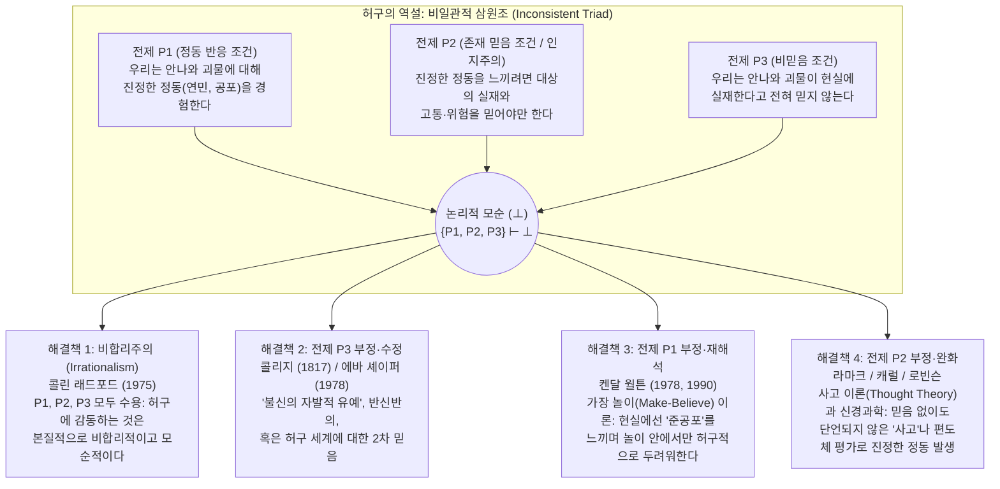

## 서론: 디도의 죽음에 흘린 아우구스티누스의 눈물과 햄릿의 경탄

우리는 일상 속에서 매우 기묘하면서도 너무나 익숙한 심리적 기적을 경험한다. 톨스토이의 대작 『안나 카레니나』의 마지막 장면에서 절망에 내몰린 안나가 황혼녘 기차역 플랫폼에 서서 달려오는 화물열차 바퀴 아래로 몸을 던질 때, 독자들은 가슴이 미어지고 눈시울이 붉어지며 깊은 연민과 슬픔을 느낀다. 또한 한밤중 극장에서 초록색 점액질 괴물(Green Slime)이 카메라를 향해 맹렬히 덮쳐오는 공포영화를 볼 때, 관객의 심장 박동은 급격히 빨라지고 손바닥에는 식은땀이 맺히며 온몸의 근육이 경직된다.

그러나 합리적 심리학의 관점에서 한 걸음 물러서서 생각해 보면, 이러한 반응은 심각한 철학적 수수께끼를 던진다. 『안나 카레니나』를 읽으며 우는 성인 독자는 안나라는 여성이 19세기 러시아에 실재한 적이 없으며, 모든 것이 톨스토이가 종이 위에 인쇄한 글자들(허구, Fiction)일 뿐임을 처음부터 끝까지 완벽하게 알고 있다. 극장의 관객 역시 스크린 위의 괴물이 빛의 투영일 뿐 객석으로 튀어나와 자신을 해칠 위험이 전혀 없다는 사실을 백번 잘 알고 있다. 그렇다면 우리는 왜 존재하지 않는다고 확신하는 대상에 대해 이토록 생생하고 진심 어린 감정 반응을 보이는 것일까?

이 물음은 서양 사상사에서 약 2천 년 전부터 반복해서 제기되어 왔다. 4세기 말 기독교 교부 <strong>아우구스티누스(Saint Augustine, 354–430)</strong>는 『고백록』(제3권 제2장)에서 젊은 시절 베르길리우스의 『아이네이스』를 읽으며 영웅 아이네이아스에게 버림받고 자결한 카르타고의 여왕 디도(Dido)의 비극적 운명에 뜨거운 눈물을 흘렸던 자신을 되돌아보며, 정작 신을 떠나 영적으로 죽어가는 자기 자신에 대해서는 눈물 한 방울 흘리지 않으면서 지어낸 이야기에 통곡하는 이 "광기(madness)"가 대체 무엇인지 탄식했다. 그로부터 약 1,200년 뒤 <strong>윌리엄 셰익스피어(William Shakespeare)</strong>는 비극 『햄릿』(제2막 제2장)에서 유랑 극단의 배우가 트로이 전쟁에서 남편 프리아모스 왕을 잃은 노왕비 <strong>헤큐바(Hecuba)</strong>의 슬픔을 연기하며 실제로 얼굴이 창백해지고 눈에 진짜 눈물을 흘리는 모습을 보고, 햄릿의 입을 빌려 유명한 독백을 남겼다.

> "얼마나 기괴한 일인가! 이 배우는 한낱 허구 속에서(in a fiction), 정열의 꿈속에서 자신의 영혼을 자기가 품은 상상(conceit)에 복종시켜 얼굴빛이 창백해지고, 눈에 눈물이 고이며, 목소리가 갈라지고 있지 않은가! 그것도 아무것도 아닌 것(nothing)을 위해서! 헤큐바를 위해서! <strong>그에게 헤큐바가 무엇이며, 헤큐바에게 그가 무엇이기에 저토록 그녀를 위해 눈물을 흘린단 말인가?(What's Hecuba to him, or he to Hecuba, / That he should weep for her?)</strong>"

1975년 영국의 분석철학자 <strong>콜린 래드포드(Colin Radford, 1935–2001)</strong>는 『아리스토텔레스 학회보 보충권』에 발표한 역사적인 논문 <strong>「우리는 어떻게 안나 카레니나의 운명에 감동할 수 있는가?」("How Can We Be Moved by the Fate of Anna Karenina?")</strong>를 통해 이 고전적 아포리아를 현대 분석미학(Analytic Aesthetics)과 심리철학의 핵심 난제인 <strong>'허구의 역설(The Paradox of Fiction)'</strong>로 정식화했다. 본고에서는 허구의 역설의 논리적 구조와 4대 철학적 해결책, 현대 정동 신경과학의 메커니즘, 그리고 자매 난제인 '비극의 역설', '상상적 저항', '허구적 대상의 존재론'을 체계적으로 해부한다.

---

## 제1장: 허구의 역설의 논리적 구조 — 비일관적 삼원조(Inconsistent Triad)

래드포드가 정식화한 '허구의 역설'은 개별적으로는 직관적·이론적으로 지극히 그럴듯해 보이지만, 세 명제를 동시에 긍정하면 논리적 모순($\{P_1, P_2, P_3\} \vdash \bot$)이 도출되는 <strong>비일관적 삼원조(Inconsistent Triad)</strong>로 이루어진다.

### 전제 $P_1$: 정동 반응 조건 (The Response Condition / 현상학적 사실)

> <strong>($P_1$) 우리는 허구적 등장인물이나 사건에 대해 진정한(genuine), 문자 그대로의 대상 지향적 정동(연민, 슬픔, 공포, 분노 등)을 실제로 경험한다.</strong>

우리가 안나 카레니나를 불쌍히 여겨 눈물을 흘리거나 공포영화의 괴물에게 공포를 느낄 때, 우리는 슬픈 척하거나 겁먹은 척 연기하고 있는 것이 아니다. 우리의 심장 박동과 눈물은 생리학적·현상학적으로 100% 실제 감정이며, 일상 언어에서도 $\text{Emotion}_E(S, X)$는 참인 명제로 통용된다.

### 전제 $P_2$: 정동에 관한 존재 믿음 조건 (The Cognitive / Existence-Belief Condition)

> <strong>($P_2$) 주체 $S$가 어떤 대상 $X$에 대해 진정한 대상 지향적 정동 $E$를 느끼기 위해서는, $S$는 $X$가 실제로 존재하며 실제로 고통을 겪거나 위험을 가하고 있다고 믿어야(believe) 한다.</strong>

기호논리학으로 정식화하면 다음과 같다:

$$\forall S \forall X \Big( \text{Emotion}_E(S, X) \implies \text{Bel}_S\big(\exists x (x = X \land \text{Eval}_E(x))\big) \Big)$$

이 전제 $P_2$는 <strong>아리스토텔레스(『수사학』)</strong>와 <strong>스피노자(『에티카』)</strong>에서 출발하여 현대의 <strong>로버트 솔로몬(Robert Solomon)</strong>, <strong>마사 누스바움(Martha Nussbaum)</strong>으로 이어지는 <strong>'정동의 인지주의(Cognitivism about Emotions)'</strong>에 굳건한 뿌리를 두고 있다. 대상이 없는 막연한 '기분(Mood)'이나 단순한 '신체 감각(Sensation)'과 달리, 정동(Emotion)은 반드시 특정 대상을 향한 <strong>지향성(Intentionality)</strong>과 고유한 <strong>형식적 대상(Formal Object)</strong>을 갖는다. 연민은 대상이 부당한 고통을 겪고 있다는 인지적 판단을 요구하며, 공포는 대상이 실제적인 위협을 가한다는 믿음을 요구한다.

래드포드의 사고실험을 보자. 어떤 동료가 당신에게 달려와 자기 여동생이 방금 고속도로에서 끔찍한 교통사고를 당해 중환자실에서 죽어가고 있다고 말한다면, 당신은 그 여동생에 대해 깊은 연민과 슬픔을 느끼며 눈물을 흘릴 것이다. 그러나 직후에 동료가 웃으며 "사실은 내 연기력을 시험해 보려고 꾸며낸 거짓말이야. 난 여동생도 없어!"라고 밝힌다면, 당신이 그 여동생에게 느꼈던 연민과 슬픔은 그 즉시 사라진다(동료에 대한 분노로 바뀔 뿐이다). 만약 거짓말임을 완벽히 알고 나서도 계속 "그래도 사고를 당한 그 불쌍한 여동생이 너무 가엾다"며 통곡한다면 우리는 그를 비합리적이라고 판단할 것이다. 따라서 진정한 정동은 <strong>존재 믿음(Existential Belief)</strong>을 필수 조건으로 삼는다.

### 전제 $P_3$: 비믿음 조건 (The Non-Belief Condition)

> <strong>($P_3$) 정상적인 성인 독자와 관객은 허구적 인물이나 괴물이 현실에 실제로 존재한다고 전혀 믿지 않는다: $\neg \text{Bel}_S(\exists x (x = X))$.</strong>

관객이 극장에서 괴물을 보고도 경찰에 신고하거나 비상구로 도망치지 않고 팝콘을 먹으며 좌석에 앉아 있다는 행동적 사실이 $P_3$를 명백히 입증한다.

---

## 제2장: 해결책 1과 2 — 래드포드의 '비합리주의'와 콜리지의 '불신의 유예'

### 1. 해결책 1: 콜린 래드포드의 비합리주의(Irrationalism)

래드포드(1975)는 모든 회피 시도를 논파한 끝에 <strong>$P_1, P_2, P_3$가 모두 참이며, 따라서 허구에 감동하여 눈물을 흘리는 인간의 반응은 본질적으로 비합리적(irrational)이고 비일관적(incoherent)이다</strong>라는 급진적 결론을 내렸다. 그는 이를 <strong>공포증(Phobia)</strong>에 비유했다. 거미 공포증 환자가 유리병 속의 거미가 안전하다는 것을 이성적으로 100% 알면서도($\neg \text{Bel}(\text{Danger})$) 진짜 공포($P_1$)를 느끼는 것과 같다는 것이다.

<strong>비합리주의에 대한 비판</strong>:
그러나 현대 미학자들은 래드포드의 결론을 거부한다. 가장 치명적인 문제는 <strong>'규범적 전도(Normative Inversion)'</strong>이다. 공포증은 치료해야 할 합리성의 결함이지만, 『안나 카레니나』나 『리어왕』을 읽고 깊은 연민을 느끼는 능력은 <strong>정서적 성숙과 도덕적·미적 감수성의 탁월함</strong>으로 칭송받는다. 만약 래드포드가 옳다면 소설을 읽고 "실재하지 않는 인물이니 아무 감정도 안 느껴진다"고 말하는 냉혈한이 가장 합리적인 인간이라는 기괴한 결론에 이른다.

### 2. 해결책 2: 전제 $P_3$의 부정 — '불신의 자발적 유예'와 이층 믿음

영국의 낭만주의 시인 <strong>새뮤얼 테일러 콜리지(Samuel Taylor Coleridge)</strong>는 『문학 평전』(1817, 제14장)에서 시적 믿음을 구성하는 <strong>"그 순간의 자발적인 불신의 유예(that willing suspension of disbelief for the moment)"</strong>라는 유명한 개념을 제시했다. 또한 <strong>에바 셰이퍼(Eva Schaper, 1978)</strong>는 우리가 1차적으로는 안나가 실재하지 않음을 알지만, 2차적으로는 "(소설 속에서) 안나가 절망하여 자살한다"는 진정한 믿음을 가지고 있으며 이것이 정동을 일으킨다고 주장했다.

<strong>왜 $P_3$ 부정은 실패하는가?</strong>
1. <strong>믿음의 비자발성(Doxastic Involuntarism)</strong>: 우리는 의지에 따라 자유롭게 '상상'할 수는 있지만, 의지만으로 '믿음'을 켜고 끌 수는 없다.
2. <strong>행동과의 괴리</strong>: 만약 관객이 단 1초라도 괴물의 실재를 믿거나 반신반의한다면 즉시 극장 밖으로 도망치거나 경찰에 신고했을 것이다.
3. <strong>셰이퍼 이론의 붕괴</strong>: "소설 텍스트에 안나가 고통받는다고 적혀 있다"고 믿는 것은 텍스트에 대한 믿음일 뿐, 실제로 고통받는 존재가 있다는 $P_2$의 존재 믿음을 충족하지 못한다.

---

## 제3장: 해결책 3 — 켄달 월튼의 '가장 놀이(Make-Believe)' 이론과 '준공포(Quasi-Fear)'

미시간 대학교의 철학자 <strong>켄달 월튼(Kendall L. Walton)</strong>은 1978년 논문 <strong>「허구를 두려워하기」("Fearing Fictions")</strong>와 1990년 주저 <strong>『가장 놀이로서의 미메시스』(Mimesis as Make-Believe)</strong>에서 전제 $P_2$(인지주의)와 $P_3$(비믿음)를 온전히 유지한 채 <strong>전제 $P_1$을 정교하게 부정·재해석</strong>하는 기념비적 이론을 구축했다.

### 1. 소품(Props)과 가장 놀이(Game of Make-Believe)

월튼은 모든 재현 예술을 아이들의 <strong>가장 놀이(소꿉놀이/역할놀이)</strong> 모델로 설명한다. 숲속에서 노는 아이들이 "숲의 모든 나무 그루터기는 곰이다"라고 규칙(<strong>생성 원리 Principles of Generation</strong>)을 정하면, 실제 그루터기는 상상을 처방하는 <strong>'소품(Prop)'</strong>이 되며, 그루터기가 있는 곳에 곰이 있다는 것은 <strong>'허구적으로 참(Fictionally true, $\mathcal{F}(\phi)$)'</strong>이 된다. 마찬가지로 소설 『안나 카레니나』나 공포영화는 감상자가 자기 자신도 참여자로서 수행하는 가장 놀이의 정교한 소품이다.

### 2. 찰스와 초록색 점액 괴물(Charles and the Green Slime): 진짜 공포 vs. 준공포

월튼의 유명한 사고실험인 <strong>'찰스와 초록색 점액 괴물'</strong>을 보자. 공포영화를 보던 찰스는 스크린에서 초록색 점액 괴물이 카메라(관객석)를 향해 돌진하자 팔걸이를 움켜쥐고 심장이 쿵쾅거리며 식은땀을 흘린다. 월튼은 묻는다: <strong>찰스는 현실 세계에서 문자 그대로 괴물을 두려워했는가(literally feared)?</strong>
월튼의 답은 <strong>'아니다($\neg P_1$)'</strong>이다. 진짜 공포는 위험에 대한 믿음($P_2$)과 도망치려는 행동 동기를 필수적으로 수반하는데, 찰스는 둘 다 결여하고 있기 때문이다.

그렇다고 찰스가 겁먹은 척 연기를 한 것은 아니다! 찰스는 심박수 상승, 아드레날린 분비, 전율감이라는 100% 실제적인 생리적·현상학적 상태를 경험했다. 월튼은 이를 진짜 공포와 구별하여 <strong>'준공포(Quasi-fear)'</strong>(일반화하면 <strong>'준정동 Quasi-emotions'</strong>)라고 명명했다.

월튼 이론의 핵심 메커니즘은 다음과 같다:
1. 스크린 영상(외적 소품)을 보고 찰스는 "괴물이 나를 덮치고 있다"고 자기지시적 상상(*de se* imagination)을 한다.
2. 이 상상이 원인이 되어 찰스의 신체에 실제 <strong>준공포(Quasi-fear)</strong>가 발생한다.
3. 이 실제 준공포 감각 자체가 두 번째 <strong>내적 소품(Reflexive Prop)</strong>으로 기능하여, 찰스의 가장 놀이 세계 안에서 <strong>"찰스가 괴물을 진짜로 두려워하고 있다"는 허구적 진리($\mathcal{F}_G(\text{LiteralFear}(\text{Charles}, \text{Slime}))$)</strong>를 생성한다!

$$\text{Imagine}_{\text{Charles}}(\text{Danger}) \xrightarrow{\text{인과적 유발}} \text{QuasiFear}(\text{Charles}) \xrightarrow{\text{소품으로 기능}} \mathcal{F}_G\big(\text{LiteralFear}(\text{Charles}, \text{Slime})\big)$$

이는 아버지가 괴물 흉내를 내며 아이를 쫓아갈 때, 아이가 아버지가 진짜 괴물이 아님을 완벽히 알면서도 짜릿한 '준공포'를 느끼며 놀이 안에서 '괴물을 무서워하며 도망치는 아이'가 되는 것과 정확히 같다. (이후 <strong>Gregory Currie 1990</strong>은 이를 마음의 <strong>'오프라인 시뮬레이션 이론 Off-line Simulation Theory'</strong>으로 발전시켰다.)

---

## 제4장: 해결책 4 — 전제 $P_2$의 부정: '사고 이론(Thought Theory)'과 정동 신경과학

월튼의 이론에 맞서 <strong>피터 라마크(Peter Lamarque, 1981)</strong>, <strong>노엘 캐럴(Noël Carroll, 1990, 『공포의 철학』)</strong>, <strong>제니퍼 로빈슨(Jenefer Robinson, 2005)</strong>, <strong>타마르 겐들러(Tamar Szabó Gendler, 2008)</strong> 등은 "안나 카레니나를 읽고 흘리는 눈물이 단지 '슬퍼하는 가장 놀이'일 뿐이라는 주장은 우리의 내성적 경험에 정면으로 배치된다"고 비판하며, <strong>전제 $P_1$(우리는 진짜 정동을 느낀다)을 옹호하고 전제 $P_2$(진정한 정동에는 존재 믿음이 필요하다)를 기각</strong>했다.

### 1. 사고 이론(Thought Theory): 단언되지 않은 명제적 사고가 진짜 정동을 낳는다

라마크와 캐럴이 제창한 <strong>'사고 이론(Thought Theory)'</strong>에 따르면, 진정한 정동이 발생하기 위해 대상의 실재에 대한 '단언적 믿음(Assertoric Belief)'은 필요하지 않다. 어떤 명제적 내용(<strong>사고 Thought / 심적 표상</strong>)을 진리값 단언 없이 마음속에 생생하게 떠올리는 것(unasserted entertaining of a thought)만으로도 진짜 정동이 인과적으로 발생한다.
- 예를 들어 안전한 전망대 난간 뒤에 서서 자신이 안전함을 100% 믿으면서도($\neg \text{Bel}(\text{Danger})$), 단지 '내가 난간 너머 절벽 아래로 추락하는 모습'을 머릿속에 생생히 떠올리는(Thought) 것만으로 진짜 아찔한 공포가 발생한다.
- 역겨운 장면을 머릿속으로 상상하는 것만으로 실제 <strong>혐오감(Disgust)</strong>이 치밀어 오른다.

따라서 우리가 드라큘라를 두려워하거나 안나를 연민할 때, 우리의 진짜 정동은 텍스트가 형성한 <strong>'사고 내용(Thought-content)'</strong>에 의해 인과적으로 촉발되며, 존재 믿음이 없기 때문에 도망치거나 신고하는 행동 프로그램은 작동하지 않는다.

### 2. 현대 정동 신경과학(편도체 이중 경로)과 '알리프(Alief)'

현대 뇌신경과학(<strong>Joseph LeDoux</strong>의 편도체 연구)은 전제 $P_2$가 경험적으로 거짓임을 증명했다.
1. <strong>피질하 빠른 경로(Low Road: 시상 $\to$ 편도체 Amygdala / 뇌섬엽)</strong>: 시각·청각 자극이나 생생한 상상은 대뇌피질의 존재론적 검증을 거치지 않고 수 밀리초 만에 <strong>편도체</strong>와 거울 뉴런계를 자극한다. 편도체는 그것이 허구인지 현실인지 판별하는 '믿음 검증(Belief-checking)' 능력이 없으며, 표상 패턴에 즉각 반응하여 <strong>진짜 생리적·정서적 공포와 공감 반응</strong>을 일으킨다($P_1$ 입증, $P_2$ 기각).
2. <strong>전두엽 느린 경로(High Road: 시상 $\to$ 전전두피질 PFC)</strong>: 직후에 전전두피질이 "이것은 영화관 스크린일 뿐이다"($P_3$)라는 맥락을 파악하여 <strong>운동 피질의 도주 명령을 억제(Inhibition)</strong>함으로써 관객이 안전하게 좌석에서 정동을 음미하게 해 준다.

예일대 철학자 <strong>타마르 겐들러(Tamar Szabó Gendler, 2008)</strong>는 이처럼 명시적 <strong>믿음(Belief)</strong>과 별개로 지각·상상 표상에 자동 반응하는 원초적 표상-정동-행동 연합 상태를 <strong>'알리프(Alief)'</strong>라고 명명했다.

| 해결 접근법 | 부정하는 전제 | 대표 철학자 | 허구 정동의 본질 | 왜 극장에서 도망치지 않는가? | 핵심 강점 및 한계 |
| :--- | :---: | :--- | :--- | :--- | :--- |
| <strong>1. 비합리주의</strong> (Irrationalism) | <strong>없음</strong> (모순 수용) | 콜린 래드포드 (1975) | 진짜 정동이지만 공포증과 같은 비합리적·모순적 상태. | 이성적 믿음($P_3$)이 행동을 제어하나 감정은 비합리적으로 반응. | 세 직관을 모두 유지하나 예술적 감수성을 정신병리적 공포증으로 격하함. |
| <strong>2. 불신의 유예설</strong> (Suspension of Disbelief) | <strong>$P_3$ 부정</strong> | 콜리지 (1817) 에바 셰이퍼 (1978) | 일시적 환상, 반신반의, 혹은 이야기 세계에 대한 2차 믿음에 기초한 진짜 정동. | 1차 현실 믿음이 행동을 억제하고 2차 이야기 믿음이 정동 유발. | 몰입감을 설명하나, 믿음은 의지로 켤 수 없고 반신반의라도 도망쳐야 함. |
| <strong>3. 가장 놀이 이론</strong> (Make-Believe Theory) | <strong>$P_1$ 부정</strong> | 켄달 월튼 (1978, 1990) 그레고리 커리 (1990) | 현실에선 생리적 <strong>'준공포(Quasi-fear)'</strong>만 느끼며 놀이 안에서 허구적으로 두려워함($\mathcal{F}_G$). | 위험 믿음과 진짜 공포가 없고 오프라인 시뮬레이션 상태임. | 인지주의($P_2$)와 행동 억제를 완벽히 설명하나 비극의 눈물을 '놀이'로 보는 인공성. |
| <strong>4. 사고 이론 및 신경과학</strong> (Thought Theory) | <strong>$P_2$ 부정</strong> | 피터 라마크 (1981) 노엘 캐럴 (1990) 제니퍼 로빈슨 (2005) 타마르 겐들러 (2008) | 단언되지 않은 <strong>명제적 사고(Thought)</strong>와 피질하 <strong>알리프(Alief)</strong>가 일으키는 <strong>진짜 정동</strong>. | 전전두피질의 현실 모니터링($P_3$)이 도주 운동 출력을 억제함. | 일상 현상학($P_1$) 및 현대 정동 신경과학(편도체 이중 경로)과 완벽히 부합. |

---

## 제5장: 미학의 자매 아포리아 — '비극의 역설', '상상적 저항', '허구적 대상의 존재론'

### 1. 비극과 공포의 역설(The Paradox of Tragedy and Horror)

현실에서 슬픔, 연민, 공포는 누구나 피하고 싶어 하는 고통스러운 불쾌 정동인데, 왜 우리는 돈을 내고 비극과 공포영화를 찾아가며 거기서 깊은 미적 쾌감을 얻는가?
- <strong>아리스토텔레스의 '카타르시스(Katharsis / 정화·배설)' 이론(『시학』 제6장)</strong>: 비극은 연민과 공포를 불러일으킴으로써 그러한 감정의 카타르시스(안전한 배설 및 정서적 조율)를 성취한다.
- <strong>데이비드 흄의 '전환 이론(Conversion Theory)'</strong>(1757년 논문 「비극에 관하여」 *"Of Tragedy"*): 예술가의 웅변과 시적 운율, 모방의 탁월함이 일으키는 지배적인 '미적 쾌감'이 비극적 사건이 일으키는 슬픔의 정동 에너지를 흡수하여 <strong>전체를 미적 쾌락으로 전환(convert)·증폭</strong>시킨다.
- <strong>수전 피긴(Susan Feagin, 1983)의 '메타 반응(Meta-Response)' 이론</strong>: 안나의 죽음에 대한 1차 반응은 고통스럽지만, 타인의 불행에 깊이 공감할 줄 아는 자신의 도덕적 감수성을 자각하는 2차 메타 반응에서 깊은 만족감을 얻는다.
- <strong>노엘 캐럴(1990)의 '인지적 호기심(Cognitive Curiosity)' 이론</strong>: 공포영화의 괴물은 범주적 경계를 위반하는 존재로서 강렬한 서사적·인지적 호기심을 자극하며, 공포는 그 지적 쾌감을 얻기 위한 대가이자 각성 증폭제이다.

### 2. 상상적 저항(Imaginative Resistance: 흄, 월튼, 겐들러)

데이비드 흄이 「취미의 기준에 관하여」(1757) 말미에서 지적하고 <strong>월튼(1994)</strong>과 <strong>타마르 겐들러(Tamar Szabó Gendler, 2000)</strong>가 정식화한 <strong>'상상적 저항'</strong>은 작가의 권위가 무너지는 비대칭성을 보여준다. 작가가 "이 세계에서는 용이 하늘을 날고 시간이 거꾸로 흐른다"고 쓰면 독자는 물리적 불가능성을 아무 저항 없이 상상한다. 그러나 작가가 다음과 같은 도덕적 왜곡을 처방하면 어떻게 되는가(월튼의 유명한 문장)?

> <strong>"자기 아기를 죽인 기젤다의 행동은 옳았다. 어쨌든 그 아기는 여자아이였으니까(In killing her baby, Giselda did the right thing; after all, it was a girl)."</strong>

독자는 즉시 강력한 <strong>상상적 저항</strong>에 부딪힌다! 우리는 마을 사람들이 여아 살해를 옳다고 믿는다는 것은 상상할 수 있지만, <strong>"여자아이라는 이유만으로 신생아를 죽이는 것이 객관적 도덕 진리로서 정말 옳다"고는 결코 상상할 수 없다(혹은 상상하기를 거부한다)</strong>! 월튼은 도덕적 속성이 자연적 사실에 개념적으로 <strong>수반(Supervene)</strong>하기 때문에 상상 불가능("Can't")하다고 보았고, 겐들러는 허구의 왜곡된 도덕적 관점을 수용하면 현실의 내 도덕적 가치관이 <strong>인지적 오염(Contagion)</strong>을 입을 위험이 있기 때문에 독자가 자발적으로 거부("Won't")하는 것이라고 해명했다.

### 3. 허구적 대상의 존재론(Ontology of Fictional Entities)

우리가 "안나 카레니나를 연민한다"고 할 때, '안나 카레니나'는 존재론적으로 무엇인가?
1. <strong>마이농주의(Meinongianism — Alexius Meinong, Terence Parsons, Edward Zalta)</strong>: 시공간에 실재하지 않지만 소설 속 속성들을 내포하거나 인코딩하는 '비존재 대상(Non-existent objects)'이 객관적으로 존재한다고 본다.
2. <strong>반실재론적 가장 의미론(Anti-Realist Pretense — Kendall Walton)</strong>: 허구적 대상은 전혀 존재하지 않으며, 안나에 대한 발화는 톨스토이의 소설을 소품으로 한 가장 놀이 안에서의 가장적 발화($\mathcal{F}_W$)일 뿐이다.
3. <strong>인공물 이론(Artifactual Theory — Saul Kripke, Peter van Inwagen, Amie Thomasson 1999 『허구와 형이상학』)</strong>: 현재 가장 유력한 실재론적 중도 입장이다. <strong>에이미 토마슨(Amie Thomasson)</strong>에 따르면, 법률이나 교향곡이나 체스 규칙처럼 허구적 캐릭터는 작가가 특정한 역사적 시점에 창작 행위를 통해 만들어낸 <strong>'추상적 문화적 인공물(Abstract Cultural Artifacts)'</strong>로서 현실 세계에 실제로 존재한다! 따라서 "안나 카레니나는 1870년대에 톨스토이가 창조한 캐릭터이며 수많은 독자의 연민을 받고 있다"는 문장은 문자 그대로 참이 된다.

---

## 결론: 인간성의 실험실로서의 정서적 상상력

콜린 래드포드의 1975년 논문 이후 반세기 동안 전개된 '허구의 역설' 논쟁은 우리가 허구의 이야기에 흘리는 눈물이 결코 비합리적인 인지적 결함이나 착각이 아님을 밝혀냈다. 켄달 월튼이 보여준 정교한 <strong>가장 놀이(Make-Believe)</strong>의 능력과, 피터 라마크·노엘 캐럴·현대 정동 신경과학이 규명한 <strong>사고(Thought) 및 편도체-전전두피질 이중 경로 시스템</strong> 덕분에, 인간은 물리적 안전이 보장된 상태에서 '만약 이러하다면(What if)'이라는 상상의 날개를 타고 존재하지 않는 타자의 아픔과 운명에 진심으로 공명할 수 있다. 허구에 대한 정서적 상상력이야말로 우리를 좁은 자기중심성에서 해방시켜 타자의 내면을 이해하게 만드는 가장 깊고 안전한 '영혼의 실험실'인 것이다.
