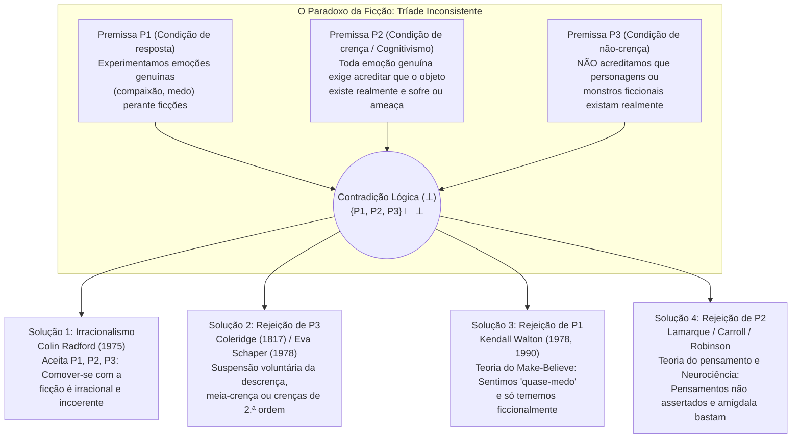

## Introdução: As lágrimas de Santo Agostinho por Dido e o espanto de Hamlet diante de Hécuba

Todos os dias vivenciamos um fenômeno psicológico tão familiar que raramente paramos para notar o quão profundamente misterioso — e aparentemente irracional — ele é. Quando, perto do final da obra-prima de Liev Tolstói, *Anna Karenina*, a desesperada Anna se atira ao entardecer sob as rodas de ferro de um trem de carga na plataforma de uma estação, sentimos um nó na garganta, lágrimas vêm aos nossos olhos e somos tomados por uma onda de profunda compaixão e tristeza. Ou pensemos em uma sessão de cinema à meia-noite exibindo um filme de terror: quando um monstro grotesco de lodo verde (*Green Slime*) avança ferozmente em direção à lente da câmera, nossa frequência cardíaca dispara, a adrenalina inunda a corrente sanguínea, nossas mãos suam frio e agarramos os braços da poltrona em terror visceral.

Contudo, se examinarmos essas reações sob a ótica da psicologia racional, deparamo-nos imediatamente com um abismo filosófico. O leitor que chora por Anna Karenina não sofre de nenhuma alucinação; ele sabe com absoluta certeza que Anna Karenina jamais existiu e que toda aquela tragédia consiste unicamente em marcas de tinta impressas no papel por um romancista russo. Da mesma forma, o espectador no cinema sabe sem sombra de dúvida que está sentado em total segurança em uma sala climatizada olhando para feixes de luz projetados em uma tela plana. Por que, então, adultos racionais choram, sofrem, indignam-se e tremem diante do destino de entidades que sabem perfeitamente serem inexistentes?

Esse enigma intriga o pensamento ocidental há quase dois milênios. Por volta de 397 d.C., <strong>Santo Agostinho de Hipona (354–430)</strong> recordava com remorso no Livro III de suas *Confissões* (III.ii.2) como, em sua juventude, chorava copiosamente ao ler na *Eneida* de Virgílio o suicídio da rainha cartaginesa Dido após ser abandonada por Eneias, enquanto não derramava uma única lágrima por sua própria morte espiritual longe de Deus: *«Que loucura pode ser mais insana do que esta?»* Doze séculos mais tarde, por volta de 1601, <strong>William Shakespeare</strong> colocou nos lábios do príncipe <strong>Hamlet</strong> (Ato II, Cena 2) um célebre monólogo após observar como um ator itinerante empalidecia e derramava lágrimas reais ao declamar a dor da velha rainha troiana <strong>Hécuba</strong>:

> «Não é monstruoso que este ator aqui presente, / apenas numa ficção (*in a fiction*), num sonho de paixão, / possa forçar sua alma de tal modo à sua própria concepção (*conceit*) / que, por obra dela, todo o seu rosto empalideça, / tenha lágrimas nos olhos, desvario no semblante, / a voz embargada… e tudo por nada! / Por Hécuba! / <strong>O que é Hécuba para ele, ou ele para Hécuba, / para que assim chore por ela?</strong> (*What's Hecuba to him, or he to Hecuba, / That he should weep for her?*)»

Em 1975, o filósofo analítico britânico <strong>Colin Radford (1935–2001)</strong> publicou nos *Proceedings of the Aristotelian Society* seu artigo histórico <strong>«How Can We Be Moved by the Fate of Anna Karenina?»</strong> (*Como podemos nos comover com o destino de Anna Karenina?*), cristalizando esse antigo espanto em um dos problemas centrais da estética analítica e da filosofia da mente: <strong>o Paradoxo da Ficção (The Paradox of Fiction)</strong>. Neste artigo, analisaremos rigorosamente a estrutura lógica de sua tríade inconsistente, as quatro grandes estratégias filosóficas de resolução, as descobertas da neurociência afetiva contemporânea e seus problemas irmãos: o *paradoxo da tragédia*, a *resistência imaginativa* e a *ontologia das entidades ficcionais*.

---

## Capítulo 1: A estrutura lógica do paradoxo — Uma tríade inconsistente

Colin Radford formulou o paradoxo da ficção como uma <strong>tríade inconsistente (Inconsistent Triad)</strong> composta por três premissas ($P_1, P_2, P_3$) que, consideradas individualmente, parecem altamente plausíveis, mas cuja conjunção implica uma contradição lógica formal ($\{P_1, P_2, P_3\} \vdash \bot$):

### Premissa $P_1$: A condição de resposta emocional (Fato fenomenológico)

> <strong>($P_1$) Experimentamos emoções genuínas, literais e direcionadas a um objeto (tais como compaixão, tristeza, medo, raiva e admiração) em relação a personagens e eventos ficcionais.</strong>

Quando choramos por Anna Karenina ou nos assustamos diante do monstro na tela, não estamos fingindo estar tristes ou assustados para enganar alguém. Nossa emoção é fenomenológica e fisiologicamente autêntica: $\text{Emotion}_E(S, X)$.

### Premissa $P_2$: A condição cognitiva de crença existencial (Cognitivismo emocional)

> <strong>($P_2$) Para que um sujeito $S$ experimente uma emoção genuína $E$ direcionada a um objeto $X$, $S$ deve acreditar (manter a crença assertórica) que $X$ realmente existe e possui efetivamente as propriedades avaliativas relevantes (sofrimento imerecido, perigo iminente, etc.).</strong>

Na lógica doxástica quantificada, a premissa $P_2$ expressa-se assim:

$$\forall S \forall X \Big( \text{Emotion}_E(S, X) \implies \text{Bel}_S\big(\exists x (x = X \land \text{Eval}_E(x))\big) \Big)$$

Essa premissa baseia-se no <strong>cognitivismo das emoções (Cognitivism about Emotions)</strong>, desenvolvido desde <strong>Aristóteles (*Retórica*, Livro II)</strong> e <strong>Espinosa (*Ética*)</strong> até <strong>Anthony Kenny (1963)</strong>, <strong>Robert C. Solomon (1976)</strong> e <strong>Martha Nussbaum (2001)</strong>. Diferentemente de um estado de espírito difuso sem objeto (*mood*) ou de uma mera sensação corporal (*sensation*, como uma dor de dente), uma emoção possui <strong>intencionalidade</strong> e é definida por seu <strong>objeto formal (Formal Object)</strong>: sentir compaixão por $X$ exige julgar que $X$ sofre realmente; temer $X$ exige acreditar que $X$ constitui uma ameaça real.

Consideremos o experimento mental de Radford: um colega de trabalho conta-lhe aos prantos que sua irmã acaba de sofrer um terrível acidente de carro e agoniza na UTI. Você sente imediatamente uma profunda compaixão e angústia por ela. No instante seguinte, o colega sorri e diz: *«Era uma pegadinha para testar minha atuação! Eu nem sequer tenho irmã!»* No exato segundo em que você descobre que a irmã não existe, <strong>sua compaixão pela irmã evapora instantaneamente</strong> (dando lugar à indignação contra o colega). Se, após saber que tudo era falso, você continuasse chorando inconsolavelmente dizendo: *«Mas ainda sinto tanta pena daquela pobre moça no hospital!»*, qualquer pessoa julgaria sua reação irracional.

### Premissa $P_3$: A condição de não-crença (Non-Belief Condition)

> <strong>($P_3$) Leitores e espectadores adultos normais não acreditam de forma alguma que personagens ou monstros ficcionais existam realmente: $\neg \text{Bel}_S(\exists x (x = X))$.</strong>

Nosso comportamento demonstra isso conclusivamente: nenhum espectador aterrorizado no cinema chama a polícia nem foge pela saída de emergência; nenhum leitor tenta parar o trem em Moscou.

---

## Capítulo 2: Soluções 1 e 2 — O irracionalismo de Radford e a «suspensão da descrença» de Coleridge

### 1. Estratégia 1: O irracionalismo de Colin Radford (1975)

Após descartar diversas vias de escape, Radford concluiu que <strong>$P_1, P_2$ e $P_3$ são todas verdadeiras</strong>, de modo que o fato de nos comovermos com obras de ficção nos envolve em <strong>inconsistência e irracionalidade brutas</strong>, análogas a uma <strong>fobia</strong> (como o aracnofóbico que sente pavor real diante de uma aranha inofensiva dentro de um vidro sabendo perfeitamente que está seguro).

<strong>Crítica ao irracionalismo</strong>:
Quase todos os estetas contemporâneos rejeitam essa conclusão. Em primeiro lugar, ela incorre em uma <strong>inversão normativa</strong>: enquanto uma fobia é um defeito da racionalidade que desejamos tratar, a capacidade de se comover profundamente com *Anna Karenina* ou *Rei Lear* é valorizada como sinal de maturidade emocional, sensibilidade moral e compreensão artística adequada. Em segundo lugar, ao contrário do fóbico que entra em pânico e foge, o espectador de cinema mantém intacto seu controle comportamental.

### 2. Estratégia 2: A rejeição de $P_3$ — «Willing Suspension of Disbelief»

O poeta romântico inglês <strong>Samuel Taylor Coleridge</strong> cunhou em 1817 em sua *Biographia Literaria* (cap. XIV) a famosa fórmula da <strong>«suspensão voluntária da descrença pelo momento, que constitui a fé poética» (*that willing suspension of disbelief for the moment, which constitutes poetic faith*)</strong>. Mais tarde, <strong>Eva Schaper (1978)</strong> propôs uma estrutura de crenças em dois níveis: mantemos crenças de primeira ordem de que Anna não existe, mas crenças genuínas de segunda ordem sobre o que ocorre dentro da história.

<strong>Por que a rejeição de $P_3$ fracassa</strong>:
1. <strong>Involuntarismo doxástico</strong>: Não podemos decidir acreditar ou deixar de acreditar em algo por ato de vontade.
2. <strong>Assimetria comportamental</strong>: Se um espectador suspendesse sua descrença nem que fosse por cinco segundos diante de um monstro letal, sairia correndo do cinema imediatamente.
3. <strong>Colapso da tese de Schaper</strong>: Acreditar que *segundo o texto de Tolstói* Anna sofre é apenas uma crença literária sobre um texto, não a crença de que um ser humano real está sofrendo ($P_2$).

---

## Capítulo 3: Solução 3 — A teoria do «Faz-de-Conta (Make-Believe)» e o «Quase-Medo» de Kendall Walton (Rejeição de $P_1$)

Em seu célebre artigo <strong>«Fearing Fictions» (1978)</strong> e em sua obra-prima <strong>*Mimesis as Make-Believe: On the Foundations of the Representational Arts* (1990)</strong>, o filósofo <strong>Kendall L. Walton</strong> (Universidade de Michigan) formulou uma teoria monumental que <strong>preserva estritamente $P_2$ e $P_3$ e resolve o paradoxo rejeitando e reinterpretando a premissa $P_1$</strong>.

### 1. Adereços (Props) e jogos de faz-de-conta (Games of Make-Believe)

Walton modela todas as artes representativas a partir das <strong>brincadeiras infantis de faz-de-conta</strong>. Quando duas crianças combinam na floresta que todos os tocos de árvores são ursos, os tocos reais funcionam como <strong>adereços ou suportes (*props*)</strong> que prescrevem, segundo princípios de geração, quais proposições são <strong>ficcionalmente verdadeiras ($\mathcal{F}(\phi)$)</strong> no jogo. Da mesma forma, o romance *Anna Karenina* ou um filme de terror são suportes culturalmente institucionalizados que prescrevem ao apreciador participar de um jogo de faz-de-conta ($\mathcal{F}_G$).

### 2. Charles e o Lodo Verde (Charles and the Green Slime): Medo real vs. Quase-medo

Walton analisa o famoso caso de <strong>Charles</strong>, que assiste a um filme de terror no qual um lodo verde (*Green Slime*) avança para a câmera. Charles agarra sua poltrona, seu coração bate forte e ele sua frio. <strong>Charles teme literalmente o lodo verde no mundo real ($\text{LiteralFear}$)?</strong>
Walton responde: <strong>Não ($\neg P_1$)!</strong> Porque o medo literal exige acreditar que se está em perigo real ($P_2$) e ter a motivação comportamental de fugir, dois elementos ausentes em Charles.

Mas Charles não está fingindo friamente! Ele experimenta um estado fisiológico e afetivo completamente real (taquicardia, descarga de adrenalina, calafrio fenomenológico) que Walton denomina <strong>«quase-medo» (*quasi-fear*, e em geral *quasi-emotions*)</strong>.
O circuito causal e representacional opera assim:
1. A imagem na tela (adereço externo) leva Charles a imaginar sobre si mesmo (*de se*): *«O lodo está me atacando!»*
2. Essa vívida imaginação *de se* causa diretamente no corpo de Charles um <strong>quase-medo</strong> real.
3. Esse quase-medo real atua por sua vez como um <strong>adereço interno reflexivo (*reflexive prop*)</strong> que torna <strong>ficcionalmente verdadeiro dentro do jogo de Charles que ele teme literalmente o lodo</strong>:

$$\text{Imagine}_{\text{Charles}}(\text{Perigo}) \xrightarrow{\text{causa}} \text{QuasiFear}(\text{Charles}) \xrightarrow{\text{gera}} \mathcal{F}_G\big(\text{LiteralFear}(\text{Charles}, \text{Slime})\big)$$

É exatamente igual à criança que brinca de monstro com o pai: a criança sabe que o pai não lhe fará mal, mas experimenta um emocionante *quase-medo* real graças ao qual, *dentro da brincadeira*, está aterrorizada pelo monstro. (<strong>Gregory Currie 1990</strong> reformulou isso na ciência cognitiva como a <strong>teoria da simulação off-line</strong>).

---

## Capítulo 4: Solução 4 — A rejeição de $P_2$: A «Teoria do Pensamento (Thought Theory)» e a neurociência afetiva

Contra Walton, filósofos como <strong>Peter Lamarque (1981)</strong>, <strong>Noël Carroll (*The Philosophy of Horror*, 1990)</strong>, <strong>Richard Moran (1994)</strong>, <strong>Jenefer Robinson (2005)</strong> e <strong>Tamar Szabó Gendler (2008)</strong> objetaram que reduzir nossa tristeza por Anna Karenina a um «jogo de faz-de-conta» distorce nossa experiência vivida: <strong>sentimos emoções genuínas ($P_1$ é verdadeira), e a premissa falsa é $P_2$ (o requisito de crença existencial)</strong>.

### 1. A Teoria do Pensamento (Thought Theory: Lamarque e Carroll)

Segundo a <strong>Thought Theory</strong>, as emoções genuínas não exigem uma crença assertórica na existência do objeto; basta <strong>entreter vividamente na mente um pensamento proposicional não assertado (*vividly entertaining an unasserted thought*)</strong>.
- Se você estiver completamente seguro atrás de um parapeito de aço no topo de um arranha-céu ($\neg \text{Bel}(\text{Perigo})$) e simplesmente contemplar vividamente o *pensamento* de despencar no vazio, sentirá uma onda de medo e vertigem genuínos.
- Se imaginar vividamente mastigar minhocas vivas, experimentará um <strong>nojo (Disgust)</strong> real.

O que causa nosso medo genuíno diante de Drácula ou nossa compaixão real por Anna Karenina é o <strong>conteúdo de pensamento (*Thought-content*)</strong> configurado pela obra. Por ser gerado por um pensamento não assertado e não por uma crença existencial, os programas motores de fuga física não são acionados.

### 2. Neurociência afetiva (a dupla via da amígdala) e «Alief»

A neurociência afetiva contemporânea (<strong>Joseph LeDoux</strong>, *The Emotional Brain*, 1996) refuta empiricamente $P_2$ mediante o modelo da <strong>dupla via</strong>:
1. <strong>A via baixa subcortical rápida (Low Road: Tálamo $\to$ Amígdala / Ínsula)</strong>: As representações perceptivas ou imaginativas chegam em milissegundos à <strong>amígdala</strong>, a qual é «cega à ficção» (*fiction-blind*) e incapaz de realizar verificações ontológicas de existência. A amígdala dispara imediatamente uma <strong>emoção fisiológica e afetiva genuína</strong> ($P_1$ confirmada, $P_2$ refutada).
2. <strong>A via alta cortical lenta (High Road: Tálamo $\to$ Córtex pré-frontal PFC)</strong>: O córtex pré-frontal avalia o contexto (*«Estou num cinema vendo um filme»*, $P_3$) e <strong>inibe a ordem motora de fuga</strong>, permitindo-nos saborear a emoção em segurança na poltrona.

<strong>Tamar Szabó Gendler (2008)</strong> introduziu o conceito de <strong>«Alief»</strong>: enquanto a <strong>crença (Belief)</strong> explícita de Charles é *«O lodo não existe»*, a imagem ativa um <strong>Alief</strong> associativo e automático (*«Monstro perigoso! Sinta pavor! Recue!»*).

| Estratégia de resolução | Premissa rejeitada | Filósofos principais | Natureza da emoção ficcional | Por que não fugimos do cinema? | Força principal e Crítica maior |
| :--- | :---: | :--- | :--- | :--- | :--- |
| <strong>1. Irracionalismo</strong> | <strong>Nenhuma</strong> (Aceita $\bot$) | Colin Radford (1975) | Emoção genuína e literal, mas irracional e incoerente (como uma fobia). | A crença racional ($P_3$) freia a ação enquanto o coração chora irracionalmente. | Respeita as 3 intuições, mas rebaixa a empatia literária ao nível de uma patologia fóbica. |
| <strong>2. Suspensão da descrença</strong> | <strong>Rejeita $P_3$</strong> | S. T. Coleridge (1817) Eva Schaper (1978) | Emoção genuína baseada em ilusão temporária ou crenças de segunda ordem sobre a trama. | A crença de 1.ª ordem sobre a realidade inibe a fuga; a de 2.ª ordem cria a emoção. | Explica a imersão, mas falha ante o involuntarismo doxástico e a ausência de pânico. |
| <strong>3. Teoria do Make-Believe</strong> | <strong>Rejeita $P_1$</strong> | Kendall Walton (1978, 1990) Gregory Currie (1990) | <strong>Quase-emoção</strong> real que serve de adereço tornando <strong>ficcionalmente verdadeiro ($\mathcal{F}_G$)</strong> que tememos ou nos compadecemos. | Sem crença em perigo ($P_3$) nem medo literal; simulação mental «off-line». | Salva o cognitivismo ($P_2$), mas soa artificial chamar de «faz-de-conta» a dor trágica profunda. |
| <strong>4. Thought Theory e Neurociência</strong> | <strong>Rejeita $P_2$</strong> | Peter Lamarque (1981) Noël Carroll (1990) Jenefer Robinson (2005) Tamar Gendler (2008) | <strong>Emoção genuína e literal</strong> disparada por <strong>pensamentos não assertados</strong> ou <strong>Aliefs</strong> subcorticais. | O monitoramento de realidade do córtex pré-frontal ($P_3$) inibe a saída motora de fuga. | Plenamente coerente com a fenomenologia ordinária ($P_1$) e a neurobiologia atual. |

---

## Capítulo 5: Paradoxos irmãos — Paradoxo da tragédia, Resistência imaginativa e Ontologia

### 1. O paradoxo da tragédia e do terror

Por que buscamos voluntariamente na arte emoções dolorosas (tristeza, compaixão, terror) que evitamos a todo custo na vida real?
- <strong>A *Catarse* de Aristóteles (*Poética*, cap. 6)</strong>: A tragédia realiza, mediante a compaixão (*eleos*) e o temor (*phobos*), a purgação, descarga e calibração racional de tais paixões.
- <strong>A «teoria da conversão» de David Hume (1757, *«Of Tragedy»*)</strong>: O prazer estético predominante despertado pela eloquência, pelo ritmo poético e pela maestria imitativa do artista apodera-se da energia emocional dolorosa da tristeza e <strong>a converte por completo em deleite estético</strong>.
- <strong>A «meta-resposta» de Susan Feagin (1983)</strong>: À dor direta segue-se uma meta-resposta prazerosa na qual nos sentimos moralmente reconfortados ao experimentar nossa própria capacidade de empatia humana.
- <strong>A curiosidade cognitiva de Noël Carroll (1990)</strong>: No terror, suportamos o medo e o nojo como o preço (ou amplificador) de um intenso fascínio cognitivo por monstros que transgridem nossas categorias conceituais.

### 2. O quebra-cabeça da resistência imaginativa (Hume, Walton, Gendler)

Enquanto imaginamos sem esforço impossibilidades físicas (dragões que cospem fogo, viagens no tempo), opomos uma férrea <strong>resistência imaginativa (Imaginative Resistance)</strong> quando um autor tenta estipular uma verdade moral aberrante — como na famosa frase de <strong>Kendall Walton</strong>:

> <strong>«Ao matar seu bebê, Giselda fez a coisa certa; afinal, era uma menina (*In killing her baby, Giselda did the right thing; after all, it was a girl*).»</strong>

Segundo <strong>Walton (1994)</strong>, *não podemos* imaginar isso (*Can't*) porque as propriedades morais <strong>sobrevêm (supervene)</strong> conceitualmente sobre os fatos naturais. Segundo <strong>Tamar Szabó Gendler (2000)</strong>, *recusamo-nos* a imaginar isso (*Won't*) para evitar «exportar» uma perspectiva moral perversa para fora da ficção e contaminar nossa sensibilidade moral real.

### 3. A ontologia das entidades ficcionais (Meinong vs. a teoria artefatual de Thomasson)

Qual é o estatuto ontológico de «Anna Karenina»?
1. <strong>Meinongianismo (Alexius Meinong, Terence Parsons, Edward Zalta)</strong>: Anna Karenina é um <strong>objeto inexistente</strong> concreto ou abstrato que codifica as propriedades atribuídas no romance.
2. <strong>Semântica antirrealista da simulação (Kendall Walton)</strong>: Não existem entidades ficcionais; falar de Anna é apenas participar do jogo de faz-de-conta prescrito pelo romance.
3. <strong>A teoria artefatual da ficção (Saul Kripke, Peter van Inwagen, Amie L. Thomasson 1999 *Fiction and Metaphysics*)</strong>: A posição realista hoje dominante. Assim como leis, sinfonias ou o xadrez, os personagens de ficção são <strong>artefatos culturais abstratos (*Abstract Cultural Artifacts*)</strong> criados em um momento histórico específico por seus autores e que existem realmente em nosso mundo cultural. Por isso, a proposição *«Anna Karenina foi criada por Tolstói e é compadecida por milhões de leitores»* é literalmente verdadeira.

---

## Conclusão: A imaginação emocional como laboratório da humanidade

Meio século de debates desde o artigo de Colin Radford (1975) demonstra que nossas lágrimas por Anna Karenina não são nem uma falha irracional nem uma ilusão cognitiva. Graças à nossa capacidade de <strong>simulação imaginativa (Walton)</strong> e à arquitetura de dupla via de nosso cérebro emocional (<strong>Lamarque, Carroll, Robinson, LeDoux</strong>), onde <strong>pensamentos vívidos</strong> despertam uma empatia subcortical autêntica sob a vigilância segura do córtex pré-frontal, a ficção opera como o laboratório moral e afetivo mais profundo do ser humano: permite-nos transcender as estreitas fronteiras do nosso eu para sentir por dentro o sofrimento e a dignidade de outros seres.
