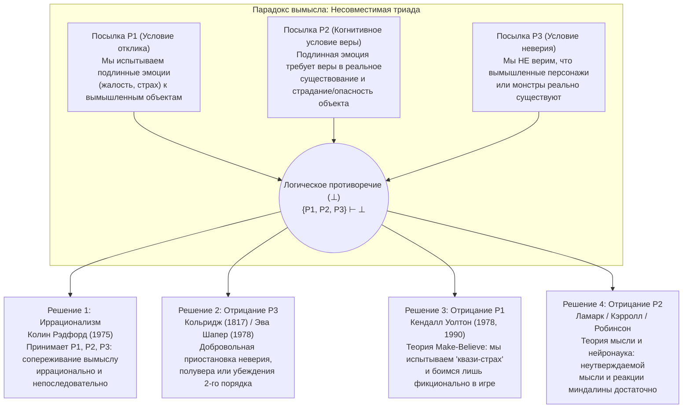

## Введение: Слезы Блаженного Августина о Дидоне и изумление Гамлета перед Гекубой

Каждый день мы переживаем психологический феномен, настолько привычный, что редко задумываемся о том, насколько он глубоко загадочен — и, на первый взгляд, иррационален. Когда в финале великого романа Льва Толстого *«Анна Каренина»* доведенная до отчаяния Анна стоит в сумерках на перроне вокзала и бросается под чугунные колеса товарного поезда, у нас перехватывает дыхание, на глаза наворачиваются слезы, и сердце сжимается от острой жалости и скорби. Или представим ночной сеанс фильма ужасов: когда чудовищная зеленая слизь (*Green Slime*) стремительно ползет прямо на объектив камеры, наш пульс подскакивает, в кровь выбрасывается адреналин, ладони покрываются холодным потом, и мы вцепляемся в подлокотники кресла от неподдельного ужаса.

Однако если взглянуть на эти реакции с точки зрения рациональной психологии, мы тотчас окажемся перед философской бездной. Читатель, плачущий над судьбой Анны Карениной, не страдает галлюцинациями: он абсолютно точно знает, что женщины по имени Анна Каренина никогда не существовало, а вся трагедия состоит лишь из типографской краски на бумаге. Точно так же зритель в кинотеатре прекрасно осознает, что сидит в полной безопасности в кресле и смотрит на проекцию света на плоском экране. Почему же тогда разумные взрослые люди плачут, скорбят, негодуют и трепещут из-за участи существ, о которых они достоверно знают, что те вообще не существуют?

Эта загадка волнует западную мысль уже почти два тысячелетия. Около 397 года н. э. <strong>Блаженный Августин (354–430)</strong> в третьей книге своей *«Исповеди»* (III.ii.2) с горечью вспоминал, как в юности обливался слезами над «Энеидой» Вергилия, оплакивая самоубийство карфагенской царицы Дидоны, покинутой Энеем, но не проронил ни слезинки о собственной духовной гибели вдали от Бога: *«Какое безумие может быть безумнее этого?»* Двенадцать веков спустя, около 1601 года, <strong>Уильям Шекспир</strong> вложил в уста принца <strong>Гамлета</strong> (Акт II, сцена 2) знаменитый монолог, когда тот увидел, как бродячий актер побледнел и заплакал настоящими слезами, декламируя рассказ о горе древней троянской царицы <strong>Гекубы</strong>:

> «Не чудовищно ли, что этот актер здесь, / Всего лишь в вымысле (*in a fiction*), в грезе страсти, / Смог так подчинить свою душу собственному воображению (*conceit*), / Что от его действия побледнело все его лицо, / В глазах — слезы, в чертах — смятение, / Надломленный голос… и все это — из-за ничто! / Из-за Гекубы! / <strong>Что ему Гекуба, или он Гекубе, / Чтобы так плакать о ней?</strong> (*What's Hecuba to him, or he to Hecuba, / That he should weep for her?*)»

В 1975 году британский аналитический философ <strong>Колин Рэдфорд (Colin Radford, 1935–2001)</strong> опубликовал в *Proceedings of the Aristotelian Society* эпохальную статью <strong>«Как нас может трогать судьба Анны Карениной?» («How Can We Be Moved by the Fate of Anna Karenina?»)</strong>, превратив этот классический вопрос в одну из центральных проблем современной аналитической эстетики и философии сознания — <strong>парадокс художественного вымысла (The Paradox of Fiction)</strong>. В данной статье мы детально проанализируем логическую структуру этой несовместимой триады, четыре главные философские стратегии ее разрешения, данные современной аффективной нейронауки, а также родственные проблемы: *парадокс трагедии*, *воображаемое сопротивление* и *онтологию вымышленных объектов*.

---

## Глава 1: Логическая структура парадокса — Несовместимая триада (Inconsistent Triad)

Колин Рэдфорд сформулировал парадокс вымысла как <strong>несовместимую триаду (Inconsistent Triad)</strong> из трех посылок ($P_1, P_2, P_3$), каждая из которых по отдельности кажется безусловно истинной, но их конъюнкция порождает формально-логическое противоречие ($\{P_1, P_2, P_3\} \vdash \bot$):

### Посылка $P_1$: Условие эмоционального отклика (Феноменологический факт)

> <strong>($P_1$) Мы испытываем подлинные, буквальные предметно-направленные эмоции (такие как жалость, скорбь, страх, гнев и восхищение) по отношению к вымышленным персонажам и событиям.</strong>

Когда мы плачем над Анной Карениной или пугаемся монстра в фильме ужасов, мы не притворяемся перед окружающими. Наше переживание феноменологически и физиологически подлинно: $\text{Emotion}_E(S, X)$.

### Посылка $P_2$: Когнитивное условие экзистенциального убеждения (Когнитивизм в теории эмоций)

> <strong>($P_2$) Для того чтобы субъект $S$ испытывал подлинную предметно-направленную эмоцию $E$ по отношению к объекту $X$, субъект $S$ должен верить (иметь ассерторическое убеждение), что $X$ действительно существует и реально обладает соответствующими оценочными свойствами (незаслуженно страдает, представляет угрозу и т. д.).</strong>

На языке кванторной доксастической логики посылка $P_2$ записывается так:

$$\forall S \forall X \Big( \text{Emotion}_E(S, X) \implies \text{Bel}_S\big(\exists x (x = X \land \text{Eval}_E(x))\big) \Big)$$

Эта посылка опирается на <strong>когнитивистскую теорию эмоций (Cognitivism about Emotions)</strong>, развивавшуюся от <strong>Аристотеля (*«Риторика»*, кн. II)</strong> и <strong>Спинозы (*«Этика»*)</strong> до <strong>Энтони Кенни (1963)</strong>, <strong>Роберта Соломона (1976)</strong> и <strong>Марты Нуссбаум (2001)</strong>. В отличие от беспредметного настроения (*mood*) или простого телесного ощущения (*sensation*, например зубной боли), эмоция обладает <strong>интенциональностью</strong> и определяется своим <strong>формальным объектом (Formal Object)</strong>: жалость к $X$ требует суждения о том, что $X$ реально страдает; страх перед $X$ требует убеждения, что $X$ реально опасен.

Рассмотрим мысленный эксперимент Рэдфорда: ваш приятель со слезами на глазах рассказывает вам, что его сестра только что попала в страшную автокатастрофу и умирает в реанимации. Вы мгновенно проникаетесь глубокой жалостью и состраданием к девушке. Но в следующую секунду приятель усмехается: *«Расслабься, я все выдумал ради проверки актерского мастерства! У меня вообще нет сестры!»* В ту самую секунду, когда вы узнаете, что сестры не существует, <strong>ваша жалость к сестре мгновенно испаряется</strong> (сменяясь гневом на шутника). Если бы, полностью поверив, что рассказ — выдумка, вы продолжили рыдать: *«Но мне все равно так жалко эту бедную девушку в больнице!»*, вас сочли бы совершенно иррациональным.

### Посылка $P_3$: Условие отсутствия веры (Non-Belief Condition)

> <strong>($P_3$) Нормальные, разумные взрослые читатели и зрители нисколько не верят в то, что вымышленные персонажи или монстры реально существуют: $\neg \text{Bel}_S(\exists x (x = X))$.</strong>

Это неопровержимо доказывается нашим поведением: ни один испуганный зритель в кинотеатре не вызывает полицию и не выбегает через запасной выход; ни один читатель не пытается остановить поезд в Москве.

---

## Глава 2: Решения 1 и 2 — Иррационализм Рэдфорда и «приостановка неверия» Кольриджа

### 1. Стратегия 1: Иррационализм Колина Рэдфорда (1975)

Отвергнув все попытки обойти противоречие, Рэдфорд пришел к радикальному выводу: <strong>посылки $P_1, P_2$ и $P_3$ все истинны</strong>, а значит, наша эмоциональная реакция на художественный вымысел свидетельствует о <strong>фундаментальной иррациональности и непоследовательности</strong> человеческой природы — подобно <strong>фобии</strong> (когда арахнофоб испытывает настоящий ужас перед безобидным пауком в стеклянной банке, прекрасно зная, что опасности нет).

<strong>Критика иррационализма</strong>:
Почти все современные эстетики отвергают вывод Рэдфорда. Во-первых, он совершает <strong>нормативную инверсию</strong>: фобия — это патологический дефект рациональности, который нужно лечить, тогда как способность глубоко сопереживать *«Анне Карениной»* или *«Королю Лиру»* ценится как признак эмоциональной зрелости, нравственной чуткости и правильного понимания искусства. Во-вторых, в отличие от охваченного паникой фобика, зритель в кинотеатре полностью сохраняет контроль над своим поведением.

### 2. Стратегия 2: Отрицание посылки $P_3$ — «Willing Suspension of Disbelief»

Английский поэт-романтик <strong>Сэмюэл Тейлор Кольридж</strong> в 1817 году в *«Biographia Literaria»* (гл. XIV) сформулировал знаменитый принцип <strong>«добровольной приостановки неверия на мгновение, составляющей поэтическую веру» (*that willing suspension of disbelief for the moment, which constitutes poetic faith*)</strong>. Позже <strong>Эва Шапер (Eva Schaper, 1978)</strong> предложила двухуровневую модель убеждений: у нас есть убеждения первого порядка о том, что Анны не существует, но подлинные убеждения второго порядка о том, что происходит внутри романа.

<strong>Почему отрицание $P_3$ терпит крах</strong>:
1. <strong>Доксастический инволюнтаризм</strong>: Невозможно усилием воли заставить себя поверить во что-то или перестать верить.
2. <strong>Поведенческая асимметрия</strong>: Если бы зритель приостановил свое неверие хотя бы на пять секунд перед смертоносным монстром, он бы немедленно бросился бежать из зала.
3. <strong>Схлопывание тезиса Шапер</strong>: Верить, что *согласно тексту Толстого* Анна страдает, — значит просто верить в литературный факт о тексте, а не верить в реальное страдание живого существа ($P_2$).

---

## Глава 3: Решение 3 — Теория «игры воображения (Make-Believe)» и «квази-страх» Кендалла Уолтона (Отрицание $P_1$)

В своей классической статье <strong>«Боясь вымыслов» («Fearing Fictions», 1978)</strong> и фундаментальном труде <strong>*«Мимесис как игра воображения» (Mimesis as Make-Believe, 1990)</strong>* философ <strong>Кендалл Уолтон (Kendall L. Walton)</strong> разработал грандиозную концепцию, которая <strong>строго сохраняет $P_2$ и $P_3$, разрешая парадокс путем отрицания и переосмысления посылки $P_1$</strong>.

### 1. Реквизиты (Props) и игры воображения (Games of Make-Believe)

Уолтон берет за образец всех репрезентативных искусств <strong>детские игры понарошку (Games of Make-Believe)</strong>. Когда дети в лесу договариваются, что все пни — это медведи, реальные пни служат <strong>реквизитами (*props*)</strong>, которые согласно правилам генерации предписывают, какие суждения являются <strong>фикционально истинными ($\mathcal{F}(\phi)$)</strong> в мире игры. Роман *«Анна Каренина»* или фильм ужасов — это культурно институционализированные реквизиты, вовлекающие самого читателя или зрителя в авторизованную игру воображения ($\mathcal{F}_G$).

### 2. Чарльз и Зеленая Слизь (Charles and the Green Slime): Настоящий страх против Квази-страха

Уолтон рассматривает знаменитый пример со зрителем <strong>Чарльзом</strong>, который смотрит фильм ужасов про Зеленую Слизь (*Green Slime*). Когда слизь бросается прямо на камеру, Чарльз вжимается в кресло, его сердце колотится, прошибает холодный пот. <strong>Боится ли Чарльз Зеленую Слизь буквально в реальном мире ($\text{LiteralFear}$)?</strong>
Уолтон отвечает: <strong>Нет ($\neg P_1$)!</strong> Ибо буквальный страх требует веры в реальную опасность ($P_2$) и поведенческой мотивации к бегству, чего у Чарльза нет.

Но Чарльз вовсе не притворяется! Он переживает совершенно реальное физиологическое и аффективно-феноменологическое состояние (учащенный пульс, выброс адреналина, внутренний трепет), которое Уолтон называет <strong>«квази-страхом» (*quasi-fear*, и шире — *quasi-emotions*)</strong>.
Причинно-репрезентативный механизм работает так:
1. Кадр на экране (внешний реквизит) побуждает Чарльза вообразить о самом себе (*de se*): *«Слизь атакует меня!»*
2. Это живое воображение *de se* каузально вызывает в теле Чарльза реальный <strong>квази-страх</strong>.
3. Этот реальный квази-страх выступает в качестве <strong>рефлексивного внутреннего реквизита (*reflexive prop*)</strong>, который делает <strong>фикционально истинным внутри игры Чарльза то, что он буквально боится слизи</strong>:

$$\text{Imagine}_{\text{Charles}}(\text{Опасность}) \xrightarrow{\text{вызывает}} \text{QuasiFear}(\text{Charles}) \xrightarrow{\text{порождает}} \mathcal{F}_G\big(\text{LiteralFear}(\text{Charles}, \text{Slime})\big)$$

Это в точности подобно ребенку, играющему с отцом в «монстра»: ребенок знает, что отец его любит и не причинит вреда, но испытывает захватывающий реальный *квази-страх*, благодаря которому *внутри игры* он в ужасе убегает от чудовища. (<strong>Грегори Карри / Gregory Currie 1990</strong> переформулировал это в когнитивной науке как <strong>теорию офлайн-симуляции / *off-line simulation</strong>*).

---

## Глава 4: Решение 4 — Отрицание $P_2$: «Теория мысли (Thought Theory)» и аффективная нейронаука

Против Уолтона выступили <strong>Питер Ламарк (Peter Lamarque, 1981)</strong>, <strong>Ноэль Кэрролл (Noël Carroll, *The Philosophy of Horror*, 1990)</strong>, <strong>Ричард Моран (1994)</strong>, <strong>Дженефер Робинсон (2005)</strong> и <strong>Тамар Сбо Гендлер (2008)</strong>: сведение нашей скорби об Анне Карениной к «игре понарошку» искажает наш внутренний опыт — <strong>мы испытываем подлинные эмоции ($P_1$ истинна), а ложной является именно посылка $P_2$ (требование экзистенциального убеждения)!</strong>

### 1. Теория мысли (Thought Theory: Ламарк и Кэрролл)

Согласно <strong>Thought Theory</strong>, подлинные эмоции не требуют ассерторического убеждения в существовании объекта; достаточно <strong>живо удерживать в сознании неутверждаемую пропозициональную мысль (*vividly entertaining an unasserted thought*)</strong>.
- Если вы стоите в полной безопасности за стальным ограждением на крыше небоскреба ($\neg \text{Bel}(\text{Опасность})$) и просто живо представите себе *мысль* о том, как переваливаетесь через перила и летите в бездну, вас охватит самый настоящий страх и головокружение.
- Если живо вообразить, как вы жуете живых дождевых червей, возникнет подлинное <strong>отвращение (Disgust)</strong>.

Настоящий страх перед Дракулой или настоящая жалость к Анне Карениной вызываются <strong>мыслительным содержанием (*Thought-content*)</strong>, сконструированным текстом. Поскольку эмоция порождена мыслью, а не убеждением в реальной угрозе, моторные программы бегства не запускаются.

### 2. Аффективная нейронаука (двойной путь миндалины) и «Alief»

Современная аффективная нейронаука (<strong>Джозеф Леду / Joseph LeDoux</strong>, *The Emotional Brain*, 1996) эмпирически опровергает $P_2$ с помощью модели <strong>двойного пути</strong>:
1. <strong>Быстрый подкорковый путь (Low Road: Таламус $\to$ Миндалина / Островковая доля)</strong>: Перцептивные и воображаемые образы за миллисекунды достигают <strong>миндалины (амигдалы)</strong>, которая «слепа к вымыслу» (*fiction-blind*) и не способна проверять онтологическое существование объекта. Она мгновенно запускает <strong>подлинную физиологическую и аффективную эмоцию</strong> ($P_1$ подтверждена, $P_2$ опровергнута).
2. <strong>Медленный корковый путь (High Road: Таламус $\to$ Префронтальная кора PFC)</strong>: Префронтальная кора оценивает контекст (*«Я сижу в кинотеатре, это просто фильм»*, $P_3$) и <strong>тормозит моторную команду к бегству</strong>, позволяя нам безопасно переживать эмоцию в кресле.

<strong>Тамар Сбо Гендлер (2008)</strong> ввела понятие <strong>«Alief» (ассоциативно-аффективная установка)</strong>: в то время как эксплицитное <strong>убеждение (Belief)</strong> Чарльза гласит *«Слизи не существует»*, экранный образ активирует автоматический <strong>Alief</strong> (*«Опасный монстр! Бойся! Отшатнись!»*).

| Стратегия разрешения | Отвергаемая посылка | Главные представители | Природа эмоции к вымыслу | Почему мы не убегаем из кинозала? | Главная сила и Главная уязвимость |
| :--- | :---: | :--- | :--- | :--- | :--- |
| <strong>1. Иррационализм</strong> | <strong>Никакая</strong> (Принимает $\bot$) | Колин Рэдфорд (1975) | Подлинная буквальная эмоция, но иррациональная и противоречивая (как фобия). | Рациональное убеждение ($P_3$) блокирует действие, пока сердце иррационально плачет. | Сохраняет все 3 интуиции, но приравнивает художественную эмпатию к психической патологии. |
| <strong>2. Приостановка неверия</strong> | <strong>Отвергает $P_3$</strong> | С. Т. Кольридж (1817) Эва Шапер (1978) | Подлинная эмоция на основе временной иллюзии или убеждений 2-го порядка о сюжете. | Убеждение 1-го порядка о реальности тормозит побег; 2-го порядка — рождает эмоцию. | Объясняет погружение, но рушится из-за непроизвольности веры и отсутствия паники. |
| <strong>3. Теория Make-Believe</strong> | <strong>Отвергает $P_1$</strong> | Кендалл Уолтон (1978, 1990) Грегори Карри (1990) | Реальная <strong>квази-эмоция</strong>, служащая реквизитом и делающая <strong>фикционально истинным ($\mathcal{F}_G$)</strong> наш страх или жалость. | Нет веры в опасность ($P_3$) и буквального страха; ментальная симуляция работает «офлайн». | Спасает когнитивизм ($P_2$), но объявление глубокой трагической скорби «игрой» кажется искусственным. |
| <strong>4. Thought Theory и нейронаука</strong> | <strong>Отвергает $P_2$</strong> | Питер Ламарк (1981) Ноэль Кэрролл (1990) Дженефер Робинсон (2005) Тамар Гендлер (2008) | <strong>Подлинная буквальная эмоция</strong>, вызванная <strong>неутверждаемыми мыслями</strong> или подкорковыми <strong>Aliefs</strong>. | Контроль реальности в префронтальной коре ($P_3$) подавляет моторные программы бегства. | Полное согласие с повседневной феноменологией ($P_1$) и современной нейробиологией мозга. |

---

## Глава 5: Родственные парадоксы — Парадокс трагедии, Воображаемое сопротивление и Онтология

### 1. Парадокс трагедии и ужаса

Почему мы добровольно ищем в искусстве мучительные эмоции (скорбь, жалость, ужас), которых всячески избегаем в реальной жизни?
- <strong>Теория *катарсиса* Аристотеля (*«Поэтика»*, гл. 6)</strong>: Трагедия через сострадание (*eleos*) и страх (*phobos*) совершает очищение, разрядку и гармоническое упорядочение этих страстей.
- <strong>«Теория конверсии» Дэвида Юма (1757, *«О трагедии»*)</strong>: Преобладающее эстетическое удовольствие от красноречия, поэтического ритма и мастерства подражания захватывает болезненную эмоциональную энергию скорби и <strong>целиком преобразует (*converts*) ее в эстетическое наслаждение</strong>.
- <strong>«Мета-отклик» Сьюзан Фигин (Susan Feagin, 1983)</strong>: За болезненной прямой реакцией следует приносящий удовлетворение мета-отклик, в котором мы осознаем собственную способность к человеческому состраданию.
- <strong>Когнитивное любопытство Ноэля Кэрролла (1990)</strong>: В хорроре мы терпим страх и отвращение как цену (или усилитель) за когнитивное очарование монстрами, нарушающими наши категориальные схемы.

### 2. Загадка воображаемого сопротивления (Юм, Уолтон, Гендлер)

В то время как мы без труда воображаем физические невозможности (летающих драконов, путешествия во времени), мы оказываем упорное <strong>воображаемое сопротивление (Imaginative Resistance)</strong>, когда автор пытается постулировать извращенную моральную истину — как в знаменитом предложении <strong>Кендалла Уолтона</strong>:

> <strong>«Убив своего младенца, Гизельда поступила правильно; в конце концов, это была девочка (*In killing her baby, Giselda did the right thing; after all, it was a girl*).»</strong>

По <strong>Уолтону (1994)</strong>, мы *не можем* это вообразить (*Can't*), поскольку моральные свойства концептуально <strong>супервентны (supervene)</strong> на естественных фактах. По <strong>Тамар Сбо Гендлер (2000)</strong>, мы *отказываемся* это воображать (*Won't*), чтобы не «экспортировать» чудовищную моральную установку из вымысла и не загрязнить свое реальное нравственное чувство.

### 3. Онтология вымышленных объектов (Мейнонг против артефактуальной теории Томассон)

Каков онтологический статус «Анны Карениной»?
1. <strong>Мейнонгианство (Алексиус Мейнонг, Теренс Парсонс, Эдвард Залта)</strong>: Анна Каренина — это конкретный или абстрактный <strong>несуществующий объект</strong>, кодирующий приписанные ему в романе свойства.
2. <strong>Антиреалистическая семантика притворства (Кендалл Уолтон)</strong>: Вымышленных сущностей вообще нет; речи об Анне — лишь ходы в игре воображения, предписанной романом.
3. <strong>Артефактуальная теория вымысла (Сол Крипке, Питер ван Инваген, Эми Томассон / Amie L. Thomasson 1999 *Fiction and Metaphysics*)</strong>: Ведущая современная реалистическая позиция. Подобно законам, симфониям или правилам шахмат, вымышленные персонажи — это <strong>абстрактные культурные артефакты (*Abstract Cultural Artifacts*)</strong>, созданные авторами в определенный исторический момент и реально существующие в нашем культурном мире. Поэтому высказывание *«Анна Каренина была создана Толстым и вызывает жалость миллионов читателей»* буквально истинно!

---

## Заключение: Эмоциональное воображение как лаборатория человечности

Полвека дискуссий после статьи Колина Рэдфорда (1975) показывают, что наши слезы над Анной Карениной — не иррациональный сбой и не самообман. Благодаря нашей способности к <strong>воображаемой симуляции (Уолтон)</strong> и двухконтурной архитектуре эмоционального мозга (<strong>Ламарк, Кэрролл, Робинсон, Леду</strong>), где <strong>живые мысли</strong> пробуждают подлинную подкорковую эмпатию под безопасным контролем префронтальной коры, художественный вымысел служит глубочайшей нравственной лабораторией человечества, позволяя нам выйти за пределы собственного «я» и пережить изнутри страдание и достоинство другого существа.
