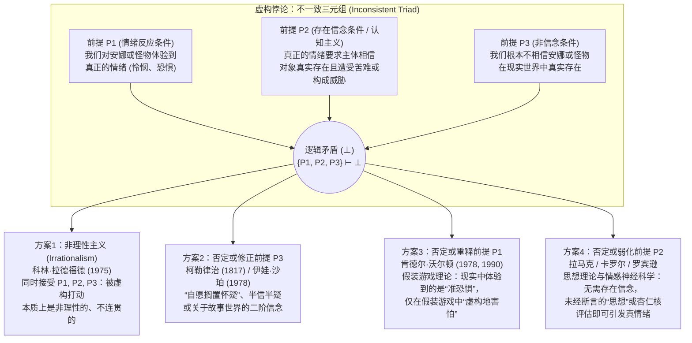

## 引言：奥古斯丁为狄多流下的眼泪与哈姆雷特的惊叹

在日常生活中，我们频繁经历着一种既极其熟悉又在逻辑上令人费解的心理奇迹。当我们读到列夫·托尔斯泰的小说《安娜·卡列尼娜》结尾，走投无路的安娜在黄昏的火车站月台上纵身跃入飞驰的货运列车车轮之下时，我们会感到胸口窒息、热泪盈眶，心中涌起深切的怜悯与悲痛；当我们坐在午夜电影院的黑暗中，看到银幕上一团绿色的粘液怪物（Green Slime）咆哮着扑向镜头时，我们的心率飙升、手心冒汗、全身肌肉紧绷。

然而，从理性心理学与认识论的角度来看，这种反应似乎包含着深刻的矛盾。任何心智正常的成年读者都清楚地知道，安娜·卡列尼娜从未在十九世纪的俄国存在过，那场悲剧不过是托尔斯泰留在纸上的油墨印记；电影院里的观众也百分之百地确信，银幕上的绿色粘液只是光影的投射，绝不可能爬出银幕吞噬自己。既然我们明知这些人物与怪物根本不存在，为什么我们还会对它们产生如此真实、强烈的情绪反应？

这一谜题在西方思想史上回荡了近两千年。公元四世纪末，基督教教父<strong>奥古斯丁（Saint Augustine, 354–430）</strong>在《忏悔录》（第三卷第二章）中痛切地回忆自己年轻时阅读维吉尔史诗《埃涅阿斯纪》时，为因失恋而自杀的迦太基女王狄多（Dido）痛哭流涕，却不为自己灵魂远离上帝而落泪，他质问道：“还有什么比这更荒谬的疯狂呢？” 约一千二百年后，<strong>威廉·莎士比亚（William Shakespeare）</strong>在《哈姆雷特》（第二幕第二场）中让丹麦王子看着一位巡回伶人演到特洛伊老王后<strong>赫卡柏（Hecuba）</strong>丧夫之痛时脸色苍白、声泪俱下，发出了千古名叹：

> “难道不令人惊骇吗？这名演员不过是在虚构的故事里（in a fiction），在一场激情的幻梦中，就能迫使自己的灵魂顺从自己的想象，以至于脸色苍白、热泪盈眶、声音哽咽……而这一切竟然都是为了乌有（all for nothing）！为了赫卡柏！<strong>赫卡柏对他算什么，他对赫卡柏又算什么，他竟为她痛哭流涕？（What's Hecuba to him, or he to Hecuba, / That he should weep for her?）</strong>”

1975年，英国分析哲学家<strong>科林·拉德福德（Colin Radford, 1935–2001）</strong>在《亚里士多德学会会刊补编》上发表了里程碑式的论文<strong>《我们何以会被安娜·卡列尼娜的命运所打动？》（"How Can We Be Moved by the Fate of Anna Karenina?"）</strong>，将这一古老的困惑严格形式化为分析美学与心灵哲学的核心难题——<strong>“虚构悖论（The Paradox of Fiction）”</strong>。本文将系统剖析虚构悖论的逻辑结构、四大哲学解决方案、当代情感神经科学证据，以及它的姊妹难题——“悲剧悖论”“想象性阻抗”与“虚构对象的本体论”。

---

## 第一章：虚构悖论的逻辑结构——不一致三元组（Inconsistent Triad）

拉德福德指出，虚构悖论之所以构成严格的哲学悖论，是因为以下三个前提（$P_1, P_2, P_3$）各自都具有极强的直觉与理论说服力，但三者的合取却直接导出逻辑矛盾（$\{P_1, P_2, P_3\} \vdash \bot$）：

### 前提 $P_1$：情绪反应条件（The Response Condition / 现象学事实）

> <strong>（$P_1$）我们对虚构的人物和事件确实体验到真正的、字面意义上的对象指向性情绪（Genuine emotions，如怜悯、悲伤、恐惧、愤怒、钦佩等）。</strong>

当我们为安娜·卡列尼娜流泪，或被恐怖片中的怪物吓得发抖时，我们并不是在逢场作戏或假装难过。我们的眼泪与心跳加速具有完全真实的生理学与现象学质感。在日常语言与文学批评中，“我真心地同情安娜”“观众非常害怕那个怪物”被视为字面上为真的命题：$\text{Emotion}_E(S, X)$。

### 前提 $P_2$：情绪的存在信念条件（The Cognitive / Existence-Belief Condition）

> <strong>（$P_2$）主体 $S$ 若要对某个对象 $X$ 产生真正的对象指向性情绪 $E$，则 $S$ 必须相信 $X$ 真实存在，并且相信 $X$ 确实遭受了苦难或构成了威胁。</strong>

用量化认知逻辑可表示为：

$$\forall S \forall X \Big( \text{Emotion}_E(S, X) \implies \text{Bel}_S\big(\exists x (x = X \land \text{Eval}_E(x))\big) \Big)$$

这一前提植根于自<strong>亚里士多德（《修辞学》）</strong>、<strong>斯宾诺莎（《伦理学》）</strong>直至当代<strong>罗伯特·所罗门（Robert Solomon）</strong>与<strong>玛莎·努斯鲍姆（Martha Nussbaum）</strong>所捍卫的<strong>“情绪认知主义（Cognitivism about Emotions）”</strong>。情绪不同于无对象的“心境（Mood，如莫名的烦躁）”或单纯的“身体感觉（Sensation，如胃痛）”，每一种情绪都具有<strong>意向性（Intentionality）</strong>和特定的<strong>形式对象（Formal Object）</strong>：怜悯要求认知上判断对象正在遭受不应得的苦难；恐惧要求认知上判断对象构成了迫在眉睫的危险。

拉德福德举了一个极具说服力的例子：假设你的朋友神色慌张地告诉你，他的妹妹刚刚在高速公路上遭遇惨烈车祸，正在重症监护室抢救。你听后悲痛欲绝，对那个女孩充满深切的怜悯。但下一秒，朋友哈哈大笑说：“骗你的！我根本没有妹妹，刚才全是我编造的演技测试！” 在你确信“那个妹妹根本不存在”的一瞬间，你对那个虚构妹妹的悲伤和怜悯立刻烟消云散（虽然会转化为对朋友恶作剧的愤怒）。如果得知真相后你仍然嚎啕大哭：“哪怕她不存在，我还是好心疼那个在车祸中流血的妹妹啊！”，所有人都会认为你丧失了理性。因此，真正的对象指向性情绪以<strong>存在信念（Existential Belief）</strong>为必要条件。

### 前提 $P_3$：非信念条件（The Non-Belief Condition）

> <strong>（$P_3$）心智正常的成年读者与观众并不相信虚构的人物或怪物在现实中真实存在：$\neg \text{Bel}_S(\exists x (x = X))$。</strong>

这一点由我们的实际行动充分证明：无论读者多么同情安娜，都不会拨打莫斯科铁路警察局的电话去救她；无论观众在影院里多么害怕绿色粘液怪物，都不会夺门而出或报警。

---

## 第二章：方案一与方案二——拉德福德的“非理性主义”与柯勒律治的“搁置怀疑”

### 1. 解决策略一：科林·拉德福德的非理性主义（Irrationalism）

在1975年的论文中，拉德福德逐一驳斥了各种消解方案，最终得出了一个惊世骇俗的结论：<strong>前提 $P_1, P_2, P_3$ 全部为真，因此人类对虚构作品产生情绪反应这一现象，本质上就是非理性的（irrational）、不连贯的（incoherent）和自相矛盾的！</strong> 他将其类比为人类的<strong>恐惧症（Phobia）</strong>：一个患有蜘蛛恐惧症的人在理智上百分之百知道玻璃瓶里的无毒小蜘蛛绝对安全（$\neg \text{Bel}(\text{Danger})$），却依然感到真实的惊恐（$P_1$）。

<strong>对非理性主义的批判</strong>：
当代美学家几乎一致拒绝拉德福德的结论。首先，它犯了<strong>“规范性倒置（Normative Inversion）”</strong>的错误：恐惧症是一种需要心理治疗克服的理性缺陷，而阅读《安娜·卡列尼娜》或《李尔王》时产生深刻的同情与悲悯，却被我们视为<strong>审美理解力、道德敏感性与情感成熟度的标志</strong>。如果拉德福德是对的，那么读完《安娜·卡列尼娜》无动于衷、冷酷地说“她又不存在，有什么好哭的”的人反而是最理性的楷模，这完全颠倒了审美规范。其次，恐惧症患者会失控逃跑，而恐怖片观众的行为控制力完好无损。

### 2. 解决策略二：否定前提 $P_3$——“自愿搁置怀疑”与双层信念

第二种传统方案试图否定前提 $P_3$。英国浪漫主义诗人<strong>塞缪尔·泰勒·柯勒律治（Samuel Taylor Coleridge）</strong>在1817年的《文学传记》（第14章）中提出了著名的<strong>“那一刻自愿搁置怀疑，从而构成诗性信仰（that willing suspension of disbelief for the moment, which constitutes poetic faith）”</strong>。如果观众在看戏时暂时搁置了“这是假戏”的怀疑，进入“半信半疑（Half-belief）”的幻觉状态，那么 $P_2$ 就得到了满足。此外，哲学家<strong>伊娃·沙珀（Eva Schaper, 1978）</strong>提出了精致的<strong>双层信念论</strong>：我们虽然有一阶信念“安娜在现实中不存在”，但同时拥有关于故事内容的真实二阶信念“（在小说中）安娜因绝望而卧轨自杀”，正是这种二阶信念引发了情绪。

<strong>为什么否定 $P_3$ 会失败？</strong>
1. <strong>信念的非自愿性（Doxastic Involuntarism）</strong>：认识论表明，人可以凭意志自由地“想象”，但无法凭意志自由地开关“信念”。
2. <strong>行为不对称性</strong>：哪怕观众只在一秒钟内真正相信（或有10%的半信）银幕上的食人粘液怪物是真的，他也会立刻尖叫着冲出电影院逃命或拨打报警电话。观众稳坐席间吃爆米花并欣赏镜头语言的事实，证明 $P_3$ 从未动摇。
3. <strong>沙珀方案的坍缩</strong>：相信“小说文本里写着安娜自杀”，只是相信一个关于文学文本的事实，并不是相信“现实中有一个活生生的人在受苦”（$P_2$ 的核心要求）。如果关于文本的信念就能引发真情绪，那实际上已经是放弃了 $P_2$。

---

## 第三章：方案三——肯德尔·沃尔顿的“假装游戏（Make-Believe）”与“准恐惧（Quasi-Fear）”

为了在不牺牲人类理性、同时严格保留前提 $P_2$（认知主义）与 $P_3$（非信念）的前提下解开悖论，密歇根大学哲学家<strong>肯德尔·沃尔顿（Kendall L. Walton）</strong>在1978年的经典论文<strong>《害怕虚构之物》（"Fearing Fictions"）</strong>及1990年的巨著<strong>《作为假装游戏的摹仿》（*Mimesis as Make-Believe*）</strong>中，提出了震撼分析美学界的<strong>假装游戏理论（Make-Believe Theory）</strong>，通过精巧地<strong>否定并重构前提 $P_1$</strong> 解决了悖论。

### 1. 道具（Props）与假装游戏中的虚构真理

沃尔顿将儿童的<strong>假装游戏（Games of Make-Believe）</strong>作为理解一切表征艺术（小说、绘画、戏剧、电影）的基础模型。设想两个孩子在森林里玩游戏，约定“所有的树桩都是熊”。在这里，真实的树桩是<strong>“道具（Props）”</strong>，游戏的约定是<strong>“生成原则（Principles of Generation）”</strong>。只要某处有一个真实的树桩，在该游戏中“那里有一头熊”就是<strong>“虚构地真（Fictionally true，记作 $\mathcal{F}(\phi)$）”</strong>。

同样，《安娜·卡列尼娜》的文本或恐怖片的银幕，正是供成年欣赏者进行规范化假装游戏的<strong>高级道具</strong>。当我们欣赏作品时，我们不仅是在观察“作品世界（Work World, $\mathcal{F}_W$）”，更是把自己也投射进了一个包含欣赏者自身在内的<strong>“欣赏者游戏世界（Appreciator's Game World, $\mathcal{F}_G$）”</strong>。

### 2. 查尔斯与绿色粘液（Charles and the Green Slime）：真恐惧 vs. 准恐惧

沃尔顿设计了著名的思想实验：<strong>查尔斯与绿色粘液</strong>。查尔斯正在看一部关于吞噬一切的绿色粘液怪物的恐怖片。当镜头里的绿色粘液突然朝观众席方向猛扑过来时，查尔斯死死抓住扶手，心跳加速，冷汗直流，胃部紧缩。电影结束后，查尔斯说：“我刚才真的怕死那个粘液怪物了！”

沃尔顿提问：<strong>在现实世界中，查尔斯真的（字面意义上）害怕（literally fear）那个绿色粘液吗？</strong>
沃尔顿回答：<strong>绝对没有（$\neg P_1$）！</strong> 因为真正的恐惧包含两个不可或缺的要素：（1）相信自己处于真实的危险中（$P_2$）；（2）产生逃跑或自卫的行为动机。查尔斯两者皆无。

但是，查尔斯绝不是在演戏！他体验到了一种完全真实的生理与现象学感受——心率飙升、肾上腺素分泌、肌肉紧绷与战栗感。沃尔顿将这种剥离了“危险信念”与“逃跑动机”的纯粹生理—情感唤醒状态命名为<strong>“准恐惧（Quasi-fear）”</strong>（统称<strong>“准情绪 Quasi-emotions”</strong>）。

沃尔顿理论最精彩的一步在于：
1. 银幕上的画面（外部道具）促使查尔斯在假装游戏中进行自我指涉的想象（*de se* imagination）：“绿色粘液正向我扑来！”
2. 这一生动的想象直接因果性地引发了查尔斯身体里真实的<strong>准恐惧（Quasi-fear）</strong>。
3. 查尔斯体内真实的“准恐惧”感受本身，又作为第二个<strong>内部反身道具（Reflexive Prop）</strong>，在查尔斯的假装游戏世界中生成了一个虚构真理——<strong>“在假装游戏中，查尔斯真正害怕绿色粘液”</strong>：

$$\text{Imagine}_{\text{Charles}}(\text{Danger}) \xrightarrow{\text{因果引发}} \text{QuasiFear}(\text{Charles}) \xrightarrow{\text{作为道具生成}} \mathcal{F}_G\big(\text{LiteralFear}(\text{Charles}, \text{Slime})\big)$$

因此，在现实世界中查尔斯感受到的只是“准恐惧”（而非字面上的真恐惧，$\neg P_1$），而在假装游戏的世界里他“虚构地感到真恐惧（$\mathcal{F}_G(\text{Fear})$）”。这就像父亲假装成怪兽追逐年幼的儿子，儿子尖叫着躲到沙发后：儿子知道父亲不会伤害自己，他在现实中体验着刺激的“准恐惧”，并在假装游戏中扮演“害怕怪兽的孩子”。（后来 <strong>Gregory Currie 1990</strong> 将这一机制发展为认知科学中的<strong>“离线心理模拟理论 Off-line Simulation Theory”</strong>）。

---

## 第四章：方案四——否定前提 $P_2$：“思想理论（Thought Theory）”与情感神经科学

沃尔顿的理论虽然精密绝伦，但遭到了许多哲学家的强烈反击。批评者指出：当我们读《安娜·卡列尼娜》或大屠杀题材小说而流下悲痛的眼泪时，说我们只是在玩“假装自己很难过的游戏（$\mathcal{F}_G(\text{Pity})$）”，不仅严重违背了我们的内省现象学体验，而且阅读第三人称小说时我们根本没有把自己投射到十九世纪的莫斯科火车站去当旁观者！

因此，以<strong>彼得·拉马克（Peter Lamarque, 1981）</strong>、<strong>诺埃尔·卡罗尔（Noël Carroll, 1990, 《恐怖的哲学》）</strong>、<strong>理查德·莫兰（Richard Moran, 1994）</strong>、<strong>珍妮弗·罗宾逊（Jenefer Robinson, 2005）</strong>与<strong>塔玛尔·根德勒（Tamar Szabó Gendler, 2008）</strong>为代表的阵营主张：<strong>前提 $P_1$（我们体验到真正的情绪）是完全正确的，真正错误的罪魁祸首是前提 $P_2$（真正的情绪必须以存在信念为前提）！</strong>

### 1. 思想理论（Thought Theory）：未经断言的命题思想足以引发真情绪

拉马克与卡罗尔提出的<strong>“思想理论（Thought Theory）”</strong>指出：在现实生活中，真正的情绪完全不需要“断言性存在信念（Assertoric Belief）”，仅仅在心灵中<strong>生动地怀想或表征一个未经断言的命题思想（Vividly entertaining an unasserted thought）</strong>，就足以因果性地引发字面意义上的真正情绪！

- <strong>悬崖思想实验</strong>：你站在摩天大楼顶层坚固的钢铁护栏后面，百分之百相信自己绝对安全（$\neg \text{Bel}(\text{Danger})$）。但只要你在脑海中生动地想象（怀想这一思想）“自己身体前倾翻过护栏坠落深渊”的画面，你就会立刻感到一阵真正的眩晕与恐惧，并本能地后退一步。
- <strong>厌恶思想实验</strong>：只要在脑海中生动地想象咀嚼一嘴活蚯蚓的画面，即使知道嘴里什么也没有，也会立刻产生真正的<strong>厌恶感（Disgust）</strong>。

卡罗尔指出，当我们看恐怖片或读《安娜·卡列尼娜》时，引发我们真正恐惧或真正怜悯的，正是文本与影像在我们心中构建的<strong>“思想内容（Thought-content）”</strong>。因为这种真正的情绪是由“思想/想象”而非“存在信念”引发的，所以它自然不会触发“逃离电影院或报警”的行动程序！

### 2. 当代情感神经科学（杏仁核双通路）与“Alief（类信念）”

21世纪的情感神经科学（如 <strong>Joseph LeDoux</strong> 的《情绪脑》）为否定前提 $P_2$ 提供了决定性的脑科学证据。人类大脑处理情绪刺激存在<strong>“双通路（Two Roads）”</strong>：
1. <strong>皮层下快速通道（Low Road：丘脑 $\to$ 杏仁核 Amygdala / 脑岛 Insula）</strong>：视觉、听觉或生动的想象表征在十几个毫秒内直接抵达进化上古老的杏仁核与镜像神经元系统。<strong>杏仁核是“虚构盲（fiction-blind）”的</strong>——它根本没有能力去做“这个对象在现实中是否存在”的本体论信念核查（Belief-checking），而是直接对表征模式做出自动的情感评估（Affective Appraisal），立即启动百分之百真实的恐惧或共情悲伤反应（证实 $P_1$，否定 $P_2$）。
2. <strong>前额叶慢速监控通道（High Road：丘脑 $\to$ 前额叶皮层 PFC）</strong>：稍后，腹内侧与背外侧前额叶皮层完成语境评估：“我正坐在电影院里，这只是虚构电影”（$P_3$）。前额叶随后<strong>抑制运动皮层的逃跑指令</strong>，让我们稳坐在座位上安全地进行审美体验。

耶鲁大学哲学家<strong>塔玛尔·根德勒（Tamar Szabó Gendler, 2008）</strong>据此提出了著名的<strong>“Alief（类信念/联结态）”</strong>概念：查尔斯在理性皮层中持有“粘液不存在”的显性<strong>信念（Belief）</strong>，但生动的银幕画面激活了他底层自动的、联结性的<strong>Alief</strong>（“危险粘液扑过来了！快害怕！快缩身！”）。

| 解决方案流派 | 否定的前提 | 代表哲学家 | 对虚构情绪的定性 | 为什么观众不逃跑或报警？ | 核心优势与主要缺陷 |
| :--- | :---: | :--- | :--- | :--- | :--- |
| <strong>1. 非理性主义</strong> (Irrationalism) | <strong>无</strong> (接受矛盾) | 科林·拉德福德 (1975) | 真正的字面情绪，但属于类似恐惧症的非理性矛盾状态。 | 理性信念 ($P_3$) 阻止了外部行动，但感性依然非理性地哭泣。 | 保留全部直觉，但将高尚的文学共情贬低为精神病理学上的恐惧症。 |
| <strong>2. 搁置怀疑论</strong> (Suspension of Disbelief) | <strong>否定 $P_3$</strong> | 柯勒律治 (1817) 伊娃·沙珀 (1978) | 由暂时幻觉、半信半疑或关于故事的二阶信念引发的真情绪。 | 一阶现实信念抑制行动，二阶故事信念引发情绪。 | 符合沉浸感直觉，但信念无法凭意志开关，且半信危险也会导致逃跑。 |
| <strong>3. 假装游戏理论</strong> (Make-Believe Theory) | <strong>否定 $P_1$</strong> | 肯德尔·沃尔顿 (1978, 1990) 格雷戈里·柯里 (1990) | 现实中仅体验生理性的<strong>“准恐惧（Quasi-fear）”</strong>，在假装游戏中虚构地害怕 ($\mathcal{F}_G$)。 | 缺乏危险信念与字面真恐惧，心理模拟处于“离线（off-line）”状态。 | 完美调和认知主义与行为控制，但将深沉的悲剧眼泪视为“假装游戏”显得矫揉造作。 |
| <strong>4. 思想理论与神经科学</strong> (Thought Theory) | <strong>否定 $P_2$</strong> | 彼得·拉马克 (1981) 诺埃尔·卡罗尔 (1990) 珍妮弗·罗宾逊 (2005) 塔玛尔·根德勒 (2008) | 由未经断言的<strong>命题思想（Thought）</strong>或皮层下<strong>Alief</strong>直接引发的<strong>真正情绪</strong>。 | 前额叶皮层的现实监控 ($P_3$) 抑制了运动逃跑输出。 | 完全契合日常内省直觉与当代脑神经科学（杏仁核双通路模型）。 |

---

## 第五章：美学的姊妹难题——“悲剧悖论”“想象性阻抗”与“虚构对象本体论”

### 1. 悲剧与恐怖悖论（The Paradox of Tragedy and Horror）

虚构悖论追问的是“我们<strong>如何可能</strong>对虚构之物产生悲伤与恐惧”，而<strong>悲剧悖论</strong>追问的则是动机与享乐价值：<strong>“既然悲伤、怜悯与恐惧在现实中是令人痛苦的负面情绪，为什么我们却主动花钱去阅读悲剧、观看恐怖片，并从中获得深刻的审美快感？”</strong>
- <strong>亚里士多德的“卡塔西斯（Katharsis / 净化与宣泄）”说（《诗学》第六章）</strong>：悲剧通过引发怜悯与恐惧，使这类积郁的情感得到安全的宣泄与理性的陶冶校准。
- <strong>大卫·休谟的“转化说（Conversion Theory）”</strong>（1757年论文《论悲剧》*"Of Tragedy"*）：休谟提出，艺术家的雄辩、诗歌韵律之美与精湛的摹仿技艺激发了占主导地位的“审美快感”，这种主导快感夺取了悲剧事件所引发的痛苦情绪能量（动物精气的悸动），并将其<strong>全部转化（convert）为审美愉悦</strong>，从而极大增强了整体快感。
- <strong>苏珊·费金（Susan Feagin, 1983）的“元反应（Meta-Response）”说</strong>：我们对安娜之死的一阶直接反应确实是痛苦的，但我们在二阶“元反应”中为自己拥有同情他人苦难的道德人性而感到欣慰与自豪。
- <strong>诺埃尔·卡罗尔（Noël Carroll, 1990）的“认知好奇心（Cognitive Curiosity）”说</strong>：恐怖片中的怪物打破了常规分类范畴（如生与死的边界），激发了人类强烈的认知探索欲，恐惧的生理唤醒是我们为满足叙事好奇心而支付的代价（或兴奋放大器）。

### 2. 想象性阻抗（Imaginative Resistance：休谟、沃尔顿、根德勒）

由休谟在《论趣味的标准》（1757）末尾首次指出，并由<strong>沃尔顿（1994）</strong>与<strong>塔玛尔·根德勒（Tamar Szabó Gendler, 2000）</strong>深入剖析的<strong>“想象性阻抗”</strong>揭示了一个惊人的不对称：作者拥有设定物理不可能性的绝对权威（如果作者写“在这个世界里巨龙会喷火、时间会倒流”，读者会毫不费力地欣然想象）；但如果作者试图设定一个<strong>扭曲的道德真理</strong>——例如沃尔顿著名的单句小说：

> <strong>“在杀死自己的婴儿这件事上，吉塞尔达做得完全正确；毕竟，那是个女婴（In killing her baby, Giselda did the right thing; after all, it was a girl）。”</strong>

读者的想象力会立刻撞上一堵高墙！我们可以想象吉塞尔达所在的原始部落迷信地认为杀女婴是对的，但我们<strong>绝无法（或坚决拒绝）想象“仅仅因为是女婴就将其杀害在客观道德上真的是高尚正确的”</strong>！沃尔顿认为这是因为道德属性概念性地<strong>随附（Supervene）</strong>于自然事实之上（“不能想象 Can't”）；而根德勒则指出，这是因为道德评价具有高度的跨界渗透性，读者为了防止虚构的邪恶价值观“污染（Contagion）”自己现实中的道德人格，主动拒绝（“不愿想象 Won't”）执行作者的想象指令。

### 3. 虚构对象的本体论（Ontology of Fictional Entities）

当我们说“我同情安娜·卡列尼娜”时，“安娜·卡列尼娜”在本体论上究竟是什么？
1. <strong>迈农主义（Meinongianism — Alexius Meinong, Terence Parsons, Edward Zalta）</strong>：主张存在一个由“不存在的对象（Non-existent objects）”构成的领域，安娜作为编码了小说中各项属性的抽象或具体非存在对象客观存在。
2. <strong>反实在论的假装语义学（Anti-Realist Pretense — Kendall Walton）</strong>：根本不存在任何虚构对象；谈论安娜只是在托尔斯泰小说这一道具规范的假装游戏中进行假装断言。
3. <strong>人工物本体论（Artifactual Theory — Saul Kripke, Peter van Inwagen, Amie Thomasson 1999《虚构与形而上学》）</strong>：当代最主流的温和实在论立场。<strong>艾米·托马森（Amie Thomasson）</strong>指出，正如“法律”“交响乐”“国际象棋规则”一样，虚构角色是作者在特定历史时刻通过书写行为创造出来的<strong>“抽象文化人工物（Abstract Cultural Artifacts）”</strong>。它们真实存在于人类文化世界中，依赖文本与读者共同体而延续。因此，“安娜·卡列尼娜由托尔斯泰于1870年代创造，并受到全球读者的深切同情”在字面意义上是完全为真的！

---

## 结语：作为人性实验室的情感想象力

从科林·拉德福德1975年的诘问到肯德尔·沃尔顿的假装游戏理论，再到当代情感神经科学的双通路模型，关于“虚构悖论”的半世纪求索向我们揭示：我们为安娜·卡列尼娜流下的眼泪，既不是精神病理学上的非理性故障，也不是丧失现实感的幻觉。正是因为人类拥有<strong>情感想象力（Emotional Imagination）</strong>——能够在前额叶现实监控的安全保护下，借助文学与艺术道具进行深度的心理模拟，让皮层下共情系统对“假如如此（What if）”的他者命运产生真实的情感共鸣——我们才得以超越狭隘的自我中心，理解未曾亲历的苦难，并在虚构这一最深邃的“灵魂实验室”中不断拓展人性的疆界。
