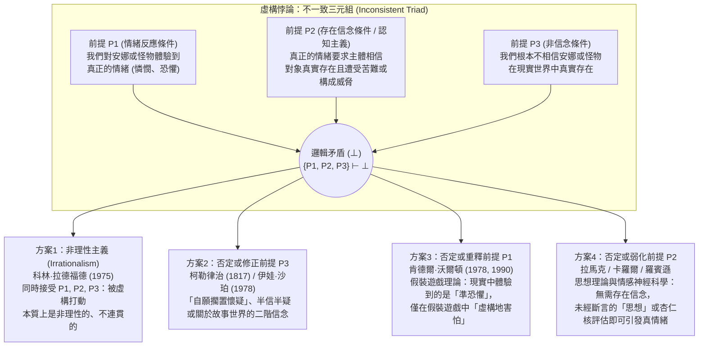

## 引言：奧古斯丁為狄多流下的眼淚與哈姆雷特的驚嘆

在日常生活中，我們頻繁經歷著一種既極其熟悉又在邏輯上令人費解的心理奇蹟。當我們讀到列夫·托爾斯泰的小說《安娜·卡列尼娜》結尾，走投無路的安娜在黃昏的火車站月台上縱身躍入飛馳的貨運列車車輪之下時，我們會感到胸口窒息、熱淚盈眶，心中湧起深切的憐憫與悲痛；當我們坐在午夜電影院的黑暗中，看到銀幕上一團綠色的黏液怪物（Green Slime）咆哮著撲向鏡頭時，我們的心率飆升、手心冒汗、全身肌肉緊繃。

然而，從理性心理學與認識論的角度來看，這種反應似乎包含著深刻的矛盾。任何心智正常的成年讀者都清楚地知道，安娜·卡列尼娜從未在十九世紀的俄國存在過，那場悲劇不過是托爾斯泰留在紙上的油墨印記；電影院裡的觀眾也百分之百地確信，銀幕上的綠色黏液只是光影的投射，絕不可能爬出銀幕吞噬自己。既然我們明知這些人物與怪物根本不存在，為什麼我們還會對它們產生如此真實、強烈的情緒反應？

這一謎題在西方思想史上迴盪了近兩千年。西元四世紀末，基督教教父<strong>奧古斯丁（Saint Augustine, 354–430）</strong>在《懺悔錄》（第三卷第二章）中痛切地回憶自己年輕時閱讀維吉爾史詩《埃涅阿斯紀》時，為因失戀而自殺的迦太基女王狄多（Dido）痛哭流涕，卻不為自己靈魂遠離上帝而落淚，他質問道：「還有什麼比這更荒謬的瘋狂呢？」約一千二百年後，<strong>威廉·莎士比亞（William Shakespeare）</strong>在《哈姆雷特》（第二幕第二場）中讓丹麥王子看著一位巡迴伶人演到特洛伊老王后<strong>赫卡柏（Hecuba）</strong>喪夫之痛時臉色蒼白、聲淚俱下，發出了千古名嘆：

> 「難道不令人驚駭嗎？這名演員不過是在虛構的故事裡（in a fiction），在一場激情的幻夢中，就能迫使自己的靈魂順從自己的想像，以至於臉色蒼白、熱淚盈眶、聲音哽咽……而這一切竟然都是為了烏有（all for nothing）！為了赫卡柏！<strong>赫卡柏對他算什麼，他對赫卡柏又算什麼，他竟為她痛哭流涕？（What's Hecuba to him, or he to Hecuba, / That he should weep for her?）</strong>」

1975年，英國分析哲學家<strong>科林·拉德福德（Colin Radford, 1935–2001）</strong>在《亞里斯多德學會會刊補編》上發表了里程碑式的論文<strong>《我們何以會被安娜·卡列尼娜的命運所打動？》（"How Can We Be Moved by the Fate of Anna Karenina?"）</strong>，將這一古老的困惑嚴格形式化為分析美學與心靈哲學的核心難題——<strong>「虛構悖論（The Paradox of Fiction）」</strong>。本文將系統剖析虛構悖論的邏輯結構、四大哲學解決方案、當代情感神經科學證據，以及它的姊妹難題——「悲劇悖論」「想像性阻抗」與「虛構對象的本體論」。

---

## 第一章：虛構悖論的邏輯結構——不一致三元組（Inconsistent Triad）

拉德福德指出，虛構悖論之所以構成嚴格的哲學悖論，是因為以下三個前提（$P_1, P_2, P_3$）各自都具有極強的直覺與理論說服力，但三者的合取卻直接導出邏輯矛盾（$\{P_1, P_2, P_3\} \vdash \bot$）：

### 前提 $P_1$：情緒反應條件（The Response Condition / 現象學事實）

> <strong>（$P_1$）我們對虛構的人物和事件確實體驗到真正的、字面意義上的對象指向性情緒（Genuine emotions，如憐憫、悲傷、恐懼、憤怒、欽佩等）。</strong>

當我們為安娜·卡列尼娜流淚，或被恐怖片中的怪物嚇得發抖時，我們並不是在逢場作戲或假裝難過。我們的眼淚與心跳加速具有完全真實的生理學與現象學質感。在日常語言與文學批評中，「我真心地同情安娜」「觀眾非常害怕那個怪物」被視為字面上為真的命題：$\text{Emotion}_E(S, X)$。

### 前提 $P_2$：情緒的存在信念條件（The Cognitive / Existence-Belief Condition）

> <strong>（$P_2$）主體 $S$ 若要對某個對象 $X$ 產生真正的對象指向性情緒 $E$，則 $S$ 必須相信 $X$ 真實存在，並且相信 $X$ 確實遭受了苦難或構成了威脅。</strong>

用量化認知邏輯可表示為：

$$\forall S \forall X \Big( \text{Emotion}_E(S, X) \implies \text{Bel}_S\big(\exists x (x = X \land \text{Eval}_E(x))\big) \Big)$$

這一前提植根於自<strong>亞里斯多德（《修辭學》）</strong>、<strong>斯賓諾莎（《倫理學》）</strong>直至當代<strong>羅伯特·所羅門（Robert Solomon）</strong>與<strong>瑪莎·努斯鮑姆（Martha Nussbaum）</strong>所捍衛的<strong>「情緒認知主義（Cognitivism about Emotions）」</strong>。情緒不同於無對象的「心境（Mood，如莫名的煩躁）」或單純的「身體感覺（Sensation，如胃痛）」，每一種情緒都具有<strong>意向性（Intentionality）</strong>和特定的<strong>形式對象（Formal Object）</strong>：憐憫要求認知上判斷對象正在遭受不應得的苦難；恐懼要求認知上判斷對象構成了迫在眉睫的危險。

拉德福德舉了一個極具說服力的例子：假設你的朋友神色慌張地告訴你，他的妹妹剛剛在高速公路上遭遇慘烈車禍，正在加護病房搶救。你聽後悲痛欲絕，對那個女孩充滿深切的憐憫。但下一秒，朋友哈哈大笑說：「騙你的！我根本沒有妹妹，剛才全是我編造的演技測試！」在你確信「那個妹妹根本不存在」的一瞬間，你對那個虛構妹妹的悲傷和憐憫立刻煙消雲散（雖然會轉化為對朋友惡作劇的憤怒）。如果得知真相後你仍然嚎啕大哭：「哪怕她不存在，我還是好心疼那個在車禍中流血的妹妹啊！」，所有人都會認為你喪失了理性。因此，真正的對象指向性情緒以<strong>存在信念（Existential Belief）</strong>為必要條件。

### 前提 $P_3$：非信念條件（The Non-Belief Condition）

> <strong>（$P_3$）心智正常的成年讀者與觀眾並不相信虛構的人物或怪物在現實中真實存在：$\neg \text{Bel}_S(\exists x (x = X))$。</strong>

這一點由我們的實際行動充分證明：無論讀者多麼同情安娜，都不會撥打莫斯科鐵路警察局的電話去救她；無論觀眾在影院裡多麼害怕綠色黏液怪物，都不會奪門而出或報警。

---

## 第二章：方案一與方案二——拉德福德的「非理性主義」與柯勒律治的「擱置懷疑」

### 1. 解決策略一：科林·拉德福德的非理性主義（Irrationalism）

在1975年的論文中，拉德福德逐一駁斥了各種消解方案，最終得出了一個驚世駭俗的結論：<strong>前提 $P_1, P_2, P_3$ 全部為真，因此人類對虛構作品產生情緒反應這一現象，本質上就是非理性的（irrational）、不連貫的（incoherent）和自相矛盾的！</strong> 他將其類比為人類的<strong>恐懼症（Phobia）</strong>：一個患有蜘蛛恐懼症的人在理智上百分之百知道玻璃瓶裡的無毒小蜘蛛絕對安全（$\neg \text{Bel}(\text{Danger})$），卻依然感到真實的驚恐（$P_1$）。

<strong>對非理性主義的批判</strong>：
當代美學家幾乎一致拒絕拉德福德的結論。首先，它犯了<strong>「規範性倒置（Normative Inversion）」</strong>的錯誤：恐懼症是一種需要心理治療克服的理性缺陷，而閱讀《安娜·卡列尼娜》或《李爾王》時產生深刻的同情與悲憫，卻被我們視為<strong>審美理解力、道德敏感性與情感成熟度的標誌</strong>。如果拉德福德是對的，那麼讀完《安娜·卡列尼娜》無動於衷、冷酷地說「她又不存在，有什麼好哭的」的人反而是最理性的楷模，這完全顛倒了審美規範。其次，恐懼症患者會失控逃跑，而恐怖片觀眾的行為控制力完好無損。

### 2. 解決策略二：否定前提 $P_3$——「自願擱置懷疑」與雙層信念

第二種傳統方案試圖否定前提 $P_3$。英國浪漫主義詩人<strong>塞繆爾·泰勒·柯勒律治（Samuel Taylor Coleridge）</strong>在1817年的《文學傳記》（第14章）中提出了著名的<strong>「那一刻自願擱置懷疑，從而構成詩性信仰（that willing suspension of disbelief for the moment, which constitutes poetic faith）」</strong>。如果觀眾在看戲時暫時擱置了「這是假戲」的懷疑，進入「半信半疑（Half-belief）」的幻覺狀態，那麼 $P_2$ 就得到了滿足。此外，哲學家<strong>伊娃·沙珀（Eva Schaper, 1978）</strong>提出了精緻的<strong>雙層信念論</strong>：我們雖然有一階信念「安娜在現實中不存在」，但同時擁有關於故事內容的真實二階信念「（在小說中）安娜因絕望而臥軌自殺」，正是這種二階信念引發了情緒。

<strong>為什麼否定 $P_3$ 會失敗？</strong>
1. <strong>信念的非自願性（Doxastic Involuntarism）</strong>：認識論表明，人可以憑意志自由地「想像」，但無法憑意志自由地開關「信念」。
2. <strong>行為不對稱性</strong>：哪怕觀眾只在一秒鐘內真正相信（或有10%的半信）銀幕上的食人黏液怪物是真的，他也會立刻尖叫著衝出電影院逃命或撥打報警電話。觀眾穩坐席間吃爆米花並欣賞鏡頭語言的事實，證明 $P_3$ 從未動搖。
3. <strong>沙珀方案的坍縮</strong>：相信「小說文本裡寫著安娜自殺」，只是相信一個關於文學文本的事實，並不是相信「現實中有一個活生生的人在受苦」（$P_2$ 的核心要求）。如果關於文本的信念就能引發真情緒，那實際上已經是放棄了 $P_2$。

---

## 第三章：方案三——肯德爾·沃爾頓的「假裝遊戲（Make-Believe）」與「準恐懼（Quasi-Fear）」

為了在不犧牲人類理性、同時嚴格保留前提 $P_2$（認知主義）與 $P_3$（非信念）的前提下解開悖論，密西根大學哲學家<strong>肯德爾·沃爾頓（Kendall L. Walton）</strong>在1978年的經典論文<strong>《害怕虛構之物》（"Fearing Fictions"）</strong>及1990年的巨著<strong>《作為假裝遊戲的摹仿》（*Mimesis as Make-Believe*）</strong>中，提出了震撼分析美學界的<strong>假裝遊戲理論（Make-Believe Theory）</strong>，透過精巧地<strong>否定並重構前提 $P_1$</strong> 解決了悖論。

### 1. 道具（Props）與假裝遊戲中的虛構真理

沃爾頓將兒童的<strong>假裝遊戲（Games of Make-Believe）</strong>作為理解一切表徵藝術（小說、繪畫、戲劇、電影）的基礎模型。設想兩個孩子在森林裡玩遊戲，約定「所有的樹樁都是熊」。在這裡，真實的樹樁是<strong>「道具（Props）」</strong>，遊戲的約定是<strong>「生成原則（Principles of Generation）」</strong>。只要某處有一個真實的樹樁，在該遊戲中「那裡有一頭熊」就是<strong>「虛構地真（Fictionally true，記作 $\mathcal{F}(\phi)$）」</strong>。

同樣，《安娜·卡列尼娜》的文本或恐怖片的銀幕，正是供成年欣賞者進行規範化假裝遊戲的<strong>高級道具</strong>。當我們欣賞作品時，我們不僅是在觀察「作品世界（Work World, $\mathcal{F}_W$）」，更是把自己也投射進了一個包含欣賞者自身在內的<strong>「欣賞者遊戲世界（Appreciator's Game World, $\mathcal{F}_G$）」</strong>。

### 2. 查爾斯與綠色黏液（Charles and the Green Slime）：真恐懼 vs. 準恐懼

沃爾頓設計了著名的思想實驗：<strong>查爾斯與綠色黏液</strong>。查爾斯正在看一部關於吞噬一切的綠色黏液怪物的恐怖片。當鏡頭裡的綠色黏液突然朝觀眾席方向猛撲過來時，查爾斯死死抓住扶手，心跳加速，冷汗直流，胃部緊縮。電影結束後，查爾斯說：「我剛才真的怕死那個黏液怪物了！」

沃爾頓提問：<strong>在現實世界中，查爾斯真的（字面意義上）害怕（literally fear）那個綠色黏液嗎？</strong>
沃爾頓回答：<strong>絕對沒有（$\neg P_1$）！</strong> 因為真正的恐懼包含兩個不可或缺的要素：（1）相信自己處於真實的危險中（$P_2$）；（2）產生逃跑或自衛的行為動機。查爾斯兩者皆無。

但是，查爾斯絕不是在演戲！他體驗到了一種完全真實的生理與現象學感受——心率飆升、腎上腺素分泌、肌肉緊繃與戰慄感。沃爾頓將這種剝離了「危險信念」與「逃跑動機」的純粹生理—情感喚醒狀態命名為<strong>「準恐懼（Quasi-fear）」</strong>（統稱<strong>「準情緒 Quasi-emotions」</strong>）。

沃爾頓理論最精彩的一步在於：
1. 銀幕上的畫面（外部道具）促使查爾斯在假裝遊戲中進行自我指涉的想像（*de se* imagination）：「綠色黏液正向我撲來！」
2. 這一生動的想像直接因果性地引發了查爾斯身體裡真實的<strong>準恐懼（Quasi-fear）</strong>。
3. 查爾斯體內真實的「準恐懼」感受本身，又作為第二個<strong>內部反身道具（Reflexive Prop）</strong>，在查爾斯的假裝遊戲世界中生成了一個虛構真理——<strong>「在假裝遊戲中，查爾斯真正害怕綠色黏液」</strong>：

$$\text{Imagine}_{\text{Charles}}(\text{Danger}) \xrightarrow{\text{因果引發}} \text{QuasiFear}(\text{Charles}) \xrightarrow{\text{作為道具生成}} \mathcal{F}_G\big(\text{LiteralFear}(\text{Charles}, \text{Slime})\big)$$

因此，在現實世界中查爾斯感受到的只是「準恐懼」（而非字面上的真恐懼，$\neg P_1$），而在假裝遊戲的世界裡他「虛構地感到真恐懼（$\mathcal{F}_G(\text{Fear})$）」。這就像父親假裝成怪獸追逐年幼的兒子，兒子尖叫著躲到沙發後：兒子知道父親不會傷害自己，他在現實中體驗著刺激的「準恐懼」，並在假裝遊戲中扮演「害怕怪獸的孩子」。（後來 <strong>Gregory Currie 1990</strong> 將這一機制發展為認知科學中的<strong>「離線心理模擬理論 Off-line Simulation Theory」</strong>）。

---

## 第四章：方案四——否定前提 $P_2$：「思想理論（Thought Theory）」與情感神經科學

沃爾頓的理論雖然精密絕倫，但遭到了許多哲學家的強烈反擊。批評者指出：當我們讀《安娜·卡列尼娜》或大屠殺題材小說而流下悲痛的眼淚時，說我們只是在玩「假裝自己很難過的遊戲（$\mathcal{F}_G(\text{Pity})$）」，不僅嚴重違背了我們的內省現象學體驗，而且閱讀第三人稱小說時我們根本沒有把自己投射到十九世紀的莫斯科火車站去當旁觀者！

因此，以<strong>彼得·拉馬克（Peter Lamarque, 1981）</strong>、<strong>諾埃爾·卡羅爾（Noël Carroll, 1990, 《恐怖的哲學》）</strong>、<strong>理查德·莫蘭（Richard Moran, 1994）</strong>、<strong>珍妮弗·羅賓遜（Jenefer Robinson, 2005）</strong>與<strong>塔瑪爾·根德勒（Tamar Szabó Gendler, 2008）</strong>為代表的陣營主張：<strong>前提 $P_1$（我們體驗到真正的情緒）是完全正確的，真正錯誤的罪魁禍首是前提 $P_2$（真正的情緒必須以存在信念為前提）！</strong>

### 1. 思想理論（Thought Theory）：未經斷言的命題思想足以引發真情緒

拉馬克與卡羅爾提出的<strong>「思想理論（Thought Theory）」</strong>指出：在現實生活中，真正的情緒完全不需要「斷言性存在信念（Assertoric Belief）」，僅僅在心靈中<strong>生動地懷想或表徵一個未經斷言的命題思想（Vividly entertaining an unasserted thought）</strong>，就足以因果性地引發字面意義上的真正情緒！

- <strong>懸崖思想實驗</strong>：你站在摩天大樓頂層堅固的鋼鐵護欄後面，百分之百相信自己絕對安全（$\neg \text{Bel}(\text{Danger})$）。但只要你在腦海中生動地想像（懷想這一思想）「自己身體前傾翻過護欄墜落深淵」的畫面，你就會立刻感到一陣真正的眩暈與恐懼，並本能地後退一步。
- <strong>厭惡思想實驗</strong>：只要在腦海中生動地想像咀嚼一嘴活蚯蚓的畫面，即使知道嘴裡什麼也沒有，也會立刻產生真正的<strong>厭惡感（Disgust）</strong>。

卡羅爾指出，當我們看恐怖片或讀《安娜·卡列尼娜》時，引發我們真正恐懼或真正憐憫的，正是文本與影像在我們心中構建的<strong>「思想內容（Thought-content）」</strong>。因為這種真正的情緒是由「思想/想像」而非「存在信念」引發的，所以它自然不會觸發「逃離電影院或報警」的行動程序！

### 2. 當代情感神經科學（杏仁核雙通路）與「Alief（類信念）」

21世紀的情感神經科學（如 <strong>Joseph LeDoux</strong> 的《情緒腦》）為否定前提 $P_2$ 提供了決定性的腦科學證據。人類大腦處理情緒刺激存在<strong>「雙通路（Two Roads）」</strong>：
1. <strong>皮質下快速通道（Low Road：視丘 $\to$ 杏仁核 Amygdala / 腦島 Insula）</strong>：視覺、聽覺或生動的想像表徵在十幾個毫秒內直接抵達演化上古老的杏仁核與鏡像神經元系統。<strong>杏仁核是「虛構盲（fiction-blind）」的</strong>——它根本沒有能力去做「這個對象在現實中是否存在」的本體論信念核查（Belief-checking），而是直接對表徵模式做出自動的情感評估（Affective Appraisal），立即啟動百分之百真實的恐懼或共情悲傷反應（證實 $P_1$，否定 $P_2$）。
2. <strong>前額葉慢速監控通道（High Road：視丘 $\to$ 前額葉皮質 PFC）</strong>：稍後，腹內側與背外側前額葉皮質完成語境評估：「我正坐在電影院裡，這只是虛構電影」（$P_3$）。前額葉隨後<strong>抑制運動皮質的逃跑指令</strong>，讓我們穩坐在座位上安全地進行審美體驗。

耶魯大學哲學家<strong>塔瑪爾·根德勒（Tamar Szabó Gendler, 2008）</strong>據此提出了著名的<strong>「Alief（類信念/聯結態）」</strong>概念：查爾斯在理性皮質中持有「黏液不存在」的顯性<strong>信念（Belief）</strong>，但生動的銀幕畫面激活了他底層自動的、聯結性的<strong>Alief</strong>（「危險黏液撲過來了！快害怕！快縮身！」）。

| 解決方案流派 | 否定的前提 | 代表哲學家 | 對虛構情緒的定性 | 為什麼觀眾不逃跑或報警？ | 核心優勢與主要缺陷 |
| :--- | :---: | :--- | :--- | :--- | :--- |
| <strong>1. 非理性主義</strong> (Irrationalism) | <strong>無</strong> (接受矛盾) | 科林·拉德福德 (1975) | 真正的字面情緒，但屬於類似恐懼症的非理性矛盾狀態。 | 理性信念 ($P_3$) 阻止了外部行動，但感性依然非理性地哭泣。 | 保留全部直覺，但將高尚的文學共情貶低為精神病理學上的恐懼症。 |
| <strong>2. 擱置懷疑論</strong> (Suspension of Disbelief) | <strong>否定 $P_3$</strong> | 柯勒律治 (1817) 伊娃·沙珀 (1978) | 由暫時幻覺、半信半疑或關於故事的二階信念引發的真情緒。 | 一階現實信念抑制行動，二階故事信念引發情緒。 | 符合沉浸感直覺，但信念無法憑意志開關，且半信危險也會導致逃跑。 |
| <strong>3. 假裝遊戲理論</strong> (Make-Believe Theory) | <strong>否定 $P_1$</strong> | 肯德爾·沃爾頓 (1978, 1990) 格雷戈里·柯里 (1990) | 現實中僅體驗生理性的<strong>「準恐懼（Quasi-fear）」</strong>，在假裝遊戲中虛構地害怕 ($\mathcal{F}_G$)。 | 缺乏危險信念與字面真恐懼，心理模擬處於「離線（off-line）」狀態。 | 完美調和認知主義與行為控制，但將深沉的悲劇眼淚視為「假裝遊戲」顯得矯揉造作。 |
| <strong>4. 思想理論與神經科學</strong> (Thought Theory) | <strong>否定 $P_2$</strong> | 彼得·拉馬克 (1981) 諾埃爾·卡羅爾 (1990) 珍妮弗·羅賓遜 (2005) 塔瑪爾·根德勒 (2008) | 由未經斷言的<strong>命題思想（Thought）</strong>或皮質下<strong>Alief</strong>直接引發的<strong>真正情緒</strong>。 | 前額葉皮質的現實監控 ($P_3$) 抑制了運動逃跑輸出。 | 完全契合日常內省直覺與當代腦神經科學（杏仁核雙通路模型）。 |

---

## 第五章：美學的姊妹難題——「悲劇悖論」「想像性阻抗」與「虛構對象本體論」

### 1. 悲劇與恐怖悖論（The Paradox of Tragedy and Horror）

虛構悖論追問的是「我們<strong>如何可能</strong>對虛構之物產生悲傷與恐懼」，而<strong>悲劇悖論</strong>追問的則是動機與享樂價值：<strong>「既然悲傷、憐憫與恐懼在現實中是令人痛苦的負面情緒，為什麼我們卻主動花錢去閱讀悲劇、觀看恐怖片，並從中獲得深刻的審美快感？」</strong>
- <strong>亞里斯多德的「卡塔西斯（Katharsis / 淨化與宣洩）」說（《詩學》第六章）</strong>：悲劇透過引發憐憫與恐懼，使這類積鬱的情感得到安全的宣洩與理性的陶冶校準。
- <strong>大衛·休謨的「轉化說（Conversion Theory）」</strong>（1757年論文《論悲劇》*"Of Tragedy"*）：休謨提出，藝術家的雄辯、詩歌韻律之美與精湛的摹仿技藝激發了佔主導地位的「審美快感」，這種主導快感奪取了悲劇事件所引發的痛苦情緒能量（動物精氣的悸動），並將其<strong>全部轉化（convert）為審美愉悅</strong>，從而極大增強了整體快感。
- <strong>蘇珊·費金（Susan Feagin, 1983）的「元反應（Meta-Response）」說</strong>：我們對安娜之死的一階直接反應確實是痛苦的，但我們在二階「元反應」中為自己擁有同情他人苦難的道德人性而感到欣慰與自豪。
- <strong>諾埃爾·卡羅爾（Noël Carroll, 1990）的「認知好奇心（Cognitive Curiosity）」說</strong>：恐怖片中的怪物打破了常規分類範疇（如生與死的邊界），激發了人類強烈的認知探索欲，恐懼的生理喚醒是我們為滿足敘事好奇心而支付的代價（或興奮放大器）。

### 2. 想像性阻抗（Imaginative Resistance：休謨、沃爾頓、根德勒）

由休謨在《論趣味的標準》（1757）末尾首次指出，並由<strong>沃爾頓（1994）</strong>與<strong>塔瑪爾·根德勒（Tamar Szabó Gendler, 2000）</strong>深入剖析的<strong>「想像性阻抗」</strong>揭示了一個驚人的不對稱：作者擁有設定物理不可能性的絕對權威（如果作者寫「在這個世界裡巨龍會噴火、時間會倒流」，讀者會毫不費力地欣然想像）；但如果作者試圖設定一個<strong>扭曲的道德真理</strong>——例如沃爾頓著名的單句小說：

> <strong>「在殺死自己的嬰兒這件事上，吉塞爾達做得完全正確；畢竟，那是個女嬰（In killing her baby, Giselda did the right thing; after all, it was a girl）。」</strong>

讀者的想像力會立刻撞上一堵高牆！我們可以想像吉塞爾達所在的原始部落迷信地認為殺女嬰是對的，但我們<strong>絕無法（或堅決拒絕）想像「僅僅因為是女嬰就將其殺害在客觀道德上真的是高尚正確的」</strong>！沃爾頓認為這是因為道德屬性概念性地<strong>隨附（Supervene）</strong>於自然事實之上（「不能想像 Can't」）；而根德勒則指出，這是因為道德評價具有高度的跨界滲透性，讀者為了防止虛構的邪惡價值觀「污染（Contagion）」自己現實中的道德人格，主動拒絕（「不願想像 Won't」）執行作者的想像指令。

### 3. 虛構對象的本體論（Ontology of Fictional Entities）

當我們說「我同情安娜·卡列尼娜」時，「安娜·卡列尼娜」在本體論上究竟是什麼？
1. <strong>邁農主義（Meinongianism — Alexius Meinong, Terence Parsons, Edward Zalta）</strong>：主張存在一個由「不存在的對象（Non-existent objects）」構成的領域，安娜作為編碼了小說中各項屬性的抽象或具體非存在對象客觀存在。
2. <strong>反實在論的假裝語義學（Anti-Realist Pretense — Kendall Walton）</strong>：根本不存在任何虛構對象；談論安娜只是在托爾斯泰小說這一道具規範的假裝遊戲中進行假裝斷言。
3. <strong>人工物本體論（Artifactual Theory — Saul Kripke, Peter van Inwagen, Amie Thomasson 1999《虛構與形上學》）</strong>：當代最主流的溫和實在論立場。<strong>艾米·托馬森（Amie Thomasson）</strong>指出，正如「法律」「交響樂」「國際象棋規則」一樣，虛構角色是作者在特定歷史時刻透過書寫行為創造出來的<strong>「抽象文化人工物（Abstract Cultural Artifacts）」</strong>。它們真實存在於人類文化世界中，依賴文本與讀者共同體而延續。因此，「安娜·卡列尼娜由托爾斯泰於1870年代創造，並受到全球讀者的深切同情」在字面意義上是完全為真的！

---

## 結語：作為人性實驗室的情感想像力

從科林·拉德福德1975年的詰問到肯德爾·沃爾頓的假裝遊戲理論，再到當代情感神經科學的雙通路模型，關於「虛構悖論」的半世紀求索向我們揭示：我們為安娜·卡列尼娜流下的眼淚，既不是精神病理學上的非理性故障，也不是喪失現實感的幻覺。正是因為人類擁有<strong>情感想像力（Emotional Imagination）</strong>——能夠在前額葉現實監控的安全保護下，借助文學與藝術道具進行深度的心理模擬，讓皮質下共情系統對「假如如此（What if）」的他者命運產生真實的情感共鳴——我們才得以超越狹隘的自我中心，理解未曾親歷的苦難，並在虛構這一最深邃的「靈魂實驗室」中不斷拓展人性的疆界。
