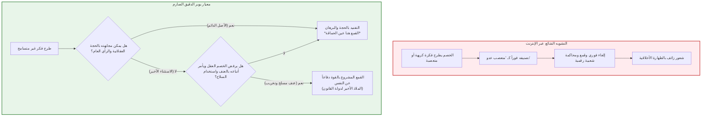

## مقدمة: المعضلة التي تنخر المجتمعات الحرة من الداخل

في الفكر المدني المعاصر، لا توجد فضيلة تحظى بإجماع وتبجيل عالمي — وفي الوقت ذاته تتسم بالهشاشة وتحفل بالتناقضات الذاتية العميقة — مثل فضيلة **التسامح (Tolerance)**.

إن السماح بالتعبير عن سائر الآراء، واحتواء القناعات المتباينة، والامتناع التام عن إقصاء المعارض بالعنف: كان هذا هو الإنجاز الأسمى الذي بنته حركة التنوير والديمقراطية الليبرالية بعد قرون من الحروب المذهبية الدامية. غير أننا في الفضاء الرقمي للقرن الحادي والعشرين نواجه حقيقة مقلقة؛ ففي ساحة عامة مفتوحة للجميع دون قيود، تنتشر خطابات الكراهية، والتطرف، ونظريات المؤامرة التي تنتهك الكرامة الإنسانية بضراوة بالغة، متخذة من "حرية التعبير" و"التسامح" دروعاً لتدمير بنية المجتمع الحر نفسه من الداخل.

من هنا تنبثق المعضلة الفلسفية الكبرى المعروفة باسم **«مفارقة التسامح» (Paradox of Tolerance)**:

> **«هل يتعين على المجتمع المتسامح أن يظل متسامحاً بلا حدود حتى مع أولئك الذين يسعون جهاراً إلى تدميره واجتثاث التسامح ذاته؟»**
> 
> **«إذا أسبغنا تسامحاً مطلقاً على غير المتسامحين، فإن المجتمع سينتهي إلى السقوط في قبضة التعصب وتفنى الحرية برمتها. ولكن، إذا قمعنا غير المتسامحين ونبذناهم، ألا ينحدر مجتمعنا ذاته إلى نظام سلطوي واستبدادي غير متسامح؟»**

إن هذه المفارقة ليست ترفاً نظرياً؛ فقد انهارت جمهورية فايمار في ثلاثينيات القرن العشرين، رغم امتلاكها أحدث دستور ديمقراطي آنذاك، عندما استغل النازيون الحريات العامة للقضاء على الديمقراطية بآليات دستورية. واليوم، يعاني الفضاء الرقمي من تشويه مخل؛ إذ تنتشر رسوم هزلية تنسب لكارل بوبر مقولة شائهة تزعم أنه **«يحق إسكات وقمع وإلغاء كل رأي نعتبره غير متسامح»**. وقد أدى ذلك إلى نشوء **«تعصب مضاد (Meta-Intolerance)»**، حيث يُصنف أي رأي مخالف على أنه "تعصب" يستوجب الإعدام المعنوي.

يقدم هذا البحث تفكيكاً دقيقاً للنصوص الأصلية لكارل بوبر، وجون رولز، والقانون الدستوري الألماني لحماية المجتمع المفتوح.

---

## الفصل الأول: تحذير كارل بوبر وفضيحة التشويه عبر الإنترنت

### 1.1 السياق التاريخي لكتاب «المجتمع المفتوح وأعداؤه»

صاغ الفيلسوف النمساوي البريطاني كارل بوبر (1902–1994) هذه المفارقة في كتابه الصادر عام 1945 *«المجتمع المفتوح وأعداؤه»*. بعد فراره من النمسا إثر التهديد النازي، حذر بوبر من الفلسفات الشمولية التي تضحي بالفرد من أجل غايات تاريخية حتمية، داعياً إلى مجتمع مفتوح يرتكز على العقلانية النقدية وقابلية الخطأ.

### 1.2 التحليل الدقيق لنص الحاشية رقم 4 (الفصل السابع)

تتوقف المنشورات الشائعة عند عبارته: *"التسامح اللامحدود يجب أن يؤدي إلى اندثار التسامح"*. لكن بوبر استطرد بحزم ومسؤولية قائلاً:

> **«إنني لا أعني بهذا التعبير، على سبيل المثال، أنه يجب علينا دائماً قمع الجهر بالفلسفات غير المتسامحة؛ فطالما أننا قادرون على مجابهتها بالحجج العقلانية وإبقائها تحت السيطرة بواسطة الرأي العام، فإن القمع سيكون بالتأكيد عين الحماقة (most unwise).»**

إن بوبر لم يجز القمع إلا في حالة استثنائية محددة بدقة: **حين يرفض الخصم الحوار العقلاني تماماً، ويعتبر التفكير خدعة، ويوجه أتباعه للرد على الحجج بـ "القبضات والمسدسات"**.

---

## الفصل الثاني: جون رولز ونظرية العدالة

في كتابه *«نظرية العدالة»* (1971)، أرسى جون رولز قاعدة أن المجتمع العادل ملزم **بالتسامح مع غير المتسامحين** طالما كانت المؤسسات الدستورية مستقرة. فالحياة في ظل دستور حر تمارس قوة استيعابية تجعل الجماعات الراديكالية تعتدل وتكتسب ولاءً تدريجياً للديمقراطية. ولا يُسوغ تقييد الحرية إلا عند وجود **خطر داهم ووشيك يهدد مؤسسات الحرية ذاتها**.

---

## الفصل الثالث: «الديمقراطية المقاتلة» في القانون الأساسي الألماني

تعلمت ألمانيا من سقوط فايمار ألا تقف الديمقراطية مكتوفة الأيدي، فأسست في دستور بون (1949) مبدأ **«الديمقراطية المقاتلة» (Streitbare Demokratie)**:
1. **المادة 79 (الفقرة 3) [البند الأبدي]**: حظر تعديل مبادئ الكرامة الإنسانية والنظام الديمقراطي الفيدرالي.
2. **المادة 21 (الفقرة 2)**: حصر حق حظر الأحزاب المناهضة للنظام الديمقراطي الحر بالمحكمة الدستورية الاتحادية.

---

## الفصل الرابع: النموذج الأمريكي: التعديل الأول وسوق الأفكار

يرتكز النموذج الأمريكي على تقاليد جون ستيوارت ميل (*عن الحرية*، 1859). وفي قضية **_براندنبورغ ضد أوهايو_ (1969)**، قضت المحكمة العليا الأمريكية بأنه لا يجوز تجريم أي خطاب إلا إذا كان **يحرض بشكل مباشر ومحدد على عمل غير قانوني وشيك ويحتمل جداً أن يؤدي إليه**. فالخوف من منح الدولة سلطة الرقابة يفوق بكثير الخوف من الأفكار الكريهة.

---

## الفصل الخامس: الفضاء الرقمي، ثقافة الإلغاء ورقابة الذكاء الاصطناعي

حولت خوارزميات منصات التواصل الاجتماعي النقاش العقلاني إلى ساحة للغضب الأخلاقي والاستقطاب. وأصبحت **ثقافة الإلغاء** محكمة تفتيش رقمية تخرس المعارضين باسم التسامح.

كما تفرض نماذج الذكاء الاصطناعي الكبرى (LLMs) رقابة خفية عبر تقنيات المواءمة (RLHF)، مما ينذر بنظام **أورويلية رقمية** يمحو الأفكار المغايرة من جذورها.

---

## الخلاصة: نحو تسامح يقظ في القرن الحادي والعشرين

إن التسامح الحقيقي ليس تراخياً، بل شجاعة فكرية تقتضي:
1. **دحض الأفكار السامة بالبرهان العقلي** لا بالرقابة المذعورة؛
2. **حصر القمع القانوني في مواجهة العنف المسلح الداهم**؛
3. **رفض ثقافة الإلغاء والمحاكم التفتيشية الرقمية**.
