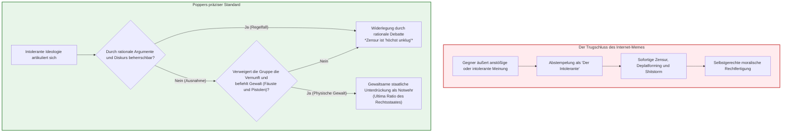
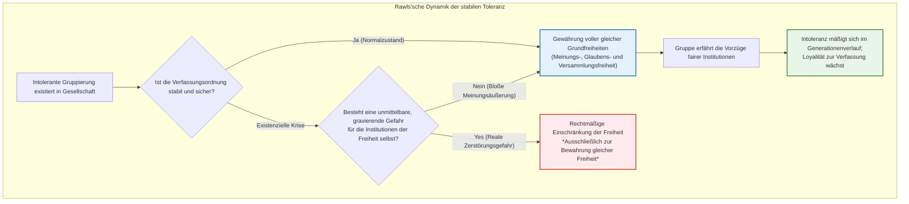
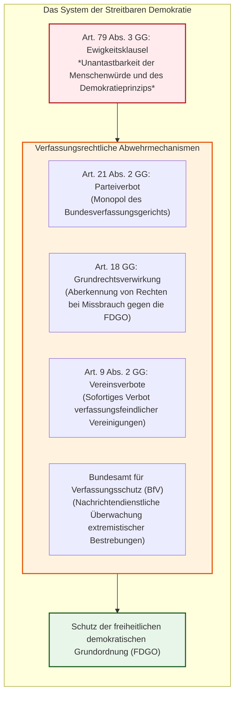
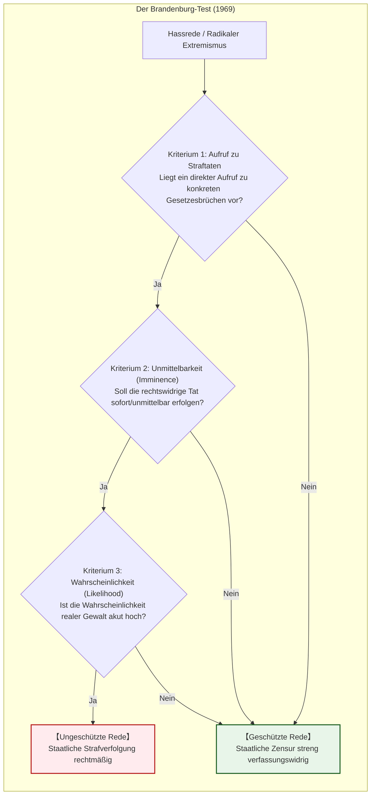
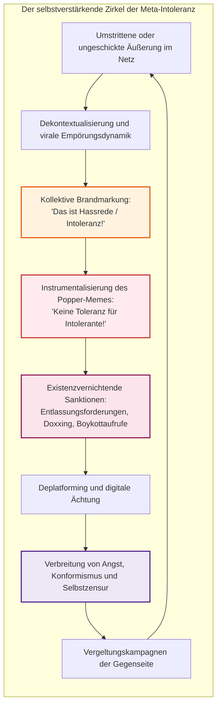

## Einleitung: Die Aporie, die freie Gesellschaften von innen aushöhlt

Im zeitgenössischen gesellschaftlichen Diskurs gibt es kaum eine Tugend, die so universell gepriesen wird – und die gleichzeitig so zerbrechlich und voller existenzieller Selbstwidersprüche ist – wie die **Toleranz**.

Jede Meinungsäußerung zuzulassen, abweichende Weltanschauungen zu integrieren und niemals den Dissidenten gewaltsam auszustoßen: Dies galt als die erhabenste Errungenschaft, die Aufklärung und liberale Demokratie nach Jahrhunderten blutiger Religionskriege erkämpft hatten. Doch im digitalen Informationsraum des 21. Jahrhunderts sehen wir uns einer zutiefst beunruhigenden Realität gegenüber. In einer bedingungslos geöffneten Öffentlichkeit vermehren sich Fremdenfeindlichkeit, radikale Verschwörungsmythen, totalitäre Propaganda und menschenverachtende Hetze mit beispielloser Wucht. Schlimmer noch: Diese antiliberalen Kräfte instrumentalisieren die Schutzschilde von „Meinungsfreiheit“ und „Toleranz“, um das Fundament der freien Ordnung von innen heraus zu zerstören.

Hieraus erwächst das fundamentale Dilemma, das als **Toleranz-Paradoxon (Paradox of Tolerance)** bekannt ist:

> **„Muss eine tolerante Gesellschaft selbst jenen gegenüber unbegrenzt tolerant bleiben, die ihre offene Zerstörung anstreben?“**
> 
> **„Wenn wir den Intoleranten unbegrenzte Toleranz gewähren, wird die Gesellschaft unweigerlich von der Intoleranz überwältigt und die Freiheit selbst erlischt. Wenn wir jedoch die Intoleranten verbieten und ausgrenzen, verfällt die Gesellschaft dann nicht selbst in eine intolerante Tyrannei?“**

Dieses Dilemma ist kein theoretisches Gedankenspiel. Historisch gesehen besaß die Weimarer Republik der 1930er Jahre die damals fortschrittlichste demokratische Verfassung der Welt; dennoch nutzten die Nationalsozialisten deren liberale Wahl- und Meinungsfreiheiten skrupellos aus, um das demokratische System auf formal legalem Wege zu beseitigen. Heute, von den Debatten um Hate-Speech-Gesetze über die Schauprozesse der „Cancel Culture“ bis hin zur algorithmischen Zensur durch Big-Tech-Konzerne und Künstliche Intelligenz, markiert dieses Paradoxon die Bruchlinien unserer zerrissenen Gesellschaft.

Doch im Netz kursiert heute eine verhängnisvolle intellektuelle Karikatur dieses Problems: Ein vereinfachtes Comic-Meme unter Berufung auf Karl Popper suggeriert den vermeintlichen Freifahrtschein, **„jede als intolerant empfundene Meinung sofort mundtot zu machen, zu canceln und auszustoßen.“** Dies hat zu einer grassierenden **„Meta-Intoleranz“** geführt: Unter dem moralischen Banner der Vielfalt wird jeder abweichende Diskursbeitrag als „intolerant“ stigmatisiert und mit inquisitorischer Härte verfolgt.

Dieser Essay dekonstruiert diese vulgäre Verharmlosung und analysiert die historische, rechtsphilosophische und informationstheoretische Tiefe des Toleranz-Paradoxons in aller Gründlichkeit.

---

## Kapitel 1: Karl Poppers Warnung und der Trugschluss des Internet-Memes

### 1.1 Historischer Kontext: Zwischen Faschismus und Stalinismus

Das Toleranz-Paradoxon geht direkt auf den österreichisch-britischen Philosophen Karl Raimund Popper (1902–1994) und sein 1945 veröffentlichtes Meisterwerk *Die offene Gesellschaft und ihre Feinde (The Open Society and Its Enemies)* zurück.

Popper, der aufgrund seiner jüdischen Herkunft 1937 vor dem drohenden Nazi-Terror nach Neuseeland emigriert war, erlebte mit Erschütterung, wie der Nationalsozialismus und der sowjetische Stalinismus die europäische Zivilisation verwüsteten. In seinem Werk entlarvte er die Denkmuster von Platon, Hegel und Marx, die im Namen historischer Gesetzmäßigkeiten die Unterdrückung des Individuums rechtfertigten. Dem setzte Popper die „Offene Gesellschaft“ entgegen – gegründet auf kritischer Vernunft, Fehlbarkeit (Fallibilismus) und dem ständigen friedlichen Wettstreit der Argumente.

### 1.2 Präzise Exegese: Kapitel 7, Fußnote 4

Popper formulierte das Paradoxon nicht im Haupttext, sondern in einer scheinbar beiläufigen Anmerkung: **Kapitel 7, Fußnote 4**.

> *„Uneingeschränkte Toleranz muss zum Verschwinden der Toleranz führen. Wenn wir die unbeschränkte Toleranz sogar auf jene ausdehnen, die intolerant sind, wenn wir nicht bereit sind, eine tolerante Gesellschaftsordnung gegen die Angriffe der Intoleranz zu verteidigen, dann werden die Toleranten vernichtet werden und mit ihnen die Toleranz.“*

Das Internet zitiert fast ausnahmslos diesen ersten Satz. Doch Poppers entscheidende methodische Eingrenzung folgt unmittelbar danach:

> *„Damit möchte ich nicht sagen, dass wir z. B. intolerante Philosophien immer unterdrücken sollten; solange wir ihnen durch rationale Argumente entgegentreten können und sie durch die öffentliche Meinung in Schranken gehalten werden, wäre ihre Unterdrückung gewiss höchst unklug.“*

Popper betont ausdrücklich: **Unterdrückung ist höchst unklug**, solange rationale Gegenargumente und öffentliche Kritik greifen. Erst wenn die Gegenseite den Boden der Vernunft willkürlich verlässt, greift das Notwehrrecht:

> *„Wir sollten für uns das Recht in Anspruch nehmen, sie, wenn nötig, selbst mit Gewalt zu unterdrücken; denn es kann sich leicht herausstellen, dass sie nicht bereit sind, mit uns auf der Ebene rationaler Argumentation zusammenzutreffen, sondern jedes Argument von vornherein verwerfen; sie können ihren Anhängern verbieten, auf rationale Argumente zu hören, weil diese täuschend seien, und ihnen beibringen, Argumente mit der Verwendung ihrer Fäuste oder Pistolen zu beantworten.“*

> [!WARNING]
> **Die Gefahr des Vulgär-Popperismus**
> Poppers Konzept war eine Notbremse gegen bewaffnete faschistische Schlägertrupps, die den Diskurs physisch vernichteten. Wer daraus eine Rechtfertigung bastelt, um unliebsame Meinungen im Internet sozial hinzurichten, pervertiert Poppers Philosophie in ihr genaues Gegenteil.

---

## Kapitel 2: John Rawls: Gerechtigkeitstheorie und institutionelle Einbindung

### 2.1 Die zwei Grundsätze der Gerechtigkeit und der Schleier des Nichtwissens

In seinem monumentalen Werk *A Theory of Justice* (1971) hob John Rawls (1921–2002) das Paradoxon auf das Niveau der Verfassungstheorie. Unter dem **Schleier des Nichtwissens (Veil of Ignorance)** einigen sich rationale Akteure auf den **Vorrang gleicher Grundfreiheiten (Erster Gerechtigkeitsgrundsatz)**, der jedem utilitaristischen Nützlichkeitskalkül übergeordnet ist.

### 2.2 Paragraph 35: Duldung der Intoleranten

In § 35 fragt Rawls, ob eine gerechte Gesellschaft intolerante Sekten dulden muss:
1. **Haben Intolerante ein Recht auf Klage?** Nein, denn wer anderen keine Freiheit gewährt, kann sich nicht logisch auf Gerechtigkeitsprinzipien berufen.
2. **Muss die gerechte Gesellschaft sie dennoch dulden?** **Ja.** Die gerechte Ordnung misst sich nicht an der Gesinnungsethik ihrer Bürger, sondern an ihren objektiven Institutionen. Solange die Verfassungsordnung stabil ist, gebietet die Gerechtigkeit, auch Intoleranten uneingeschränkte Rede-, Versammlungs- und Gewissensfreiheit zu garantieren.
3. **Die integrative Kraft gerechter Institutionen**: Rawls betont, dass Menschen, die im Schutz einer freien Verfassung leben, im Laufe der Zeit deren Vorzüge anerkennen und ihre eigene Intoleranz mäßigen.

### 2.3 Spieltheoretische Modellierung: Die Auszahlungsmatrix der Toleranz

Die Interaktion zwischen toleranten Bürgern (Spieler A) und intoleranten Akteuren (Spieler B) lässt sich spieltheoretisch als wiederholtes Gefangenendilemma darstellen:

| Spieler A / Spieler B | Kooperieren / Tolerant ($C$) | Defektieren / Intolerant ($D$) |
| :--- | :---: | :---: |
| **Kooperieren / Tolerant ($C$)** | $(3, 3)$ : Blühende Offene Gesellschaft | $(0, 5)$ : Ausbeutung / Totalitäre Machtübernahme |
| **Defektieren / Repression ($D$)** | $(5, 0)$ : Präventive Unterdrückung | $(1, 1)$ : Polizeistaatlicher Dauerkonflikt |

Die mathematisch stabile evolutionäre Strategie (ESS) ist Robert Axelrods **Tit-for-Tat**: Prinzipielle Kooperation (Toleranz), sofortige und unnachgiebige Sanktion bei Bruch der Spielregeln (Gewalt/Umsturz), und sofortige Rückkehr zur Kooperation, sobald der Regelbrecher die Verfassung anerkennt.

---

## Kapitel 3: Das institutionalisierte Paradoxon: Die Streitbare Demokratie des Grundgesetzes

### 3.1 Das Trauma von Weimar: Der legale Selbstmord der Demokratie

Das Toleranz-Paradoxon wurde nirgends so grausam Realität wie beim Zusammenbruch der Weimarer Republik (1919–1933). Das Grundübel der Weimarer Verfassung war ihr **wertrelativer Rechtspositivismus**: Jedes Gesetz und jede Verfassungsänderung galt als legitim, solange formale parlamentarische Mehrheiten existierten – selbst die Selbstabschaffung der Demokratie.

Joseph Goebbels höhnte 1935:
> *„Das wird immer einer der besten Witze der Demokratie bleiben, dass sie ihren Todfeinden die Mittel selber stellte, durch die sie vernichtet wurde.“*

### 3.2 Karl Loewensteins Konzept der wehrhaften Demokratie

Der deutsch-jüdische Staatsrechtler Karl Loewenstein (1891–1973) forderte 1937 im US-Exil die Abkehr von naiver Passivität. Eine Demokratie dürfe nicht wehrlos zusehen, wie Faschisten die Verfassungsmechanismen kapern; sie müsse sich zur **„Streitbaren Demokratie“ (Militant Democracy)** aufrüsten.

### 3.3 Das Schutzsystem des Grundgesetzes (1949)

Das Grundgesetz für die Bundesrepublik Deutschland zog daraus radikale Konsequenzen:

1. **Art. 79 Abs. 3 GG (Ewigkeitsklausel)**: Eine völkerrechtliche und staatsrechtliche Einzigartigkeit: Selbst eine parlamentarische Mehrheit von 100% kann die Grundsätze der Menschenwürde (Art. 1) und der Demokratie (Art. 20) niemals legal abschaffen.
2. **Art. 21 Abs. 2 GG (Parteiverbot)**: Das Bundesverfassungsgericht in Karlsruhe besitzt das alleinige Monopol, Parteien zu verbieten, die darauf ausgehen, die freiheitliche demokratische Grundordnung zu beeinträchtigen oder zu beseitigen.
3. **Art. 18 GG (Grundrechtsverwirkung)**: Wer Freiheitsrechte zum Kampf gegen die Verfassung missbraucht, kann dieser Rechte gerichtlich verlustig erklärt werden.

### 3.4 Von SRP und KPD bis zum NPD-Urteil und der AfD-Debatte

Nach den Verboten der nationalsozialistischen **SRP** (1952) und der kommunistischen **KPD** (1956) präzisierte das Verfassungsgericht 2017 im zweiten **NPD-Verfahren** die Kriterien: Es führte das Kriterium der **„Potentialität“** ein. Eine Partei wird nur verboten, wenn konkrete Anhaltspunkte dafür vorliegen, dass ihr verfassungsfeindliches Handeln auch Aussicht auf Erfolg hat.

Die gegenwärtige Auseinandersetzung um die **Alternative für Deutschland (AfD)** veranschaulicht das immanente Risiko: Verbietet ein Staat eine Partei mit Millionen Wählern, riskiert er, die Demokratie im Namen ihrer Verteidigung unheilbar zu delegitimieren und den gesellschaftlichen Konflikt in den gewaltsamen Untergrund zu drängen.

---

## Kapitel 4: Der US-amerikanische Ansatz: Der Erste Verfassungszusatz und der „Marktplatz der Ideen“

### 4.1 J.S. Mills *Über die Freiheit*: Der epistemische Wert des Irrtums

Im diametralen Gegensatz zum deutschen Präventionsstaat steht die US-Doktrin, geprägt von John Stuart Mills Werk *On Liberty* (1859). Mill betonte, dass selbst falsche und verletzende Meinungen geschützt werden müssen: Ohne ständigen Widerspruch erstarrt selbst die heiligste Wahrheit zu einem toten Dogma.

### 4.2 Die Brandenburg-Doktrin des US Supreme Court

Der Erste Verfassungszusatz (*First Amendment*) verbietet dem Kongress jegliche Zensurgesetze. Im historischen Urteil **_Brandenburg v. Ohio_ (1969)** legte der Oberste Gerichtshof die Messlatte für Zensur extrem hoch:

Staatliche Bestrafung ist nur zulässig bei Rede, die **unmittelbar bevorstehende gesetzwidrige Handlungen herbeiführt und dies mit hoher Wahrscheinlichkeit tut**. Selbst Nazi-Märsche in überwiegend von Holocaust-Überlebenden bewohnten Orten (Skokie-Fall, 1977) wurden durch den First Amendment geschützt. Dahinter steht das zutiefst amerikanische Misstrauen gegenüber dem Staat: Wer der Regierung die Macht gibt, „Intoleranz“ zu definieren, schafft die Infrastruktur künftiger Tyrannei.

---

## Kapitel 5: Der digitale Strukturwandel und die Explosion der Meta-Intoleranz

### 5.1 Zerfall der Habermas'schen Diskursethik

Jürgen Habermas postulierte das Ideal einer **herrschaftsfreien deliberativen Öffentlichkeit**, in der das „bessere Argument“ zwanglos triumphiert.

Die Ökonomie der modernen Social-Media-Plattformen hat diese Utopie vernichtet. Algorithmen belohnen nicht Differenzierung, sondern **moralische Empörung, Wut und Stammesdenken**. Der digitale Raum belohnt Extreme und bestraft Nuancen.

### 5.2 Cancel Culture als inquisitorischer Zirkel

Das Phänomen der Cancel Culture offenbart eine tragische Perversion: Die Verfolger wähnen sich im Besitz absoluter moralischer Reinheit. Doch indem sie Abweichler ohne faires Verfahren beruflich und sozial vernichten, etablieren sie genau jene totalitäre Intoleranz, die sie vorgeben zu bekämpfen.

---

## Kapitel 6: Künstliche Intelligenz und algorithmische Zensur

### 6.1 LLM-Alignment und unsichtbare Zensur

Durch Methoden wie **RLHF (Reinforcement Learning from Human Feedback)** programmieren Tech-Konzerne Wertvorstellungen in moderne Sprachmodelle ein. Dies führt zu einer beispiellosen Machtkonzentration: Ein kleines Konsortium privater Tech-Eliten im Silicon Valley entscheidet im Verborgenen, welche Meinungen als „toxisch“ gelten und vorab unterdrückt werden.

Wer das Monopol über die Algorithmen besitzt, kontrolliert die Grenzen des Denkbaren. George Orwells Albtraum einer künstlich beschnittenen Sprache (*Neusprech*) droht durch scheinbar wohlwollende KI-Sicherheitsleitplanken Realität zu werden.

---

## Kapitel 7: Fazit: Wachsame Toleranz für das 21. Jahrhundert

Echte Toleranz ist keine feige Gleichgültigkeit. Sie ist eine anspruchsvolle, kämpferische Geisteshaltung:
1. **Meinungsstreit statt Zensur**: Beleidigende oder abwegige Thesen müssen auf dem Marktplatz der Ideen argumentativ zerschlagen werden.
2. **Rechtsstaatliche Strenge**: Physische Gewalt und verfassungsfeindliche Umsturzversuche müssen mit der vollen Härte des Rechtsstaates und unter strenger richterlicher Kontrolle geahndet werden.
3. **Widerstand gegen die digitale Inquisition**: Wir dürfen Popper nicht als Ausrede missbrauchen, um abweichende Stimmen im digitalen Scherbengericht mundtot zu machen.

Eine Offene Gesellschaft überlebt nicht, indem sie sich in eine geschlossene Zensuranstalt verwandelt, sondern indem sie den Mut aufbringt, das Wagnis der Freiheit täglich neu zu bestehen.
