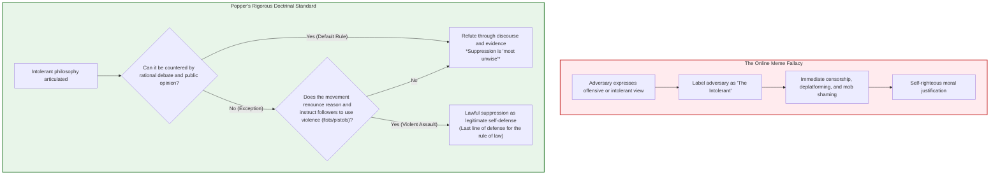
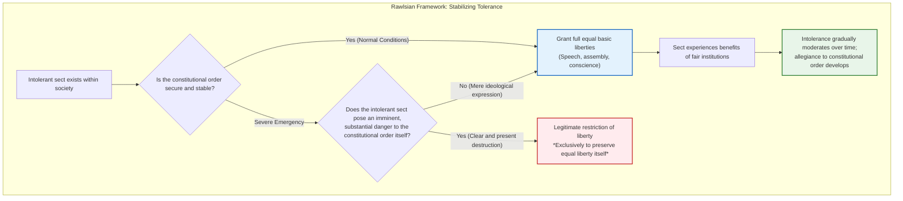
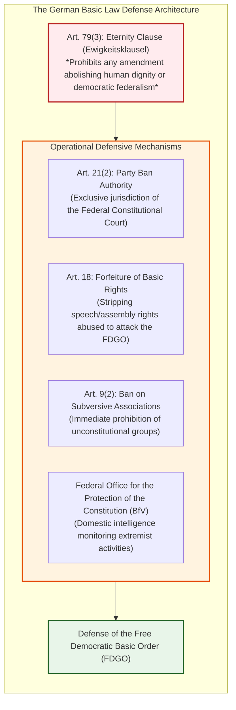
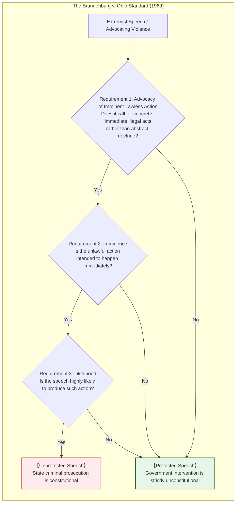
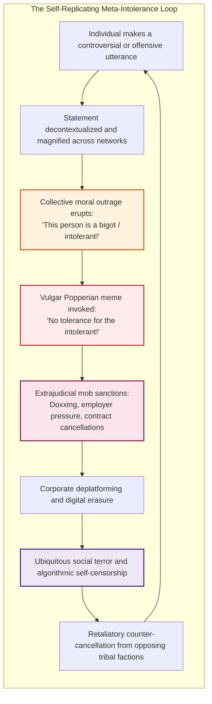
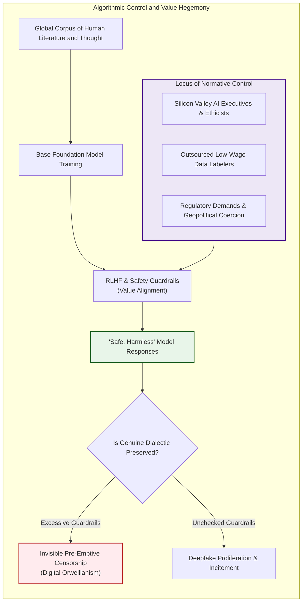
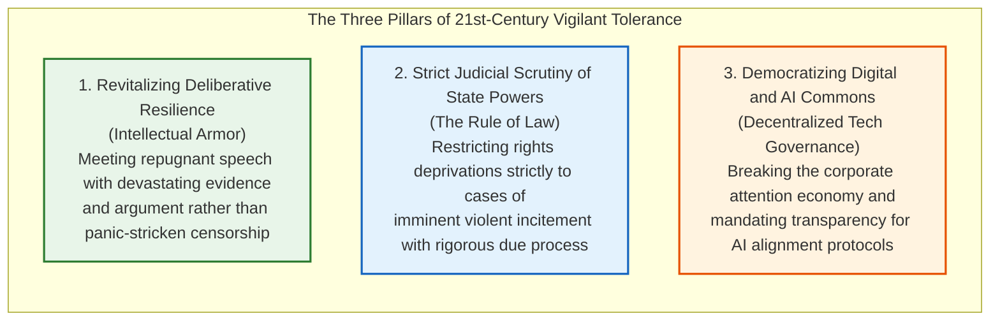

## Introduction: The Aporia Eroding Free Societies from Within

In contemporary civil discourse, no virtue is as universally celebrated—and yet as fragile and loaded with severe internal contradictions—as **tolerance**.

To permit the articulation of all viewpoints, to accommodate divergent moral convictions, and to never purge the dissenter: this stood as the crowning triumph forged through centuries of bloodshed by Enlightenment philosophy and liberal democracy. Yet in the digital information sphere of the twenty-first century, we confront a deeply disquieting reality. Within an open public realm predicated on absolute openness, xenophobia, virulent conspiracism, totalitarian propaganda, and hate speech that denies human dignity proliferate at unprecedented velocity. Worse still, these forces frequently seize upon the shields of "free speech" and "tolerance" to hollow out and cannibalize the very foundations of the free order itself.

Here emerges the foundational dilemma known as the **Paradox of Tolerance**:

> **"Must a tolerant society remain infinitely tolerant even toward those who seek its total annihilation?"**
> 
> **"If we extend unlimited tolerance to the intolerant, society will eventually be engulfed by intolerance, extinguishing freedom itself. Yet if we systematically purge the intolerant, does not that society itself degenerate into an authoritarian, intolerant regime?"**

This dilemma is neither an academic exercise nor a semantic game. Historically, the Weimar Republic of 1930s Germany possessed the most democratic, rights-protective constitution of its era, yet the National Socialists exploited its electoral and expressive freedoms to lawfully dismantle the constitutional order from within. Today, across battlegrounds ranging from hate-speech legislation, the extrajudicial purges of "cancel culture," and opaque content moderation by Big Tech and AI algorithms, this ancient paradox dictates the fault lines of modern polarization.

Yet a profound intellectual distortion has poisoned contemporary discourse. A simplified infographic cartoon bearing Karl Popper’s name has circulated virally across social media, peddling the reckless shortcut that **"we are entitled to immediately silence, deplatform, and crush any intolerant opinion."** This bastardized slogan has been wielded as a righteous moral license: crusaders claiming to fight bigotry brand any dissenting voice as "intolerant," unleashing punitive campaigns and online mob lynching. The result is a rampant **"meta-intolerance"**—the exponential proliferation of intolerance disguised as the defense of tolerance.

This treatise seeks to demolish this superficial meme and present the definitive, multidisciplinary anatomy of the Paradox of Tolerance across political philosophy, comparative constitutional jurisprudence, and information ethics.

From a meticulous exegesis of Karl Popper’s 1945 masterpiece *The Open Society and Its Enemies*, to John Rawls’s reconstruction in *A Theory of Justice*, the institutional armor of postwar Germany’s "Militant Democracy" (*Streitbare Demokratie*), the American First Amendment doctrine of the "Marketplace of Ideas," and the algorithmic censorship of AI alignment, we analyze the philosophical mechanics and legal safeguards of an open society.

A free society is not an undefended vacuum. Yet the fortress built to protect freedom must never mutate into a prison that suffocates its own citizens.

---

## Chapter 1: Karl Popper's Warning and the Fallacy of the Internet Meme

### 1.1 Historical Context: Caught Between the Jaws of Totalitarianism

The concept of the Paradox of Tolerance traces its direct lineage to Austrian-British philosopher Karl Raimund Popper (1902–1994) in his seminal 1945 treatise, *The Open Society and Its Enemies*.

To grasp Popper’s true intent, one must understand the crucible in which the work was forged. Having anticipated the Nazi annexation (*Anschluss*) of Austria due to his Jewish heritage, Popper fled to New Zealand in 1937. Teaching at Canterbury University College, he watched in agony as the twin monsters of European totalitarianism—Nazism and Soviet Stalinism—shattered European civilization.

Popper sought to expose the historicist roots of totalitarianism embedded within Western intellectual giants—Plato, Hegel, and Marx—who posited inevitable laws of destiny and justified crushing individuals in pursuit of utopian ends. Against this "Closed Society," Popper championed the "Open Society," anchored in fallibilism, critical reason, and institutional checks on power.

### 1.2 Meticulous Exegesis: Chapter 7, Note 4

Popper introduced the Paradox of Tolerance not within his primary text, but within an ostensibly modest footnote: **Chapter 7, Note 4**.

Because contemporary online discourse habitually quotes this passage out of context, the unabridged original text demands careful examination:

> *"Unlimited tolerance must lead to the disappearance of tolerance. If we extend unlimited tolerance even to those who are intolerant, if we are not prepared to defend a tolerant society against the onslaught of the intolerant, then the tolerant will be destroyed, and tolerance with them."*

Online memes universally stop at this introductory aphorism, concluding that suppression is immediately warranted. But Popper’s profound moral caution appears in the sentences that follow immediately:

> *"In this formulation, I do not imply, for instance, that we should always suppress the utterance of intolerant philosophies; as long as we can counter them by rational argument and keep them in check by public opinion, suppression would certainly be most unwise."*

Popper unambiguously states that suppressing intolerant speech is **"most unwise"** so long as society can counter it through rational argumentation and public scrutiny. Coercive suppression is never the primary response. When, then, does a free society possess the right to invoke force? Popper articulates strict, uncompromising criteria:

> *"But we should claim the right to suppress them if necessary even by force; for it may easily turn out that they are not prepared to meet us on the level of rational argument, but begin by denouncing all argument; they may forbid their followers to listen to rational argument, because it is deceptive, and teach them to answer arguments by the use of their fists or pistols."*

> *"We should therefore claim, in the name of tolerance, the right not to tolerate the intolerant. We should claim that any movement preaching intolerance places itself outside the law, and we should consider incitement to intolerance and persecution as criminal, in the same way as we should consider incitement to murder, or to kidnapping, or to the revival of the slave trade, as criminal."*

### 1.3 The Fatal Distortions of the Cartoon Infographic

A widely shared modern infographic cartoon illustrates a Nazi figure infiltrating society under the guise of free speech until he destroys it, concluding with the lesson that "to maintain a tolerant society, the society must be intolerant of intolerance."

This meme commits two catastrophic philosophical distortions:

1. **The Abandonment of the Rational Rebuttal Duty**: For Popper, the foundational protocol of an open society was *Critical Rationalism*. Because humans are intrinsically fallible, truth emerges only through continuous trial, error, and refutation. The first obligation of citizens is to intellectually confront bad ideas in the public forum. State or mob suppression is exclusively an *ultima ratio* (last resort).
2. **The Erasure of the Physical Violence Threshold ("Fists and Pistols")**: Popper explicitly restricted forcible suppression to groups that *renounce rational argument entirely and command their followers to answer debate with violence*. The internet meme strips away this physical violence requirement, weaponizing Popper to justify persecuting anyone who expresses morally offensive or politically dissenting opinions.

> [!WARNING]
> **The Hazard of the Vulgar Popperian Meme**
> To transform Popper’s defense against paramilitary violence into an inquisitorial license to purge ideological opponents does not defend the Open Society—it collapses it back into the tribalism of a Closed Society.

---

## Chapter 2: John Rawls's Reconstruction in *A Theory of Justice*

### 2.1 The Two Principles of Justice and the Original Position

In his landmark 1971 work *A Theory of Justice*, John Rawls (1921–2002) translated the philosophical paradox into a rigorous framework of constitutional jurisprudence.

Through the thought experiment of the **Original Position** behind the **Veil of Ignorance**—where contractors design societal rules without knowing their own race, wealth, class, or moral doctrines—Rawls demonstrated that rational agents would establish the **Priority of Equal Basic Liberties (The First Principle of Justice)** above all utilitarian calculations.

### 2.2 Section 35: Toleration of the Intolerant

In Section 35, Rawls addresses whether a just society must tolerate intolerant sects. His analysis unfolds through three rigorous steps:

1. **Do the intolerant have a claim to justice?** No. Having rejected equal liberty for others, an intolerant sect cannot consistently appeal to principles of justice when denied those same liberties.
2. **Does the tolerant society have an obligation to tolerate them?** **Yes.** A just constitution is governed not by the personal virtue of its citizens, but by objective institutional justice. So long as the basic structure remains secure, the state has no authority to deny basic liberties (speech, conscience, assembly) to individuals solely based on their intolerant beliefs.
3. **The Assimilative Power of Just Institutions**: Rawls observed that living under equal liberty exerts an inherent stabilizing pull. As intolerant groups experience the impartiality and protection of a constitutional regime, their dogmatism gradually softens, generating allegiance to the democratic framework.

### 2.3 Strict Justification for Coercive Intervention

Rawls specifies that the liberty of the intolerant may be curtailed **only when the tolerant reasonably and sincerely believe that their own security and the institutions of liberty are in jeopardy**.

The state cannot act on speculative fears or moral disgust. The threat must be tangible, imminent, and existential. Crucially, the restriction must never be punitive or retaliatory; its sole legal justification is to **restore and preserve equal liberty for all**.

### 2.4 Game-Theoretic Formulation: The Payoff Matrix of Tolerance

We can model the interaction between Tolerant Citizens (Player A) and Intolerant Factions (Player B) through the lens of repeated game theory and the Prisoner's Dilemma:

| Player A \ Player B | Cooperate / Tolerate ($C$) | Defect / Intolerance ($D$) |
| :--- | :---: | :---: |
| **Cooperate / Tolerate ($C$)** | $(R, R) = (3, 3)$ **Open Society Flourishing** | $(S, T) = (0, 5)$ **Exploitation / Totalitarian Capture** |
| **Defect / Restrict ($D$)** | $(T, S) = (5, 0)$ **Preemptive Repression** | $(P, P) = (1, 1)$ **Mutual Despotism / Police State** |

The payoff ordering satisfies $T > R > P > S$.
- **$(R, R)$**: Mutual toleration yields the highest social welfare.
- **$(S, T)$**: Unconditional, naive toleration allows the intolerant to conquer the state (Popper's nightmare).
- **$(P, P)$**: Universal paranoia and preemptive purges dissolve civil society.

As Robert Axelrod’s evolutionary game theory demonstrates, unconditional cooperation (*All-C*) is mathematically suicidal. The evolutionary stable strategy is a **Tit-for-Tat** variant: start with tolerance, maintain tolerance as long as the counterparty abides by constitutional rules, but retaliate decisively the instant the counterparty resorts to violence or institutional sabotage—returning to tolerance immediately upon their compliance.

---

## Chapter 3: Institutionalized Paradox: Germany's "Militant Democracy"

### 3.1 The Suicide of the Weimar Republic

The Paradox of Tolerance ceased to be an academic question with the tragic demise of the Weimar Republic (1919–1933).

Weimar possessed one of history's most progressive democratic constitutions. However, it suffered from a fatal flaw: **absolute, value-neutral legal positivism**. Under the prevailing doctrine, any constitutional amendment was valid if passed by a two-thirds parliamentary majority—even an amendment abolishing democracy itself.

Nazi Propaganda Minister Joseph Goebbels gloated in 1935:

> *"It will always remain one of the best jokes of democracy that it gave its deadly enemies the means by which it was destroyed."*

Exploiting free speech and electoral mechanics while using the SA paramilitary to terrorize opponents, Hitler achieved appointment as Chancellor in 1933, triggered emergency decrees following the Reichstag fire, and passed the Enabling Act (*Ermächtigungsgesetz*), legally euthanizing parliamentary democracy.

### 3.2 Karl Loewenstein and the Birth of Militant Democracy

Exiled in the United States, German jurist Karl Loewenstein published his pathbreaking 1937 treatise *Militant Democracy and Fundamental Rights*. Loewenstein argued that fascism was a subversive emotional technique that exploits the mechanisms of democracy to strangle it. Democracy, he insisted, could no longer remain passive: it must become **"Militant Democracy" (*Streitbare Demokratie*)**, arming itself with constitutional weapons to proactively neutralize subversive elements before they attain power.

### 3.3 The Constitutional Defense Architecture of the Grundgesetz

The 1949 Basic Law (*Grundgesetz*) of the Federal Republic of Germany embedded Loewenstein’s principles into the bedrock of the state:

Key pillars include:
1. **Article 79(3) [The Eternity Clause (*Ewigkeitsklausel*)]**: Explicitly forbids any constitutional amendment that impairs human dignity (Art. 1) or the democratic, federal, and social order (Art. 20). No supermajority can legalize tyranny.
2. **Article 21(2) [Unconstitutional Party Bans]**: Political parties seeking to undermine or abolish the *Free Democratic Basic Order (FDGO)* may be banned exclusively by the Federal Constitutional Court (*Bundesverfassungsgericht*).
3. **Article 18 [Forfeiture of Basic Rights]**: Any individual who abuses freedom of expression, press, teaching, assembly, or association to combat the FDGO forfeits these fundamental rights.

### 3.4 Landmark Rulings and Modern Battles: From SRP/KPD to the AfD

The Constitutional Court exercised this ultimate power in banning the neo-Nazi **SRP (Socialist Reich Party)** in 1952 and the communist **KPD (Communist Party of Germany)** in 1956.

However, in the 2017 **NPD (National Democratic Party of Germany)** proceedings, the Court introduced a vital refinement: the requirement of **"Potentiality" (*Potentialität*)**. While acknowledging the NPD's anti-constitutional ideology, the Court unanimously refused to ban it because the party lacked any realistic prospect of attaining parliamentary power or overthrowing the republic.

Today, Germany grapples with the surging **Alternative for Germany (AfD)**. While domestic intelligence agencies have classified several state chapters as confirmed right-wing extremist organizations, mainstream jurists fiercely debate the wisdom of a constitutional ban. Banning a party that garners millions of votes risks alienating broad swathes of the electorate and driving dissent underground, underscoring the enduring danger that a militant state may itself compromise democratic legitimacy.

---

## Chapter 4: The American Approach: The First Amendment and the Marketplace of Ideas

### 4.1 J.S. Mill’s *On Liberty*: The Epistemic Value of Error

In contrast to Germany’s preventive state intervention, the United States adopted an ideological paradigm rooted in John Stuart Mill’s 1859 classic, *On Liberty*.

Mill argued that suppressing any opinion—no matter how offensive or false—inflicts an intolerable harm upon civilization:
1. If the suppressed opinion is true, society is robbed of truth.
2. Even if an opinion is entirely erroneous, subjecting the truth to public collision with error prevents truth from degenerating into a "dead dogma."
3. Vigorous debate vitalizes the living conviction of free citizens.

### 4.2 The First Amendment and the Brandenburg Incitement Standard

The US Constitution's First Amendment ("*Congress shall make no law... abridging the freedom of speech*") was interpreted in the early twentieth century through Justice Oliver Wendell Holmes Jr.’s standard of **"Clear and Present Danger"** and the concept of the **"Marketplace of Ideas"**.

This jurisprudence culminated in the landmark 1969 ruling **_Brandenburg v. Ohio_**:

Under *Brandenburg*, advocacy of violence or racial hatred is fully protected unless it is **directed to inciting or producing imminent lawless action and is likely to incite or produce such action**. In the 1977 Skokie case (*National Socialist Party of America v. Village of Skokie*), the courts upheld the constitutional right of neo-Nazis to march peacefully in a predominantly Jewish town of Holocaust survivors.

### 4.3 Systematic Comparison: Germany vs. United States

Why does America reject European-style prohibitions on hate speech? Because the American tradition distrusts the sovereign state far more than it fears repugnant ideas. Entrusting the government with the power to define "intolerance" hands future despots the ultimate weapon of political repression.

| Dimension | Karl Popper | John Rawls | J.S. Mill | German Basic Law | US Supreme Court |
| :--- | :--- | :--- | :--- | :--- | :--- |
| **Philosophical Anchor** | Critical Rationalism | Justice as Fairness | Epistemic Marketplace | Militant Democracy | Anti-Censorship Absolutism |
| **Justification for Tolerance** | Human fallibility & dialogue | Priority of basic liberty | Self-realization & truth testing | Objective value order | Absolute distrust of state power |
| **Intervention Threshold** | Renunciation of reason & **use of physical force** | **Imminent, substantial danger** to constitutional order | Tangible physical harm (Harm Principle) | Hostile intent with **potentiality to subvert order** | **Incitement to imminent lawless action** with high likelihood |
| **State Authority** | Police power as *ultima ratio* | Minimal defensive measures | Strictly criminal prohibitions | Party bans & rights forfeiture via high court | Total constitutional ban on content discrimination |
| **Greatest Dread** | Totalitarian capture of open society | Collapse of institutional justice | Tyranny of the majority | Legalistic fascist resurgence | State monopoly on political truth |

---

## Chapter 5: The Digital Public Sphere and the Surge of Meta-Intolerance

### 5.1 The Collapse of Habermasian Discourse Ethics

Jürgen Habermas envisioned an ideal democratic sphere fueled by **communicative rationality**, wherein citizens engage as equal deliberative partners seeking uncoerced consensus.

The algorithmic architecture of twenty-first-century platforms has dismantled this ideal. Social media is propelled by an **Attention Economy** optimized for engagement time. Cognitive psychology confirms that viral engagement is driven not by nuanced contemplation, but by **moral outrage, fear, and tribal hostility**. The public square has transformed into an arena of performative cruelty.

### 5.2 The Pathology of Cancel Culture: The Meta-Intolerance Loop

Within this hyper-polarized ecosystem, the Paradox of Tolerance has been weaponized into **Cancel Culture**:

This phenomenon exhibits a severe moral pathology: the online mob operates under the intoxicated certainty that **they are purifying society of evil**. Because the target is branded an "intolerant monster," all standards of due process, charity, and proportion are abandoned.

Here the paradox doubles upon itself: **the extrajudicial campaign to purge intolerance becomes the most virulent vector of intolerance in the modern world**.

### 5.3 Corporate Deplatforming: The Oligarchy of Invisible Censors

Constitutional free speech provisions were designed to shield citizens from the state. Today, speech is mediated by private monopolies (Meta, Alphabet, X, ByteDance). Under corporate terms of service, arbitrary moderation teams determine who speaks and who is digitally excommunicated.

The uncoordinated deplatforming of an elected US President in 2021 proved that private technology oligarchs can sever a world leader from the digital commons without a shred of judicial due process. Escaping the censorship of the state, we entered the reign of **corporate sovereign censorship**.

---

## Chapter 6: Speech in the Age of AI and Algorithmic Hegemony

### 6.1 LLM Alignment and RLHF: Whose Values Get Codified?

Large Language Models (LLMs) introduce an unprecedented layer of speech control through **AI Alignment**, implemented via **Reinforcement Learning from Human Feedback (RLHF)** and Constitutional AI frameworks.

Corporate AI labs embed guardrails to eliminate hate speech and bias. Yet this immediately raises the ancient question: **Who decides what is harmful?**

To evade legal and PR liability, developers code guardrails reflecting Western corporate orthodoxies. Legitimate philosophical dissidence, historical debates, and unorthodox hypotheses are increasingly blocked as "policy violations." The medieval inquisitor has been replaced by the invisible weights of a transformer network.

### 6.2 Evading Digital Orwellianism

If future education, query interfaces, and creative writing are dominated by closed, proprietary models, humanity faces a sanitized, sterile intellectual regime: **Digital Orwellianism**. Speech is not burned by firemen; it is vaporized before it can be conceptualized.

To safeguard an open intellectual horizon, we must:
1. **Defend Open-Source and Decentralized AI**: Prevent closed monopolies from controlling model weights, enabling global communities to audit and fine-tune models.
2. **Mandate Algorithmic Transparency**: Force AI developers to publish system prompts, alignment guidelines, and refusal logs.
3. **Democratize Alignment Governance**: Shift normative safety decisions from private corporate committees to multi-stakeholder public forums.

---

## Chapter 7: Conclusion: Vigilant Tolerance for an Open Society

### 7.1 True Tolerance as an Active, Demanding Struggle

We return to our opening question: **How far should we tolerate the intolerant?**

Our philosophical voyage yields three cardinal truths:

First, **tolerance is neither passive moral indifference nor timid cowardice**. Real tolerance demands intense intellectual courage: the capacity to endure ideas that repulse our deepest sensibilities while keeping them within the crucible of public argumentation.

Second, **coercive suppression is an extreme, desperate remedy**. As Popper commanded, so long as we can refute bad ideas through evidence and debate, state or social suppression is "most unwise." The state may intervene only when a faction **renounces rational argument and organizes physical violence to subvert constitutional freedom**.

Third, **the extrajudicial mobbing of cancel culture is the supreme betrayal of tolerance**. Weaponizing Popper's name to justify silencing intellectual rivals is an authoritarian regression that accelerates civil society's self-destruction.

### 7.2 The Three Pillars of Vigilant Tolerance for the 21st Century

An open society is not a permanent resting place; it is a precarious tightrope walker balancing perpetually between the abyss of totalitarian intolerance and the abyss of authoritarian self-defense.

To conquer the intolerant, we must never become the monsters we fight. We must crush violence with the unyielding strength of constitutional law, while conquering fallacy with the relentless light of critical reason. This is the essence of **Vigilant Tolerance** in our digital century.
