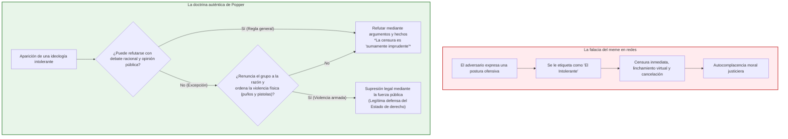
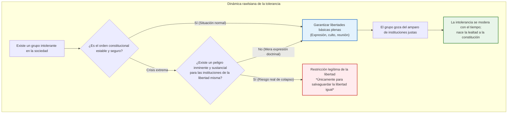
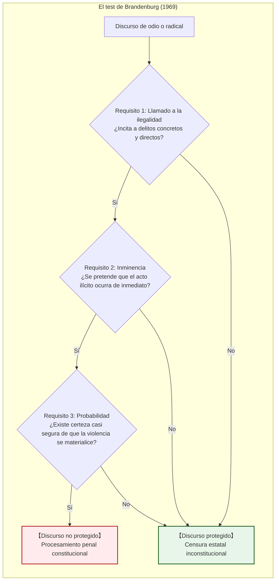

## Introducción: La aporía que corroe las sociedades libres desde adentro

En el discurso público contemporáneo, ninguna virtud es tan universalmente celebrada —y a la vez tan frágil y cargada de contradicciones internas— como la **tolerancia**.

Permitir la articulación de cualquier opinión, acomodar convicciones morales discrepantes y jamás proscribir al disidente: este fue el mayor triunfo forjado a lo largo de siglos de sangrientos conflictos por la Ilustración y la democracia liberal. Sin embargo, en la esfera de la información digital del siglo XXI, nos enfrentamos a una realidad sumamente inquietante. Dentro de un espacio público fundamentado en la apertura irrestricta, la xenofobia, las teorías conspirativas radicales, la propaganda totalitaria y los discursos de odio que niegan la dignidad humana proliferan con un ímpetu demoledor. Peor aún: estas fuerzas iliberales se escudan con frecuencia en la «libertad de expresión» y la «tolerancia» para erosionar desde sus cimientos la propia sociedad libre.

De aquí surge el dilema fundamental conocido como la **Paradoja de la tolerancia**:

> **«¿Debe una sociedad tolerante permanecer infinitamente tolerante incluso hacia aquellos que buscan su aniquilación absoluta?»**
> 
> **«Si otorgamos una tolerancia ilimitada a los intolerantes, la sociedad será finalmente devorada por la intolerancia y la libertad misma perecerá. Pero si reprimimos y proscribimos a los intolerantes, ¿no degenera la sociedad en un régimen autoritario e intolerante?»**

Este dilema dista de ser un mero ejercicio de salón. Históricamente, la República de Weimar de los años treinta poseía la constitución más democrática y garantista de su tiempo; sin embargo, el nazismo aprovechó las libertades electorales y de expresión para liquidar legalmente el orden constitucional desde su propio seno. Hoy en día, desde las leyes contra los delitos de odio hasta los linchamientos morales de la «cultura de la cancelación» y la moderación algorítmica opaca de las grandes corporaciones tecnológicas y la inteligencia artificial, esta paradoja marca las líneas de falla de nuestras democracias.

No obstante, una grave distorsión intelectual contamina el debate en redes sociales: una tira cómica simplista atribuida a Karl Popper que pregona el atajo de **«silenciar, cancelar y expulsar de inmediato cualquier opinión tildada de intolerante»**. Este eslogan vulgar ha incubado una rampante **«meta-intolerancia»**: bajo el estandarte de la justicia, todo aquel que disienta de la ortodoxia imperante es tachado de «intolerante» y sometido a la muerte civil.

Este ensayo analiza la profundidad histórica, iusfilosófica e informática de la paradoja de la tolerancia con el máximo rigor académico.

---

## Capítulo 1: La advertencia de Karl Popper y la falacia del meme de Internet

### 1.1 Contexto histórico: Entre las garras del fascismo y el estalinismo

El concepto de la paradoja de la tolerancia proviene directamente del filósofo austrobritánico Karl Raimund Popper (1902–1994) en su obra capital de 1945, *La sociedad abierta y sus enemigos (The Open Society and Its Enemies)*.

Habiendo huido de Austria en 1937 ante la inminencia de la anexión nazi para refugiarse en Nueva Zelanda, Popper presenció con dolor la destrucción de la civilización europea por el nazismo y el totalitarismo estalinista. En su libro denunció el pensamiento de Platón, Hegel y Marx, quienes en nombre de supuestas leyes históricas justificaban el aplastamiento del individuo. Frente a la «sociedad cerrada», Popper defendió la «sociedad abierta», cimentada en la razón crítica, la falibilidad humana y el debate libre de ideas.

### 1.2 Exégesis rigurosa: Capítulo 7, Nota 4

Popper no introdujo la paradoja en el cuerpo principal de su texto, sino en una nota al pie: **el capítulo 7, nota 4**.

> *«La tolerancia ilimitada debe conducir a la desaparición de la tolerancia. Si extendemos la tolerancia ilimitada aun a aquellos que son intolerantes, si no nos hallamos preparados para defender una sociedad tolerante contra las tropelías de los intolerantes, el resultado será la destrucción de los tolerantes y, junto con ellos, de la tolerancia.»*

Los memes de Internet citan exclusivamente esta premisa inicial. Sin embargo, la advertencia moral más trascendental de Popper aparece en las líneas siguientes:

> *«Con este planteamiento no queremos significar, por ejemplo, que siempre debamos suprimir la manifestación de filosofías intolerantes; mientras nos sea posible contrarrestarlas mediante argumentos racionales y mantenerlas en jaque ante la opinión pública, su supresión sería sin duda la más imprudente de las medidas.»*

Popper recalca con vehemencia: **la supresión es sumamente imprudente (most unwise)** mientras podamos responder con argumentos racionales y debate público. ¿Cuándo tiene la sociedad el derecho a recurrir a la fuerza? Popper estipula condiciones inflexibles:

> *«Pero debemos reclamar el derecho de suprimirlas, si es necesario incluso por la fuerza, pues bien puede suceder que no estén dispuestas a encontrarse con nosotros en el nivel del argumento racional, sino que comiencen por rechazar todo argumento; pueden prohibir a sus seguidores escuchar el argumento racional porque es engañoso, y enseñarles a responder a los argumentos mediante el uso de sus puños o sus pistolas.»*

> [!WARNING]
> **El peligro del popperianismo vulgar**
> Degradar un principio de legítima defensa frente a grupos paramilitares armados en un pretexto para purgar a quienes expresan discrepancias éticas o políticas en Internet es una traición flagrante al ideario de la Sociedad Abierta.

---

## Capítulo 2: John Rawls y la Teoría de la Justicia

### 2.1 Los principios de la justicia y la posición original

En *Teoría de la justicia* (1971), John Rawls (1921–2002) elevó el problema al ámbito de la teoría constitucional. Tras el **Velo de la ignorancia**, los individuos racionales pactan la **prioridad de las libertades básicas iguales (Primer principio de la justicia)** sobre cualquier cálculo utilitarista.

### 2.2 Sección 35: La tolerancia de los intolerantes

Rawls aborda la cuestión en tres pasos lógicos:
1. **¿Tienen los intolerantes derecho a quejarse de no ser tolerados?** No, pues quien niega la libertad a los demás carece de fundamento moral para exigir libertad para sí mismo.
2. **¿Debe la sociedad justa tolerarlos a pesar de todo?** **Sí.** El orden constitucional justo no se mide por la santidad de sus miembros, sino por la imparcialidad de sus instituciones. La justicia exige conceder plena libertad de expresión y conciencia a los intolerantes mientras no pongan en riesgo tangible las libertades ajenas.
3. **El poder integrador de las instituciones equitativas**: Al convivir bajo el amparo de una constitución libre, los grupos intolerantes experimentan sus ventajas y van moderando gradualmente su fanatismo con el relevo generacional.

### 2.3 Matriz de teoría de juegos: La coexistencia estratégica

La relación entre ciudadanos tolerantes (Jugador A) y facciones intolerantes (Jugador B) adopta la forma de un dilema del prisionero reiterado:

| Jugador A / Jugador B | Cooperar / Tolerar ($C$) | Traicionar / Intolerancia ($D$) |
| :--- | :---: | :---: |
| **Cooperar / Tolerar ($C$)** | $(3, 3)$ : Sociedad abierta floreciente | $(0, 5)$ : Servidumbre y captura totalitaria |
| **Traicionar / Reprimir ($D$)** | $(5, 0)$ : Supresión preventiva | $(1, 1)$ : Estado policial y persecución mutua |

La estrategia evolutivamente estable demostrada por Robert Axelrod es **Don de ojo (Tit-for-Tat)**: cooperar por defecto, replicar con firmeza ante cualquier agresión a las reglas de juego (violencia o sedición) y perdonar tan pronto como el infractor vuelva al marco democrático.

---

## Capítulo 3: La paradoja institucionalizada: La «Democracia militante» alemana

### 3.1 La caída de Weimar: El suicidio legal de la democracia

La República de Weimar (1919–1933) demostró el peligro del **positivismo formalista ciego**: cualquier ley o enmienda constitucional se consideraba válida si contaba con mayoría parlamentaria, incluso la anulación de la propia democracia.

Joseph Goebbels se jactaba en 1935:
> *«Esta será siempre una de las mejores bromas de la democracia: haber facilitado a sus enemigos mortales los instrumentos con los que fue aniquilada.»*

### 3.2 Karl Loewenstein y la defensa del orden constitucional

Exiliado en Estados Unidos, el jurista Karl Loewenstein acuñó en 1937 el concepto de **Democracia militante (*Streitbare Demokratie*)**: el Estado constitucional no puede permanecer inerme; debe dotarse de herramientas legales para proscribir a los enemigos de la libertad antes de que tomen el poder.

### 3.3 El blindaje de la Ley Fundamental de Bonn (1949)

La Constitución alemana de posguerra incorporó resortes decisivos:
1. **Art. 79 párr. 3 (Cláusula de eternidad / *Ewigkeitsklausel*)**: Prohíbe cualquier reforma constitucional que vulnere la dignidad humana (Art. 1) o los principios democráticos y federales (Art. 20).
2. **Art. 21 párr. 2 (Ilegalización de partidos)**: Competencia exclusiva del Tribunal Constitucional Federal para disolver partidos que pretendan socavar el orden constitucional democrático (*FDGO*).
3. **Art. 18 (Pérdida de derechos fundamentales)**: Quien abuse de la libertad de expresión o reunión para derrocar el orden constitucional puede ser privado de tales derechos.

---

## Capítulo 4: La doctrina estadounidense: La Primera Enmienda y el mercado de las ideas

### 4.1 J.S. Mill: El valor dialéctico del error

En *Sobre la libertad* (1859), John Stuart Mill sostuvo que acallar cualquier opinión perjudica a la verdad: solo al contrastar la verdad con el error se evita que esta degenere en un dogma inerte.

### 4.2 El criterio de Brandenburg v. Ohio (1969)

La Primera Enmienda de EE. UU. prohíbe al Congreso restringir la libertad de expresión. La Corte Suprema fijó un listón estrictísimo: **la incitación a una acción ilegal inminente (*imminent lawless action*)**.

En Estados Unidos, incluso las marchas neonazis están amparadas judicialmente (caso Skokie, 1977), ya que se teme mucho más la discrecionalidad censora del Estado que el desvarío de los fanáticos.

---

## Capítulo 5: La esfera pública digital y el auge de la meta-intolerancia

Las redes sociales actuales sustituyeron la deliberación racional por la **economía de la atención**, optimizada para la ira tribal y la indignación moral. En este caldo de cultivo, la «cultura de la cancelación» convierte el apotegma de Popper en una herramienta de linchamiento inquisitorial: quienes purgan al disidente en nombre de la tolerancia terminan imponiendo el régimen más implacable de censura y autocensura social.

Asimismo, la privatización del ágora digital en manos de gigantes corporativos somete el debate a una censura algorítmica opaca que prescinde del debido proceso legal.

---

## Capítulo 6: Inteligencia artificial y censura invisible

El alineamiento de modelos de lenguaje (LLM) mediante técnicas como RLHF otorga a una élite tecnológica el monopolio de decidir qué ideas son «seguras». El riesgo de un **orwellianismo digital** —donde los conceptos heterodoxos son neutralizados por el código antes de que puedan articularse— exige democratizar y descentralizar la gobernanza de la IA.

---

## Capítulo 7: Conclusión: Tolerancia vigilante para el siglo XXI

La verdadera tolerancia no es cobardía ni pasividad; exige coraje intelectual:
1. **Derrotar las malas ideas con argumentos superiores**, no con censura punitiva.
2. **Aplicar la fuerza de la ley únicamente ante el llamado directo e inminente a la violencia física.**
3. **Rechazar el linchamiento moral digital**, que envilece a la sociedad convirtiéndola en un tribunal permanente.

La Sociedad Abierta no se defiende erigiendo una cárcel mental, sino manteniendo encendida la llama del pensamiento libre y la deliberación crítica.
