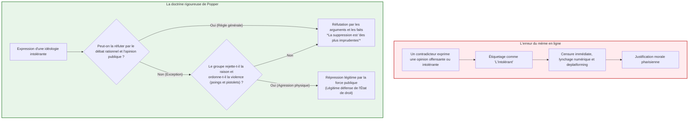
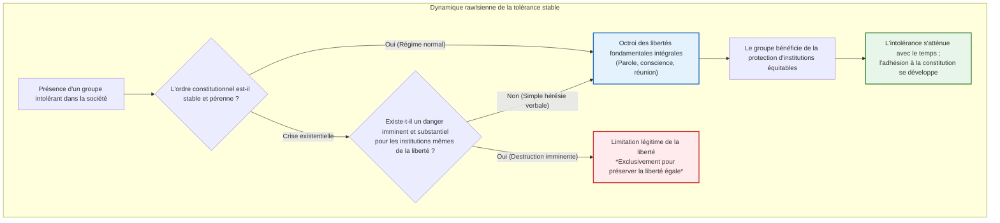
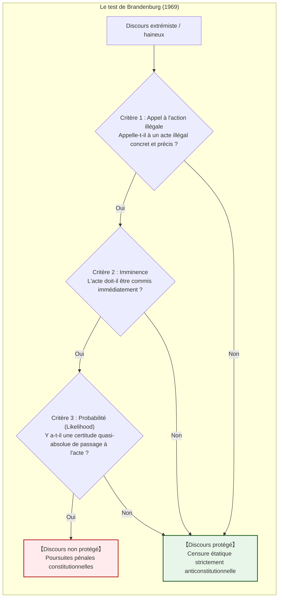
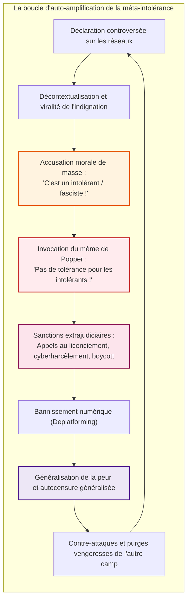

## Introduction : L'aporie qui ronge les sociétés libres de l'intérieur

Dans le débat civil contemporain, aucune vertu n'est aussi unanimement célébrée – et pourtant aussi fragile et chargée de contradictions internes – que la **tolérance**.

Autoriser l'expression de toutes les opinions, intégrer les croyances divergentes et ne jamais bannir le dissident : cela constituait le triomphe absolu forgé par les Lumières et la démocratie libérale après des siècles de guerres de religion sanglantes. Pourtant, dans l'espace numérique du XXIe siècle, nous faisons face à une réalité profondément troublante. Au sein d'un espace public fondé sur l'ouverture inconditionnelle, la xénophobie, les thèses conspirationnistes radicales, la propagande totalitaire et les discours de haine niant la dignité humaine prolifèrent avec une violence inouïe. Pire encore, ces forces antilibérales s'emparent des boucliers de la « liberté d'expression » et de la « tolérance » pour dévorer de l'intérieur les fondements mêmes de la société libre.

De là émerge le dilemme fondamental connu sous le nom de **Paradoxe de la tolérance** :

> **« Une société tolérante doit-elle demeurer infiniment tolérante envers ceux qui cherchent sa destruction totale ? »**
> 
> **« Si nous accordons une tolérance illimitée aux intolérants, la société sera finalement engloutie par l'intolérance et la liberté elle-même disparaîtra. Mais si nous réprimons et excluons les intolérants, la société ne dégénère-t-elle pas elle-même en un régime autoritaire et intolérant ? »**

Ce dilemme n'est pas une simple spéculation théorique. Historiquement, la République de Weimar des années 1930 possédait la constitution démocratique la plus avancée de son époque ; pourtant, le parti nazi exploita sans scrupules ses libertés électorales et d'expression pour anéantir légalement l'ordre constitutionnel de l'intérieur. Aujourd'hui, des lois contre les discours de haine aux tribunaux populaires de la « cancel culture », jusqu'à la modération algorithmique opaque des géants de la Tech et de l'intelligence artificielle, ce paradoxe dicte les lignes de fracture de notre monde polarisé.

Cependant, une grave distorsion intellectuelle empoisonne le débat contemporain : un mème sous forme de bande dessinée simpliste attribuant à Karl Popper l'idée qu'**« il est légitime de faire taire et d'ostraciser immédiatement toute opinion jugée intolérante »**. Ce slogan réducteur a engendré une **« méta-intolérance »** galopante : au nom de la vertu et de la diversité, quiconque émet une opinion discordante est étiqueté « intolérant » et voué à la mort sociale.

Cette étude a pour vocation de déconstruire ce mythe vulgaire et d'exposer l'anatomie philosophique, constitutionnelle et informationnelle du paradoxe de la tolérance dans toute sa complexité.

---

## Chapitre 1 : L'avertissement de Karl Popper et l'erreur du mème en ligne

### 1.1 Contexte historique : Pris en étau entre fascisme et stalinisme

Le concept du paradoxe de la tolérance trouve son origine directe chez le philosophe austro-britannique Karl Raimund Popper (1902–1994) dans son chef-d'œuvre de 1945, *La Société ouverte et ses ennemis (The Open Society and Its Enemies)*.

Ayant fui l'Autriche en 1937 devant la menace nazie pour s'exiler en Nouvelle-Zélande, Popper a assisté avec effroi à la destruction de la civilisation européenne par le nazisme et le totalitarisme soviétique. Dans son ouvrage, il dénonce les doctrines de Platon, Hegel et Marx, qui au nom de prétendues lois de l'Histoire justifiaient l'écrasement de l'individu. À ce modèle de « société close », Popper oppose la « société ouverte », ancrée dans la rationalité critique, la faillibilité humaine (faillibilisme) et le libre débat contradictoire.

### 1.2 Exégèse rigoureuse : Chapitre 7, Note 4

Popper n'a pas introduit le paradoxe dans son texte principal, mais dans une note en bas de page : **le chapitre 7, note 4**.

> *« Une tolérance illimitée doit mener à la disparition de la tolérance. Si nous étendons la tolérance illimitée même à ceux qui sont intolérants, si nous ne sommes pas préparés à défendre une société tolérante contre les assauts des intolérants, alors les tolérants seront détruits, et avec eux la tolérance. »*

Les mèmes sur Internet s'arrêtent systématiquement à cette phrase introductive. Pourtant, la mise en garde fondamentale de Popper suit immédiatement :

> *« Par cette formulation, je n'entends pas affirmer, par exemple, qu'il faille toujours réprimer les théories intolérantes : tant que nous pouvons les contrer par des arguments rationnels et les maintenir en échec par l'opinion publique, la suppression serait très certainement des plus imprudentes. »*

Popper stipule expressément que réprimer les opinions intolérantes est **« des plus imprudent (most unwise) »** tant que la raison et la réprobation publique permettent de les neutraliser. Quand donc une société libre a-t-elle le droit d'invoquer la force coercitive ? Popper fixe des conditions strictes et intransigeantes :

> *« Mais nous devons revendiquer le droit de les réprimer, si nécessaire même par la force ; car il peut aisément apparaître qu'ils ne sont pas disposés à nous rencontrer sur le terrain des arguments rationnels, mais commencent par récuser toute argumentation ; ils peuvent interdire à leurs disciples d'écouter les arguments rationnels au prétexte qu'ils sont trompeurs, et leur apprendre à répondre aux arguments par l'usage de leurs poings ou de leurs pistolets. »*

> [!WARNING]
> **Le piège du poppérisme vulgaire**
> Transformer une doctrine d'autodéfense contre des milices fascistes violentes en un prétexte pour museler des adversaires politiques sur les réseaux sociaux constitue une trahison absolue de la pensée de Popper.

---

## Chapitre 2 : John Rawls et la Théorie de la justice

### 2.1 Les principes de la justice et le voile d'ignorance

Dans *Théorie de la justice* (1971), John Rawls (1921–2002) ancre le paradoxe dans une théorie constitutionnelle rigoureuse. Derrière le **Voile d'ignorance**, des partenaires rationnels s'accordent sur la **priorité des libertés de base égales pour tous (Premier principe de justice)**, qui prévaut sur toute considération d'utilité collective.

### 2.2 Section 35 : La tolérance des intolérants

Dans la section 35, Rawls résout la question en trois propositions :
1. **Les intolérants ont-ils un titre à se plaindre d'être intolérés ?** Non, car nul ne peut revendiquer la liberté pour soi tout en la refusant aux autres.
2. **La société tolérante a-t-elle l'obligation de les tolérer ?** **Oui.** Une constitution juste n'est pas régie par la sainteté de ses citoyens, mais par la justice objective de ses lois. Tant que les institutions sont stables, la justice exige de garantir aux intolérants la liberté d'expression, de culte et d'association.
3. **La force intégratrice des institutions équitables** : En vivant sous le régime de la liberté égale, les factions intolérantes éprouvent la justice de la constitution et finissent par modérer leur fanatisme au fil des générations.

### 2.3 Matrice de gains en théorie des jeux

L'interaction entre citoyens tolérants (Joueur A) et factions intolérantes (Joueur B) correspond à un dilemme du prisonnier réitéré :

| Joueur A / Joueur B | Coopérer / Tolérer ($C$) | Trahir / Intolérance ($D$) |
| :--- | :---: | :---: |
| **Coopérer / Tolérer ($C$)** | $(3, 3)$ : Société ouverte florissante | $(0, 5)$ : Servitude et prise de pouvoir totalitaire |
| **Trahir / Réprimer ($D$)** | $(5, 0)$ : Répression préventive | $(1, 1)$ : État policier et tyrannie mutuelle |

La stratégie évolutivement stable démontrée par Robert Axelrod est le **Donnant-donnant (Tit-for-Tat)** : tolérer par principe, riposter immédiatement en cas de violation des règles démocratiques (violence/subversion), et pardonner dès que l'adversaire réintègre le cadre constitutionnel.

---

## Chapitre 3 : L'institutionnalisation du paradoxe : La « Démocratie combative » allemande

### 3.1 La faillite de Weimar : Le suicide légal de la démocratie

L'effondrement de la République de Weimar (1919–1933) a démontré qu'une démocratie neutre sur le plan des valeurs (*Wertrelativismus*) peut s'autodétruire en respectant formellement ses propres lois électorales. 

Joseph Goebbels déclarait avec cynisme en 1935 :
> *« Ce sera toujours une des meilleures farces de la démocratie d'avoir fourni elle-même à ses ennemis mortels les moyens par lesquels elle a été détruite. »*

### 3.2 Karl Loewenstein et la démocratie militante

Le juriste allemand en exil Karl Loewenstein a théorisé en 1937 le concept de **Démocratie militante (*Streitbare Demokratie*)** : la démocratie ne doit pas rester désarmée face au fascisme ; elle doit s'armer juridiquement pour neutraliser les factions séditieuses avant qu'elles ne confisquent le pouvoir d'État.

### 3.3 Le dispositif de la Loi fondamentale de Bonn (1949)

La Loi fondamentale allemande a intégré des verrous constitutionnels majeurs :
1. **L'article 79 alinéa 3 (Clause d'éternité / *Ewigkeitsklausel*)** : Interdit formellement toute révision constitutionnelle touchant à la dignité humaine (art. 1) ou aux principes républicains, fédéraux et démocratiques (art. 20).
2. **L'article 21 alinéa 2 (Interdiction des partis inconstitutionnels)** : La Cour constitutionnelle fédérale de Karlsruhe est seule compétente pour dissoudre un parti cherchant à porter atteinte à l'ordre libéral et démocratique (*FDGO*).
3. **L'article 18 (Déchéance des droits fondamentaux)** : Toute personne qui abuse de la liberté d'expression ou de réunion pour combattre l'ordre constitutionnel peut être déchue de ses droits.

---

## Chapitre 4 : La doctrine américaine : Le Premier Amendement et le marché des idées

### 4.1 J.S. Mill : La valeur heuristique de l'erreur

Dans *De la liberté* (1859), John Stuart Mill affirmait qu'étouffer une opinion, même fausse, est un crime contre la vérité : c'est par le choc contradictoire et la confrontation avec l'erreur que la vérité demeure vivante et évite de dégénérer en dogme mort.

### 4.2 L'arrêt *Brandenburg v. Ohio* (1969)

Le Premier Amendement américain interdit au Congrès de restreindre la liberté de parole. La Cour suprême a fixé un critère d'une exigence absolue : **l'incitation à une action illégale imminente (*imminent lawless action*)**.

Aux États-Unis, même les défilés néonazis sont protégés par la Constitution (affaire Skokie, 1977), car la tradition américaine redoute infiniment plus l'arbitraire de l'État censeur que les outrances des fanatiques.

---

## Chapitre 5 : L'espace public numérique et l'engrenage de la méta-intolérance

### 5.1 L'effondrement de l'éthique de la discussion de Habermas

Jürgen Habermas postulait l'avènement d'un espace public démocratique fondé sur l'agir communicationnel et la rationalité délibérative.
L'économie de l'attention des plateformes contemporaines a broyé cet idéal : les algorithmes privilégient l'indignation morale, la haine tribale et l'invective, car ce sont les vecteurs les plus rentables d'engagement.

### 5.2 La spirale répressive de la Cancel Culture

En prétendant purifier la société de l'intolérance, les foules numériques instaurent un climat d'inquisition et de délation digne des heures les plus sombres de l'Histoire.

---

## Chapitre 6 : L'intelligence artificielle et la censure invisible

L'alignement des modèles de langage (LLM) par renforcement à partir du feedback humain (RLHF) délègue à quelques multinationales de la Silicon Valley le pouvoir exorbitant de décider quelles idées sont licites. Le risque d'un **orwellianisme numérique** – où la pensée déviante est effacée avant même d'avoir pu être formulée – exige une gouvernance décentralisée et transparente des technologies d'IA.

---

## Chapitre 7 : Conclusion : Pour une tolérance vigilante au XXIe siècle

La tolérance authentique n'est pas une résignation passive. Elle exige :
1. **La résistance intellectuelle** : Démonter les théories toxiques par des faits et des arguments plutôt que par la censure panique.
2. **La rigueur de l'État de droit** : Réprimer avec intransigeance les violences physiques et les conspirations séditieuses sous le strict contrôle des tribunaux.
3. **Le refus de l'inquisition morale** : Cesser d'instrumentaliser Popper pour justifier la tyrannie des foules numériques.

Une société ouverte ne préserve pas sa liberté en se transformant en caserne, mais en assumant avec courage le risque fécond de la libre confrontation des esprits.
