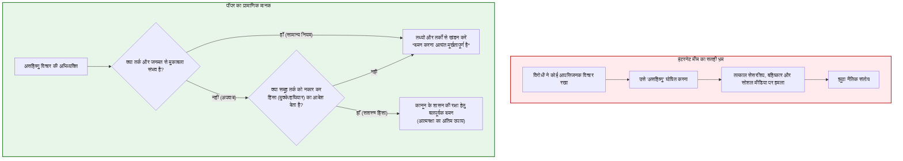

## प्रस्तावना: स्वतंत्र समाज को भीतर से खोखला करती विडंबना

आधुनिक विमर्श में **‘सहिष्णुता (Tolerance)’** जैसा कोई दूसरा सद्गुण नहीं है, जिसे इतना सराहा जाता हो और जो साथ ही इतना नाजुक तथा आंतरिक विरोधाभासों से भरा हो।

सभी विचारों की अभिव्यक्ति की अनुमति देना और मतभेदों को हिंसा से न दबाना—यही प्रबोधन (Enlightenment) और उदारवादी लोकतंत्र की सबसे बड़ी उपलब्धि थी। परंतु 21वीं सदी के डिजिटल युग में, घृणास्पद भाषण और कट्टरता स्वतंत्र समाज के बुनियादी सिद्धांतों को नष्ट करने के लिए 'अभिव्यक्ति की स्वतंत्रता' की ढाल का दुरुपयोग कर रहे हैं।

यहीं से प्रसिद्ध **‘सहिष्णुता का विरोधाभास’ (Paradox of Tolerance)** उत्पन्न होता है:

> **"क्या एक सहिष्णु समाज को उन लोगों के प्रति भी असीमित रूप से सहिष्णु होना चाहिए जो उसे नष्ट करने पर तुले हैं?"**
> 
> **"यदि हम असहिष्णु लोगों को असीमित सहिष्णुता प्रदान करते हैं, तो समाज अंततः असहिष्णुता की भेंट चढ़ जाएगा और स्वतंत्रता स्वयं समाप्त हो जाएगी। परंतु यदि हम असहिष्णु लोगों का दमन करते हैं, तो क्या हमारा समाज स्वयं एक सत्तावादी और असहिष्णु व्यवस्था में नहीं बदल जाएगा?"**

---

## अध्याय 1: कार्ल पॉपर की चेतावनी और इंटरनेट मीम का भ्रम

कार्ल पॉपर ने 1945 में अपनी पुस्तक *द ओपन सोसाइटी एंड इट्स एनिमीज़* (अध्याय 7, पादटिप्पणी 4) में लिखा था:

> *"असीमित सहिष्णुता का परिणाम सहिष्णुता के विनाश के रूप में होना चाहिए। यदि हम असहिष्णु लोगों के प्रति भी असीमित सहिष्णुता का विस्तार करते हैं, तो सहिष्णु लोग नष्ट हो जाएंगे और उनके साथ सहिष्णुता भी समाप्त हो जाएगी।"*

परंतु इंटरनेट पर प्रचलित मीम इसके तुरंत बाद आने वाले पॉपर के मूल कथन को छिपा लेते हैं:

> **"इस कथन से मेरा यह अर्थ कदापि नहीं है कि हमें असहिष्णु दर्शनों की अभिव्यक्ति का हमेशा दमन करना चाहिए; जब तक हम तर्कसंगत बहस द्वारा उनका मुकाबला कर सकते हैं और जनमत द्वारा उन्हें रोक सकते हैं, तब तक उनका दमन करना निश्चित रूप से अत्यंत मूर्खतापूर्ण (most unwise) होगा।"**

पॉपर ने स्पष्ट किया कि बलप्रयोग केवल तभी वैध है जब विरोधी **तर्क को सुनने से इनकार कर दे और अपने समर्थकों को मुक्कों व बंदूकों से जवाब देने का आदेश दे**।

---

## अध्याय 2: जॉन रॉल्स और 'न्याय का सिद्धांत'

जॉन रॉल्स (*A Theory of Justice*, 1971) के अनुसार, जब तक संवैधानिक व्यवस्था सुरक्षित है, न्यायपूर्ण समाज का यह **कर्तव्य है कि वह असहिष्णु समूहों को भी समान मौलिक स्वतंत्रताएं (भाषण, विवेक और सभा की स्वतंत्रता) प्रदान करे**। न्यायपूर्ण संस्थाओं का संरक्षण पाकर कट्टरपंथी समूह धीरे-धीरे अपने हठधर्म को त्याग देते हैं।

दमन केवल तभी उचित है जब **स्वतंत्रता की संस्थाओं के अस्तित्व पर कोई सीधा और आसन्न खतरा उत्पन्न हो जाए**।

---

## अध्याय 3: जर्मन बुनियादी कानून में 'जुझारू लोकतंत्र'

वाइमर गणराज्य के पतन से सीख लेकर युद्धोत्तर जर्मनी ने **'जुझारू लोकतंत्र' (Streitbare Demokratie)** का सिद्धांत अपनाया:
1. **अनुच्छेद 79(3) [शाश्वत उपबंध]**: मानव गरिमा और लोकतांत्रिक व्यवस्था को 100% बहुमत से भी समाप्त नहीं किया जा सकता।
2. **अनुच्छेद 21(2) [असंवैधानिक दलों पर प्रतिबंध]**: केवल संघीय संवैधानिक न्यायालय को लोकतंत्र विरोधी दलों को प्रतिबंधित करने का अधिकार है।

---

## अध्याय 4: अमेरिकी दृष्टिकोण: प्रथम संशोधन और विचारों का मुक्त बाजार

जे.एस. मिल (*ऑन लिबर्टी*, 1859) की परंपरा में सत्य केवल त्रुटि के साथ खुली टक्कर से ही जीवित रहता है। अमेरिकी सुप्रीम कोर्ट ने **_ब्रैंडेनबर्ग बनाम ओहायो_ (1969)** में व्यवस्था दी कि किसी भी भाषण को तब तक प्रतिबंधित नहीं किया जा सकता जब तक कि वह **आसन्न गैरकानूनी कार्रवाई को सीधे भड़काने वाला न हो**।

---

## निष्कर्ष: 21वीं सदी के लिए 'जागरूक सहिष्णुता'

सच्ची सहिष्णुता कायरता या निष्क्रियता नहीं है:
1. **बुरे विचारों को सेंसरशिप से नहीं, बल्कि अकाट्य तर्कों से परास्त करें**;
2. **सशस्त्र हिंसा और विद्रोह के विरुद्ध ही कानून के कठोरतम बल का प्रयोग करें**;
3. **कैंसिल कल्चर की भीड़शाही और डिजिटल अदालतों का दृढ़ता से विरोध करें**।
